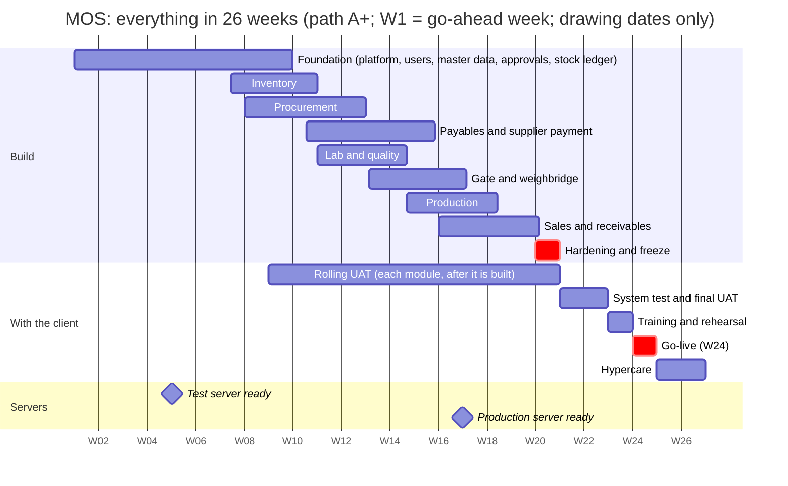
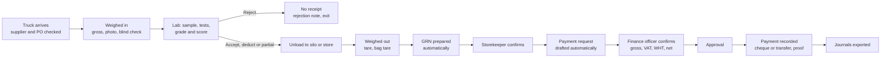
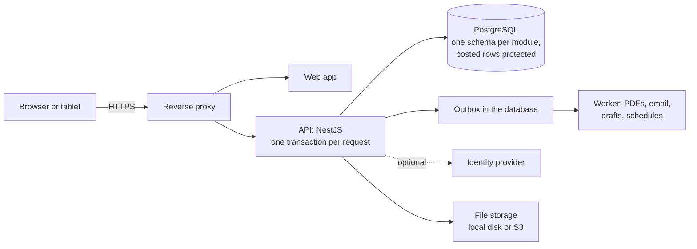

# MOS (Manufacturing Operations Suite): Master Plan

<!-- nav -->[MOS](../../README.md) › [1. Overview](README.md)

| | |
|---|---|
| Document | Master plan: the whole planning package on a few pages |
| Version | **0.5**, draft for review (2026-10-03: everything inside six months; the client's v2 documents absorbed. 0.4: 2026-09-28) |
| Audience | Product owner and stakeholders; the entry point for developers |
| Status | **Planning only.** No implementation has started and no code has been written |
| Read next | [Implementation plan](../4-plan/MOS-IMPLEMENTATION-PLAN.md) (when) · [Sprint plan](../4-plan/MOS-SPRINT-PLAN.md) (sprint by sprint) · [FRD](../2-requirements/MOS-FRD.md) (what) · [TDD](../3-design/MOS-TDD.md) (how) · [Commercial proposal](../5-for-the-client/MOS-COMMERCIAL-PROPOSAL.md) (price) · [Decision register](../6-decisions/MOS-DECISION-REGISTER.md) (what is open) |

> "MOS" is a working codename. The client's screens call the system **"Factory ERP"**, a candidate name to confirm. One find/replace renames it before any external release.

---

## In one minute

- **What:** one integrated system for a **flour mill**: procurement with supplier payment, inventory with silos, lab and quality, gate and weighbridge, production (milling and packing), and sales with receivables.
- **When:** **everything inside 26 weeks.** Build in W1–W20, each module tested by the client's key users as soon as it is built, **go-live in W24**, close support to W26 ([ADR-0025](../6-decisions/adr/ADR-0025-everything-in-six-months.md)).
- **Size:** the six modules at core depth are **2,439 estimated hours** of AI-assisted development. Everything tagged v1 is 3,177 hours.
- **Team:** recommended **path A+**: three developers, AI assistance, one QA engineer. It needs the team to work at the best case of the estimate (×1.33). Two developers would need ×1.89, which is beyond it.
- **Price:** one **fixed price of ETB 986,615** (about US$6,090), within the owner's ETB 1,000,000 cap, for every given requirement and every go-live service ([pricing and timeline](../5-for-the-client/MOS-PRICING-AND-TIMELINE.md)). Maintenance, new features, hosting and third-party services are outside it.
- **Status:** planning complete; the client's documents of 27 September – 2 October reviewed and absorbed; discussed with the client on 3 October. Implementation waits for the owner's go-ahead.

### Words used here

| Word | Meaning |
|---|---|
| **Core / standard / full** | Depth of a feature. Core = the flow works end to end with its key controls (this is what the release promises). Standard and full are year-one conveniences and extras, built if time allows, otherwise in the next release (v1.1) |
| **Speed needed** (×1.33) | How much faster than the likely estimate the team must work. ×1.33 = each estimated hour done in 45 minutes |
| **UAT** | User acceptance testing: the client's key users test the system against agreed scripts |
| **Hypercare** | Close daily support right after go-live |
| **GRN / PV / PR / PO** | Goods received note / payment request (payment voucher) / purchase requisition / purchase order |

---

## 1. What MOS is

MOS is a **company-neutral** system for running a manufacturing plant's core operations. **v1 runs as one installation per company**, with deliberate seams to grow into multi-company and SaaS later. Six modules:

1. **Procurement, with supplier payment:** suppliers, requisitions, purchase orders, the supplier delivery record, goods receipt, invoices and matching, payment requests, approvals, payments.
2. **Inventory:** multi-site, multi-store and silo stock; lots; stock statuses; transfers; counts; bin and stock cards; valuation.
3. **Lab and quality:** specifications, inspection, grades and scores, decisions, quality price and weight deductions.
4. **Gate and weighbridge:** vehicles and goods in and out, weighing, delivery verification, exit control.
5. **Production:** recipes with flour and by-products, milling runs, packing, work orders, finished-flour release, extraction rate.
6. **Sales and receivables:** customers, credit control, orders, deliveries with outbound weighing, invoicing, receipts.

It includes a **payables/receivables sub-ledger** that exports journals to the accounting package the client already uses. It is not a general ledger.

**The headline capability is the inbound raw-material loop.** A truck is weighed and the lab inspects and grades the wheat. On acceptance, **the goods receipt is prepared automatically and the payment request is drafted.** Nothing is re-keyed. By default the storekeeper and the finance officer each confirm the prepared document.

---

## 2. The plan on one page

| Review | Week | What the client sees |
|---|---|---|
| M1 | W4 | Sign-in, the shell, users and roles, **the test server on their infrastructure**; first speed checkpoint |
| M2 | W8 | Company set-up, stores and silos, items, partners, taxes, numbering, approvals; second checkpoint |
| M3 | W12 | Stock documents, bin and stock cards, counts; suppliers, PRs, POs, deliveries; inspection set-up |
| M4 | W16 | **The client's procure-to-pay end to end**: PR → PO → delivery → inspection → GRN → payment request → approval → payment; production server ready |
| M5 | W20 | Gate and weighbridge, production, sales; **feature freeze** |
| Go-live | **W24** | After the system test and final UAT (W21–W22) and training (W23); hypercare W25–W26 |

The [sprint plan](../4-plan/MOS-SPRINT-PLAN.md) has every sprint's features, tasks, tests and client inputs.

---

## 3. Team options and what they need

| Path | Team | Speed needed | In plain words | Team cost at the US$5 rate card |
|---|---|---|---|---|
| **A+** (recommended) | 3 developers + AI + QA | **×1.33** | Tight but inside the estimate's range | **$22,190** |
| **A** | 2 developers + AI + QA | ×1.89 | Beyond the best case; possible only if the client drops the gate module and grading (×1.59) and the second developer works 7 days (×1.49) | $17,390 |
| **B** | 2 developers + AI | ×2.22 | Not recommended | $13,390 |
| **C** | 1 developer | does not fit | The go-live work alone needs more than one person has in the last six weeks | — |

**Why three developers still need ×1.33:** much of the build is a chain (platform → master data → stock ledger → procurement → payables and QC → gate → sales). Each step waits for half of the one before. A third developer shortens the parallel parts, not the chain. Which paths are offered is the owner's decision **O-34**.

**How the plan is held:** checkpoints at **W4 and W8** measure the real speed. If the team is more than 10% behind, capacity is added before W9; the date and the core scope do not move. If it is ahead, standard features are pulled into the release.

---

## 4. Decisions taken

| Topic | Decision |
|---|---|
| Installation model | **One installation per company, no tenancy in v1** (ADR-0017). Multi-company and SaaS are later stages with a written playbook |
| Scope and time | **One release: all six modules at core depth, everything inside 26 weeks, go-live W24** (ADR-0020 as amended by ADR-0025) |
| Infrastructure | **Not assumed** (ADR-0019). The proposal leads with **on-premises** hosting, native services or Docker Compose (ADR-0022). The client's infrastructure answers are needed **before W1** (test server by W4) |
| Industry | Generic engine; industry specifics are data. v1 ships the **grain/flour-milling pack** |
| Finance | Operational sub-ledger + journal export. **No general ledger** |
| Identity | **Local username/password accounts by default** (two-factor for sensitive roles), plus optional single sign-on through any OpenID Connect provider (ADR-0015) |
| Automation | **The system prepares, a named role confirms** (ADR-0016): the storekeeper confirms the GRN, the finance officer the payment request |
| Platform reuse | **Standalone.** Uses the house SSO only as an optional identity provider; copies proven patterns from DMS; **does not use GMS** |
| Hardware | Weighbridge and barcodes **by manual entry with strong controls** in v1; direct capture is Later |
| Stack (ADR-0021) | Node.js 24, TypeScript, NestJS 12, Zod, Drizzle ORM, PostgreSQL 18. **Open (O-27, O-28):** Vite single-page app instead of Next.js 16, and pg-boss instead of BullMQ + Redis; both recommended |
| Locale | English / Gregorian in v1; Amharic + Ethiopian calendar is Later |
| Documents | Kept in this repository (private GitHub remote); never published as claude.ai pages |

---

## 5. The headline flow: inbound raw material

- **With the gate module off** (the client's own flow), the storekeeper records the delivery when the truck arrives, the inspector records the weights, and the GRN is prepared from them.
- Bulk materials are tested **before unloading**; packaged materials go **into quarantine** first.
- Weight-based deductions reduce the **payable** quantity, never physical stock.
- 34 real-world exception cases are specified, each with a test.

---

## 6. Architecture at a glance

- **Modular monolith:** one API and one background worker share one PostgreSQL database, with one schema per module and strict dependency tiers.
- **Posted records are permanent.** Receipts, issues, invoices, payments, QC results and approvals cannot be edited; corrections are reversal documents. **Status changes only through actions** (submit, approve, post), never by editing a field.
- **The inventory ledger** records every stock movement with quantity and value; property-based tests prove the balance always reconciles.
- **Side effects go through an outbox** (emails, PDFs, automatic drafts): nothing is half-done after a crash, and nothing happens twice.
- **Controls are data:** approval matrices, segregation-of-duties rules, tolerances, grade tables and price rules.

Full design: [TDD](../3-design/MOS-TDD.md) and [database design](../3-design/MOS-DATABASE-DESIGN.md) (230 tables).

---

## 7. Controls built in (highlights)

- **Segregation of duties:** the PO creator never posts its GRN; neither may approve a payment request covering their PO or GRN; the payment request's requester cannot approve it, and its approver cannot record the payment; bank-detail changes need an independent approver and a call-back; a weighbridge operator cannot verify their own weight.
- **Fraud-resistant supplier bank details:** never edited in place; a change needs independent approval, a call-back and a cooling-off period.
- **Payments:** only against an approved request, never above the approved amount; unique cheque numbers; proof attached.
- **Weighbridge integrity:** photo evidence, blind re-entry by a second person, random forced re-tare, gap-free weigh tickets.
- **Exit control:** no outbound goods leave without a posted document and a weight within tolerance.
- **Quality holds and periods:** quarantined stock can't be issued, shipped or paid for; period close and backdating windows apply.

---

## 8. The client's documents (27 September – 2 October)

| Document | What we did |
|---|---|
| Procure-to-pay process, first draft (27 Sep) | Reviewed screen by screen ([first-draft review](../7-reviews/MOS-CLIENT-P2P-DRAFT-REVIEW.md)) |
| Procure-to-pay process v2, 28 screens (1 Oct) | Reviewed and re-checked page by page ([v2 review](../7-reviews/MOS-CLIENT-DOCS-V2-REVIEW.md)); three new screens adopted (the supplier delivery record, the bin card, the stock card) |
| Data dictionary (1 Oct) | Every field captured; the table design stays ours (O-33) |
| Architecture proposal (2 Oct) | Compared decision by decision; two changes recommended (Vite, pg-boss: O-27, O-28) |

Together they added **59 core hours** (now counted). They were discussed with the client on 3 October ([discussion pack](../8-meetings/2026-10-03-client-documents/DISCUSSION-PACK.md)). **Four answers decide how comfortable the six months are:** the gate module (Q-01), grading (Q-02), who raises supplier payment requests (Q-03) and invoice approval (Q-04).

---

## 9. Top risks

| Risk | What we do about it |
|---|---|
| The plan needs a speed above the likely estimate (A+ ×1.33, A ×1.89) | Checkpoints at W4 and W8; capacity added before W9 if behind; buffer slots at the end of the build relieve the critical path |
| Infrastructure is unknown, and now needed before W1 | The infrastructure questions go first; a temporary test server on our side if theirs is late |
| Key users not available for rolling UAT | Named before W1; sessions booked at each sprint review |
| Gate, production and sales have no client input yet | Workshops before W10 (gate, production) and W12 (sales) |
| Burnout from 7-day weeks for six months | 80% focus factor; one rest day a week recommended; path A+ spreads the load |
| No slack in the go-live window | First migration dry run in W17–W20; go/no-go at the end of W23 |
| Sales invoices may legally need a fiscal device | Asked before W12; added through the change rule if required |
| Stock or valuation errors | The ledger is built and proven with property tests before any inventory screen |

The full register is in the [implementation plan](../4-plan/MOS-IMPLEMENTATION-PLAN.md) §13.

---

## 10. Honest assessment

- **Six months all-in rests on AI-assisted speed at the best case of the estimate**, even with three developers. The W4 checkpoint shows early whether it holds.
- **Standard and full depth (738 estimated hours) are not promised in the release.** The client should see those lists before signing.
- **Production and sales are designed from flour-milling practice, not yet from the client's own description.** The workshops before W10 and W12 are essential.
- **The client's documents are a strong start** but contain defects that would become bugs if built as drawn (for example editable status fields, a payment approval with no link to its requisition, rejected stock received in full). The plan builds the corrected versions.
- **AI speeds up coding, not everything.** Client decisions, UAT, data migration and servers still take calendar time; that is why the go-live work is spread across the build.

---

## 11. What happens next

1. **The owner** settles O-34 (which team to plan with) and O-27/O-28 (stack) in the [decision register](../6-decisions/MOS-DECISION-REGISTER.md). The price is decided (A-43).
2. **The client** answers the four sizing questions and the "before W1" items, including infrastructure, and names key users.
3. The proposal and questionnaire go to the client; the client chooses a path and a start week.
4. W1 begins after the go-ahead. No code is written before that.

---

## 12. Document map

| Folder | Documents |
|---|---|
| [1-overview](README.md) | This master plan |
| [2-requirements](../2-requirements/README.md) | [FRD](../2-requirements/MOS-FRD.md): 231 requirements (205 in v1) with acceptance criteria · [Process model](../2-requirements/MOS-PROCESS-MODEL.md): 21 swimlanes, 199 numbered steps, lifecycles, exceptions, controls |
| [3-design](../3-design/README.md) | [Database design](../3-design/MOS-DATABASE-DESIGN.md): 230 tables in 9 schemas · [TDD](../3-design/MOS-TDD.md): architecture and technical design |
| [4-plan](../4-plan/README.md) | [Implementation plan](../4-plan/MOS-IMPLEMENTATION-PLAN.md): estimate, speed per path, roadmap, go-live, risks · [Sprint plan](../4-plan/MOS-SPRINT-PLAN.md): 13 sprints, every feature with tasks · [Module 1 plan](../4-plan/MOS-PROCUREMENT-MODULE-PLAN.md): 54 stories, UAT script |
| [5-for-the-client](../5-for-the-client/README.md) | [Commercial proposal](../5-for-the-client/MOS-COMMERCIAL-PROPOSAL.md) · [Pricing and timeline](../5-for-the-client/MOS-PRICING-AND-TIMELINE.md) (price by phase, sprint, module and feature) · [Stakeholder questionnaire](../5-for-the-client/MOS-STAKEHOLDER-QUESTIONNAIRE.md) (drafts, not sent) |
| [6-decisions](../6-decisions/README.md) | [Decision register](../6-decisions/MOS-DECISION-REGISTER.md) · [ADRs](../6-decisions/adr/README.md) 0001–0025 |
| [7-reviews](../7-reviews/README.md) | [Client documents v2 review](../7-reviews/MOS-CLIENT-DOCS-V2-REVIEW.md) (current) and three earlier reviews |
| [8-meetings](../8-meetings/README.md) | [3 October: discussion pack and owner briefing](../8-meetings/2026-10-03-client-documents/README.md) |
| [9-inputs](../9-inputs/README.md) | The client's documents as received; the owner's ChatGPT brainstorm (not client documents) |
