# MOS: End-to-end process model

<!-- nav -->[MOS](../../README.md) › [2. Requirements](README.md)

| | |
|---|---|
| Product | MOS (Manufacturing Operations Suite, working codename) |
| Document | End-to-end process model: value chain (L0), whole-ERP flow (L1), swimlanes (L2), lifecycles (L3) and the supporting tables |
| Version | **0.2** (planning Phase 3 feedback), 2026-09-27. First issued in planning Phase 2. Belongs to planning package v0.3 |
| Audience | <br>• Product owner<br>• The client's process owners, to validate at the workshops<br>• Developers and QA<br>• Trainers |
| Replaces | The owner's ChatGPT flow picture, swimlane and supporting document ([review](../7-reviews/MOS-BRAINSTORM-OUTPUT-REVIEW.md)) |
| Companion docs | [FRD](MOS-FRD.md) (what the system must do) · [TDD](../3-design/MOS-TDD.md) (how it is built) · [implementation plan](../4-plan/MOS-IMPLEMENTATION-PLAN.md) · [client-draft review](../7-reviews/MOS-CLIENT-P2P-DRAFT-REVIEW.md) · local HTML view: `MOS-PROCESS-MODEL.html` (open in a browser; diagrams need internet access) |
| Status | Planning only. No code has been written |

**Revision history**

| Version | Date | Change |
|---|---|---|
| 0.1 | 2026-09-27 | First issue:<br>• L0 value chain and L1 whole-ERP flow with 33 numbered hand-offs<br>• 21 processes and 2 shared sub-processes as swimlanes with numbered steps<br>• 27 lifecycle diagrams covering the 28 rows of FRD §1.5 (supplier and customer share one)<br>• gate step sequences per visit class<br>• document chain and trace<br>• event catalogue and synchronous ports<br>• 64 exception cases<br>• RACI and SoD pairs<br>• controls, KPIs and reports<br>• requirement-to-step traceability<br>Gaps found while modelling were fed back into the FRD, TDD and ADRs (§14) |
| 0.2 | 2026-09-27 | From the [database design](../3-design/MOS-DATABASE-DESIGN.md): §9.1 adds `PartnerLedgerPort` (SY-16) and `WeighTicketReader` (SY-17); §9.2 adds `supplier_return.posted`; P08 states the return and debit-note journals |

**How this document relates to the others.**
- The **FRD is normative**: where this model and the FRD disagree, the FRD wins, and the disagreement is a defect in this model.
- This model adds **who does what, in which order, and what the system does at each step**.
- Every step cites the requirements it exercises. §13 lists, for every v1 requirement, the steps that use it.

---

## 1. Scope, notation and configurations

### 1.1 Levels

| Level | What it shows | Where |
|---|---|---|
| L0 | The value chain: six stages from sourcing wheat to collecting cash | §2 |
| L1 | The whole ERP on one page: modules, key documents and 33 numbered hand-offs | §3 |
| L2 | One swimlane per process, with numbered steps, system behaviour, exceptions, controls and KPIs | §4 (catalogue), §5 (processes) |
| L3 | The lifecycle (state machine) of every document and master record | §6 |
| Supporting | Gate step sequences, document chain and trace, events and ports, exceptions, RACI and SoD, controls and KPIs, traceability | §7–§13 |

### 1.2 Notation

- **Swimlanes (L2) are drawn in sequence form.**
  - Each column is a role (codes from [FRD §2](MOS-FRD.md#2-users-roles-and-personas)), the system (`MOS`) or an outside party (supplier, customer, bank). Time runs downwards.
  - Arrow `->>` is a person's action or a hand-over; `-->>` is the system responding; `--)` is an **asynchronous** effect (an outbox event: it happens after the transaction commits, possibly seconds later).
  - `alt` boxes are decisions; `opt` boxes are optional steps.
  - Mermaid renders these in GitHub, in VS Code with a Mermaid extension, and in the local HTML view.
- **Step IDs.** `P05.14` is step 14 of process P05; `S1.03` is step 3 of shared sub-process S1. The IDs are stable: the database design, the test plan and the training material will refer to them.
- **Step tables** have five columns:
  - `#`: the step ID;
  - **Role**: who acts. "MOS" means the system acts on its own;
  - **Step**: what the person does;
  - **System behaviour**: what MOS checks and records, including what happens **in the same transaction**;
  - **Refs**: requirement IDs (`FR-…`), business rules (`BR-…`), segregation-of-duties rules (`SOD-…`), exceptions (`E…`, §10) and hand-offs (`H…`, §3).
- **Months** (M1–M6) say when a process becomes usable in the development window ([implementation plan §3](../4-plan/MOS-IMPLEMENTATION-PLAN.md)).

### 1.3 Configurations that change the flows

Each setting is data, changed by the administrator. Changes are audited and never affect documents already in flight (FR-INB-010).

| Setting | Values | Default | Processes affected |
|---|---|---|---|
| Gate module (FR-PLT-006) | on / off | On once built (M4). **The client's current process runs without it** (flow C, P07) | P05–P08, P10, P14–P18 |
| Inspection point, per item or category (FR-QC-004) | BEFORE_UNLOADING / IN_QUARANTINE / NONE | From the industry pack: bulk wheat before unloading, packaged additives in quarantine, spares none | P05, P06, P07 |
| Release mode (FR-QC-004) | IMMEDIATE / HOLD_PENDING_LONG_TESTS | IMMEDIATE | P05, P06 |
| GRN generation (FR-INB-010) | confirm (the storekeeper generates) / automatic | confirm | P05–P07 |
| PV creation (FR-INB-010) | draft for the finance officer / auto-submit when matched | draft | P09 |
| Self-billing, per supplier (FR-AP-018) | on / off | off; on for individual farmers | P09 |
| PO without PR (FR-PRC-010) | refused / allowed | refused (as in the client's draft) | P03, P04 |
| Second approver for bank-detail changes (FR-PRC-004) | off / on | on (recommended) | P02 |
| Payer must differ from PV requester (SOD-05) | off / on | off (the client's finance officer raises and records) | P09 |
| Proof of payment required (FR-AP-008) | on / off | on | P09 |
| Weight verification coverage (FR-GATE-010) | every manual weighing / random % / above a value | every manual weighing | P05, P07, P08, P14 |
| Capacity mode, per storage unit (FR-INV-019) | WARN / BLOCK | WARN | P05–P07, P10 |
| Count mode, per count (FR-INV-009) | FREEZE / CUT_OFF | CUT_OFF for silos, FREEZE for stores | P11 |
| Credit check mode, per customer (FR-SAL-001) | NONE / WARN / BLOCK | WARN | P14 |
| Cash-sale exit needs the fiscal number (FR-SAL-012) | on / off | on | P14 |
| Devices and services (NFR-14): camera, label printer, scanner, email relay, virus scanner | on / off each | off until the device exists | Photos, labels, scanning, email and file scanning fall back to manual steps |

### 1.4 Actors

- **Roles** are the 24 seeded roles of [FRD §2](MOS-FRD.md#2-users-roles-and-personas). Examples: STK storekeeper, LAB lab analyst, APC finance officer, PAP payment approver, TRS the person who records payments.
- **One person may hold several roles.** The SoD rules (§11.2) stop the combinations that matter.
- **MOS** is the system actor. Its automatic actions (drafting a GRN, drafting a PV, escalating an approval) are recorded under a system identity and are audited like a person's.
- **Outside parties** have no login in v1:
  - supplier and driver;
  - customer;
  - bank: payments are executed at the bank and recorded in MOS;
  - accounting package: it imports MOS's journal export.

---

## 2. L0: value chain

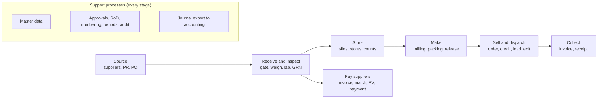

| Stage | Modules | Processes (§5) | Key measures (§12) |
|---|---|---|---|
| Source | Procurement, master data | P01 supplier onboarding, P02 bank-detail change, P03 requisition, P04 purchase order | Approval cycle time, PR-to-PO time, open PO value |
| Receive and inspect | Gate, lab/QC, inventory, procurement | P05, P06, P07 inbound deliveries; P08 supplier return | Truck turnaround, acceptance rate, deduction %, net vs declared weight |
| Pay suppliers | Payables | P09 invoice → match → PV → approval → payment | GRN-to-payment days, match exceptions, approved-but-unpaid PVs |
| Store | Inventory | P10 stock movements, P11 counts | Silo fill %, count accuracy, adjustment value |
| Make | Production, lab/QC, inventory | P12 milling run, P13 packing | Extraction rate, by-product %, loss vs band, downtime |
| Sell and dispatch | Sales, inventory, gate | P14 order to cash, P15 returns, P16 gate passes | Orders shipped, credit holds, dispatch turnaround |
| Collect | Receivables | P14 (invoice, receipt), P15 (credit note) | Receivables ageing, cash-session variance |
| Support | Platform | S1 approvals, S2 corrections, P00 daily work, P17 period close, P18 gate outage, P19 set-up, P20 administration | Audit-chain result, overrides, late approvals |

---

## 3. L1: the whole ERP on one page

The diagram shows the modules, their key documents and the **33 hand-offs** between them. Solid arrows happen in the same transaction or by a person's action; dotted arrows are asynchronous events. Every posting also writes its journal lines in the same transaction (H33), which is not drawn for each module. The local HTML view shows the same map as a printable drawing.

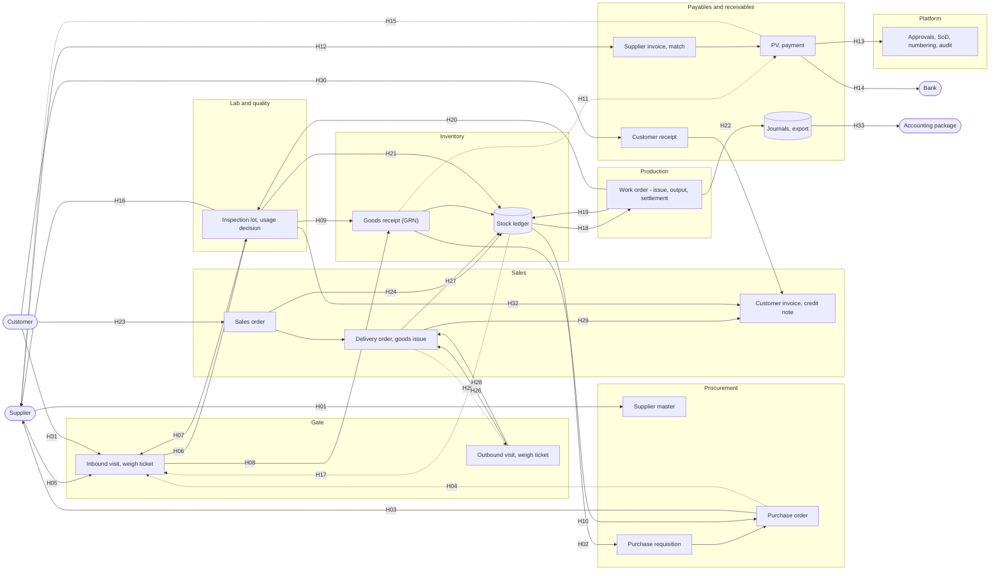

| # | From → to | What passes | How | Process |
|---|---|---|---|---|
| H01 | Supplier → procurement | Registration data, KYC documents, bank details → an approved supplier | People; approval (S1) | P01, P02 |
| H02 | Inventory → procurement | Available-to-use stock on PR lines; reorder suggestions that pre-fill a PR | Same transaction (read) | P03 |
| H03 | Procurement → supplier | The issued PO (PDF by email where configured, or printed) | Asynchronous (`po.issued`) | P04 |
| H04 | Procurement → gate | Expected arrivals from the approved PO's delivery schedule | Asynchronous (`po.approved`) | P04, P05 |
| H05 | Supplier → gate | The truck arrives and checks in against an open PO line | People | P05 |
| H06 | Gate → QC | The inspection lot and sampling plan, created at the first weighing, with weights, bags, plate and PO | Same transaction | P05 |
| H07 | QC → gate | The usage decision: unloading authorised, or truck rejected | Same transaction, through the `UsageDecisionListener` port | P05 |
| H08 | Gate → inventory | At tare: the GRN draft with net, bag tare, lot and suggested storage unit | Same transaction | P05 |
| H09 | QC → inventory | The payable quantity and quality-adjusted price, snapshotted on the GRN | Same transaction | P05, P06, P07 |
| H10 | Inventory → procurement | The GRN posting updates the PO line's received quantity | Same transaction, through the `ReceiptCommitmentPort` | P05, P06, P07 |
| H11 | Inventory → payables | The posted GRN triggers a PV draft, or a self-billed voucher | Asynchronous (`grn.posted`) | P09 |
| H12 | Supplier → payables | The supplier's invoice, matched against the GRN's payable quantity and price | People | P09 |
| H13 | Payables → platform | The submitted PV enters its approval chain | Same transaction | P09, S1 |
| H14 | Payables ↔ bank | The approved PV is paid at the bank, then recorded in MOS with proof | People (outside MOS, then recorded) | P09 |
| H15 | Payables → supplier | Payment advice and WHT certificate | Asynchronous (`payment.posted`) | P09 |
| H16 | QC and procurement → supplier | Rejection or deduction note; supplier return and debit note | Asynchronous notice; people | P05, P08 |
| H17 | Inventory → gate | A dispatched inter-site transfer creates an expected arrival at the destination site | Asynchronous (`transfer.dispatched`) | P10 |
| H18 | Inventory → production | Work-order release reserves stock; issues draw silo lots first-in-first-out | Same transaction | P12, P13 |
| H19 | Production → inventory | Output lots, in QUARANTINE until released | Same transaction | P12, P13 |
| H20 | Production → QC | A finished-goods inspection lot per output lot (or per shift) | Same transaction | P12, P13 |
| H21 | QC → inventory | Release (→ AVAILABLE), regrade or reject | Same transaction | P12, P13 |
| H22 | Production → finance | Settlement values the output; journals | Same transaction (`JournalPort`) | P12 |
| H23 | Customer → sales | The customer's order | People | P14 |
| H24 | Sales → inventory | Availability check and soft reservation at approval | Same transaction | P14 |
| H25 | Sales → gate | A released delivery order creates an expected arrival for the outbound visit | Asynchronous (`delivery_order.released`) | P14 |
| H26 | Gate → sales | The verified outbound net becomes the goods-issue draft | Same transaction, through the `OutboundLoadListener` port | P14 |
| H27 | Sales → inventory | The goods issue posts stock out and cost of goods sold | Same transaction | P14 |
| H28 | Gate → sales / inventory | Exit clearance asks whether the goods issue (or return, transfer dispatch, gate-pass document) is posted and the weight is within tolerance | Same transaction, through the `OutboundDocumentChecker` port | P14, P08, P10, P16 |
| H29 | Sales → receivables | The customer invoice from posted deliveries | Same transaction | P14 |
| H30 | Customer → receivables | Receipts, advances and cash-sale payments, allocated to invoices | People | P14 |
| H31 | Customer → gate → QC | A return truck, receipt into QUARANTINE, inspection | People; same transaction | P15 |
| H32 | QC → sales | The decision on a returned lot drafts the credit note | Same transaction, through the `UsageDecisionListener` port | P15 |
| H33 | Every posting → finance → accounting package | Journal lines written in each posting transaction; CSV batches exported | Same transaction; export batch on request | P17 |

---

## 4. L2: process catalogue

| ID | Process | Starts when | Ends when | Main roles | Usable from | Acceptance scenarios |
|---|---|---|---|---|---|---|
| P00 | Sign-in and daily work | A user opens MOS | The task is done or the session ends | Everyone | M1 | AS-11 |
| S1 | Approval (shared sub-process) | A document is submitted | Its chain is approved, rejected or returned | Submitter, approvers | M1 | AS-12 |
| S2 | Correcting a posted document | An error is found in a posted document | The reversal and the corrected document are posted | The poster, with permission | M1 | — |
| P01 | Supplier onboarding | A new supplier is needed | The supplier is APPROVED | BUY, PMGR | M1 | — |
| P02 | Supplier bank-detail change | A supplier gives new bank details | The new account is ACTIVE after its cooling-off period | BUY / APC, PMGR / FINC | M1 | AS-05 |
| P03 | Purchase requisition | A need, or a reorder alert | The PR is ORDERED or CLOSED | STK / REQ, MGMT, BUY | M1 | AS-13 |
| P04 | Purchase order: issue, amend, close | A PR is approved | The PO is CLOSED | BUY, PMGR / MGMT | M2 | AS-13 |
| P05 | Inbound delivery, flow A: gate on, inspected before unloading (bulk wheat) | A truck arrives at the gate | The truck has exited and the GRN is posted | GRD, WBO, LAB, QAM, STK | M4 | AS-01, AS-02, AS-04 |
| P06 | Inbound delivery, flow B: inspected in quarantine, or not inspected | A truck with packaged or non-inspected goods arrives | The GRN is posted and the quarantine decided | GRD, STK, LAB, QAM | M2 (no QC), M3 (quarantine), M4 (with gate) | AS-03, AS-02 (long tests) |
| P07 | Inbound delivery, flow C: gate off (the client's own flow) | A truck arrives at stores | The GRN is posted | LAB, STK, weigher | M3 | AS-13 |
| P08 | Supplier return and replacement | Rejected or defective stock must go back | The return is posted, the debit raised and the PO reopened if replacing | STK, BUY, PMGR, GRD, APC | M2 (M4 with gate) | AS-03, AS-09 |
| P09 | Invoice, match, PV, approval, payment | A GRN posts, or an invoice arrives | The PV is PAID | APC, PAP, TRS | M2 (payables), M3 (with reports) | AS-01, AS-05, AS-13 |
| P10 | Stock movements: issue, transfer, status change, adjustment | Stock must be issued, moved, held or corrected | The document is posted | STK, WSUP, PLM, FINC, QAM | M2–M3 | AS-06 |
| P11 | Stock count (store and silo) | A count is planned | The generated adjustment is posted | STK, WSUP | M3 | AS-07 |
| P12 | Production: milling run | A production plan | The work order is CLOSED | PPL, PSUP, LAB, QAM, FINC | M5 | AS-14, AS-17 |
| P13 | Packing | Released bulk flour and a packing plan | The packed lots are released | PPL, PSUP, LAB | M5 | AS-16 |
| P14 | Order to cash (credit sale and cash sale) | A customer orders | The delivery is DELIVERED and the invoice PAID | SREP, SMGR, CRC, DSP, GRD, WBO, CSH | M5–M6 | AS-15, AS-18 |
| P15 | Customer return and credit note | A customer returns goods or claims | The credit note is posted | SREP, GRD, STK, LAB, SMGR | M6 | AS-19 |
| P16 | Material gate pass | An item or asset must leave, and perhaps return | The pass is closed | REQ, approver, GRD | M4 | — |
| P17 | Period close and journal export | Month end | The periods are CLOSED and journals exported | FINC, WSUP, PPL, APC | M3 (inventory, payables), M6 (all) | AS-08 |
| P18 | Gate outage: paper mode and back-entry | The system or network is down at the gate | Back-entry is complete, with no slip gaps | GRD, WBO, SSUP | M4 | AS-10 |
| P19 | Installation set-up and data migration | A new installation, or go-live | Opening balances are posted and reconciled | ADM, FINC, data owners | M1 (tools), M7 (go-live) | — |
| P20 | Administration and audit | Ongoing | — | ADM, AUD, FINC | M1 | AS-11 |

---

## 5. L2: processes

### P00 Sign-in and daily work

**Purpose:** how every user enters MOS, finds work and acts on it. **Trigger:** a user opens MOS. **Usable from:** M1.

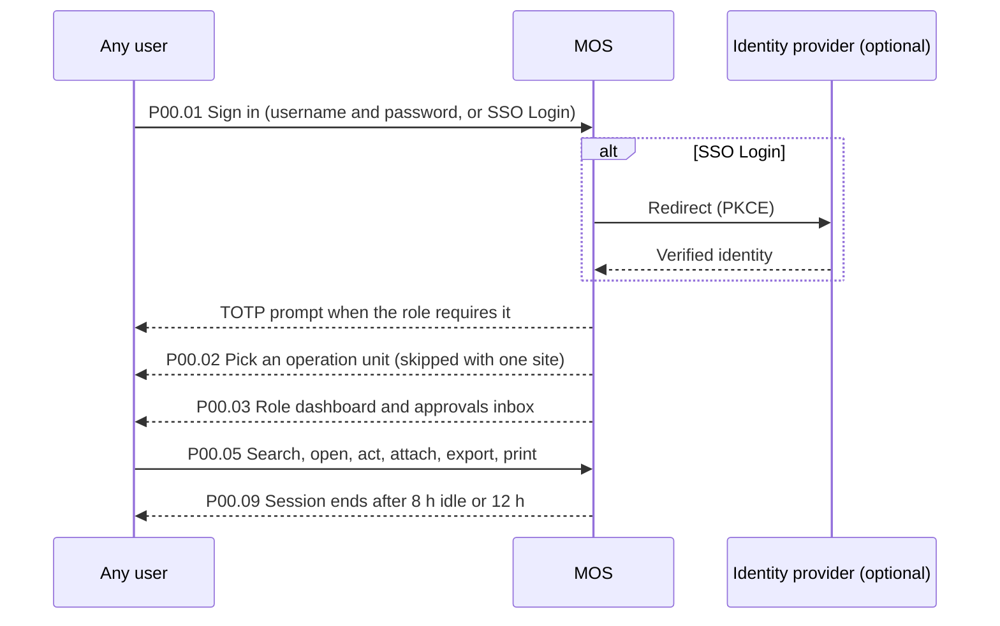

| # | Role | Step | System behaviour | Refs |
|---|---|---|---|---|
| P00.01 | Any user | Signs in with a local account, or with "SSO Login" where enabled | Lockout after 5 failures for 15 minutes; identical responses for an unknown user and a wrong password; TOTP enforced for the roles that require it (e.g. PAP, TRS, ADM). An SSO sign-in succeeds only for a user who already exists or was invited | FR-PLT-010, FR-PLT-018, FR-PLT-011 |
| P00.02 | Any user | Picks an operation unit (a site) | The list shows only the sites the user is assigned to. The choice is remembered and switchable from the header. It sets defaults; it never widens access | FR-PLT-019, FR-PLT-012 |
| P00.03 | Any user | Lands on the role dashboard | Tiles for the user's roles, each drilling down to its list. UI text comes from message catalogues; dates render through one formatter (English/Gregorian in v1) | FR-RPT-001, FR-PLT-052 |
| P00.04 | Any user | Works from the approvals inbox and notifications | Pending tasks across modules with filters, SLA due times and KPI tiles; usable on a phone. In-app notifications always; email copies where a relay is configured | FR-PLT-030, FR-PLT-045 |
| P00.05 | Any user | Searches by document number, item, partner, plate or lot | Results only within the user's site scopes, in under 1 s | FR-PLT-051, FR-PLT-012 |
| P00.06 | Any user | Attaches photos, PDFs or spreadsheets to a record | Content-type check, size limit, SHA-256; virus scan where a scanner is configured | FR-PLT-044 |
| P00.07 | Any user | Filters lists and reports by date and site, and exports | XLSX/CSV export equal to the filtered list and within scope; heavy reports run in the background and notify on completion | FR-PLT-048, FR-RPT-002, FR-RPT-003 |
| P00.08 | Any user | Prints a document | Company-branded PDF with a QR code of the document reference | FR-PLT-049 |
| P00.09 | MOS | Ends the session | 8 h idle / 12 h absolute; signing out also ends the IdP session for SSO users | FR-PLT-015 |

**Exceptions:** E62 (a device or service is unavailable). **Controls:** lockout, TOTP for sensitive roles, site scoping.

---

### S1 Approval (shared sub-process)

**Purpose:** the one approval mechanism used by every approval-controlled document: supplier, bank change, PR, PO, PV, adjustment, count variance, concession, match exception, credit note, sales order hold, period reopen, gate pass and others. **Trigger:** a document is submitted. **Usable from:** M1.

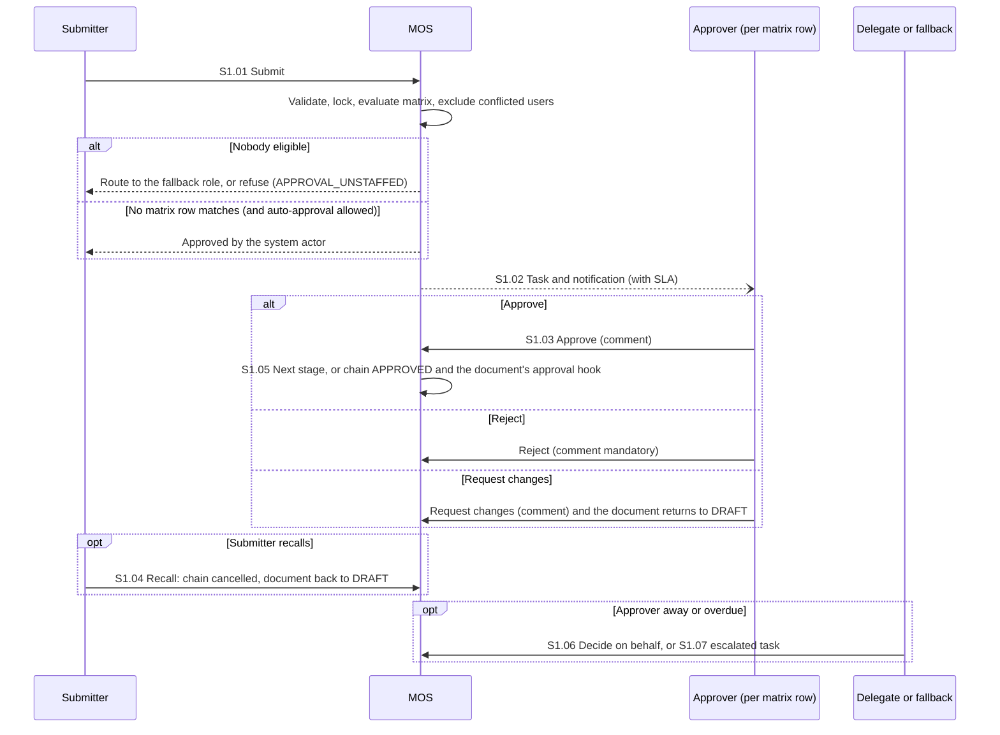

| # | Role | Step | System behaviour | Refs |
|---|---|---|---|---|
| S1.01 | Submitter | Submits the document | Status changes only through this named action. Date sanity checks (e.g. required date ≥ request date). The document locks. The approval matrix is evaluated: amount band × site × category × department, plus flags such as SOLE_SOURCE, BANK_CHANGED_RECENTLY, VARIANCE_OVER_TOLERANCE, PRIORITY_URGENT, CREDIT_EXCEEDED, BELOW_FLOOR_PRICE. Stage-1 assignments are made after SoD exclusion. If a stage has nobody eligible, it goes to the fallback role or submission is refused. If no row matches and the document type allows it, the system actor approves | FR-PLT-020, FR-PLT-031, FR-PLT-055, FR-PLT-023, FR-PLT-028, FR-PLT-029, E38 |
| S1.02 | MOS | Assigns the task | Inbox task with SLA due time; in-app notification (email where configured) | FR-PLT-030, FR-PLT-045 |
| S1.03 | Approver | Approves, rejects or requests changes | A comment is mandatory for reject and request changes (and for PVs, also for approve). Authority, SoD and TOTP are **re-checked at decision time**. Nobody approves two stages of one chain. Bulk approval where enabled: each item is still checked individually; bulk is off for PVs and bank changes by default | FR-PLT-025, FR-PLT-032, SOD-01, SOD-11 |
| S1.04 | Submitter | Recalls the document (optional) | The chain is cancelled and the document returns to DRAFT; the history records the recall | FR-PLT-025 |
| S1.05 | MOS | Advances the chain | The next stage activates. When the chain is APPROVED, the document type's approval hook runs in the same transaction: status, number where numbered at approval, optional automatic posting | FR-PLT-020 |
| S1.06 | Delegate | Decides "on behalf of" during a delegation | Delegations do not chain; SoD applies to both people; the audit shows both names | FR-PLT-026 |
| S1.07 | MOS | Escalates an overdue step | Reminder first; then the matrix row's fallback role is added as assignee | FR-PLT-027, E37 |
| S1.08 | MOS | Keeps the history | Chains, decisions and comments cannot be edited or deleted, including for rejected and cancelled documents | FR-PLT-054 |

**Exceptions:** E37 (approver absent), E38 (nobody eligible). **KPIs:** average approval time and its trend, pending by age (FR-RPT-001).

---

### S2 Correcting a posted document (reversal)

**Purpose:** the only way to fix a posted GRN, issue, adjustment, invoice, payment or other posting document. **Trigger:** an error is found after posting. **Usable from:** M1.

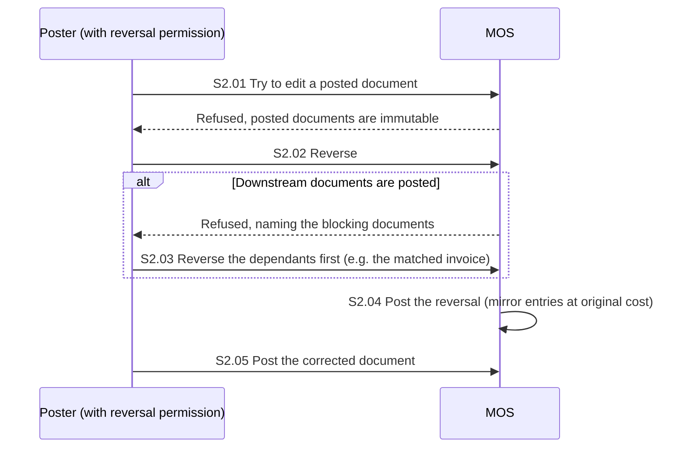

| # | Role | Step | System behaviour | Refs |
|---|---|---|---|---|
| S2.01 | Poster | Finds an error in a posted document | No edit or delete for anyone, including administrators; the API returns 409 and the database refuses the application role | FR-PLT-021 |
| S2.02 | Poster | Chooses Reverse | The dependency guard reads the document-link graph and refuses while posted downstream documents exist, naming them (e.g. an invoice matched to the GRN) | FR-PLT-022, E32 |
| S2.03 | Poster | Reverses the dependants first, in reverse order | Each reversal follows the same rules | FR-PLT-022 |
| S2.04 | MOS | Posts the reversal | A new document mirroring the original's ledger entries at their original cost. Posting date: the original's if that period is open, else the first open date. Gap-free number. The original shows REVERSED. If the stock was already consumed, the reversal is refused (no negative stock); a supplier return or an adjustment is used instead | FR-PLT-022, FR-PLT-041, FR-PLT-042, FR-INV-011 |
| S2.05 | Poster | Posts the corrected document | Within the backdating window, or with the override permission and a reason | FR-PLT-043 |

**Exceptions:** E03, E31, E32, E34. **Controls:** reversals appear on the reversals exception report (FRD §15.3).

---

### P01 Supplier onboarding

**Purpose:** register a supplier with its KYC documents and first bank account, and approve it. **Trigger:** procurement needs a new supplier. **Ends:** supplier APPROVED. **Usable from:** M1.

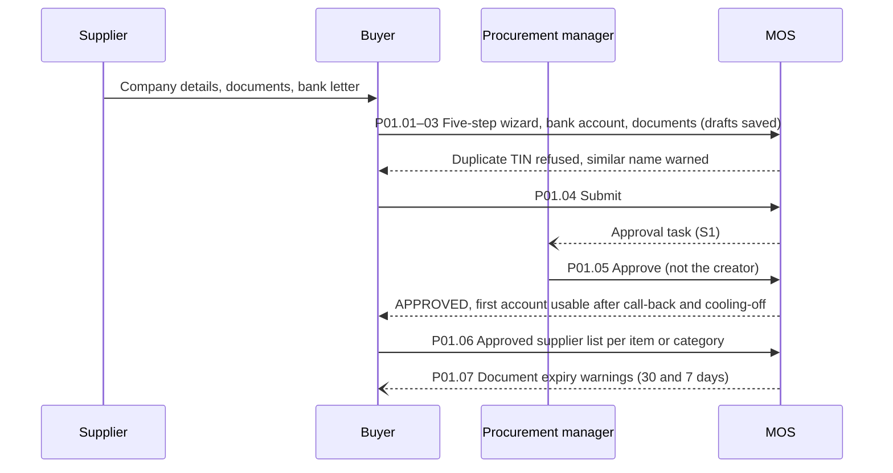

| # | Role | Step | System behaviour | Refs |
|---|---|---|---|---|
| P01.01 | BUY | Enters the 5-step wizard: basic, contacts, address, financial, products and services | Drafts save at any step. A duplicate TIN is refused; a similar name warns. **Individual suppliers** (farmers, traders): TIN optional, national ID instead, self-billing flag, the no-TIN withholding rate | FR-PRC-001, FR-MD-005, FR-MD-014, FR-MD-013, E63 |
| P01.02 | BUY | Adds the bank account(s) | The bank comes from the bank master. The account number is encrypted and masked. The first account needs a recorded call-back verification as part of approval | FR-MD-012, FR-PRC-004, FR-PRC-005 |
| P01.03 | BUY | Uploads the onboarding documents for the supplier group (trade licence, TIN and VAT certificates, bank letter) with expiry dates | Content-checked attachments; the checklist shows what is missing | FR-PRC-001, FR-PLT-044 |
| P01.04 | BUY | Submits | Every mandatory field and document is present; status becomes SUBMITTED by the system (never typed); the approval chain starts (S1) | FR-PRC-001, FR-PLT-031 |
| P01.05 | PMGR | Approves | The approver cannot be the creator. The supplier becomes APPROVED; the first bank account becomes ACTIVE once the call-back is recorded, usable after the cooling-off period | SOD-07, FR-PRC-004 |
| P01.06 | BUY | Maintains the approved supplier list per item or category (and optionally site) | Enforcement per category: none / warn / block at PO submission and at receipt | FR-PRC-006 |
| P01.07 | MOS | Warns before documents expire | Notifications 30 and 7 days before expiry (automatic suspension is v1.1) | FR-PRC-003, E64 |
| P01.08 | PMGR | Suspends or blocks a supplier, with a reason | A suspended or blocked supplier gets no new POs, cannot deliver and cannot be paid | FR-PRC-002, BR-PRC-04, E36 |
| P01.09 | PMGR | Deactivates a supplier that is no longer used | Refused while open POs or balances exist; a used supplier is never deleted; reactivation needs approval | FR-PLT-053 |

**Controls:** SOD-07 creator ≠ approver; bank-account encryption and audited reveal; duplicate TIN. **KPIs:** onboarding time; suppliers with expiring documents.

---

### P02 Supplier bank-detail change

**Purpose:** change where a supplier is paid without opening the door to payment fraud. **Trigger:** a supplier sends new bank details. **Ends:** the new account is ACTIVE and usable. **Usable from:** M1.

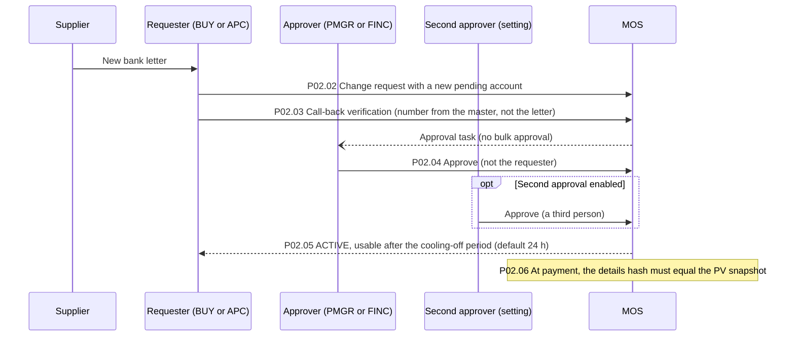

| # | Role | Step | System behaviour | Refs |
|---|---|---|---|---|
| P02.01 | Supplier → BUY/APC | Sends a signed letter with the new details | — | FR-PRC-004 |
| P02.02 | BUY or APC | Creates a change request: a **new pending account**, never an edit of the old one | The old account stays active until the new one is usable; the letter is attached | FR-PRC-004, FR-PRC-005 |
| P02.03 | BUY or APC | Records the call-back: the supplier contact called on the number already in the master, who confirmed, when, evidence | Approval is blocked without a call-back record | FR-PRC-004 |
| P02.04 | PMGR or FINC (and a second approver when enabled) | Approves | The approver cannot be the requester, and the second approver cannot be either of them. Bulk approval is off for bank changes | SOD-06, FR-PLT-032 |
| P02.05 | MOS | Activates the account | `usable_from` = approval + cooling-off. PVs to a recently changed account carry the BANK_CHANGED_RECENTLY flag, which adds an approval stage | FR-PRC-004, FR-PLT-023, FR-AP-007 |
| P02.06 | MOS | Guards payments | A transfer payment re-verifies the account's details hash against the PV snapshot; a mismatch blocks it and forces re-approval. A payment before `usable_from` is refused | BR-AP-04, E29 |
| P02.07 | Authorised user | Reveals a full account number | Needs a permission; every reveal is audited | FR-PRC-005 |

**Controls:** dual control, call-back, cooling-off, hash check at payment; "bank-detail changes" and "payments to recently changed accounts" exception reports (FRD §15.3). **Scenario:** AS-05.

---

### P03 Purchase requisition

**Purpose:** ask for materials, with the quantity to buy computed from live stock. **Trigger:** a need (in the client's process the storekeeper raises raw-material PRs) or a reorder alert. **Ends:** ORDERED, or CLOSED with a reason. **Usable from:** M1.

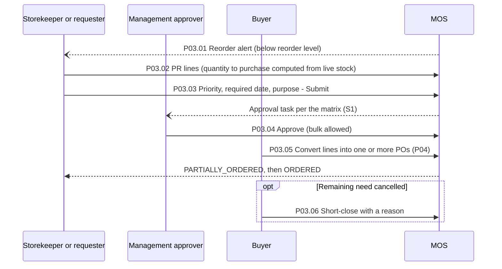

| # | Role | Step | System behaviour | Refs |
|---|---|---|---|---|
| P03.01 | MOS / STK | A reorder alert, or the reorder report's "create PR" | Items below reorder level, with a suggested quantity up to the maximum level, pre-fill a PR. Level precedence: storage unit → item per warehouse → item default | FR-INV-013, FR-MD-010, H02 |
| P03.02 | STK or REQ | Enters the lines: material, requested quantity, specification | Shows **live available-to-use stock** at the site; computes quantity to purchase = requested − available (optionally − open PR/PO quantity), editable only upward with a reason; estimated cost from the item's reference cost; free-text lines for non-stock items | FR-PRC-007, FR-INV-015 |
| P03.03 | STK or REQ | Sets priority, required date and purpose, then submits | Department and employee ID default from the user; required date ≥ request date; available quantity snapshotted; approval chain (S1) | FR-PRC-007, FR-PLT-007, FR-PLT-055, E35 |
| P03.04 | MGMT | Approves within their band | Bulk approval allowed for PRs; a returned PR shows the approver's comment | FR-PLT-023, FR-PLT-032 |
| P03.05 | BUY | Converts approved lines into POs | Ordered quantity tracked per line. **The quantity ordered cannot exceed the line's quantity to purchase by more than the PR tolerance** (default 0%) | FR-PRC-007, BR-PRC-05 |
| P03.06 | BUY or REQ | Short-closes the remaining quantity, or cancels an unordered PR | CLOSED with a reason, or CANCELLED | FR-PRC-007 |

**Controls:** SOD-01; date sanity; PO quantity within the PR (BR-PRC-05). **KPIs:** PR ageing; approval cycle time; PR-to-PO time (FR-PRC-017).

---

### P04 Purchase order: issue, amend, close

**Purpose:** commit to a supplier, tell the gate what to expect, and close cleanly. **Trigger:** an approved PR. **Ends:** CLOSED. **Usable from:** M2.

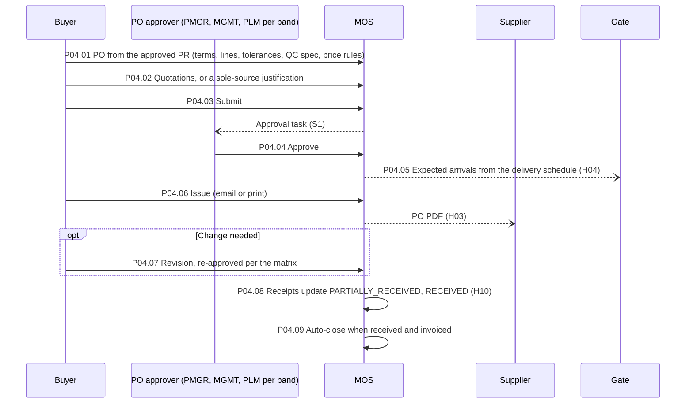

| # | Role | Step | System behaviour | Refs |
|---|---|---|---|---|
| P04.01 | BUY | Creates the PO from the approved PR: supplier, payment terms, delivery terms, purchasing department, plant, deliver-to unit, required delivery date, currency, header discount; lines with price, tax codes, over/under tolerance, excess policy, QC spec, price and grade rule set, delivery schedule | PR link required unless the setting allows otherwise. Only APPROVED, unblocked suppliers; approved supplier list enforced. Foreign currency stores its rate. The header discount is allocated to lines; tax computed from line codes | FR-PRC-010, FR-PRC-002, FR-PRC-006, FR-MD-006, FR-MD-007, FR-MD-008, BR-PRC-04 |
| P04.02 | BUY | Records quotations (supplier, amount, attachment each) or a sole-source justification | The sourcing policy per category and amount band sets the minimum number of quotations | FR-PRC-008 |
| P04.03 | BUY | Submits | Too few quotations without justification refuses submission; a sole source sets the SOLE_SOURCE flag in the matrix | FR-PRC-008, FR-PLT-023 |
| P04.04 | PMGR / MGMT / PLM | Approve(s) per band | S1; the PO creator never receives the task | SOD-01 |
| P04.05 | MOS | Generates expected arrivals | One expected arrival per schedule line, with a time window (gate module on) | FR-GATE-004, H04 |
| P04.06 | BUY | Issues the PO | ISSUED, with method and time recorded; the PDF is queued to the supplier where email is configured, or printed | FR-PRC-010, FR-PLT-049, H03 |
| P04.07 | BUY | Amends: a new revision | Re-approved per the matrix (a quantity decrease or date change may auto-approve). Received quantities cannot be reduced below what was received. Receipts continue against the approved revision; expected arrivals update | FR-PRC-011 |
| P04.08 | MOS | Tracks receipts | Each posted GRN updates the line's received quantity; the PO shows PARTIALLY_RECEIVED or RECEIVED | FR-PRC-013, H10 |
| P04.09 | MOS / BUY | Closes | Auto-close when fully received (within tolerance) **and invoiced**. BUY short-closes with a reason; cancellation only with zero receipts; open expected arrivals are cancelled. The stale-PO report lists old open POs | FR-PRC-012, FR-GATE-004, E14 |
| P04.10 | BUY / PMGR | Reviews procurement reports | Open PRs and POs, PR ageing, PO status, outstanding deliveries, price history, spend by supplier and category | FR-PRC-017 |

**Controls:** SOD-01; sourcing rule; approved supplier list; PO creator ≠ GRN poster (SOD-02, enforced at P05.16). **KPIs:** PO on-time delivery; open PO value; spend.

---

### P05 Inbound delivery, flow A: gate on, inspected before unloading (bulk wheat)

**Purpose:** the headline loop. A wheat truck is checked in, weighed, sampled, tested, graded and decided **before it unloads**. The accepted load is unloaded and tared; the GRN is prepared from the weights and the decision; the posting drafts the supplier payment. **Trigger:** a truck arrives at the gate. **Ends:** the truck has exited and the GRN is posted. **Usable from:** M4 (FRD §9.1). **Scenarios:** AS-01 (accepted with a deduction), AS-02 (rejected), AS-04 (leaves without tare).

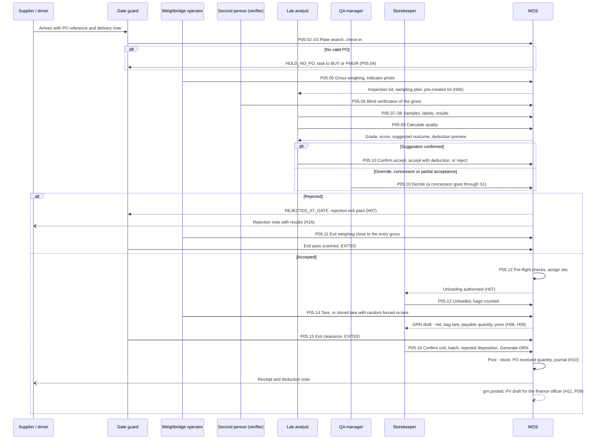

| # | Role | Step | System behaviour | Refs |
|---|---|---|---|---|
| P05.01 | GRD | Opens the shift at the gate post (if not open) | Gate actions need an open shift at that post | FR-GATE-003, BR-GATE-03 |
| P05.02 | GRD | Searches the plate (scan or type) | Matches the expected arrival (from the approved PO) or registers a walk-in with a purpose. Blacklist: BLOCK refuses entry; WARN shows a banner the supervisor acknowledges. One open visit per vehicle. Double clicks and retries never create a second visit | FR-GATE-004, FR-GATE-005, FR-GATE-002, FR-GATE-008, FR-INB-007, BR-GATE-01, BR-GATE-02, E16, H05 |
| P05.03 | GRD | Checks in: driver, transporter, supplier delivery-note number, declared quantity and bags, seals, checklist, photos (where a camera exists) | Mandatory fields per visit purpose. Supplier APPROVED and not blocked; PO APPROVED or ISSUED and open for the item. The inspection point and release mode are snapshotted from the QC policy. The visit becomes CHECKED_IN, or HOLD_NO_PO. It appears on the yard board | FR-GATE-006, FR-GATE-007, FR-GATE-021, FR-PRC-002, BR-GATE-04, BR-PRC-04 |
| P05.04 | BUY or PMGR | On HOLD_NO_PO: links a PO (audited) or rejects at the gate | The truck does not enter while on hold; a rejection issues a rejection exit pass | FR-GATE-005, E01, E02 |
| P05.05 | WBO | First weighing (gross), with a photo of the indicator | The weight must be a multiple of the weighbridge division and within minimum/capacity; the bridge must be in calibration (else a QAM override); plausible for the vehicle. The weigh ticket takes the next **gap-free number for that weighbridge**. A typo is corrected by a superseding weighing with a reason, never by deletion. A failed photo upload leaves the weighing "photo pending". **The inspection lot, sampling plan and pre-created lot (QC status PENDING) are created in the same transaction** | FR-GATE-009, FR-GATE-011, FR-GATE-014, FR-GATE-030, FR-QC-006, FR-QC-005, H06, E04, E18 |
| P05.06 | Second person | Blind verification of the gross | Enters the value without seeing the first; a mismatch rejects and logs both attempts; the operator can never verify their own weighing. Coverage per setting | FR-GATE-010, BR-GATE-07, SOD-10 |
| P05.07 | LAB | Works from the lab queue; draws samples per the sampling plan; prints labels | Queue by age and priority; unique sample numbers with barcode labels; a retention sample where the policy requires it (storage location, retain-until date). Scanning a label opens result entry | FR-QC-018, FR-QC-007, FR-QC-016, E19 |
| P05.08 | LAB | Enters results in the keyboard grid; adds optional parameters; attaches the supplier's CoA where required | Live pass/fail against the spec **frozen onto the lot**. Results are insert-only: a correction invalidates the old value with a reason. A retest from a retest or retention sample is allowed up to the configured maximum. No decision without a required CoA | FR-QC-003, FR-QC-008, FR-QC-010, FR-QC-017, FR-QC-024, BR-QC-05 |
| P05.09 | LAB | Presses "Calculate quality" | Grade (worst parameter or score bands), quality score 0–100 with breakdown, suggested outcome, suggested rejection reason, deduction preview (payable-quantity % and price %) | FR-QC-009, FR-QC-022, FR-QC-023, FR-QC-013 |
| P05.10 | LAB, or QAM | **Usage decision.** LAB confirms the suggestion: ACCEPT, ACCEPT WITH DEDUCTION (computed), or REJECT at a reject threshold. QAM is required to override the suggestion, and for a concession (routed through S1) or a partial acceptance | Stored with the grade, score and deduction evidence (payable quantity, adjusted price, rule-set version), which prints on the supplier's note. **In the same transaction:** the visit moves to QC_DECIDED, then UNLOAD_AUTHORIZED, or REJECTED_AT_GATE with a rejection exit pass. A rejection or deduction notice goes to the supplier asynchronously | FR-QC-011, FR-QC-012, FR-QC-013, FR-QC-014, FR-INB-009, SOD-08, BR-GATE-05, H07, H16, E08, E10 |
| P05.11 | WBO, GRD | Rejected truck: optional exit weighing; exit | The exit weight must be within tolerance of the entry gross (nothing was left behind); no direction-anomaly hold for rejected visits. Exit clearance, then EXITED. The retention sample is kept | FR-GATE-011, FR-GATE-012, FR-GATE-016, FR-GATE-018, BR-GATE-06, E08 |
| P05.12 | MOS | Pre-flight before unloading | PO line open with tolerance headroom (estimated net from the vehicle's tare history), period open, item and storage unit active with capacity, supplier not blocked. Assigns the unload unit (silo). A failure keeps the truck from unloading, with the reason | FR-INB-004, FR-PRC-014, FR-INV-019, E13, E15, E40 |
| P05.13 | STK | Unloads into the silo or store; confirms the unit, bag count and damage notes | The visit becomes UNLOADED | FR-PRC-021 |
| P05.14 | WBO | Second weighing (tare), or uses the stored tare | Stored tare only where valid and permitted; a **random forced re-tare** is decided by the server and revealed only now. Net = gross − tare; material net = net − bags × bag tare; a tare that deviates from history raises an alert. Payable quantity = material net after the payable-quantity deduction. **The GRN is built as a DRAFT inside a savepoint**, running every posting validation. On a business failure the savepoint rolls back, the weighing is kept, the visit goes to RECEIPT_EXCEPTION, and an exception task is created. Otherwise the visit becomes GRN_DRAFTED; the storekeeper's task appears (escalates to WSUP after the SLA, default 4 h). Mode *automatic*: the GRN posts here | FR-GATE-013, FR-PRC-013, FR-PRC-014, FR-PRC-021, FR-INB-001, FR-INB-002, FR-INB-005, FR-INB-008, FR-INB-010, H08, H09, E05, E06, E15 |
| P05.15 | GRD | Scans the exit pass | Exit clearance checks: no blocking hold, mandatory steps done, tare verified, seals and plate matching the entry. Overridable checks need SSUP with a reason code. EXITED. An accepted truck that leaves without unloading becomes ABANDONED (SSUP) | FR-GATE-016, FR-GATE-017, FR-GATE-018, E07 |
| P05.16 | STK | Confirms the storage unit, batch number and rejected disposition, then "Save & Generate GRN" | Posts the GRN: RECEIPT entries for the accepted quantity (in the item's receipt status) and the held-rejected quantity (REJECTED); value = payable quantity × quality-adjusted price; the PO line's received quantity updates; journal Dr Inventory / Cr GRNI; gap-free GRN number; the weigh ticket locks. **The GRN poster cannot be the PO creator.** Outbox: `grn.posted` | FR-PRC-013, FR-INB-002, FR-INV-001, FR-INV-022, FR-AP-010, BR-PRC-01, BR-PRC-02, BR-PRC-03, SOD-02, H10 |
| P05.17 | MOS | After commit | Drafts the PV for the finance officer (P09.01), or the self-billed voucher; sends the receipt and deduction note to the supplier (email where configured, otherwise printable) | FR-INB-003, FR-INB-009, H11 |
| P05.18 | QAM | Corrects a decision when a result error is found | Before unloading: reopen with a reason. After stock or financial effects: a superseding decision with QAM approval and compensating documents (status change, revaluation, AP adjustment). A disputed deduction goes to a third-party test of the retention sample, then the same route | FR-QC-015, E12, E20 |
| P05.19 | SSUP | Reviews gate reports and incidents | Daily gate register, weigh-ticket register (voided and superseded included), turnaround and dwell, overrides, net-vs-declared variance; incidents with an optional blacklist proposal | FR-GATE-025, FR-GATE-022 |

**Other paths:**
- **Truck leaves without tare** (E06): SSUP records the exit with reason NO_TARE. The GRN is drafted from an estimated tare or bag count, flagged, and needs PMGR approval to post; payment stays blocked until it is resolved.
- **Suspicious tare** (E05): a tare that deviates from history needs SSUP confirmation with a photo; the flag travels to the GRN and is visible at matching.
- **Deferred weight verification** (single-operator shifts): the GRN may post, but the invoice cannot match until the ticket is verified (FR-GATE-010).
- **All §9.5 cases** are acceptance scenarios (FR-INB-008).

**Controls:**
- **Preventive:** blind weight verification (SOD-10); forced re-tare; calibration check; tolerance rules; no unloading without a decision (BR-GATE-05); pre-flight checks; PO creator ≠ GRN poster (SOD-02); capacity check.
- **Detective:** stored-tare usage, tare deviations, net-vs-declared outliers, overrides.

**KPIs:** truck turnaround (arrival → exit) and time per step; acceptance rate by supplier; average deduction %; net vs declared variance.

---

### P06 Inbound delivery, flow B: inspected in quarantine, or not inspected

**Purpose:** packaged goods (additives, packaging) are received first and tested afterwards; items without inspection (spares, consumables) are simply received. **Trigger:** a truck with such goods arrives. **Ends:** the GRN is posted and any quarantine decided. **Usable from:** M2 without inspection, M3 with quarantine inspection, M4 through the gate (FRD §9.2). **Scenarios:** AS-03; the long-test variant of AS-02.

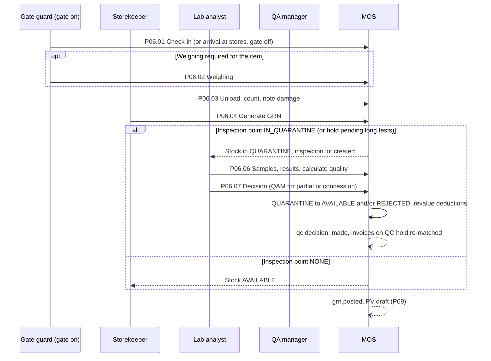

| # | Role | Step | System behaviour | Refs |
|---|---|---|---|---|
| P06.01 | GRD, or STK (gate off) | Registers the arrival and checks in against the PO | As P05.02–03; with the gate off, the storekeeper records the vehicle and delivery note on the GRN | FR-GATE-005, FR-GATE-007, FR-PRC-013 |
| P06.02 | WBO | Weighs, where the item or category requires it | As P05.05–06 | FR-GATE-009, FR-GATE-010 |
| P06.03 | STK | Unloads and counts; records damage | The GRN draft is prepared from the PO and visit at receipt; counted quantities in any unit convert to the base unit once | FR-INB-002, FR-MD-002, BR-INV-06 |
| P06.04 | STK | Generates the GRN | RECEIPT into **QUARANTINE** for IN_QUARANTINE items and for items on "hold pending long tests"; into AVAILABLE for items with no inspection. **The inspection lot is created in the same transaction** (one per GRN line). PO creator ≠ GRN poster | FR-PRC-013, FR-QC-004, FR-QC-006, BR-QC-04, SOD-02 |
| P06.05 | GRD | Exit | As P05.15 | FR-GATE-016 |
| P06.06 | LAB | Samples, results, "Calculate quality" | As P05.07–09. Quarantined stock cannot be issued, transferred off-site, reserved or dispatched meanwhile | FR-QC-007, FR-QC-008, FR-QC-009, BR-QC-01 |
| P06.07 | LAB or QAM | Usage decision | **In one transaction:** status change QUARANTINE → AVAILABLE and/or REJECTED (a partial acceptance splits the lot); lot QC status; a deduction becomes a REVALUATION on the share still on hand, and the consumed share goes to PPV. Outbox `qc.decision_made` lifts the QC hold on matching invoices | FR-QC-012, FR-INV-003, FR-QC-015, BR-QC-02, BR-AP-03, E09, E10, E26 |
| P06.08 | STK / BUY | Handles rejected stock | Supplier return (P08), scrap with approval, or a concession | FR-INV-002, BR-INV-05, E09 |

**Controls:** BR-QC-01 (no use of quarantined stock) and BR-QC-02 (no payment for it). **KPIs:** time in quarantine; rejection rate.

---

### P07 Inbound delivery, flow C: gate module off (the client's own flow)

**Purpose:** the client's procure-to-pay as drafted, where the inspection screen creates the record. **Trigger:** a truck arrives at stores. **Ends:** the GRN is posted and the PV drafted. **Usable from:** M3 (FRD §9.3). **Scenario:** AS-13.

The weigher is whoever holds the weighbridge-operator permission. In a small plant without the gate module this may be the storekeeper; the weight verifier must still be a different person (SOD-10).

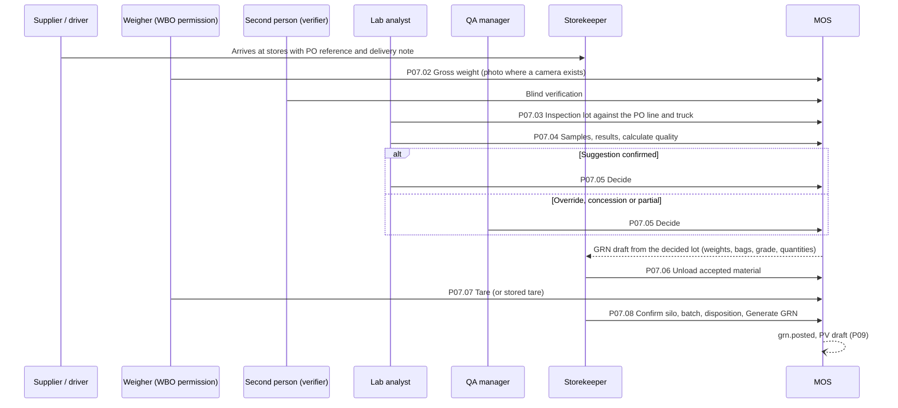

| # | Role | Step | System behaviour | Refs |
|---|---|---|---|---|
| P07.01 | Supplier → STK | The truck arrives at stores with the PO reference and delivery note | The gate module is off: there is no visit record; the inspection lot plays that role | FR-PLT-006 |
| P07.02 | Weigher, verifier | Gross weighing on the weighbridge | Recorded on an inline weigh ticket attached to the inspection lot, with the same controls: division, calibration, photo where a camera exists, blind verification, gap-free ticket number | FR-PRC-013, FR-QC-025, FR-GATE-010, FR-GATE-030, SOD-10 |
| P07.03 | LAB | Creates the inspection lot against the open PO line and the truck: plate, supplier document number, gross, stored or provisional tare, bag count, variety, origin, quantity in secondary units | One live lot per delivery and item; the net is marked **provisional** until the tare is weighed | FR-QC-006, FR-QC-024, FR-QC-025, BR-QC-04 |
| P07.04 | LAB | Samples, results, "Calculate quality" | As P05.07–09 | FR-QC-007, FR-QC-008, FR-QC-009, FR-QC-022, FR-QC-023 |
| P07.05 | LAB or QAM | Usage decision | As P05.10. **In the same transaction** (the `UsageDecisionListener`, implemented by procurement when the gate is off), the GRN draft is prepared from the decided lot: weights, bags, grade, accepted and rejected quantities. **The GRN cannot be generated before a decision** | FR-QC-012, FR-QC-025, FR-INB-001, FR-INB-002, H09 |
| P07.06 | STK | Unloads the accepted material into the silo or store | The rejected part stays on the truck, or is unloaded and held as REJECTED | FR-PRC-013 |
| P07.07 | Weigher | Tare (or the stored tare) | Material net = net − bags × bag tare; the draft's payable quantity is recomputed | FR-PRC-021, FR-PRC-013 |
| P07.08 | STK | Confirms the unit, batch (`BATCH-{YYYYMMDD}-{SEQ:2}` or the supplier's) and disposition, then "Save & Generate GRN" | As P05.16. A difference beyond tolerance between (accepted + held-rejected) and the computed net blocks generation, naming the mismatch. The stock balance reconciles: received includes held-rejected, and status columns sum to on-hand | FR-PRC-013, FR-PRC-014, FR-INV-022, FR-INV-014, SOD-02, H10 |
| P07.09 | MOS | After commit | PV draft (P09.01) | FR-INB-003, H11 |

**Controls:** as P05, without the gate's shift, blacklist and exit clearance. **KPIs:** inspection-to-GRN time; acceptance rate; deduction %.

---

### P08 Supplier return and replacement

**Purpose:** send rejected or defective material back, recover its value, and reopen the PO when the supplier replaces it. **Trigger:** REJECTED held stock, or defective AVAILABLE stock found later. **Ends:** the return is posted, the debit raised, and the PO reopened if replacing. **Usable from:** M2 (M4 through the gate). **Scenarios:** AS-03, AS-09.

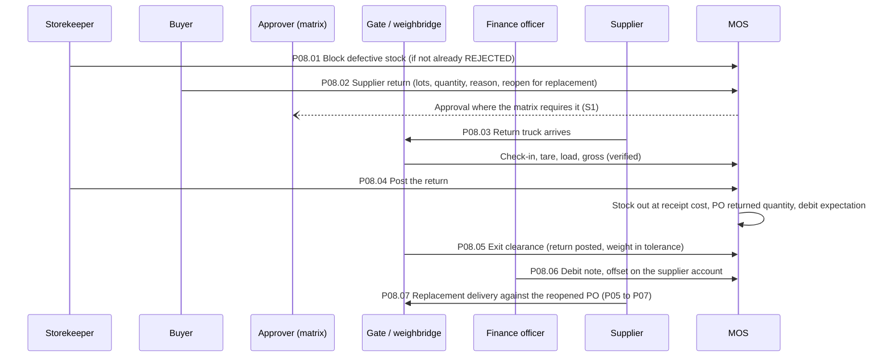

| # | Role | Step | System behaviour | Refs |
|---|---|---|---|---|
| P08.01 | STK / WSUP / QAM | Blocks AVAILABLE stock found defective (REJECTED stock needs no step) | Status change with a reason; on-hand unchanged | FR-INV-003 |
| P08.02 | BUY | Creates the supplier return: lines from REJECTED or AVAILABLE lots, quantity, reason, "reopen for replacement" | Approval through S1 where the matrix requires it; the supplier is notified | FR-PRC-015 |
| P08.03 | GRD, WBO | Return truck: check-in (purpose "outbound purchase return"), tare, loading, gross, verification | As the outbound pattern (§7); verification is required before exit | FR-GATE-006, FR-GATE-009, FR-GATE-010 |
| P08.04 | STK | Posts the return | RETURN_TO_SUPPLIER entries at the **original receipt cost**; the PO line's returned quantity; with "reopen" on, the PO's open quantity increases by the returned quantity. Journal Dr GRNI / Cr Inventory. Outbox `supplier_return.posted` | FR-PRC-015, FR-INV-002, BR-PRC-01, BR-INV-05 |
| P08.05 | GRD | Exit | Exit clearance requires the posted return and the weight within tolerance; **not overridable** | FR-GATE-016, BR-GATE-09, E53, H28 |
| P08.06 | APC | When the returned goods were already invoiced: completes and posts the RETURN debit note drafted by the system (gap-free number, printable), or matches the supplier's credit note instead | Offsets the supplier's open items or the next PV; journal Dr AP / Cr GRNI at the return value. When nothing was invoiced yet, no debit note is needed: the return has already reduced GRNI | FR-PRC-015, FR-AP-009, FR-AP-010 |
| P08.07 | Supplier | Delivers the replacement against the reopened PO line | P05, P06 or P07 | FR-PRC-015 |

With the gate module off, the supplier collects at stores and P08.03 and P08.05 do not apply.

**Controls:** return valued at receipt cost; no exit without the posted return (BR-GATE-09). **KPIs:** returned quantity and value by supplier; days to replacement.

---

### P09 Invoice, match, PV, approval, payment

**Purpose:** pay the supplier the right amount, once, to the right account, with an independent approval. **Trigger:** a GRN posts, or a supplier invoice arrives. **Ends:** the PV is PAID. **Usable from:** M2 (M3 with the payables reports). **Scenarios:** AS-01, AS-05, AS-13.

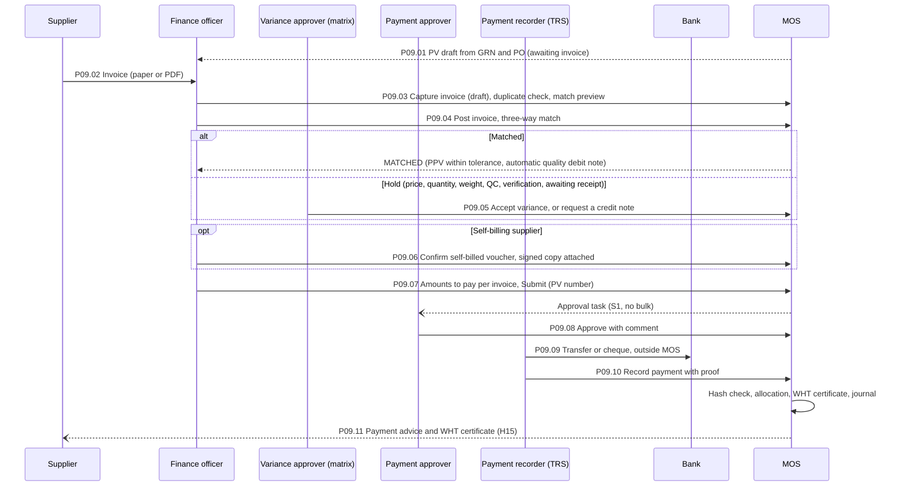

| # | Role | Step | System behaviour | Refs |
|---|---|---|---|---|
| P09.01 | MOS | On `grn.posted`, drafts the PV | Re-reads and locks the GRN and **does nothing if it is no longer POSTED**. Creates a PV DRAFT for APC with the GRN and PO as linked cards, the matched invoices, or "awaiting invoice". A self-billing supplier gets a self-billed voucher draft instead. One automatic PV per GRN, even with duplicate events. Missing finance set-up (tax profile, bank account for a transfer-paid supplier) creates a process exception and never blocks receiving | FR-INB-003, FR-INB-006, FR-INB-007, FR-PLT-050, FR-AP-006, H11, E22 |
| P09.02 | Supplier → APC | Sends the invoice | — | FR-AP-001 |
| P09.03 | APC | Captures the invoice, from the PV screen ("Add invoice") or the invoice list: number, date, lines linked to PO and GRN lines, tax codes, attachment | Saved as a **DRAFT invoice** (typos fixable). Duplicate check on supplier + normalised number + fiscal year (refused), plus a warning for the same amount and date. Due date from the payment terms. A match preview shows the result before posting. An invoice currency different from the PO's is refused (unless the client's USD/ETB rule is confirmed) | FR-AP-001, FR-MD-006, E27, E33 |
| P09.04 | APC | Posts the invoice ("Submit") | Posts to the payables sub-ledger: Cr AP, Dr VAT input, Dr GRNI at the invoice's goods value. **Matching runs in the same transaction:** three-way against the GRN's **payable quantity** and **quality-adjusted price**; two-way plus a service confirmation for service lines. Within tolerance: the difference posts to PPV or rounding. If the excess equals the recorded quality deduction, an **automatic quality debit note** is created and allocated. Otherwise a hold: price, quantity, weight, QC (goods in quarantine), verification pending (unverified weigh ticket), or awaiting receipt. VAT and WHT are computed per line (WHT threshold on the invoice value) | FR-AP-002, FR-AP-003, FR-AP-005, FR-AP-013, FR-PRC-022, BR-AP-01, BR-AP-03, BR-QC-02, H12, E23, E24, E25, E26 |
| P09.05 | Approver (matrix), APC | Resolves holds | Accept the variance (approval through S1; the approver is recorded for SoD) → a PPV entry clears GRNI; or request a credit note from the supplier; or amend the PO for future receipts. A weight dispute is resolved as ours / theirs / split into an AP adjustment request; the weigh ticket is never changed. An invoice that was awaiting receipt re-matches automatically when the GRN posts | FR-AP-004, FR-GATE-015, BR-GATE-12, SOD-05, E11, E23, E25 |
| P09.06 | APC | Self-billing supplier: confirms the self-billed voucher, prints it for the supplier's signature, attaches the signed copy | Gap-free number; deduction lines; no input VAT unless the supplier is VAT-registered. The confirmer cannot be the GRN poster | FR-AP-006, FR-AP-018, SOD-16 |
| P09.07 | APC | Completes and submits the PV: payment method, currency, priority, purpose; amount to pay per invoice line (full or partial) | Supplier payment details are read-only from the master and snapshotted, with the details hash. Gross, VAT, WHT and net per line. **Requested amount = Σ amounts to pay**, never typed. Lines on hold cannot be included. **The PV number (`PV-{FY}-…`) is assigned at submission.** The amounts are reserved against the invoices (reserved + paid ≤ payable). Mode *auto-submit*: a PV whose invoice matched within tolerance is submitted by the system | FR-AP-007, FR-AP-013, FR-AP-014, FR-PLT-041, FR-INB-010, BR-AP-02, H13 |
| P09.08 | PAP | Approves (comment mandatory), rejects or requests changes | Matrix by amount; a recently changed bank account adds a stage; no bulk approval for PVs; TOTP where the role requires it. The approver cannot be the GRN poster, the PO creator or the PV requester. A rejected or cancelled PV keeps its number and releases its reservations. **Changing the payment method after approval sends the PV back for approval** | FR-AP-007, FR-PLT-018, FR-PLT-032, SOD-03, SOD-04, SOD-05, E28 |
| P09.09 | TRS | Executes the payment at the bank, or writes the cheque | Outside MOS | H14 |
| P09.10 | TRS (in the client's process, the same finance officer who raised the PV) | Records the payment: company paying account, method (must equal the PV's), cheque number and date (post-dated allowed) or bank reference, amount (= net), invoices from the approved PV only, proof of payment | **Transfers:** the supplier's account must be ACTIVE, past its cooling-off period, with a details hash equal to the PV snapshot. **Cheques:** payee = supplier's legal name; the cheque number must come from a registered book and be unused. **Cash:** within the cash-box limit, signed receipt attached. Supplier not blocked. Amount in words. Posting allocates to invoices, computes WHT due at payment and issues the **WHT certificate** (gap-free), updates the supplier balance, and posts the journal Dr AP / Cr Bank or Cash (+ Cr WHT). The PV shows PARTIALLY_PAID or PAID. **The PV approver cannot record this payment** | FR-AP-008, FR-AP-012, FR-AP-015, FR-AP-016, BR-AP-04, SOD-15, E29, E30, H14 |
| P09.11 | MOS | After commit | Payment advice and WHT certificate to the supplier (email where configured, otherwise printable) | FR-INB-009, H15 |
| P09.12 | TRS | Maintains cheques: cleared (with date), stale (after the configured age), voided (number kept; voiding a posted payment's cheque needs the payment reversal first) | Cheque-book gap report: every leaf issued, voided or reported missing | FR-AP-012, FR-AP-016 |
| P09.13 | APC / FINC | Reviews supplier statements and ageing, approved-but-unpaid PVs, the **GRNI reconciliation**, and the input VAT and WHT registers | Statement closing balance = ledger balance; GRNI report totals equal the GRNI journal balance; register totals equal the VAT and WHT journals | FR-AP-009, FR-AP-014, FR-AP-017, FR-AP-019 |
| P09.14 | Requester of a service PO | Confirms delivery of service lines (quantity or percentage) | A service receipt with no stock effect, so services are also matched three ways | FR-PRC-022 |

**Correcting mistakes:** a wrong payment → payment reversal (allocations reversed, WHT certificate voided with its number kept) → record again (S2, E31). A miscomputed WHT follows the same route (E34).

**Controls:**
- **Preventive:** three-way match with holds (BR-AP-03); duplicate-invoice refusal; derived PV totals; reservation ceiling (BR-AP-02); independent approval (SOD-03, 04, 05); method fixed at approval; bank hash check (BR-AP-04); payer ≠ approver (SOD-15); proof of payment; gap-free PV, payment, WHT and cheque numbers.
- **Detective:** PPV report; approved-but-unpaid PVs; payments to recently changed accounts; cheque-book gaps; GRNI ageing.

**KPIs:** GRN-to-payment days; match exceptions by age; PPV %; approved-unpaid value.

---

### P10 Stock movements: issue, transfer, status change, adjustment

**Purpose:** every way stock moves or changes status inside the company, other than receipts, production and sales. **Trigger:** stock must be issued, moved, held or corrected. **Ends:** the document is posted. **Usable from:** M2–M3. **Scenario:** AS-06 (inter-site transfer with a short receipt).

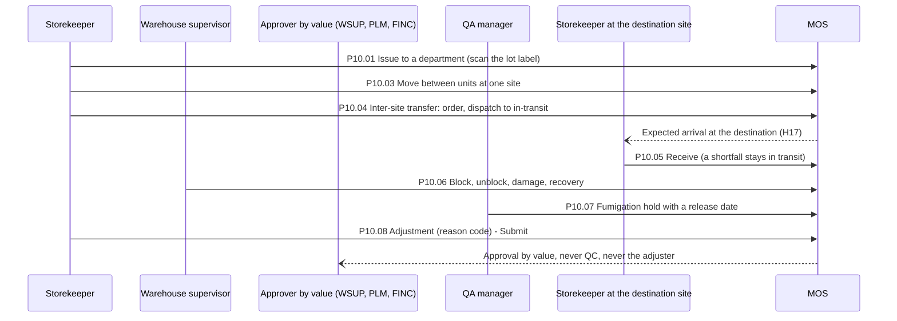

| # | Role | Step | System behaviour | Refs |
|---|---|---|---|---|
| P10.01 | STK | Issues stock to a department or cost centre (consumables, spares), scanning lot labels where a scanner exists | Only AVAILABLE stock; valued at the company-level moving average; **never negative**, and a refusal names the short bucket; approval above the document type's threshold | FR-INV-006, FR-INV-002, FR-INV-010, FR-INV-011, FR-INV-018, E39 |
| P10.02 | STK (restricted permission) | Posts a miscellaneous receipt with a reason and cost | Refused without the permission | FR-INV-005 |
| P10.03 | STK | Transfers between units at one site | One posting with paired, zero-sum entries; the unit's "allow transfer" flag and approval setting apply; capacity check at the destination (warn or block); quarantine-only units refuse AVAILABLE stock | FR-INV-007, FR-MD-010, FR-INV-019, BR-INV-02, E40 |
| P10.04 | STK at the source | Inter-site transfer: transfer order (approval where required), then dispatch | Dispatch moves the stock into the destination's IN_TRANSIT unit **at dispatch cost**. With the gate on, the outbound transfer visit cannot exit until the dispatch is posted. `transfer.dispatched` creates the expected arrival at the destination | FR-INV-007, FR-GATE-004, FR-GATE-016, H17, H28 |
| P10.05 | STK at the destination | Receives the transfer | Received at the dispatch entry's cost. A short receipt stays in transit until it is received later or written off as transit loss (approval, at dispatch cost). The in-transit ageing report lists open quantities; period close warns about them | FR-INV-007, E43 |
| P10.06 | WSUP, STK | Changes stock status: block and unblock (WSUP; releasing a QC-originated block needs QC); damage (STK, reason, photo optional); recovery from DAMAGED (WSUP approval) | A status change is a document with a reason; **it never changes on-hand quantity**. REJECTED and DAMAGED stock leave only by supplier return, scrap or (damaged) approved recovery | FR-INV-003, FR-INV-002, FR-MD-009, BR-INV-05 |
| P10.07 | QAM / WSUP | Places a fumigation or treatment hold on a silo, stack or lot: chemical, dose, operator, date, release-not-before date | The affected stock moves to BLOCKED with reason FUMIGATION. Issues are refused until QC releases it, and release is refused before the date, even for QC | FR-INV-021, E44 |
| P10.08 | STK | Creates a stock adjustment (+/−): type, **reason code** (mandatory), reference, attachment; submits | Approver from the matrix by value (e.g. < X WSUP; X–Y PLM; > Y PLM + FINC): **warehouse authority, never QC, never the adjuster**. Posts only after approval, except below the auto-post threshold. A positive adjustment carries a cost; a negative one is valued at the moving average | FR-INV-008, FR-MD-009, SOD-14 |
| P10.09 | Any inventory user | Reads the stock balance, movement ledger, lot trace, valuation, expiry, adjustments and in-transit reports | Stock balance per material × unit × batch: opening, received, issued, adjusted, closing = Σ status columns; each total shown **per unit of measure**; transaction history per row; backward and forward lot trace; each bucket equals the sum of its ledger movements | FR-INV-001, FR-INV-004, FR-INV-014, FR-RPT-005, FR-MD-001, BR-INV-01 |

**Controls:** no negative stock (BR-INV-03); quarantine enforcement; SOD-14; zero-sum moves (BR-INV-02). **KPIs:** adjustment value by user; blocked and damaged stock value; in-transit ageing.

---

### P11 Stock count (store and silo)

**Purpose:** confirm that the books match the floor, including silos counted by measurement. **Trigger:** a count is planned (cycle or full). **Ends:** the generated adjustment is posted. **Usable from:** M3. **Scenario:** AS-07.

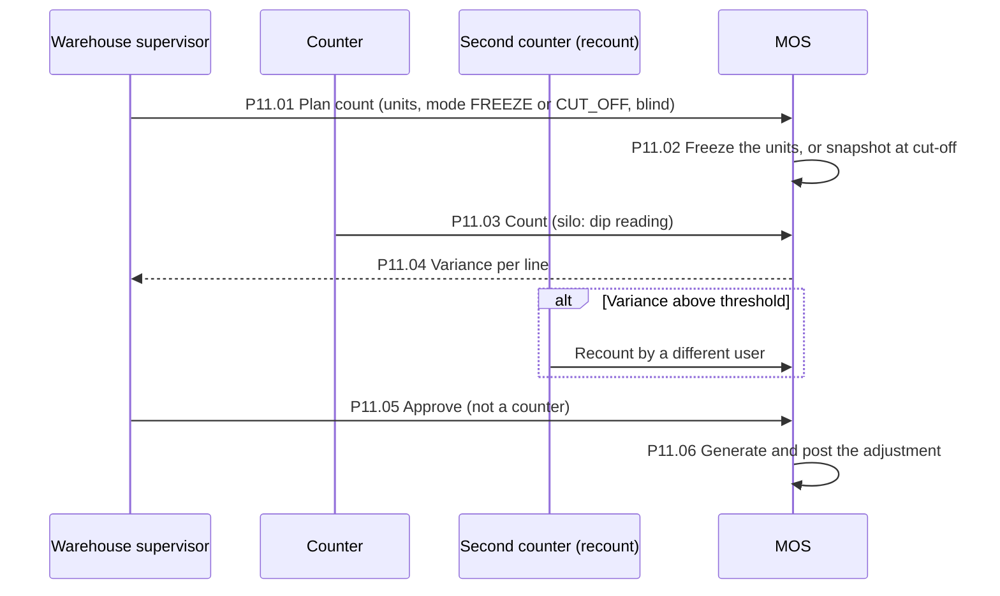

| # | Role | Step | System behaviour | Refs |
|---|---|---|---|---|
| P11.01 | WSUP | Plans a cycle or full count: storage units and items, mode, blind flag | Mode per count: FREEZE (postings to counted units refused until posted) or CUT_OFF (counted against a snapshot; postings after the cut-off roll forward; the default for silos) | FR-INV-009 |
| P11.02 | MOS | Starts the count | FREEZE locks the counted units; CUT_OFF snapshots the book quantity per bucket across all statuses | FR-INV-009, E42 |
| P11.03 | STK (counter) | Counts. Blind counts hide the system quantity. **Silos:** records a dip or level reading | Silo reading → volume through the silo's geometry table → mass through bulk density (latest hectolitre weight of the contents, or a configured value) → compared with the book level | FR-INV-009, FR-INV-020 |
| P11.04 | MOS | Computes variances | Against on-hand across all statuses; above the threshold, a **recount by a different user** is required | FR-INV-009, SOD-09, E41 |
| P11.05 | WSUP | Approves the variances (matrix by value) | The approver cannot be a counter | SOD-09 |
| P11.06 | MOS | Generates the adjustment | Referencing the count; COUNT_ADJ entries at the current moving average; journal to COUNT_VARIANCE; units unfrozen | FR-INV-009 |

**KPIs:** count accuracy (lines within tolerance); variance value; silo book-vs-measured variance.

---

### P12 Production: milling run

**Purpose:** turn wheat from silos into flour grades, bran and other by-products, release the flour, and value the output. **Trigger:** a production plan. **Ends:** the work order is CLOSED. **Usable from:** M5. **Scenarios:** AS-14, AS-17. The client has not yet described its production process; this flow follows flour-milling practice and is validated at the M4 production workshop (client question Q17).

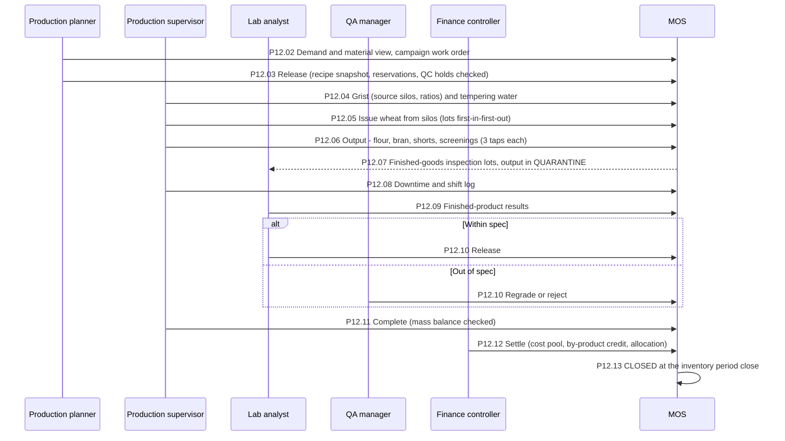

| # | Role | Step | System behaviour | Refs |
|---|---|---|---|---|
| P12.01 | PPL (QAM consulted) | Maintains work centres (cleaning, milling line, packing) with line-side and output units and shift calendars; maintains recipes: inputs (quantity per base, scrap %, manual or backflush), outputs (primary, co-product, by-product, scrap, waste) with expected yield and band, mass-balance band, co-product allocation method | Recipes are versioned and approved; a recipe whose outputs fall outside its mass-balance band cannot be approved; allocation ratios must sum to 100% | FR-MFG-001, FR-MFG-003 |
| P12.02 | PPL | Reviews the **demand and material view** (open sales orders vs available finished stock and released orders; wheat available vs requirement), then creates a **campaign** work order for a milling day or shift | The view's "create work order" pre-fills the order; a wheat shortfall can pre-fill a PR (P03) | FR-MFG-018, FR-MFG-005 |
| P12.03 | PPL | Releases the work order | Snapshots the recipe; soft-reserves the inputs; checks QC and fumigation holds; prints the work-order sheet | FR-MFG-005, FR-INV-015, FR-INV-021, H18 |
| P12.04 | PSUP | Records the grist (source silos with target ratios) and tempering (water litres, conditioning hours) | A blend that deviates from target ratios beyond tolerance shows a warning; the water is included in the mass balance | FR-MFG-015 |
| P12.05 | PSUP | Issues wheat from the silo(s) by quantity | Only AVAILABLE, released lots. **A silo draw names no lot: MOS allocates the silo's lots first-in-first-out** and records the allocation for traceability. PRODUCTION_ISSUE at the moving average; journal Dr WIP / Cr Inventory | FR-MFG-006, FR-INV-019, FR-INV-002, E44, H18 |
| P12.06 | PSUP | Records output per product in ≤ 3 interactions: flour grades, bran, shorts, screenings; lot attributes; labels | PRODUCTION_OUTPUT at a provisional cost (reference cost); lots with PRODUCE links from the allocated input lots; initial status QUARANTINE where release is required. Packaging backflushes; **a shortage creates a pending issue** and never makes stock negative | FR-MFG-007, FR-MFG-011, FR-INV-011, H19, E45 |
| P12.07 | MOS | Creates the finished-goods inspection lot per output lot (or per shift) | In the same transaction as the output | FR-QC-019, H20 |
| P12.08 | PSUP | Records downtime start and stop with a reason; keeps the shift log and handover | Downtime entries on one work centre cannot overlap | FR-MFG-012 |
| P12.09 | LAB | Samples and enters finished-product results (moisture, ash, protein, wet gluten, falling number, water absorption, granulation, colour); records fortification dosing where the client requires it | Evaluated against the finished-product spec; dosing outside tolerance is flagged at release | FR-QC-026, FR-MFG-017 |
| P12.10 | LAB, or QAM | Releases, regrades or rejects | Release: QUARANTINE → AVAILABLE. Regrade: the quantity moves to the lower-grade item **at the same cost**. Reject: REJECTED, then scrap with approval. The releaser cannot be the supervisor who posted that output. Flour cannot be delivered while in QUARANTINE | FR-MFG-008, FR-QC-019, SOD-12, BR-QC-01, H21, E47 |
| P12.11 | PSUP | Completes the work order | No more issues or outputs. The mass balance (Σ outputs − Σ inputs − water) is checked against the recipe band; outside the band, completion needs a reason and the run appears on the loss exception report | FR-MFG-015, FR-MFG-013, E46 |
| P12.12 | PPL or FINC | Posts the settlement prepared by the system | Needs no open pending issues. Cost pool = issues + backflushed packaging; by-products credited at their fixed value; the remainder allocated to primary and co-products; true-up of provisional cost (on-hand share revalued, consumed share to production variance); journals. SETTLED | FR-MFG-014, FR-MFG-006, BR-MFG-01, H22 |
| P12.13 | MOS / PPL | Closes, and reports | CLOSED at the inventory period close. Extraction rate per run and per day, yield and by-product % against the band, waste by reason, downtime Pareto, production vs plan. Backward and forward trace, and a recall report listing affected lots, deliveries and customers | FR-MFG-013, FR-MFG-009 |

**Controls:** only released, available lots consumed; FG hold until release (SOD-12); non-overlapping downtime; mass-balance band; settlement before close (BR-MFG-01). **KPIs:** extraction rate; by-product %; loss vs band; output vs plan; downtime hours by reason.

---

### P13 Packing

**Purpose:** pack released bulk flour into bag SKUs with labels, and prove the net content. **Trigger:** released bulk flour and a packing plan. **Ends:** the packed lots are released. **Usable from:** M5. **Scenario:** AS-16.

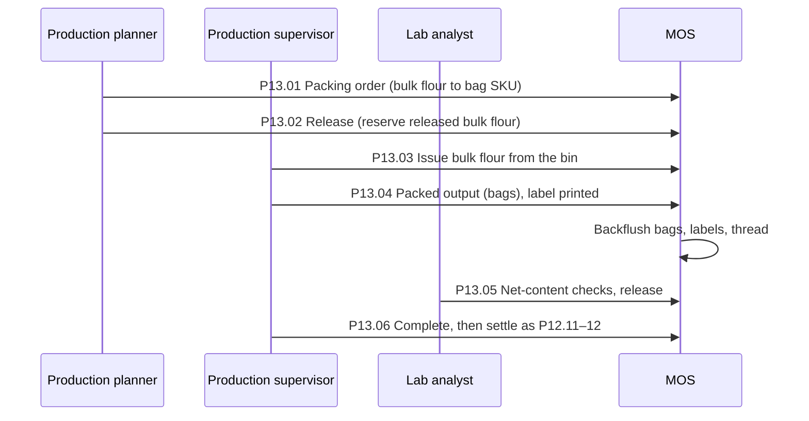

| # | Role | Step | System behaviour | Refs |
|---|---|---|---|---|
| P13.01 | PPL | Creates a packing order: a STANDARD order whose recipe converts bulk flour into a bag SKU (e.g. 50, 25, 10, 5 kg), with bags, labels and thread as backflushed inputs | — | FR-MFG-016, FR-MFG-005 |
| P13.02 | PPL | Releases it | Reserves released AVAILABLE bulk flour only | FR-MFG-005, FR-INV-015 |
| P13.03 | PSUP | Issues bulk flour from the flour bin | Commingled bins allocate lots first-in-first-out | FR-MFG-006 |
| P13.04 | PSUP | Records packed output (number of bags) | A packed lot is created and its bag label prints with lot and dates; bags, labels and thread backflush; a shortage becomes a pending issue | FR-MFG-016, FR-INV-018, FR-INV-011 |
| P13.05 | LAB | Records net-content sample checks against the packed-product spec; releases | As P12.10 | FR-QC-026, FR-MFG-008 |
| P13.06 | PSUP, PPL / FINC | Completes and settles | As P12.11–12 | FR-MFG-014 |

**KPIs:** bags packed per shift; net-content pass rate; packaging usage vs recipe.

---

### P14 Order to cash (credit sale and cash sale)

**Purpose:** sell flour and by-products within credit rules, load and weigh the truck, post the goods issue **before** it leaves, invoice and collect. **Trigger:** a customer order. **Ends:** the delivery is DELIVERED and the invoice PAID. **Usable from:** M5–M6. **Scenarios:** AS-15, AS-18. The client has not yet described its sales process; this flow is validated at the M5 sales workshop (client question Q18).

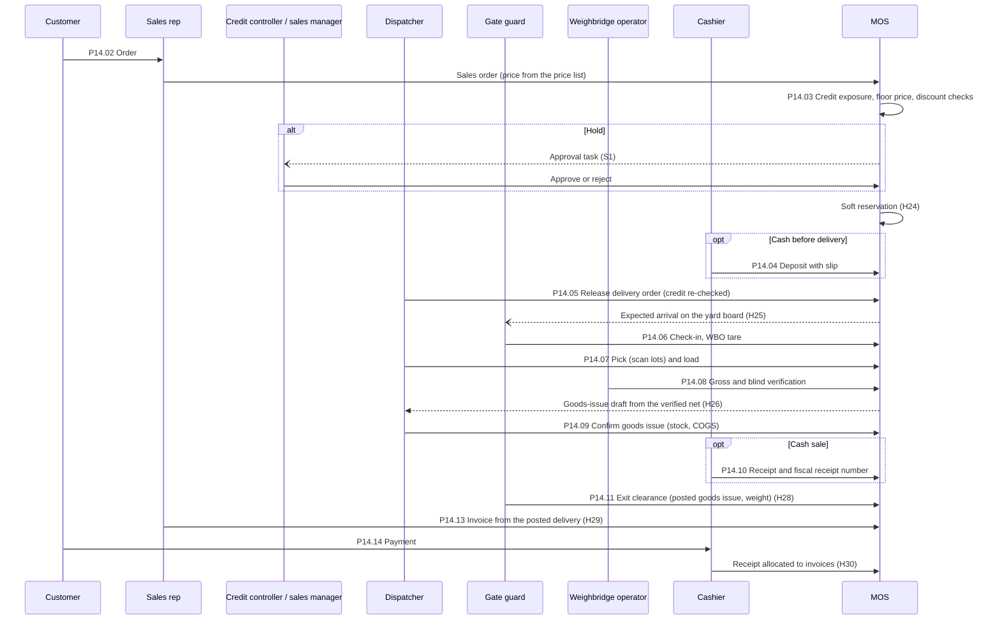

| # | Role | Step | System behaviour | Refs |
|---|---|---|---|---|
| P14.01 | SREP, CRC, SMGR | Maintain customers and price lists: SREP drafts a customer; CRC sets the credit limit, check mode and terms; the customer is approved. Price-list versions are approved before they take effect | Duplicate TIN refused. A credit-limit change is its own approval; the requester cannot approve it | FR-SAL-001, FR-SAL-002, FR-SAL-016, FR-SAL-017, FR-MD-005, SOD-17, E63 |
| P14.02 | SREP | Creates the sales order: customer, ship-to, lines | Price resolved deterministically from the price list in force and **snapshotted** on the line; line discount within the role's limit | FR-SAL-002, FR-SAL-004 |
| P14.03 | SREP | Submits | Approval triggers: credit exposure (open receivables + delivered-not-invoiced + open orders + this order) above the limit, overdue beyond N days, price below floor, discount above limit, manual hold → ON_HOLD for CRC or SMGR (S1). The approver cannot be the creator. On approval: soft reservation of available-to-use; if short, a warning, and only what is available is reserved | FR-SAL-004, FR-SAL-005, FR-INV-015, BR-SAL-01, SOD-12, H24, E49, E50, E51 |
| P14.04 | CSH | Cash-before-delivery: records the customer's deposit with its slip | An advance on the customer account; the delivery order cannot be released until it covers the order value | FR-SAL-013 |
| P14.05 | DSP | Creates and releases the delivery order | Credit exposure re-checked at release. The expected arrival appears on the yard board (`delivery_order.released`) | FR-SAL-006, FR-SAL-015, FR-GATE-004, BR-SAL-01, H25 |
| P14.06 | GRD, WBO | Checks in the truck (purpose "outbound sales"); first weighing (tare) | As P05.02–05 with the outbound direction (first tare, second gross) | FR-GATE-006, FR-GATE-009, FR-GATE-011 |
| P14.07 | DSP (STK) | Picks by scanning lots, and loads | Only AVAILABLE, released lots; quarantined flour cannot be picked | FR-SAL-006, BR-QC-01 |
| P14.08 | WBO, second person | Second weighing (gross) and blind verification (always required before an outbound exit) | Net vs the delivery order checked against tolerance: over-loading beyond tolerance **blocks exit** until the excess is unloaded and re-weighed (a superseding weighing) or the order is amended. The verified net becomes the goods-issue draft (`OutboundLoadListener`) | FR-GATE-010, FR-GATE-012, FR-GATE-014, H26, E52 |
| P14.09 | DSP | Confirms the goods issue | SALES_ISSUE at the moving average (journal Dr COGS / Cr Inventory); reservation released; the delivery order becomes GOODS_ISSUED and the visit follows (`goods_issue.posted`); delivery note printed | FR-SAL-006, FR-INV-006, BR-SAL-02, H27 |
| P14.10 | CSH | Cash sale: takes the payment in an open cash session; enters the fiscal receipt number and machine ID | Exit is blocked until the receipt is posted and (setting) the fiscal number is entered | FR-SAL-008, FR-SAL-012, FR-SAL-014, E54 |
| P14.11 | GRD | Scans the exit pass | Exit clearance asks, through the `OutboundDocumentChecker` port, whether the goods issue is posted and the weight within tolerance. **Not overridable.** EXITED | FR-GATE-016, FR-GATE-018, BR-GATE-09, H28, E53 |
| P14.12 | DSP | Records delivery confirmation with the signed delivery note attached | DELIVERED (a tokenised driver link is v1.1) | FR-SAL-006 |
| P14.13 | SREP (billing; the role is confirmed at the sales workshop) | Posts the customer invoice from the posted delivery | Lines only from posted delivery lines (never more than delivered); tax per line; **gap-free number at posting**; fiscal receipt reference; advances allocated; journal Dr AR (or customer advance) / Cr Revenue + VAT output | FR-SAL-008, FR-SAL-012, FR-SAL-013, FR-PLT-041, BR-SAL-03, H29 |
| P14.14 | CSH | Records the customer's payment (cash, transfer, cheque with clearance, mobile money) and allocates it to invoices | Cash receipts need an open cash session; journal Dr Bank/Cash / Cr AR | FR-SAL-008, FR-SAL-014, FR-AP-015, H30 |
| P14.15 | CSH | A cheque bounces | Receipt reversal reopens the invoices; credit exposure rises; CRC notified | FR-SAL-008, E55 |
| P14.16 | CRC, SREP | Statements, ageing, collections; sales reports by product, customer, region and salesperson; output VAT register | Ageing total = receivables balance | FR-SAL-010, FR-AP-017 |
| P14.17 | CSH | Closes the cash session: count, variance with reason, handover | A session cannot close without a count | FR-SAL-014, E57 |

**Controls:**
- **Preventive:** credit exposure at approval and release (BR-SAL-01); floor prices and discount limits; creator ≠ approver (SOD-12); no goods issue without an approved order and released delivery (BR-SAL-02); **no exit without the posted goods issue and weight in tolerance (BR-GATE-09)**; invoices only from deliveries (BR-SAL-03); gap-free invoice and receipt numbers.
- **Detective:** credit-limit overrides; cash-session variances.

**KPIs:** orders and tonnes shipped; credit holds; dispatch turnaround; receivables ageing.

---

### P15 Customer return and credit note

**Purpose:** take goods back safely (quarantine and inspection first), or credit a price or shortage claim, always against the original invoice. **Trigger:** a customer returns goods or makes a claim. **Ends:** the credit note is posted. **Usable from:** M6. **Scenario:** AS-19.

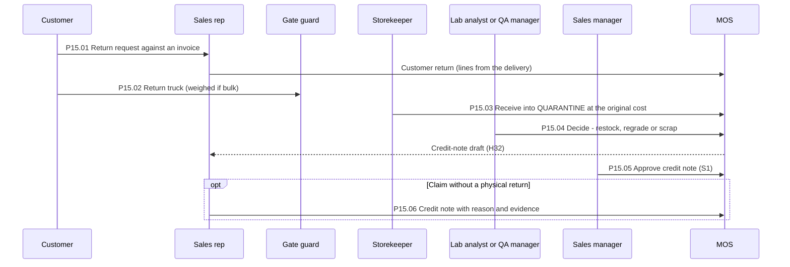

| # | Role | Step | System behaviour | Refs |
|---|---|---|---|---|
| P15.01 | SREP | Records the customer return against the original delivery and invoice lines | The quantity cannot exceed delivered minus already returned | FR-SAL-009 |
| P15.02 | GRD, WBO | Inbound customer-return visit; weighing if bulk | Visit purpose "inbound customer return" (§7) | FR-GATE-006, H31 |
| P15.03 | STK | Receives the goods | CUSTOMER_RETURN entries into **QUARANTINE** at the original cost of goods sold; an inspection lot is created in the same transaction | FR-SAL-009, FR-QC-006 |
| P15.04 | LAB or QAM | Decides: restock (→ AVAILABLE), regrade, or scrap (approval) | The decision drafts the credit note (`UsageDecisionListener`, implemented by sales) | FR-SAL-009, FR-QC-012, H32 |
| P15.05 | SMGR | Approves the credit note (matrix) | Never more than the original invoice line's quantity and price; gap-free number; reverses the revenue and VAT lines. A credit balance is offset against later invoices | FR-SAL-009, BR-SAL-03, FR-PLT-041 |
| P15.06 | SREP → SMGR | A credit note **without** a physical return (price correction, shortage or damage claim): reason and evidence (e.g. the signed delivery note) | Approval through the matrix; the same ceiling | FR-SAL-018, E56 |

Whether customers are ever refunded in cash (rather than offset against later invoices) is a client question for the Phase 5 register. **KPIs:** returns by reason and customer; credit-note value.

---

### P16 Material gate pass

**Purpose:** control items and assets that leave the site outside a sale, return or transfer, and bring back what must return. **Trigger:** an item or asset must leave (tools for repair, scrap sale, loan). **Ends:** the pass is closed. **Usable from:** M4.

```mermaid
sequenceDiagram
    participant REQ as Requester
    participant APR as Approver (matrix)
    participant GRD as Gate guard
    participant MOS as MOS
    REQ->>MOS: P16.01 Gate pass (returnable or not, lines, return date)
    MOS--)APR: Approval (S1)
    APR->>MOS: Approve
    GRD->>MOS: P16.02 Verify items at exit, record the movement
    MOS->>MOS: Non-returnable stock item needs its posted inventory document
    opt Returnable
        GRD->>MOS: P16.03 Record the return (partial allowed)
        MOS--)REQ: Overdue alert after the return date
    end
```

| # | Role | Step | System behaviour | Refs |
|---|---|---|---|---|
| P16.01 | REQ | Creates the pass: returnable or non-returnable, reason, lines (item or asset tag or serial, quantity, estimated value), expected return date, validity; submits | Approval through S1 | FR-GATE-019 |
| P16.02 | GRD | Verifies the items at exit and records the movement (partial allowed) | A non-returnable **stock** item cannot exit without its posted inventory document (e.g. a scrap-sale issue); exit clearance applies | FR-GATE-019, FR-GATE-016, FR-GATE-018, FR-INV-006, H28 |
| P16.03 | GRD | Records the returns | The pass closes when everything is back; overdue returns alert the requester and SSUP | FR-GATE-019, E59 |

---

### P17 Period close and journal export

**Purpose:** close the month in a fixed order so that stock, payables, receivables and journals agree, then hand the journals to the accounting package. **Trigger:** month end. **Ends:** the periods are CLOSED and the journals exported. **Usable from:** M3 (inventory and payables), M6 (all modules). **Scenario:** AS-08.

```mermaid
sequenceDiagram
    participant FINC as Finance controller
    participant PPL as Production planner
    participant WSUP as Warehouse supervisor
    participant APC as Finance officer
    participant MOS as MOS
    participant ACC as Accounting package
    FINC->>MOS: P17.01 Open the close checklist
    PPL->>MOS: P17.02 Settle every work order with postings in the period
    WSUP->>MOS: P17.03 Counts done, in-transit reviewed, no unposted documents
    FINC->>MOS: P17.04 Soft close
    MOS->>MOS: P17.05 Inventory value snapshot
    APC->>MOS: P17.06 GRNI, tax registers, exceptions reviewed
    FINC->>MOS: P17.07 Generate journal export batch
    FINC->>ACC: Import the CSV (outside MOS)
    FINC->>MOS: P17.08 Close (reopen needs approval)
```

| # | Role | Step | System behaviour | Refs |
|---|---|---|---|---|
| P17.01 | FINC | Opens the period's close checklist | Periods per module: OPEN → SOFT_CLOSED → CLOSED | FR-PLT-042 |
| P17.02 | PPL / FINC | Settles every work order with postings in the period | Inventory close is refused while any such order is unsettled | BR-MFG-01, FR-MFG-014, E48 |
| P17.03 | WSUP | Clears the inventory checklist: no unposted documents dated in the period, no open counts, in-transit report reviewed | The checklist names each blocking item | FR-INV-012, FR-INV-007 |
| P17.04 | FINC | Soft-closes | Postings into the period now need a permission | FR-PLT-042 |
| P17.05 | MOS | Snapshots inventory value per bucket and item | "As of" reports for the period become reproducible and fast | FR-INV-012 |
| P17.06 | APC / FINC | Reviews the GRNI reconciliation, approved-but-unpaid PVs, match exceptions, input and output VAT and WHT registers, and the exception reports | Register totals equal their journals; the GRNI report equals the GRNI balance | FR-AP-017, FR-AP-019, FR-AP-014, FR-RPT-004 |
| P17.07 | FINC | Generates the journal export batch up to the cut-off | Claims every unexported journal entry (never by id cursor); CSV with the account map applied, per-entry rounding lines, checksum; a re-download is byte-identical. The accounting package imports it outside MOS | FR-AP-010, H33 |
| P17.08 | FINC | Closes | A posting into a closed period is refused. Reopening needs approval (S1) | FR-PLT-042, E58 |

**KPIs:** days to close; exception count at close; GRNI ageing.

---

### P18 Gate outage: paper mode and back-entry

**Purpose:** keep trucks moving when the system or network is down, without losing control. **Trigger:** the system or network is unavailable at the gate. **Ends:** back-entry is complete with no slip gaps. **Usable from:** M4. **Scenario:** AS-10.

```mermaid
sequenceDiagram
    participant SSUP as Security supervisor
    participant GRD as Gate guard / weighbridge operator
    participant VER as Second person
    participant MOS as MOS
    SSUP->>GRD: P18.01 Declare the outage, issue registered slip books
    GRD->>GRD: P18.02 Paper slips (times, weights, indicator photo)
    Note over GRD: Outbound exit only for dispatches already posted and on the degraded-mode list
    GRD->>MOS: P18.03 Back-entry after recovery (slip time kept, scan attached)
    VER->>MOS: Second-person verification
    MOS-->>SSUP: P18.04 Gap detection, incident for a missing number
    SSUP->>MOS: P18.05 Approve the back-entry batch
```

| # | Role | Step | System behaviour | Refs |
|---|---|---|---|---|
| P18.01 | SSUP | Declares the outage; issues the registered, pre-numbered slip books for each post | Only registered series are valid; the outage rules are shown on the gate screen when it is available | FR-GATE-023, BR-GATE-11 |
| P18.02 | GRD, WBO | Record arrivals, weights and exits on paper | **Inbound deliveries may continue. Outbound goods may exit only if their dispatch was already posted and is on the degraded-mode list**; this stop is deliberate | FR-GATE-016, FR-GATE-023, NFR-11, E60 |
| P18.03 | GRD, WBO; second person | Enter the slips in the back-entry workbench | The slip's actual time is kept separate from the entry time; the slip scan or photo is mandatory; second-person verification | FR-GATE-024 |
| P18.04 | MOS | Detects gaps | Every issued slip number must end used, void or lost; a missing number creates an incident | FR-GATE-024, FR-GATE-022, E61 |
| P18.05 | SSUP | Approves the batch | Downstream steps continue as in P05 (GRN drafts from back-entered weighings) | FR-GATE-024 |

---

### P19 Installation set-up and data migration

**Purpose:** set up a new installation and bring in opening data so the first day starts from reconciled balances. **Trigger:** a new installation, or go-live. **Ends:** opening balances are posted and reconciled. **Usable from:** M1 (set-up and import tools); performed for real in M7 (go-live).

| # | Role | Step | System behaviour | Refs |
|---|---|---|---|---|
| P19.01 | ADM | Runs the set-up wizard: company profile (legal name, TIN/VAT, address, logo), base currency, fiscal-year start, time zone, rounding mode, first site | The profile prints on every document; base currency locks after the first posting; business dates use the site's time zone | FR-PLT-008, FR-PLT-003, FR-PLT-004 |
| P19.02 | ADM | Creates sites, departments, warehouses and storage units (types, capacity, levels, silo geometry, allowed categories and statuses, keepers, restrictions) | One company only in v1; safety ≤ reorder ≤ maximum ≤ capacity | FR-PLT-002, FR-PLT-007, FR-MD-010 |
| P19.03 | ADM | Sets the modules (gate on or off), automation modes and device settings | See §1.3 | FR-PLT-006, FR-INB-010, NFR-14 |
| P19.04 | ADM | Installs the grain/flour-milling industry pack | Seeds categories and attribute schemas, QC parameters and methods, specs, grade schemes, score models, deduction rules, reason codes, checklists, label and recipe templates | FR-MD-011, FR-MD-004, FR-MD-009, FR-QC-001 |
| P19.05 | ADM, FINC | Configures number series, fiscal periods, approval matrix, SoD rules, account map, tax codes, payment terms, currencies and rates, banks, company paying accounts, cheque books | Patterns such as `PV-{FY}-{SEQ:6}`; rates are seed data confirmed by the client | FR-PLT-040, FR-PLT-042, FR-PLT-023, FR-PLT-028, FR-AP-010, FR-MD-006, FR-MD-007, FR-MD-008, FR-MD-012, FR-AP-015, FR-AP-016 |
| P19.06 | ADM | Creates users (local, or invited for SSO) and assigns roles with site scopes; TOTP enrolment for the roles that require it | Risky role combinations are flagged | FR-PLT-011, FR-PLT-012, FR-PLT-018, SOD-13 |
| P19.07 | Data owners, ADM | Import templates: items with UoM conversions, suppliers, customers, storage units, opening stock with lots and costs, open supplier and customer balances | A dry run reports row-level errors; commit is all-or-nothing; opening stock posts as OPENING_BALANCE receipts with explicit costs | FR-PLT-047, FR-MD-001, FR-MD-002, FR-MD-003, FR-MD-005, FR-INV-005 |
| P19.08 | QAM | Approves the specs, grade schemes, score models and price rules; sets the QC policy per item (inspection point, release mode, sampling plan, CoA, retention) | Specs are versioned; approved specs for the same scope cannot overlap in dates | FR-QC-002, FR-QC-003, FR-QC-004, FR-QC-005, FR-QC-013, FR-QC-022, FR-QC-023 |
| P19.09 | SSUP, ADM | Gate masters: posts, weighbridges (capacity, division, calibration), vehicles and stored tares, drivers, transporters, blacklist, paper slip series | Duplicate plates refused after normalisation | FR-GATE-001, FR-GATE-002, FR-GATE-013, FR-GATE-023 |
| P19.10 | PPL, SMGR, CRC | Work centres and recipes; customers, credit limits and price lists | Approved as in P12.01 and P14.01 | FR-MFG-001, FR-MFG-003, FR-SAL-001, FR-SAL-002 |
| P19.11 | FINC | Reconciles the opening balances (stock value, AP, AR) to the old records before go-live | Sign-off recorded | FR-PLT-047 |

---

### P20 Administration and audit

**Purpose:** keep access right and prove the records have not been tampered with. **Trigger:** ongoing. **Usable from:** M1. **Scenario:** AS-11.

| # | Role | Step | System behaviour | Refs |
|---|---|---|---|---|
| P20.01 | ADM | Changes roles and site scopes | Effective on the user's next request, with no re-login; risky combinations (e.g. APC + PAP, BUY + STK) are reported | FR-PLT-014, FR-PLT-012, SOD-13 |
| P20.02 | MOS | Seals and verifies the audit log | A worker seals committed audit rows every few minutes; a daily job verifies the seal chain and alerts on a break | FR-PLT-046, NFR-07 |
| P20.03 | AUD, FINC, PLM | Review the exception reports: overrides, back-entries, stored-tare use, tare deviations, net-vs-declared outliers, PPV, adjustments, reversals, open process exceptions, late approvals, dormant supplier reactivations, bank-detail changes, payments to recently changed accounts, cheque-book gaps, approved-unpaid PVs, credit-limit overrides, production loss outside band, audit-chain result | AUD has read-only access to everything | FR-RPT-004 |
| P20.04 | ADM, AUD | Quarterly access review | The export lists every user, role, scope, grant date and grantor, and matches the database | FR-PLT-017 |

---

## 6. L3: lifecycles

Each diagram draws one row of the canonical status vocabulary in [FRD §1.5](MOS-FRD.md#15-status-vocabulary-canonical). State names match the FRD exactly; transition labels give the action and, in brackets, the usual role.

Three rules hold for every diagram:
- A status changes **only through a named action**, never by editing a field (FR-PLT-031).
- Every transition is a status-guarded update. Two people acting at once: one succeeds, and the other receives a conflict showing the fresh state (E17).
- **Displayed** fulfilment statuses are computed from the stored status plus fulfilment columns, and are marked *derived* below. Examples: PARTIALLY_ORDERED, PARTIALLY_RECEIVED, PARTIALLY_PAID, PARTIALLY_DELIVERED. See TDD §8.3.

### 6.1 Generic approval-controlled document

Used by every document with an approval chain unless its own diagram below says otherwise.

```mermaid
stateDiagram-v2
    %% lifecycle: Generic approval-controlled document
    [*] --> DRAFT
    DRAFT --> SUBMITTED : submit (creator)
    SUBMITTED --> DRAFT : request changes (approver, logged as RETURNED) or recall (submitter)
    SUBMITTED --> APPROVED : last stage approves (approvers)
    SUBMITTED --> REJECTED : reject with comment (approver)
    APPROVED --> [*]
    REJECTED --> [*]
```

### 6.2 Supplier and customer

```mermaid
stateDiagram-v2
    %% lifecycle: Supplier
    %% lifecycle: Customer
    [*] --> DRAFT
    DRAFT --> SUBMITTED : submit (BUY or SREP)
    SUBMITTED --> DRAFT : request changes
    SUBMITTED --> APPROVED : approve (PMGR or SMGR, not the creator)
    SUBMITTED --> REJECTED : reject
    APPROVED --> SUSPENDED : suspend with reason
    SUSPENDED --> APPROVED : reinstate
    APPROVED --> BLOCKED : block with reason
    SUSPENDED --> BLOCKED : block with reason
    BLOCKED --> APPROVED : unblock (approval)
    APPROVED --> INACTIVE : deactivate (no open documents or balances)
    INACTIVE --> APPROVED : reactivate (approval)
    note right of BLOCKED
        No new orders, no receipts or deliveries, no payments
    end note
```

A customer's **manual credit hold** is a flag, not a status (FR-SAL-001).

### 6.3 Supplier bank account

The change request itself follows the generic lifecycle (§6.1) with the dual-control rules of P02.

```mermaid
stateDiagram-v2
    %% lifecycle: Supplier bank account
    [*] --> PENDING : new account (registration or change request)
    PENDING --> ACTIVE : change request approved and call-back recorded
    PENDING --> REJECTED : change request rejected
    ACTIVE --> INACTIVE : replaced or closed
    note right of ACTIVE
        Usable for transfers only after the cooling-off period
    end note
```

### 6.4 Purchase requisition

```mermaid
stateDiagram-v2
    %% lifecycle: Purchase requisition (PR)
    [*] --> DRAFT
    DRAFT --> SUBMITTED : submit (STK or REQ)
    SUBMITTED --> DRAFT : request changes or recall
    SUBMITTED --> APPROVED : approve (MGMT)
    SUBMITTED --> REJECTED : reject
    DRAFT --> CANCELLED : cancel
    APPROVED --> CANCELLED : cancel before ordering
    APPROVED --> PARTIALLY_ORDERED : some lines on POs (derived)
    APPROVED --> ORDERED : all lines on POs (derived)
    PARTIALLY_ORDERED --> ORDERED : remaining lines on POs (derived)
    PARTIALLY_ORDERED --> CLOSED : short-close with reason (BUY)
    ORDERED --> [*]
    CLOSED --> [*]
```

### 6.5 Purchase order

A revision (FR-PRC-011) is a separate draft copy with its own approval; while it is in approval, receipts continue against the approved revision.

```mermaid
stateDiagram-v2
    %% lifecycle: Purchase order (PO)
    [*] --> DRAFT
    DRAFT --> SUBMITTED : submit (BUY)
    SUBMITTED --> DRAFT : request changes or recall
    SUBMITTED --> APPROVED : approve (PMGR, MGMT, PLM per band)
    SUBMITTED --> REJECTED : reject
    APPROVED --> ISSUED : issue by email or print (BUY)
    APPROVED --> CANCELLED : cancel
    ISSUED --> CANCELLED : cancel (zero receipts only)
    ISSUED --> PARTIALLY_RECEIVED : GRN posted (derived)
    PARTIALLY_RECEIVED --> RECEIVED : fully received within tolerance (derived)
    PARTIALLY_RECEIVED --> CLOSED : short-close with reason (BUY)
    RECEIVED --> CLOSED : fully invoiced (automatic)
    CLOSED --> [*]
```

### 6.6 Expected arrival

```mermaid
stateDiagram-v2
    %% lifecycle: Expected arrival
    [*] --> PLANNED : PO approved, transfer dispatched, or delivery order released
    PLANNED --> ARRIVED : truck registered at the gate (GRD)
    PLANNED --> CANCELLED : source cancelled or closed
    ARRIVED --> CLOSED : visit exited
    CLOSED --> [*]
    CANCELLED --> [*]
```

The yard board shows PLANNED arrivals as "Expected". Automatic no-show handling is v1.1.

### 6.7 Gate visit, inbound (behaviour class INBOUND_PO)

```mermaid
stateDiagram-v2
    %% lifecycle: Gate visit (inbound)
    [*] --> CHECKED_IN : check-in with a valid PO (GRD)
    [*] --> HOLD_NO_PO : no valid PO
    HOLD_NO_PO --> CHECKED_IN : PO linked (BUY or PMGR)
    HOLD_NO_PO --> REJECTED_AT_GATE : rejected by procurement
    CHECKED_IN --> FIRST_WEIGHED : gross weighing (WBO)
    CHECKED_IN --> UNLOAD_AUTHORIZED : quarantine or no-inspection item, not weighed
    FIRST_WEIGHED --> SAMPLED : samples drawn (LAB)
    FIRST_WEIGHED --> UNLOAD_AUTHORIZED : quarantine or no-inspection item
    SAMPLED --> QC_DECIDED : usage decision (LAB or QAM)
    QC_DECIDED --> UNLOAD_AUTHORIZED : accepted, pre-flight passed
    QC_DECIDED --> REJECTED_AT_GATE : rejected
    UNLOAD_AUTHORIZED --> UNLOADED : unloaded (STK)
    UNLOAD_AUTHORIZED --> ABANDONED : truck leaves without unloading (SSUP)
    UNLOADED --> GRN_DRAFTED : tare, GRN draft built (WBO)
    UNLOADED --> RECEIPT_EXCEPTION : GRN validation fails
    UNLOADED --> EXITED : exit without tare (SSUP, flagged)
    GRN_DRAFTED --> RECEIPTED : GRN generated (STK)
    GRN_DRAFTED --> EXITED : tare verified, truck leaves before the GRN is confirmed
    RECEIPT_EXCEPTION --> GRN_DRAFTED : exception resolved
    RECEIPT_EXCEPTION --> EXITED : supervisor override exit pass
    RECEIPTED --> EXITED : exit clearance (GRD)
    REJECTED_AT_GATE --> EXITED : exit weighing within tolerance
    ABANDONED --> EXITED : exit clearance
    CHECKED_IN --> CANCELLED : registered in error (SSUP)
    CANCELLED --> EXITED : exit clearance
    EXITED --> [*]
```

Flow B (quarantine) and no-inspection items go straight from CHECKED_IN or FIRST_WEIGHED to UNLOAD_AUTHORIZED; their GRN posts at unloading. In mode *automatic*, UNLOADED goes straight to RECEIPTED at the tare. With the gate module off (flow C) there is no visit: the inspection lot carries the process.

### 6.8 Gate visit, outbound (OUTBOUND_SALES, OUTBOUND_RETURN, OUTBOUND_TRANSFER)

```mermaid
stateDiagram-v2
    %% lifecycle: Gate visit (outbound)
    [*] --> CHECKED_IN : check-in against the expected arrival (GRD)
    CHECKED_IN --> FIRST_WEIGHED : tare (WBO)
    CHECKED_IN --> LOADING : bagged goods, no weighing required
    FIRST_WEIGHED --> LOADING : loading starts (DSP)
    LOADING --> SECOND_WEIGHED : gross, blind-verified (WBO)
    SECOND_WEIGHED --> SECOND_WEIGHED : excess unloaded, re-weighed
    SECOND_WEIGHED --> GOODS_ISSUED : outbound document posted (DSP or STK)
    LOADING --> GOODS_ISSUED : outbound document posted (not weighed)
    GOODS_ISSUED --> EXITED : exit clearance, not overridable (GRD)
    CHECKED_IN --> CANCELLED : cancelled before loading
    LOADING --> CANCELLED : unloaded, cancelled before goods issue
    CANCELLED --> [*]
    EXITED --> [*]
```

"Outbound document" is the goods issue (sales), the supplier return (purchase return) or the transfer dispatch (inter-site transfer).

### 6.9 Weigh ticket

```mermaid
stateDiagram-v2
    %% lifecycle: Weigh ticket
    [*] --> OPEN : first weighing (gap-free number per weighbridge)
    OPEN --> COMPLETE : second weighing, or stored tare
    OPEN --> VOIDED : visit cancelled (number kept)
    COMPLETE --> LOCKED : consumed by a posted GRN, goods issue or return
    COMPLETE --> VOIDED : voided with approval (number kept)
    LOCKED --> VOIDED : downstream document reversed, new linked ticket issued (approval)
    LOCKED --> [*]
    VOIDED --> [*]
```

**Verification** is a separate status on the ticket: NOT_REQUIRED, PENDING or VERIFIED (FR-GATE-010). An inbound ticket may be LOCKED while its verification is still PENDING (deferred verification). Its GRN then posts, but the invoice cannot match until the ticket is VERIFIED. Re-weighing adds a superseding weighing to an OPEN or COMPLETE ticket; it never deletes one.

### 6.10 Inspection lot

```mermaid
stateDiagram-v2
    %% lifecycle: Inspection lot
    [*] --> CREATED : first weighing, LAB against a PO line, GRN posting, FG output, or re-inspection
    CREATED --> IN_TESTING : first result entered (LAB)
    IN_TESTING --> DECISION_PENDING : all mandatory results in, quality calculated
    DECISION_PENDING --> DECIDED : usage decision (LAB, or QAM)
    DECIDED --> DECISION_PENDING : reopened before unloading or receipt (reason)
    DECIDED --> CLOSED : effects complete (GRN posted, truck exited, status changed)
    CREATED --> CANCELLED : created in error or visit cancelled
    IN_TESTING --> CANCELLED : visit abandoned before a decision
    CLOSED --> [*]
    CANCELLED --> [*]
```

Out-of-spec investigation is a flag, not a state. A superseding decision after stock or financial effects keeps the lot CLOSED, needs QAM approval and creates compensating documents (FR-QC-015).

### 6.11 Stock status (per bucket)

```mermaid
stateDiagram-v2
    %% lifecycle: Stock status (per bucket)
    [*] --> QUARANTINE : receipt of an item inspected in quarantine, FG output, customer return
    [*] --> AVAILABLE : receipt of an accepted or non-inspected item
    [*] --> REJECTED : held-rejected quantity at receipt
    QUARANTINE --> AVAILABLE : QC decision (accept or release)
    QUARANTINE --> REJECTED : QC decision (reject)
    AVAILABLE --> BLOCKED : block (WSUP or QC), fumigation hold
    BLOCKED --> AVAILABLE : unblock (QC for QC-originated blocks, after the release date)
    AVAILABLE --> DAMAGED : damage (STK, reason)
    DAMAGED --> AVAILABLE : recovery (WSUP approval)
    AVAILABLE --> [*] : issue, sale, transfer, production
    REJECTED --> [*] : supplier return or scrap
    DAMAGED --> [*] : scrap or supplier return
```

A status change moves quantity between status columns and **never changes on-hand quantity** (FR-INV-003, FR-INV-014).

### 6.12 Goods receipt (GRN)

```mermaid
stateDiagram-v2
    %% lifecycle: GRN
    [*] --> DRAFT : prepared by the system (tare, decision or receipt)
    DRAFT --> POSTED : generate (STK), or automatic mode
    DRAFT --> CANCELLED : cancelled (e.g. visit abandoned)
    POSTED --> REVERSED : reversal posted (no downstream documents)
    POSTED --> [*]
    REVERSED --> [*]
```

### 6.13 Supplier invoice

```mermaid
stateDiagram-v2
    %% lifecycle: Supplier invoice
    [*] --> DRAFT : captured (APC), from the PV screen or the invoice list
    DRAFT --> POSTED : submit, posts to payables and runs matching (APC)
    state POSTED {
        [*] --> AWAITING_RECEIPT : no GRN yet
        [*] --> MATCHED : within tolerance
        [*] --> ON_HOLD : price, quantity, weight, QC or verification
        AWAITING_RECEIPT --> MATCHED : GRN posted, re-matched
        AWAITING_RECEIPT --> ON_HOLD : re-matched with a difference
        ON_HOLD --> MATCHED : hold resolved (approval or credit note)
        MATCHED --> PARTIALLY_PAID : payment posted (derived)
        MATCHED --> PAID : paid in full (derived)
        PARTIALLY_PAID --> PAID : remaining paid (derived)
    }
    POSTED --> REVERSED : reversal (no payments allocated)
```

### 6.14 PV (payment request)

```mermaid
stateDiagram-v2
    %% lifecycle: PV (payment request)
    [*] --> DRAFT : drafted by the system on grn.posted, or by APC
    DRAFT --> SUBMITTED : submit, PV number assigned (APC or automatic)
    DRAFT --> CANCELLED : draft discarded (no number yet)
    SUBMITTED --> DRAFT : request changes or recall (number kept)
    SUBMITTED --> APPROVED : approve with comment (PAP)
    SUBMITTED --> REJECTED : reject (number kept, reservations released)
    APPROVED --> SUBMITTED : payment method changed, re-approval
    APPROVED --> PARTIALLY_PAID : payment posted for part (derived)
    APPROVED --> PAID : paid in full (derived)
    PARTIALLY_PAID --> PAID : remaining paid (derived)
    APPROVED --> CANCELLED : cancel (number kept, reservations released)
    PAID --> [*]
```

### 6.15 Payment and customer receipt

```mermaid
stateDiagram-v2
    %% lifecycle: Payment, customer receipt
    [*] --> DRAFT : recorded (TRS or CSH)
    DRAFT --> POSTED : post (allocations, WHT certificate, journal)
    POSTED --> REVERSED : reversal (wrong entry, or bounced customer cheque)
    POSTED --> [*]
    REVERSED --> [*]
```

### 6.16 Cheque

```mermaid
stateDiagram-v2
    %% lifecycle: Cheque
    [*] --> ISSUED : payment posted with this leaf
    [*] --> VOIDED : spoiled leaf recorded (number kept)
    [*] --> MISSING : unissued leaf reported missing
    ISSUED --> CLEARED : cleared at the bank (date)
    ISSUED --> STALE : older than the configured age
    ISSUED --> VOIDED : payment reversed first
    STALE --> VOIDED : payment reversed first
    CLEARED --> [*]
```

A registered cheque book's unused leaves have no record yet; the gap report lists leaves that are neither issued, voided nor missing.

### 6.17 Stock adjustment, transfer and issue

```mermaid
stateDiagram-v2
    %% lifecycle: Stock adjustment, transfer, issue
    [*] --> DRAFT
    DRAFT --> POSTED : post (below the approval threshold)
    DRAFT --> SUBMITTED : submit (above the threshold)
    SUBMITTED --> DRAFT : request changes or recall
    SUBMITTED --> APPROVED : approve (approver by value)
    SUBMITTED --> REJECTED : reject
    APPROVED --> POSTED : post (automatic on approval)
    POSTED --> REVERSED : reversal
    POSTED --> [*]
```

An inter-site transfer order is a commitment document (generic lifecycle) whose dispatch and receipt are postings following this diagram; the order's dispatched and received quantities are derived.

### 6.18 Count

```mermaid
stateDiagram-v2
    %% lifecycle: Count
    [*] --> PLANNED : planned (WSUP)
    PLANNED --> IN_PROGRESS : started (units frozen, or cut-off snapshot)
    IN_PROGRESS --> COUNTED : all lines counted (STK)
    COUNTED --> RECOUNT : variance above threshold
    RECOUNT --> COUNTED : recounted by a different user
    COUNTED --> APPROVED : variances approved (WSUP, not a counter)
    APPROVED --> POSTED : adjustment generated and posted
    PLANNED --> CANCELLED : cancel
    IN_PROGRESS --> CANCELLED : cancel (units unfrozen)
    POSTED --> [*]
```

### 6.19 Work order

```mermaid
stateDiagram-v2
    %% lifecycle: Work order
    [*] --> PLANNED : created (PPL)
    PLANNED --> RELEASED : release (recipe snapshot, reservations)
    PLANNED --> CANCELLED : cancel
    RELEASED --> IN_PROGRESS : first issue or output (PSUP)
    RELEASED --> CANCELLED : cancel (no postings)
    IN_PROGRESS --> COMPLETED : complete (PSUP, mass balance checked)
    COMPLETED --> SETTLED : settlement posted (PPL or FINC, no open pending issues)
    SETTLED --> CLOSED : inventory period closed
    CLOSED --> [*]
```

### 6.20 Sales order

```mermaid
stateDiagram-v2
    %% lifecycle: Sales order
    [*] --> DRAFT
    DRAFT --> SUBMITTED : submit (SREP)
    SUBMITTED --> DRAFT : request changes or recall
    SUBMITTED --> APPROVED : within credit and price rules, or approved
    SUBMITTED --> ON_HOLD : credit, overdue, floor price, discount or manual hold
    ON_HOLD --> APPROVED : hold approved (CRC or SMGR, not the creator)
    ON_HOLD --> REJECTED : reject
    APPROVED --> CANCELLED : cancel (nothing delivered)
    APPROVED --> PARTIALLY_DELIVERED : goods issue posted (derived)
    APPROVED --> DELIVERED : fully delivered (derived)
    PARTIALLY_DELIVERED --> DELIVERED : remaining delivered (derived)
    PARTIALLY_DELIVERED --> CLOSED : short-close with reason
    DELIVERED --> CLOSED : fully invoiced
    CLOSED --> [*]
```

### 6.21 Delivery order

```mermaid
stateDiagram-v2
    %% lifecycle: Delivery order
    [*] --> RELEASED : release (DSP, credit re-checked)
    RELEASED --> PICKED : lots picked by scan
    PICKED --> LOADED : loaded
    LOADED --> GOODS_ISSUED : goods issue posted (DSP)
    GOODS_ISSUED --> EXITED : gate exit
    EXITED --> DELIVERED : delivery confirmed, signed note attached
    RELEASED --> CANCELLED : cancel
    PICKED --> CANCELLED : cancel
    LOADED --> CANCELLED : unloaded, cancel
    DELIVERED --> [*]
```

### 6.22 Customer invoice

```mermaid
stateDiagram-v2
    %% lifecycle: Customer invoice
    [*] --> DRAFT : from posted delivery lines
    DRAFT --> POSTED : post (gap-free number)
    POSTED --> PARTIALLY_PAID : receipt allocated (derived)
    POSTED --> PAID : paid in full (derived)
    PARTIALLY_PAID --> PAID : remaining paid (derived)
    PAID --> [*]
```

A posted customer invoice is never edited or reversed; it is corrected by a credit note (§6.23).

### 6.23 Credit note

```mermaid
stateDiagram-v2
    %% lifecycle: Credit note
    [*] --> DRAFT : from a returned lot's decision, or a claim (SREP)
    DRAFT --> SUBMITTED : submit
    SUBMITTED --> DRAFT : request changes
    SUBMITTED --> POSTED : approved (SMGR), posted automatically
    SUBMITTED --> REJECTED : reject
    POSTED --> [*]
```

### 6.24 Cash session

```mermaid
stateDiagram-v2
    %% lifecycle: Cash session
    [*] --> OPEN : open with float (CSH)
    OPEN --> CLOSED : count entered, variance reason given, handover
    CLOSED --> [*]
```

### 6.25 Material gate pass

```mermaid
stateDiagram-v2
    %% lifecycle: Material gate pass
    [*] --> DRAFT
    DRAFT --> SUBMITTED : submit (REQ)
    SUBMITTED --> DRAFT : request changes
    SUBMITTED --> APPROVED : approve
    SUBMITTED --> REJECTED : reject
    DRAFT --> CANCELLED : cancel
    APPROVED --> CANCELLED : cancel before any movement
    APPROVED --> EXPIRED : validity passed before any movement
    APPROVED --> OUT : first items leave (GRD, partial allowed)
    OUT --> CLOSED : all returned, or non-returnable items exited
    CLOSED --> [*]
```

Overdue returns are a flag with alerts, not a state.

### 6.26 Fiscal period (per module)

```mermaid
stateDiagram-v2
    %% lifecycle: Fiscal period (per module)
    [*] --> OPEN
    OPEN --> SOFT_CLOSED : soft close (FINC)
    SOFT_CLOSED --> CLOSED : close (checklist complete)
    SOFT_CLOSED --> OPEN : reopen
    CLOSED --> OPEN : reopen (approval)
```

### 6.27 Process exception

```mermaid
stateDiagram-v2
    %% lifecycle: Process exception
    [*] --> OPEN : automated step failed for a business reason (MOS)
    OPEN --> RESOLVED : cause fixed and step retried (assigned role)
    OPEN --> CANCELLED : no longer applicable, with reason (e.g. source reversed)
    RESOLVED --> [*]
    CANCELLED --> [*]
```

---

## 7. Gate step sequences per visit class

FR-GATE-006 defines the visit classes; this table gives each class's steps in order. The flows are **coded state machines per class** with configuration switches (TDD §12.5); data-driven flow templates are Later.

| Visit class | Steps, in order (optional steps in brackets) | Document that must be posted before exit | Weighing | Switches |
|---|---|---|---|---|
| INBOUND_PO, inspected before unloading (flow A) | Check-in → gross → sample → QC decision → unload → tare → GRN draft → exit (GRN confirmation may follow the exit) | None; the tare must be verified (or a supervisor-approved exit without tare) | Required | Inspection point, release mode, GRN mode, stored tare allowed, verification coverage, checklist |
| INBOUND_PO, quarantine or no inspection (flow B) | Check-in → [gross] → unload and count → GRN (into QUARANTINE or AVAILABLE) → [tare] → exit | None | Per item category (bulk: required) | Weighing required, checklist |
| INBOUND_TRANSFER | Check-in (expected from `transfer.dispatched`) → [gross] → seals checked against the dispatch → unload → [tare] → transfer receipt → exit | None | Bulk: required | Seal check |
| OUTBOUND_TRANSFER | Check-in → [tare] → load → [gross, verified] → transfer dispatch posted → exit | Transfer dispatch | Bulk: required | Seal recording |
| OUTBOUND_RETURN (purchase return) | Check-in → [tare] → load → [gross, verified] → supplier return posted → exit | Supplier return | Bulk: required | — |
| OUTBOUND_SALES | Check-in (expected from the delivery-order release) → tare → pick and load → gross (verified) → goods issue posted (cash sale: receipt and fiscal number) → exit | Goods issue (and, for a cash sale, the receipt) | Bulk: required; bagged: optional | Fiscal-number setting, seal recording |
| INBOUND_CUSTOMER_RETURN | Check-in → [gross] → unload → return receipt into QUARANTINE → [tare] → exit | None | Bulk: required | — |
| GATE_PASS_OUT / GATE_PASS_IN | Walk-up or check-in → items verified against the approved pass → movement recorded → exit (out) or entry (in) | For non-returnable **stock** items: their posted inventory document | None | — |
| EMPTY / NON_CARGO | Check-in → [checklist] → exit | None | Optional (tare for stored-tare refresh) | Checklist |

**Every class also applies:**
- an open guard shift (BR-GATE-03);
- the blacklist (BR-GATE-01);
- one open visit per vehicle (BR-GATE-02);
- the tolerance rules (FR-GATE-012);
- exit-pass issue and scan (FR-GATE-018).

The outbound document check (BR-GATE-09) cannot be overridden.

---

## 8. Document chain and traceability

### 8.1 The document chain

Every document records the documents it came from in the document-link graph (`core.doc_link`, TDD §8.5). That graph answers four needs:
- backward and forward trace;
- the reversal dependency guard (S2);
- the "linked cards" on screens such as the PV;
- cross-document SoD rules.

| Document | Default number | Class | Created by | Created from | Enables |
|---|---|---|---|---|---|
| Supplier / customer | `SUP-{SEQ:5}`; customer code | Master | BUY / SREP | — | PO, receipt / sales order |
| Purchase requisition | `PR-{FY}-{SEQ:5}` | Commitment | STK / REQ | A need or reorder alert | PO |
| Purchase order (with revisions) | `PO-{FY}-{SEQ:5}` | Commitment | BUY | Approved PR | Expected arrival, visit, inspection lot, GRN, invoice match |
| Expected arrival | internal | Operational | MOS | PO schedule, transfer dispatch, delivery-order release | Visit |
| Gate visit | `GV-{FY}-{SEQ:6}` *(new default)* | Operational | GRD | Expected arrival or walk-in | Weigh ticket, inspection lot, GRN draft, exit pass |
| Weigh ticket | `WT-{WB}-{SEQ:7}`, gap-free **per weighbridge** *(new default)* | Operational (locked when consumed) | WBO | Visit, or the inspection lot (gate off) | GRN quantity, goods-issue quantity, return check |
| Inspection lot, samples | `INS-{FY}-{SEQ:6}`; samples `S-{FY}-{SEQ:7}` | Operational | MOS / LAB | First weighing, PO line + truck, GRN, output, return | Usage decision |
| Usage decision | on the lot | Operational (superseded, never edited) | LAB / QAM | Inspection lot | Unload authorisation, GRN draft, status change, credit-note draft |
| GRN | `GRN-{FY}-{SEQ:6}`, gap-free | Posting | STK / MOS | PO + visit or inspection lot | Stock, PV draft, invoice match, supplier return |
| Lot / batch | `BATCH-{YYYYMMDD}-{SEQ:2}` or the supplier's | Master (per item) | MOS | GRN, production output | Trace, issues, picking |
| Supplier invoice | internal `SINV-{FY}-{SEQ:6}` + the supplier's number | Posting | APC | Supplier's document | Match, debit note, PV line |
| Quality debit note / return debit note | `DN-{FY}-{SEQ:5}`, gap-free *(new default)* | Posting | MOS / APC | Invoice excess = deduction; supplier return | Offset on the supplier account |
| Self-billed voucher | `SBV-{FY}-{SEQ:6}`, gap-free *(new default)* | Posting | MOS, confirmed by APC | GRN (self-billing supplier) | PV line |
| PV (payment request) | `PV-{FY}-{SEQ:6}`, gap-free, at submission | Commitment | MOS / APC | GRN + PO + invoices | Payment |
| Payment | `PAY-{FY}-{SEQ:6}`, gap-free | Posting | TRS | Approved PV | WHT certificate, cheque, allocation |
| WHT certificate | `WHT-{FY}-{SEQ:6}`, gap-free *(new default; the tax authority's format is a client question)* | Posting (voided, never deleted) | MOS | Payment (or invoice) | Supplier's tax credit |
| Cheque | number from a registered book | Register | TRS | Payment | Clearing, gap report |
| Supplier return | `SRN-{FY}-{SEQ:5}` *(new default)* | Posting | BUY / STK | REJECTED or AVAILABLE lots | Debit note, PO reopening, outbound visit |
| Stock issue | `ISS-{FY}-{SEQ:5}`, gap-free | Posting | STK | Request | — |
| Transfer order / dispatch / receipt | `TRF-{FY}-{SEQ:5}` *(new default)* | Commitment + postings | STK | Need | Expected arrival at the destination |
| Status change | internal | Posting (value-neutral) | WSUP / STK / QC | — | — |
| Stock adjustment | `ADJ-{FY}-{SEQ:6}`, gap-free | Posting | STK / MOS | Reason, or an approved count | — |
| Count | `CNT-{FY}-{SEQ:5}` | Operational | WSUP | Plan | Generated adjustment |
| Work order (issues, outputs, settlement) | `WO-{FY}-{SEQ:5}` | Commitment + postings | PPL / PSUP | Plan or demand view | Output lots, FG inspection lots, settlement journals |
| Sales order | `SO-{FY}-{SEQ:5}` | Commitment | SREP | Customer order | Reservation, delivery order |
| Delivery order (with its goods issue) | `DO-{FY}-{SEQ:5}` | Commitment + posting | DSP | Approved sales order | Expected arrival, invoice, exit |
| Customer invoice | `INV-{FY}-{SEQ:6}`, gap-free | Posting | SREP | Posted delivery lines | Receipt allocation, credit note |
| Customer receipt | `RCT-{FY}-{SEQ:6}`, gap-free | Posting | CSH | Payment | Allocation |
| Credit note | `CN-{FY}-{SEQ:5}`, gap-free | Posting (approved) | SREP / MOS | Invoice line + return decision or claim | Receivables reduction |
| Customer return | `CR-{FY}-{SEQ:5}` *(new default)* | Posting | SREP / STK | Delivery and invoice lines | Inspection lot, credit note |
| Material gate pass | `GP-{FY}-{SEQ:5}` *(new default)* | Commitment | REQ | Need | Gate movements |
| Journal entry, export batch | internal; batch checksum | Posting / export | MOS / FINC | Every posting | Accounting package import |

`{WB}` is a new pattern token (the weighbridge code). It needs the number series to be scoped per weighbridge, which v0.3 did not allow; see §14.

### 8.2 Backward and forward trace

```mermaid
flowchart LR
    PR["PR"] --> PO["PO"] --> V["Visit + weigh ticket"] --> IL["Inspection lot + decision"] --> GRN["GRN"] --> LOT["Wheat lot"]
    LOT --> SILO["Silo (commingled)"] --> ISS["WO issue (FIFO allocation)"] --> WO["Work order"] --> OUT["Output lots - flour, bran"]
    OUT --> FGQ["FG release"] --> PACK["Packing order"] --> PLOT["Packed lot"] --> DO["Delivery order + goods issue"] --> CUS["Customer"]
    GRN --> SINV["Supplier invoice"] --> PV["PV"] --> PAY["Payment"]
    DO --> CINV["Customer invoice"] --> RCT["Receipt"]
```

- **Backward from a flour lot:** output lot → work order → the silo lots allocated to its issues → each wheat lot's GRN → inspection lot and weigh ticket → visit → PO → PR, plus the supplier's invoice, PV and payment.
- **Forward from a wheat lot:** the issues that consumed it → work orders → output and packed lots → deliveries → customers. This is the recall report (FR-MFG-009).

### 8.3 Silo commingling

A silo holds several wheat lots at once, and a silo draw names no lot. MOS allocates each draw across the silo's AVAILABLE lots, **oldest received first**, inside the posting, and records the allocation (TDD §9.5).

> **Worked example.** Silo 01 holds lot A (12,000 kg, received on day 1) and lot B (20,000 kg, received on day 3).
> - Work order WO-1 issues 20,000 kg. It consumes all 12,000 kg of lot A and 8,000 kg of lot B.
> - The flour lots produced by WO-1 link to both A and B, with those quantities.
> - A recall of lot A finds WO-1 and every delivery of its output.
> - The next issue starts with the 12,000 kg left of lot B.

First-in-first-out allocation is an approximation of how grain actually mixes. Quantitative blend genealogy is v1.1 (FR-INV-019). The approximation errs towards including more output lots in a recall, never fewer.

---

## 9. Integration: synchronous ports and the event catalogue

**Two ways modules hand over work** (TDD §1.3):
- **Synchronous:** inside the same transaction, through an application service of a lower-tier module, or through a **port**. A port is an interface declared by a lower module and implemented by a higher one, so dependencies never point upwards.
- **Asynchronous:** an **outbox event**, written in the business transaction and processed after commit.

The rule: **anything that must be all-or-nothing with the user's action is synchronous; anything that can safely happen a few seconds later is an event.**

### 9.1 Synchronous hand-offs

| # | From → to | Mechanism | Happens at | Why synchronous |
|---|---|---|---|---|
| SY-01 | Gate → QC | QC application service: create the inspection lot and sampling plan | First weighing (P05.05) | The lab queue must never miss a truck |
| SY-02 | QC → gate | `UsageDecisionListener` port, implemented by gate | Usage decision (P05.10) | The unload authorisation and the decision must agree |
| SY-03 | QC → procurement | `UsageDecisionListener` port, implemented by procurement (gate off) | Usage decision (P07.05) | The GRN draft must exist as soon as the decision does |
| SY-04 | QC → sales | `UsageDecisionListener` port, implemented by sales | Decision on a returned lot (P15.04) | The credit-note draft follows the decision |
| SY-05 | QC → inventory | Inventory application service: status change, revaluation | Quarantine decisions (P06.07), FG release (P12.10) | Stock status and QC status must agree |
| SY-06 | Gate → inventory | Inventory application service: build the GRN draft in a savepoint | Tare (P05.14) | Validation failures must keep the weighing and raise an exception in the same step |
| SY-07 | Inventory → procurement | **`ReceiptCommitmentPort`**, implemented by procurement *(new; fixes a tier violation, §14)* | GRN posting and reversal (P05.16) | PO received quantity and the tolerance ceiling are enforced under the same locks |
| SY-08 | Gate → sales / inventory | **`OutboundLoadListener`** port, implemented by sales (goods issue) and inventory (bulk transfer dispatch) *(new, §14)* | Verified outbound gross (P14.08) | The goods-issue quantity is the verified net |
| SY-09 | Gate → sales / inventory | `OutboundDocumentChecker` port, implemented by sales and inventory | Every outbound exit attempt (P14.11, P08.05, P10.04, P16.02) | Exit must see the current posted state; not overridable |
| SY-10 | Every posting → finance | `JournalPort` (declared by core, implemented by finance) | Every posting | Journals balance with the posting, always |
| SY-11 | Production → inventory, QC | Application services: reserve, issue, output, FG inspection lot | P12.03–07 | Stock and the work order must agree |
| SY-12 | Sales → inventory, QC | Application services: reservation, goods issue, return receipt, return inspection lot | P14.03, P14.09, P15.03 | As above |
| SY-13 | Finance → procurement | Procurement application service: evaluate PO auto-close | Invoice posting (P09.04) | "Received and invoiced" is decided under the invoice's locks |
| SY-14 | Finance → inventory | Settlement counters on `inv.grn_line_settlement` | Match, debit note, return (P09.04) | The invoiced-quantity ceiling is a database constraint |
| SY-15 | Any module → core | Approvals, SoD, numbering, periods, document links, audit | Every submit, decision and posting | Controls cannot be deferred |
| SY-16 | Sales → finance | **`PartnerLedgerPort`** (declared by core, implemented by finance) *(added in 0.2, from the database design)* | Customer invoice, receipt and credit-note posting (P14.13, P14.14, P15.05) | Open items, partner entries and balances post with the document |
| SY-17 | QC → gate | **`WeighTicketReader`** (declared by QC, implemented by gate) *(added in 0.2)* | Flow C: the inspection lot reads the weigh ticket recorded at the weighbridge station (P07.02–P07.03, P07.07) | The GRN draft uses verified weights; QC may not import gate |

### 9.2 Event catalogue (outbox)

**Common rules for every event:**
- Events are named `<aggregate>.<past-tense verb>`.
- The payload carries ids and the document version. Consumers **re-read and lock the source** and do nothing if it is no longer in the expected state.
- Processing is idempotent by event id. A business failure writes a process exception; a technical failure is retried, then dead-lettered with an alert (TDD §17.2).
- Real-time screen updates (yard board, inbox badge) use after-commit server-sent events and are not listed here.

| Event | Producer (when) | Consumers → effect | Refs |
|---|---|---|---|
| `supplier.approved` | Procurement (P01.05) | Notifications: BUY and APC told the supplier is usable | FR-PLT-045 |
| `supplier_document.expiring` | Scheduled job (daily) | Notifications: BUY and PMGR, at 30 and 7 days | FR-PRC-003 |
| `bank_change.approved` | Master data (P02.04) | Notifications: APC and TRS told when the new account becomes usable | FR-PRC-004 |
| `po.approved` | Procurement (P04.04) | Gate: expected arrivals from the schedule lines · Notifications: BUY | FR-GATE-004, H04 |
| `po.issued` | Procurement (P04.06) | Worker: render the PO PDF and email the supplier (where configured) | FR-PRC-010, H03 |
| `po.revision_approved` | Procurement (P04.07) | Gate: update the open expected arrivals | FR-PRC-011 |
| `po.cancelled`, `po.closed` | Procurement (P04.09) | Gate: cancel the open expected arrivals | FR-GATE-004 |
| `visit.checked_in` | Gate (P05.03) | Notifications: stores and lab told a truck is on site | FR-PLT-045 |
| `visit.held` | Gate (P05.03, HOLD_NO_PO) | Notifications: BUY and PMGR (the hold task itself is created in the transaction) | FR-GATE-005 |
| `inspection_lot.created` | QC (P05.05, P06.04, P07.03, P12.07, P15.03) | Worker: sample labels · Notifications: lab queue | FR-QC-006, FR-QC-007 |
| `qc.decision_made` | QC (P05.10, P06.07, P07.05, P12.10, P15.04) | Worker and notifications: rejection or deduction note to the supplier, release notice to DSP and SREP · Finance: re-match invoices held for QC | FR-INB-009, BR-AP-03, H16 |
| `weigh_ticket.verified` | Gate (P05.06, deferred verification) | Finance: re-match invoices held for verification | FR-GATE-010 |
| `grn.drafted` | Inventory (P05.14, P07.05) | Notifications: STK task · SLA timer (escalation to WSUP) | FR-INB-002 |
| `grn.posted` | Inventory (P05.16, P06.04, P07.08) | Finance: PV draft or self-billed voucher; re-match invoices awaiting receipt · Worker: GRN PDF; receipt and deduction note to the supplier | FR-INB-003, FR-AP-006, FR-INB-009, H11 |
| `supplier_return.posted` | Inventory (P08.04) | Finance: draft a RETURN debit note, **only when the returned goods were already invoiced** *(added in 0.2)* · Notifications: APC and BUY | FR-PRC-015 |
| `grn.reversed` | Inventory (S2) | Finance: remove the GRN's lines from **draft** PVs and cancel an automatic draft left empty *(new rule, §14)* | FR-INB-003 |
| `supplier_invoice.posted` | Finance (P09.04) | Finance: auto-submit the PV in mode *auto-submit* · Notifications: holds to APC and the variance approver | FR-INB-010, FR-AP-004 |
| `pv.submitted`, `pv.approved`, `pv.rejected` | Finance (P09.07–08) | Notifications: PAP (submitted), TRS (approved), APC (rejected) | FR-PLT-045 |
| `payment.posted` | Finance (P09.10) | Worker: payment advice and WHT certificate PDF; email to the supplier | FR-INB-009, FR-AP-008, H15 |
| `payment.reversed` | Finance (S2) | Notifications: APC, FINC; supplier told the advice is void | FR-AP-008 |
| `transfer.dispatched` | Inventory (P10.04) | Gate: expected arrival at the destination · Notifications: destination STK | FR-INV-007, FR-GATE-004, H17 |
| `stock.below_reorder` | Inventory (after a posting crosses a unit's reorder or safety level; one per item, unit and day) | Notifications: STK and BUY; the reorder report highlights it | FR-INV-019, FR-INV-013 |
| `wo.released` | Production (P12.03) | Worker: work-order sheet PDF · Notifications: PSUP | FR-MFG-005 |
| `wo_output.posted` | Production (P12.06) | Worker: lot and bag labels · Notifications: lab, FG sample due | FR-MFG-007 |
| `wo.completed` | Production (P12.11) | Notifications: PPL and FINC, settlement due | FR-MFG-014 |
| `delivery_order.released` | Sales (P14.05) | Gate: expected arrival for the outbound visit · Notifications: DSP, GRD | FR-SAL-015, H25 |
| `goods_issue.posted` | Sales (P14.09) | Gate: advance the visit to GOODS_ISSUED · Worker: delivery note PDF | FR-SAL-006 |
| `customer_invoice.posted` | Sales (P14.13) | Worker: invoice PDF; email to the customer where configured | FR-SAL-008 |
| `receipt.reversed` | Sales (P14.15, bounced cheque) | Notifications: CRC and SREP | FR-SAL-008 |
| `approval.task_assigned` | Core (S1.02) | Notifications: the assignees (email where configured) | FR-PLT-030, FR-PLT-045 |
| `process_exception.created` | Core (any automated step, e.g. P09.01) | Notifications: the assigned role | FR-PLT-050 |
| `period.closed`, `period.reopened` | Core (P17.08) | Notifications: FINC and the module owners | FR-PLT-042 |
| `export_batch.requested` | Finance (P17.07) | Worker: build the CSV batch and checksum · Notifications: FINC | FR-AP-010, H33 |

### 9.3 Scheduled jobs

| Job | Frequency | What it does | Refs |
|---|---|---|---|
| Approval escalation | Every 5 minutes | Reminder, then the fallback role added (idempotent levels) | FR-PLT-027 |
| GRN-draft SLA | Every 15 minutes | Drafts older than the SLA (default 4 h) escalate to WSUP | TDD §12.2 |
| Photo-pending expiry | Hourly | Weighings still "photo pending" after the limit (default 4 h) are flagged; they already block matching | FRD §9.5 #18 |
| Audit sealing | Every few minutes | Seals committed audit rows into the hash chain | FR-PLT-046 |
| Audit verification | Daily | Verifies the seal chain; alerts on a break | FR-PLT-046 |
| Supplier document expiry | Daily | Emits `supplier_document.expiring` | FR-PRC-003 |
| Stale cheques | Daily | Marks issued cheques older than the configured age as STALE | FR-AP-016 |
| Retention-sample disposal list | Daily | Lists samples past their retain-until date | FR-QC-016 |
| Gate-pass overdue | Daily | Alerts on returnable items past their return date | FR-GATE-019 |
| Orphan attachment sweep | Daily | Removes files uploaded but never referenced for 24 h | TDD §17.4 |
| Heavy reports | On request | Runs the report in the background and notifies on completion | FR-RPT-003 |

---

## 10. Exception catalogue

### 10.1 Inbound exceptions (E01–E34)

E01–E34 are the 34 normative cases of [FRD §9.5](MOS-FRD.md#95-failure-and-exception-handling-normative), in the same order. The FRD holds the required behaviour; this table says where each case is handled and who owns it.

| E | FRD §9.5 case | Handled in | Owner |
|---|---|---|---|
| E01 | No PO, unapproved PO, or wrong supplier | P05.03–04 (HOLD_NO_PO) | BUY / PMGR |
| E02 | Wrong PO found before the GRN | P05.04 (relink; the lot re-resolves its spec) | BUY |
| E03 | Wrong PO found after the GRN | S2 (reverse and re-post) | STK, APC |
| E04 | Gross weight typo | P05.05 (superseding weighing) | WBO / SSUP |
| E05 | Suspicious tare | P05.14 (tare-history alert, SSUP confirmation) | WBO / SSUP |
| E06 | Truck leaves without second weighing | P05 other paths (NO_TARE, PMGR approval, payment block) | SSUP / PMGR |
| E07 | Accepted truck leaves without unloading | P05.15 (ABANDONED) | SSUP |
| E08 | Lab rejects before unloading | P05.10–11 | LAB / QAM |
| E09 | Lab rejects after unloading | P06.07, P08 | QAM |
| E10 | Partial acceptance | P05.10, P06.07, P07.05 | QAM |
| E11 | Weight dispute | P09.05 | BUY / APC |
| E12 | Quality deduction disputed | P05.18 | QAM, APC |
| E13 | Over-delivery beyond tolerance | P05.12 (excess policy) | BUY / PMGR |
| E14 | Under-delivery | P04.09 (auto-close within under-tolerance) | BUY |
| E15 | PO, period or item changed between pre-flight and GRN | P05.12, P05.14 (RECEIPT_EXCEPTION) | STK, BUY, FINC |
| E16 | Duplicate check-in or double click | P05.02 | GRD |
| E17 | Two operators act at once | Every step (conflict with fresh state) | — |
| E18 | Photo upload failed | P05.05 (photo pending) | WBO |
| E19 | Sample mislabelled or lost | P05.07 (new retest sample) | LAB |
| E20 | Result error found after the decision | P05.18 | QAM |
| E21 | System crash mid-step | Every step (single transaction, safe retry) | — |
| E22 | Automated step fails | P09.01 (retry, then dead letter or process exception) | ADM, APC |
| E23 | Invoice price ≠ quality-adjusted GRN price | P09.04–05 | APC, approver |
| E24 | Invoice quantity > payable quantity | P09.04 (automatic quality debit note, or hold) | APC |
| E25 | Invoice arrives before the GRN | P09.04 (awaiting receipt, re-matched) | APC |
| E26 | Invoice while the stock is in QC | P09.04 (QC hold), P06.07 | APC |
| E27 | Duplicate supplier invoice | P09.03 | APC |
| E28 | PV rejected or cancelled | P09.08 | APC |
| E29 | Bank account changed after PV approval | P09.10, P02.06 | TRS |
| E30 | Supplier blocked after approval | P09.10 | TRS |
| E31 | Payment recorded wrongly | S2, P09 (payment reversal) | TRS |
| E32 | GRN reversal after match or payment | S2 | APC, STK |
| E33 | Invoice currency ≠ PO currency | P09.03 | APC |
| E34 | Withholding miscomputed | S2, P09 | TRS, APC |

### 10.2 Exceptions in the other processes (E35–E64)

| E | Situation | Required behaviour | Owner | Refs | Process |
|---|---|---|---|---|---|
| E35 | PR required date before the request date, or an urgent PR | Submission refused for the date. URGENT priority is a matrix flag (PRIORITY_URGENT) that can add or shorten a stage | REQ, MGMT | FR-PLT-055, FR-PLT-023 | P03 |
| E36 | Supplier blocked or suspended while POs are open | New POs and receipts refused; open POs appear on the stale-PO report for re-sourcing or short-close; payments refused (E30) | PMGR, BUY | FR-PRC-002, BR-PRC-04 | P01, P04 |
| E37 | Approver absent | Delegation for a date range, or escalation to the fallback role after the SLA | Approver, ADM | FR-PLT-026, FR-PLT-027 | S1 |
| E38 | No eligible approver after SoD exclusion | Routed to the fallback role, or submission refused (APPROVAL_UNSTAFFED) | ADM | FR-PLT-029 | S1 |
| E39 | Issue or transfer exceeds on-hand | Refused with the short bucket named; stock is never negative | STK | FR-INV-011 | P10 |
| E40 | Receipt would exceed a silo's capacity | Warning, or refusal in BLOCK mode; concurrent receipts into one silo are serialised | STK, WSUP | FR-INV-019 | P05, P10 |
| E41 | Count variance above the threshold | Recount by a different user before approval | WSUP | FR-INV-009, SOD-09 | P11 |
| E42 | Postings arrive during a count | FREEZE refuses postings to the counted units with a clear message; CUT_OFF rolls them forward | STK | FR-INV-009 | P11 |
| E43 | Inter-site transfer received short | The shortfall stays in transit until received or written off as transit loss (approval, at dispatch cost); ageing report; close warning | STK, WSUP | FR-INV-007 | P10 |
| E44 | Issue from a fumigated silo before its release date | Refused, even for QC | STK, QAM | FR-INV-021 | P10, P12 |
| E45 | Backflush shortage at output | The output posts; a pending issue is created; stock never goes negative; the work order cannot settle or close until it is resolved | PSUP | FR-MFG-006, FR-INV-011 | P12, P13 |
| E46 | Mass balance outside the recipe band at completion | Completion needs a reason; the run appears on the "production loss outside the recipe band" report | PSUP, PPL | FR-MFG-015 | P12 |
| E47 | Finished-goods lot fails release | Regrade to a lower-grade item at the same cost, or reject (then scrap with approval) | QAM | FR-MFG-008 | P12 |
| E48 | Work order with postings in the period not settled at period end | Inventory close refused; the checklist names the orders | PPL, FINC | BR-MFG-01 | P17 |
| E49 | Order exceeds the credit limit, at approval or at delivery release | ON_HOLD for CRC or SMGR approval; in BLOCK mode the release is refused | CRC, SMGR | FR-SAL-004, BR-SAL-01 | P14 |
| E50 | Customer overdue beyond N days, or on manual credit hold | Order held for approval; a manual hold refuses approval | CRC | FR-SAL-001, FR-SAL-004 | P14 |
| E51 | Price below floor, or discount above the role's limit | Approval by SMGR | SMGR | FR-SAL-002, FR-SAL-004 | P14 |
| E52 | Outbound net differs from the delivery order beyond tolerance | **Over:** exit blocked until the excess is unloaded and re-weighed, or the order is amended and approved. **Under:** deliver what was loaded; the order line stays open or is short-closed | DSP, WBO | FR-GATE-012, FR-GATE-014, FR-SAL-006 | P14 |
| E53 | Truck tries to leave without a posted outbound document, or with weight out of tolerance | Exit refused; **cannot be overridden** | GRD | FR-GATE-016, BR-GATE-09 | P08, P10, P14, P16 |
| E54 | Cash-sale truck unpaid, or fiscal receipt number missing | Exit refused until the receipt is posted and (setting) the fiscal number entered | CSH, GRD | FR-SAL-008, FR-SAL-012 | P14 |
| E55 | Customer cheque bounces | Receipt reversal reopens the invoices; credit exposure rises; CRC notified | CSH, CRC | FR-SAL-008 | P14 |
| E56 | Customer claims a shortage or damage after delivery | Credit note without return (reason, evidence, SMGR approval), or a return through the gate | SREP, SMGR | FR-SAL-018, FR-SAL-009 | P15 |
| E57 | Cash-session count differs from the system | The session cannot close without a count; a variance needs a reason and appears on the variance report | CSH | FR-SAL-014 | P14 |
| E58 | Posting into a closed period, or in flight at close | Refused; reopen by approval, or post in the first open period | FINC | FR-PLT-042 | P17 |
| E59 | Returnable gate-pass item overdue | Overdue alert to the requester and SSUP; the pass stays open | REQ, SSUP | FR-GATE-019 | P16 |
| E60 | System or network down at the gate | Paper mode with registered slips; outbound exit only for already-posted dispatches on the degraded-mode list | SSUP, GRD | FR-GATE-023, NFR-11 | P18 |
| E61 | Paper slip number missing at back-entry | Gap detected; incident created; every number must end used, void or lost | SSUP | FR-GATE-024, BR-GATE-11 | P18 |
| E62 | A device or service is unavailable (camera, printer, scanner, email relay, virus scanner) | The manual fallback applies: typing instead of scanning, PDF instead of a label printer, in-app notification only, scanning off per setting. Nothing blocks the process | ADM | NFR-14, FR-PLT-044, FR-PLT-045 | All |
| E63 | Duplicate supplier or customer | Duplicate TIN refused; similar-name warning on create | BUY, SREP | FR-MD-005 | P01, P14 |
| E64 | Supplier document expired | Notifications 30 and 7 days before; automatic suspension in v1.1 | BUY, PMGR | FR-PRC-003 | P01 |

---

## 11. Responsibilities: RACI and segregation of duties

### 11.1 RACI

**Key:**
- **R:** does the work.
- **A:** accountable, i.e. approves or signs off (one per activity).
- **C:** consulted.
- **I:** informed.
- **A/R:** the same role does and signs off.

The role codes are those of [FRD §2](MOS-FRD.md#2-users-roles-and-personas). The client confirms the mapping of these roles to its people at the workshops.

**Procure to pay**

| Activity | REQ / STK | MGMT | BUY | PMGR | GRD | WBO | SSUP | LAB | QAM | WSUP | APC | PAP | TRS | FINC |
|---|---|---|---|---|---|---|---|---|---|---|---|---|---|---|
| Register a supplier (P01) | | | R | A | | | | | | | C | | | |
| Change supplier bank details (P02) | | | R | A | | | | | | | R | | I | C |
| Raise a PR (P03) | R | A | I | | | | | | | | | | | |
| Create, approve and issue a PO (P04) | I | C | R | A | | | | | | | | | | |
| Check in and control the gate (P05) | | | | | R | | A | | | | | | | |
| Weigh and verify (P05, P07) | | | | | | R | A | | | | | | | |
| Sample, test, suggest (P05–P07) | | | | | | | | R | A | | | | | |
| Override, concession, partial acceptance | | | C | | | | | | A/R | | I | | | |
| Unload and generate the GRN | R | | | | | | | | | A | I | | | |
| Supplier return (P08) | R | | R | A | R | | | | C | | I | | | |
| Capture and match invoices (P09) | | | C | | | | | | | | R | | | A |
| Approve a match variance | | | C | | | | | | | | R | | | A |
| Raise and submit the PV | | | | | | | | | | | R | | | A |
| Approve the PV | | | | | | | | | | | I | A/R | I | |
| Record the payment | | | | | | | | | | | I | | R | A |

**Inventory and production**

| Activity | STK | WSUP | QAM | LAB | PLM | FINC | PPL | PSUP |
|---|---|---|---|---|---|---|---|---|
| Issue to a department (P10) | R | A | | | | | | |
| Transfer between units or sites (P10) | R | A | | | | I | | |
| Block, unblock, damage, recovery (P10) | R | A | C | | | | | |
| Fumigation hold and release (P10) | | R | A | | | | | |
| Stock adjustment (P10) | R | A (low value) | | | A (mid value) | A (high value, with PLM) | | |
| Count and approve variances (P11) | R | A | | | | I | | |
| Recipes and work centres (P12) | | | C | | A | | R | |
| Release a work order (P12, P13) | I | | | | | | A/R | I |
| Issue and record output (P12, P13) | C | | | | | | A | R |
| Release finished goods (P12, P13) | | | A | R | | | I | I |
| Settle a work order (P12) | | | | | | A | R | |
| Inventory period close (P17) | | R | | | | A | R | |

**Order to cash and platform**

| Activity | SREP | SMGR | CRC | DSP | GRD | WBO | CSH | FINC | ADM | AUD | PLM |
|---|---|---|---|---|---|---|---|---|---|---|---|
| Onboard a customer (P14) | R | A | C | | | | | | | | |
| Change a credit limit (P14) | | A | R | | | | | I | | | |
| Approve a price-list version (P14) | C | R | | | | | | C | | | A |
| Create a sales order (P14) | R | A | C | | | | | | | | |
| Release a credit hold (P14) | I | A | R | | | | | | | | |
| Release a delivery order, load, goods issue (P14) | I | | | A/R | | | | | | | |
| Outbound weighing and exit (P14) | | | | I | R | R | | | | | |
| Cash sale, receipts, cash session (P14) | | | | | | | R | A | | | |
| Customer invoice (P14) | R | | | | | | | A | | | |
| Credit note (P15) | R | A | C | | | | | I | | | |
| Journal export and period close (P17) | | | | | | | | A/R | | | |
| Users, roles and scopes (P20) | | | | | | | | | R | I | A |
| Access review (P20) | | | | | | | | C | R | C | A |

For the gate activities, SSUP is accountable for gate and weighing control, as in the procure-to-pay table.

### 11.2 Segregation-of-duties pairs

Each pair is enforced by the SoD engine (TDD §16.4). Conflicted users are excluded from approval tasks and blocked at posting. The rules are [FRD §15.1](MOS-FRD.md#151-segregation-of-duties-default-rules-the-administrator-may-tighten-them).

| Action A | Action B (not the same person) | Scope | Rule |
|---|---|---|---|
| Submit a document | Approve it | Same document | SOD-01 |
| Approve one stage | Approve another stage | Same approval chain | SOD-11 |
| Create a PO | Post a GRN | That PO's receipts | SOD-02 |
| Post a GRN | Approve a PV | PVs covering that GRN | SOD-03 |
| Create a PO | Approve a PV | PVs covering that PO | SOD-04 |
| Request a PV; approve a match variance | Approve that PV | Same PV | SOD-05 |
| Approve a PV | Record its payment | Same PV | SOD-15 |
| Request a bank-detail change | Approve it (and the second approval) | Same change | SOD-06 |
| Create a supplier | Approve it | Same supplier | SOD-07 |
| Enter or verify QC results | Approve a concession | Same inspection lot | SOD-08 |
| Count | Approve the count variance | Same count (and a recount by a different user) | SOD-09 |
| Weigh | Verify the weight | Same weighing | SOD-10 |
| Post production output | Release that finished-goods lot | Same lot | SOD-12 |
| Create a sales order | Approve it | Same order | SOD-12 |
| Adjust stock | Approve the adjustment (and never the QC role) | Same adjustment | SOD-14 |
| Post a GRN | Confirm the self-billed voucher | Same GRN | SOD-16 |
| Request a credit-limit change | Approve it | Same customer | **SOD-17 (new)** |
| Holding risky role pairs (e.g. APC + PAP, BUY + STK) | — | At role assignment and in the access review | SOD-13 (reported in v1, blocked in v1.1) |

**The procure-to-pay core as a grid** (✕ = the same person may not do both for linked documents):

| | Create PO | Post GRN | Request PV | Approve PV | Record payment |
|---|---|---|---|---|---|
| **Create PO** | — | ✕ SOD-02 | | ✕ SOD-04 | |
| **Post GRN** | ✕ | — | | ✕ SOD-03 | |
| **Request PV** | | | — | ✕ SOD-05 | allowed (setting) |
| **Approve PV** | ✕ | ✕ | ✕ | — | ✕ SOD-15 |
| **Record payment** | | | allowed (setting) | ✕ | — |

"Allowed (setting)": the client's finance officer both raises the PV and records the payment. An independent approver sits between the two. A setting can require the payer to be a different person (SOD-05).

---

## 12. Controls, KPIs and reports

### 12.1 Key controls by process

| Control | Type | Where | Rule |
|---|---|---|---|
| Approval matrix, re-checked at decision time | Preventive | S1 | FR-PLT-023, FR-PLT-028 |
| Posted documents immutable; reversal-only corrections with a dependency guard | Preventive | S2 | FR-PLT-021, FR-PLT-022 |
| Bank-detail dual control, call-back, cooling-off, hash check at payment | Preventive | P02, P09.10 | FR-PRC-004, BR-AP-04 |
| Sourcing rule: N quotations or a justified sole source | Preventive | P04.02 | FR-PRC-008 |
| PO quantity within the PR | Preventive | P03.05 | BR-PRC-05 |
| Blind weight verification, forced re-tare, calibration check | Preventive | P05.05–06, P05.14 | FR-GATE-010, FR-GATE-013, FR-GATE-009 |
| No unloading before the QC decision (flow A) | Preventive | P05.10–12 | BR-GATE-05 |
| Pre-flight before unloading | Preventive | P05.12 | FR-INB-004 |
| Receipt tolerance and excess policy | Preventive | P05.14, P07.08 | FR-PRC-014, BR-PRC-01 |
| Quarantine enforcement (no use, no payment) | Preventive | P06, P09.04 | BR-QC-01, BR-QC-02 |
| Three-way match with holds; duplicate-invoice refusal | Preventive | P09.03–04 | FR-AP-002, BR-AP-03 |
| Derived PV total; reservation ceiling; method fixed at approval | Preventive | P09.07–08 | FR-AP-007, BR-AP-02 |
| No negative stock; zero-sum moves | Preventive | P10, P12 | FR-INV-011, BR-INV-02 |
| Blind counts and forced recounts | Preventive | P11 | FR-INV-009 |
| Fumigation release date | Preventive | P10.07 | FR-INV-021 |
| FG hold until release; releaser ≠ output poster | Preventive | P12.10 | FR-MFG-008, SOD-12 |
| Credit exposure at approval and at release; floor price | Preventive | P14.03, P14.05 | FR-SAL-004, BR-SAL-01 |
| **No outbound exit without a posted document and weight in tolerance** (not overridable) | Preventive | P08.05, P10.04, P14.11, P16.02 | BR-GATE-09 |
| Gap-free numbering of receipts, payments, weigh tickets, invoices, cheque books | Preventive / detective | Every posting | FR-PLT-041, FR-GATE-030, FR-AP-016 |
| Period close order and backdating limits | Preventive | P17, S2 | FR-PLT-042, FR-PLT-043, BR-MFG-01 |
| Exception reports (FRD §15.3) | Detective | P20.03 | FR-RPT-004 |
| GRNI reconciliation | Detective | P09.13, P17.06 | FR-AP-019 |
| Tamper-evident audit chain | Detective | P20.02 | FR-PLT-046 |

### 12.2 KPIs

Targets are proposals to agree with the client; "—" means the client sets it.

| Area | KPI | Definition | Proposed target | Dashboard |
|---|---|---|---|---|
| Procurement | Approval cycle time | Submit → final approval, average and trend (PR, PO, PV) | PR ≤ 1 day, PV ≤ 2 days | Approvals, management |
| Procurement | PR-to-PO time | PR approval → PO issued | ≤ 2 days | Procurement |
| Procurement | PO on-time delivery | Receipts by the need-by date ÷ receipts | ≥ 90% | Procurement |
| Procurement | PPV % | Purchase price variance ÷ receipt value | — | Finance |
| Gate | Truck turnaround | Check-in → exit, median and 90th percentile, by visit class | Inbound wheat ≤ 90 min | Gate, management |
| Gate | Time per step | Median dwell per visit state, against per-step targets | Per step | Yard board |
| Gate | Net vs declared variance | (Weighed net − declared) ÷ declared, by supplier | Within ±0.5% | Gate |
| Gate | Overrides | Overrides per 100 visits, by rule and user | — | Gate, audit |
| Quality | Acceptance rate | Accepted quantity ÷ delivered quantity, by supplier and material | — | Lab, management |
| Quality | Average deduction | (Physical − payable quantity) ÷ physical, and price deduction % | — | Lab, finance |
| Quality | Pending samples | Samples waiting by age and priority | None older than 30 min at the gate | Lab |
| Quality | Out-of-spec rate | OOS results ÷ results | — | Lab |
| Inventory | Silo fill | Current level ÷ capacity, per silo | Between the safety and maximum levels | Warehouse |
| Inventory | Days of wheat cover | Available wheat ÷ average daily milling | — | Management |
| Inventory | Count accuracy | Count lines within tolerance ÷ lines counted | ≥ 98% | Warehouse |
| Inventory | Adjustment value | Net adjustment value per month, by reason and user | — | Warehouse, audit |
| Production | Extraction rate | Flour output ÷ wheat input, per run and per day | Recipe band (typically 72–78%) | Production, management |
| Production | By-product % and loss % | By-product ÷ input; (input + water − outputs) ÷ input | Within the recipe band | Production |
| Production | Output vs plan | Actual ÷ planned output | ≥ 95% | Production |
| Production | Downtime | Hours by reason (Pareto) | — | Production |
| Sales | Tonnes shipped and orders | By product, customer and region | — | Sales, management |
| Sales | Credit holds | Orders on hold and their age | — | Sales |
| Sales | Receivables ageing | Open receivables by ageing bucket | — | Sales, finance |
| Sales | Cash-session variance | Variance per session and cashier | Zero | Finance |
| Finance | GRN-to-payment days | GRN posting → payment, by supplier | Per payment terms | Finance |
| Finance | Match exceptions | Invoices on hold, by reason and age | None older than 7 days | Finance |
| Finance | Approved-but-unpaid PVs | Value and age | — | Finance |
| Finance | GRNI balance | Uninvoiced receipts and unresolved variances, by age | — | Finance |

### 12.3 Reports by module

| Module | Reports | Refs |
|---|---|---|
| Procurement | Open PRs and POs, PR ageing, PO status, outstanding deliveries, price history, spend by supplier and category, stale POs | FR-PRC-017, FR-PRC-012 |
| Gate | Daily gate register, weigh-ticket register, turnaround and dwell, overrides, net-vs-declared variance, back-entry and slip gaps, incidents | FR-GATE-025, FR-GATE-024, FR-GATE-022 |
| Lab and quality | Pending samples, OOS investigations, decisions today, rejection reasons, retention-sample disposal list | FR-QC-018, FR-QC-016 |
| Inventory | Stock balance with transaction history, movement ledger, lot trace, expiry, valuation, adjustments register, count variance, in-transit ageing, reorder report | FR-INV-014, FR-INV-013, FR-INV-007 |
| Production | Extraction rate, yield and by-product % vs band, waste by reason, downtime Pareto, production vs plan, recall report | FR-MFG-013, FR-MFG-009 |
| Sales and receivables | Statements, ageing, sales by product, customer, region and salesperson | FR-SAL-010 |
| Payables and finance | Supplier statement and ageing, approved-unpaid PVs, GRNI reconciliation, input and output VAT and WHT registers, cheque register and gap report, journal export batches | FR-AP-009, FR-AP-014, FR-AP-019, FR-AP-017, FR-AP-012, FR-AP-016, FR-AP-010 |
| Platform | Exception reports (FRD §15.3), access review, audit-chain result, role dashboards | FR-RPT-004, FR-PLT-017, FR-PLT-046, FR-RPT-001 |

---

## 13. Traceability: requirements to process steps

Every requirement tagged v1 in the FRD (205 in FRD 0.3.1) is exercised by at least one numbered step. This table is generated from the step tables of §5, so it cannot drift from them. Requirements tagged v1.1, Later or Future have no steps here by design.

**Platform** (42)

| Requirement | Steps |
|---|---|
| FR-PLT-002 | P19.02 |
| FR-PLT-003 | P19.01 |
| FR-PLT-004 | P19.01 |
| FR-PLT-006 | P07.01, P19.03 |
| FR-PLT-007 | P03.03, P19.02 |
| FR-PLT-008 | P19.01 |
| FR-PLT-010 | P00.01 |
| FR-PLT-011 | P00.01, P19.06 |
| FR-PLT-012 | P00.02, P00.05, P19.06, P20.01 |
| FR-PLT-014 | P20.01 |
| FR-PLT-015 | P00.09 |
| FR-PLT-017 | P20.04 |
| FR-PLT-018 | P00.01, P09.08, P19.06 |
| FR-PLT-019 | P00.02 |
| FR-PLT-020 | S1.01, S1.05 |
| FR-PLT-021 | S2.01 |
| FR-PLT-022 | S2.02, S2.03, S2.04 |
| FR-PLT-023 | S1.01, P02.05, P03.04, P04.03, P19.05 |
| FR-PLT-025 | S1.03, S1.04 |
| FR-PLT-026 | S1.06 |
| FR-PLT-027 | S1.07 |
| FR-PLT-028 | S1.01, P19.05 |
| FR-PLT-029 | S1.01 |
| FR-PLT-030 | P00.04, S1.02 |
| FR-PLT-031 | S1.01, P01.04 |
| FR-PLT-032 | S1.03, P02.04, P03.04, P09.08 |
| FR-PLT-040 | P19.05 |
| FR-PLT-041 | S2.04, P09.07, P14.13, P15.05 |
| FR-PLT-042 | S2.04, P17.01, P17.04, P17.08, P19.05 |
| FR-PLT-043 | S2.05 |
| FR-PLT-044 | P00.06, P01.03 |
| FR-PLT-045 | P00.04, S1.02 |
| FR-PLT-046 | P20.02 |
| FR-PLT-047 | P19.07, P19.11 |
| FR-PLT-048 | P00.07 |
| FR-PLT-049 | P00.08, P04.06 |
| FR-PLT-050 | P09.01 |
| FR-PLT-051 | P00.05 |
| FR-PLT-052 | P00.03 |
| FR-PLT-053 | P01.09 |
| FR-PLT-054 | S1.08 |
| FR-PLT-055 | S1.01, P03.03 |

**Master data** (14)

| Requirement | Steps |
|---|---|
| FR-MD-001 | P10.09, P19.07 |
| FR-MD-002 | P06.03, P19.07 |
| FR-MD-003 | P19.07 |
| FR-MD-004 | P19.04 |
| FR-MD-005 | P01.01, P14.01, P19.07 |
| FR-MD-006 | P04.01, P09.03, P19.05 |
| FR-MD-007 | P04.01, P19.05 |
| FR-MD-008 | P04.01, P19.05 |
| FR-MD-009 | P10.06, P10.08, P19.04 |
| FR-MD-010 | P03.01, P10.03, P19.02 |
| FR-MD-011 | P19.04 |
| FR-MD-012 | P01.02, P19.05 |
| FR-MD-013 | P01.01 |
| FR-MD-014 | P01.01 |

**Inventory** (20)

| Requirement | Steps |
|---|---|
| FR-INV-001 | P05.16, P10.09 |
| FR-INV-002 | P06.08, P08.04, P10.01, P10.06, P12.05 |
| FR-INV-003 | P06.07, P08.01, P10.06 |
| FR-INV-004 | P10.09 |
| FR-INV-005 | P10.02, P19.07 |
| FR-INV-006 | P10.01, P14.09, P16.02 |
| FR-INV-007 | P10.03, P10.04, P10.05, P17.03 |
| FR-INV-008 | P10.08 |
| FR-INV-009 | P11.01, P11.02, P11.03, P11.04, P11.06 |
| FR-INV-010 | P10.01 |
| FR-INV-011 | S2.04, P10.01, P12.06, P13.04 |
| FR-INV-012 | P17.03, P17.05 |
| FR-INV-013 | P03.01 |
| FR-INV-014 | P07.08, P10.09 |
| FR-INV-015 | P03.02, P12.03, P13.02, P14.03 |
| FR-INV-018 | P10.01, P13.04 |
| FR-INV-019 | P05.12, P10.03, P12.05 |
| FR-INV-020 | P11.03 |
| FR-INV-021 | P10.07, P12.03 |
| FR-INV-022 | P05.16, P07.08 |

**Procurement** (17)

| Requirement | Steps |
|---|---|
| FR-PRC-001 | P01.01, P01.03, P01.04 |
| FR-PRC-002 | P01.08, P04.01, P05.03 |
| FR-PRC-003 | P01.07 |
| FR-PRC-004 | P01.02, P01.05, P02.01, P02.02, P02.03, P02.05 |
| FR-PRC-005 | P01.02, P02.02, P02.07 |
| FR-PRC-006 | P01.06, P04.01 |
| FR-PRC-007 | P03.02, P03.03, P03.05, P03.06 |
| FR-PRC-008 | P04.02, P04.03 |
| FR-PRC-010 | P04.01, P04.06 |
| FR-PRC-011 | P04.07 |
| FR-PRC-012 | P04.09 |
| FR-PRC-013 | P04.08, P05.14, P05.16, P06.01, P06.04, P07.02, P07.06, P07.07, P07.08 |
| FR-PRC-014 | P05.12, P05.14, P07.08 |
| FR-PRC-015 | P08.02, P08.04, P08.06, P08.07 |
| FR-PRC-017 | P04.10 |
| FR-PRC-021 | P05.13, P05.14, P07.07 |
| FR-PRC-022 | P09.04, P09.14 |

**Lab and quality** (24)

| Requirement | Steps |
|---|---|
| FR-QC-001 | P19.04 |
| FR-QC-002 | P19.08 |
| FR-QC-003 | P05.08, P19.08 |
| FR-QC-004 | P06.04, P19.08 |
| FR-QC-005 | P05.05, P19.08 |
| FR-QC-006 | P05.05, P06.04, P07.03, P15.03 |
| FR-QC-007 | P05.07, P06.06, P07.04 |
| FR-QC-008 | P05.08, P06.06, P07.04 |
| FR-QC-009 | P05.09, P06.06, P07.04 |
| FR-QC-010 | P05.08 |
| FR-QC-011 | P05.10 |
| FR-QC-012 | P05.10, P06.07, P07.05, P15.04 |
| FR-QC-013 | P05.09, P05.10, P19.08 |
| FR-QC-014 | P05.10 |
| FR-QC-015 | P05.18, P06.07 |
| FR-QC-016 | P05.07 |
| FR-QC-017 | P05.08 |
| FR-QC-018 | P05.07 |
| FR-QC-019 | P12.07, P12.10 |
| FR-QC-022 | P05.09, P07.04, P19.08 |
| FR-QC-023 | P05.09, P07.04, P19.08 |
| FR-QC-024 | P05.08, P07.03 |
| FR-QC-025 | P07.02, P07.03, P07.05 |
| FR-QC-026 | P12.09, P13.05 |

**Gate** (25)

| Requirement | Steps |
|---|---|
| FR-GATE-001 | P19.09 |
| FR-GATE-002 | P05.02, P19.09 |
| FR-GATE-003 | P05.01 |
| FR-GATE-004 | P04.05, P04.09, P05.02, P10.04, P14.05 |
| FR-GATE-005 | P05.02, P05.04, P06.01 |
| FR-GATE-006 | P05.03, P08.03, P14.06, P15.02 |
| FR-GATE-007 | P05.03, P06.01 |
| FR-GATE-008 | P05.02 |
| FR-GATE-009 | P05.05, P06.02, P08.03, P14.06 |
| FR-GATE-010 | P05.06, P06.02, P07.02, P08.03, P14.08 |
| FR-GATE-011 | P05.05, P05.11, P14.06 |
| FR-GATE-012 | P05.11, P14.08 |
| FR-GATE-013 | P05.14, P19.09 |
| FR-GATE-014 | P05.05, P14.08 |
| FR-GATE-015 | P09.05 |
| FR-GATE-016 | P05.11, P05.15, P06.05, P08.05, P10.04, P14.11, P16.02, P18.02 |
| FR-GATE-017 | P05.15 |
| FR-GATE-018 | P05.11, P05.15, P14.11, P16.02 |
| FR-GATE-019 | P16.01, P16.02, P16.03 |
| FR-GATE-021 | P05.03 |
| FR-GATE-022 | P05.19, P18.04 |
| FR-GATE-023 | P18.01, P18.02, P19.09 |
| FR-GATE-024 | P18.03, P18.04, P18.05 |
| FR-GATE-025 | P05.19 |
| FR-GATE-030 | P05.05, P07.02 |

**Inbound process** (10)

| Requirement | Steps |
|---|---|
| FR-INB-001 | P05.14, P07.05 |
| FR-INB-002 | P05.14, P05.16, P06.03, P07.05 |
| FR-INB-003 | P05.17, P07.09, P09.01 |
| FR-INB-004 | P05.12 |
| FR-INB-005 | P05.14 |
| FR-INB-006 | P09.01 |
| FR-INB-007 | P05.02, P09.01 |
| FR-INB-008 | P05.14 |
| FR-INB-009 | P05.10, P05.17, P09.11 |
| FR-INB-010 | P05.14, P09.07, P19.03 |

**Payables** (18)

| Requirement | Steps |
|---|---|
| FR-AP-001 | P09.02, P09.03 |
| FR-AP-002 | P09.04 |
| FR-AP-003 | P09.04 |
| FR-AP-004 | P09.05 |
| FR-AP-005 | P09.04 |
| FR-AP-006 | P09.01, P09.06 |
| FR-AP-007 | P02.05, P09.07, P09.08 |
| FR-AP-008 | P09.10 |
| FR-AP-009 | P08.06, P09.13 |
| FR-AP-010 | P05.16, P08.06, P17.07, P19.05 |
| FR-AP-012 | P09.10, P09.12 |
| FR-AP-013 | P09.04, P09.07 |
| FR-AP-014 | P09.07, P09.13, P17.06 |
| FR-AP-015 | P09.10, P14.14, P19.05 |
| FR-AP-016 | P09.10, P09.12, P19.05 |
| FR-AP-017 | P09.13, P14.16, P17.06 |
| FR-AP-018 | P09.06 |
| FR-AP-019 | P09.13, P17.06 |

**Production** (15)

| Requirement | Steps |
|---|---|
| FR-MFG-001 | P12.01, P19.10 |
| FR-MFG-003 | P12.01, P19.10 |
| FR-MFG-005 | P12.02, P12.03, P13.01, P13.02 |
| FR-MFG-006 | P12.05, P12.12, P13.03 |
| FR-MFG-007 | P12.06 |
| FR-MFG-008 | P12.10, P13.05 |
| FR-MFG-009 | P12.13 |
| FR-MFG-011 | P12.06 |
| FR-MFG-012 | P12.08 |
| FR-MFG-013 | P12.11, P12.13 |
| FR-MFG-014 | P12.12, P13.06, P17.02 |
| FR-MFG-015 | P12.04, P12.11 |
| FR-MFG-016 | P13.01, P13.04 |
| FR-MFG-017 | P12.09 |
| FR-MFG-018 | P12.02 |

**Sales and receivables** (15)

| Requirement | Steps |
|---|---|
| FR-SAL-001 | P14.01, P19.10 |
| FR-SAL-002 | P14.01, P14.02, P19.10 |
| FR-SAL-004 | P14.02, P14.03 |
| FR-SAL-005 | P14.03 |
| FR-SAL-006 | P14.05, P14.07, P14.09, P14.12 |
| FR-SAL-008 | P14.10, P14.13, P14.14, P14.15 |
| FR-SAL-009 | P15.01, P15.03, P15.04, P15.05 |
| FR-SAL-010 | P14.16 |
| FR-SAL-012 | P14.10, P14.13 |
| FR-SAL-013 | P14.04, P14.13 |
| FR-SAL-014 | P14.10, P14.14, P14.17 |
| FR-SAL-015 | P14.05 |
| FR-SAL-016 | P14.01 |
| FR-SAL-017 | P14.01 |
| FR-SAL-018 | P15.06 |

**Reporting** (5)

| Requirement | Steps |
|---|---|
| FR-RPT-001 | P00.03 |
| FR-RPT-002 | P00.07 |
| FR-RPT-003 | P00.07 |
| FR-RPT-004 | P17.06, P20.03 |
| FR-RPT-005 | P10.09 |

---

## 14. Gaps found and fed back

Modelling every process step by step exposed these gaps. Each has been fixed in the document named. The FRD, TDD and implementation plan moved to version 0.3.1 within package v0.3.

### 14.1 Requirements (FRD 0.3.1)

| # | Gap found | Change | Where |
|---|---|---|---|
| G-01 | Invoices for service lines matched two ways (PO ↔ invoice), so a service could be paid without anyone confirming it was delivered | New **FR-PRC-022**: service and non-stock receipt confirmation; service invoices match three ways | FRD §6; P09.14 |
| G-02 | FR-AP-010's GRNI criterion had no report behind it, and held invoice variances make GRNI differ from uninvoiced receipts | New **FR-AP-019**: GRNI reconciliation report; FR-AP-010's criterion corrected | FRD §10; P09.13, P17.06 |
| G-03 | MRP is Later, but nothing gave the planner open orders against stock and planned output | New **FR-MFG-018**: planner's demand and material view (no stored plan) | FRD §11; P12.02 |
| G-04 | Nothing said who approves a new customer or a credit-limit change; raising a limit to ship to a friendly customer is a classic fraud | New **FR-SAL-016** and **SOD-17** | FRD §12, §15.1; P14.01 |
| G-05 | Floor prices are only a control if the price lists themselves are controlled | New **FR-SAL-017**: price-list versions approved before use | FRD §12; P14.01 |
| G-06 | A shortage or price claim had no route except a physical return through the gate | New **FR-SAL-018**: credit note without return, with reason, evidence and approval | FRD §12; P15.06 |
| G-07 | Nothing stopped a PO ordering more than the approved PR | New **BR-PRC-05**: PO quantity within the PR tolerance (default 0%) | FRD §6.2; P03.05 |
| G-08 | A campaign work order spanning month end would leave output at provisional cost in a closed period | New **BR-MFG-01**: no inventory close with unsettled work orders; FR-INV-012's checklist extended | FRD §11, §5; P17.02 |
| G-09 | 12 documents and records had no canonical lifecycle | FRD §1.5 gains:<br>• customer; supplier bank account; expected arrival; outbound visit<br>• weigh ticket; stock status; cheque; credit note<br>• cash session; material gate pass; fiscal period; process exception | FRD §1.5; §6 here |
| G-10 | Three lifecycle rows conflicted with the TDD:<br>• the inbound visit started at EXPECTED, which is really a separate expected-arrival record;<br>• the supplier invoice was SUBMITTED, although it is a posting document;<br>• the supplier row had no REJECTED or INACTIVE | Rows corrected | FRD §1.5; §6.2, 6.7, 6.13 here |
| G-11 | The print-template list lacked documents that other requirements print: rejection note, supplier receipt with deductions, self-billed voucher, credit note | FR-PLT-049 extended | FRD §3.4 |
| G-12 | FR-GATE-006 and FRD §1.5 and §9 pointed to a process model "to come" | Now linked to §6, §7 and P05–P07 here. Audit findings F-26 and F-52 are closed | FRD §1.5, §8, §9 |

### 14.2 Design (TDD 0.3.1)

| # | Gap found | Change | Where |
|---|---|---|---|
| G-13 | **Tier violation:** GRN posting (an `inv` document, tier 2) locked and updated PO lines in `proc` (tier 3), which `inv` may not import | New port `ReceiptCommitmentPort` (inv declares, proc implements) | TDD §1.3, §10; SY-07 |
| G-14 | Nothing turned the verified outbound weight into the goods-issue quantity without a sibling import (gate ↔ sales) | New port `OutboundLoadListener` (gate declares; sales and inv implement); the three `UsageDecisionListener` implementations listed | TDD §1.3, §12.4; SY-02–04, SY-08 |
| G-15 | The weigh ticket's single status (OPEN / COMPLETE / VERIFIED / LOCKED / VOIDED) could not represent a ticket consumed by its GRN before a deferred verification, which FR-GATE-010 allows | Verification became a separate status | TDD §12.5; §6.9 here |
| G-16 | A GRN reversed while its PV was still a draft would leave the draft pointing at a reversed receipt | `grn.reversed` consumer cleans draft PVs | TDD §12.3; §9.2 here |
| G-17 | The supplier-invoice journal ("Dr GRNI (matched value) ± PPV") did not say where a held variance goes, or when an inline invoice is posted | Journal made explicit; draft invoices are posted by Submit; held variances stay in GRNI until resolved | TDD §13.2, §13.4; P09.03–05 |
| G-18 | Work-order settlement did not require pending issues to be resolved, and nothing tied settlement to the period | Settlement needs no open pending issues; BR-MFG-01; SETTLED → CLOSED at inventory close | TDD §14.2, §14.3 |
| G-19 | Number series could be scoped only per site, but weigh tickets must be gap-free **per weighbridge** (FR-GATE-030). Several gap-free documents had no default pattern | `scope_ref` and the `{WB}` token; defaults for visit, weigh ticket, supplier invoice, debit note, self-billed voucher, WHT certificate, supplier return, transfer, customer return, gate pass, sample | TDD §17.1; §8.1 here |
| G-20 | No event catalogue: only `grn.posted` was named | Catalogue of event types (36 at first issue; 37 from version 0.2, with `supplier_return.posted`) and 11 scheduled jobs; the TDD points to it | TDD §17.2; §9.2–9.3 here |
| G-21 | Customer, credit-limit and price-list approvals had no document types; credit notes had no approval rule | Document types `CUSTOMER`, `CREDIT_LIMIT_CHANGE`, `PRICE_LIST`; credit notes approved and posted on approval | TDD §15.1, §15.3 |
| G-22 | BR-PRC-05 and service lines had no design | PO-submit check; service GRN lines with no ledger entries | TDD §10 |

### 14.3 Other corrections made in this phase

| # | Found | Fix |
|---|---|---|
| G-23 | ADR-0005, 0010 and 0013 still used v0.2 vocabulary ("Phase 2", "Phase 3", "MVP", "P2", "per tenant") in their Decision text. The v0.3 audit (F-51) had re-tagged the rest of the package but missed these | Reading notes added to each ADR's status block; the decision records themselves are kept as written |
| G-24 | ADR-0015 cited the TDD's old section number for local sign-in (5.6) and listed the breached-password check as v1 | Now TDD §6.1, and the check is v1.1, as in FR-PLT-018 |
| G-25 | The implementation plan's WP-00 and R16 cited old TDD section numbers (15.4 for the CI gates, 5.6 for local accounts) | Now TDD §18.4 and TDD §6.1. The new requirements are assigned to WP-08, WP-11, WP-14 and WP-15 |
| G-26 | Review §8 said the missing number formats were in TDD §17.1; they were not | Defaults added (G-19) |

### 14.4 New questions for the client (to the Phase 5 register)

Items 1–3 come from the process model. Items 4–7 are ChatGPT's questions that the [brainstorm review](../7-reviews/MOS-BRAINSTORM-OUTPUT-REVIEW.md#5-chatgpts-15-business-questions-and-where-each-one-goes) kept as new client questions or data requests.

1. Are customers ever refunded in cash or by transfer, or are credit balances always offset against later invoices (P15.05)?
2. What format must a WHT certificate follow (the tax authority's layout and numbering)?
3. Who posts customer invoices at the mill: sales staff, a billing clerk, or finance (P14.13)?
4. Quantity and price tolerances between PR, PO, GRN and invoice (BR-PRC-05, FR-PRC-014, FR-AP-003). This is ChatGPT's question BQ-32.
5. The item list with lot tracking, inspection requirement and inspection point per item (BQ-29), and the acceptable test ranges per material (BQ-30).
6. The accounting package, and its import format for the journal CSV (BQ-40).
7. Legal retention periods for documents and audit records (BQ-42).
