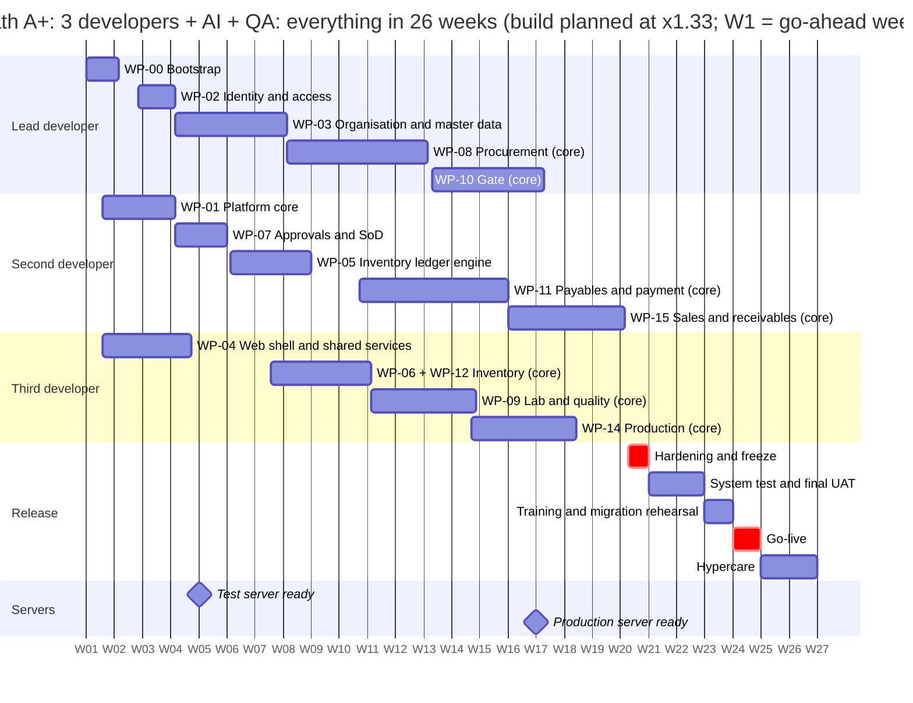
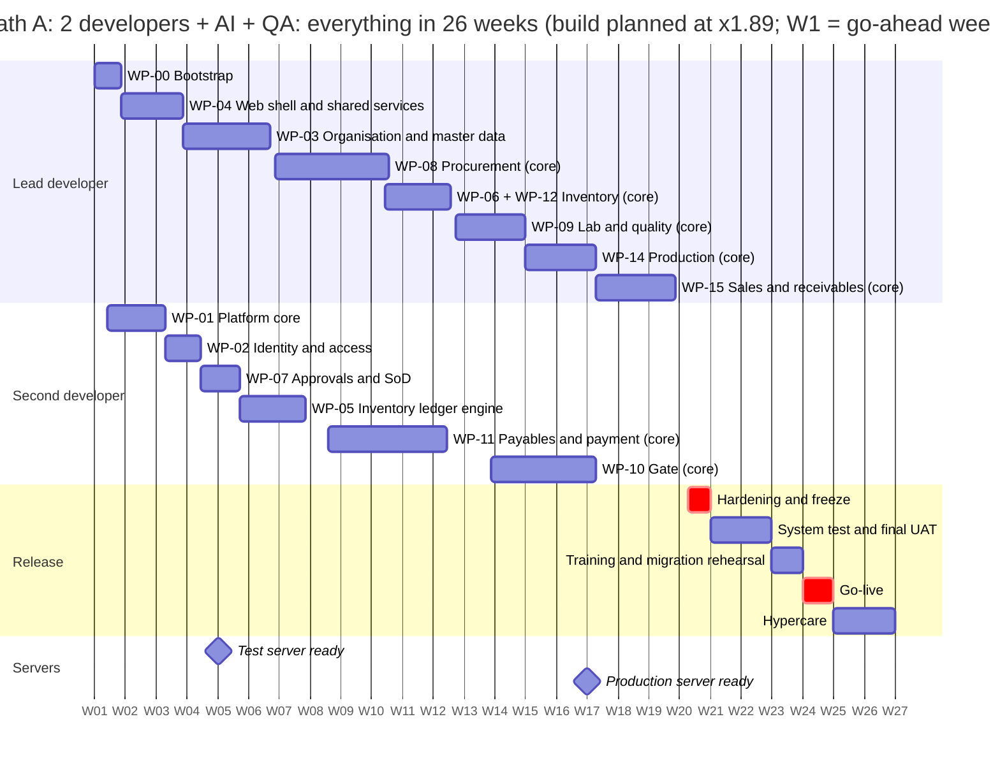
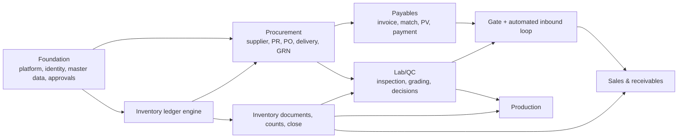

# MOS: Implementation Plan and Roadmap

<!-- nav -->[MOS](../../README.md) › [4. Plan](README.md)

| | |
|---|---|
| Product | MOS (Manufacturing Operations Suite). Working codename; the client's draft uses "Factory ERP" |
| Document | Implementation plan: estimate, capacity per team path, week-level roadmap, work packages, go-live plan, risks |
| Version | **0.5**, draft for review (2026-10-03: **everything inside six months**, [ADR-0025](../6-decisions/adr/ADR-0025-everything-in-six-months.md)) |
| Date | 2026-10-03 (first version 2026-09-27) |
| Audience | Product owner, the development team (human and AI-assisted) |
| Status | **Planning only; no implementation has started.** Prices built on this plan: [commercial proposal](../5-for-the-client/MOS-COMMERCIAL-PROPOSAL.md). Sprint by sprint: [sprint plan](MOS-SPRINT-PLAN.md). Module 1 in detail: [procurement module plan](MOS-PROCUREMENT-MODULE-PLAN.md) |
| Companion docs | [FRD](../2-requirements/MOS-FRD.md) · [Process model](../2-requirements/MOS-PROCESS-MODEL.md) · [Database design](../3-design/MOS-DATABASE-DESIGN.md) · [TDD](../3-design/MOS-TDD.md) · [Master plan](../1-overview/MOS-MASTER-PLAN.md) · [ADRs](../6-decisions/adr/) |

**Revision history**

| Version | Date | Change |
|---|---|---|
| 0.1 | 2026-09-26 | First plan: MVP ≈ 9.5 months, full scope ≈ 21–23 months |
| 0.2 | 2026-09-27 | Client procure-to-pay draft absorbed: MVP ≈ 10.4 months, full scope ≈ 22–24 months |
| 0.3 | 2026-09-27 | Re-framed by the owner: single company, no tenancy (ADR-0017); all six modules in ≤ 6 months of development, then 2 months to go live (ADR-0018); infrastructure not assumed (ADR-0019); team paths A/B/C |
| 0.3.1 | 2026-09-27 | Planning Phase 2: six new v1 requirements assigned to work packages |
| 0.4 | 2026-09-28 | Bottom-up estimate (187 features, 3,102 h; core 2,380 h); owner commitment: one release, all six modules at core, built in 26 weeks, live W27–W35 on every path, planned at ×1.32 (A), ×1.52 (B), ×2.50 (C) (ADR-0020) |
| 0.4.1 | 2026-10-03 | Milestone reviews moved to sprint ends (W10, W14, W18) to match the sprint plan |
| **0.5** | 2026-10-03 | **Everything inside six months** (owner instruction; [ADR-0025](../6-decisions/adr/ADR-0025-everything-in-six-months.md)): • one 26-week calendar: build W1–W20, rolling UAT from about W8, test server by W4, production server by W16, system test and final UAT W21–W22, training W23, **go-live W24**, hypercare W25–W26 • the client-documents review's additions counted: 12 new features and three changed ones; core **2,439 h** (was 2,380), total 3,177 h • reference path **A+** (3 developers + QA) added to the options; speeds needed: A+ ×1.33, A ×1.89, B ×2.22; **path C does not fit** • checkpoints at W4 and W8; client inputs needed earlier (§9); new risks R25–R27 |

---

## Words used in this plan

| Word | Meaning here |
|---|---|
| **Estimated hours** | The hours a feature should take one developer with AI assistance, at the *likely* estimate, including their own tests (§3) |
| **Speed needed** (velocity) | How much faster than the likely estimate a team must work to finish in time. **×1.33** means each estimated hour is done in 45 minutes |
| **Core / standard / full** | Depth of a feature. **Core**: the flow works end to end with its key controls; this is what the release promises. **Standard**: year-one conveniences. **Full**: the rest. Standard and full are built only if the team runs ahead |
| **Focus factor** | The share of worked hours that goes into building (80%). The rest is meetings, reviews, demos, questions and rework |
| **Rolling UAT** | User acceptance testing done module by module, as each module is built, by the client's key users |
| **System test** (SIT) | The team runs every end-to-end scenario on the test server before the final UAT |
| **Cutover** | The switch from the old way of working to the new system: final data load, opening balances, first live transactions |
| **Hypercare** | Close daily support in the first weeks after go-live |
| **Checkpoint** | A measured comparison of real speed against the speed needed (W4 and W8) |

---

## Summary

1. **Everything fits in 26 weeks** (the owner's instruction, 2026-10-03):

   | Weeks | What |
   |---|---|
   | W1–W20 | Build all six modules at core depth, in two-week sprints; each module goes to the client's key users as soon as it is built (rolling UAT, from about W8) |
   | by W4 · by W16 | Test server on the client's infrastructure · production server ready |
   | W21–W22 | System test and final UAT |
   | W23 | Training and the data-migration rehearsal |
   | **W24** | **Go-live** |
   | W25–W26 | Hypercare, then maintenance |

2. **The work:** all six modules at core depth are **2,439 estimated hours** (with hardening). Everything tagged v1 is 3,177 hours. The client-documents review (3 October) added 59 core hours.
3. **What each team needs to finish the build in 20 weeks:**

   | Path | Team | Speed needed | Each estimated hour in | Verdict | Team cost at the US$5 rate card, 26 weeks |
   |---|---|---|---|---|---|
   | **A+** | 3 developers + AI + QA | **×1.33** | 45 minutes | Tight: at the best case of the estimate | **$22,190** |
   | **A** | 2 developers + AI + QA | **×1.89** | 32 minutes | Very tight: beyond the best case | **$17,390** |
   | **B** | 2 developers + AI | **×2.22** | 27 minutes | Very tight: beyond the best case | $13,390 |
   | **C** | 1 developer with heavy AI | ×4.17 | 14 minutes | **Does not fit** (the go-live work alone does not fit one person) | — |

4. **Recommendation (owner decision O-34):** plan with **path A+**. It is the only path whose speed stays inside the estimate's range.
5. **The client price is fixed at ETB 986,615** (owner instruction: within ETB 1,000,000), for every given requirement and every go-live service; see the [pricing and timeline](../5-for-the-client/MOS-PRICING-AND-TIMELINE.md). The team costs in the table above are what the team would cost at the US$5 rate card; the fixed price covers about 27% of path A+'s (decided as A-43 in the [register](../6-decisions/MOS-DECISION-REGISTER.md)).
6. **The four questions in the 3 October client pack matter.** If the client drops the gate module and uses pass/fail inspection (Q-01, Q-02), A+ needs ×1.19 and A needs ×1.59 (§5.3).
7. **How the plan is held:** checkpoints at **W4 and W8**. If the team is behind, capacity is added before W9; the date and the core scope don't move. If it is ahead, standard features are pulled in.

---

## 1. Planning frame

| Item | Value | Why it matters |
|---|---|---|
| Calendar | **26 weeks for everything**, W1 = the go-ahead week ([ADR-0025](../6-decisions/adr/ADR-0025-everything-in-six-months.md)) | Owner instruction, 2026-10-03 |
| Build window | **W1–W20**, hardening and feature freeze in W20 | Leaves six weeks for the final tests, training, go-live and hypercare |
| Go-live window | **W21–W26** (§8) | System test and final UAT, training, cutover in W24, two weeks of hypercare |
| Go-live work inside the build | Test server (W3–W4), rolling UAT (W8–W20), production server (W15–W16), migration mapping (W17–W20) | Spreads the client-facing work across the build so it doesn't pile up at the end |
| After go-live | Maintenance and support (a separate service); **v1.1** planned during hypercare | Not inside the 26 weeks |
| Team paths | **A+** 3 devs + AI + QA · **A** 2 devs + AI + QA · **B** 2 devs + AI · **C** 1 dev with heavy AI | §4–§5; which are offered is O-34 |
| Hours per week | Lead developer **56** (7 × 8, the owner's figure); second and third developer **48** (6 × 8); QA **40** (5 × 8) | §5.3 shows the second developer at 56 |
| Focus factor | **80%** of worked hours go to estimated build work | The rest: meetings, reviews, demos, client questions, rework, illness and holidays |
| Reserve | **None** inside the 26 weeks | The buffer is the pull-in list (standard depth is not promised) and the capacity lever at the checkpoints |
| Testing without a QA engineer | **+15%** of build hours (paths B and C) | The developers write and run the acceptance and regression tests themselves |
| Environments | Development from W1; **test server on the client's infrastructure by W4**; production by W16 | So the hosting decision is needed **before W1** (§9) |
| Locale | English / Gregorian in v1 | The Amharic + Ethiopian-calendar pack is Later; the hooks exist from day one |

## 2. Delivery principles

1. **Contracts first.** Each work package starts with its Zod contracts and its acceptance tests from the FRD. Implementation follows.
2. **Correctness core before screens.** The inventory ledger engine and its property tests (WP-05) come before inventory screens. Every module posts through it.
3. **A block is done only when its acceptance tests are green in CI** and `PROGRESS.md` is updated. Half-built blocks are not counted.
4. **Every module goes to the client's key users as soon as it is built** (rolling UAT), on the test server. Five milestone reviews (W4, W8, W12, W16, W20) sit at sprint ends ([sprint plan](MOS-SPRINT-PLAN.md)).
5. **Core before standard, standard before full.** The release is every module's core. Standard and full depth are the pull-in list: procure-to-pay standard items first, then the other modules'.
6. **Scope freeze per block at its start.** Later changes go through the change rule (§11).
7. **Screens follow the client's v2 layout**, with the corrections in the [client-documents review](../7-reviews/MOS-CLIENT-DOCS-V2-REVIEW.md).
8. **Nothing tagged v1.1 or Later sneaks into v1** (§10).

---

## 3. The estimate

### 3.1 Method

- **Bottom-up by feature.** Every work package is broken into features, **199** in all ([Appendix A](#appendix-a-feature-estimate)). Each feature lists the FRD requirements it delivers. Every one of the 205 v1 requirements maps to at least one feature.
- **Hours are AI-assisted developer hours.** They include the developer's own tests, the migrations for the feature's tables, its screens and its PDFs. They assume the planning package is the specification. They exclude the QA engineer's work, meetings and demos (the focus factor) and the go-live work (§8).
- **Three tiers per feature:** **C** core, **S** standard, **F** full (see "Words used in this plan").
- **AI factor.** The likely figures assume AI assistance roughly halves the effort of the same work done without it. This is the largest uncertainty in the plan (R22); the checkpoints in §11 exist for it.

### 3.2 By work package

| WP | Title | Module | Core | Standard | Full | Total |
|---|---|---|---|---|---|---|
| WP-00 | Repository and tooling bootstrap | Foundation | 64 | — | — | **64** |
| WP-01 | Platform core | Foundation | 124 | 20 | — | **144** |
| WP-02 | Identity and access | Foundation | 74 | 22 | 26 | **122** |
| WP-03 | Organisation and master data | Foundation | 218 | 26 | 6 | **250** |
| WP-04 | Web shell and shared services | Foundation | 152 | 24 | 20 | **196** |
| WP-05 | Inventory ledger engine | Foundation | 136 | — | — | **136** |
| WP-07 | Approvals and SoD | Foundation | 86 | 22 | — | **108** |
| WP-08 | Procurement | Procurement | 279 | 80 | — | **359** |
| WP-11 | Payables and supplier payment | Payables | 256 | 60 | — | **316** |
| WP-06 | Inventory documents and reports | Inventory | 128 | 54 | 8 | **190** |
| WP-12 | Counts, period close, exception reports | Inventory | 40 | 72 | 12 | **124** |
| WP-09 | Lab and quality | Lab/QC | 176 | 38 | 10 | **224** |
| WP-10 | Gate and the automated inbound loop | Gate | 222 | 74 | 20 | **316** |
| WP-14 | Production | Production | 178 | 48 | 14 | **240** |
| WP-15 | Sales and receivables | Sales | 198 | 46 | — | **244** |
| WP-13 | Hardening and feature freeze | Hardening | 108 | 36 | — | **144** |
| | **Total** | | **2,439** | **622** | **116** | **3,177** |

### 3.3 By module

| Module | Core | Standard | Full | Total | Share |
|---|---|---|---|---|---|
| Foundation | 854 | 114 | 52 | 1,020 | 32% |
| Procurement | 279 | 80 | — | 359 | 11% |
| Payables | 256 | 60 | — | 316 | 10% |
| Inventory | 168 | 126 | 20 | 314 | 10% |
| Lab/QC | 176 | 38 | 10 | 224 | 7% |
| Gate | 222 | 74 | 20 | 316 | 10% |
| Production | 178 | 48 | 14 | 240 | 8% |
| Sales | 198 | 46 | — | 244 | 8% |
| Hardening | 108 | 36 | — | 144 | 5% |
| **Total** | **2,439** | **622** | **116** | **3,177** | 100% |

Foundation is about a third of the core. That is the cost of building an ERP platform from scratch (identity, approvals, numbering, audit, documents, ledger, master data) before the first purchase order can be raised.

### 3.4 Range

| Scope | Best case (×0.75) | Likely | Worst case (×1.25) |
|---|---|---|---|
| Core: every module's flow with its key controls, incl. hardening | 1,829 | **2,439** | 3,049 |
| Core + standard | 2,296 | **3,061** | 3,826 |
| Everything tagged v1 (core + standard + full) | 2,383 | **3,177** | 3,971 |

The best case is what a very effective AI-assisted workflow on a fully specified design could reach. The worst case covers late client answers and rework. **The plan uses the likely column.**

### 3.5 What the client-documents review added (3 October)

The review of the client's v2 screens, data dictionary and architecture proposal ([review §7.3](../7-reviews/MOS-CLIENT-DOCS-V2-REVIEW.md)) is now counted:

| Review item | Change | Feature | Tier | Hours |
|---|---|---|---|---|
| INT-01 | Supplier delivery (arrival) record with the gate module off | `f08s` | C | +20 |
| INT-02 | Bin card and stock card | `f06n` | C | +10 |
| INT-03 | Storage-master fields; mixed items/lots rule at posting | `f03q` | C | +8 |
| INT-04 | Supplier default bank account; PR purpose list | `f08t` | C | +3 |
| INT-15 | Client fields the first review missed | `f03r` | C | +6 |
| INT-16 | Typed attachment slots with "Verify" | `f04o` | C | +6 |
| INT-18 | Finished-flour release and the sales availability check promoted to core | `f14i`, `f15e` | S → C | +16 core, −16 standard |
| INT-10 | Vite single-page app instead of Next.js (**assumes O-27 as recommended**) | `f04a` 24 → 20 | C | −4 |
| INT-11 | pg-boss instead of BullMQ + Redis (**assumes O-28 as recommended**) | `f01j` 12 → 6 | C | −6 |
| INT-05…09, 17 | Count import, invoice approval, "checked by", budget code, API documentation, attestation | `f12h`, `f11r`, `f09n`, `f08u`, `f04n`, `f07g` | S | +32 |
| | **Net** | | | **core +59, standard +16** |

Still conditional, **not counted**: INT-12 pass/fail inspection (up to −42 core, Q-02), INT-13 no gate module (about −190 core, Q-01), INT-14 supplier portal (+140 to +200; a separately priced change, Q-03).

---

## 4. Capacity per team path

| | Path A+ | Path A | Path B | Path C |
|---|---|---|---|---|
| Team (hours per week) | Lead developer 56 h Second developer 48 h Third developer 48 h QA 40 h | Lead developer 56 h Second developer 48 h QA 40 h | Lead developer 56 h Second developer 48 h | Lead developer 56 h |
| Developer hours in the 20 build weeks | 3,040 | 2,080 | 2,080 | 1,120 |
| minus go-live work done during the build (test and production servers, rolling UAT, migration mapping) | 203 | 203 | 252 | 252 |
| × focus 80% = hours on estimated work | 2,270 | 1,502 | 1,462 | 694 |
| minus developer testing where there is no QA engineer (+15%) | — | — | 191 | 91 |
| **= build hours available** | **2,270** | **1,502** | **1,272** | **604** |
| Core to build (2,439 h) as a share of that | 107% | 162% | 192% | 404% |
| QA engineer hours in the build (after focus) | 800 (640) | 800 (640) | — | — |

**What the rows mean.** Developers work 20 weeks on the build. Some of those hours go to go-live work that now happens during the build (servers, rolling UAT, migration mapping; §8). Of the rest, 80% goes into estimated work. Paths without a QA engineer spend another 15% on testing.

**QA engineer (paths A+ and A) during the build:**

| QA activity (W1–W20) | Basis | Hours |
|---|---|---|
| Test strategy, test data, end-to-end test harness | fixed | 60 |
| Acceptance scripts from the FRD criteria, per module | ≈ 8% of 2,439 estimated build h | 195 |
| Exploratory testing of each delivered block | ≈ 6% of build h | 146 |
| Automated end-to-end flows (procure-to-pay, inbound, reversal, approvals) | ≈ 4% of build h | 98 |
| Regression before each milestone review | 5 × 12 h | 60 |
| Rolling UAT: test script per module, key-user sessions, triage | go-live table | 49 |
| **Total** | | **608** of 640 available (after focus) |

The QA percentages are lower than in the 26-week plan (8/6/4% instead of 10/7/5%) because the build is six weeks shorter; the developers' own tests carry more of it.

---

## 5. The estimate against six months

### 5.1 Speed needed per path

How the check works:
- Blocks are scheduled in priority order into each developer's stream, respecting dependencies. A block may start once half of each block it depends on is done.
- The priority order is: the foundation's core; procurement, payables, inventory and QC core (the client's procure-to-pay); then gate, production and sales core.
- The speed needed is the lowest speed at which every core block and hardening finish by the end of W20.

| | Path A+ | Path A | Path B | Path C |
|---|---|---|---|---|
| Team | 3 developers + AI + QA | 2 developers + AI + QA | 2 developers + AI | 1 developer with heavy AI |
| Build weeks needed at the likely estimate | 27 | 38 | 44 | 81 |
| **Speed needed to finish the build in 20 weeks** (× the likely estimate) | **×1.33** | **×1.89** | **×2.22** | **×4.17** |
| Each estimated hour must be done in | 45 minutes | 32 minutes | 27 minutes | 14 minutes |
| If the client drops the gate module and uses pass/fail inspection (Q-01, Q-02) | ×1.19 | ×1.59 | ×1.89 | ×3.70 |
| If the second developer also works 7 days (56 h) | ×1.20 | ×1.72 | ×2.04 | — |
| Both of the above | ×1.15 | ×1.49 | ×1.79 | — |
| Go-live work in W21–W26 fits the team? | yes (2.6, 2.2, 2.2, 5.9 person-weeks of 6) | yes (3.5, 3.4, 5.9 person-weeks of 6) | yes (5.9, 5.6 person-weeks of 6) | **no** (10.7 person-weeks of 6) |
| **Verdict** | **Tight**: inside the estimate range, near its best case | **Very tight**: beyond the best case of the estimate | **Very tight**: beyond the best case of the estimate | **Does not fit**: the go-live work alone needs more than one person has in W21–W26 |

**Why three developers don't need a third less speed.** Much of the build is a chain: the platform → master data → the stock ledger → procurement → payables and QC → gate → sales. Each link waits for half of the one before it. A third developer shortens the parallel parts, not the chain, so A+ needs ×1.33, not ×1.0.

### 5.2 What this means

- **Path A+ is the only path inside the estimate's range.** ×1.33 is the best case of the estimate (the best case is ×1.33). It is tight, but the W4 checkpoint shows early whether it holds.
- **Path A needs ×1.89**: every estimated hour in 32 minutes. That is well beyond the best case. Path A is realistic only with the gate and grading answers in §5.3 *and* the second developer at 56 hours.
- **Path B needs ×2.22**, because its two developers also carry all the testing. Not recommended.
- **Path C does not fit.** One developer would need ×4.17, and the go-live work alone (10.7 person-weeks) does not fit into the six weeks after the build.
- **Team cost follows the team's weeks** (US$5 per team hour). The client price is separate: fixed at ETB 986,615 within the owner's ETB 1,000,000 cap ([pricing and timeline](../5-for-the-client/MOS-PRICING-AND-TIMELINE.md)).

### 5.3 How to make it less tight

| Lever | Effect | Who decides |
|---|---|---|
| **No gate module, pass/fail inspection** (pack Q-01, Q-02; review INT-12/13) | A+ ×1.33 → **×1.19**; A ×1.89 → **×1.59** | The client |
| **Second developer at 56 h a week** | See the table below | The owner |
| **A third developer** (path A → A+) | A ×1.89 → A+ ×1.33 | The client's choice of path |
| **Fewer core features** | Each 100 core hours removed lowers A+ by about 0.06 | Owner and client, through the change rule |

| Second developer's week | Path A speed needed | Path A total (US$) | Path B speed needed | Path B total (US$) |
|---|---|---|---|---|
| 40 h (5 days) | ×2.00 | $16,590 | ×2.33 | $12,590 |
| 48 h (6 days) | ×1.89 | $17,390 | ×2.22 | $13,390 |
| 56 h (7 days) | ×1.72 | $18,190 | ×2.04 | $14,190 |

---

## 6. Week-level roadmap

Weeks are counted from the go-ahead (W1). Each block is one developer's work. The Gantt charts use drawing dates only (W1 is placed on a Monday so the axis shows week numbers).

### 6.1 Path A+ (3 developers + AI + QA), planned at ×1.33

| Weeks | Who | Block | Est. hours |
|---|---|---|---|
| W1–W2 | Lead developer | WP-00 Bootstrap | 64 |
| W1–W4 | Second developer | WP-01 Platform core | 124 |
| W1–W4 | Third developer | WP-04 Web shell and shared services | 152 |
| W2–W4 | Lead developer | WP-02 Identity and access | 74 |
| W4–W5 | Second developer | WP-07 Approvals and SoD | 86 |
| W4–W8 | Lead developer | WP-03 Organisation and master data | 218 |
| W6–W9 | Second developer | WP-05 Inventory ledger engine | 136 |
| W7–W11 | Third developer | WP-06 + WP-12 Inventory (core) | 168 |
| W8–W13 | Lead developer | WP-08 Procurement (core) | 279 |
| W10–W15 | Second developer | WP-11 Payables and payment (core) | 256 |
| W11–W14 | Third developer | WP-09 Lab and quality (core) | 176 |
| W13–W17 | Lead developer | WP-10 Gate (core) | 222 |
| W14–W18 | Third developer | WP-14 Production (core) | 178 |
| W15–W20 | Second developer | WP-15 Sales and receivables (core) | 198 |
| W20 | all developers | WP-13 Hardening and feature freeze | 108 |

### 6.2 Path A (2 developers + AI + QA), planned at ×1.89

| Weeks | Who | Block | Est. hours |
|---|---|---|---|
| W1 | Lead developer | WP-00 Bootstrap | 64 |
| W1–W3 | Second developer | WP-01 Platform core | 124 |
| W1–W3 | Lead developer | WP-04 Web shell and shared services | 152 |
| W3–W4 | Second developer | WP-02 Identity and access | 74 |
| W3–W6 | Lead developer | WP-03 Organisation and master data | 218 |
| W4–W5 | Second developer | WP-07 Approvals and SoD | 86 |
| W5–W7 | Second developer | WP-05 Inventory ledger engine | 136 |
| W6–W10 | Lead developer | WP-08 Procurement (core) | 279 |
| W8–W12 | Second developer | WP-11 Payables and payment (core) | 256 |
| W10–W12 | Lead developer | WP-06 + WP-12 Inventory (core) | 168 |
| W12–W14 | Lead developer | WP-09 Lab and quality (core) | 176 |
| W13–W17 | Second developer | WP-10 Gate (core) | 222 |
| W14–W17 | Lead developer | WP-14 Production (core) | 178 |
| W17–W19 | Lead developer | WP-15 Sales and receivables (core) | 198 |
| W20 | all developers | WP-13 Hardening and feature freeze | 108 |

**Path B** uses the same block weeks as path A, at ×2.22: with no QA engineer, its developers also carry the testing.

### 6.3 Path C

Not scheduled. One developer would need ×4.17 to build the six modules in 20 weeks, and the go-live work needs 598 hours of one person in the 336 hours of W21–W26. Path C can only be offered with a longer calendar or a smaller scope (O-34).

### 6.4 Milestone reviews (at sprint ends)

| Review | Week | What the client sees (path A+) |
|---|---|---|
| M1 | W4 | Sign-in, the shell, the platform core; identity; **the test server on their infrastructure**; **checkpoint 1** |
| M2 | W8 | Company set-up, storage units and silos, items, partners, taxes, numbering; approval matrix and inbox; the stock-ledger engine (finishing in W9); inventory documents begin; **checkpoint 2** |
| M3 | W12 | Stock documents, bin and stock cards, counts and close; suppliers, PRs and POs; deliveries and GRNs in progress; invoices begin; inspection set-up; **rolling UAT of inventory** |
| M4 | W16 | **The client's procure-to-pay end to end (AS-13):** PR → PO → delivery → inspection with grading → GRN → PV → approval → payment; production server ready |
| M5 | W20 | Gate and weighbridge loop; milling, packing and costing; sales through the outbound gate; hardening; **feature freeze** |

The [sprint plan](MOS-SPRINT-PLAN.md) lists the features behind each review, and when each module's rolling UAT happens.

### 6.5 Dependencies that drive the order

- **The GRN needs** the ledger (stock), approvals and master data. With the gate off it takes weights from the delivery record or the inspection record, so procurement does not wait for the gate.
- **QC decisions** set the receipt status (QUARANTINE vs AVAILABLE) and the payable quantity.
- **The gate automates** GRN preparation and needs the QC decision in the same transaction.
- **Sales' outbound exit** reuses the gate's exit clearance, so sales follows the gate. Without a gate module (Q-01), sales would not wait for it.
- **Production consumes** only QC-released stock.

---

## 7. Work packages (v1)

Weeks are from each path's schedule (§6). Every package's core is in the release; its standard and full features are the pull-in list (Appendix A).

| WP | Title | Path A+ | Path A (and B) | Scope (v1) | Key FRs / acceptance |
|---|---|---|---|---|---|
| WP-00 | Repository and tooling bootstrap | W1–W2 | W1 | Monorepo (api, worker, web, contracts, domain-kernel, db); lint and dependency-cruiser; CI gates (TDD §18.4); test harness connecting as `mos_app` | CI green; the migration-safety check blocks an un-annotated DROP |
| WP-01 | Platform core | W1–W4 | W1–W3 | `UnitOfWorkInterceptor` with retry; idempotency keys; outbox with relay, `processed_event`, `process_exception`; audit log with sealing job; error model, env contract, health; privilege boot probe, grant/trigger catalogue test, lock ranks | FR-PLT-020…022, 031, 046, 050; invariant P15 |
| WP-02 | Identity and access | W2–W4 | W3–W4 | Local accounts with TOTP (ADR-0015); optional OIDC SSO; operation unit; roles with site scope; sessions, CSRF; access-review export | FR-PLT-010…012, 014, 015, 017…019 |
| WP-03 | Organisation and master data | W4–W8 | W3–W6 | Setup wizard, sites, departments; warehouses → storage units (silos); UoM, items, categories, partners, banks, company paying accounts; tax codes, payment terms, reason codes; numbering, fiscal periods, module switches; deactivate-only masters; import with dry run; grain/flour pack; storage-master fields and the client fields from the dictionary (review) | FR-PLT-002…004, 006…008, 040…043, 047, 053, 055; FR-MD-001…014; FR-AP-015 |
| WP-04 | Web shell and shared services | W1–W4 | W1–W3 | Layout; `DataGrid`, `LineItemsForm`, `DocumentPage`, `ScanInput`; approvals inbox; attachment service; PDF template engine; notifications; list export; global search; i18n hooks; build fingerprint; typed attachment slots with "Verify" (review) | FR-PLT-030, 032, 044, 045, 048, 049, 051, 052; FR-RPT-002; inbox usable at 375 px |
| WP-07 | Approvals (lean) and SoD | W4–W5 | W4–W5 | Approval matrix; sequential stages; delegation; reminder + fallback escalation; SoD rule types; immutable approval history | FR-PLT-023, 025…029, 054; AS-12 |
| WP-05 | Inventory ledger engine | W6–W9 | W5–W7 | Ledger, balances and moving average over storage units; sorted locking, capacity check, commingled-silo FIFO; posting and reversal framework; property-test harness. **No UI** | FR-INV-010, 011, 019, 022; P1–P9 green over ≥ 10,000 generated sequences |
| WP-08 | Procurement | W8–W13 | W6–W10 | Supplier wizard with KYC and bank-change control; approved supplier list; PR; quotations on the PO; PO (issue, amendments, tolerances, closure); GRN (gate-off weights, bags, mixed lines, dispositions); service receipts; supplier returns; reports. Story level: [procurement module plan](MOS-PROCUREMENT-MODULE-PLAN.md); **supplier delivery (arrival) record with the gate off** (review) | FR-PRC-001…008, 010…015, 017, 021, 022 |
| WP-11 | Payables and supplier payment | W10–W15 | W8–W12 | Supplier invoices; 3-way match; debit notes; self-billing; PV drafted from the GRN; payment with cheque register and books, proof, WHT certificates; partner ledger; journals + CSV export; tax registers; GRNI reconciliation | FR-AP-001…010, 012…014, 016…019; FR-INB-003, 010; AS-05 |
| WP-06 | Inventory documents and reports | W7–W11 | W10–W12 | Receipts, issues, transfers, adjustments, status changes; lots and trace; stock balance and history; silo levels; reorder report; labels; **bin card and stock card** (review) | FR-INV-001…008, 013, 014, 018; AS-06 |
| WP-12 | Counts, period close, exception reports | W7–W11 | W10–W12 | Counts (modes, blind, recount) with generated adjustment; silo dip; fumigation holds; inventory period close; exception reports; background report jobs. Role dashboards are built with each module | FR-INV-009, 012, 020, 021; FR-RPT-001, 003, 004; AS-07, AS-08 |
| WP-09 | Lab and quality | W11–W14 | W12–W14 | Parameters, specs, QC policies, sampling; inspection record incl. gate-off creation; samples; insert-only results; grading and score; retest; concessions; usage decisions; deduction rules; CoA gate; lab dashboard | FR-QC-001…018, 022…025; **AS-13**; AS-03 (with WP-11) |
| WP-10 | Gate and the automated inbound loop | W13–W17 | W13–W17 | Gate masters, blacklist, shifts, expected arrivals, visits; weigh tickets with blind verification; exit clearance and passes; material gate passes; incidents; yard board; paper mode and back-entry; GRN prepared at tare; failure-case suite; outbound visit class | FR-GATE-001…019, 021…025, 030; FR-INB-001, 002, 004…009; AS-01, 02, 04, 09, 10 |
| WP-14 | Production | W14–W18 | W14–W17 | Work centres; recipes with co- and by-products; work orders (standard, campaign, packing); milling runs; issue and backflush; output by lot; finished-goods QC; traceability; material-cost settlement; shift log and downtime; reports; finished-flour release now core (review) | FR-MFG-001, 003, 005…009, 011…018; FR-QC-019, 026; AS-14, AS-16, AS-17 |
| WP-15 | Sales and receivables | W15–W20 | W17–W19 | Customers, price lists, orders with holds, reservation; delivery orders through the outbound gate; invoicing with fiscal reference; cash sales and sessions; advances, receipts; returns and credit notes; statements, reports; output VAT; availability check now core (review) | FR-SAL-001, 002, 004…006, 008…010, 012…018; FR-INV-015; FR-AP-017 (output VAT); AS-15, AS-18, AS-19 |
| WP-13 | Hardening and feature freeze | W20 | W20 | Security review (ASVS L2), performance test, backup/restore drill on dev, acceptance scripts, guides | All in-scope FRs have passing tests; the in-scope AS scenarios are green |
| WP-16 | Go live | W3–W26 (§8) | W3–W26 (§8) | Test server (W3–W4), rolling UAT (W7–W20), production server (W15–W16), migration (W17–W24), system test and final UAT (W21–W22), training (W23), go-live (W24), hypercare (W25–W26) (§8) | UAT sign-off; go-live checklist; hypercare exit criteria |

---

## 8. Going live

### 8.1 The steps and their exit criteria

| Weeks | Activity | Exit criterion |
|---|---|---|
| W3–W4 | **Test server** on the client's infrastructure: install, deployment pipeline, first release | The client's key users can sign in from their own PCs |
| W8–W20 | **Rolling UAT**: each module tested by its key users in the sprint after it is built | Each module's UAT script passes, or its defects are logged and planned |
| W15–W16 | **Production server**: hardening, PostgreSQL, reverse proxy and TLS, backups with a tested restore, monitoring, email relay | Restore drill passes; server signed off |
| W17–W20 | **Data migration preparation**: mapping, templates, first dry run | Dry-run reconciliation within agreed tolerances |
| W21–W22 | **System test** (every acceptance scenario end to end, with realistic volumes) and **final UAT** of the whole flow | No open High/Critical defect; UAT sign-off |
| W21–W23 | **Training**: role guides; role sessions in W23 | Every go-live user trained |
| W23 | **Migration rehearsal**: a full practice load and reconciliation | Rehearsal reconciles; go/no-go decision at the end of W23 |
| W24 | **Cutover and go-live**: legacy entry frozen, final load, opening balances posted | Go-live checklist complete |
| W25–W26 | **Hypercare**: daily check-ins, fast fixes, the v1.1 backlog groomed | Hypercare exit criteria met; handover to maintenance |

### 8.2 Hours per path

Go-live work is people's time with the client, so it is not planned at the build speed. Environment set-up and cutover are fixed; the rest scales with the scope.

*Path A+:*

| Weeks | Activity | Package | Lead developer | Second developer | Third developer | QA engineer | Hours |
|---|---|---|---|---|---|---|---|
| | **During the build (W1–W20)** | |  |  |  |  |  |
| W3–W4 | Test server on your infrastructure: install, deploy pipeline, first release | 3 Go-live | 10 | 7 | 7 | — | 24 |
| W8–W20 | Rolling UAT: test script per module, key-user sessions, triage | 2 Testing & UAT | — | — | — | 49 | 49 |
| W8–W20 | Rolling UAT: fix what the key users find | 2 Testing & UAT | 22 | 16 | 17 | — | 55 |
| W15–W16 | Production server: set-up, hardening, backups with a tested restore, monitoring, runbook | 3 Go-live | 26 | 19 | 19 | — | 64 |
| W17–W20 | Data migration: mapping, templates, first dry run | 3 Go-live | 24 | 18 | 18 | — | 60 |
| | **After the build (W21–W26)** | |  |  |  |  |  |
| W21–W22 | System test: every acceptance scenario end to end, regression | 2 Testing & UAT | — | — | — | 98 | 98 |
| W21–W22 | System test: fix defects | 2 Testing & UAT | 32 | 24 | 23 | — | 79 |
| W21–W22 | Final acceptance test: the whole flow with key users; sign-off | 2 Testing & UAT | — | — | — | 33 | 33 |
| W21–W22 | Final acceptance test: fix defects | 2 Testing & UAT | 22 | 16 | 17 | — | 55 |
| W21–W23 | Training: role guides and role sessions | 3 Go-live | — | — | — | 67 | 67 |
| W23 | Training: administrator and key-user sessions | 3 Go-live | 20 | 15 | 15 | — | 50 |
| W23–W24 | Data migration: rehearsal and final load | 3 Go-live | 24 | 18 | 18 | — | 60 |
| W23–W24 | Data migration: reconciliation checks | 3 Go-live | — | — | — | 17 | 17 |
| W24 | Cutover and go-live | 3 Go-live | 16 | 12 | 12 | — | 40 |
| W24 | Cutover checks | 3 Go-live | — | — | — | 8 | 8 |
| W25–W26 | Hypercare: fixes and support | 3 Go-live | 31 | 23 | 23 | — | 77 |
| W25–W26 | Hypercare: verification | 3 Go-live | — | — | — | 14 | 14 |
| | **Total** | | **227** | **168** | **169** | **286** | **850** |
| | Needed in W21–W26 | | 145 | 108 | 108 | 237 | |
| | Available in W21–W26 (6 weeks) | | 336 | 288 | 288 | 240 | |

*Path A:*

| Weeks | Activity | Package | Lead developer | Second developer | QA engineer | Hours |
|---|---|---|---|---|---|---|
| | **During the build (W1–W20)** | |  |  |  |  |
| W3–W4 | Test server on your infrastructure: install, deploy pipeline, first release | 3 Go-live | 13 | 11 | — | 24 |
| W8–W20 | Rolling UAT: test script per module, key-user sessions, triage | 2 Testing & UAT | — | — | 49 | 49 |
| W8–W20 | Rolling UAT: fix what the key users find | 2 Testing & UAT | 30 | 25 | — | 55 |
| W15–W16 | Production server: set-up, hardening, backups with a tested restore, monitoring, runbook | 3 Go-live | 35 | 29 | — | 64 |
| W17–W20 | Data migration: mapping, templates, first dry run | 3 Go-live | 33 | 27 | — | 60 |
| | **After the build (W21–W26)** | |  |  |  |  |
| W21–W22 | System test: every acceptance scenario end to end, regression | 2 Testing & UAT | — | — | 98 | 98 |
| W21–W22 | System test: fix defects | 2 Testing & UAT | 43 | 36 | — | 79 |
| W21–W22 | Final acceptance test: the whole flow with key users; sign-off | 2 Testing & UAT | — | — | 33 | 33 |
| W21–W22 | Final acceptance test: fix defects | 2 Testing & UAT | 30 | 25 | — | 55 |
| W21–W23 | Training: role guides and role sessions | 3 Go-live | — | — | 67 | 67 |
| W23 | Training: administrator and key-user sessions | 3 Go-live | 28 | 22 | — | 50 |
| W23–W24 | Data migration: rehearsal and final load | 3 Go-live | 33 | 27 | — | 60 |
| W23–W24 | Data migration: reconciliation checks | 3 Go-live | — | — | 17 | 17 |
| W24 | Cutover and go-live | 3 Go-live | 22 | 18 | — | 40 |
| W24 | Cutover checks | 3 Go-live | — | — | 8 | 8 |
| W25–W26 | Hypercare: fixes and support | 3 Go-live | 42 | 35 | — | 77 |
| W25–W26 | Hypercare: verification | 3 Go-live | — | — | 14 | 14 |
| | **Total** | | **309** | **255** | **286** | **850** |
| | Needed in W21–W26 | | 198 | 163 | 237 | |
| | Available in W21–W26 (6 weeks) | | 336 | 288 | 240 | |

*Path B (no QA engineer: the developers do the testing work):*

| Weeks | Activity | Package | Lead developer | Second developer | Hours |
|---|---|---|---|---|---|
| | **During the build (W1–W20)** | |  |  |  |
| W3–W4 | Test server on your infrastructure: install, deploy pipeline, first release | 3 Go-live | 13 | 11 | 24 |
| W8–W20 | Rolling UAT: test script per module, key-user sessions, triage | 2 Testing & UAT | 27 | 22 | 49 |
| W8–W20 | Rolling UAT: fix what the key users find | 2 Testing & UAT | 30 | 25 | 55 |
| W15–W16 | Production server: set-up, hardening, backups with a tested restore, monitoring, runbook | 3 Go-live | 35 | 29 | 64 |
| W17–W20 | Data migration: mapping, templates, first dry run | 3 Go-live | 33 | 27 | 60 |
| | **After the build (W21–W26)** | |  |  |  |
| W21–W22 | System test: every acceptance scenario end to end, regression | 2 Testing & UAT | 54 | 44 | 98 |
| W21–W22 | System test: fix defects | 2 Testing & UAT | 43 | 36 | 79 |
| W21–W22 | Final acceptance test: the whole flow with key users; sign-off | 2 Testing & UAT | 18 | 15 | 33 |
| W21–W22 | Final acceptance test: fix defects | 2 Testing & UAT | 30 | 25 | 55 |
| W21–W23 | Training: role guides and role sessions | 3 Go-live | 37 | 30 | 67 |
| W23 | Training: administrator and key-user sessions | 3 Go-live | 28 | 22 | 50 |
| W23–W24 | Data migration: rehearsal and final load | 3 Go-live | 33 | 27 | 60 |
| W23–W24 | Data migration: reconciliation checks | 3 Go-live | 9 | 8 | 17 |
| W24 | Cutover and go-live | 3 Go-live | 22 | 18 | 40 |
| W24 | Cutover checks | 3 Go-live | 4 | 4 | 8 |
| W25–W26 | Hypercare: fixes and support | 3 Go-live | 42 | 35 | 77 |
| W25–W26 | Hypercare: verification | 3 Go-live | 8 | 6 | 14 |
| | **Total** | | **466** | **384** | **850** |
| | Needed in W21–W26 | | 328 | 270 | |
| | Available in W21–W26 (6 weeks) | | 336 | 288 | |

**Staffing in W21–W26:** paths A+ and A have room (the QA engineer is the busiest, at about 5.9 of 6 weeks). Path B's lead developer needs 328 of 336 hours, so there is no slack. Path C does not fit (598 hours needed, 336 available).

---

## 9. Client inputs and when they are needed

The needed-by weeks are the earlier of paths A+ and A, so they hold whichever is chosen. The [decision register](../6-decisions/MOS-DECISION-REGISTER.md) holds every item, and the [stakeholder questionnaire](../5-for-the-client/MOS-STAKEHOLDER-QUESTIONNAIRE.md) asks the client.

| Needed by | Inputs |
|---|---|
| **Before W1** | Flour or "floor" (C-01); product name (C-02); operation unit (C-03); currency (C-04); **the four sizing questions of the 3 October pack**: the gate and weighing (Q-01 / C-38), grading and deductions (Q-02 / C-25, C-26), who raises supplier payment requests (Q-03 / C-39), invoice approval (Q-04 / C-42); the status of the architecture document and the data dictionary (C-36, C-37); what else is needed at go-live (C-48); **infrastructure for the test server**: where the system runs, the servers, containers or native, a test machine, remote access, the IT contact (I-01–I-04, I-06, I-15, I-16); **key users per module** for rolling UAT (C-05); the team path; the go-ahead date |
| **Before W3** (master data) | Item and UoM lists; warehouses, storage units and silo capacities (C-23); supplier master extract; banks and the company's paying accounts; users, roles and site scopes (C-05) |
| **Before W4** (approvals) | PR, PO and PV approval bands (C-07); which roles must be different people (C-49); a realistic end-to-end example for the acceptance tests (C-28, C-40) |
| **Before W6** (procurement) | PO without PR (C-08); individual suppliers and self-billing (C-09); onboarding documents (C-10); quotations (C-11); tolerances (C-12, C-13); who records a delivery (C-41); rejected vs short quantities (C-43); budget codes (C-47) |
| **Before W7** (inventory) | Rejected quantity and empty bags (C-21, C-22); transfer approvers (C-23); count practice (C-45, C-46); fumigation practice |
| **Before W8** (payables) | Invoice timing and weight basis (C-14); who pays (C-15); payment methods (C-16); withholding and VAT (C-17); WHT certificate (C-18); three-way match (C-19); the accounting package and its import format (C-20) |
| **Before W10** | Raw-material specs, grade table and score weights, deduction and price rules, partial acceptance (C-24…C-27, details); **gate workshop** (C-29) and weighbridge details (I-14); **production workshop** (C-30); production staging store or direct issue (C-44) |
| **Before W12** | **Sales workshop** (C-31, C-33, C-34) and the **fiscal-device / e-invoice requirement** (C-32); **production-server questions**: network, power, backups, recovery targets, domain and certificate, email, sign-in, devices, other systems, branches (I-05, I-07–I-13, I-17, I-18) |
| **Before W17** | Migration data extracts (suppliers, items, opening stock, open POs and balances); legal retention periods (C-06); the training schedule |
| **Before W21** | Final-UAT key users confirmed; training dates; the go-live date (C-35) |

---

## 10. Not in v1

**Depth that moves to v1.1:** the release is every module's core. Standard (622 h) and full (116 h) features move to v1.1 unless pulled in (§11). The tier of every feature is in Appendix A.

**v1.1** (planned during hypercare):
- RFQ-lite improvements; supplier self-registration link; GRN PO-reassignment document;
- general approval conditions with parallel/quorum steps;
- routings; quotations and dispatch planning; tokenised proof-of-delivery link; OEE;
- advances and payment runs; multi-document trucks; service/contractor visit log;
- the standard and full depth not pulled into the release (Appendix A tiers S and F).

**Later** (roadmap, no date):
- **SaaS:** shared multi-tenant SaaS (expansion playbook, TDD Appendix A), tenant onboarding, billing.
- **Identity and integration:** bundled IdP, public API and webhooks, API keys.
- **Hardware:** edge agent with weighbridge capture and ZPL printing, ANPR and barriers.
- **Portals:** supplier portal (unless ordered as a change, Q-03), RFQ comparison workflow, contracts.
- **Planning and costing:** MRP/MPS, finite scheduling, labour/overhead costing and variances.
- **Inventory:** FIFO option, landed cost, serial numbers, catch-weight.
- **Compliance and locale:** fiscal device / e-invoicing (unless the client's answer makes it a v1 legal requirement), Amharic/Ethiopian-calendar pack.
- **Connectors:** DMS connector, accounting-package adapters.
- **Never, unless re-scoped:** a general ledger.

---

## 11. Governance, calibration and change control

- **Weekly:** `PROGRESS.md` updated (status, what moved, blockers, next step, actual hours per feature). **Every sprint:** review and retrospective.
- **Velocity checkpoints at W4 and W8** (the heart of the plan):
  1. For every finished feature, divide the actual build hours by the Appendix A hours. The average is the **measured factor**.
  2. **The required factor** is the path's plan: A+ 45 minutes, A 32 minutes, B 27 minutes for each estimated hour.
  3. **If the measured factor is more than 10% worse than required,** the plan is behind. The owner adds capacity **before W9**: more hours from the second developer (up to 56), or a third developer (A → A+). The client is told at the next review. The date and the core scope don't move.
  4. **If it is better,** the next standard-depth items are pulled into the release in priority order.
  5. The factor and the action taken are recorded in `PROGRESS.md` and in the decision register.
- **Pull-in rule:** an item is pulled in only if it can be finished and tested before the freeze at the end of W20.
- **Scope-change rule:** a request that adds or changes an FRD requirement gets an ID, an estimate in Appendix A units, a tier and an FRD revision. It enters v1 only if items of equal hours leave, or by agreement. It is billed at the change-request rate.
- **Decisions:** every non-trivial technical choice gets an ADR in `docs/6-decisions/adr/`.
- **Definition of done** (per block): contracts and migrations reviewed; acceptance tests green in CI; lint and catalogue gates green; docs updated; `PROGRESS.md` updated with actual hours; demo notes recorded.

## 12. Resumability protocol (for any developer or AI session)

1. **Start every session** by reading `MOS/CLAUDE.md`, `MOS/PROGRESS.md`, and the TDD section for the current work package.
2. **Work inside one block.** If a task touches another, stop and note it in `PROGRESS.md`.
3. **Contracts first:** Zod schemas and acceptance tests before implementation.
4. **End every session** by updating `PROGRESS.md`: status, last commit, hours spent against the feature estimate, next concrete step, open questions.
5. **Decisions** go into ADRs, never only into chat.
6. **A block is resumable at any point** because its acceptance tests define "done".

---

## 13. Risk register

| # | Risk | Likelihood | Impact | Mitigation | Early warning |
|---|---|---|---|---|---|
| R1 | Requirements stay hypothetical beyond procurement: gate, production and sales have no client input yet | High | High | Workshops before W10 (§9); rolling UAT; the grain/flour pack as the baseline | No production or sales input by W10 |
| R2 | Bus factor: 2–3 developers | High | High | CLAUDE.md, ADRs, PROGRESS, contract-first, CI gates, resumable blocks | A block stalls > 1 week without a PROGRESS update |
| R3 | Scope creep from mock-ups, demos and rolling UAT | High | High | Freeze per block; change rule; v1.1 list as the pressure valve | FRD revisions during a block |
| R4 | Ledger or valuation defects found late | Medium | High | WP-05 property harness before any inventory UI; invariants in CI | Any invariant failure |
| R6 | Timeline optimism: AI speeds up coding, not client decisions, UAT or hosting | High | High | Go-live work spread across the build; client inputs by week (§9) | A review slips > 1 week |
| R7 | Gate connectivity or power failures | High | Medium | Paper mode and back-entry (standard tier); UPS and 4G recommended | Site answers show unstable links |
| R8 | Weighbridge fraud during manual weighing | Medium | High | Photo + blind verification + forced re-tare + tare analytics + exception reports | Rising tare deviations or overrides |
| R10 | Low digital literacy at gate, floor and lab | Medium | Medium | Scan-first, big-target UI; role training; rolling UAT shows it early | UAT tasks take too long |
| R13 | AI-generated code quality drift under time pressure | Medium | High | Strict lint, types, contracts; tests before merge; a QA engineer on A+ and A | Repeated reverts or flaky tests |
| R14 | Tax or regulatory variance | Medium | Medium | Tax codes as data; client questions on WHT and VAT | A rule the tax model can't express |
| R15 | Client answers late (§9), now needed earlier | High | High | Needed-by weeks; documented defaults; reviews surface gaps early | An input missing at the start of its block |
| R16 | Local-account security (a new attack surface) | Medium | High | ASVS L2 controls (TDD §6.1); targeted tests in WP-13 | Unusual lockout or reset volumes |
| R17 | **Schedule compression:** six modules built in 20 weeks with no reserve week | High | High | Core only in the release; checkpoints at W4 and W8 with capacity as the lever | Measured factor > 1.1 × required |
| R18 | **Burnout:** 7-day weeks for six months at a speed above the likely estimate | High | High | 80% focus factor; one rest day a week recommended; A+ spreads the load | Sustained speed drop; rising defect rate |
| R19 | **Infrastructure unknown**, and now needed before W1 | High | High | Portable design; the questionnaire's infrastructure part goes first; a temporary test server on our side if theirs is late | No hosting answer at W1 |
| R20 | Sales invoicing may legally need a fiscal device / e-invoicing | Medium | High | Asked before the sales workshop (W12); adapter interface; enters v1 via the change rule | The answer is "required" |
| R21 | Domain misread ("Floor" vs flour) | Low | High | Asked before W1; the client's documents already show flour | The answer is "flooring" |
| R22 | **Speed commitment:** A+ ×1.33, A ×1.89, B ×2.22; AI-assisted productivity at this scale is unproven | High | High | Checkpoints at W4 and W8; capacity added before W9 if behind | Measured factor > 1.1 × required |
| R24 | Exchange-rate movement between quote and payment | Medium | Medium | Planning rate and ±10% sensitivity in the proposal; an FX clause | ETB/US$ moves > 5% |
| R25 | **Key users not available for rolling UAT** from about W8 | Medium | High | Key users named before W1 (C-05); UAT sessions booked at each sprint review | A module's UAT slips a sprint |
| R26 | **Test or production server late** (needed by W4 and W16) | Medium | High | Hosting answers before W1; production hardware ordered by W12 | No server access by W3 |
| R27 | **Go-live window has no slack:** a failed rehearsal in W23 moves go-live past W24 | Medium | High | First dry run in W17–W20; go/no-go at the end of W23; hypercare can absorb a one-week slip only by shortening it | Dry-run differences unexplained by W20 |

R5, R9, R11 and R12 were retired with ADR-0017/0018. R23 (path C) is retired because path C is not planned for six months.

---

## 14. Next steps

1. **Owner decisions:** O-34 (which team to plan with; recommended: A+), O-27 and O-28 (stack, before S1). The price is decided: fixed at ETB 986,615 (A-43). See the [decision register](../6-decisions/MOS-DECISION-REGISTER.md).
2. **The client** answers the four sizing questions (Q-01–Q-04 in the 3 October pack) and the "before W1" items, including **the infrastructure questions**, and chooses a team path and start week.
3. **W1** starts with WP-00. The first checkpoint is at W4, together with the test server.

**Nothing in this plan has been implemented. No application code has been written.**

---

## Appendix A. Feature estimate

Every feature with its tier, likely hours and the v1 requirements it delivers. Hours are AI-assisted developer build hours (§3.1). Features added or changed by the client-documents review are marked.

| WP | Key | Feature | Tier | Hours | Requirements |
|---|---|---|---|---|---|
| WP-00 | f00a | Monorepo layout, workspaces, shared packages | C | 12 | — |
| WP-00 | f00b | Lint, formatting, dependency-cruiser tier rules | C | 8 | — |
| WP-00 | f00c | CI: types, unit and integration tests on PostgreSQL as mos_app, migration-safety check, build | C | 20 | — |
| WP-00 | f00d | Development environment, env contract templates, seed scripts | C | 10 | — |
| WP-00 | f00e | Test harness: factories, fixtures, database reset | C | 14 | — |
| WP-01 | f01a | Unit of work: transactions, serialisation retry, request context | C | 16 | FR-PLT-020 |
| WP-01 | f01b | Idempotency keys | C | 10 | — |
| WP-01 | f01c | Outbox, relay, processed events, process-exception records | C | 28 | FR-PLT-050 |
| WP-01 | f01d | Audit log of every create, submit, approve, post, reverse, override and sign-in | C | 10 | FR-PLT-046 |
| WP-01 | f01e | Audit hash chain with daily sealing and verification | S | 10 | FR-PLT-046 |
| WP-01 | f01f | Error model, env validation, health, structured logs | C | 12 | — |
| WP-01 | f01g | Table registry, generated grants, posted-row guard trigger | C | 10 | FR-PLT-021 |
| WP-01 | f01h | Privilege boot probe; grant and trigger catalogue test | S | 10 | FR-PLT-021 |
| WP-01 | f01i | Document engine: lifecycles, named actions, status map, lock ranks, posting and reversal base | C | 32 | FR-PLT-020, FR-PLT-022, FR-PLT-031 |
| WP-01 | f01j | Job queue port and scheduler *(review INT-11, 2026-10-03)* | C | 6 | — |
| WP-02 | f02a | Local accounts: password policy, hashing, lockout, admin reset, forced change | C | 24 | FR-PLT-010, FR-PLT-018 |
| WP-02 | f02b | TOTP second factor, enforceable per role | S | 14 | FR-PLT-018 |
| WP-02 | f02c | Optional OpenID Connect sign-in with invitation matching | F | 20 | FR-PLT-010, FR-PLT-011 |
| WP-02 | f02d | Sessions, CSRF, idle and absolute expiry, sign-out | C | 12 | FR-PLT-015 |
| WP-02 | f02e | Users, invitations, role and permission editor, site-scoped access in every query | C | 32 | FR-PLT-011, FR-PLT-012, FR-PLT-014 |
| WP-02 | f02f | Operation-unit selection after sign-in | C | 6 | FR-PLT-019 |
| WP-02 | f02g | Access-review export; sign-in event log | S | 8 | FR-PLT-017 |
| WP-02 | f02h | Password reset by email link | F | 6 | FR-PLT-018 |
| WP-03 | f03a | Setup wizard, company profile, sites, departments, site time zones | C | 16 | FR-PLT-002, FR-PLT-003, FR-PLT-004, FR-PLT-007, FR-PLT-008 |
| WP-03 | f03b | Warehouses and storage units: types, permissions, allowed categories and statuses, keepers, stock levels | C | 22 | FR-MD-010 |
| WP-03 | f03c | Silo geometry tables and bulk density | S | 6 | FR-MD-010 |
| WP-03 | f03d | Units of measure and versioned item conversions | C | 14 | FR-MD-001, FR-MD-002 |
| WP-03 | f03e | Items, categories, item stock levels | C | 20 | FR-MD-003 |
| WP-03 | f03f | Category attribute schemas for lots | S | 8 | FR-MD-004 |
| WP-03 | f03g | Business partners (organisations and individuals), addresses, contacts, categories, TIN rules | C | 18 | FR-MD-005, FR-MD-013, FR-MD-014 |
| WP-03 | f03h | Fuzzy duplicate-name warning | F | 6 | FR-MD-005 |
| WP-03 | f03i | Bank master; company paying accounts (bank, cash, mobile money) | C | 10 | FR-MD-012, FR-AP-015 |
| WP-03 | f03j | Tax codes and groups, withholding profiles, payment terms, currencies and rates, reason codes | C | 24 | FR-MD-006, FR-MD-007, FR-MD-008, FR-MD-009 |
| WP-03 | f03k | Numbering: series, patterns, gap-free counters with a concurrency test | C | 20 | FR-PLT-040, FR-PLT-041 |
| WP-03 | f03l | Fiscal years, periods, per-module period status, close and reopen | C | 16 | FR-PLT-042 |
| WP-03 | f03m | Module switches, deactivate-only masters, backdating windows, date checks | C | 12 | FR-PLT-006, FR-PLT-043, FR-PLT-053, FR-PLT-055 |
| WP-03 | f03n | Import framework: CSV/XLSX templates, dry-run report, all-or-nothing commit | C | 20 | FR-PLT-047 |
| WP-03 | f03o | Import templates for every master and opening balance | S | 12 | FR-PLT-047 |
| WP-03 | f03p | Grain/flour industry pack: items, categories, reason codes, templates | C | 12 | FR-MD-011 |
| WP-03 | f03q | Storage-master fields from the client dictionary (type, description, flags, dedicated item, temperature, minimum level); mixed items/lots rule at posting *(review INT-03, 2026-10-03)* | C | 8 | FR-MD-010 |
| WP-03 | f03r | Client fields the first review missed: remarks on documents, storage statuses, bin type, contact status, invoice type, supplier item code, count scope, issue received-by *(review INT-15, 2026-10-03)* | C | 6 | FR-MD-010 |
| WP-04 | f04a | App shell, navigation, sign-in pages, message catalogues, one date formatter *(review INT-10, 2026-10-03)* | C | 20 | FR-PLT-052 |
| WP-04 | f04b | Shared components: data grid, line-items form, document page, scan input, lookups | C | 48 | FR-RPT-002 |
| WP-04 | f04c | Approvals inbox, usable on a phone | C | 16 | FR-PLT-030 |
| WP-04 | f04d | Inbox KPI tiles and bulk approve/reject | S | 8 | FR-PLT-030, FR-PLT-032 |
| WP-04 | f04e | Attachment service: content check, size limit, fingerprint, local-disk or S3 storage | C | 12 | FR-PLT-044 |
| WP-04 | f04f | Virus-scan adapter for an optional scanner | F | 6 | FR-PLT-044 |
| WP-04 | f04g | PDF template engine with a branded base template and QR code | C | 20 | FR-PLT-049 |
| WP-04 | f04h | In-app notifications | C | 10 | FR-PLT-045 |
| WP-04 | f04i | Email notifications through SMTP, with per-user opt-out | S | 8 | FR-PLT-045 |
| WP-04 | f04j | List export to XLSX/CSV within scopes and filters | C | 8 | FR-PLT-048 |
| WP-04 | f04k | Global search | F | 14 | FR-PLT-051 |
| WP-04 | f04l | Process-exception work queue | C | 8 | FR-PLT-050 |
| WP-04 | f04m | Build fingerprint | C | 4 | — |
| WP-04 | f04n | API documentation (OpenAPI) generated from the contracts *(review INT-09, 2026-10-03)* | S | 8 | — |
| WP-04 | f04o | Typed attachment slots per document, each with a "Verify" action *(review INT-16, 2026-10-03)* | C | 6 | FR-PLT-044 |
| WP-07 | f07a | Approval matrix: amount bands, site, category, flags; admin screen | C | 28 | FR-PLT-023 |
| WP-07 | f07b | Approval chains: submit, approve, reject, request changes, recall; sequential stages, one-of-N | C | 28 | FR-PLT-025, FR-PLT-054 |
| WP-07 | f07c | Delegation | S | 10 | FR-PLT-026 |
| WP-07 | f07d | Reminders and fallback escalation | S | 10 | FR-PLT-027 |
| WP-07 | f07e | SoD rules, actor tracking, exclusion at assignment and posting, eligible-approver check | C | 24 | FR-PLT-028, FR-PLT-029 |
| WP-07 | f07f | Approval history (immutable) | C | 6 | FR-PLT-054 |
| WP-07 | f07g | Attestation text with an "I agree" box for the submitter and the approver *(review INT-17, 2026-10-03)* | S | 2 | FR-PLT-025 |
| WP-05 | f05a | Stock ledger, buckets and balances with sorted locking | C | 28 | FR-INV-001, FR-INV-011 |
| WP-05 | f05b | Moving-average valuation at company level | C | 20 | FR-INV-010 |
| WP-05 | f05c | Capacity check and commingled-silo FIFO | C | 20 | FR-INV-019 |
| WP-05 | f05d | Inventory posting and reversal framework, negative-stock refusal, pending-issue hook | C | 24 | FR-INV-011, FR-INV-022 |
| WP-05 | f05e | Property tests: invariants over at least 10,000 generated sequences | C | 32 | — |
| WP-05 | f05f | Lots and genealogy links | C | 12 | FR-INV-004 |
| WP-08 | f08a | Supplier 5-step wizard with drafts; onboarding document checklist | C | 24 | FR-PRC-001 |
| WP-08 | f08b | Supplier document expiry tracking | S | 8 | FR-PRC-001, FR-PRC-003 |
| WP-08 | f08c | Supplier lifecycle actions and order/receipt/payment eligibility | C | 12 | FR-PRC-002, FR-PLT-053 |
| WP-08 | f08d | Approved supplier list with enforcement | S | 8 | FR-PRC-006 |
| WP-08 | f08e | Supplier bank accounts (encrypted, masked, audited reveal) and bank-change control | C | 28 | FR-PRC-004, FR-PRC-005 |
| WP-08 | f08f | Document-expiry notification job | S | 6 | FR-PRC-003 |
| WP-08 | f08g | Purchase requisition with live available stock, quantity to purchase, approval, conversion tracking | C | 32 | FR-PRC-007 |
| WP-08 | f08h | Sourcing policy, quotations on the PO, sole-source justification | S | 14 | FR-PRC-008 |
| WP-08 | f08i | Purchase order: terms, lines, discounts, taxes, schedules, tolerances, approval, issue by PDF/email | C | 44 | FR-PRC-010 |
| WP-08 | f08j | PO amendments as re-approved revisions | S | 20 | FR-PRC-011 |
| WP-08 | f08k | PO closure (auto, short-close, cancel) and stale-PO report | C | 10 | FR-PRC-012 |
| WP-08 | f08l | GRN with the gate off: pre-fill, accepted/rejected with disposition, batches, weights, bags, tolerances, valuation | C | 56 | FR-PRC-013, FR-PRC-014, FR-PRC-021, FR-INV-022 |
| WP-08 | f08m | Service and non-stock receipt confirmation | S | 10 | FR-PRC-022 |
| WP-08 | f08n | Supplier returns and replacement | C | 20 | FR-PRC-015 |
| WP-08 | f08o | Procurement reports: open PRs and POs, ageing, status, outstanding deliveries | C | 10 | FR-PRC-017 |
| WP-08 | f08p | Price history and spend reports | S | 10 | FR-PRC-017 |
| WP-08 | f08q | Procurement dashboard | C | 8 | FR-RPT-001 |
| WP-08 | f08r | PDF templates: PO, GRN, supplier receipt with deductions, rejection note | C | 12 | FR-PLT-049 |
| WP-08 | f08s | Supplier delivery (arrival) record with the gate module off: PO lines, delivery note, plate, driver, declared quantities; hand-off to inspection and the GRN *(review INT-01, 2026-10-03)* | C | 20 | FR-PRC-013 |
| WP-08 | f08t | Small fields: supplier default bank account; PR purpose list *(review INT-04, 2026-10-03)* | C | 3 | FR-PRC-005, FR-PRC-007 |
| WP-08 | f08u | Budget code on PR and PO (recorded and reported; no budget control) *(review INT-08, 2026-10-03)* | S | 4 | FR-PRC-007, FR-PRC-010 |
| WP-11 | f11a | Supplier invoice capture (list and inline on the PV), duplicate detection, due dates | C | 20 | FR-AP-001 |
| WP-11 | f11b | Matching: three-way/two-way on payable quantity and adjusted price, tolerances, PPV, holds | C | 40 | FR-AP-002, FR-AP-003 |
| WP-11 | f11c | Match-exception resolution through the approval matrix | C | 12 | FR-AP-004 |
| WP-11 | f11d | Debit notes (quality and return) and their allocation | C | 10 | FR-AP-005 |
| WP-11 | f11e | Automatic quality debit note | S | 6 | FR-AP-005 |
| WP-11 | f11f | Self-billed vouchers and their rules | S | 16 | FR-AP-006, FR-AP-018 |
| WP-11 | f11g | PV drafted from the GRN; lines, gross/VAT/WHT/net, reservation, approval, lifecycle | C | 40 | FR-AP-007, FR-AP-013, FR-AP-014, FR-INB-003, FR-INB-010 |
| WP-11 | f11h | Payment recording: paying account, cheque, bank reference, proof, allocation, bank-detail re-check | C | 28 | FR-AP-008, FR-AP-015 |
| WP-11 | f11i | Cheque register | C | 12 | FR-AP-012 |
| WP-11 | f11j | Cheque books with gap detection; cleared and stale cheques | S | 8 | FR-AP-016 |
| WP-11 | f11k | Withholding computation and certificates | C | 14 | FR-AP-013 |
| WP-11 | f11l | Partner ledger: open items, entries, allocations, balances, statements, ageing | C | 28 | FR-AP-009 |
| WP-11 | f11m | Journals: posting rules, account map, CSV export batches | C | 32 | FR-AP-010 |
| WP-11 | f11n | Tax registers (input VAT, withholding) | S | 10 | FR-AP-017 |
| WP-11 | f11o | GRNI reconciliation report | S | 12 | FR-AP-019 |
| WP-11 | f11p | Payables dashboard | C | 8 | FR-RPT-001 |
| WP-11 | f11q | PDF templates: self-billed voucher, PV, payment voucher, debit note, WHT certificate | C | 12 | FR-PLT-049 |
| WP-11 | f11r | Optional approval of every supplier invoice (a setting; default: only match exceptions) *(review INT-06, 2026-10-03)* | S | 8 | FR-AP-001 |
| WP-06 | f06a | Miscellaneous receipts and issues (consumption, scrap) at moving average | C | 20 | FR-INV-005, FR-INV-006 |
| WP-06 | f06b | Intra-site transfers | C | 12 | FR-INV-007 |
| WP-06 | f06c | Inter-site transfers through in-transit, short receipts, transit loss | S | 20 | FR-INV-007 |
| WP-06 | f06d | Stock adjustments routed by value through the approval matrix | C | 16 | FR-INV-008 |
| WP-06 | f06e | Status changes: block, damage, recovery | C | 16 | FR-INV-002, FR-INV-003 |
| WP-06 | f06f | Lot attributes and backward/forward trace | C | 12 | FR-INV-004 |
| WP-06 | f06g | Lot split (relabel) with genealogy | F | 8 | FR-INV-004 |
| WP-06 | f06h | Stock balance with status breakdown and transaction history | C | 24 | FR-INV-014, FR-RPT-005 |
| WP-06 | f06i | Movement ledger, valuation, expiry, adjustments register, in-transit ageing | S | 12 | FR-INV-014 |
| WP-06 | f06j | Silo levels and level alerts | C | 10 | FR-INV-019 |
| WP-06 | f06k | Reorder report that creates PRs | S | 10 | FR-INV-013 |
| WP-06 | f06l | PDF labels with barcode/QR; scanner input | S | 12 | FR-INV-018 |
| WP-06 | f06m | Inventory dashboard | C | 8 | FR-RPT-001 |
| WP-06 | f06n | Bin card and stock card from the one ledger, with the opening balance for the period *(review INT-02, 2026-10-03)* | C | 10 | FR-INV-014 |
| WP-12 | f12a | Counts: count, approval, generated adjustment | C | 20 | FR-INV-009 |
| WP-12 | f12b | Count modes (freeze or cut-off), blind counting, forced recount | S | 16 | FR-INV-009 |
| WP-12 | f12c | Silo dip measurement | S | 14 | FR-INV-020 |
| WP-12 | f12d | Fumigation and treatment holds | S | 12 | FR-INV-021 |
| WP-12 | f12e | Inventory period close with checklist and value snapshot | C | 20 | FR-INV-012 |
| WP-12 | f12f | Exception reports (the detective controls) | S | 24 | FR-RPT-004 |
| WP-12 | f12g | Background report jobs | F | 12 | FR-RPT-003 |
| WP-12 | f12h | Count import from Excel; printable count sheet *(review INT-05, 2026-10-03)* | S | 6 | FR-INV-009 |
| WP-09 | f09a | Test methods, parameters, versioned and approved specs, QC policies, fixed-count sampling | C | 24 | FR-QC-001, FR-QC-002, FR-QC-003, FR-QC-004, FR-QC-005 |
| WP-09 | f09b | Percentage and composite sampling plans | S | 8 | FR-QC-005 |
| WP-09 | f09c | Inspection lots (from the gate, from quarantine, gate off with weights), inspection record, samples and labels | C | 28 | FR-QC-006, FR-QC-007, FR-QC-024, FR-QC-025 |
| WP-09 | f09e | Result entry grid, insert-only results, invalidation | C | 28 | FR-QC-008, FR-QC-010 |
| WP-09 | f09f | Evaluation, grading schemes, quality score | C | 28 | FR-QC-009, FR-QC-022, FR-QC-023 |
| WP-09 | f09g | Out-of-spec retest and concessions | S | 20 | FR-QC-010, FR-QC-011 |
| WP-09 | f09h | Usage decisions, their stock effects, decision changes | C | 24 | FR-QC-012, FR-QC-015 |
| WP-09 | f09i | Quality price and weight rules; deduction results | C | 24 | FR-QC-013, FR-QC-014 |
| WP-09 | f09j | Certificate-of-analysis gate; retention samples | F | 10 | FR-QC-016, FR-QC-017 |
| WP-09 | f09k | Lab dashboard | C | 8 | FR-QC-018, FR-RPT-001 |
| WP-09 | f09l | QC reports | S | 6 | FR-QC-018 |
| WP-09 | f09m | Flour-pack QC seed: wheat parameters, specs, grades, deduction rules | C | 12 | FR-MD-011 |
| WP-09 | f09n | "Checked by" second confirmation on the usage decision *(review INT-07, 2026-10-03)* | S | 4 | FR-QC-012 |
| WP-10 | f10a | Gate masters: posts, weighbridges, vehicles, tares, drivers, tolerance rules, checklists | C | 18 | FR-GATE-001, FR-GATE-012 |
| WP-10 | f10b | Blacklist with approval | S | 6 | FR-GATE-002 |
| WP-10 | f10c | Guard shifts | C | 6 | FR-GATE-003 |
| WP-10 | f10e | Expected arrivals | C | 10 | FR-GATE-004 |
| WP-10 | f10f | Inbound visits: arrival by plate, entry, one open visit per vehicle, documents, seals, checklist, events | C | 36 | FR-GATE-005, FR-GATE-006, FR-GATE-007, FR-GATE-008 |
| WP-10 | f10g | Weigh tickets: gap-free per weighbridge, direction, blind verification, tolerances, stored tare, re-weighing | C | 40 | FR-GATE-009, FR-GATE-010, FR-GATE-011, FR-GATE-013, FR-GATE-014, FR-GATE-015, FR-GATE-030 |
| WP-10 | f10h | Inspection hand-off and unloading pre-flight checks | C | 16 | FR-INB-004 |
| WP-10 | f10i | GRN prepared at tare; receipt exceptions | C | 28 | FR-INB-001, FR-INB-002, FR-INB-005, FR-INB-006 |
| WP-10 | f10j | Exit clearance, overrides, exit passes | C | 16 | FR-GATE-016, FR-GATE-017, FR-GATE-018 |
| WP-10 | f10k | Material gate passes | S | 20 | FR-GATE-019 |
| WP-10 | f10l | Incidents and weight disputes | F | 10 | FR-GATE-022 |
| WP-10 | f10m | Yard board | S | 8 | FR-GATE-021 |
| WP-10 | f10n | Paper mode and back-entry workbench | S | 28 | FR-GATE-023, FR-GATE-024 |
| WP-10 | f10o | Outbound visit class (dispatch, returns, transfers) | C | 16 | FR-GATE-006 |
| WP-10 | f10p | Inbound failure-case suite and idempotency replay tests | C | 20 | FR-INB-007, FR-INB-008 |
| WP-10 | f10q | Remaining failure cases | S | 12 | FR-INB-008 |
| WP-10 | f10r | Supplier notifications | F | 10 | FR-INB-009 |
| WP-10 | f10s | Gate reports and dashboard | C | 10 | FR-GATE-025, FR-RPT-001 |
| WP-10 | f10t | PDF templates: weigh ticket, gate pass, exit pass | C | 6 | FR-PLT-049 |
| WP-14 | f14a | Work centres and shift calendar | C | 10 | FR-MFG-001 |
| WP-14 | f14b | Recipes with co- and by-products and a mass-balance band, versioned and approved | C | 24 | FR-MFG-003 |
| WP-14 | f14c | Work orders (standard and packing) and release | C | 20 | FR-MFG-005 |
| WP-14 | f14d | Campaign work orders | S | 8 | FR-MFG-005 |
| WP-14 | f14e | Milling run: grist from silos, extraction rate | C | 20 | FR-MFG-015 |
| WP-14 | f14f | Tempering and fortification dosing | S | 12 | FR-MFG-015, FR-MFG-017 |
| WP-14 | f14g | Material issue: silo draw-down, scan issue, backflush, pending issues; supervisor screens | C | 28 | FR-MFG-006, FR-MFG-011 |
| WP-14 | f14h | Output by lot with co- and by-products; packing into bag SKUs | C | 20 | FR-MFG-007, FR-MFG-016 |
| WP-14 | f14i | Finished-goods QC and release *(review INT-18, 2026-10-03)* | C | 8 | FR-MFG-008, FR-QC-019, FR-QC-026 |
| WP-14 | f14j | Material-cost settlement | C | 32 | FR-MFG-014 |
| WP-14 | f14k | Shift logs and downtime | S | 14 | FR-MFG-012 |
| WP-14 | f14l | Traceability backward and forward | C | 8 | FR-MFG-009 |
| WP-14 | f14m | Recall report | S | 6 | FR-MFG-009 |
| WP-14 | f14n | Planner's demand and material view | F | 14 | FR-MFG-018 |
| WP-14 | f14o | Production reports (extraction rate, yield) and dashboard | C | 8 | FR-MFG-013, FR-RPT-001 |
| WP-14 | f14p | Further production reports | S | 8 | FR-MFG-013 |
| WP-15 | f15a | Customers with approval, credit limits and changes, ship-to addresses | C | 24 | FR-SAL-001, FR-SAL-016 |
| WP-15 | f15b | Price lists with approval, floor prices, discount limits | C | 12 | FR-SAL-002, FR-SAL-017 |
| WP-15 | f15d | Sales orders with credit, price and discount holds | C | 28 | FR-SAL-004 |
| WP-15 | f15e | Availability check and soft reservation *(review INT-18, 2026-10-03)* | C | 8 | FR-SAL-005, FR-INV-015 |
| WP-15 | f15f | Delivery orders through the outbound gate: pick, load, weigh, goods issue, exit | C | 36 | FR-SAL-006, FR-SAL-015 |
| WP-15 | f15g | Goods issue posting at average cost | C | 12 | FR-SAL-006 |
| WP-15 | f15h | Customer invoicing (gap-free, fiscal reference) | C | 24 | FR-SAL-008, FR-SAL-012 |
| WP-15 | f15i | Cash sales and cash sessions | C | 20 | FR-SAL-014 |
| WP-15 | f15j | Customer receipts with allocation | C | 16 | FR-SAL-013 |
| WP-15 | f15k | Customer advances and cash-before-delivery | S | 8 | FR-SAL-013 |
| WP-15 | f15l | Customer returns and credit notes | S | 28 | FR-SAL-009, FR-SAL-018 |
| WP-15 | f15m | Statements, ageing, sales reports and dashboard | C | 10 | FR-SAL-010, FR-RPT-001 |
| WP-15 | f15n | Output VAT register; further sales reports | S | 10 | FR-SAL-010, FR-AP-017 |
| WP-15 | f15p | PDF templates: delivery note, customer invoice, credit note, receipt | C | 8 | FR-PLT-049 |
| WP-13 | f13a | Security review (ASVS L2, local-account attacks) and fixes | C | 40 | — |
| WP-13 | f13b | Performance test at the NFR targets | C | 16 | — |
| WP-13 | f13c | Extended performance test and tuning | S | 16 | — |
| WP-13 | f13d | Backup and restore drill on development | C | 8 | — |
| WP-13 | f13e | Acceptance scripts and user-guide drafts (developer share) | C | 20 | — |
| WP-13 | f13f | Further acceptance scripts and guides | S | 20 | — |
| WP-13 | f13g | Administration guide and runbook drafts | C | 24 | — |
