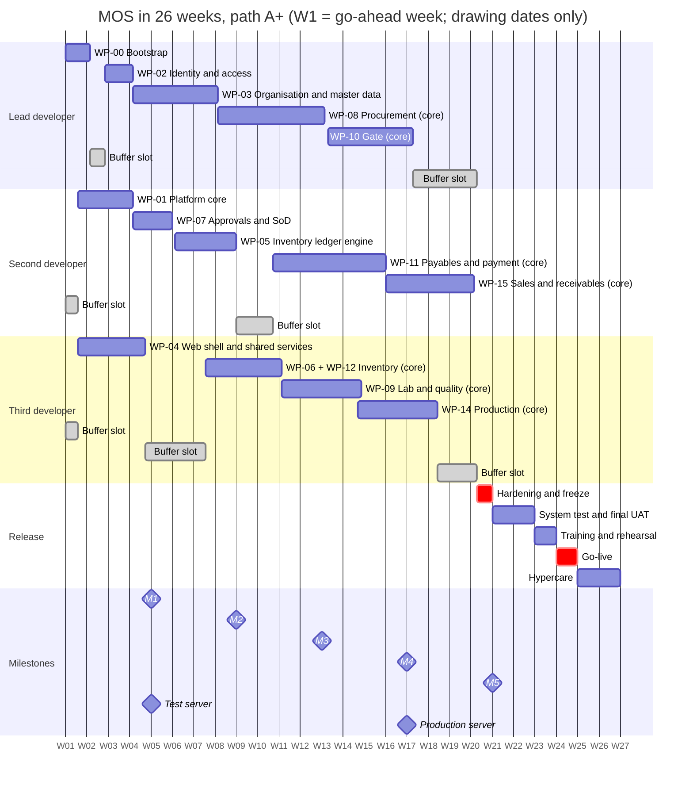

# MOS: Sprint Plan: phases, sprints, modules and features

<!-- nav -->[MOS](../../README.md) › [4. Plan](README.md)

| | |
|---|---|
| Product | MOS (Manufacturing Operations Suite). Working codename; the client's draft uses "Factory ERP" |
| Document | Delivery plan by phase, two-week sprint, module and feature: timelines, tasks, deliverables, acceptance, client inputs, hours |
| Version | **0.2**, draft for the owner's review (0.1: 2026-10-03, the 26 + 9-week calendar; **0.2: 2026-10-03, everything in 26 weeks**, [ADR-0025](../6-decisions/adr/ADR-0025-everything-in-six-months.md)) |
| Date | 2026-10-03 |
| Audience | The product owner and the development team. The phase and milestone tables (§2, §3.3) can be shown to the client |
| Status | **Planning only; no implementation has started.** Building starts at the owner's go-ahead (O-03) and the client's choice of team path (O-34) |
| Baseline | [Implementation plan 0.5](MOS-IMPLEMENTATION-PLAN.md): all six modules at core depth, built W1–W20, **live W24**, hypercare to W26. Feature keys, hours and tiers are its [Appendix A](MOS-IMPLEMENTATION-PLAN.md#appendix-a-feature-estimate); story IDs (M1-xx) are the [procurement module plan](MOS-PROCUREMENT-MODULE-PLAN.md)'s |
| Companion docs | [FRD](../2-requirements/MOS-FRD.md) · [Process model](../2-requirements/MOS-PROCESS-MODEL.md) · [Database design](../3-design/MOS-DATABASE-DESIGN.md) · [TDD](../3-design/MOS-TDD.md) · [Decision register](../6-decisions/MOS-DECISION-REGISTER.md) · [Commercial proposal](../5-for-the-client/MOS-COMMERCIAL-PROPOSAL.md) |

---

## Summary

- **Thirteen two-week sprints, 26 weeks, everything included.** W1 is the go-ahead week.

  | Sprints | Weeks | What happens |
  |---|---|---|
  | S1–S10 | W1–W20 | **Build**, with rolling UAT: each module goes to the client's key users in the sprint after it is built. Test server by W4 (S2); production server by W16 (S8); feature freeze at the end of W20 |
  | S11 | W21–W22 | **System test and final UAT** of the whole flow; sign-off |
  | S12 | W23–W24 | **Training and the migration rehearsal (W23); go-live (W24)** |
  | S13 | W25–W26 | **Hypercare**, then maintenance |

- **The sprint-by-sprint plan follows path A+** (3 developers + AI + QA), the recommended path. Path A's sprint for every feature is in the §6 tables, and its block weeks are in §8.
- **Every one of the 199 estimated features is in this plan.**
  - **133 core features (2,439 h)** are placed in a sprint, in order inside their block, in proportion to their hours.
  - **Each feature has its own tasks and a "done when" test.**
  - **55 standard features (622 h)** form a numbered pull-in queue (§9). **11 full features (116 h)** are the first candidates for v1.1.
- **Sprint load matches capacity** at the speed each path needs: path A+ ×1.33, path A ×1.89 (§5.11).
- **Five milestone reviews** at sprint ends: **W4, W8, W12, W16, W20**. Checkpoints at **W4 and W8** (ADR-0025).
- **Buffer slots.** Dependencies leave some developers without a block for a while (§5.12). Those slots absorb overruns first, then relieve the critical path, then take pull-ins.
- **Decide before S1:** the stack questions O-27 (Vite or Next.js) and O-28 (pg-boss or BullMQ + Redis) change S1's tasks (`f00d`, `f01j`, `f04a`). They are part of Phase 0 (§4).

---

## 1. How to read this plan

| Term | Meaning |
|---|---|
| **W*n*** | Week *n* counted from the go-ahead week (W1). Dates follow once the go-ahead date (O-03) is set |
| **S*n*** | Two-week sprint: S*n* = W(2*n*−1)–W(2*n*). Planning on the first Monday, review and retrospective on the last Friday |
| **Streams** | **L** lead developer (56 h a week) · **D2** second developer (48 h) · **D3** third developer (48 h, path A+ only) · **QA** engineer (40 h; ≈ 64 h a sprint after the focus factor) |
| **Est. h** | Estimated build hours at the *likely* estimate (implementation plan §3), AI-assisted, including the developer's own tests. The team is planned to deliver them faster: path A+ ×1.33, A ×1.89, B ×2.22 |
| **Tiers** | **C** core: in the release. **S** standard: the pull-in queue (§9). **F** full: v1.1 unless pulled in |
| **Feature keys** | `f08l` and so on are the implementation plan's Appendix A keys |
| **Rolling UAT** | Key users test a module on the test server in the sprint after it is built, using its UAT script (from S4–S5, about W8) |

## 2. Timeline at a glance

### 2.1 Phases

| Phase | Sprints | Weeks (path A+) | Goal | Exit gate |
|---|---|---|---|---|
| **0 Mobilisation** | before S1 | 2–3 weeks before W1 | Contract, path, "before W1" answers including infrastructure, team and tooling ready, S1–S2 backlog ready | Every Phase 0 item in §4 closed |
| **1 Foundation** | S1–S5 | W1–W9 | The platform: repository and CI, transactions, outbox and audit, identity, master data, approvals and SoD, numbering and periods, the stock-ledger engine | M2 (W8) accepted; checkpoints W4 and W8 read and acted on; property tests P1–P9 green |
| **2 Procure-to-pay** | S4–S8 | W7–W15 | Inventory documents; suppliers → PR → PO → delivery → GRN → invoice and match → PV → payment; inspection with grading and deductions | **M4 (W16): AS-13, the client's procure-to-pay, end to end on the test server** |
| **3 Plant operations** | S7–S10 | W13–W20 | Gate and weighbridge loop; production (milling, packing, settlement); sales and receivables | M5 (W20) |
| **4 Hardening and freeze** | S10 | W20 | Security review, performance, restore drill, acceptance scripts, guides; **feature freeze at the end of W20** | Every scenario's core variant green (§3.5); no open High/Critical defect |
| **5 Go-live** | S11–S13 | W21–W26 | System test and final UAT; training and rehearsal; **go-live W24**; hypercare | UAT sign-off; go-live checklist; hypercare exit criteria |
| **6 Maintenance and v1.1** | — | after W26 | Handover to the maintenance retainer; v1.1 from the standard and full features not pulled in | Maintenance agreement in force |

The phases overlap because three developer streams run in parallel.

### 2.2 Sprint calendar

| Sprint | Weeks | Phase | Sprint goal (path A+) | Review |
|---|---|---|---|---|
| **S1** | W1–W2 | 1 | L: repository, CI and test harness (start to finish); sign-in, users and roles (begins) · D2: the platform core (transactions, outbox, audit, documents) (begins) · D3: the web shell and shared components (begins) | sprint review |
| **S2** | W3–W4 | 1 | L: sign-in, users and roles (finishes); company set-up and master data (begins) · D2: the platform core (transactions, outbox, audit, documents) (finishes); approvals and segregation of duties (begins) · D3: the web shell and shared components (finishes) | **M1** + checkpoint 1; test server live |
| **S3** | W5–W6 | 1 | L: company set-up and master data (continues) · D2: approvals and segregation of duties (finishes); the stock-ledger engine (begins) · D3: buffer slot (§5.12) | sprint review |
| **S4** | W7–W8 | 1 / 2 | L: company set-up and master data (finishes); procurement (begins) · D2: the stock-ledger engine (continues) · D3: inventory documents, counts and close (begins) | **M2** + checkpoint 2 |
| **S5** | W9–W10 | 1 / 2 | L: procurement (continues) · D2: the stock-ledger engine (finishes); payables and supplier payment (begins) · D3: inventory documents, counts and close (continues) | sprint review |
| **S6** | W11–W12 | 2 | L: procurement (continues) · D2: payables and supplier payment (continues) · D3: inventory documents, counts and close (finishes); lab and quality (begins) | **M3** |
| **S7** | W13–W14 | 2 / 3 | L: procurement (finishes); gate and weighbridge (begins) · D2: payables and supplier payment (continues) · D3: lab and quality (finishes); production (begins) | sprint review |
| **S8** | W15–W16 | 2 / 3 | L: gate and weighbridge (continues) · D2: payables and supplier payment (finishes); sales and receivables (begins) · D3: production (continues) | **M4** (AS-13); production server ready |
| **S9** | W17–W18 | 3 | L: gate and weighbridge (finishes) · D2: sales and receivables (continues) · D3: production (finishes) | sprint review |
| **S10** | W19–W20 | 3 / 4 | L: buffer slot (§5.12) · D2: sales and receivables (finishes) · D3: buffer slot (§5.12) · hardening and **feature freeze** (all) | **M5**; freeze |
| **S11** | W21–W22 | 5 | System test of every acceptance scenario; final UAT of the whole flow; sign-off | UAT sign-off |
| **S12** | W23–W24 | 5 | Training and the migration rehearsal (W23); **cutover and go-live (W24)** | go/no-go (end of W23); go-live |
| **S13** | W25–W26 | 5 | Hypercare: daily check-ins, fast fixes, the v1.1 backlog; handover to maintenance | hypercare exit |

### 2.3 Gantt (path A+)

---

## 3. Cadence, roles and controls

### 3.1 Sprint rhythm

These events come out of the 20% of hours the focus factor keeps for non-build work (implementation plan §1).

| When | Event | Who | Time box | Output |
|---|---|---|---|---|
| Day 1 of the sprint | Sprint planning | Team; owner for priorities | 2 h | Sprint goal; the features of §5 confirmed or adjusted |
| Every day | Async check-in in `PROGRESS.md` | Each developer | 10 min | Yesterday, today, blockers; actual hours against the feature |
| End of week 1 of the sprint | Mid-sprint check | Team | 30 min | Load against capacity; decide early on buffer-slot use (§5.12) |
| Weekly | Backlog refinement | Lead developer, QA | 1 h | The next sprint's features meet the definition of ready (§3.4) |
| During the sprint | **Rolling UAT session** | QA, the module's key users | 2–4 h | The previous sprint's module tested on the test server; findings logged |
| Last day | Sprint review | Team, owner; client key users at milestone reviews | 1–1.5 h | Working features shown on the test server; feedback logged |
| Last day | Retrospective | Team | 45 min | One improvement for the next sprint |

### 3.2 Who does what

| Role | Responsible for |
|---|---|
| Owner (product owner) | Priorities, decisions in the register, the go-ahead, adding capacity after a checkpoint, scope changes |
| Lead developer | Architecture, the critical-path stream, code review of every merge, sprint planning, the test and production servers |
| Second and third developers | Their streams; code review; the buffer slots |
| QA engineer | Test strategy and harness, acceptance scripts from the FRD, exploratory testing, end-to-end automation, regression before reviews, **rolling UAT sessions** |
| Client key users | Inputs by the needed-by weeks, rolling UAT from about W8, the final UAT in W21–W22 |

### 3.3 Milestone reviews and checkpoints

| Review | Week | Sprint end | What the client sees (path A+) | Path A difference |
|---|---|---|---|---|
| **M1** | W4 | S2 | Sign-in, the shell, shared components; the platform core; users and roles; **the test server on their infrastructure**. **Checkpoint 1** | Same |
| **M2** | W8 | S4 | Company set-up, storage units and silos, items, partners, taxes, numbering, periods; approval matrix and inbox; the stock-ledger engine finishing; inventory documents begin; the set-up screens ready for rolling UAT in S5. **Checkpoint 2** | Ledger done (W7); procurement well under way; payables starting |
| **M3** | W12 | S6 | Stock documents, bin and stock cards, counts and close; suppliers, PRs, POs, deliveries; GRN finishing; invoices and matching; inspection set-up | Procurement, payables and inventory complete; QC starting |
| **M4** | W16 | S8 | **AS-13: the client's procure-to-pay end to end** on the test server; gate and production under way; production server ready | Gate and production under way |
| **M5** | W20 | S10 | Gate and weighbridge loop; production; sales through the outbound gate; hardening; **feature freeze** | Same |

**Checkpoints (ADR-0025):**
- **When:** at the end of **W4** (the S2 review) and **W8** (the S4 review).
- **What is measured:** the average of actual ÷ estimated hours over the features finished so far.
- **If it is more than 10% worse than the path's required factor** (A+ 45/60, A 32/60, B 27/60): the owner adds capacity **before W9**. The date and the core scope don't move.
- **If it is better:** the next items of the pull-in queue (§9) enter the release.

### 3.4 Definition of ready and definition of done

**Ready (before a feature enters a sprint):**
1. Its FRD requirements, tables (database design) and process steps (process model) are named. §6 does this for every feature.
2. The client inputs it needs have arrived, or a documented default is agreed (the decision register's "default if unanswered").
3. Its dependencies are at least half done.
4. The tasks in §6 are understood and the estimate is not disputed.

**Done (a feature counts only when all of these hold):**
1. Zod contracts and migrations reviewed; tables follow their registry class.
2. The FRD acceptance criteria pass as automated tests that quote the FR ID, run as `mos_app`; the feature's "done when" test in §6 passes.
3. Lint, dependency-cruiser, catalogue and migration-safety gates green; frontend build green.
4. Screens follow the client's layout with the review corrections; status is never editable.
5. TDD sections and ADRs updated where touched; `PROGRESS.md` updated with **actual hours**.
6. Shown at the sprint review, and deployed to the test server.

### 3.5 Acceptance scenarios: when each can first pass

The FRD's end-to-end scenarios (FRD §16) are the release's acceptance tests. Some include standard-depth features. So each scenario has a **core variant**, which must pass in the release, and a **full variant**, which passes once the named pull-ins are built. "Can first pass" is when the last core feature it needs is planned to finish.

| Scenario | What it proves | Can first pass (A+) | Path A | Core variant | Full variant also needs |
|---|---|---|---|---|---|
| **AS-01** | Wheat truck, gate on, accepted with a moisture deduction, through to payment | S9 (W17) | S8 (W16) | The quality debit note is raised by the finance officer (`f11d`) | `f11e` (Q15) |
| **AS-02** | Wheat truck rejected before unloading; long-test variant | S8 (W16) | S8 (W16) | The retention sample is recorded as a note until `f09j` (v1.1) | `f09j` (v1.1) |
| **AS-03** | Packaged additive into quarantine; partial accept; rejected part returned with a debit | S7 (W13) | S7 (W14) | The whole scenario | — |
| **AS-04** | Truck leaves without tare: flagged GRN draft, approval, payment block | S9 (W17) | S8 (W16) | The whole scenario | — |
| **AS-05** | Bank-account change fraud attempt | S7 (W13) | S5 (W10) | The whole scenario | — |
| **AS-06** | Inter-site transfer with a short receipt | — | — | None: the whole scenario depends on the pull-in | `f06c` (Q30) |
| **AS-07** | Counts: silo dip in cut-off mode; blind count with recount | S5 (W10) | S6 (W12) | A plain count with approval and the generated adjustment | `f12b` (Q26), `f12c` (Q28) |
| **AS-08** | Period close with an in-flight posting; reopen | S6 (W11) | S6 (W12) | The whole scenario | — |
| **AS-09** | Outbound purchase-return truck | S8 (W16) | S8 (W16) | The whole scenario | — |
| **AS-10** | Network outage at the gate: paper slips and back-entry | — | — | None: the whole scenario depends on the pull-in | `f10n` (Q38) |
| **AS-11** | Site scoping through UI, API, exports, search, notifications, jobs | S2 (W4) | S2 (W4) | UI, API, exports and notifications; search and background jobs follow `f04k`/`f12g` (v1.1) | `f04k` (v1.1), `f12g` (v1.1) |
| **AS-12** | Approval delegation and escalation with SoD | S3 (W5) | S3 (W5) | SoD exclusion and the approval chain; delegation and escalation need the pull-ins | `f07c` (Q8), `f07d` (Q9) |
| **AS-13** | The client's procure-to-pay walkthrough | S7 (W14) | S7 (W14) | Management approves PRs one by one; bulk approval needs `f04d` | `f04d` (Q3) |
| **AS-14** | Milling run with extraction, settlement and trace | S9 (W18) | S9 (W17) | A standard work order without tempering water; the campaign order and tempering need the pull-ins | `f14d` (Q44), `f14f` (Q43) |
| **AS-15** | Order to cash through the outbound gate | S10 (W19) | S10 (W19) | The whole scenario | — |
| **AS-16** | Packing into 50 kg bags with backflush | S9 (W17) | S8 (W16) | Bag labels printed from a standard template need `f06l` | `f06l` (Q33) |
| **AS-17** | Finished-goods hold and release | S9 (W17) | S8 (W16) | The whole scenario (`f14i` is core since the review) | — |
| **AS-18** | Cash sale: exit blocked until paid | S10 (W19) | S10 (W19) | The whole scenario | — |
| **AS-19** | Customer return and credit note | — | — | None: the whole scenario depends on the pull-in | `f15l` (Q48) |

**Read this as a finding:** three scenarios (AS-06, AS-10, AS-19) are entirely standard depth, and seven more have a standard-depth part. The release's exit criterion is therefore *every core variant green*. Each full variant joins when its pull-in is built. (AS-17 became core with the review's INT-18.)

---

## 4. Phase 0: mobilisation (before W1)

| # | Task | Owner | Needed for | Deliverable |
|---|---|---|---|---|
| 0.1 | Client chooses a team path (O-34) and signs the proposal; go-ahead date set (O-03) | Client, owner | Everything | Signed proposal; W1 date |
| 0.2 | **Stack decisions O-27 (frontend) and O-28 (job queue)**; ADR-0023/0024 if adopted | Owner | S1 tasks `f00d`, `f01j`, `f04a` | Decision recorded |
| 0.3 | Client answers the **four sizing questions** (Q-01 gate, Q-02 grading, Q-03 supplier payment requests, Q-04 invoice approval) and the other "before W1" items | Client | Scope of every sprint | Answers in the register |
| 0.4 | **Infrastructure answers for the test server** (I-01–I-04, I-06, I-15, I-16): where it runs, which machine, containers or native, remote access, the IT contact | Client's IT | S2 (test server by W4) | Access to a test machine |
| 0.5 | **Key users named per module** (C-05) and their UAT time booked from about W8 | Client | Rolling UAT | Names and calendar |
| 0.6 | Coherent end-to-end dataset agreed with the client (one example from PR to payment, C-28/C-40) | Client key users, owner | Acceptance tests from S4 | Dataset file |
| 0.7 | Team set-up: private repository access, AI tooling, development machines, password manager, communication channel | Lead developer | S1 | Everyone can clone and push |
| 0.8 | Backlog for S1–S2 ready; QA test strategy outline | Lead developer, QA | S1 | Ready backlog |
| 0.9 | Request the master-data extracts (due before W3) with templates | Owner | S2 | Request sent |

---

## 5. Sprint by sprint (path A+)

Each build sprint lists the core features placed in it, by stream. **A feature that spans two sprints appears in both**, with its whole estimate and its weeks. The task-level detail of every feature is in §6.

### 5.1 S1: W1–W2

**Goal:** L: repository, CI and test harness (start to finish); sign-in, users and roles (begins) · D2: the platform core (transactions, outbox, audit, documents) (begins) · D3: the web shell and shared components (begins).

| Stream | Key | Feature | Module | Est. h | Weeks |
|---|---|---|---|---|---|
| Lead developer | `f00a` | Monorepo layout, workspaces, shared packages | Foundation | 12 | W1 |
| Lead developer | `f00b` | Lint, formatting, dependency-cruiser tier rules | Foundation | 8 | W1 |
| Lead developer | `f00c` | CI: types, unit and integration tests on PostgreSQL as mos_app, migration-safety check, build | Foundation | 20 | W1 |
| Lead developer | `f00d` | Development environment, env contract templates, seed scripts | Foundation | 10 | W1 |
| Lead developer | `f00e` | Test harness: factories, fixtures, database reset | Foundation | 14 | W1–W2 |
| Lead developer | `f02a` | Local accounts: password policy, hashing, lockout, admin reset, forced change *(continues)* | Foundation | 24 | W2–W3 |
| Second developer | `f01a` | Unit of work: transactions, serialisation retry, request context | Foundation | 16 | W1 |
| Second developer | `f01b` | Idempotency keys | Foundation | 10 | W1–W2 |
| Second developer | `f01c` | Outbox, relay, processed events, process-exception records | Foundation | 28 | W2 |
| Second developer | `f01d` | Audit log of every create, submit, approve, post, reverse, override and sign-in | Foundation | 10 | W2 |
| Second developer | `f01f` | Error model, env validation, health, structured logs *(continues)* | Foundation | 12 | W2–W3 |
| Third developer | `f04a` | App shell, navigation, sign-in pages, message catalogues, one date formatter | Foundation | 20 | W1 |
| Third developer | `f04b` | Shared components: data grid, line-items form, document page, scan input, lookups | Foundation | 48 | W1–W2 |
| Third developer | `f04c` | Approvals inbox, usable on a phone *(continues)* | Foundation | 16 | W2–W3 |

**Load (estimated hours this sprint):** lead 71 of ≈ 111 · second 68 of ≈ 96 · third 68 of ≈ 96.

**QA:** Test strategy; test-data plan from the end-to-end dataset; end-to-end harness (part of the 60 h set-up).

**Client inputs:** **due before W3:** master-data extracts: items and UoM, storage units and silo capacities, suppliers, banks and paying accounts, users and roles; **due before W4:** approval bands; which roles must be different people (C-49); the end-to-end example for acceptance tests.

**Finished at the review:** `f00a`, `f00b`, `f00c`, `f00d`, `f00e`, `f01a`, `f01b`, `f01c`, `f01d`, `f04a`, `f04b`.

**Watch:** O-27 and O-28 decided before sprint planning; the test-server machine must be reachable by the end of S1.

### 5.2 S2: W3–W4

**Goal:** L: sign-in, users and roles (finishes); company set-up and master data (begins) · D2: the platform core (transactions, outbox, audit, documents) (finishes); approvals and segregation of duties (begins) · D3: the web shell and shared components (finishes).

| Stream | Key | Feature | Module | Est. h | Weeks |
|---|---|---|---|---|---|
| Lead developer | `f02a` | Local accounts: password policy, hashing, lockout, admin reset, forced change *(from S1)* | Foundation | 24 | W2–W3 |
| Lead developer | `f02d` | Sessions, CSRF, idle and absolute expiry, sign-out | Foundation | 12 | W3 |
| Lead developer | `f02e` | Users, invitations, role and permission editor, site-scoped access in every query | Foundation | 32 | W3–W4 |
| Lead developer | `f02f` | Operation-unit selection after sign-in | Foundation | 6 | W4 |
| Lead developer | `f03a` | Setup wizard, company profile, sites, departments, site time zones | Foundation | 16 | W4 |
| Lead developer | `f03b` | Warehouses and storage units: types, permissions, allowed categories and statuses, keepers, stock levels | Foundation | 22 | W4 |
| Lead developer | `f03d` | Units of measure and versioned item conversions *(continues)* | Foundation | 14 | W4–W5 |
| Second developer | `f01f` | Error model, env validation, health, structured logs *(from S1)* | Foundation | 12 | W2–W3 |
| Second developer | `f01g` | Table registry, generated grants, posted-row guard trigger | Foundation | 10 | W3 |
| Second developer | `f01i` | Document engine: lifecycles, named actions, status map, lock ranks, posting and reversal base | Foundation | 32 | W3–W4 |
| Second developer | `f01j` | Job queue port and scheduler | Foundation | 6 | W4 |
| Second developer | `f07a` | Approval matrix: amount bands, site, category, flags; admin screen | Foundation | 28 | W4 |
| Second developer | `f07b` | Approval chains: submit, approve, reject, request changes, recall; sequential stages, one-of-N *(continues)* | Foundation | 28 | W4–W5 |
| Third developer | `f04c` | Approvals inbox, usable on a phone *(from S1)* | Foundation | 16 | W2–W3 |
| Third developer | `f04e` | Attachment service: content check, size limit, fingerprint, local-disk or S3 storage | Foundation | 12 | W3 |
| Third developer | `f04g` | PDF template engine with a branded base template and QR code | Foundation | 20 | W3 |
| Third developer | `f04h` | In-app notifications | Foundation | 10 | W3–W4 |
| Third developer | `f04j` | List export to XLSX/CSV within scopes and filters | Foundation | 8 | W4 |
| Third developer | `f04l` | Process-exception work queue | Foundation | 8 | W4 |
| Third developer | `f04m` | Build fingerprint | Foundation | 4 | W4 |
| Third developer | `f04o` | Typed attachment slots per document, each with a "Verify" action | Foundation | 6 | W4 |

**Load (estimated hours this sprint):** lead 111 of ≈ 111 · second 96 of ≈ 96 · third 84 of ≈ 96.

**QA:** Harness complete; acceptance scripts for platform features; exploratory testing of sign-in and the shell; **regression for M1** (12 h); smoke test of the test server.

**Client inputs:** **due before W6:** procurement rules: PO without PR, individual suppliers, onboarding documents, quotations, tolerances, who records deliveries, rejected vs short, budget codes.

**Finished at the review:** `f01f`, `f01g`, `f01i`, `f01j`, `f02a`, `f02d`, `f02e`, `f02f`, `f03a`, `f03b`, `f04c`, `f04e`, `f04g`, `f04h`, `f04j`, `f04l`, `f04m`, `f04o`, `f07a`.

**Exit criteria:** Checkpoint 1 recorded; M1 accepted; the test server reachable by the client.

**Watch:** Checkpoint 1 at the end of W4; the test server goes live this sprint (R26); the approvals inbox must work at 375 px.

### 5.3 S3: W5–W6

**Goal:** L: company set-up and master data (continues) · D2: approvals and segregation of duties (finishes); the stock-ledger engine (begins) · D3: buffer slot (§5.12).

| Stream | Key | Feature | Module | Est. h | Weeks |
|---|---|---|---|---|---|
| Lead developer | `f03d` | Units of measure and versioned item conversions *(from S2)* | Foundation | 14 | W4–W5 |
| Lead developer | `f03e` | Items, categories, item stock levels | Foundation | 20 | W5 |
| Lead developer | `f03g` | Business partners (organisations and individuals), addresses, contacts, categories, TIN rules | Foundation | 18 | W5 |
| Lead developer | `f03i` | Bank master; company paying accounts (bank, cash, mobile money) | Foundation | 10 | W5–W6 |
| Lead developer | `f03j` | Tax codes and groups, withholding profiles, payment terms, currencies and rates, reason codes | Foundation | 24 | W6 |
| Lead developer | `f03k` | Numbering: series, patterns, gap-free counters with a concurrency test | Foundation | 20 | W6 |
| Lead developer | `f03l` | Fiscal years, periods, per-module period status, close and reopen *(continues)* | Foundation | 16 | W6–W7 |
| Second developer | `f07b` | Approval chains: submit, approve, reject, request changes, recall; sequential stages, one-of-N *(from S2)* | Foundation | 28 | W4–W5 |
| Second developer | `f07e` | SoD rules, actor tracking, exclusion at assignment and posting, eligible-approver check | Foundation | 24 | W5 |
| Second developer | `f07f` | Approval history (immutable) | Foundation | 6 | W5 |
| Second developer | `f05a` | Stock ledger, buckets and balances with sorted locking | Foundation | 28 | W6 |
| Second developer | `f05b` | Moving-average valuation at company level *(continues)* | Foundation | 20 | W6–W7 |

**Load (estimated hours this sprint):** lead 111 of ≈ 111 · second 85 of ≈ 96 · third 0 of ≈ 96.

**QA:** Acceptance scripts for master data, roles and site scopes (AS-11) and approvals and SoD (AS-12); UAT script for the set-up screens.

**Client inputs:** **due before W7:** inventory practice: rejected quantities and empty bags, transfer approvers, counting, fumigation; **due before W8:** payables: invoice timing, who pays, payment methods, withholding and VAT, WHT certificate, accounting package format.

**Finished at the review:** `f03d`, `f03e`, `f03g`, `f03i`, `f03j`, `f03k`, `f07b`, `f07e`, `f07f`, `f05a`.

**Watch:** The third developer has a buffer slot (§5.12); late master-data extracts (R15): build against the flour pack and import later.

### 5.4 S4: W7–W8

**Goal:** L: company set-up and master data (finishes); procurement (begins) · D2: the stock-ledger engine (continues) · D3: inventory documents, counts and close (begins).

| Stream | Key | Feature | Module | Est. h | Weeks |
|---|---|---|---|---|---|
| Lead developer | `f03l` | Fiscal years, periods, per-module period status, close and reopen *(from S3)* | Foundation | 16 | W6–W7 |
| Lead developer | `f03m` | Module switches, deactivate-only masters, backdating windows, date checks | Foundation | 12 | W7 |
| Lead developer | `f03n` | Import framework: CSV/XLSX templates, dry-run report, all-or-nothing commit | Foundation | 20 | W7 |
| Lead developer | `f03p` | Grain/flour industry pack: items, categories, reason codes, templates | Foundation | 12 | W7 |
| Lead developer | `f03q` | Storage-master fields from the client dictionary (type, description, flags, dedicated item, temperature, minimum level); mixed items/lots rule at posting | Foundation | 8 | W7–W8 |
| Lead developer | `f03r` | Client fields the first review missed: remarks on documents, storage statuses, bin type, contact status, invoice type, supplier item code, count scope, issue received-by | Foundation | 6 | W8 |
| Lead developer | `f08a` | Supplier 5-step wizard with drafts; onboarding document checklist | Procurement | 24 | W8 |
| Lead developer | `f08c` | Supplier lifecycle actions and order/receipt/payment eligibility | Procurement | 12 | W8 |
| Lead developer | `f08e` | Supplier bank accounts (encrypted, masked, audited reveal) and bank-change control *(continues)* | Procurement | 28 | W8–W9 |
| Second developer | `f05b` | Moving-average valuation at company level *(from S3)* | Foundation | 20 | W6–W7 |
| Second developer | `f05c` | Capacity check and commingled-silo FIFO | Foundation | 20 | W7 |
| Second developer | `f05d` | Inventory posting and reversal framework, negative-stock refusal, pending-issue hook | Foundation | 24 | W7–W8 |
| Second developer | `f05e` | Property tests: invariants over at least 10,000 generated sequences | Foundation | 32 | W8 |
| Second developer | `f05f` | Lots and genealogy links *(continues)* | Foundation | 12 | W8–W9 |
| Third developer | `f06a` | Miscellaneous receipts and issues (consumption, scrap) at moving average | Inventory | 20 | W7–W8 |
| Third developer | `f06b` | Intra-site transfers | Inventory | 12 | W8 |
| Third developer | `f06d` | Stock adjustments routed by value through the approval matrix | Inventory | 16 | W8 |
| Third developer | `f06e` | Status changes: block, damage, recovery | Inventory | 16 | W8 |
| Third developer | `f06f` | Lot attributes and backward/forward trace *(continues)* | Inventory | 12 | W8–W9 |

**Load (estimated hours this sprint):** lead 111 of ≈ 111 · second 96 of ≈ 96 · third 68 of ≈ 96.

**QA:** Exploratory testing of master data and approvals; numbering concurrency tests (P14); **regression for M2** (12 h).

**Client inputs:** **due before W10:** QC specs, grade table, deductions; **gate workshop**; **production workshop**; staging store or direct issue.

**Finished at the review:** `f03l`, `f03m`, `f03n`, `f03p`, `f03q`, `f03r`, `f05b`, `f05c`, `f05d`, `f05e`, `f08a`, `f08c`, `f06a`, `f06b`, `f06d`, `f06e`.

**Exit criteria:** Checkpoint 2 recorded and acted on before W9; M2 accepted.

**Watch:** Checkpoint 2 at the end of W8 decides any added capacity before W9; approval bands were due before W4; any ledger property failure stops inventory until fixed (R4).

### 5.5 S5: W9–W10

**Goal:** L: procurement (continues) · D2: the stock-ledger engine (finishes); payables and supplier payment (begins) · D3: inventory documents, counts and close (continues).

| Stream | Key | Feature | Module | Est. h | Weeks |
|---|---|---|---|---|---|
| Lead developer | `f08e` | Supplier bank accounts (encrypted, masked, audited reveal) and bank-change control *(from S4)* | Procurement | 28 | W8–W9 |
| Lead developer | `f08g` | Purchase requisition with live available stock, quantity to purchase, approval, conversion tracking | Procurement | 32 | W9 |
| Lead developer | `f08i` | Purchase order: terms, lines, discounts, taxes, schedules, tolerances, approval, issue by PDF/email | Procurement | 44 | W9–W10 |
| Lead developer | `f08k` | PO closure (auto, short-close, cancel) and stale-PO report | Procurement | 10 | W10 |
| Lead developer | `f08l` | GRN with the gate off: pre-fill, accepted/rejected with disposition, batches, weights, bags, tolerances, valuation *(continues)* | Procurement | 56 | W10–W11 |
| Second developer | `f05f` | Lots and genealogy links *(from S4)* | Foundation | 12 | W8–W9 |
| Second developer | `f11a` | Supplier invoice capture (list and inline on the PV), duplicate detection, due dates *(continues)* | Payables | 20 | W10–W11 |
| Third developer | `f06f` | Lot attributes and backward/forward trace *(from S4)* | Inventory | 12 | W8–W9 |
| Third developer | `f06h` | Stock balance with status breakdown and transaction history | Inventory | 24 | W9 |
| Third developer | `f06j` | Silo levels and level alerts | Inventory | 10 | W9 |
| Third developer | `f06m` | Inventory dashboard | Inventory | 8 | W9–W10 |
| Third developer | `f06n` | Bin card and stock card from the one ledger, with the opening balance for the period | Inventory | 10 | W10 |
| Third developer | `f12a` | Counts: count, approval, generated adjustment | Inventory | 20 | W10 |
| Third developer | `f12e` | Inventory period close with checklist and value snapshot *(continues)* | Inventory | 20 | W10–W11 |

**Load (estimated hours this sprint):** lead 111 of ≈ 111 · second 17 of ≈ 96 · third 96 of ≈ 96.

**QA:** **Rolling UAT: set-up screens** with the key users; acceptance scripts for procurement (UAT-01…UAT-09) and inventory.

**Rolling UAT this sprint:** Foundation set-up (users, roles, company set-up, master data, approvals).

**Client inputs:** **due before W12:** **sales workshop**; fiscal-device answer; **production-server questions** (network, power, backups, domain, email, devices).

**Finished at the review:** `f05f`, `f08e`, `f08g`, `f08i`, `f08k`, `f06f`, `f06h`, `f06j`, `f06m`, `f06n`, `f12a`.

**Watch:** Rolling UAT starts in earnest: key users must turn up (R25); procurement is the lead's critical path.

### 5.6 S6: W11–W12

**Goal:** L: procurement (continues) · D2: payables and supplier payment (continues) · D3: inventory documents, counts and close (finishes); lab and quality (begins).

| Stream | Key | Feature | Module | Est. h | Weeks |
|---|---|---|---|---|---|
| Lead developer | `f08l` | GRN with the gate off: pre-fill, accepted/rejected with disposition, batches, weights, bags, tolerances, valuation *(from S5)* | Procurement | 56 | W10–W11 |
| Lead developer | `f08n` | Supplier returns and replacement | Procurement | 20 | W11–W12 |
| Lead developer | `f08o` | Procurement reports: open PRs and POs, ageing, status, outstanding deliveries | Procurement | 10 | W12 |
| Lead developer | `f08q` | Procurement dashboard | Procurement | 8 | W12 |
| Lead developer | `f08r` | PDF templates: PO, GRN, supplier receipt with deductions, rejection note | Procurement | 12 | W12 |
| Lead developer | `f08s` | Supplier delivery (arrival) record with the gate module off: PO lines, delivery note, plate, driver, declared quantities; hand-off to inspection and the GRN *(continues)* | Procurement | 20 | W12–W13 |
| Second developer | `f11a` | Supplier invoice capture (list and inline on the PV), duplicate detection, due dates *(from S5)* | Payables | 20 | W10–W11 |
| Second developer | `f11b` | Matching: three-way/two-way on payable quantity and adjusted price, tolerances, PPV, holds | Payables | 40 | W11 |
| Second developer | `f11c` | Match-exception resolution through the approval matrix | Payables | 12 | W11–W12 |
| Second developer | `f11d` | Debit notes (quality and return) and their allocation | Payables | 10 | W12 |
| Second developer | `f11g` | PV drafted from the GRN; lines, gross/VAT/WHT/net, reservation, approval, lifecycle *(continues)* | Payables | 40 | W12–W13 |
| Third developer | `f12e` | Inventory period close with checklist and value snapshot *(from S5)* | Inventory | 20 | W10–W11 |
| Third developer | `f09a` | Test methods, parameters, versioned and approved specs, QC policies, fixed-count sampling | Lab/QC | 24 | W11 |
| Third developer | `f09c` | Inspection lots (from the gate, from quarantine, gate off with weights), inspection record, samples and labels | Lab/QC | 28 | W11–W12 |
| Third developer | `f09e` | Result entry grid, insert-only results, invalidation | Lab/QC | 28 | W12 |
| Third developer | `f09f` | Evaluation, grading schemes, quality score *(continues)* | Lab/QC | 28 | W12–W13 |

**Load (estimated hours this sprint):** lead 111 of ≈ 111 · second 96 of ≈ 96 · third 96 of ≈ 96.

**QA:** End-to-end flow PR → PO → delivery → GRN; exploratory testing of the GRN; **regression for M3** (12 h).

**Client inputs:** none due.

**Finished at the review:** `f08l`, `f08n`, `f08o`, `f08q`, `f08r`, `f11a`, `f11b`, `f11c`, `f11d`, `f12e`, `f09a`, `f09c`, `f09e`.

**Exit criteria:** Inventory UAT script passes; M3 accepted.

**Watch:** The GRN (`f08l`, 56 h) is the largest feature: review it in two slices; QC specs and the gate and production workshops are due before W10.

### 5.7 S7: W13–W14

**Goal:** L: procurement (finishes); gate and weighbridge (begins) · D2: payables and supplier payment (continues) · D3: lab and quality (finishes); production (begins).

| Stream | Key | Feature | Module | Est. h | Weeks |
|---|---|---|---|---|---|
| Lead developer | `f08s` | Supplier delivery (arrival) record with the gate module off: PO lines, delivery note, plate, driver, declared quantities; hand-off to inspection and the GRN *(from S6)* | Procurement | 20 | W12–W13 |
| Lead developer | `f08t` | Small fields: supplier default bank account; PR purpose list | Procurement | 3 | W13 |
| Lead developer | `f10a` | Gate masters: posts, weighbridges, vehicles, tares, drivers, tolerance rules, checklists | Gate | 18 | W13 |
| Lead developer | `f10c` | Guard shifts | Gate | 6 | W13 |
| Lead developer | `f10e` | Expected arrivals | Gate | 10 | W13 |
| Lead developer | `f10f` | Inbound visits: arrival by plate, entry, one open visit per vehicle, documents, seals, checklist, events | Gate | 36 | W13–W14 |
| Lead developer | `f10g` | Weigh tickets: gap-free per weighbridge, direction, blind verification, tolerances, stored tare, re-weighing *(continues)* | Gate | 40 | W14–W15 |
| Second developer | `f11g` | PV drafted from the GRN; lines, gross/VAT/WHT/net, reservation, approval, lifecycle *(from S6)* | Payables | 40 | W12–W13 |
| Second developer | `f11h` | Payment recording: paying account, cheque, bank reference, proof, allocation, bank-detail re-check | Payables | 28 | W13 |
| Second developer | `f11i` | Cheque register | Payables | 12 | W13–W14 |
| Second developer | `f11k` | Withholding computation and certificates | Payables | 14 | W14 |
| Second developer | `f11l` | Partner ledger: open items, entries, allocations, balances, statements, ageing | Payables | 28 | W14 |
| Second developer | `f11m` | Journals: posting rules, account map, CSV export batches *(continues)* | Payables | 32 | W14–W15 |
| Third developer | `f09f` | Evaluation, grading schemes, quality score *(from S6)* | Lab/QC | 28 | W12–W13 |
| Third developer | `f09h` | Usage decisions, their stock effects, decision changes | Lab/QC | 24 | W13 |
| Third developer | `f09i` | Quality price and weight rules; deduction results | Lab/QC | 24 | W13–W14 |
| Third developer | `f09k` | Lab dashboard | Lab/QC | 8 | W14 |
| Third developer | `f09m` | Flour-pack QC seed: wheat parameters, specs, grades, deduction rules | Lab/QC | 12 | W14 |
| Third developer | `f14a` | Work centres and shift calendar | Production | 10 | W14 |
| Third developer | `f14b` | Recipes with co- and by-products and a mass-balance band, versioned and approved *(continues)* | Production | 24 | W14–W15 |

**Load (estimated hours this sprint):** lead 103 of ≈ 111 · second 96 of ≈ 96 · third 96 of ≈ 96.

**QA:** **Rolling UAT: inventory**; acceptance scripts for payables (UAT-10…UAT-20) and QC.

**Rolling UAT this sprint:** Inventory (stock documents, bin and stock cards, counts, close).

**Client inputs:** none due.

**Finished at the review:** `f08s`, `f08t`, `f11g`, `f11h`, `f11i`, `f11k`, `f11l`, `f09f`, `f09h`, `f09i`, `f09k`, `f09m`, `f10a`, `f10c`, `f10e`, `f10f`, `f14a`.

**Watch:** Withholding and VAT rules confirmed (R14); the sales workshop and fiscal-device answer are due before W12.

### 5.8 S8: W15–W16

**Goal:** L: gate and weighbridge (continues) · D2: payables and supplier payment (finishes); sales and receivables (begins) · D3: production (continues).

| Stream | Key | Feature | Module | Est. h | Weeks |
|---|---|---|---|---|---|
| Lead developer | `f10g` | Weigh tickets: gap-free per weighbridge, direction, blind verification, tolerances, stored tare, re-weighing *(from S7)* | Gate | 40 | W14–W15 |
| Lead developer | `f10h` | Inspection hand-off and unloading pre-flight checks | Gate | 16 | W15 |
| Lead developer | `f10i` | GRN prepared at tare; receipt exceptions | Gate | 28 | W15–W16 |
| Lead developer | `f10j` | Exit clearance, overrides, exit passes | Gate | 16 | W16 |
| Lead developer | `f10o` | Outbound visit class (dispatch, returns, transfers) | Gate | 16 | W16 |
| Lead developer | `f10p` | Inbound failure-case suite and idempotency replay tests *(continues)* | Gate | 20 | W16–W17 |
| Second developer | `f11m` | Journals: posting rules, account map, CSV export batches *(from S7)* | Payables | 32 | W14–W15 |
| Second developer | `f11p` | Payables dashboard | Payables | 8 | W15 |
| Second developer | `f11q` | PDF templates: self-billed voucher, PV, payment voucher, debit note, WHT certificate | Payables | 12 | W15 |
| Second developer | `f15a` | Customers with approval, credit limits and changes, ship-to addresses | Sales | 24 | W15–W16 |
| Second developer | `f15b` | Price lists with approval, floor prices, discount limits | Sales | 12 | W16 |
| Second developer | `f15d` | Sales orders with credit, price and discount holds *(continues)* | Sales | 28 | W16–W17 |
| Third developer | `f14b` | Recipes with co- and by-products and a mass-balance band, versioned and approved *(from S7)* | Production | 24 | W14–W15 |
| Third developer | `f14c` | Work orders (standard and packing) and release | Production | 20 | W15 |
| Third developer | `f14e` | Milling run: grist from silos, extraction rate | Production | 20 | W15–W16 |
| Third developer | `f14g` | Material issue: silo draw-down, scan issue, backflush, pending issues; supervisor screens | Production | 28 | W16 |
| Third developer | `f14h` | Output by lot with co- and by-products; packing into bag SKUs *(continues)* | Production | 20 | W16–W17 |

**Load (estimated hours this sprint):** lead 111 of ≈ 111 · second 96 of ≈ 96 · third 96 of ≈ 96.

**QA:** End-to-end flow: **AS-13** in full; AS-03; **regression for M4** (12 h).

**Client inputs:** **due before W17:** migration data extracts; retention periods; training schedule.

**Finished at the review:** `f11m`, `f11p`, `f11q`, `f10g`, `f10h`, `f10i`, `f10j`, `f10o`, `f14b`, `f14c`, `f14e`, `f14g`, `f15a`, `f15b`.

**Exit criteria:** AS-13 passes end to end on the test server; M4 accepted by the key users; production server signed off (restore drill passed).

**Watch:** AS-13 on the test server uses the Phase 0 dataset; the production server must be signed off this sprint; production-server answers were due before W12.

### 5.9 S9: W17–W18

**Goal:** L: gate and weighbridge (finishes) · D2: sales and receivables (continues) · D3: production (finishes).

| Stream | Key | Feature | Module | Est. h | Weeks |
|---|---|---|---|---|---|
| Lead developer | `f10p` | Inbound failure-case suite and idempotency replay tests *(from S8)* | Gate | 20 | W16–W17 |
| Lead developer | `f10s` | Gate reports and dashboard | Gate | 10 | W17 |
| Lead developer | `f10t` | PDF templates: weigh ticket, gate pass, exit pass | Gate | 6 | W17 |
| Second developer | `f15d` | Sales orders with credit, price and discount holds *(from S8)* | Sales | 28 | W16–W17 |
| Second developer | `f15e` | Availability check and soft reservation | Sales | 8 | W17 |
| Second developer | `f15f` | Delivery orders through the outbound gate: pick, load, weigh, goods issue, exit | Sales | 36 | W17–W18 |
| Second developer | `f15g` | Goods issue posting at average cost | Sales | 12 | W18 |
| Second developer | `f15h` | Customer invoicing (gap-free, fiscal reference) | Sales | 24 | W18 |
| Second developer | `f15i` | Cash sales and cash sessions *(continues)* | Sales | 20 | W18–W19 |
| Third developer | `f14h` | Output by lot with co- and by-products; packing into bag SKUs *(from S8)* | Production | 20 | W16–W17 |
| Third developer | `f14i` | Finished-goods QC and release | Production | 8 | W17 |
| Third developer | `f14j` | Material-cost settlement | Production | 32 | W17–W18 |
| Third developer | `f14l` | Traceability backward and forward | Production | 8 | W18 |
| Third developer | `f14o` | Production reports (extraction rate, yield) and dashboard | Production | 8 | W18 |

**Load (estimated hours this sprint):** lead 19 of ≈ 111 · second 96 of ≈ 96 · third 71 of ≈ 96.

**QA:** **Rolling UAT: procure-to-pay** with the key users; acceptance scripts for the gate, production and sales.

**Rolling UAT this sprint:** Procure-to-pay (supplier → PR → PO → delivery → inspection → GRN → PV → payment (AS-13)).

**Client inputs:** none due.

**Finished at the review:** `f10p`, `f10s`, `f10t`, `f14h`, `f14i`, `f14j`, `f14l`, `f14o`, `f15d`, `f15e`, `f15f`, `f15g`, `f15h`.

**Watch:** Migration extracts due before W17; weighbridge failure cases need real data; first migration dry run.

### 5.10 S10: W19–W20

**Goal:** L: buffer slot (§5.12) · D2: sales and receivables (finishes) · D3: buffer slot (§5.12) · hardening and **feature freeze** (all).

| Stream | Key | Feature | Module | Est. h | Weeks |
|---|---|---|---|---|---|
| Second developer | `f15i` | Cash sales and cash sessions *(from S9)* | Sales | 20 | W18–W19 |
| Second developer | `f15j` | Customer receipts with allocation | Sales | 16 | W19 |
| Second developer | `f15m` | Statements, ageing, sales reports and dashboard | Sales | 10 | W19 |
| Second developer | `f15p` | PDF templates: delivery note, customer invoice, credit note, receipt | Sales | 8 | W19–W20 |
| All developers | `f13a` | Security review (ASVS L2, local-account attacks) and fixes | Hardening | 40 | W20 |
| All developers | `f13b` | Performance test at the NFR targets | Hardening | 16 | W20 |
| All developers | `f13d` | Backup and restore drill on development | Hardening | 8 | W20 |
| All developers | `f13e` | Acceptance scripts and user-guide drafts (developer share) | Hardening | 20 | W20 |
| All developers | `f13g` | Administration guide and runbook drafts | Hardening | 24 | W20 |

**Load (estimated hours this sprint):** lead 36 of ≈ 111 · second 90 of ≈ 96 · third 36 of ≈ 96.

**QA:** **Rolling UAT: gate and production**; full regression; **regression for M5** (12 h); system-test scenarios AS-01…AS-19 and data sets ready.

**Rolling UAT this sprint:** Gate (arrival, weighing, exit); Production (recipes, milling runs, packing, output).

**Client inputs:** **due before W21:** final-UAT key users; training dates; the go-live date.

**Finished at the review:** `f15i`, `f15j`, `f15m`, `f15p`, `f13a`, `f13b`, `f13d`, `f13e`, `f13g`.

**Exit criteria:** Every scenario's core variant green (§3.5); no open High/Critical defect; M5 accepted; freeze.

**Watch:** Anything not finished by the end of W20 waits for v1.1 (freeze); the system-test data and the test server must be ready for W21.

### 5.11 Load per sprint

Planned estimated hours per sprint and stream, against the capacity at the path's required speed.

*Path A+* (×1.33):

| Sprint | Lead developer | Second developer | Third developer |
|---|---|---|---|
| S1 | 71 | 68 | 68 |
| S2 | 111 | 96 | 84 |
| S3 | 111 | 85 | 0 |
| S4 | 111 | 96 | 68 |
| S5 | 111 | 17 | 96 |
| S6 | 111 | 96 | 96 |
| S7 | 103 | 96 | 96 |
| S8 | 111 | 96 | 96 |
| S9 | 19 | 96 | 71 |
| S10 | 36 | 90 | 36 |
| **Capacity a sprint** | ≈ 111 | ≈ 96 | ≈ 96 |

*Path A* (×1.89):

| Sprint | Lead developer | Second developer |
|---|---|---|
| S1 | 152 | 103 |
| S2 | 152 | 131 |
| S3 | 145 | 131 |
| S4 | 152 | 79 |
| S5 | 152 | 131 |
| S6 | 152 | 100 |
| S7 | 152 | 77 |
| S8 | 152 | 131 |
| S9 | 152 | 14 |
| S10 | 123 | 54 |
| **Capacity a sprint** | ≈ 152 | ≈ 131 |

**Planned burn-up** (core estimated hours finished by the end of each sprint). Track actual against it at every review.

| Sprint end | Path A+ cumulative | % of core | Path A cumulative | % of core |
|---|---|---|---|---|
| S1 (W2) | 208 | 9% | 256 | 10% |
| S2 (W4) | 498 | 20% | 539 | 22% |
| S3 (W6) | 694 | 28% | 815 | 33% |
| S4 (W8) | 968 | 40% | 1,047 | 43% |
| S5 (W10) | 1,192 | 49% | 1,330 | 55% |
| S6 (W12) | 1,494 | 61% | 1,583 | 65% |
| S7 (W14) | 1,789 | 73% | 1,812 | 74% |
| S8 (W16) | 2,091 | 86% | 2,096 | 86% |
| S9 (W18) | 2,277 | 93% | 2,262 | 93% |
| S10 (W20) | 2,439 | 100% | 2,439 | 100% |

### 5.12 Buffer slots

Dependencies leave a developer without a block for a while. The slots below are where that happens. Each slot is used in this order: **1.** that developer's own overrun; **2.** relief for the critical path (taking features from the stream that finishes last); **3.** pull-ins from the queue (§9), only if they can be finished and tested before the freeze.

| Path | Slot | Developer | Weeks | ≈ Est. h free |
|---|---|---|---|---|
| A+ | A+/1 | Lead developer | W2 | 40 |
| A+ | A+/2 | Lead developer | W17–W20 | 163 |
| A+ | A+/3 | Second developer | W1 | 28 |
| A+ | A+/4 | Second developer | W9–W10 | 79 |
| A+ | A+/5 | Third developer | W1 | 28 |
| A+ | A+/6 | Third developer | W4–W7 | 136 |
| A+ | A+/7 | Third developer | W18–W20 | 87 |
| A | A/1 | Lead developer | W19–W20 | 25 |
| A | A/2 | Second developer | W1 | 28 |
| A | A/3 | Second developer | W7–W8 | 52 |
| A | A/4 | Second developer | W12–W13 | 84 |
| A | A/5 | Second developer | W17–W20 | 198 |

**The end-of-build slots are the main safety margin.** On path A+ the lead developer is free from W17 and the third developer from W18, while the second developer finishes sales in W19–W20. Moving part of sales (for example `f15i` cash sales, `f15j` receipts, `f15m` reports, `f15p` PDFs) to them is the first use of those slots, and it is how an overrun earlier in the build is absorbed without moving the freeze. On path A the second developer is free from W17 while the lead finishes sales.

The use of each slot is decided at the mid-sprint check before it and recorded in `PROGRESS.md`.

---

## 6. Module by module, feature by feature

Every feature of the estimate, with its tasks and the test that proves it done.
- **Sprint A+** and **Sprint A** give where each core feature is built, with its stream.
- Standard features show their place in the pull-in queue (§9), for example **Q3**. Full features show **v1.1**.
- Requirements and tables are in the [FRD](../2-requirements/MOS-FRD.md) and the [database design](../3-design/MOS-DATABASE-DESIGN.md). Features marked *(review)* were added by the client-documents review of 3 October.

### 6.1 Foundation

The platform every module stands on. Nothing in procurement can run without it, and every later module shares it.

| | |
|---|---|
| Work packages | WP-00 Repository and tooling bootstrap, WP-01 Platform core, WP-04 Web shell and shared services, WP-02 Identity and access, WP-03 Organisation and master data, WP-07 Approvals and SoD, WP-05 Inventory ledger engine |
| Weeks (core) | Path A+ **W1–W9** (S1–S5) · Path A **W1–W7** (S1–S4) |
| Estimated hours | Core **854** · standard 114 · full 52 · total 1020 |
| Module acceptance | AS-11 (site scopes), AS-12 (approvals and SoD); invariants P1–P9, P14, P15, P16, P18 green in CI |
| Roles to train | ADM (administrator sessions, §7) |

**WP-00 Repository and tooling bootstrap**

| Key | Feature | Tier | Est. h | Sprint A+ | Sprint A | Tasks | Done when | Requirements |
|---|---|---|---|---|---|---|---|---|
| `f00a` | Monorepo layout, workspaces, shared packages | C | 12 | S1 (W1) · L | S1 (W1) · L | • Create the workspaces `apps/api`, `apps/worker`, `apps/web`, `packages/contracts`, `packages/domain-kernel`, `packages/db` (TDD §3) • Shared `tsconfig` with project references; Node 24 pinned in `engines` and `.nvmrc` • Root scripts: `build`, `test`, `lint`, `typecheck`, `db:migrate`, `db:seed` | `npm ci && npm run build` builds every workspace from a clean clone | — |
| `f00b` | Lint, formatting, dependency-cruiser tier rules | C | 8 | S1 (W1) · L | S1 (W1) · L | • ESLint native flat config and Prettier • dependency-cruiser rules: tiers of TDD §1.3; other modules only through their `index.ts` • Custom lint rules: no `Number()`/`parseFloat` on money or quantity; locks only through `LockService`; no `db.transaction()` in controllers | A deliberate deep import and a `parseFloat(amount)` both fail lint in CI | — |
| `f00c` | CI: types, unit and integration tests on PostgreSQL as mos_app, migration-safety check, build | C | 20 | S1 (W1) · L | S1 (W1) · L | • GitHub Actions on the private `DawitBK/MOS` repository • Jobs: typecheck, lint, unit, integration on a PostgreSQL 18 service **as `mos_app`**, web production build, npm audit gate • Migration-safety check ported from DMS: DROP, RENAME or SET NOT NULL fails unless annotated `-- SAFE:` • Branch protection on `main`: CI green and one review before merge (path C: an AI review plus the author's checklist, as there is no second developer) | CI is green on `main`, and a test migration with an un-annotated DROP fails it | — |
| `f00d` | Development environment, env contract templates, seed scripts | C | 10 | S1 (W1) · L | S1 (W1) · L | • `infra/dev`: PostgreSQL 18 and Mailpit (plus Redis/Valkey only if O-28 keeps BullMQ), as Docker Compose and as native-install notes (ADR-0022) • Database roles `mos_owner`, `mos_migrator`, `mos_app`; the app login is never owner or superuser • Env contract: `.env.example` per app, Zod validation at boot, dotenv with `override: true`; production reads `.env.production` only • Seed script for a development company, sites and users | A new developer goes from clone to a running API and web app in under an hour by following the README | — |
| `f00e` | Test harness: factories, fixtures, database reset | C | 14 | S1 (W1–W2) · L | S1 (W1) · L | • Test factories per table class; fixtures; database reset between tests (truncate as owner, run as `mos_app`) • Vitest projects: unit, integration, property (fast-check) • Playwright smoke project for the web app | A sample integration test runs as `mos_app`, and an UPDATE on an insert-only table fails in it | — |

**WP-01 Platform core**

| Key | Feature | Tier | Est. h | Sprint A+ | Sprint A | Tasks | Done when | Requirements |
|---|---|---|---|---|---|---|---|---|
| `f01a` | Unit of work: transactions, serialisation retry, request context | C | 16 | S1 (W1) · D2 | S1 (W1) · D2 | • `UnitOfWorkInterceptor`: one transaction per request (TDD §7.2) • nestjs-cls request context: user, site scope, operation unit, request id • Retry on serialisation failure and deadlock (40001, 40P01) with a bounded count | A forced serialisation conflict is retried and succeeds; a handler cannot open a second transaction | FR-PLT-020 |
| `f01b` | Idempotency keys | C | 10 | S1 (W1–W2) · D2 | S1 (W1) · D2 | • `Idempotency-Key` required on every mutating endpoint (guard) • `core.idempotency_key`: key, request hash, stored response, expiry • Replay returns the stored response; the same key with a different body returns 422 | Invariant P15 (idempotent replay gives identical state and response) is green | — |
| `f01c` | Outbox, relay, processed events, process-exception records | C | 28 | S1 (W2) · D2 | S1 (W1–W2) · D2 | • `core.outbox_event` written inside the request transaction • Relay from the outbox to the `JobQueue` port; consumers deduplicate on `core.processed_event` • Retry with back-off; after the last attempt, a `core.process_exception` row | Killing the relay mid-batch loses nothing and duplicates nothing; a poison event lands in `core.process_exception` | FR-PLT-050 |
| `f01d` | Audit log of every create, submit, approve, post, reverse, override and sign-in | C | 10 | S1 (W2) · D2 | S1 (W2) · D2 | • `core.audit_event` writer called by the document engine and by sign-in • Actor, action, document, before/after values for master data • Read API with filters (user, action, document, date) | Every named action on the sample document appears exactly once in the audit log (FR-PLT-046) | FR-PLT-046 |
| `f01f` | Error model, env validation, health, structured logs | C | 12 | S1–S2 (W2–W3) · D2 | S1 (W2) · D2 | • Error model: problem+json with codes from `domain-kernel` • Boot-time env validation; production refuses placeholders • `/health` and `/ready`; structured logs with request id; secrets never logged | A missing required variable stops boot with a clear message; logs carry the request id | — |
| `f01g` | Table registry, generated grants, posted-row guard trigger | C | 10 | S2 (W3) · D2 | S1 (W2) · D2 | • Table registry in `packages/db`: each table's class (mutable, never deleted, insert-only, posting, side) • Grant migration generated from the registry • `guard_posted` trigger on posting tables | As `mos_app`, an UPDATE of a posted row and a DELETE on a never-deleted table both fail (FR-PLT-021) | FR-PLT-021 |
| `f01i` | Document engine: lifecycles, named actions, status map, lock ranks, posting and reversal base | C | 32 | S2 (W3–W4) · D2 | S1–S2 (W2–W3) · D2 | • Document engine: lifecycle definition, named actions (submit, approve, post, reverse, cancel), stored vs displayed status (database design §2.7) • Status never accepted in create/update payloads • `LockService` with ranks R1–R6 and a lock tracer that fails out-of-order locking in tests • Posting and reversal base classes; `core.doc_link` written for every derived document | A sample document posts and reverses; an out-of-rank lock fails its test (FR-PLT-020, 022, 031) | FR-PLT-020, FR-PLT-022, FR-PLT-031 |
| `f01j` | Job queue port and scheduler *(review)* | C | 6 | S2 (W4) · D2 | S2 (W3) · D2 | • `JobQueue` port with the pg-boss adapter on PostgreSQL (O-28, recommended), or BullMQ 6 + Redis/Valkey if O-28 keeps it • Scheduler for recurring jobs (audit sealing, document expiry, reminders) • Worker app bootstrap with graceful shutdown | A scheduled job runs exactly once with two worker instances running | — |
| `f01h` | Privilege boot probe; grant and trigger catalogue test | S | 10 | pull-in **Q5** | pull-in **Q5** | • Boot probe: refuse to start if the app login is a superuser or a table owner • Catalogue test: actual grants and triggers equal the registry | Starting the API as the owner role is refused; a missing trigger fails CI | FR-PLT-021 |
| `f01e` | Audit hash chain with daily sealing and verification | S | 10 | pull-in **Q6** | pull-in **Q6** | • Hash chain over `core.audit_event` rows • Daily sealing job writing `core.audit_seal` • Verification report that names the first broken link | Tampering with one audit row is detected by the verification report | FR-PLT-046 |

**WP-04 Web shell and shared services**

| Key | Feature | Tier | Est. h | Sprint A+ | Sprint A | Tasks | Done when | Requirements |
|---|---|---|---|---|---|---|---|---|
| `f04a` | App shell, navigation, sign-in pages, message catalogues, one date formatter *(review)* | C | 20 | S1 (W1) · D3 | S1 (W1–W2) · L | • Web app scaffold: a Vite single-page app with React Router (O-27, recommended), or Next.js 16 if O-27 keeps it • Layout and navigation driven by permissions; sign-in and sign-out pages; operation-unit switcher • Message catalogue (English) and one date formatter (Gregorian, with the Ethiopian-calendar hook) | A signed-in user sees only the menus their permissions allow (FR-PLT-052) | FR-PLT-052 |
| `f04b` | Shared components: data grid, line-items form, document page, scan input, lookups | C | 48 | S1 (W1–W2) · D3 | S1 (W2) · L | • `DataGrid`: server-side pagination, sort, filter, column chooser • `LineItemsForm` on react-hook-form with the shared Zod contracts • `DocumentPage`: header, lines, status badge, action bar from allowed transitions, approval timeline, attachments, audit tab • `ScanInput` (keyboard-wedge scanner) and lookups (item, partner, storage unit) • Typed API client adding `Idempotency-Key` per submission | A sample document is created, submitted and viewed using only shared components (FR-RPT-002) | FR-RPT-002 |
| `f04c` | Approvals inbox, usable on a phone | C | 16 | S1–S2 (W2–W3) · D3 | S1 (W2) · L | • Approvals inbox: my tasks, approve, reject or return with comment • Responsive down to 375 px | An approver completes a task on a phone-width browser (FR-PLT-030) | FR-PLT-030 |
| `f04e` | Attachment service: content check, size limit, fingerprint, local-disk or S3 storage | C | 12 | S2 (W3) · D3 | S1–S2 (W2–W3) · L | • `core.attachment`: content-type sniffing, size limit, SHA-256 fingerprint • Local-disk adapter (default) and S3 adapter (ADR-0013); download checks document access | A renamed executable is refused; a user without access to the document cannot download its file (FR-PLT-044) | FR-PLT-044 |
| `f04g` | PDF template engine with a branded base template and QR code | C | 20 | S2 (W3) · D3 | S2 (W3) · L | • PDF engine in the worker, fed by the outbox • Branded base template (logo, legal details) with a QR code to the document • Output stored as an attachment | A sample document prints with logo and a QR code that opens it (FR-PLT-049) | FR-PLT-049 |
| `f04h` | In-app notifications | C | 10 | S2 (W3–W4) · D3 | S2 (W3) · L | • `core.notification`; bell with unread count; link to the document | An approval request notifies the approver in-app (FR-PLT-045) | FR-PLT-045 |
| `f04j` | List export to XLSX/CSV within scopes and filters | C | 8 | S2 (W4) · D3 | S2 (W3) · L | • List export to XLSX/CSV with the user's scopes and filters | An export contains exactly the rows the grid shows (FR-PLT-048) | FR-PLT-048 |
| `f04l` | Process-exception work queue | C | 8 | S2 (W4) · D3 | S2 (W3) · L | • Process-exception work queue: list, retry, resolve with a note | A failed event can be retried from the screen and leaves an audit trail (FR-PLT-050) | FR-PLT-050 |
| `f04m` | Build fingerprint | C | 4 | S2 (W4) · D3 | S2 (W3) · L | • Build fingerprint: the build stamps the env hash; start refuses a mismatch (house pattern) | Changing a build-time variable without rebuilding stops the web app from starting | — |
| `f04o` | Typed attachment slots per document, each with a "Verify" action *(review)* | C | 6 | S2 (W4) · D3 | S2 (W3) · L | • Attachment slots per document type (for example: delivery note, invoice, proof of payment), each optional or required • A per-attachment "Verify" action that records who checked it and when | A document with a required slot empty cannot be submitted; a verified attachment shows the verifier (FR-PLT-044) | FR-PLT-044 |
| `f04d` | Inbox KPI tiles and bulk approve/reject | S | 8 | pull-in **Q3** | pull-in **Q3** | • KPI tiles (pending, overdue) and bulk approve/reject with one comment | Ten PRs are approved in one action, each with its own decision row (FR-PLT-032) | FR-PLT-030, FR-PLT-032 |
| `f04n` | API documentation (OpenAPI) generated from the contracts *(review)* | S | 8 | pull-in **Q7** | pull-in **Q7** | • OpenAPI document generated from the Zod contracts at build time • Swagger UI on the development and test servers only | Every endpoint appears in the OpenAPI document with its request and response schema | — |
| `f04i` | Email notifications through SMTP, with per-user opt-out | S | 8 | pull-in **Q10** | pull-in **Q10** | • SMTP through the outbox; `core.notification_pref` opt-out per user and event | An opted-out user gets no email but still the in-app notification | FR-PLT-045 |
| `f04f` | Virus-scan adapter for an optional scanner | F | 6 | **v1.1** | **v1.1** | • Virus-scan adapter (ClamAV or none); quarantine on positive | An EICAR test file is refused when the scanner is configured | FR-PLT-044 |
| `f04k` | Global search | F | 14 | **v1.1** | **v1.1** | • Global search across documents and masters, scope-filtered | A site-A user's search never returns a site-B document (FR-PLT-051) | FR-PLT-051 |

**WP-02 Identity and access**

| Key | Feature | Tier | Est. h | Sprint A+ | Sprint A | Tasks | Done when | Requirements |
|---|---|---|---|---|---|---|---|---|
| `f02a` | Local accounts: password policy, hashing, lockout, admin reset, forced change | C | 24 | S1–S2 (W2–W3) · L | S2 (W3) · D2 | • `core.user`, `core.local_credential` with argon2id; policy from `core.auth_policy` • Lockout after failed attempts; non-enumerating responses • Admin reset and forced password change; `core.auth_event` for every sign-in event | Unknown user and wrong password give the same response; lockout works; a hash is never returned or logged (FR-PLT-010, 018) | FR-PLT-010, FR-PLT-018 |
| `f02d` | Sessions, CSRF, idle and absolute expiry, sign-out | C | 12 | S2 (W3) · L | S2 (W3) · D2 | • `core.session` server-side; secure, HttpOnly, SameSite cookies • CSRF protection on every mutating request • Idle and absolute expiry; sign-out and sign-out-everywhere | An expired session and a request without the CSRF token are both refused (FR-PLT-015) | FR-PLT-015 |
| `f02e` | Users, invitations, role and permission editor, site-scoped access in every query | C | 32 | S2 (W3–W4) · L | S2 (W3–W4) · D2 | • `core.invitation`, `core.role`, `core.permission` (`module.object.action`), `core.role_permission`, `core.user_role` with site scope • Seed the 25 default roles of FRD §2 • Site-scope filter applied in every repository query, export and search • Screens: users, invitations, role and permission editor | AS-11 at API level: a site-A user sees nothing of site B in lists, documents, exports or search (FR-PLT-011, 012, 014) | FR-PLT-011, FR-PLT-012, FR-PLT-014 |
| `f02f` | Operation-unit selection after sign-in | C | 6 | S2 (W4) · L | S2 (W4) · D2 | • Operation-unit selection after sign-in, stored in the session and the request context • Switcher in the shell | Documents are created in the selected operation unit (FR-PLT-019) | FR-PLT-019 |
| `f02b` | TOTP second factor, enforceable per role | S | 14 | pull-in **Q2** | pull-in **Q2** | • TOTP enrolment and verification; recovery codes • Enforcement per role (PAP, TRS, ADM at go-live) | A role with TOTP enforced cannot sign in without the second factor | FR-PLT-018 |
| `f02g` | Access-review export; sign-in event log | S | 8 | pull-in **Q51** | pull-in **Q51** | • Access-review export: users, roles, scopes, last sign-in • Sign-in event log screen over `core.auth_event` | The export lists every active user with roles and scopes (FR-PLT-017) | FR-PLT-017 |
| `f02c` | Optional OpenID Connect sign-in with invitation matching | F | 20 | **v1.1** | **v1.1** | • `core.idp_config`, `core.oidc_flow`, `core.user_identity`; openid-client with PKCE • Invitation matching: an OIDC sign-in links only to an invited user • The house SSO as reference IdP (client `mos`, gated by `MOS_ENABLED=true` in SSO) | Sign-in through the reference SSO works; an uninvited identity is refused | FR-PLT-010, FR-PLT-011 |
| `f02h` | Password reset by email link | F | 6 | **v1.1** | **v1.1** | • `core.password_reset_token`: single-use, short expiry, hashed • Email through the outbox; non-enumerating request form | A used or expired reset link is refused | FR-PLT-018 |

**WP-03 Organisation and master data**

| Key | Feature | Tier | Est. h | Sprint A+ | Sprint A | Tasks | Done when | Requirements |
|---|---|---|---|---|---|---|---|---|
| `f03a` | Setup wizard, company profile, sites, departments, site time zones | C | 16 | S2 (W4) · L | S2 (W3–W4) · L | • Setup wizard: `core.installation`, `core.company` (singleton), `core.site`, `core.department` • Site time zones, logo, legal details, TIN, fiscal-year start | A fresh install reaches a usable company through the wizard; a second company is refused (FR-PLT-002…008) | FR-PLT-002, FR-PLT-003, FR-PLT-004, FR-PLT-007, FR-PLT-008 |
| `f03b` | Warehouses and storage units: types, permissions, allowed categories and statuses, keepers, stock levels | C | 22 | S2 (W4) · L | S2 (W4) · L | • `md.warehouse`, `md.storage_unit` (silo, bin, floor, bay), `md.storage_unit_keeper`, `md.storage_unit_category` • Allowed categories and statuses per unit; stock levels with safety ≤ reorder ≤ maximum ≤ capacity • List and detail screens | A silo with capacity and allowed categories is created; an inconsistent level set is refused (FR-MD-010) | FR-MD-010 |
| `f03d` | Units of measure and versioned item conversions | C | 14 | S2–S3 (W4–W5) · L | S2 (W4) · L | • `md.uom` and `md.item_uom` with versioned conversions (e.g. 1 bag = 50 kg) • Conversion helper in `domain-kernel` with the rounding rule | Invariant P16 (unit conversion invariance) is green (FR-MD-001, 002) | FR-MD-001, FR-MD-002 |
| `f03e` | Items, categories, item stock levels | C | 20 | S3 (W5) · L | S2 (W4) · L | • `md.item_category`, `md.item`, `md.item_level` • Flags: stocked, lot-tracked, QC-required; base UoM • List, detail and import-ready screens | Items with categories and levels are created and found by lookup (FR-MD-003) | FR-MD-003 |
| `f03g` | Business partners (organisations and individuals), addresses, contacts, categories, TIN rules | C | 18 | S3 (W5) · L | S2–S3 (W4–W5) · L | • `md.partner` (organisation or individual), `md.partner_address`, `md.partner_contact`, `md.partner_category`, `md.product_service_category` • TIN rules: unique where present, optional for individuals | Duplicate TIN refused; an individual without TIN accepted (FR-MD-005, 013, 014) | FR-MD-005, FR-MD-013, FR-MD-014 |
| `f03i` | Bank master; company paying accounts (bank, cash, mobile money) | C | 10 | S3 (W5–W6) · L | S3 (W5) · L | • `md.bank`; `md.company_account` (bank, cash, mobile money) with export codes | Paying accounts exist for payments (FR-MD-012, FR-AP-015) | FR-MD-012, FR-AP-015 |
| `f03j` | Tax codes and groups, withholding profiles, payment terms, currencies and rates, reason codes | C | 24 | S3 (W6) · L | S3 (W5) · L | • `md.tax_code`, `md.tax_group`, `md.tax_group_code`, `md.withholding_profile`, `md.payment_terms`, `md.currency`, `md.fx_rate`, `md.reason_code` • Seed VAT and withholding as data, marked to confirm with the client (C-17) | A tax group computes VAT and withholding on a test line (FR-MD-006…009) | FR-MD-006, FR-MD-007, FR-MD-008, FR-MD-009 |
| `f03k` | Numbering: series, patterns, gap-free counters with a concurrency test | C | 20 | S3 (W6) · L | S3 (W5) · L | • `core.doc_type`, `core.number_series`, `core.number_counter`; prefix and pattern per document type and site • Gap-free numbers taken inside the posting transaction | 50 parallel postings get numbers 1..50 with no gap (invariant P14; FR-PLT-040, 041) | FR-PLT-040, FR-PLT-041 |
| `f03l` | Fiscal years, periods, per-module period status, close and reopen | C | 16 | S3–S4 (W6–W7) · L | S3 (W5) · L | • `core.fiscal_year`, `core.fiscal_period`, `core.period_status` per module • Close and reopen; reopen goes through approval | Posting into a closed period is refused (FR-PLT-042) | FR-PLT-042 |
| `f03m` | Module switches, deactivate-only masters, backdating windows, date checks | C | 12 | S4 (W7) · L | S3 (W5–W6) · L | • Module switches (gate on/off and others) in `core.doc_type_policy` and settings • Deactivate-only masters; backdating windows; date rules such as required date ≥ request date | A deactivated supplier cannot be chosen; a PR dated before its request date is refused (FR-PLT-006, 043, 053, 055) | FR-PLT-006, FR-PLT-043, FR-PLT-053, FR-PLT-055 |
| `f03n` | Import framework: CSV/XLSX templates, dry-run report, all-or-nothing commit | C | 20 | S4 (W7) · L | S3 (W6) · L | • `core.import_batch`; CSV/XLSX template download • Dry-run report per row; all-or-nothing commit; audit of the batch | A file with one bad row commits nothing and the report names the row (FR-PLT-047) | FR-PLT-047 |
| `f03p` | Grain/flour industry pack: items, categories, reason codes, templates | C | 12 | S4 (W7) · L | S3 (W6) · L | • `md.industry_pack`: grain/flour seed (wheat, maize, soya, bran, flour grades, bags), categories, reason codes, document templates | A new install with the pack has usable items and reason codes (FR-MD-011) | FR-MD-011 |
| `f03q` | Storage-master fields from the client dictionary (type, description, flags, dedicated item, temperature, minimum level); mixed items/lots rule at posting *(review)* | C | 8 | S4 (W7–W8) · L | S3 (W6) · L | • Storage-master fields from the client's dictionary: type and description, warehouse-level flags, dedicated item, temperature range, minimum operating level • Rule at posting: a storage unit flagged single-item or single-lot refuses a second item or lot | Posting a second lot into a single-lot silo is refused with a clear message (FR-MD-010) | FR-MD-010 |
| `f03r` | Client fields the first review missed: remarks on documents, storage statuses, bin type, contact status, invoice type, supplier item code, count scope, issue received-by *(review)* | C | 6 | S4 (W8) · L | S3 (W6) · L | • The client fields the first review missed (review §4.5, R-01…R-11): remarks on documents; storage statuses; bin type; contact status; invoice type; supplier item code; count scope; issue received-by • Each field on its screen, in the API contract and in the list export | Every field in review §4.5 can be entered, saved, listed and exported | FR-MD-010 |
| `f03o` | Import templates for every master and opening balance | S | 12 | pull-in **Q1** | pull-in **Q1** | • Import templates for every master and opening balance (items, partners, storage units, banks, opening stock, open POs, open balances) | Each template round-trips: export, re-import, no change | FR-PLT-047 |
| `f03c` | Silo geometry tables and bulk density | S | 6 | pull-in **Q52** | pull-in **Q52** | • Silo geometry table (height → volume) and bulk density per item | A dip height converts to a quantity for a configured silo | FR-MD-010 |
| `f03f` | Category attribute schemas for lots | S | 8 | pull-in **Q53** | pull-in **Q53** | • Attribute schemas per category, validated on lot attributes | A lot of a category with a schema refuses an invalid attribute (FR-MD-004) | FR-MD-004 |
| `f03h` | Fuzzy duplicate-name warning | F | 6 | **v1.1** | **v1.1** | • Fuzzy name match on partner create (trigram similarity), shown as a warning | A near-duplicate name shows the warning with the existing partner | FR-MD-005 |

**WP-07 Approvals and SoD**

| Key | Feature | Tier | Est. h | Sprint A+ | Sprint A | Tasks | Done when | Requirements |
|---|---|---|---|---|---|---|---|---|
| `f07a` | Approval matrix: amount bands, site, category, flags; admin screen | C | 28 | S2 (W4) · D2 | S2 (W4) · D2 | • `core.approval_matrix`: document type, amount band, site, category, flags, stages • Admin screen; validation that every row has an eligible approver | A matrix row without an eligible approver cannot be saved (FR-PLT-023) | FR-PLT-023 |
| `f07b` | Approval chains: submit, approve, reject, request changes, recall; sequential stages, one-of-N | C | 28 | S2–S3 (W4–W5) · D2 | S2–S3 (W4–W5) · D2 | • `core.approval_chain`, `core.approval_step`, `core.approval_assignment`, `core.approval_decision` • Submit, approve, reject, request changes, recall; sequential stages; one-of-N • Auto-approval below a threshold; hooks into the document engine | A two-stage PO chain runs to approval; a recall returns it to draft (FR-PLT-025, 054) | FR-PLT-025, FR-PLT-054 |
| `f07e` | SoD rules, actor tracking, exclusion at assignment and posting, eligible-approver check | C | 24 | S3 (W5) · D2 | S3 (W5) · D2 | • `core.sod_rule`, `core.doc_actor` • Exclusion at assignment, re-check at posting; eligible-approver check prevents an unstaffed chain | Invariant P18 is green: SoD is never violated and no chain is left without an approver (FR-PLT-028, 029) | FR-PLT-028, FR-PLT-029 |
| `f07f` | Approval history (immutable) | C | 6 | S3 (W5) · D2 | S3 (W5) · D2 | • Insert-only decision rows; approval timeline data for `DocumentPage` | Decisions cannot be changed or deleted as `mos_app` (FR-PLT-054) | FR-PLT-054 |
| `f07g` | Attestation text with an "I agree" box for the submitter and the approver *(review)* | S | 2 | pull-in **Q4** | pull-in **Q4** | • Attestation text per document type, set by the administrator • An "I agree" box for the submitter and the approver, recorded with the approval | The approval history shows the attestation text each person agreed to (FR-PLT-025) | FR-PLT-025 |
| `f07c` | Delegation | S | 10 | pull-in **Q8** | pull-in **Q8** | • `core.approval_delegation` with period and scope; delegate acts in their own name | A delegate approves during the period, and the history shows both names (FR-PLT-026) | FR-PLT-026 |
| `f07d` | Reminders and fallback escalation | S | 10 | pull-in **Q9** | pull-in **Q9** | • Reminder job; fallback escalation after the configured delay | An overdue task escalates to the fallback approver (FR-PLT-027) | FR-PLT-027 |

**WP-05 Inventory ledger engine**

| Key | Feature | Tier | Est. h | Sprint A+ | Sprint A | Tasks | Done when | Requirements |
|---|---|---|---|---|---|---|---|---|
| `f05a` | Stock ledger, buckets and balances with sorted locking | C | 28 | S3 (W6) · D2 | S3 (W5–W6) · D2 | • `inv.stock_txn`, `inv.stock_ledger_entry`, `inv.stock_balance` buckets (item, storage unit, lot, status) • `InventoryLedger.apply(entries)` with sorted locking in rank order | Invariants P1 and P2 hold under concurrent postings (FR-INV-001, 011) | FR-INV-001, FR-INV-011 |
| `f05b` | Moving-average valuation at company level | C | 20 | S3–S4 (W6–W7) · D2 | S3 (W6) · D2 | • `inv.item_valuation`: company-level moving average • Rounding helper; zero quantity ⇒ zero value | Invariant P5 holds; the average after a receipt matches the hand-computed figure (FR-INV-010) | FR-INV-010 |
| `f05c` | Capacity check and commingled-silo FIFO | C | 20 | S4 (W7) · D2 | S3 (W6) · D2 | • Capacity check per storage unit (BLOCK or WARN) • Commingled silo: lots consumed first in, first out | A receipt over a BLOCK silo's capacity is refused; issues from a commingled silo draw the oldest lot first (FR-INV-019) | FR-INV-019 |
| `f05d` | Inventory posting and reversal framework, negative-stock refusal, pending-issue hook | C | 24 | S4 (W7–W8) · D2 | S3–S4 (W6–W7) · D2 | • Poster interface for documents; negative-stock refusal • Pending-issue hook for backflush • Reversal nets to zero | Invariants P3, P4 and P6 hold (FR-INV-011, 022) | FR-INV-011, FR-INV-022 |
| `f05e` | Property tests: invariants over at least 10,000 generated sequences | C | 32 | S4 (W8) · D2 | S4 (W7) · D2 | • fast-check command sequences with concurrent workers on a real PostgreSQL as `mos_app` • Invariants P1–P9; at least 10,000 generated sequences nightly, a reduced run on every commit | The nightly property run passes 10,000 sequences | — |
| `f05f` | Lots and genealogy links | C | 12 | S4–S5 (W8–W9) · D2 | S4 (W7) · D2 | • `inv.lot`, `inv.lot_link` for split, merge, commingle and produce | A lot's genealogy is queryable both ways (FR-INV-004) | FR-INV-004 |

### 6.2 Procurement

Module 1 with payables: suppliers with fraud-resistant bank details, requisitions, purchase orders, **the supplier delivery record**, goods receipt with the gate module off, returns. Story level and UAT script: the [procurement module plan](MOS-PROCUREMENT-MODULE-PLAN.md).

| | |
|---|---|
| Work packages | WP-08 Procurement |
| Weeks (core) | Path A+ **W8–W13** (S4–S7) · Path A **W6–W10** (S3–S5) |
| Estimated hours | Core **279** · standard 80 · full 0 · total 359 |
| Module acceptance | UAT-01…UAT-09, UAT-16, UAT-19, UAT-20; AS-05 (bank part); invariant P13 |
| Roles to train | REQ, STK, BUY, PMGR, MGMT |

**WP-08 Procurement**

| Key | Feature | Tier | Est. h | Sprint A+ | Sprint A | Tasks | Done when | Requirements |
|---|---|---|---|---|---|---|---|---|
| `f08a` | Supplier 5-step wizard with drafts; onboarding document checklist | C | 24 | S4 (W8) · L | S3–S4 (W6–W7) · L | • Stories M1-01, M1-02 • 5-step supplier wizard (organisation or individual) with drafts at any step • `md.supplier_company`, `md.kyc_requirement`, `md.supplier_document`; submission blocked while a required document is missing | UAT-01 steps 1–2 pass (FR-PRC-001) | FR-PRC-001 |
| `f08c` | Supplier lifecycle actions and order/receipt/payment eligibility | C | 12 | S4 (W8) · L | S4 (W7) · L | • Story M1-03 • Approve, reject, suspend, block, deactivate • Order, receipt and payment eligibility checks used by PO, GRN and PV | A blocked supplier cannot be ordered from, deliver or be paid (FR-PRC-002, FR-PLT-053) | FR-PRC-002, FR-PLT-053 |
| `f08e` | Supplier bank accounts (encrypted, masked, audited reveal) and bank-change control | C | 28 | S4–S5 (W8–W9) · L | S4 (W7) · L | • Stories M1-04, M1-05 • `md.supplier_bank_account` encrypted and masked; reveal needs a permission and is audited • `md.bank_change_request`: independent approver, call-back evidence, cooling-off period | UAT-02 and AS-05 (bank part) pass (FR-PRC-004, 005) | FR-PRC-004, FR-PRC-005 |
| `f08g` | Purchase requisition with live available stock, quantity to purchase, approval, conversion tracking | C | 32 | S5 (W9) · L | S4 (W7–W8) · L | • Stories M1-09, M1-10, M1-11 • `proc.purchase_requisition` and `proc.purchase_requisition_line` with live available stock and quantity to purchase • Approval through the inbox; conversion to POs with ordered quantity tracked per line | UAT-03 and UAT-04 pass (FR-PRC-007) | FR-PRC-007 |
| `f08i` | Purchase order: terms, lines, discounts, taxes, schedules, tolerances, approval, issue by PDF/email | C | 44 | S5 (W9–W10) · L | S4 (W8) · L | • Stories M1-12, M1-13, M1-14 • `proc.purchase_order` and `proc.purchase_order_line`, `proc.po_schedule`: terms, taxes, discounts, schedule, receipt tolerances • Approval by the matrix; issue by PDF and email through the outbox | UAT-05 and UAT-06 pass (FR-PRC-010) | FR-PRC-010 |
| `f08k` | PO closure (auto, short-close, cancel) and stale-PO report | C | 10 | S5 (W10) · L | S4 (W8) · L | • Story M1-17 • Auto close when received and invoiced; short-close with reason; cancel without receipts; stale-PO report | A PO with a receipt cannot be cancelled (FR-PRC-012) | FR-PRC-012 |
| `f08l` | GRN with the gate off: pre-fill, accepted/rejected with disposition, batches, weights, bags, tolerances, valuation | C | 56 | S5–S6 (W10–W11) · L | S4–S5 (W8–W9) · L | • Stories M1-18, M1-19, M1-20, M1-21 • `inv.goods_receipt` and `inv.goods_receipt_line` from a pre-filled draft: accepted/rejected with disposition, batch, storage unit • Gate-off weights (gross, tare, net) and bags with reconciliation to the net; tolerances and excess policy • Valuation at payable quantity × quality-adjusted price; stock posting and the GRNI journal; `inv.grn_line_settlement` | UAT-07, UAT-08 and UAT-09 pass (FR-PRC-013, 014, 021; FR-INV-022) | FR-PRC-013, FR-PRC-014, FR-PRC-021, FR-INV-022 |
| `f08n` | Supplier returns and replacement | C | 20 | S6 (W11–W12) · L | S5 (W9) · L | • Story M1-23 • `inv.supplier_return` and `inv.supplier_return_line` at original cost; debit expectation to payables; reopen the PO for replacement | UAT-16 passes (FR-PRC-015) | FR-PRC-015 |
| `f08o` | Procurement reports: open PRs and POs, ageing, status, outstanding deliveries | C | 10 | S6 (W12) · L | S5 (W9) · L | • Story M1-24 • Open PRs and POs, PR ageing, PO status, outstanding deliveries | Report totals equal the document lists (FR-PRC-017) | FR-PRC-017 |
| `f08q` | Procurement dashboard | C | 8 | S6 (W12) · L | S5 (W9) · L | • Story M1-26 • Procurement dashboard: pending approvals, open orders, deliveries due | Tiles link to the filtered lists (FR-RPT-001) | FR-RPT-001 |
| `f08r` | PDF templates: PO, GRN, supplier receipt with deductions, rejection note | C | 12 | S6 (W12) · L | S5 (W9–W10) · L | • Story M1-27 • PDF templates: PO, GRN, supplier receipt with deductions, rejection note | Each template prints from the document page (FR-PLT-049) | FR-PLT-049 |
| `f08s` | Supplier delivery (arrival) record with the gate module off: PO lines, delivery note, plate, driver, declared quantities; hand-off to inspection and the GRN *(review)* | C | 20 | S6–S7 (W12–W13) · L | S5 (W10) · L | • Arrival record with the gate module off, held in `gate.visit` (O-29: one truck, one record in both modes) • Lines from the open PO; delivery note number, plate, driver, arrival time, declared quantities • Statuses RECORDED → SENT TO INSPECTION → RECEIVED; the inspection record and the GRN draft start from it | A delivery recorded without the gate module reaches the GRN with its lines and declared quantities, and cannot be received twice | FR-PRC-013 |
| `f08t` | Small fields: supplier default bank account; PR purpose list *(review)* | C | 3 | S7 (W13) · L | S5 (W10) · L | • Default flag on one approved supplier bank account • PR purpose list maintained by the administrator | A PV proposes the default account; a PR offers only listed purposes | FR-PRC-005, FR-PRC-007 |
| `f08j` | PO amendments as re-approved revisions | S | 20 | pull-in **Q11** | pull-in **Q11** | • Story M1-16 • `proc.po_revision`: amendment as a re-approved revision; receipts continue against the approved revision | An amendment above the approved value goes back for approval (FR-PRC-011) | FR-PRC-011 |
| `f08h` | Sourcing policy, quotations on the PO, sole-source justification | S | 14 | pull-in **Q12** | pull-in **Q12** | • Story M1-15 • `proc.sourcing_policy`, `proc.po_quotation`; sole-source justification | A PO above the policy threshold without quotations or a justification cannot be submitted (FR-PRC-008) | FR-PRC-008 |
| `f08u` | Budget code on PR and PO (recorded and reported; no budget control) *(review)* | S | 4 | pull-in **Q13** | pull-in **Q13** | • Budget code on the PR and PO header (recorded, not checked) • Spend by budget code in the procurement reports | Spend by budget code equals the sum of the posted POs carrying it | FR-PRC-007, FR-PRC-010 |
| `f08d` | Approved supplier list with enforcement | S | 8 | pull-in **Q17** | pull-in **Q17** | • Story M1-08 • `proc.approved_supplier_item` with NONE/WARN/BLOCK at PO submission and receipt | A BLOCK item from an unlisted supplier is refused (FR-PRC-006) | FR-PRC-006 |
| `f08b` | Supplier document expiry tracking | S | 8 | pull-in **Q18** | pull-in **Q18** | • Story M1-06 • Document list with expiry date and status | Expired documents show as expired (FR-PRC-003) | FR-PRC-001, FR-PRC-003 |
| `f08f` | Document-expiry notification job | S | 6 | pull-in **Q19** | pull-in **Q19** | • Story M1-07 • Expiry notification job at 30 and 7 days | Notifications are sent once per threshold (FR-PRC-003) | FR-PRC-003 |
| `f08m` | Service and non-stock receipt confirmation | S | 10 | pull-in **Q20** | pull-in **Q20** | • Story M1-22 • Service and non-stock receipt by quantity or percentage | A service line confirmed at 50% is half payable (FR-PRC-022) | FR-PRC-022 |
| `f08p` | Price history and spend reports | S | 10 | pull-in **Q21** | pull-in **Q21** | • Story M1-25 • Price history per item; spend by supplier and category | Spend equals the sum of received value per period (FR-PRC-017) | FR-PRC-017 |

### 6.3 Payables

Supplier invoices and matching, debit notes, the payment request (PV) drafted from the GRN, approval, payment with cheques and withholding, partner ledger, journals and export.

| | |
|---|---|
| Work packages | WP-11 Payables and supplier payment |
| Weeks (core) | Path A+ **W10–W15** (S5–S8) · Path A **W8–W12** (S4–S6) |
| Estimated hours | Core **256** · standard 60 · full 0 · total 316 |
| Module acceptance | UAT-10…UAT-18; AS-05 (payment part); invariants P8, P10, P11, P12 |
| Roles to train | APC, PAP, TRS, FINC |

**WP-11 Payables and supplier payment**

| Key | Feature | Tier | Est. h | Sprint A+ | Sprint A | Tasks | Done when | Requirements |
|---|---|---|---|---|---|---|---|---|
| `f11a` | Supplier invoice capture (list and inline on the PV), duplicate detection, due dates | C | 20 | S5–S6 (W10–W11) · D2 | S4 (W8) · D2 | • Story M1-28 • `fin.supplier_invoice` and `fin.supplier_invoice_line` from the list or inline on the PV; duplicate detection; due date from terms | A duplicate supplier invoice number for the same supplier is refused (FR-AP-001) | FR-AP-001 |
| `f11b` | Matching: three-way/two-way on payable quantity and adjusted price, tolerances, PPV, holds | C | 40 | S6 (W11) · D2 | S4–S5 (W8–W9) · D2 | • Stories M1-29, M1-30 • `fin.invoice_match`, `fin.match_tolerance`: three-way (two-way for services) on payable quantity and adjusted price • Within tolerance to PPV or rounding; holds with reason (price, quantity, weight, QC, verification) | UAT-11 passes (FR-AP-002, 003) | FR-AP-002, FR-AP-003 |
| `f11c` | Match-exception resolution through the approval matrix | C | 12 | S6 (W11–W12) · D2 | S5 (W9) · D2 | • Story M1-31 • Accept the variance, request a credit note, or keep on hold, through the approval matrix | An accepted variance releases the hold with an approval record (FR-AP-004) | FR-AP-004 |
| `f11d` | Debit notes (quality and return) and their allocation | C | 10 | S6 (W12) · D2 | S5 (W9) · D2 | • Story M1-32 • `fin.debit_note` and `fin.debit_note_line` (quality, return) and allocation to invoices | UAT-12 (manual variant) passes (FR-AP-005) | FR-AP-005 |
| `f11g` | PV drafted from the GRN; lines, gross/VAT/WHT/net, reservation, approval, lifecycle | C | 40 | S6–S7 (W12–W13) · D2 | S5 (W9–W10) · D2 | • Stories M1-35, M1-36, M1-37 • `fin.payment_request` and `fin.payment_request_line` drafted once per GRN from `grn.posted` • Gross/VAT/WHT/net per line; reservation of the open balance; approval; a method change after approval sends it back | UAT-10 and UAT-14 pass (FR-AP-007, 013, 014; FR-INB-003, 010) | FR-AP-007, FR-AP-013, FR-AP-014, FR-INB-003, FR-INB-010 |
| `f11h` | Payment recording: paying account, cheque, bank reference, proof, allocation, bank-detail re-check | C | 28 | S7 (W13) · D2 | S5 (W10) · D2 | • Story M1-38 • `fin.payment`, `fin.partner_allocation`: paying account, cheque or bank reference, amount in words, proof; bank details re-checked | UAT-15 passes (FR-AP-008, 015) | FR-AP-008, FR-AP-015 |
| `f11i` | Cheque register | C | 12 | S7 (W13–W14) · D2 | S5–S6 (W10–W11) · D2 | • Story M1-39 • `fin.cheque` per bank account: unique numbers, voids with reason | A reused cheque number is refused (FR-AP-012) | FR-AP-012 |
| `f11k` | Withholding computation and certificates | C | 14 | S7 (W14) · D2 | S6 (W11) · D2 | • Story M1-41 • Withholding once on the invoice value; gap-free `fin.wht_certificate` | UAT-13 passes (FR-AP-013) | FR-AP-013 |
| `f11l` | Partner ledger: open items, entries, allocations, balances, statements, ageing | C | 28 | S7 (W14) · D2 | S6 (W11) · D2 | • Story M1-42 • `fin.open_item`, `fin.partner_entry`, `fin.partner_allocation`, `fin.partner_balance`; statement and ageing as of any date | UAT-17 passes; invariant P11 holds (FR-AP-009) | FR-AP-009 |
| `f11m` | Journals: posting rules, account map, CSV export batches | C | 32 | S7–S8 (W14–W15) · D2 | S6 (W11–W12) · D2 | • Stories M1-43, M1-44 • `fin.account_map`, `fin.journal_entry`, `fin.journal_line` for every posting • `fin.export_batch` and `fin.export_batch_item`: CSV with checksum; re-download is identical | UAT-18 passes; invariant P8 holds (FR-AP-010) | FR-AP-010 |
| `f11p` | Payables dashboard | C | 8 | S8 (W15) · D2 | S6 (W12) · D2 | • Story M1-47 • Payables dashboard: PVs to prepare, approvals pending, payments due, holds | Tiles link to the filtered lists (FR-RPT-001) | FR-RPT-001 |
| `f11q` | PDF templates: self-billed voucher, PV, payment voucher, debit note, WHT certificate | C | 12 | S8 (W15) · D2 | S6 (W12) · D2 | • Story M1-48 • PDF templates: self-billed voucher, PV, payment voucher, debit note, WHT certificate | Each template prints from its document (FR-PLT-049) | FR-PLT-049 |
| `f11f` | Self-billed vouchers and their rules | S | 16 | pull-in **Q14** | pull-in **Q14** | • Story M1-34 • `fin.self_billed_voucher` and `fin.self_billed_voucher_line` from the GRN for suppliers who issue no invoice | A self-billed voucher is confirmed and matched like an invoice (FR-AP-006, 018) | FR-AP-006, FR-AP-018 |
| `f11e` | Automatic quality debit note | S | 6 | pull-in **Q15** | pull-in **Q15** | • Story M1-33 • Automatic quality debit note when the invoice exceeds payable by exactly the recorded deduction | UAT-12 (automatic variant) passes (FR-AP-005) | FR-AP-005 |
| `f11r` | Optional approval of every supplier invoice (a setting; default: only match exceptions) *(review)* | S | 8 | pull-in **Q16** | pull-in **Q16** | • Setting: approve every supplier invoice (default off: only invoices with a match difference) • Invoice statuses SUBMITTED and APPROVED when the setting is on; a PV cannot include an unapproved invoice | With the setting on, an unapproved invoice cannot be paid; with it off, the match-exception rule alone applies | FR-AP-001 |
| `f11j` | Cheque books with gap detection; cleared and stale cheques | S | 8 | pull-in **Q22** | pull-in **Q22** | • Story M1-40 • `fin.cheque_book` ranges, gap detection, cleared and stale cheques | A gap in a book is reported (FR-AP-016) | FR-AP-016 |
| `f11n` | Tax registers (input VAT, withholding) | S | 10 | pull-in **Q23** | pull-in **Q23** | • Story M1-45 • Input-VAT and withholding registers per period | Register totals equal the posted tax amounts (FR-AP-017) | FR-AP-017 |
| `f11o` | GRNI reconciliation report | S | 12 | pull-in **Q24** | pull-in **Q24** | • Story M1-46 • GRNI reconciliation: uninvoiced receipts and unresolved variances | The report equals the GRNI balance; invariant P10 (FR-AP-019) | FR-AP-019 |

### 6.4 Inventory

Stock documents on top of the ledger engine: receipts, issues, transfers, adjustments, status changes, lots and trace, balances, **bin and stock cards**, silo levels, counts and period close.

| | |
|---|---|
| Work packages | WP-06 Inventory documents and reports, WP-12 Counts, period close, exception reports |
| Weeks (core) | Path A+ **W7–W11** (S4–S6) · Path A **W10–W12** (S5–S6) |
| Estimated hours | Core **168** · standard 126 · full 20 · total 314 |
| Module acceptance | AS-08 (period close); count scenario of AS-07 (core part); invariants P1–P7 under the documents |
| Roles to train | STK, WSUP |

**WP-06 Inventory documents and reports**

| Key | Feature | Tier | Est. h | Sprint A+ | Sprint A | Tasks | Done when | Requirements |
|---|---|---|---|---|---|---|---|---|
| `f06a` | Miscellaneous receipts and issues (consumption, scrap) at moving average | C | 20 | S4 (W7–W8) · D3 | S5 (W10) · L | • `inv.misc_receipt` and `inv.misc_receipt_line` and `inv.stock_issue` and `inv.stock_issue_line` (consumption, scrap) with reason codes • Posted at moving average through the ledger engine | An issue of the last unit in parallel with another fails cleanly for one of them (FR-INV-005, 006) | FR-INV-005, FR-INV-006 |
| `f06b` | Intra-site transfers | C | 12 | S4 (W8) · D3 | S5 (W10) · L | • `inv.transfer_order` and `inv.transfer_order_line`, `inv.transfer_movement` and `inv.transfer_movement_line` within a site • Capacity and status checks at the destination | Invariant P6 holds; a transfer into a full BLOCK silo is refused (FR-INV-007) | FR-INV-007 |
| `f06d` | Stock adjustments routed by value through the approval matrix | C | 16 | S4 (W8) · D3 | S5–S6 (W10–W11) · L | • `inv.stock_adjustment` and `inv.stock_adjustment_line` with reason codes • Routed by value through the approval matrix | An adjustment above the band waits for WSUP approval before posting (FR-INV-008) | FR-INV-008 |
| `f06e` | Status changes: block, damage, recovery | C | 16 | S4 (W8) · D3 | S6 (W11) · L | • `inv.status_change` and `inv.status_change_line`: AVAILABLE ↔ BLOCKED, DAMAGED, recovery | Blocked stock cannot be issued (FR-INV-002, 003) | FR-INV-002, FR-INV-003 |
| `f06f` | Lot attributes and backward/forward trace | C | 12 | S4–S5 (W8–W9) · D3 | S6 (W11) · L | • Lot attribute entry using the category schema • Backward and forward trace over `inv.lot_link` and `core.doc_link` | A trace from a supplier lot lists every document that used it (FR-INV-004) | FR-INV-004 |
| `f06h` | Stock balance with status breakdown and transaction history | C | 24 | S5 (W9) · D3 | S6 (W11) · L | • Stock balance by item, storage unit, lot and status, as of a date • Transaction history drill-down; export | The balance equals the ledger sum for every bucket (FR-INV-014, FR-RPT-005) | FR-INV-014, FR-RPT-005 |
| `f06j` | Silo levels and level alerts | C | 10 | S5 (W9) · D3 | S6 (W11) · L | • Silo levels against capacity and minimum level; level alerts as notifications | A silo below its minimum raises one alert (FR-INV-019) | FR-INV-019 |
| `f06m` | Inventory dashboard | C | 8 | S5 (W9–W10) · D3 | S6 (W11–W12) · L | • Inventory dashboard: stock value, blocked stock, silo levels, pending adjustments | Tiles link to the filtered lists (FR-RPT-001) | FR-RPT-001 |
| `f06n` | Bin card and stock card from the one ledger, with the opening balance for the period *(review)* | C | 10 | S5 (W10) · D3 | S6 (W12) · L | • Bin card per storage unit and item; stock card per item, both read from the one stock ledger • Opening balance for the chosen period, every movement, running balance; print and export | The closing balance on both cards equals the stock balance for the same date | FR-INV-014 |
| `f06c` | Inter-site transfers through in-transit, short receipts, transit loss | S | 20 | pull-in **Q30** | pull-in **Q30** | • Inter-site dispatch to in-transit; receipt with short quantity; transit loss at dispatch cost | AS-06 passes (FR-INV-007) | FR-INV-007 |
| `f06i` | Movement ledger, valuation, expiry, adjustments register, in-transit ageing | S | 12 | pull-in **Q31** | pull-in **Q31** | • Movement ledger, valuation, expiry, adjustments register, in-transit ageing | Valuation report total equals the ledger value (FR-INV-014) | FR-INV-014 |
| `f06k` | Reorder report that creates PRs | S | 10 | pull-in **Q32** | pull-in **Q32** | • Reorder report from item levels; creates draft PRs | Selected lines become one draft PR (FR-INV-013) | FR-INV-013 |
| `f06l` | PDF labels with barcode/QR; scanner input | S | 12 | pull-in **Q33** | pull-in **Q33** | • PDF labels with barcode/QR for lots and storage units; scanner input resolves them | A scanned label opens its lot (FR-INV-018) | FR-INV-018 |
| `f06g` | Lot split (relabel) with genealogy | F | 8 | **v1.1** | **v1.1** | • Lot split (relabel) with genealogy links | Both new lots trace back to the original | FR-INV-004 |

**WP-12 Counts, period close, exception reports**

| Key | Feature | Tier | Est. h | Sprint A+ | Sprint A | Tasks | Done when | Requirements |
|---|---|---|---|---|---|---|---|---|
| `f12a` | Counts: count, approval, generated adjustment | C | 20 | S5 (W10) · D3 | S6 (W12) · L | • `inv.count`, `inv.count_line`, `inv.count_entry`: create, enter, approve • Approved variances generate a posted adjustment | A count with a variance posts exactly one adjustment for the difference (FR-INV-009) | FR-INV-009 |
| `f12e` | Inventory period close with checklist and value snapshot | C | 20 | S5–S6 (W10–W11) · D3 | S6 (W12) · L | • Period-close checklist (open documents, in-flight postings) • `inv.period_snapshot` value snapshot; close and reopen through `core.period_status` | AS-08 passes (FR-INV-012) | FR-INV-012 |
| `f12f` | Exception reports (the detective controls) | S | 24 | pull-in **Q25** | pull-in **Q25** | • Exception reports of FRD §15.3 (the detective controls) | Each report lists its seeded test exceptions (FR-RPT-004) | FR-RPT-004 |
| `f12b` | Count modes (freeze or cut-off), blind counting, forced recount | S | 16 | pull-in **Q26** | pull-in **Q26** | • Freeze or cut-off mode; blind counting; forced recount by another user above a threshold | AS-07 store part passes (FR-INV-009) | FR-INV-009 |
| `f12h` | Count import from Excel; printable count sheet *(review)* | S | 6 | pull-in **Q27** | pull-in **Q27** | • Printable count sheet (blind or with system quantity, per the count setting) • Import of counted quantities from Excel with a dry-run report | An imported count gives the same adjustment as the same figures typed in | FR-INV-009 |
| `f12c` | Silo dip measurement | S | 14 | pull-in **Q28** | pull-in **Q28** | • `inv.silo_measurement` from dip height through silo geometry | AS-07 silo part passes (FR-INV-020) | FR-INV-020 |
| `f12d` | Fumigation and treatment holds | S | 12 | pull-in **Q29** | pull-in **Q29** | • `inv.treatment_hold`: fumigation holds that block issue until release | Stock under treatment cannot be issued (FR-INV-021) | FR-INV-021 |
| `f12g` | Background report jobs | F | 12 | **v1.1** | **v1.1** | • `core.report_job`: large reports run in the background and notify when ready | A long report completes without blocking the request (FR-RPT-003) | FR-RPT-003 |

### 6.5 Lab/QC

Inspection of incoming material: specs, sampling, inspection lots (including gate-off), insert-only results, grading and score, usage decisions with stock effects, quality price and weight deductions.

| | |
|---|---|
| Work packages | WP-09 Lab and quality |
| Weeks (core) | Path A+ **W11–W14** (S6–S7) · Path A **W12–W14** (S6–S7) |
| Estimated hours | Core **176** · standard 38 · full 10 · total 224 |
| Module acceptance | **AS-13** (with procurement and payables, M4); AS-02 long-test variant; UAT-21; invariant P17 |
| Roles to train | LAB, QAM |

**WP-09 Lab and quality**

| Key | Feature | Tier | Est. h | Sprint A+ | Sprint A | Tasks | Done when | Requirements |
|---|---|---|---|---|---|---|---|---|
| `f09a` | Test methods, parameters, versioned and approved specs, QC policies, fixed-count sampling | C | 24 | S6 (W11) · D3 | S6 (W12) · L | • `qc.test_method`, `qc.parameter`, `qc.parameter_option`, `qc.spec` + `qc.spec_line` (versioned, approved), `qc.item_qc_policy`, `qc.sampling_plan` (fixed count) | An approved spec version is used by new inspections; old inspections keep theirs (FR-QC-001…005) | FR-QC-001, FR-QC-002, FR-QC-003, FR-QC-004, FR-QC-005 |
| `f09c` | Inspection lots (from the gate, from quarantine, gate off with weights), inspection record, samples and labels | C | 28 | S6 (W11–W12) · D3 | S6–S7 (W12–W13) · L | • `qc.inspection_lot` from a gate visit, from a quarantine receipt, or created with weights when the gate is off (FR-QC-025) • `qc.sample` with labels; inspection record screen | An inspection lot is created in each of the three ways (FR-QC-006, 007, 024, 025) | FR-QC-006, FR-QC-007, FR-QC-024, FR-QC-025 |
| `f09e` | Result entry grid, insert-only results, invalidation | C | 28 | S6 (W12) · D3 | S7 (W13) · L | • `qc.result` insert-only; `qc.result_invalidation` • Keyboard-first result grid with live out-of-spec highlighting | A result cannot be edited, only invalidated with a reason (FR-QC-008, 010) | FR-QC-008, FR-QC-010 |
| `f09f` | Evaluation, grading schemes, quality score | C | 28 | S6–S7 (W12–W13) · D3 | S7 (W13–W14) · L | • `qc.grade_scheme`, `qc.grade`, `qc.grade_band`, `qc.grade_score_band`, `qc.score_model`, `qc.score_weight` • Pure evaluator with property tests; "Calculate quality" | Invariant P17 holds; the AS-13 sample gives the agreed grade and score (FR-QC-009, 022, 023) | FR-QC-009, FR-QC-022, FR-QC-023 |
| `f09h` | Usage decisions, their stock effects, decision changes | C | 24 | S7 (W13) · D3 | S7 (W14) · L | • `qc.usage_decision`: accept, accept with deduction, partial, reject, hold • Stock effects through the ledger (QUARANTINE → AVAILABLE or REJECTED); payable quantity and adjusted price to the GRN; decision-change rules | AS-02 long-test variant and AS-03 (partial accept from quarantine, the rejected part returned with a debit) pass (FR-QC-012, 015) | FR-QC-012, FR-QC-015 |
| `f09i` | Quality price and weight rules; deduction results | C | 24 | S7 (W13–W14) · D3 | S7 (W14) · L | • `qc.price_rule_set`, `qc.price_rule`, `qc.price_rule_grade`; deduction results stored for the GRN and payables | UAT-21 passes: the GRN draft carries the payable quantity and adjusted price (FR-QC-013, 014) | FR-QC-013, FR-QC-014 |
| `f09k` | Lab dashboard | C | 8 | S7 (W14) · D3 | S7 (W14) · L | • Lab dashboard: lots waiting, overdue results, decisions pending | Tiles link to the filtered lists (FR-QC-018, FR-RPT-001) | FR-QC-018, FR-RPT-001 |
| `f09m` | Flour-pack QC seed: wheat parameters, specs, grades, deduction rules | C | 12 | S7 (W14) · D3 | S7 (W14) · L | • Flour-pack QC seed: wheat parameters (moisture, hectolitre weight, protein, falling number, foreign matter, infestation), specs, grades, deduction rules • Marked as data to confirm with the client (C-25, C-26) | A new install can inspect wheat without further set-up (FR-MD-011) | FR-MD-011 |
| `f09g` | Out-of-spec retest and concessions | S | 20 | pull-in **Q34** | pull-in **Q34** | • Out-of-spec retest; `qc.concession` with approval | A concession lets an out-of-spec lot be accepted with an audit trail (FR-QC-010, 011) | FR-QC-010, FR-QC-011 |
| `f09n` | "Checked by" second confirmation on the usage decision *(review)* | S | 4 | pull-in **Q35** | pull-in **Q35** | • Optional "checked by" confirmation on the usage decision by a second person (a setting) | With the setting on, the decision takes effect only after a different person confirms it | FR-QC-012 |
| `f09b` | Percentage and composite sampling plans | S | 8 | pull-in **Q36** | pull-in **Q36** | • Percentage and composite sampling plans | A percentage plan computes the sample count for a lot size (FR-QC-005) | FR-QC-005 |
| `f09l` | QC reports | S | 6 | pull-in **Q37** | pull-in **Q37** | • QC reports: results by supplier and parameter, rejection rates | Report figures equal the stored results (FR-QC-018) | FR-QC-018 |
| `f09j` | Certificate-of-analysis gate; retention samples | F | 10 | **v1.1** | **v1.1** | • Certificate-of-analysis gate for items that need one; retention samples | A receipt without a required CoA cannot be released (FR-QC-016, 017) | FR-QC-016, FR-QC-017 |

### 6.6 Gate

The gate and weighbridge loop: visits, weigh tickets with blind verification, hand-off to inspection, the GRN prepared at tare, exit clearance, the outbound visit class used by sales. **Q-01 decides whether this module is in the release** (about −190 h).

| | |
|---|---|
| Work packages | WP-10 Gate and the automated inbound loop |
| Weeks (core) | Path A+ **W13–W17** (S7–S9) · Path A **W13–W17** (S7–S9) |
| Estimated hours | Core **222** · standard 74 · full 20 · total 316 |
| Module acceptance | AS-01, AS-02, AS-04, AS-09; the FRD §9.5 failure cases (core set) |
| Roles to train | GRD, WBO, SSUP |

**WP-10 Gate and the automated inbound loop**

| Key | Feature | Tier | Est. h | Sprint A+ | Sprint A | Tasks | Done when | Requirements |
|---|---|---|---|---|---|---|---|---|
| `f10a` | Gate masters: posts, weighbridges, vehicles, tares, drivers, tolerance rules, checklists | C | 18 | S7 (W13) · L | S7 (W13–W14) · D2 | • `gate.gate_post`, `gate.weighbridge`, `gate.vehicle_type`, `gate.vehicle`, `gate.vehicle_tare`, `gate.driver`, `gate.tolerance_rule`, `gate.checklist_template` | Gate masters can be set up and imported (FR-GATE-001, 012) | FR-GATE-001, FR-GATE-012 |
| `f10c` | Guard shifts | C | 6 | S7 (W13) · L | S7 (W14) · D2 | • `gate.guard_shift`, `gate.guard_shift_member`; shift context on every gate action | Every gate event records post, shift and guard (FR-GATE-003) | FR-GATE-003 |
| `f10e` | Expected arrivals | C | 10 | S7 (W13) · L | S7 (W14) · D2 | • `gate.expected_arrival` from POs (and later sales deliveries) | An expected truck is found by plate at arrival (FR-GATE-004) | FR-GATE-004 |
| `f10f` | Inbound visits: arrival by plate, entry, one open visit per vehicle, documents, seals, checklist, events | C | 36 | S7 (W13–W14) · L | S7 (W14) · D2 | • `gate.visit`, `gate.visit_line`, `gate.visit_document`, `gate.visit_seal`, `gate.visit_checklist_response`, `gate.visit_event` • Arrival by plate; one open visit per vehicle; large-target gate screens | A second open visit for the same vehicle is refused (FR-GATE-005…008) | FR-GATE-005, FR-GATE-006, FR-GATE-007, FR-GATE-008 |
| `f10g` | Weigh tickets: gap-free per weighbridge, direction, blind verification, tolerances, stored tare, re-weighing | C | 40 | S7–S8 (W14–W15) · L | S7–S8 (W14–W15) · D2 | • `gate.weigh_ticket` gap-free per weighbridge; `gate.weighing`; `gate.weight_verification` (blind, never your own); `gate.tolerance_evaluation` • Stored tare; re-weighing | An operator cannot verify their own weighing; ticket numbers are gap-free under faults (FR-GATE-009…015, 030) | FR-GATE-009, FR-GATE-010, FR-GATE-011, FR-GATE-013, FR-GATE-014, FR-GATE-015, FR-GATE-030 |
| `f10h` | Inspection hand-off and unloading pre-flight checks | C | 16 | S8 (W15) · L | S8 (W15) · D2 | • Hand-off to inspection; unloading pre-flight checks (QC decision present, storage unit capacity and compatibility) | Unloading without an accepting decision is refused (FR-INB-004) | FR-INB-004 |
| `f10i` | GRN prepared at tare; receipt exceptions | C | 28 | S8 (W15–W16) · L | S8 (W15–W16) · D2 | • Inbound process manager (ADR-0009): GRN draft built from the visit and the QC decision at tare, in the same transaction • Receipt exceptions of FRD §9.5 | AS-01 gate part passes (FR-INB-001, 002, 005, 006) | FR-INB-001, FR-INB-002, FR-INB-005, FR-INB-006 |
| `f10j` | Exit clearance, overrides, exit passes | C | 16 | S8 (W16) · L | S8 (W16) · D2 | • `gate.exit_clearance`, `gate.exit_pass`; overrides by SSUP with reason | A truck with an open condition cannot get an exit pass without an override (FR-GATE-016…018) | FR-GATE-016, FR-GATE-017, FR-GATE-018 |
| `f10o` | Outbound visit class (dispatch, returns, transfers) | C | 16 | S8 (W16) · L | S8 (W16) · D2 | • Outbound visit class (dispatch, purchase returns, transfers), reusing exit clearance | AS-09 passes (FR-GATE-006) | FR-GATE-006 |
| `f10p` | Inbound failure-case suite and idempotency replay tests | C | 20 | S8–S9 (W16–W17) · L | S8 (W16) · D2 | • Automated suite for the inbound failure cases of FRD §9.5; idempotency replay tests | Every core failure case has a passing test (FR-INB-007, 008) | FR-INB-007, FR-INB-008 |
| `f10s` | Gate reports and dashboard | C | 10 | S9 (W17) · L | S8–S9 (W16–W17) · D2 | • Gate reports and dashboard: trucks in yard, turnaround, tare deviations, overrides | Turnaround equals exit minus arrival per visit (FR-GATE-025, FR-RPT-001) | FR-GATE-025, FR-RPT-001 |
| `f10t` | PDF templates: weigh ticket, gate pass, exit pass | C | 6 | S9 (W17) · L | S9 (W17) · D2 | • PDF templates: weigh ticket, gate pass, exit pass | Each template prints at the gate (FR-PLT-049) | FR-PLT-049 |
| `f10n` | Paper mode and back-entry workbench | S | 28 | pull-in **Q38** | pull-in **Q38** | • `gate.outage`, `gate.paper_series`, `gate.paper_slip`, `gate.back_entry_batch`: paper mode and back-entry with approval • Slip gap detection | AS-10 passes (FR-GATE-023, 024) | FR-GATE-023, FR-GATE-024 |
| `f10k` | Material gate passes | S | 20 | pull-in **Q39** | pull-in **Q39** | • `gate.gate_pass`, `gate.gate_pass_line`, `gate.gate_pass_movement` for non-PO material leaving or entering | A returnable gate pass shows as open until the material returns (FR-GATE-019) | FR-GATE-019 |
| `f10b` | Blacklist with approval | S | 6 | pull-in **Q40** | pull-in **Q40** | • `gate.blacklist_entry` with approval; checked at arrival | A blacklisted vehicle or driver is stopped at arrival (FR-GATE-002) | FR-GATE-002 |
| `f10m` | Yard board | S | 8 | pull-in **Q41** | pull-in **Q41** | • Yard board with live updates (SSE) | A visit's stage change appears on the board without refresh (FR-GATE-021) | FR-GATE-021 |
| `f10q` | Remaining failure cases | S | 12 | pull-in **Q42** | pull-in **Q42** | • The remaining FRD §9.5 failure cases | All §9.5 cases have passing tests (FR-INB-008) | FR-INB-008 |
| `f10l` | Incidents and weight disputes | F | 10 | **v1.1** | **v1.1** | • `gate.incident`, `gate.weight_dispute` | A dispute links to its weigh ticket and blocks settlement until resolved (FR-GATE-022) | FR-GATE-022 |
| `f10r` | Supplier notifications | F | 10 | **v1.1** | **v1.1** | • Supplier notifications (arrival, rejection, receipt) by email | A rejected delivery notifies the supplier contact (FR-INB-009) | FR-INB-009 |

### 6.7 Production

Milling and packing: work centres, recipes with co- and by-products, work orders, milling runs, issues with silo draw-down, output by lot, **finished-flour release**, material-cost settlement, traceability.

| | |
|---|---|
| Work packages | WP-14 Production |
| Weeks (core) | Path A+ **W14–W18** (S7–S9) · Path A **W14–W17** (S7–S9) |
| Estimated hours | Core **178** · standard 48 · full 14 · total 240 |
| Module acceptance | AS-14, AS-16, AS-17; invariant P21 |
| Roles to train | PPL, PSUP |

**WP-14 Production**

| Key | Feature | Tier | Est. h | Sprint A+ | Sprint A | Tasks | Done when | Requirements |
|---|---|---|---|---|---|---|---|---|
| `f14a` | Work centres and shift calendar | C | 10 | S7 (W14) · D3 | S7–S8 (W14–W15) · L | • `mfg.work_centre`, `mfg.shift_calendar` | Work centres and shifts can be set up (FR-MFG-001) | FR-MFG-001 |
| `f14b` | Recipes with co- and by-products and a mass-balance band, versioned and approved | C | 24 | S7–S8 (W14–W15) · D3 | S8 (W15) · L | • `mfg.recipe`, `mfg.recipe_input`, `mfg.recipe_output` with co- and by-products and a mass-balance band • Versioned and approved | A work order can only use an approved recipe version (FR-MFG-003) | FR-MFG-003 |
| `f14c` | Work orders (standard and packing) and release | C | 20 | S8 (W15) · D3 | S8 (W15) · L | • `mfg.work_order` (standard and packing); release checks | A work order releases only with an approved recipe (FR-MFG-005) | FR-MFG-005 |
| `f14e` | Milling run: grist from silos, extraction rate | C | 20 | S8 (W15–W16) · D3 | S8 (W15) · L | • `mfg.wo_grist`: grist from silos; extraction-rate calculation | AS-14 step 1 extraction figures are correct (FR-MFG-015) | FR-MFG-015 |
| `f14g` | Material issue: silo draw-down, scan issue, backflush, pending issues; supervisor screens | C | 28 | S8 (W16) · D3 | S8 (W15–W16) · L | • `mfg.wo_issue` and `mfg.wo_issue_line`: silo draw-down FIFO through the ledger, scan issue, backflush, `mfg.pending_issue` • Large-target supervisor screens | Issues from Silo 01 draw two lots first in, first out (FR-MFG-006, 011) | FR-MFG-006, FR-MFG-011 |
| `f14h` | Output by lot with co- and by-products; packing into bag SKUs | C | 20 | S8–S9 (W16–W17) · D3 | S8 (W16) · L | • `mfg.wo_output` and `mfg.wo_output_line` by lot with co- and by-products; packing into bag SKUs; genealogy links | AS-14 step 2 and AS-16 pass (FR-MFG-007, 016) | FR-MFG-007, FR-MFG-016 |
| `f14i` | Finished-goods QC and release *(review)* | C | 8 | S9 (W17) · D3 | S8 (W16) · L | • Finished-goods QC hold and release; regrade | AS-17 passes (FR-MFG-008, FR-QC-019, 026) | FR-MFG-008, FR-QC-019, FR-QC-026 |
| `f14j` | Material-cost settlement | C | 32 | S9 (W17–W18) · D3 | S8–S9 (W16–W17) · L | • `mfg.wo_settlement` and `mfg.wo_settlement_line`: issues + packaging − by-product credit allocated to outputs; WIP journal | Invariant P21 holds; AS-14 step 3 passes (FR-MFG-014) | FR-MFG-014 |
| `f14l` | Traceability backward and forward | C | 8 | S9 (W18) · D3 | S9 (W17) · L | • Trace backward and forward from any lot | AS-14 step 4 passes (FR-MFG-009) | FR-MFG-009 |
| `f14o` | Production reports (extraction rate, yield) and dashboard | C | 8 | S9 (W18) · D3 | S9 (W17) · L | • Extraction rate, yield and loss reports; production dashboard | Report figures equal the work-order data (FR-MFG-013, FR-RPT-001) | FR-MFG-013, FR-RPT-001 |
| `f14f` | Tempering and fortification dosing | S | 12 | pull-in **Q43** | pull-in **Q43** | • `mfg.wo_conditioning`, `mfg.wo_dosing`: tempering water and fortification | Tempering water is recorded on the run (FR-MFG-015, 017) | FR-MFG-015, FR-MFG-017 |
| `f14d` | Campaign work orders | S | 8 | pull-in **Q44** | pull-in **Q44** | • Campaign work orders spanning several shifts | A campaign order collects issues and outputs across shifts (FR-MFG-005) | FR-MFG-005 |
| `f14k` | Shift logs and downtime | S | 14 | pull-in **Q45** | pull-in **Q45** | • `mfg.shift_log`, `mfg.downtime` | Downtime totals per shift are reported (FR-MFG-012) | FR-MFG-012 |
| `f14m` | Recall report | S | 6 | pull-in **Q46** | pull-in **Q46** | • Recall report: every customer delivery from an affected lot | The report lists the deliveries of a seeded lot (FR-MFG-009) | FR-MFG-009 |
| `f14p` | Further production reports | S | 8 | pull-in **Q47** | pull-in **Q47** | • Further production reports | Report figures equal the work-order data (FR-MFG-013) | FR-MFG-013 |
| `f14n` | Planner's demand and material view | F | 14 | **v1.1** | **v1.1** | • Planner's demand and material view | Planned demand against stock shows shortfalls (FR-MFG-018) | FR-MFG-018 |

### 6.8 Sales

Order to cash: customers with credit control, price lists, orders with holds and **the availability check**, delivery through the outbound gate, goods issue, invoicing, cash sales, receipts.

| | |
|---|---|
| Work packages | WP-15 Sales and receivables |
| Weeks (core) | Path A+ **W15–W20** (S8–S10) · Path A **W17–W19** (S9–S10) |
| Estimated hours | Core **198** · standard 46 · full 0 · total 244 |
| Module acceptance | AS-15, AS-18; invariants P19, P20, P22 |
| Roles to train | SREP, SMGR, CRC, DSP, CSH |

**WP-15 Sales and receivables**

| Key | Feature | Tier | Est. h | Sprint A+ | Sprint A | Tasks | Done when | Requirements |
|---|---|---|---|---|---|---|---|---|
| `f15a` | Customers with approval, credit limits and changes, ship-to addresses | C | 24 | S8 (W15–W16) · D2 | S9 (W17) · L | • `sales.customer` with approval; `sales.credit_limit_change`; ship-to addresses | A customer is usable only after approval (FR-SAL-001, 016) | FR-SAL-001, FR-SAL-016 |
| `f15b` | Price lists with approval, floor prices, discount limits | C | 12 | S8 (W16) · D2 | S9 (W17) · L | • `sales.price_list` and `sales.price_list_line` with approval; floor prices; `sales.discount_limit` | A price below the floor goes on hold (FR-SAL-002, 017) | FR-SAL-002, FR-SAL-017 |
| `f15d` | Sales orders with credit, price and discount holds | C | 28 | S8–S9 (W16–W17) · D2 | S9 (W17–W18) · L | • `sales.sales_order` and `sales.sales_order_line` with credit, price and discount holds routed to CRC/SMGR | AS-15 credit-limit variant passes (FR-SAL-004) | FR-SAL-004 |
| `f15e` | Availability check and soft reservation *(review)* | C | 8 | S9 (W17) · D2 | S9 (W18) · L | • `inv.reservation`: availability check and soft reservation | Invariant P22 holds (FR-SAL-005, FR-INV-015) | FR-SAL-005, FR-INV-015 |
| `f15f` | Delivery orders through the outbound gate: pick, load, weigh, goods issue, exit | C | 36 | S9 (W17–W18) · D2 | S9 (W18) · L | • `sales.delivery_order` and `sales.delivery_order_line`; expected outbound visit; pick, load, outbound weighing, exit through the gate's outbound class | AS-15 steps 1–2 pass (FR-SAL-006, 015) | FR-SAL-006, FR-SAL-015 |
| `f15g` | Goods issue posting at average cost | C | 12 | S9 (W18) · D2 | S9 (W18) · L | • `sales.goods_issue` and `sales.goods_issue_line` posting at moving average (COGS) | Goods-issue value equals the average cost at posting (FR-SAL-006) | FR-SAL-006 |
| `f15h` | Customer invoicing (gap-free, fiscal reference) | C | 24 | S9 (W18) · D2 | S9–S10 (W18–W19) · L | • `sales.customer_invoice` and `sales.customer_invoice_line`, `sales.delivery_line_billing`; gap-free numbering; fiscal reference field | Invariant P19 holds; AS-15 step 3 passes (FR-SAL-008, 012) | FR-SAL-008, FR-SAL-012 |
| `f15i` | Cash sales and cash sessions | C | 20 | S9–S10 (W18–W19) · D2 | S10 (W19) · L | • `sales.cash_session`; cash sale; exit blocked until paid and the fiscal receipt number entered | AS-18 passes (FR-SAL-014) | FR-SAL-014 |
| `f15j` | Customer receipts with allocation | C | 16 | S10 (W19) · D2 | S10 (W19) · L | • `sales.receipt` with allocation through `fin.partner_allocation` | Invariant P20 holds (FR-SAL-013) | FR-SAL-013 |
| `f15m` | Statements, ageing, sales reports and dashboard | C | 10 | S10 (W19) · D2 | S10 (W19) · L | • Customer statements, ageing, sales reports and dashboard | Statement balance equals the ledger balance (FR-SAL-010, FR-RPT-001) | FR-SAL-010, FR-RPT-001 |
| `f15p` | PDF templates: delivery note, customer invoice, credit note, receipt | C | 8 | S10 (W19–W20) · D2 | S10 (W19) · L | • PDF templates: delivery note, customer invoice, credit note, receipt | Each template prints from its document (FR-PLT-049) | FR-PLT-049 |
| `f15l` | Customer returns and credit notes | S | 28 | pull-in **Q48** | pull-in **Q48** | • `sales.customer_return` and `sales.customer_return_line` through the gate into quarantine; `sales.credit_note` and `sales.credit_note_line` against the original invoice | AS-19 passes (FR-SAL-009, 018) | FR-SAL-009, FR-SAL-018 |
| `f15k` | Customer advances and cash-before-delivery | S | 8 | pull-in **Q49** | pull-in **Q49** | • Customer advances and cash-before-delivery | A cash-before-delivery order cannot release before payment (FR-SAL-013) | FR-SAL-013 |
| `f15n` | Output VAT register; further sales reports | S | 10 | pull-in **Q50** | pull-in **Q50** | • Output-VAT register; further sales reports | Register total equals posted output VAT (FR-SAL-010, FR-AP-017) | FR-SAL-010, FR-AP-017 |

### 6.9 Hardening

Release readiness: security, performance, restore drill, acceptance scripts and guides.

| | |
|---|---|
| Work packages | WP-13 Hardening and feature freeze |
| Weeks (core) | Path A+ **W20** (S10) · Path A **W20** (S10) |
| Estimated hours | Core **108** · standard 36 · full 0 · total 144 |
| Module acceptance | Every acceptance scenario's core variant green (§3.5); no open High/Critical defect |
| Roles to train | — |

**WP-13 Hardening and feature freeze**

| Key | Feature | Tier | Est. h | Sprint A+ | Sprint A | Tasks | Done when | Requirements |
|---|---|---|---|---|---|---|---|---|
| `f13a` | Security review (ASVS L2, local-account attacks) and fixes | C | 40 | S10 (W20) · all | S10 (W20) · all | • ASVS L2 review; local-account attack tests; authorisation-matrix test; upload validation • Fix every High and Critical finding | No open High/Critical security finding | — |
| `f13b` | Performance test at the NFR targets | C | 16 | S10 (W20) · all | S10 (W20) · all | • k6 performance test at the NFR targets with concurrent gate, warehouse, production and sales load | Posting p95 within the NFR target | — |
| `f13d` | Backup and restore drill on development | C | 8 | S10 (W20) · all | S10 (W20) · all | • Backup and restore drill on development per ADR-0022 (nightly full + WAL), timed and written down | A restore to a point in time succeeds and is documented | — |
| `f13e` | Acceptance scripts and user-guide drafts (developer share) | C | 20 | S10 (W20) · all | S10 (W20) · all | • Acceptance scripts per module from the FRD criteria; user-guide drafts (developer share) | Every acceptance scenario has a script for its core variant, and for its full variant where the pull-in is built (§3.5) | — |
| `f13g` | Administration guide and runbook drafts | C | 24 | S10 (W20) · all | S10 (W20) · all | • Administration guide and runbook drafts: install (native and Docker Compose), env, backup, upgrade, monitoring | A second person installs staging from the runbook alone | — |
| `f13c` | Extended performance test and tuning | S | 16 | pull-in **Q54** | pull-in **Q54** | • Extended performance test and tuning (indexes, query plans) | Report with before/after figures | — |
| `f13f` | Further acceptance scripts and guides | S | 20 | pull-in **Q55** | pull-in **Q55** | • Further acceptance scripts and guides | Scripts cover the pulled-in standard features | — |

---

## 7. Go-live work, sprint by sprint

Go-live work is time with the client: servers, testing, training and cutover. It is planned at the hours of implementation plan §8, not at the build speed. Some of it now happens during the build, so that the last six weeks are not overloaded.

| Sprint | Weeks | Activity | Path A+ hours | Path A hours |
|---|---|---|---|---|
| S2 | W3–W4 | Test server on your infrastructure: install, deploy pipeline, first release | 24 | 24 |
| S4–10 | W8–W20 | Rolling UAT: test script per module, key-user sessions, triage | 49 | 49 |
| S4–10 | W8–W20 | Rolling UAT: fix what the key users find | 55 | 55 |
| S8 | W15–W16 | Production server: set-up, hardening, backups with a tested restore, monitoring, runbook | 64 | 64 |
| S9–10 | W17–W20 | Data migration: mapping, templates, first dry run | 60 | 60 |
| S11 | W21–W22 | System test: every acceptance scenario end to end, regression | 98 | 98 |
| S11 | W21–W22 | System test: fix defects | 79 | 79 |
| S11 | W21–W22 | Final acceptance test: the whole flow with key users; sign-off | 33 | 33 |
| S11 | W21–W22 | Final acceptance test: fix defects | 55 | 55 |
| S11–12 | W21–W23 | Training: role guides and role sessions | 67 | 67 |
| S12 | W23 | Training: administrator and key-user sessions | 50 | 50 |
| S12 | W23–W24 | Data migration: rehearsal and final load | 60 | 60 |
| S12 | W23–W24 | Data migration: reconciliation checks | 17 | 17 |
| S12 | W24 | Cutover and go-live | 40 | 40 |
| S12 | W24 | Cutover checks | 8 | 8 |
| S13 | W25–W26 | Hypercare: fixes and support | 77 | 77 |
| S13 | W25–W26 | Hypercare: verification | 14 | 14 |
| | | **Total** | **850** | **850** |

**The three go-live sprints:**

| Sprint | Weeks | Tasks | Deliverables | Exit criteria |
|---|---|---|---|---|
| **S11** | W21–W22 | • Release candidate on the test server • System test: AS-01…AS-19 and the regression suite with realistic volumes • Final UAT of the whole flow by the key users • Fix defects by severity • Role guides drafted from the acceptance scripts | System-test report; defect log; **UAT sign-off** | No open High/Critical defect; UAT signed |
| **S12** | W23–W24 | • **W23:** role training sessions; administrator and key-user sessions; **migration rehearsal** with reconciliation; supplier bank-account verification (call-backs for imported accounts, O-13); go/no-go at the end of W23 • **W24:** cutover: freeze legacy entry, final load, opening balances posted and reconciled by FINC; **go-live** | Trained users; reconciled rehearsal; go decision; **live system**; reconciled opening balances | Every go-live user trained; go-live checklist complete |
| **S13** | W25–W26 | • Hypercare: daily check-ins, fast fixes • The v1.1 backlog groomed • Handover to the maintenance retainer | Hypercare log; v1.1 backlog; handover note | Hypercare exit criteria met; maintenance in force |

### 7.1 Go-live content per module

All data is loaded with the import tool (dry run, then all-or-nothing commit): a first dry run in S9–S10, the rehearsal in W23 and the final load in W24. Procurement and payables have the full detail (data owners, checks, the go-live checklist) in the [procurement module plan](MOS-PROCUREMENT-MODULE-PLAN.md).

| Module | Migration objects | UAT focus | Training | Go-live checks |
|---|---|---|---|---|
| Foundation | Users, roles and site scopes; company, sites, departments; approval matrix; number-series start numbers; fiscal periods | AS-11, AS-12 (core variants); the approvals inbox on a phone | ADM 2 × 3 h; approvers 1 × 2 h; AUD 1 × 2 h | Approval matrix signed by management; number series follow the last paper numbers |
| Procurement | Suppliers with contacts, addresses, categories and documents; supplier bank accounts (imported PENDING until the call-back); items, categories, UoM conversions; open POs | UAT-01…UAT-09, UAT-16, UAT-19, UAT-20 | REQ and STK 2 × 3 h; BUY and PMGR 2 × 3 h | Open POs reconcile; every bank account in the first payment run is verified |
| Payables | Open supplier balances; banks, paying accounts, cheque books; tax codes, withholding profiles, payment terms | UAT-10…UAT-18; AS-05 | APC, TRS and FINC 3 × 3 h | Open supplier balances equal the payables control balance, signed by FINC |
| Inventory | Warehouses, storage units and silo capacities; opening stock by storage unit with lots and costs | Stock balance reconciliation; AS-08; the core part of AS-07 | Inside the REQ/STK sessions; WSUP 1 × 2 h | Opening stock value equals the finance balance at cutover |
| Lab/QC | Test methods, parameters, specs, grade tables and score weights, deduction and price rules, item QC policies | AS-13, AS-03, AS-02; UAT-21 | LAB and QAM 2 × 3 h | Specs and grade tables approved by QAM |
| Gate | Gate posts, weighbridges, vehicles with stored tares, drivers, tolerance rules, checklist templates | AS-01, AS-02, AS-04, AS-09 | GRD, WBO and SSUP 2 × 2 h, per shift | Test weighing on each weighbridge; the paper fallback agreed |
| Production | Work centres, shift calendar, recipes with outputs and mass-balance bands | AS-14, AS-16, AS-17 | PPL and PSUP 2 × 3 h | Recipe versions approved; silo balances reconcile |
| Sales | Customers with credit limits and ship-to addresses; price lists; open customer balances; open orders | AS-15, AS-18 | SREP, SMGR, CRC, DSP and CSH 2 × 3 h | Open customer balances equal the receivables balance |

---

## 8. Path A (and B), and path C

**Path A** (2 developers + AI + QA) runs the same sprints, reviews and go-live weeks at ×1.89. Its blocks:

| Block | Developer | Weeks | Sprints |
|---|---|---|---|
| WP-00 Bootstrap | Lead developer | W1 | S1 |
| WP-01 Platform core | Second developer | W1–W3 | S1–S2 |
| WP-04 Web shell and shared services | Lead developer | W1–W3 | S1–S2 |
| WP-02 Identity and access | Second developer | W3–W4 | S2 |
| WP-03 Organisation and master data | Lead developer | W3–W6 | S2–S3 |
| WP-07 Approvals and SoD | Second developer | W4–W5 | S2–S3 |
| WP-05 Inventory ledger engine | Second developer | W5–W7 | S3–S4 |
| WP-08 Procurement (core) | Lead developer | W6–W10 | S3–S5 |
| WP-11 Payables and payment (core) | Second developer | W8–W12 | S4–S6 |
| WP-06 + WP-12 Inventory (core) | Lead developer | W10–W12 | S5–S6 |
| WP-09 Lab and quality (core) | Lead developer | W12–W14 | S6–S7 |
| WP-10 Gate (core) | Second developer | W13–W17 | S7–S9 |
| WP-14 Production (core) | Lead developer | W14–W17 | S7–S9 |
| WP-15 Sales and receivables (core) | Lead developer | W17–W19 | S9–S10 |
| WP-13 Hardening and feature freeze | All developers | W20 | S10 |

**Path A differences that matter:**
- **Procurement starts earlier** (W6), because there is no third stream for inventory: the lead developer builds inventory after procurement.
- **AS-13 can first pass in W14 on both paths**, two weeks before the M4 review.
- **The second developer has the largest slots** (W7–W8, W12–W13, W17–W20), so critical-path relief matters even more on path A.
- **The speed needed is ×1.89**, beyond the best case of the estimate. With no gate module and pass/fail inspection it is ×1.59; with the second developer at 56 hours as well, ×1.49 (implementation plan §5.3).

**Path B** uses path A's weeks at ×2.22: with no QA engineer, the developers run the QA work of §5 themselves.

**Path C** is not planned: one developer would need ×4.17, and the go-live work alone does not fit into W21–W26.

---

## 9. Pull-in queue (standard features) and v1.1

**How the queue works:**
- Standard features enter the release only when a checkpoint or a buffer slot frees capacity.
- An item enters only if it can be finished and tested before the freeze (end of W20).
- Go-live enablers come first (migration templates, TOTP for payment roles, bulk approval, attestation, the privilege probe and the audit seal), then procure-to-pay standard items, then the other modules'.

| Q | Key | Feature | Module | Est. h | Cumulative | Why here |
|---|---|---|---|---|---|---|
| Q1 | `f03o` | Import templates for every master and opening balance | Foundation | 12 | 12 | Every master and opening balance is migrated with these templates |
| Q2 | `f02b` | TOTP second factor, enforceable per role | Foundation | 14 | 26 | Go-live checklist: TOTP for PAP, TRS, ADM |
| Q3 | `f04d` | Inbox KPI tiles and bulk approve/reject | Foundation | 8 | 34 | AS-13 step 2: management approves PRs in bulk |
| Q4 | `f07g` | Attestation text with an "I agree" box for the submitter and the approver | Foundation | 2 | 36 | The client's screens show an attestation text (review) |
| Q5 | `f01h` | Privilege boot probe; grant and trigger catalogue test | Foundation | 10 | 46 | Cheap now, guards every later grant |
| Q6 | `f01e` | Audit hash chain with daily sealing and verification | Foundation | 10 | 56 | Tamper evidence for the audit log |
| Q7 | `f04n` | API documentation (OpenAPI) generated from the contracts | Foundation | 8 | 64 | The client asked for API documentation (review) |
| Q8 | `f07c` | Delegation | Foundation | 10 | 74 | AS-12; approvers on leave |
| Q9 | `f07d` | Reminders and fallback escalation | Foundation | 10 | 84 | AS-12; stuck approvals |
| Q10 | `f04i` | Email notifications through SMTP, with per-user opt-out | Foundation | 8 | 92 | Approvers away from the system |
| Q11 | `f08j` | PO amendments as re-approved revisions | Procurement | 20 | 112 | PO changes without cancelling |
| Q12 | `f08h` | Sourcing policy, quotations on the PO, sole-source justification | Procurement | 14 | 126 | Sourcing policy |
| Q13 | `f08u` | Budget code on PR and PO (recorded and reported; no budget control) | Procurement | 4 | 130 | If the client budgets purchases (C-47) |
| Q14 | `f11f` | Self-billed vouchers and their rules | Payables | 16 | 146 | If the client has suppliers without invoices |
| Q15 | `f11e` | Automatic quality debit note | Payables | 6 | 152 | Fewer manual debit notes |
| Q16 | `f11r` | Optional approval of every supplier invoice (a setting; default: only match exceptions) | Payables | 8 | 160 | If every invoice must be approved (Q-04) |
| Q17 | `f08d` | Approved supplier list with enforcement | Procurement | 8 | 168 |  |
| Q18 | `f08b` | Supplier document expiry tracking | Procurement | 8 | 176 |  |
| Q19 | `f08f` | Document-expiry notification job | Procurement | 6 | 182 |  |
| Q20 | `f08m` | Service and non-stock receipt confirmation | Procurement | 10 | 192 |  |
| Q21 | `f08p` | Price history and spend reports | Procurement | 10 | 202 |  |
| Q22 | `f11j` | Cheque books with gap detection; cleared and stale cheques | Payables | 8 | 210 |  |
| Q23 | `f11n` | Tax registers (input VAT, withholding) | Payables | 10 | 220 |  |
| Q24 | `f11o` | GRNI reconciliation report | Payables | 12 | 232 |  |
| Q25 | `f12f` | Exception reports (the detective controls) | Inventory | 24 | 256 | Detective controls (FRD §15.3) |
| Q26 | `f12b` | Count modes (freeze or cut-off), blind counting, forced recount | Inventory | 16 | 272 | AS-07 blind counts |
| Q27 | `f12h` | Count import from Excel; printable count sheet | Inventory | 6 | 278 | The client counts in Excel (C-45) |
| Q28 | `f12c` | Silo dip measurement | Inventory | 14 | 292 | AS-07 silo dips |
| Q29 | `f12d` | Fumigation and treatment holds | Inventory | 12 | 304 |  |
| Q30 | `f06c` | Inter-site transfers through in-transit, short receipts, transit loss | Inventory | 20 | 324 | AS-06 inter-site transfers |
| Q31 | `f06i` | Movement ledger, valuation, expiry, adjustments register, in-transit ageing | Inventory | 12 | 336 |  |
| Q32 | `f06k` | Reorder report that creates PRs | Inventory | 10 | 346 |  |
| Q33 | `f06l` | PDF labels with barcode/QR; scanner input | Inventory | 12 | 358 |  |
| Q34 | `f09g` | Out-of-spec retest and concessions | Lab/QC | 20 | 378 |  |
| Q35 | `f09n` | "Checked by" second confirmation on the usage decision | Lab/QC | 4 | 382 | The client's "checked by" (review) |
| Q36 | `f09b` | Percentage and composite sampling plans | Lab/QC | 8 | 390 |  |
| Q37 | `f09l` | QC reports | Lab/QC | 6 | 396 |  |
| Q38 | `f10n` | Paper mode and back-entry workbench | Gate | 28 | 424 | Risk R7: gate network outages; AS-10 |
| Q39 | `f10k` | Material gate passes | Gate | 20 | 444 |  |
| Q40 | `f10b` | Blacklist with approval | Gate | 6 | 450 |  |
| Q41 | `f10m` | Yard board | Gate | 8 | 458 |  |
| Q42 | `f10q` | Remaining failure cases | Gate | 12 | 470 |  |
| Q43 | `f14f` | Tempering and fortification dosing | Production | 12 | 482 |  |
| Q44 | `f14d` | Campaign work orders | Production | 8 | 490 |  |
| Q45 | `f14k` | Shift logs and downtime | Production | 14 | 504 |  |
| Q46 | `f14m` | Recall report | Production | 6 | 510 |  |
| Q47 | `f14p` | Further production reports | Production | 8 | 518 |  |
| Q48 | `f15l` | Customer returns and credit notes | Sales | 28 | 546 | AS-19 |
| Q49 | `f15k` | Customer advances and cash-before-delivery | Sales | 8 | 554 |  |
| Q50 | `f15n` | Output VAT register; further sales reports | Sales | 10 | 564 |  |
| Q51 | `f02g` | Access-review export; sign-in event log | Foundation | 8 | 572 |  |
| Q52 | `f03c` | Silo geometry tables and bulk density | Foundation | 6 | 578 |  |
| Q53 | `f03f` | Category attribute schemas for lots | Foundation | 8 | 586 |  |
| Q54 | `f13c` | Extended performance test and tuning | Hardening | 16 | 602 |  |
| Q55 | `f13f` | Further acceptance scripts and guides | Hardening | 20 | 622 |  |

**v1.1 candidates (full tier, 116 h)**, plus whatever standard features are not pulled in:

| Key | Feature | Module | Est. h |
|---|---|---|---|
| `f02c` | Optional OpenID Connect sign-in with invitation matching | Foundation | 20 |
| `f02h` | Password reset by email link | Foundation | 6 |
| `f03h` | Fuzzy duplicate-name warning | Foundation | 6 |
| `f04f` | Virus-scan adapter for an optional scanner | Foundation | 6 |
| `f04k` | Global search | Foundation | 14 |
| `f06g` | Lot split (relabel) with genealogy | Inventory | 8 |
| `f12g` | Background report jobs | Inventory | 12 |
| `f09j` | Certificate-of-analysis gate; retention samples | Lab/QC | 10 |
| `f10l` | Incidents and weight disputes | Gate | 10 |
| `f10r` | Supplier notifications | Gate | 10 |
| `f14n` | Planner's demand and material view | Production | 14 |

---

## 10. The client-documents review: where each addition landed

The review's items are now counted in the estimate ([implementation plan](MOS-IMPLEMENTATION-PLAN.md) §3.5).

| Item | Change | Feature | Tier | Est. h | Path A+ | Path A |
|---|---|---|---|---|---|---|
| INT-01 | Supplier delivery (arrival) record with the gate module off: PO lines, delivery note, plate, driver, declared quantities; hand-off to inspection and the GRN | `f08s` | C | 20 | S6–S7 · L | S5 · L |
| INT-02 | Bin card and stock card from the one ledger, with the opening balance for the period | `f06n` | C | 10 | S5 · D3 | S6 · L |
| INT-03 | Storage-master fields from the client dictionary (type, description, flags, dedicated item, temperature, minimum level); mixed items/lots rule at posting | `f03q` | C | 8 | S4 · L | S3 · L |
| INT-04 | Small fields: supplier default bank account; PR purpose list | `f08t` | C | 3 | S7 · L | S5 · L |
| INT-15 | Client fields the first review missed: remarks on documents, storage statuses, bin type, contact status, invoice type, supplier item code, count scope, issue received-by | `f03r` | C | 6 | S4 · L | S3 · L |
| INT-16 | Typed attachment slots per document, each with a "Verify" action | `f04o` | C | 6 | S2 · D3 | S2 · L |
| INT-18 | Finished-goods QC and release | `f14i` | C | 8 | S9 · D3 | S8 · L |
| INT-18 | Availability check and soft reservation | `f15e` | C | 8 | S9 · D2 | S9 · L |
| INT-10 | App shell, navigation, sign-in pages, message catalogues, one date formatter | `f04a` | C | 20 | S1 · D3 | S1 · L |
| INT-11 | Job queue port and scheduler | `f01j` | C | 6 | S2 · D2 | S2 · D2 |
| INT-05 | Count import from Excel; printable count sheet | `f12h` | S | 6 | pull-in Q27 | pull-in Q27 |
| INT-06 | Optional approval of every supplier invoice (a setting; default: only match exceptions) | `f11r` | S | 8 | pull-in Q16 | pull-in Q16 |
| INT-07 | "Checked by" second confirmation on the usage decision | `f09n` | S | 4 | pull-in Q35 | pull-in Q35 |
| INT-08 | Budget code on PR and PO (recorded and reported; no budget control) | `f08u` | S | 4 | pull-in Q13 | pull-in Q13 |
| INT-09 | API documentation (OpenAPI) generated from the contracts | `f04n` | S | 8 | pull-in Q7 | pull-in Q7 |
| INT-17 | Attestation text with an "I agree" box for the submitter and the approver | `f07g` | S | 2 | pull-in Q4 | pull-in Q4 |
| INT-12 | Inspection pass/fail only (Q-02) | `f09f`, `f09i` | C | up to −42 | if answered: QC block shortens | same |
| INT-13 | No gate module (Q-01) | WP-10 | C | about −190 | if answered: the gate block nearly disappears and sales starts earlier | same |
| INT-14 | Supplier portal (Q-03) | — | — | +140 to +200 | not in v1: a separately priced change | — |

---

## 11. Governance and change control

- **Weekly:** `PROGRESS.md` gets status, what moved, blockers, next step and actual hours per feature.
- **Every sprint:** review, retrospective, rolling UAT session, and the burn-up of §5.11 updated with actuals.
- **Checkpoints:** W4 and W8, as in §3.3. The measured factor and the action taken are recorded in `PROGRESS.md` and in the decision register.
- **Scope-change rule** (implementation plan §11): a request that adds or changes a requirement gets an ID, an estimate in Appendix A units, a tier and an FRD revision. It enters the release only if equal hours leave, or by agreement. It is billed at the change-request rate.
- **Freeze:** at the end of W20. After it, only defect fixes until go-live.
- **Decisions:** every non-trivial technical choice gets an ADR.
- **Risks to watch per sprint** (implementation plan §13):

  | Risk | Watch in |
  |---|---|
  | R15 late client inputs | each sprint's "client inputs" line |
  | R17 schedule compression and R22 speed | the burn-up |
  | R18 burnout | the retrospective |
  | R19 / R26 servers | S1–S2 (test server), S7–S8 (production server) |
  | R25 key users for rolling UAT | each sprint's rolling-UAT line |
  | R27 go-live slack | the S9–S10 dry run, the W23 rehearsal |

## 12. Checks run on this plan

- **Features:** 199 in the estimate = 133 core (placed in a sprint on both paths: 133) + 55 standard (in the pull-in queue: 55) + 11 full (v1.1 list). Every feature has tasks and a "done when" test.
- **Hours:** core 2,439 + standard 622 + full 116 = 3,177, equal to the implementation plan's total.
- **Placement:** each core feature sits inside its block's weeks in the implementation plan §6; sprint loads are within the capacity of §5.11 apart from sprint-boundary rounding.
- **Go-live hours** equal the implementation plan §8 tables.
- **Generated from the estimate model**, so a change to Appendix A regenerates this plan.

**Nothing in this plan has been implemented. No application code has been written.**
