# MOS: Database design

| | |
|---|---|
| Product | MOS (Manufacturing Operations Suite, working codename) |
| Document | Database design for the whole ERP:<br>• conventions and schema map<br>• data dictionary with an entity-relationship diagram per area<br>• deep dives, transaction write-sets, invariants and reconciliation<br>• operations; ownership matrix |
| Version | **0.1.1** (planning Phase 6 decisions), 2026-09-28. First issue 0.1 in planning Phase 3. Belongs to planning package v0.3 |
| Audience | <br>• Developers and reviewers (all of it)<br>• Product owner (§1–§3, §13–§18) |
| Status | **Design only.** No DDL, migrations or code. Column lists are design notation; the DDL is written during implementation, starting with WP-00/01 |
| Companion docs | [FRD](MOS-FRD.md) (what) · [process model](MOS-PROCESS-MODEL.md) (who, in which order; step IDs such as `P05.16`) · [TDD](MOS-TDD.md) (how) · [implementation plan](MOS-IMPLEMENTATION-PLAN.md) · local HTML view: `MOS-DATABASE-DESIGN.html` (open in a browser; the diagrams need internet access) |

**Revision history**

| Version | Date | Change |
|---|---|---|
| 0.1 | 2026-09-27 | First issue:<br>• 230 tables in 9 schemas; 3304 columns; 1144 foreign keys<br>• 35 entity-relationship diagrams<br>• every FRD §1.5 lifecycle mapped to a stored status column<br>• every process-model document mapped to its tables<br>• worked examples, transaction write-sets, invariants, operations<br>• ownership and CRUD matrix<br>Design decisions that change the TDD are listed in §18 and were fed back to it |
| 0.1.1 | 2026-09-28 | Planning Phase 6: PostgreSQL 18 confirmed; monthly partitioning of `core.audit_event` declined for v1 (D-18, §16.2, §16.3, §18.3; ADR-0021). No table or column changed |

**How to read this document.**
- **Conventions (§2)** apply to every table and are not repeated per table.
- **The dictionary (§4–§12)** has one section per schema, split into areas:
  - each area starts with an entity-relationship diagram;
  - each table then gets its class, the process steps that write it, its expected volume, and its columns.
- **The diagrams** show primary keys, foreign keys and the status, number and code columns. Tables in other areas appear as small stubs. References to the user, company, site, attachment, approval chain, unit, currency and reason-code tables are left out of the diagrams to keep them readable; they are always in the column lists.
- **"Written by"** cites the process-model step IDs, so every table can be traced to the step that creates or changes it.

---

## 1. Scope and principles

**What this covers.**
- The physical design for **PostgreSQL 18** (native `uuidv7()`; decided in Phase 6, ADR-0021). It covers every requirement tagged v1 in the FRD.
- Where a v1.1 or Later feature needs a table that is not in v1, the text says so rather than designing it now: instrument calibration, blend genealogy, AP advances, fiscal-device integration.

**Principles.**
1. **One schema per module, one writer.** The module that owns a schema is the only code that writes its tables. Other modules call its application services or its ports (TDD §1.3). §17 shows who owns, triggers and reads each table.
2. **The ledger is the truth.** Stock balances, valuation and partner balances are materialised sums of insert-only ledgers, and invariant tests prove they agree (§15).
3. **Posted means permanent.**
   - Posting documents are immutable: a trigger plus the grants enforce it.
   - Corrections are reversal documents.
   - Counters that must change after posting live in side tables.
4. **Status by action.** Stored status columns have CHECK lists and change only through named actions. Fulfilment statuses such as "partially received" are derived, not stored (§2.7).
5. **Evidence is kept.** Results, weighings, verification attempts, decisions, approvals, visit events and the audit log are insert-only.
6. **Seams for growth.** UUIDv7 keys everywhere; a company dimension on documents, ledgers, series and periods; no tenant layer in v1 (ADR-0017; §16.7).
7. **Constraints where they are cheap and certain:**
   - foreign keys, unique keys, CHECKs and exclusion constraints in the database;
   - rules that need context (SoD, tolerances, the approval matrix) in the services;
   - cross-table sums in nightly reconciliation jobs.
8. **No infrastructure assumed.** Nothing here depends on the hosting choice, except the backup targets (§16.4).

---

## 2. Conventions

### 2.1 Schemas and dependency tiers

| Schema | Module | Tier | Owns |
|---|---|---|---|
| `core` | Platform | 0 | Installation, company, sites, departments, users and access, document types, numbering, periods, approvals and SoD, document actors and links, outbox, idempotency, process exceptions, attachments, audit, notifications, jobs |
| `md` | Master data | 1 | Units, items, partners and supplier KYC, banks and bank accounts (supplier and company), payment terms, currencies, tax codes, reason codes, warehouses and storage units |
| `inv` | Inventory | 2 | Ledger, balances, valuation, lots, reservations, all stock documents (including the GRN and the supplier return), counts, holds, snapshots |
| `qc` | Lab and quality | 3 | Methods, parameters, specs, policies, grading, scoring, price rules, inspection lots, samples, results, decisions, concessions |
| `proc` | Procurement | 3 | Sourcing policy, approved supplier list, PRs, POs, schedules, quotations, revisions |
| `gate` | Gate | 4 | Gate masters, shifts, expected arrivals, visits, weigh tickets and weighings, clearance, gate passes, incidents, disputes, paper mode |
| `mfg` | Production | 4 | Work centres, recipes, work orders and their postings, pending issues, settlement, shift logs, downtime |
| `sales` | Sales and receivables | 4 | Customers, credit changes, price lists, orders, delivery orders, goods issues, invoices, credit notes, receipts, cash sessions, returns |
| `fin` | Payables, receivables and journals | 5 | Supplier invoices and matching, open items, debit notes, self-billed vouchers, PVs, payments, cheques, WHT certificates, partner ledger, account map, journals, export |

- **Foreign keys may cross schemas in any direction.** A constraint is not a code import. The tier rule governs code only, and the migrations form one ordered history. For example, `inv.goods_receipt.po_id` references `proc.purchase_order`, although inventory code never imports procurement: it goes through the `ReceiptCommitmentPort`.
- **Polymorphic references have no foreign key** (listed in §2.9). They are checked by the application and by the nightly orphan check (§15.2).

### 2.2 Naming

| Pattern | Meaning | Example |
|---|---|---|
| `snake_case`, singular nouns | Tables and columns | `inv.goods_receipt` |
| `<header>_line` | Document lines | `inv.goods_receipt_line` |
| `<table>_id` | Foreign key to that table's `id` | `po_line_id` |
| `number` | The document's own number, allocated by the numbering service | `GRN-2026-000123` |
| `code` | Short unique master code | `SILO01` |
| `_no` | An external or printed number | `supplier_invoice_no`, `cheque_no` |
| `_at` / `_date` | Instant (`timestamptz`) / business date (`date`) | `posted_at`, `posting_date` |
| `_by` | User who acted | `approved_by` |
| `_base` | Quantity in the item's base unit | `qty_base` |
| `_kg`, `_pct` | Weight in kilograms; percentage 0–100 | `net_kg`, `over_tolerance_pct` |
| `_enc`, `_hash` | Encrypted bytes; one-way hash | `account_no_enc`, `token_hash` |
| `status` | The action-driven lifecycle column (§2.7) | |
| `version` | Optimistic-concurrency counter | |

### 2.3 Keys
- Every table has a single-column `id uuid` primary key: UUIDv7, generated by the application (or `uuidv7()` on PostgreSQL 18). The key orders by time, which keeps indexes compact, and lets databases from several installations be merged later.
- **Exceptions** are pure link tables, counters, balances, side tables and catalogues, which use a composite, natural or shared key. The dictionary marks each one "Primary key: (…)", or shows the key column as both PK and FK. Examples: `core.role_permission`, `core.number_counter`, `inv.item_valuation`, `fin.partner_balance`, `inv.grn_line_settlement`, and the catalogues `core.permission`, `core.doc_type` and `md.currency`.
- Natural business keys (codes, numbers, TIN, plate) are UNIQUE constraints, never primary keys.
- Where ordering matters, a `seq bigint` column carries it: the stock ledger `seq`, the audit seal `seq`, the visit event `seq`.

### 2.4 Types and domains

| Domain or type | Definition | Used for |
|---|---|---|
| `core.qty` | `numeric(20,6)` | Quantities in any unit, weights in kg |
| `core.amount` | `numeric(20,4)` | Money: ledger values at 4 dp; document amounts rounded to the currency's minor unit per line (TDD §9.6) |
| `core.price` | `numeric(20,8)` | Unit prices and unit costs |
| `core.factor` | `numeric(24,12)` | Unit conversion factors, exchange rates, bulk density |
| `core.pct` | `numeric(9,4)` | Percentages as 0–100 (**new domain** in this design) |
| `text` + CHECK list | Enumerations (shown as "one of …") | Statuses and kinds. Plain CHECK lists rather than PostgreSQL enum types, because they evolve cleanly with expand/contract migrations |
| `citext` | Case-insensitive text | Usernames, emails |
| `timestamptz` | UTC instant | Everything that happened at a moment |
| `date` | Business date in the site's time zone | Posting, document, due and expiry dates |
| `jsonb` | Structured data | Only for snapshots (spec, recipe, facts), settings, lot attributes, event payloads, check results, breakdowns. Never for data that is queried as columns |
| `bytea` | Binary | Encrypted values (`_enc`) |
| `tstzrange`, `inet`, arrays | | Downtime periods, IP addresses, short tag lists |

**Extensions:** `pgcrypto` (digests), `btree_gist` (exclusion constraints), `pg_trgm` (similar-name search on partners, items and plates), `citext`.

### 2.5 Standard column sets

The dictionary shows these as one row in italics, to keep tables short.

| Set | Columns | Used by |
|---|---|---|
| **Standard audit columns** | `created_at timestamptz NN default now()`, `created_by uuid NN → core.user`, `updated_at timestamptz NN`, `updated_by uuid NN → core.user`, `version int NN default 1` | Master data and mutable records |
| **Standard quantity columns** | `qty_entered core.qty NN` (as typed), `uom_entered_id uuid NN → md.uom`, `uom_factor core.factor NN` (snapshot), `qty_base core.qty NN` (base unit, converted once; BR-INV-06) | Every document line with a quantity |
| **Commitment-document header** | `company_id NN → core.company`; `site_id NN → core.site`; `number` (NULL until allocated); `document_date NN`; `currency_code NN → md.currency`; `fx_rate NN default 1`; `external_ref`; `approval_chain_id → core.approval_chain`; `content_hash`; `submitted_at/by`; `approved_at/by`; `cancelled_at/by`; `cancel_reason`; plus the audit columns. Unique `(company_id, number)` | PR, PO, transfer order, PV, sales order, gate pass |
| **Posting-document header** | The commitment header plus `posting_date`, `posted_at`, `posted_by`, `is_reversal NN default false`, `reversal_of_id` and `reversed_by_id` (both → the same table). Unique `(reversal_of_id) WHERE is_reversal` | GRN, stock documents, work-order postings, goods issue, receipts, supplier invoice, debit note, voucher, payment, WHT certificate |
| **Posting header without reversal** | The commitment header plus `posting_date`, `posted_at`, `posted_by` | Customer invoice and credit note (corrected by credit note, never reversed; FRD §1.5) |
| **Operational timing** | `occurred_at` (when it happened: slip time for paper back-entry) and `recorded_at` (when it was typed) | Gate visits, weighings, visit events |

### 2.6 Table classes and grants

| Class | Grants to `mos_rw` (the app and worker) | Extra protection | Examples |
|---|---|---|---|
| **Mutable** | SELECT, INSERT, UPDATE, DELETE | Optimistic `version`; FK RESTRICT stops deleting referenced rows | Settings, links, lines of commitment documents |
| **Mutable, never deleted** | SELECT, INSERT, UPDATE (no DELETE) | Deactivation instead of deletion (FR-PLT-053) | Masters, users, approval chains, visits, work orders, cheques |
| **Insert-only** | SELECT, INSERT | No UPDATE or DELETE for anyone but the owner role | Ledgers, journals, results, weighings, audit, decisions |
| **Posting document** | SELECT, INSERT, UPDATE, DELETE | Trigger `core.guard_posted()` refuses UPDATE and DELETE once the status is POSTED or REVERSED, except the POSTED → REVERSED stamp | Document headers and lines that post |
| **Settlement side table** | SELECT, INSERT, UPDATE | CHECK constraints on the counters; updated under the R3 lock | `inv.grn_line_settlement`, `fin.open_item`, `sales.delivery_line_billing` |

- **The registry.** The class of every table lives in a table registry in `packages/db`, not in the database. The migrations generate the grants from it, and the CI catalog test checks them (TDD §4.3).
- **"Never deleted" is new in this design.** It is an attribute of MUTABLE tables in the registry that drops the DELETE grant.

| Schema | Module | Tier | Tables | Mutable | Never deleted | Insert-only | Posting | Side |
|---|---|---|---|---|---|---|---|---|
| `core` | Platform | 0 | 45 | 22 | 16 | 7 | 0 | 0 |
| `md` | Master data | 1 | 30 | 11 | 19 | 0 | 0 | 0 |
| `inv` | Inventory | 2 | 30 | 7 | 3 | 5 | 14 | 1 |
| `qc` | Lab and quality | 3 | 22 | 10 | 9 | 3 | 0 | 0 |
| `proc` | Procurement | 3 | 9 | 8 | 1 | 0 | 0 | 0 |
| `gate` | Gate | 4 | 33 | 9 | 18 | 6 | 0 | 0 |
| `mfg` | Production | 4 | 18 | 8 | 4 | 0 | 6 | 0 |
| `sales` | Sales and receivables | 4 | 20 | 5 | 5 | 0 | 9 | 1 |
| `fin` | Payables, receivables and journals | 5 | 23 | 5 | 3 | 6 | 8 | 1 |
| **Total** | | | **230** | 85 | 78 | 27 | 37 | 3 |

### 2.7 Statuses: stored and displayed

- **Stored status.** Each lifecycle is one `status` column with a CHECK list. It changes only through a named action (FR-PLT-031), as a status-guarded update: `WHERE status = :expected AND version = :v`, where zero rows affected means 409.
- **Fulfilment** (how much is ordered, received, delivered or paid) is kept in separate columns: `order_status`, `receipt_status`, `payment_status`, `delivery_status`, or the open item's `allocated`.
- **Displayed statuses** such as PARTIALLY_RECEIVED are computed from the stored status and the fulfilment columns. This avoids a combinatorial explosion of stored states (TDD §8.3).

The table below maps each lifecycle in [FRD §1.5](MOS-FRD.md#15-status-vocabulary-canonical) to its storage. It is generated and checked: every FRD state appears either in a CHECK list or as a derived state.

| FRD §1.5 lifecycle | Stored in | Stored states | Displayed (derived) states |
|---|---|---|---|
| Generic approval-controlled document | `md.bank_change_request.status`, `qc.concession.status`, `sales.credit_limit_change.status` | APPROVED, DRAFT, REJECTED, SUBMITTED | — |
| Supplier | `md.supplier_company.status` | APPROVED, BLOCKED, DRAFT, INACTIVE, REJECTED, SUBMITTED, SUSPENDED | — |
| Customer | `sales.customer.status` | APPROVED, BLOCKED, DRAFT, INACTIVE, REJECTED, SUBMITTED, SUSPENDED | — |
| Supplier bank account | `md.supplier_bank_account.status` | ACTIVE, INACTIVE, PENDING, REJECTED | — |
| Purchase requisition (PR) | `proc.purchase_requisition.status` | APPROVED, CANCELLED, CLOSED, DRAFT, REJECTED, SUBMITTED | ORDERED, PARTIALLY_ORDERED |
| Purchase order (PO) | `proc.purchase_order.status` | APPROVED, CANCELLED, CLOSED, DRAFT, ISSUED, REJECTED, SUBMITTED | PARTIALLY_RECEIVED, RECEIVED |
| Expected arrival | `gate.expected_arrival.status` | ARRIVED, CANCELLED, CLOSED, PLANNED | — |
| Gate visit (inbound) | `gate.visit.status` | ABANDONED, CANCELLED, CHECKED_IN, EXITED, FIRST_WEIGHED, GRN_DRAFTED, HOLD_NO_PO, QC_DECIDED, RECEIPTED, RECEIPT_EXCEPTION, REJECTED_AT_GATE, SAMPLED, UNLOADED, UNLOAD_AUTHORIZED | — |
| Gate visit (outbound) | `gate.visit.status` | CANCELLED, CHECKED_IN, EXITED, FIRST_WEIGHED, GOODS_ISSUED, LOADING, SECOND_WEIGHED | — |
| Weigh ticket | `gate.weigh_ticket.status`, `gate.weigh_ticket.verification_status` | COMPLETE, LOCKED, NOT_REQUIRED, OPEN, PENDING, VERIFIED, VOIDED | — |
| Inspection lot | `qc.inspection_lot.status` | CANCELLED, CLOSED, CREATED, DECIDED, DECISION_PENDING, IN_TESTING | — |
| Stock status (per bucket) | `inv.stock_balance.stock_status` | AVAILABLE, BLOCKED, DAMAGED, QUARANTINE, REJECTED | — |
| GRN | `inv.goods_receipt.status` | CANCELLED, DRAFT, POSTED, REVERSED | — |
| Supplier invoice | `fin.supplier_invoice.status`, `fin.open_item.match_status` | AWAITING_RECEIPT, DRAFT, MATCHED, ON_HOLD, POSTED, REVERSED | AWAITING_RECEIPT, MATCHED, ON_HOLD, PAID, PARTIALLY_PAID |
| PV (payment request) | `fin.payment_request.status` | APPROVED, CANCELLED, DRAFT, REJECTED, SUBMITTED | PAID, PARTIALLY_PAID |
| Payment, customer receipt | `fin.payment.status`, `sales.receipt.status` | DRAFT, POSTED, REVERSED | — |
| Cheque | `fin.cheque.status` | CLEARED, ISSUED, MISSING, STALE, VOIDED | — |
| Stock adjustment, transfer, issue | `inv.stock_adjustment.status`, `inv.transfer_movement.status`, `inv.stock_issue.status` | APPROVED, DRAFT, POSTED, REJECTED, REVERSED, SUBMITTED | — |
| Count | `inv.count.status` | APPROVED, CANCELLED, COUNTED, IN_PROGRESS, PLANNED, POSTED, RECOUNT | — |
| Work order | `mfg.work_order.status` | CANCELLED, CLOSED, COMPLETED, IN_PROGRESS, PLANNED, RELEASED, SETTLED | — |
| Sales order | `sales.sales_order.status` | APPROVED, CANCELLED, CLOSED, DRAFT, ON_HOLD, REJECTED, SUBMITTED | DELIVERED, PARTIALLY_DELIVERED |
| Delivery order | `sales.delivery_order.status` | CANCELLED, DELIVERED, EXITED, GOODS_ISSUED, LOADED, PICKED, RELEASED | — |
| Customer invoice | `sales.customer_invoice.status` | DRAFT, POSTED | PAID, PARTIALLY_PAID |
| Credit note | `sales.credit_note.status` | DRAFT, POSTED, REJECTED, SUBMITTED | — |
| Cash session | `sales.cash_session.status` | CLOSED, OPEN | — |
| Material gate pass | `gate.gate_pass.status` | APPROVED, CANCELLED, CLOSED, DRAFT, EXPIRED, OUT, REJECTED, SUBMITTED | — |
| Fiscal period (per module) | `core.period_status.status` | CLOSED, OPEN, SOFT_CLOSED | — |
| Process exception | `core.process_exception.status` | CANCELLED, OPEN, RESOLVED | — |

### 2.8 Deletion, history and corrections
- **Drafts** can be deleted by their creator: a DRAFT header deletes with its lines through `ON DELETE CASCADE` from header to line.
- **Numbered documents are never deleted.** A cancelled or rejected document keeps its number and stays visible (FR-PLT-041).
- **Masters are deactivated, never deleted** once referenced (FR-PLT-053). Every other foreign key is `ON DELETE RESTRICT`.
- **Posted documents are corrected by reversal** (process model S2). The reversal is a new row in the same table, pointing at the original.
- **History tables are insert-only:** `core.approval_decision`, `core.audit_event`, `qc.result`, `qc.result_invalidation`, `qc.usage_decision`, `gate.weighing`, `gate.weight_verification`, `gate.visit_event`, `gate.exit_clearance`.
- **Superseding, not overwriting.** A superseding weighing, result or decision is a new row with `supersedes_id` pointing at the old one. The unique constraint on `supersedes_id` means each row can be superseded only once.

### 2.9 References across schemas and polymorphic references

**Polymorphic references** are pairs of (type, id) without a foreign key:

| Where | Columns | Points at |
|---|---|---|
| `core.approval_chain`, `core.doc_actor`, `core.process_exception`, `core.notification` | `doc_type`, `doc_id` (or `source_…`, `link_…`) | Any document |
| `core.doc_link` | `from_type/from_id`, `to_type/to_id` | Any two documents |
| `core.outbox_event` | `aggregate_type`, `aggregate_id` | The document that raised the event |
| `core.attachment` | `entity_type`, `entity_id` | Any record |
| `inv.stock_txn`, `inv.stock_ledger_entry`, `inv.reservation`, `inv.lot` | `source_doc_type`, `source_doc_id` (and `source_line_id`) | The posting or commitment document |
| `gate.expected_arrival`, `gate.weigh_ticket` | `source_doc_type/id`, `locked_by_doc_type/id` | PO, transfer, delivery order; the consuming posting |
| `fin.open_item`, `fin.partner_entry`, `fin.partner_allocation`, `fin.journal_entry` | `source_doc_type`, `source_doc_id` | The partner document or posting |
| `core.number_series` | `scope_ref` | A weighbridge (weigh tickets are gap-free per weighbridge) |

The `doc_type` values themselves reference `core.doc_type.code` by foreign key. Only the id half is unchecked.

### 2.10 Company dimension, site scope and expansion
- **`company_id`** is on:
  - every document header and ledger;
  - number series, fiscal years and periods;
  - company accounts, open items, balances, the account map and journals;
  - the supplier and customer role tables.
- **Items, partners and banks are installation-wide.** The company-specific part of a partner is in `md.supplier_company` and `sales.customer`.
- **`site_id`** is on every operational record and document. The repository scope helper filters by the user's site scopes (FR-PLT-012, AS-11).
- **Growth:** multi-company needs no schema change; pooled SaaS adds `tenant_id` to the organisation-owned tables (§16.7).

### 2.11 Time
- Instants are `timestamptz`, stored in UTC and rendered through one formatter.
- **Business dates** (`posting_date`, `document_date`) are `date` values computed on the server in the **site's** time zone (FR-PLT-004).
- `posting_date` is never in the future (FR-PLT-043).
- Reference dates may be future-dated where the FRD allows it, e.g. `fin.payment.cheque_date` for a post-dated cheque.

### 2.12 Currency and amounts
- **One currency per document**, with the rate stored on the header (`fx_rate`).
- **Ledgers:**
  - stock ledger values are in company currency;
  - partner entries and journal lines carry both the document and the company amount where they differ.
- **Rounding** follows TDD §9.6:
  - 4 dp for ledger values and journal lines;
  - document lines rounded to the currency's minor unit, with totals as sums of the rounded lines;
  - the CSV export adds a per-entry rounding line.
- **Totals** such as `fin.payment_request.total_amount` are generated or derived, never typed.

### 2.13 Concurrency: versions and lock ranks

Every mutable row that users edit carries `version` (TDD §7.5). Posting transactions take row locks in this rank order (TDD §7.3), updated to this design's table names:

| Rank | Tables | Mode |
|---|---|---|
| R1 | `core.idempotency_key` | Insert, first statement |
| R2 | `gate.visit` → `qc.inspection_lot` → `mfg.work_order` → document headers by document-type rank → `core.approval_chain` | `FOR NO KEY UPDATE` |
| R3 | Document lines with counters (`proc.purchase_requisition_line`, `proc.purchase_order_line`, `sales.sales_order_line`, `sales.delivery_order_line`, `inv.transfer_order_line`) and side tables (`inv.grn_line_settlement`, `fin.open_item`, `sales.delivery_line_billing`) | `FOR NO KEY UPDATE` |
| R4 | Reference rows: `core.period_status` (was `core.fiscal_period`), `md.supplier_company`, `md.supplier_bank_account`, `sales.customer`, `md.storage_unit` | `FOR SHARE`. `FOR NO KEY UPDATE` for a BLOCK-mode or counted storage unit, and for a period at close |
| R5 | Balances: `inv.item_valuation`, `inv.stock_balance`, `fin.partner_balance` | `FOR NO KEY UPDATE`, sorted by key |
| R6 | `core.number_counter` | `FOR NO KEY UPDATE`, last |

---

## 3. Schema map

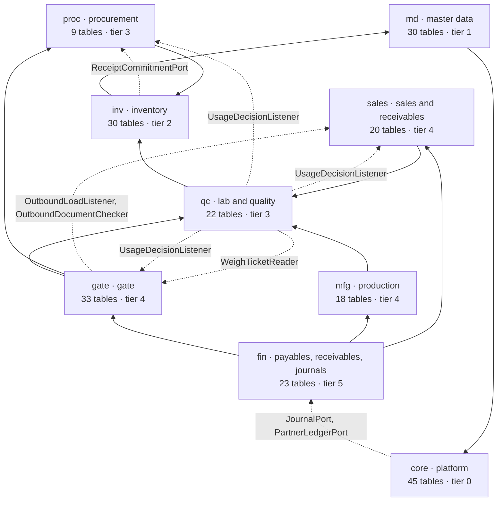

- **Solid arrows** point from a module to a lower tier it may use. Higher modules may use every lower tier; only the direct arrows are drawn.
- **Dotted arrows** are ports: the lower module declares the interface and the higher module implements it. Two ports are new in this design: `PartnerLedgerPort` and `WeighTicketReader` (§18).
- The local HTML view draws the same map by hand, so it also works offline.

**Where the rows are.** At the NFR-01 design point, ten years of history:
- **Size.** Most tables stay small (S or M). About a dozen reach tens of millions of rows. The audit log is the one table above a hundred million.
- **Planning.** §16.2 lists the large tables, how their sizes were estimated, and the partitioning recommendation.

---

## 4. `core`: Platform

**Owns:** Installation, company and organisation, identity and access, document types, numbering, fiscal periods, approvals and SoD, document actors and links, outbox and idempotency, process exceptions, attachments, audit, notifications, background jobs. **Dependency tier:** 0. **Tables:** 45.

### 4.1 Installation and organisation

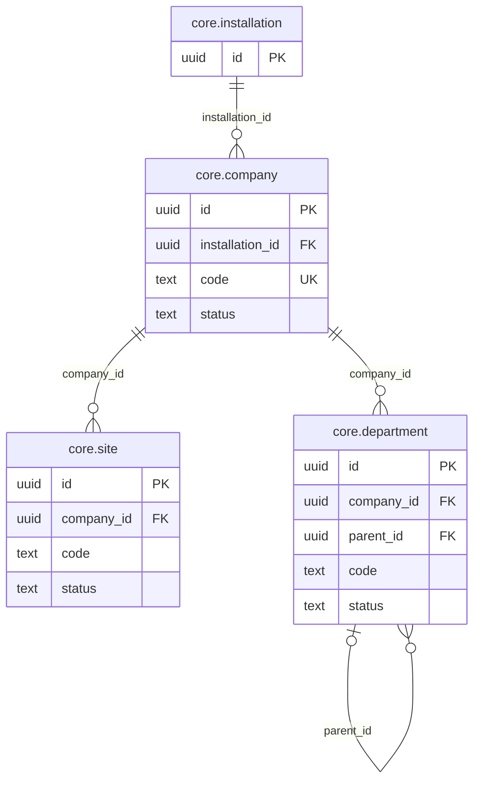

#### core.installation

Singleton: the installation's identity and installation-wide settings.

*Mutable, never deleted · written by P19.01, P19.03 · volume S (< 10 k rows)*

| Column | Type | Null | Default | Key / reference | Notes |
|---|---|---|---|---|---|
| `id` | uuid | no |  | PK |  |
| `name` | text | no |  |  |  |
| `settings` | jsonb | no | '{}' |  | module switches (FR-PLT-006), automation modes (FR-INB-010), device and service switches (NFR-14) |
| `created_at` | timestamptz | no | now() |  |  |
| `updated_at` | timestamptz | no | now() |  |  |
| `version` | int | no | 1 |  |  |

**Constraints and notes:**
- Exactly one row. It becomes `core.tenant` in expansion stage 3 (TDD Appendix A).

#### core.company

The legal entity. Exactly one row in v1 (FR-PLT-002, FR-PLT-008).

*Mutable, never deleted · written by P19.01 · volume S (< 10 k rows)*

| Column | Type | Null | Default | Key / reference | Notes |
|---|---|---|---|---|---|
| `id` | uuid | no |  | PK |  |
| `installation_id` | uuid | no |  | → `core.installation` |  |
| `code` | text | no |  | UNIQUE |  |
| `legal_name` | text | no |  |  |  |
| `trade_name` | text | yes |  |  |  |
| `tin` | text | yes |  |  | taxpayer identification number |
| `vat_no` | text | yes |  |  |  |
| `address` | text | yes |  |  |  |
| `phone` | text | yes |  |  |  |
| `email` | citext | yes |  |  |  |
| `logo_file_id` | uuid | yes |  | → `core.attachment` |  |
| `base_currency_code` | char(3) | no |  | → `md.currency`.code | ISO 4217 |
| `fiscal_year_start_month` | smallint | no | 1 |  | 1–12 |
| `time_zone` | text | no |  |  | IANA name, e.g. Africa/Addis_Ababa |
| `rounding_mode` | text | no | 'HALF_UP' |  | one of `HALF_UP`, `HALF_EVEN` |
| `status` | text | no | 'ACTIVE' |  | one of `ACTIVE`, `INACTIVE` |
| *standard audit columns:* `created_at`, `created_by`, `updated_at`, `updated_by`, `version` (§2.5) | | | | | |

**Constraints and notes:**
- Check: fiscal_year_start_month between 1 and 12.
- A second company is refused in v1 by the application (FR-PLT-002). base_currency_code cannot change after the first posting (FR-PLT-003).

#### core.site

A plant or depot: the "operation unit" chosen after sign-in (FR-PLT-004, FR-PLT-019).

*Mutable, never deleted · written by P19.02 · volume S (< 10 k rows)*

| Column | Type | Null | Default | Key / reference | Notes |
|---|---|---|---|---|---|
| `id` | uuid | no |  | PK |  |
| `company_id` | uuid | no |  | → `core.company` |  |
| `code` | text | no |  |  |  |
| `name` | text | no |  |  |  |
| `time_zone` | text | no |  |  | business dates are computed in this zone |
| `address` | text | yes |  |  |  |
| `status` | text | no | 'ACTIVE' |  | one of `ACTIVE`, `INACTIVE` |
| *standard audit columns:* `created_at`, `created_by`, `updated_at`, `updated_by`, `version` (§2.5) | | | | | |

**Constraints and notes:**
- Unique: (company_id, code).

#### core.department

Hierarchical departments with a head (FR-PLT-007).

*Mutable, never deleted · written by P19.02 · volume S (< 10 k rows)*

| Column | Type | Null | Default | Key / reference | Notes |
|---|---|---|---|---|---|
| `id` | uuid | no |  | PK |  |
| `company_id` | uuid | no |  | → `core.company` |  |
| `parent_id` | uuid | yes |  | → `core.department` |  |
| `code` | text | no |  |  |  |
| `name` | text | no |  |  |  |
| `head_user_id` | uuid | yes |  | → `core.user` |  |
| `status` | text | no | 'ACTIVE' |  | one of `ACTIVE`, `INACTIVE` |
| *standard audit columns:* `created_at`, `created_by`, `updated_at`, `updated_by`, `version` (§2.5) | | | | | |

**Constraints and notes:**
- Unique: (company_id, code).

### 4.2 Identity, sessions and access

```mermaid
erDiagram
    core__user["core.user"] {
        uuid id PK
        text status
    }
    core__local_credential["core.local_credential"] {
        uuid user_id PK, FK
    }
    core__user_identity["core.user_identity"] {
        uuid id PK
        uuid user_id FK
    }
    core__idp_config["core.idp_config"] {
        uuid id PK
    }
    core__auth_policy["core.auth_policy"] {
        uuid id PK
    }
    core__invitation["core.invitation"] {
        uuid id PK
        uuid user_id FK
        uuid invited_by FK
    }
    core__oidc_flow["core.oidc_flow"] {
        uuid id PK
    }
    core__password_reset_token["core.password_reset_token"] {
        uuid id PK
        uuid user_id FK
    }
    core__session["core.session"] {
        uuid id PK
        uuid user_id FK
    }
    core__auth_event["core.auth_event"] {
        uuid id PK
        uuid user_id FK
    }
    core__permission["core.permission"] {
        text code PK
    }
    core__role["core.role"] {
        uuid id PK
        text code UK
        text status
    }
    core__role_permission["core.role_permission"] {
        uuid role_id PK
        text permission_code PK
        uuid granted_by FK
    }
    core__user_role["core.user_role"] {
        uuid id PK
        uuid user_id FK
        uuid role_id FK
        uuid granted_by FK
        uuid revoked_by FK
    }
    core__user ||--o| core__local_credential : "user_id"
    core__user ||--o{ core__user_identity : "user_id"
    core__user ||--o{ core__invitation : "user_id"
    core__user ||--o{ core__invitation : "invited_by"
    core__user ||--o{ core__password_reset_token : "user_id"
    core__user ||--o{ core__session : "user_id"
    core__user |o--o{ core__auth_event : "user_id"
    core__role ||--o{ core__role_permission : "role_id"
    core__permission ||--o{ core__role_permission : "permission_code"
    core__user ||--o{ core__role_permission : "granted_by"
    core__user ||--o{ core__user_role : "user_id"
    core__role ||--o{ core__user_role : "role_id"
    core__user ||--o{ core__user_role : "granted_by"
    core__user |o--o{ core__user_role : "revoked_by"
```

#### core.user

A person who signs in (local account, SSO identity, or both).

*Mutable, never deleted · written by P19.06, P20.01 · volume S (< 10 k rows)*

| Column | Type | Null | Default | Key / reference | Notes |
|---|---|---|---|---|---|
| `id` | uuid | no |  | PK |  |
| `display_name` | text | no |  |  | personal data |
| `email` | citext | yes |  | UNIQUE | personal data; unique when present; invitation matching for SSO |
| `employee_id` | text | yes |  |  | personal data |
| `home_department_id` | uuid | yes |  | → `core.department` |  |
| `default_site_id` | uuid | yes |  | → `core.site` | remembered operation unit (FR-PLT-019) |
| `locale` | text | no | 'en' |  |  |
| `status` | text | no | 'INVITED' |  | one of `INVITED`, `ACTIVE`, `INACTIVE` |
| `authz_version` | int | no | 1 |  | bumped on any grant change (FR-PLT-014) |
| `last_sign_in_at` | timestamptz | yes |  |  |  |
| *standard audit columns:* `created_at`, `created_by`, `updated_at`, `updated_by`, `version` (§2.5) | | | | | |

**Constraints and notes:**
- Users are deactivated, never deleted; audit and document actors keep pointing at them (FR-PLT-053).

#### core.local_credential

Local username and password, lockout and TOTP (ADR-0015, FR-PLT-018).

*Mutable · written by P00.01, P19.06 · volume S (< 10 k rows)*

| Column | Type | Null | Default | Key / reference | Notes |
|---|---|---|---|---|---|
| `user_id` | uuid | no |  | PK → `core.user` |  |
| `username` | citext | no |  | UNIQUE | personal data |
| `password_hash` | text | no |  |  | argon2id; parameters inside the hash string |
| `password_changed_at` | timestamptz | no |  |  |  |
| `must_change` | boolean | no | false |  |  |
| `failed_count` | int | no | 0 |  |  |
| `locked_until` | timestamptz | yes |  |  |  |
| `totp_secret_enc` | bytea | yes |  |  | **encrypted**; AES-256-GCM |
| `totp_enabled` | boolean | no | false |  |  |
| `totp_last_step` | bigint | yes |  |  | replay guard |
| `recovery_codes_hash` | text[] | yes |  |  | hashed |
| *standard audit columns:* `created_at`, `created_by`, `updated_at`, `updated_by`, `version` (§2.5) | | | | | |

#### core.user_identity

Link between a user and an external OIDC identity (issuer, subject).

*Mutable · written by P00.01 · volume S (< 10 k rows)*

| Column | Type | Null | Default | Key / reference | Notes |
|---|---|---|---|---|---|
| `id` | uuid | no |  | PK |  |
| `user_id` | uuid | no |  | → `core.user` |  |
| `issuer` | text | no |  |  |  |
| `subject` | text | no |  |  | personal data |
| `email_at_link` | citext | yes |  |  | personal data |
| `linked_at` | timestamptz | no | now() |  |  |

**Constraints and notes:**
- Unique: (issuer, subject).

#### core.idp_config

OIDC identity-provider configuration for the installation (FR-PLT-010).

*Mutable · written by P19.06 · volume S (< 10 k rows)*

| Column | Type | Null | Default | Key / reference | Notes |
|---|---|---|---|---|---|
| `id` | uuid | no |  | PK |  |
| `enabled` | boolean | no | false |  |  |
| `display_name` | text | no | 'SSO Login' |  |  |
| `issuer` | text | no |  |  |  |
| `client_id` | text | no |  |  |  |
| `client_secret_enc` | bytea | yes |  |  | **encrypted** |
| `scopes` | text | no | 'openid profile email' |  |  |
| `group_claim_path` | text | yes |  |  | v1.1 group-to-role sync |
| `email_verified_mode` | text | no | 'CLAIM' |  | one of `CLAIM`, `TRUST_ISSUER` |
| `email_verified_claim` | text | yes | 'email_verified' |  |  |
| *standard audit columns:* `created_at`, `created_by`, `updated_at`, `updated_by`, `version` (§2.5) | | | | | |

#### core.auth_policy

Singleton: sign-in methods, password policy, lockout, MFA roles, reset mode (TDD §6.1).

*Mutable, never deleted · written by P19.06 · volume S (< 10 k rows)*

| Column | Type | Null | Default | Key / reference | Notes |
|---|---|---|---|---|---|
| `id` | uuid | no |  | PK |  |
| `local_enabled` | boolean | no | true |  |  |
| `oidc_enabled` | boolean | no | false |  |  |
| `min_length` | int | no | 12 |  |  |
| `lockout_threshold` | int | no | 5 |  |  |
| `lockout_minutes` | int | no | 15 |  |  |
| `mfa_required_role_ids` | uuid[] | no | '{}' |  | e.g. PAP, TRS, ADM |
| `reset_mode` | text | no | 'ADMIN' |  | one of `ADMIN`, `EMAIL_LINK` |
| `idle_timeout_minutes` | int | no | 480 |  | FR-PLT-015 |
| `absolute_timeout_minutes` | int | no | 720 |  |  |
| *standard audit columns:* `created_at`, `created_by`, `updated_at`, `updated_by`, `version` (§2.5) | | | | | |

#### core.invitation

Invitation of a new user by email (FR-PLT-011).

*Mutable · written by P19.06 · volume S (< 10 k rows)*

| Column | Type | Null | Default | Key / reference | Notes |
|---|---|---|---|---|---|
| `id` | uuid | no |  | PK |  |
| `user_id` | uuid | no |  | → `core.user` | the INVITED user row |
| `email` | citext | no |  |  | personal data |
| `token_hash` | text | no |  | UNIQUE |  |
| `invited_by` | uuid | no |  | → `core.user` |  |
| `invited_at` | timestamptz | no | now() |  |  |
| `expires_at` | timestamptz | no |  |  |  |
| `accepted_at` | timestamptz | yes |  |  |  |
| `bound_issuer` | text | yes |  |  | (issuer, subject) bound at first SSO sign-in |
| `bound_subject` | text | yes |  |  |  |

#### core.oidc_flow

Server-side OIDC login state; single use, 10-minute TTL (TDD §6.2).

*Mutable · written by P00.01 · volume M (10 k – 1 M)*

| Column | Type | Null | Default | Key / reference | Notes |
|---|---|---|---|---|---|
| `id` | uuid | no |  | PK |  |
| `state_hash` | text | no |  | UNIQUE |  |
| `nonce` | text | no |  |  |  |
| `code_verifier_enc` | bytea | no |  |  | **encrypted** |
| `binding_hash` | text | no |  |  | browser-binding cookie |
| `return_to` | text | yes |  |  |  |
| `created_at` | timestamptz | no | now() |  |  |
| `expires_at` | timestamptz | no |  |  |  |
| `used_at` | timestamptz | yes |  |  |  |

**Constraints and notes:**
- Purged daily.

#### core.password_reset_token

Email-link password reset token; single use, 30 minutes (FR-PLT-018).

*Mutable · written by P00.01 · volume S (< 10 k rows)*

| Column | Type | Null | Default | Key / reference | Notes |
|---|---|---|---|---|---|
| `id` | uuid | no |  | PK |  |
| `user_id` | uuid | no |  | → `core.user` |  |
| `token_hash` | text | no |  | UNIQUE |  |
| `created_at` | timestamptz | no | now() |  |  |
| `expires_at` | timestamptz | no |  |  |  |
| `used_at` | timestamptz | yes |  |  |  |

#### core.session

Server-side session behind the opaque `mos_sid` cookie (TDD §6.3).

*Mutable · written by P00.01, P00.02, P00.09 · volume M (10 k – 1 M)*

| Column | Type | Null | Default | Key / reference | Notes |
|---|---|---|---|---|---|
| `id` | uuid | no |  | PK |  |
| `token_hash` | text | no |  | UNIQUE | SHA-256 of the 256-bit cookie value |
| `user_id` | uuid | no |  | → `core.user` |  |
| `authz_version` | int | no |  |  |  |
| `op_site_id` | uuid | yes |  | → `core.site` | operation unit; never widens access |
| `auth_method` | text | no |  |  | one of `LOCAL`, `OIDC` |
| `created_at` | timestamptz | no | now() |  |  |
| `last_seen_at` | timestamptz | no | now() |  |  |
| `idle_expires_at` | timestamptz | no |  |  |  |
| `absolute_expires_at` | timestamptz | no |  |  |  |
| `user_agent` | text | yes |  |  |  |
| `ip` | inet | yes |  |  | personal data |
| `revoked_at` | timestamptz | yes |  |  |  |

**Constraints and notes:**
- Index: (user_id) WHERE revoked_at IS NULL.
- Expired sessions are purged after 30 days.

#### core.auth_event

Every sign-in attempt, lockout, reset and sign-out (TDD §6.1).

*Insert-only · written by P00.01, P00.09 · volume L (1 – 10 M)*

| Column | Type | Null | Default | Key / reference | Notes |
|---|---|---|---|---|---|
| `id` | uuid | no |  | PK |  |
| `occurred_at` | timestamptz | no | now() |  |  |
| `user_id` | uuid | yes |  | → `core.user` |  |
| `username_attempted` | text | yes |  |  | personal data; pseudonymised after the retention period |
| `event` | text | no |  |  | one of `SIGN_IN_OK`, `SIGN_IN_FAILED`, `LOCKED`, `UNLOCKED`, `TOTP_FAILED`, `PASSWORD_CHANGED`, `RESET_REQUESTED`, `RESET_DONE`, `SIGNED_OUT`, `SESSION_EXPIRED` |
| `auth_method` | text | yes |  |  | one of `LOCAL`, `OIDC` |
| `ip` | inet | yes |  |  | personal data |
| `user_agent` | text | yes |  |  |  |
| `detail` | jsonb | yes |  |  |  |

**Constraints and notes:**
- Index: (user_id, occurred_at).

#### core.permission

Catalogue of permission strings `module.object.action`, seeded (TDD §6.6).

*Mutable · written by P19.06 · volume S (< 10 k rows)*

| Column | Type | Null | Default | Key / reference | Notes |
|---|---|---|---|---|---|
| `code` | text | no |  | PK | e.g. proc.po.approve |
| `module` | text | no |  |  |  |
| `description` | text | no |  |  |  |
| `is_sensitive` | boolean | no | false |  | e.g. reveal bank account |

#### core.role

Roles: the 24 seeded defaults (FRD §2) plus administrator-defined ones.

*Mutable, never deleted · written by P19.06, P20.01 · volume S (< 10 k rows)*

| Column | Type | Null | Default | Key / reference | Notes |
|---|---|---|---|---|---|
| `id` | uuid | no |  | PK |  |
| `code` | text | no |  | UNIQUE | STK, LAB, APC, PAP … |
| `name` | text | no |  |  |  |
| `description` | text | yes |  |  |  |
| `is_seeded` | boolean | no | false |  |  |
| `status` | text | no | 'ACTIVE' |  | one of `ACTIVE`, `INACTIVE` |
| *standard audit columns:* `created_at`, `created_by`, `updated_at`, `updated_by`, `version` (§2.5) | | | | | |

#### core.role_permission

Permissions in each role.

*Mutable · written by P19.06, P20.01 · volume S (< 10 k rows)*

| Column | Type | Null | Default | Key / reference | Notes |
|---|---|---|---|---|---|
| `role_id` | uuid | no |  | PK → `core.role` |  |
| `permission_code` | text | no |  | PK → `core.permission`.code |  |
| `granted_at` | timestamptz | no | now() |  |  |
| `granted_by` | uuid | no |  | → `core.user` |  |

**Constraints and notes:**
- Primary key: (role_id, permission_code).
- Unique: (role_id, permission_code).
- Primary key is the pair; shown as UNIQUE here and implemented as the composite primary key.

#### core.user_role

Role grants, optionally scoped to a site; revocations are kept for the access review (FR-PLT-012, FR-PLT-017).

*Mutable, never deleted · written by P19.06, P20.01 · volume S (< 10 k rows)*

| Column | Type | Null | Default | Key / reference | Notes |
|---|---|---|---|---|---|
| `id` | uuid | no |  | PK |  |
| `user_id` | uuid | no |  | → `core.user` |  |
| `role_id` | uuid | no |  | → `core.role` |  |
| `site_id` | uuid | yes |  | → `core.site` | NULL = all sites |
| `granted_at` | timestamptz | no | now() |  |  |
| `granted_by` | uuid | no |  | → `core.user` |  |
| `revoked_at` | timestamptz | yes |  |  |  |
| `revoked_by` | uuid | yes |  | → `core.user` |  |

**Constraints and notes:**
- Unique: (user_id, role_id, site_id) WHERE revoked_at IS NULL -- NULLS NOT DISTINCT.

### 4.3 Document types, numbering and periods

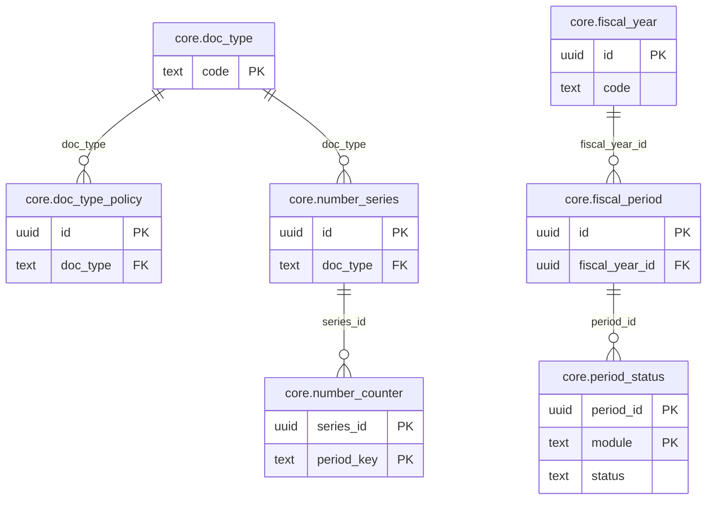

#### core.doc_type

Catalogue of document types, seeded (TDD §8.1).

*Mutable · written by P19.05 · volume S (< 10 k rows)*

| Column | Type | Null | Default | Key / reference | Notes |
|---|---|---|---|---|---|
| `code` | text | no |  | PK | PR, PO, GRN, PV, PAY, INV … |
| `module` | text | no |  |  | one of `core`, `md`, `inv`, `qc`, `proc`, `gate`, `mfg`, `sales`, `fin` |
| `class` | text | no |  |  | one of `COMMITMENT`, `POSTING`, `OPERATIONAL`, `MASTER` |
| `name` | text | no |  |  |  |
| `reversible` | boolean | no | false |  |  |
| `gap_free` | boolean | no | false |  | FR-PLT-041 |
| `number_at` | text | no | 'POST' |  | one of `CREATE`, `SUBMIT`, `APPROVE`, `POST` |
| `lock_rank` | int | no |  |  | R2 table order (TDD §7.3) |

#### core.doc_type_policy

Per-company settings of a document type.

*Mutable · written by P19.05 · volume S (< 10 k rows)*

| Column | Type | Null | Default | Key / reference | Notes |
|---|---|---|---|---|---|
| `id` | uuid | no |  | PK |  |
| `company_id` | uuid | no |  | → `core.company` |  |
| `doc_type` | text | no |  | → `core.doc_type`.code |  |
| `requires_approval` | boolean | no | false |  |  |
| `auto_post_on_approval` | boolean | no | false |  |  |
| `auto_post_below_amount` | core.amount | yes |  |  | e.g. adjustments below the threshold post without approval (FR-INV-008) |
| `backdate_days_allowed` | int | no | 0 |  | FR-PLT-043 |
| `bulk_approval_enabled` | boolean | no | true |  | off by default for PV and bank changes (FR-PLT-032) |
| *standard audit columns:* `created_at`, `created_by`, `updated_at`, `updated_by`, `version` (§2.5) | | | | | |

**Constraints and notes:**
- Unique: (company_id, doc_type).

#### core.number_series

Number series per document type, optionally per site or per object (FR-PLT-040).

*Mutable · written by P19.05 · volume S (< 10 k rows)*

| Column | Type | Null | Default | Key / reference | Notes |
|---|---|---|---|---|---|
| `id` | uuid | no |  | PK |  |
| `company_id` | uuid | no |  | → `core.company` |  |
| `doc_type` | text | no |  | → `core.doc_type`.code |  |
| `site_id` | uuid | yes |  | → `core.site` |  |
| `scope_ref` | uuid | yes |  |  | e.g. a weighbridge: weigh tickets are gap-free per weighbridge (FR-GATE-030) |
| `pattern` | text | no |  |  | tokens {FY} {YYYY} {YYYYMMDD} {SITE} {WB} {SEQ:n} |
| `reset_policy` | text | no | 'FISCAL_YEAR' |  | one of `NEVER`, `FISCAL_YEAR`, `CALENDAR_YEAR`, `MONTH` |
| `gap_free` | boolean | no | false |  |  |
| `active` | boolean | no | true |  |  |
| *standard audit columns:* `created_at`, `created_by`, `updated_at`, `updated_by`, `version` (§2.5) | | | | | |

**Constraints and notes:**
- Unique: (company_id, doc_type, site_id, scope_ref) -- NULLS NOT DISTINCT.
- Check: a series whose pattern contains {SITE} has site_id; one containing {WB} has scope_ref.

#### core.number_counter

The counter per series and period; locked last (R6) and incremented in the document's own transaction (TDD §17.1).

*Mutable · written by every numbered posting · volume M (10 k – 1 M)*

| Column | Type | Null | Default | Key / reference | Notes |
|---|---|---|---|---|---|
| `series_id` | uuid | no |  | PK → `core.number_series` |  |
| `period_key` | text | no |  | PK | e.g. FY2026, 2026-09, ALL |
| `last_value` | bigint | no | 0 |  |  |

**Constraints and notes:**
- Primary key: (series_id, period_key).

#### core.fiscal_year

Fiscal years of the company.

*Mutable, never deleted · written by P19.05, P17.01 · volume S (< 10 k rows)*

| Column | Type | Null | Default | Key / reference | Notes |
|---|---|---|---|---|---|
| `id` | uuid | no |  | PK |  |
| `company_id` | uuid | no |  | → `core.company` |  |
| `code` | text | no |  |  | e.g. FY2026 |
| `start_date` | date | no |  |  |  |
| `end_date` | date | no |  |  |  |
| *standard audit columns:* `created_at`, `created_by`, `updated_at`, `updated_by`, `version` (§2.5) | | | | | |

**Constraints and notes:**
- Unique: (company_id, code).
- Check: start_date < end_date.

#### core.fiscal_period

Periods of a fiscal year (FR-PLT-042).

*Mutable, never deleted · written by P19.05 · volume S (< 10 k rows)*

| Column | Type | Null | Default | Key / reference | Notes |
|---|---|---|---|---|---|
| `id` | uuid | no |  | PK |  |
| `company_id` | uuid | no |  | → `core.company` |  |
| `fiscal_year_id` | uuid | no |  | → `core.fiscal_year` |  |
| `period_no` | smallint | no |  |  |  |
| `start_date` | date | no |  |  |  |
| `end_date` | date | no |  |  |  |
| *standard audit columns:* `created_at`, `created_by`, `updated_at`, `updated_by`, `version` (§2.5) | | | | | |

**Constraints and notes:**
- Unique: (fiscal_year_id, period_no).
- Exclusion: no two periods of a company overlap in dates (btree_gist).

#### core.period_status

Status of a period per module: postings are allowed only into open periods (FR-PLT-042).

*Mutable, never deleted · written by P17.04, P17.08 · volume S (< 10 k rows)*

| Column | Type | Null | Default | Key / reference | Notes |
|---|---|---|---|---|---|
| `period_id` | uuid | no |  | PK → `core.fiscal_period` |  |
| `module` | text | no |  | PK | one of `inv`, `proc`, `gate`, `mfg`, `sales`, `fin` |
| `status` | text | no | 'OPEN' |  | one of `OPEN`, `SOFT_CLOSED`, `CLOSED` |
| `changed_at` | timestamptz | no | now() |  |  |
| `changed_by` | uuid | no |  | → `core.user` |  |
| `reopen_chain_id` | uuid | yes |  | → `core.approval_chain` | reopening needs approval |

**Constraints and notes:**
- Primary key: (period_id, module).
- Locked FOR SHARE (R4) by every posting; FOR NO KEY UPDATE at close.

### 4.4 Approvals and segregation of duties

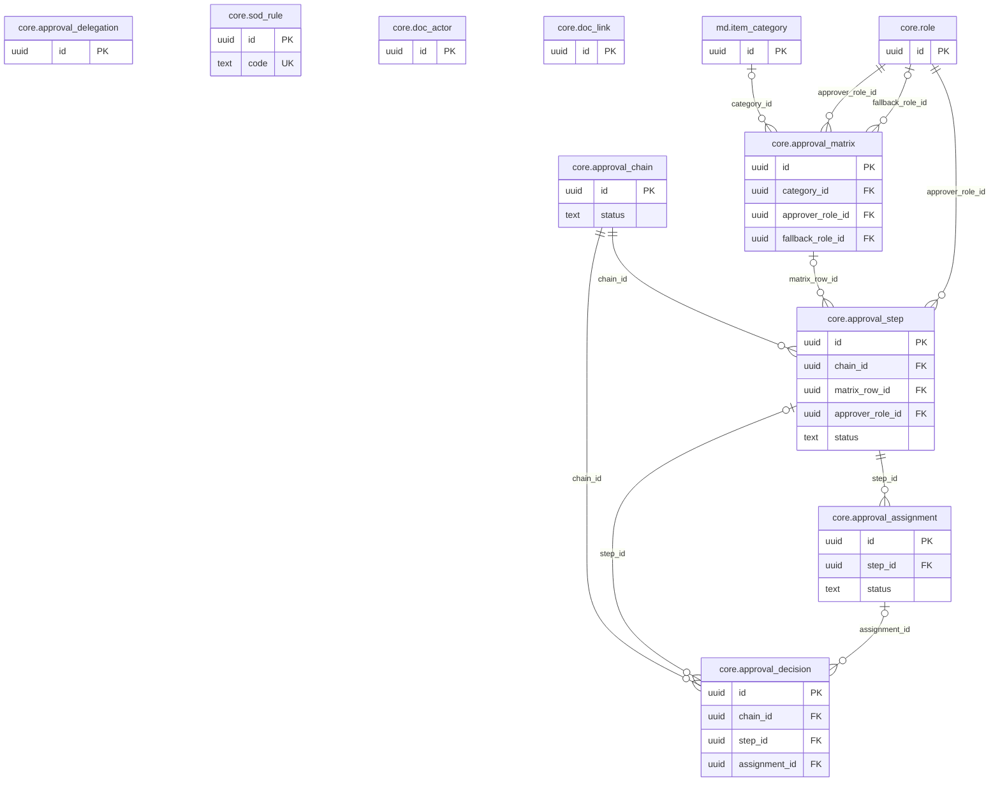

#### core.approval_matrix

One row per approval stage: document type × amount band × site × category × department, plus a flag (TDD §16.1, FR-PLT-023).

*Mutable · written by P19.05 · volume S (< 10 k rows)*

| Column | Type | Null | Default | Key / reference | Notes |
|---|---|---|---|---|---|
| `id` | uuid | no |  | PK |  |
| `doc_type` | text | no |  | → `core.doc_type`.code |  |
| `company_id` | uuid | yes |  | → `core.company` |  |
| `site_id` | uuid | yes |  | → `core.site` |  |
| `category_id` | uuid | yes |  | → `md.item_category` |  |
| `department_id` | uuid | yes |  | → `core.department` |  |
| `min_amount` | core.amount | yes |  |  |  |
| `max_amount` | core.amount | yes |  |  |  |
| `flag` | text | yes |  |  | one of `SOLE_SOURCE`, `BANK_CHANGED_RECENTLY`, `VARIANCE_OVER_TOLERANCE`, `PRIORITY_URGENT`, `BELOW_FLOOR_PRICE`, `CREDIT_EXCEEDED`, `DISCOUNT_OVER_LIMIT`, `OVERDUE`, `MANUAL_HOLD` |
| `stage_seq` | smallint | no |  |  |  |
| `approver_role_id` | uuid | no |  | → `core.role` |  |
| `sla_hours` | int | no | 24 |  |  |
| `fallback_role_id` | uuid | yes |  | → `core.role` |  |
| `matrix_version` | int | no | 1 |  |  |
| `active` | boolean | no | true |  |  |
| *standard audit columns:* `created_at`, `created_by`, `updated_at`, `updated_by`, `version` (§2.5) | | | | | |

**Constraints and notes:**
- Check: min_amount is null or max_amount is null or min_amount <= max_amount.

#### core.approval_chain

The approval chain of one submission of a document (TDD §16.1).

*Mutable, never deleted · written by S1.01, S1.05 · volume L (1 – 10 M)*

| Column | Type | Null | Default | Key / reference | Notes |
|---|---|---|---|---|---|
| `id` | uuid | no |  | PK |  |
| `doc_type` | text | no |  | → `core.doc_type`.code |  |
| `doc_id` | uuid | no |  |  |  |
| `doc_content_hash` | text | no |  |  | the submitted content; a changed document cannot be approved |
| `matrix_version` | int | no |  |  |  |
| `facts` | jsonb | no |  |  | snapshot of the facts evaluated (amount, site, category, flags) |
| `status` | text | no | 'ACTIVE' |  | one of `ACTIVE`, `APPROVED`, `REJECTED`, `RETURNED`, `RECALLED`, `CANCELLED` |
| `created_at` | timestamptz | no | now() |  |  |
| `created_by` | uuid | no |  | → `core.user` |  |
| `completed_at` | timestamptz | yes |  |  |  |

**Constraints and notes:**
- Unique: (doc_type, doc_id) WHERE status = 'ACTIVE'.
- Index: (doc_type, doc_id).

#### core.approval_step

One stage of a chain.

*Mutable, never deleted · written by S1.01, S1.05, S1.07 · volume L (1 – 10 M)*

| Column | Type | Null | Default | Key / reference | Notes |
|---|---|---|---|---|---|
| `id` | uuid | no |  | PK |  |
| `chain_id` | uuid | no |  | → `core.approval_chain` |  |
| `stage_seq` | smallint | no |  |  |  |
| `matrix_row_id` | uuid | yes |  | → `core.approval_matrix` |  |
| `approver_role_id` | uuid | no |  | → `core.role` |  |
| `status` | text | no | 'WAITING' |  | one of `WAITING`, `ACTIVE`, `APPROVED`, `REJECTED`, `RETURNED`, `CANCELLED` |
| `due_at` | timestamptz | yes |  |  |  |
| `escalation_level` | smallint | no | 0 |  |  |
| `activated_at` | timestamptz | yes |  |  |  |
| `completed_at` | timestamptz | yes |  |  |  |

**Constraints and notes:**
- Unique: (chain_id, stage_seq).

#### core.approval_assignment

A user who may decide a step (after SoD exclusion).

*Mutable, never deleted · written by S1.01, S1.06, S1.07 · volume L (1 – 10 M)*

| Column | Type | Null | Default | Key / reference | Notes |
|---|---|---|---|---|---|
| `id` | uuid | no |  | PK |  |
| `step_id` | uuid | no |  | → `core.approval_step` |  |
| `user_id` | uuid | no |  | → `core.user` |  |
| `source` | text | no |  |  | one of `MATRIX`, `DELEGATION`, `ESCALATION`, `REASSIGN` |
| `on_behalf_of` | uuid | yes |  | → `core.user` |  |
| `status` | text | no | 'PENDING' |  | one of `PENDING`, `DECIDED`, `SUPERSEDED`, `WITHDRAWN` |
| `assigned_at` | timestamptz | no | now() |  |  |

**Constraints and notes:**
- Unique: (step_id, user_id).

#### core.approval_decision

Every decision, with its comment; never edited or deleted (FR-PLT-054).

*Insert-only · written by S1.03, S1.04 · volume L (1 – 10 M)*

| Column | Type | Null | Default | Key / reference | Notes |
|---|---|---|---|---|---|
| `id` | uuid | no |  | PK |  |
| `chain_id` | uuid | no |  | → `core.approval_chain` |  |
| `step_id` | uuid | yes |  | → `core.approval_step` |  |
| `assignment_id` | uuid | yes |  | → `core.approval_assignment` |  |
| `decided_by` | uuid | no |  | → `core.user` |  |
| `on_behalf_of` | uuid | yes |  | → `core.user` |  |
| `decision` | text | no |  |  | one of `APPROVE`, `REJECT`, `REQUEST_CHANGES`, `RECALL`, `AUTO_APPROVE` |
| `comment` | text | yes |  |  |  |
| `doc_content_hash` | text | no |  |  |  |
| `decided_at` | timestamptz | no | now() |  |  |

**Constraints and notes:**
- Check: comment is present for REJECT and REQUEST_CHANGES.

#### core.approval_delegation

Delegation of approvals for a date range (FR-PLT-026).

*Mutable, never deleted · written by S1.06 · volume S (< 10 k rows)*

| Column | Type | Null | Default | Key / reference | Notes |
|---|---|---|---|---|---|
| `id` | uuid | no |  | PK |  |
| `delegator_id` | uuid | no |  | → `core.user` |  |
| `delegate_id` | uuid | no |  | → `core.user` |  |
| `doc_types` | text[] | yes |  |  | NULL = all |
| `max_amount` | core.amount | yes |  |  |  |
| `valid_from` | timestamptz | no |  |  |  |
| `valid_to` | timestamptz | no |  |  |  |
| `revoked_at` | timestamptz | yes |  |  |  |
| *standard audit columns:* `created_at`, `created_by`, `updated_at`, `updated_by`, `version` (§2.5) | | | | | |

**Constraints and notes:**
- Check: delegator_id <> delegate_id and valid_from < valid_to.

#### core.sod_rule

Segregation-of-duties rules: a closed set of rule types, parameterised (TDD §16.4, FRD §15.1).

*Mutable · written by P19.05 · volume S (< 10 k rows)*

| Column | Type | Null | Default | Key / reference | Notes |
|---|---|---|---|---|---|
| `id` | uuid | no |  | PK |  |
| `code` | text | no |  | UNIQUE | SOD-01 … SOD-17 |
| `rule_type` | text | no |  |  | one of `NOT_DOC_ACTOR`, `CROSS_DOC_DISTINCT`, `MASTER_EDITOR_NOT_APPROVER`, `ONE_STAGE_PER_USER`, `RESULT_ENTRY_NOT_DECIDER`, `ROLE_CONFLICT` |
| `params` | jsonb | no | '{}' |  |  |
| `doc_types` | text[] | yes |  |  |  |
| `severity` | text | no | 'BLOCK' |  | one of `BLOCK`, `WARN_JUSTIFY` |
| `enabled` | boolean | no | true |  |  |
| *standard audit columns:* `created_at`, `created_by`, `updated_at`, `updated_by`, `version` (§2.5) | | | | | |

#### core.doc_actor

Who did which action on which document: the data source for SoD (TDD §16.4).

*Insert-only · written by every create, submit, decide and post · volume XL (10 – 100 M)*

| Column | Type | Null | Default | Key / reference | Notes |
|---|---|---|---|---|---|
| `id` | uuid | no |  | PK |  |
| `doc_type` | text | no |  | → `core.doc_type`.code |  |
| `doc_id` | uuid | no |  |  |  |
| `action` | text | no |  |  | CREATE, SUBMIT, APPROVE, POST, ENTER_RESULT, WEIGH, VERIFY, COUNT … |
| `user_id` | uuid | no |  | → `core.user` |  |
| `on_behalf_of` | uuid | yes |  | → `core.user` |  |
| `occurred_at` | timestamptz | no | now() |  |  |

**Constraints and notes:**
- Index: (doc_type, doc_id, action).
- Index: (user_id, action).

#### core.doc_link

The document-link graph: trace, reversal dependency guard, cross-document SoD (TDD §8.5).

*Insert-only · written by every posting · volume XL (10 – 100 M)*

| Column | Type | Null | Default | Key / reference | Notes |
|---|---|---|---|---|---|
| `id` | uuid | no |  | PK |  |
| `from_type` | text | no |  | → `core.doc_type`.code |  |
| `from_id` | uuid | no |  |  |  |
| `to_type` | text | no |  | → `core.doc_type`.code |  |
| `to_id` | uuid | no |  |  |  |
| `link_type` | text | no |  |  | one of `SOURCE`, `REVERSAL`, `MATCH`, `ALLOCATION`, `RETURN`, `REPLACEMENT`, `SETTLEMENT` |
| `created_at` | timestamptz | no | now() |  |  |

**Constraints and notes:**
- Unique: (from_type, from_id, to_type, to_id, link_type).
- Index: (to_type, to_id).

### 4.5 Outbox, idempotency and process exceptions

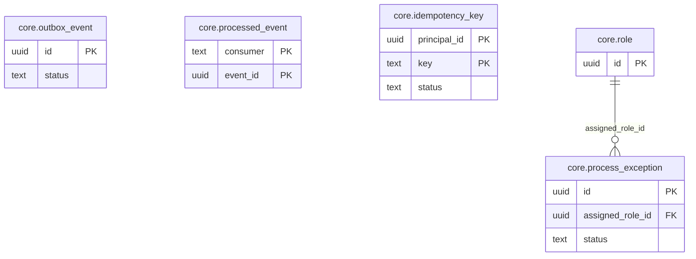

#### core.outbox_event

Domain events written in the business transaction; claimed with a lease (TDD §17.2).

*Mutable · written by every posting and process step · volume L (1 – 10 M)*

| Column | Type | Null | Default | Key / reference | Notes |
|---|---|---|---|---|---|
| `id` | uuid | no |  | PK | also the job id |
| `aggregate_type` | text | no |  |  |  |
| `aggregate_id` | uuid | no |  |  |  |
| `event_type` | text | no |  |  | e.g. grn.posted (process model §9.2) |
| `payload` | jsonb | no |  |  | ids and the document version only |
| `status` | text | no | 'PENDING' |  | one of `PENDING`, `CLAIMED`, `DONE`, `DEAD` |
| `attempts` | int | no | 0 |  |  |
| `process_after` | timestamptz | no | now() |  |  |
| `claimed_until` | timestamptz | yes |  |  |  |
| `last_error` | text | yes |  |  |  |
| `created_at` | timestamptz | no | now() |  |  |
| `done_at` | timestamptz | yes |  |  |  |

**Constraints and notes:**
- Index: (status, process_after) WHERE status IN ('PENDING','CLAIMED').
- DONE rows are purged after 30 days; DEAD rows are kept until resolved.

#### core.processed_event

Consumer receipts: exactly-once database effects (TDD §17.2).

*Insert-only · written by every event consumer · volume L (1 – 10 M)*

| Column | Type | Null | Default | Key / reference | Notes |
|---|---|---|---|---|---|
| `consumer` | text | no |  | PK |  |
| `event_id` | uuid | no |  | PK |  |
| `processed_at` | timestamptz | no | now() |  |  |
| `outcome` | text | no | 'OK' |  | one of `OK`, `BUSINESS_ERROR`, `SKIPPED_STALE` |

**Constraints and notes:**
- Primary key: (consumer, event_id).
- Purged after 90 days (longer than the outbox retention).

#### core.idempotency_key

One row per (principal, Idempotency-Key); only 2xx responses are kept (TDD §7.4).

*Mutable · written by every mutating request · volume L (1 – 10 M)*

| Column | Type | Null | Default | Key / reference | Notes |
|---|---|---|---|---|---|
| `principal_id` | uuid | no |  | PK → `core.user` |  |
| `key` | text | no |  | PK |  |
| `method_route` | text | no |  |  |  |
| `request_hash` | text | no |  |  |  |
| `status` | text | no |  |  | one of `IN_PROGRESS`, `COMPLETED` |
| `response_code` | smallint | yes |  |  |  |
| `response_body` | jsonb | yes |  |  |  |
| `created_at` | timestamptz | no | now() |  |  |
| `expires_at` | timestamptz | no |  |  | 48 h |

**Constraints and notes:**
- Primary key: (principal_id, key).
- Swept daily.

#### core.process_exception

Business failures of automated steps, as tasks with resolve and retry (FR-PLT-050).

*Mutable, never deleted · written by P09.01, P05.14 · volume M (10 k – 1 M)*

| Column | Type | Null | Default | Key / reference | Notes |
|---|---|---|---|---|---|
| `id` | uuid | no |  | PK |  |
| `kind` | text | no |  |  | e.g. PV_DRAFT_NO_BANK_ACCOUNT, GRN_VALIDATION_FAILED |
| `source_doc_type` | text | yes |  | → `core.doc_type`.code |  |
| `source_doc_id` | uuid | yes |  |  |  |
| `event_id` | uuid | yes |  |  | the outbox event that failed |
| `assigned_role_id` | uuid | no |  | → `core.role` |  |
| `site_id` | uuid | yes |  | → `core.site` |  |
| `status` | text | no | 'OPEN' |  | one of `OPEN`, `RESOLVED`, `CANCELLED` |
| `message` | text | no |  |  |  |
| `detail` | jsonb | yes |  |  |  |
| `created_at` | timestamptz | no | now() |  |  |
| `resolved_at` | timestamptz | yes |  |  |  |
| `resolved_by` | uuid | yes |  | → `core.user` |  |
| `resolution_note` | text | yes |  |  |  |

**Constraints and notes:**
- Index: (status, assigned_role_id).

### 4.6 Attachments, audit, notifications and jobs

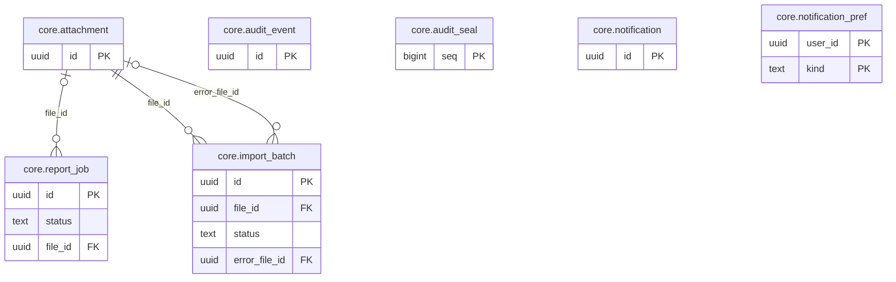

#### core.attachment

Files: uploaded before the business transaction, then linked to a record (TDD §17.4, FR-PLT-044).

*Mutable · written by P00.06 and every step with a photo or document · volume L (1 – 10 M)*

| Column | Type | Null | Default | Key / reference | Notes |
|---|---|---|---|---|---|
| `id` | uuid | no |  | PK |  |
| `storage_key` | text | no |  | UNIQUE | <install_id>/<yyyy>/<uuid> |
| `sha256` | text | no |  |  |  |
| `mime` | text | no |  |  | sniffed from content |
| `size_bytes` | bigint | no |  |  |  |
| `original_name` | text | yes |  |  |  |
| `av_status` | text | no | 'SKIPPED' |  | one of `PENDING`, `CLEAN`, `INFECTED`, `SKIPPED` |
| `uploaded_by` | uuid | no |  | → `core.user` |  |
| `uploaded_at` | timestamptz | no | now() |  |  |
| `entity_type` | text | yes |  |  | set when linked |
| `entity_id` | uuid | yes |  |  |  |
| `linked_at` | timestamptz | yes |  |  |  |

**Constraints and notes:**
- Index: (entity_type, entity_id).
- Unlinked files older than 24 h are removed by the orphan sweep (the only deletion).

#### core.audit_event

Tamper-evident audit trail of every create, submit, approve, post, reverse, override, permission change and sign-in (FR-PLT-046).

*Insert-only · written by every action · volume XXL (> 100 M)*

| Column | Type | Null | Default | Key / reference | Notes |
|---|---|---|---|---|---|
| `id` | uuid | no |  | PK |  |
| `occurred_at` | timestamptz | no | now() |  |  |
| `txid` | xid8 | no |  |  | pg_current_xact_id(), used by sealing |
| `user_id` | uuid | yes |  | → `core.user` |  |
| `on_behalf_of` | uuid | yes |  | → `core.user` |  |
| `action` | text | no |  |  |  |
| `entity_type` | text | no |  |  |  |
| `entity_id` | uuid | yes |  |  |  |
| `site_id` | uuid | yes |  | → `core.site` |  |
| `source` | text | no |  |  | one of `UI`, `API`, `JOB`, `SYSTEM`, `BACK_ENTRY` |
| `ip` | inet | yes |  |  | personal data |
| `correlation_id` | text | yes |  |  |  |
| `content_hash` | text | yes |  |  |  |
| `details` | jsonb | yes |  |  | personal data in free text is pseudonymised (NFR-06) |

**Constraints and notes:**
- Index: (entity_type, entity_id).
- Index: (occurred_at).
- The seal rows record which id ranges are sealed; audit rows are never updated. Recommended: range-partition by month from day one (§16.2).

#### core.audit_seal

Hash chain over committed audit rows (TDD §17.3).

*Insert-only · written by scheduled job · volume L (1 – 10 M)*

| Column | Type | Null | Default | Key / reference | Notes |
|---|---|---|---|---|---|
| `seq` | bigint | no |  | PK |  |
| `from_id` | uuid | no |  |  |  |
| `to_id` | uuid | no |  |  |  |
| `row_count` | int | no |  |  |  |
| `hash` | text | no |  |  |  |
| `prev_hash` | text | no |  |  |  |
| `hmac` | text | no |  |  | HMAC-SHA256, key from env or KMS |
| `sealed_at` | timestamptz | no | now() |  |  |

#### core.notification

In-app notifications, with email status where a relay is configured (FR-PLT-045).

*Mutable · written by S1.02 and event consumers · volume L (1 – 10 M)*

| Column | Type | Null | Default | Key / reference | Notes |
|---|---|---|---|---|---|
| `id` | uuid | no |  | PK |  |
| `user_id` | uuid | no |  | → `core.user` |  |
| `kind` | text | no |  |  |  |
| `title` | text | no |  |  |  |
| `body` | text | yes |  |  |  |
| `link_doc_type` | text | yes |  | → `core.doc_type`.code |  |
| `link_doc_id` | uuid | yes |  |  |  |
| `created_at` | timestamptz | no | now() |  |  |
| `read_at` | timestamptz | yes |  |  |  |
| `email_status` | text | no | 'NONE' |  | one of `NONE`, `QUEUED`, `SENT`, `FAILED`, `SUPPRESSED` |
| `dedupe_key` | text | yes |  | UNIQUE |  |

**Constraints and notes:**
- Index: (user_id, read_at).
- Purged after 1 year.

#### core.notification_pref

Per-user email opt-out for non-critical kinds (FR-PLT-045).

*Mutable · written by P00.04 · volume S (< 10 k rows)*

| Column | Type | Null | Default | Key / reference | Notes |
|---|---|---|---|---|---|
| `user_id` | uuid | no |  | PK → `core.user` |  |
| `kind` | text | no |  | PK |  |
| `email_enabled` | boolean | no | true |  |  |

**Constraints and notes:**
- Primary key: (user_id, kind).

#### core.report_job

Heavy reports run in the background (FR-RPT-003).

*Mutable · written by P00.07 · volume M (10 k – 1 M)*

| Column | Type | Null | Default | Key / reference | Notes |
|---|---|---|---|---|---|
| `id` | uuid | no |  | PK |  |
| `report_code` | text | no |  |  |  |
| `params` | jsonb | no |  |  |  |
| `requested_by` | uuid | no |  | → `core.user` |  |
| `status` | text | no | 'QUEUED' |  | one of `QUEUED`, `RUNNING`, `DONE`, `FAILED` |
| `file_id` | uuid | yes |  | → `core.attachment` |  |
| `error` | text | yes |  |  |  |
| `created_at` | timestamptz | no | now() |  |  |
| `finished_at` | timestamptz | yes |  |  |  |

#### core.import_batch

CSV/XLSX import with dry run and all-or-nothing commit (FR-PLT-047).

*Mutable · written by P19.07 · volume S (< 10 k rows)*

| Column | Type | Null | Default | Key / reference | Notes |
|---|---|---|---|---|---|
| `id` | uuid | no |  | PK |  |
| `entity` | text | no |  |  | items, suppliers, opening_stock … |
| `file_id` | uuid | no |  | → `core.attachment` |  |
| `status` | text | no | 'UPLOADED' |  | one of `UPLOADED`, `VALIDATED`, `INVALID`, `COMMITTED`, `FAILED` |
| `row_count` | int | yes |  |  |  |
| `error_count` | int | yes |  |  |  |
| `error_file_id` | uuid | yes |  | → `core.attachment` |  |
| `created_by` | uuid | no |  | → `core.user` |  |
| `created_at` | timestamptz | no | now() |  |  |
| `committed_at` | timestamptz | yes |  |  |  |

---

## 5. `md`: Master data

**Owns:** Units and items, business partners and supplier KYC, banks and supplier bank accounts, payment terms, currencies, tax codes, reason codes, warehouses and storage units. **Dependency tier:** 1. **Tables:** 30.

### 5.1 Units, categories and items

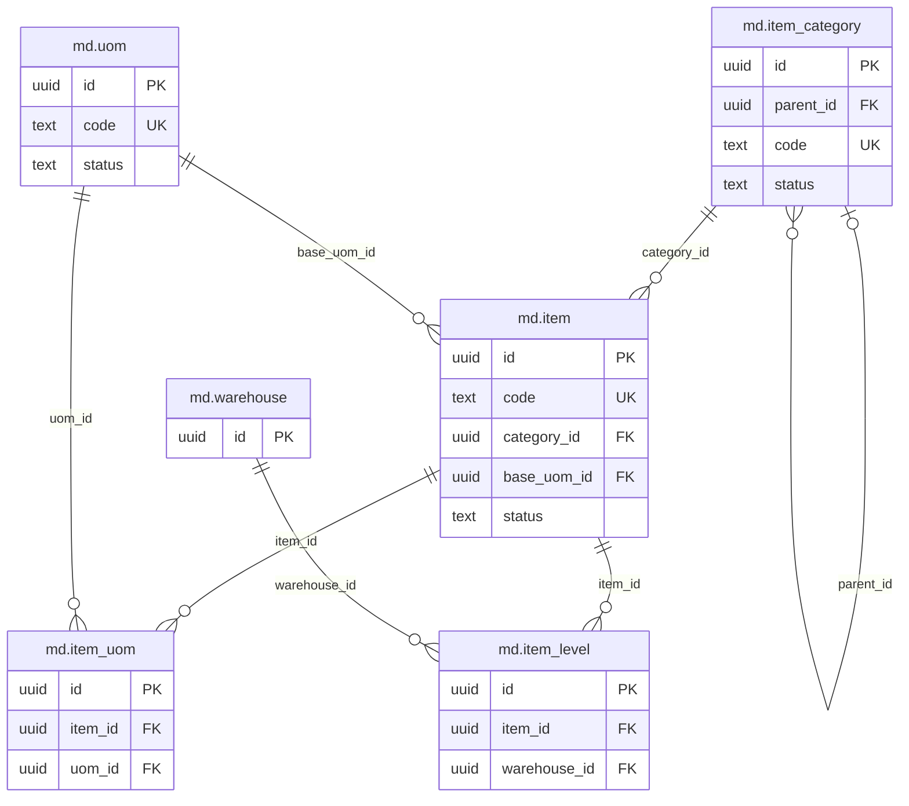

#### md.uom

Units of measure with dimension and factor to the dimension's base (FR-MD-001).

*Mutable, never deleted · written by P19.04 · volume S (< 10 k rows)*

| Column | Type | Null | Default | Key / reference | Notes |
|---|---|---|---|---|---|
| `id` | uuid | no |  | PK |  |
| `code` | text | no |  | UNIQUE | kg, t, quintal, l, pcs … |
| `name` | text | no |  |  |  |
| `dimension` | text | no |  |  | one of `MASS`, `VOLUME`, `COUNT`, `LENGTH`, `AREA`, `TIME` |
| `factor_to_dimension_base` | core.factor | no |  |  | kg = 1, t = 1000, quintal = 100 |
| `decimals` | smallint | no | 3 |  |  |
| `status` | text | no | 'ACTIVE' |  | one of `ACTIVE`, `INACTIVE` |
| *standard audit columns:* `created_at`, `created_by`, `updated_at`, `updated_by`, `version` (§2.5) | | | | | |

#### md.item_category

Hierarchical item categories, each with the attribute schema its lots must satisfy (FR-MD-004).

*Mutable, never deleted · written by P19.04 · volume S (< 10 k rows)*

| Column | Type | Null | Default | Key / reference | Notes |
|---|---|---|---|---|---|
| `id` | uuid | no |  | PK |  |
| `parent_id` | uuid | yes |  | → `md.item_category` |  |
| `code` | text | no |  | UNIQUE |  |
| `name` | text | no |  |  |  |
| `attribute_schema` | jsonb | no | '{}' |  | e.g. wheat: variety, origin, crop year, grade |
| `status` | text | no | 'ACTIVE' |  | one of `ACTIVE`, `INACTIVE` |
| *standard audit columns:* `created_at`, `created_by`, `updated_at`, `updated_by`, `version` (§2.5) | | | | | |

#### md.item

Materials, products, packaging, spares and non-stock items (FR-MD-003).

*Mutable, never deleted · written by P19.07, P19.04 · volume M (10 k – 1 M)*

| Column | Type | Null | Default | Key / reference | Notes |
|---|---|---|---|---|---|
| `id` | uuid | no |  | PK |  |
| `system_no` | text | no |  | UNIQUE | MAT{SEQ:6} |
| `code` | text | no |  | UNIQUE | user-defined material code |
| `name` | text | no |  |  |  |
| `description` | text | yes |  |  |  |
| `item_type` | text | no |  |  | one of `RAW`, `PACKAGING`, `SEMI_FINISHED`, `FINISHED`, `BY_PRODUCT`, `SCRAP`, `CONSUMABLE`, `SPARE_PART`, `NON_STOCK` |
| `category_id` | uuid | no |  | → `md.item_category` |  |
| `base_uom_id` | uuid | no |  | → `md.uom` | cannot change after the first posting |
| `lot_tracking` | text | no | 'NONE' |  | one of `NONE`, `LOT` |
| `shelf_life_days` | int | yes |  |  |  |
| `gross_weight_per_base_uom` | core.qty | yes |  |  | kg per base unit; for counted lines on a weighed truck (FR-PRC-013) |
| `inspection_required` | boolean | no | false |  | routes receipts through QC (FR-QC-004) |
| `reference_cost` | core.price | yes |  |  | PR estimates and provisional production cost; never valuation |
| `reorder_level` | core.qty | yes |  |  |  |
| `safety_stock` | core.qty | yes |  |  |  |
| `max_level` | core.qty | yes |  |  |  |
| `status` | text | no | 'ACTIVE' |  | one of `ACTIVE`, `INACTIVE` |
| *standard audit columns:* `created_at`, `created_by`, `updated_at`, `updated_by`, `version` (§2.5) | | | | | |

#### md.item_uom

Item-specific conversions (1 bag = 50 kg); immutable once referenced, changed by a new version (FR-MD-002).

*Mutable, never deleted · written by P19.07 · volume M (10 k – 1 M)*

| Column | Type | Null | Default | Key / reference | Notes |
|---|---|---|---|---|---|
| `id` | uuid | no |  | PK |  |
| `item_id` | uuid | no |  | → `md.item` |  |
| `uom_id` | uuid | no |  | → `md.uom` |  |
| `factor_to_base` | core.factor | no |  |  | base units per one of this unit |
| `effective_from` | date | no |  |  |  |
| `superseded_at` | timestamptz | yes |  |  |  |
| *standard audit columns:* `created_at`, `created_by`, `updated_at`, `updated_by`, `version` (§2.5) | | | | | |

**Constraints and notes:**
- Unique: (item_id, uom_id) WHERE superseded_at IS NULL.

#### md.item_level

Item levels per warehouse, overriding the item default (FR-MD-010 precedence).

*Mutable · written by P19.07 · volume M (10 k – 1 M)*

| Column | Type | Null | Default | Key / reference | Notes |
|---|---|---|---|---|---|
| `id` | uuid | no |  | PK |  |
| `item_id` | uuid | no |  | → `md.item` |  |
| `warehouse_id` | uuid | no |  | → `md.warehouse` |  |
| `reorder_level` | core.qty | yes |  |  |  |
| `safety_level` | core.qty | yes |  |  |  |
| `max_level` | core.qty | yes |  |  |  |
| *standard audit columns:* `created_at`, `created_by`, `updated_at`, `updated_by`, `version` (§2.5) | | | | | |

**Constraints and notes:**
- Unique: (item_id, warehouse_id).
- Check: safety_level <= reorder_level <= max_level where present.

### 5.2 Business partners, suppliers and KYC

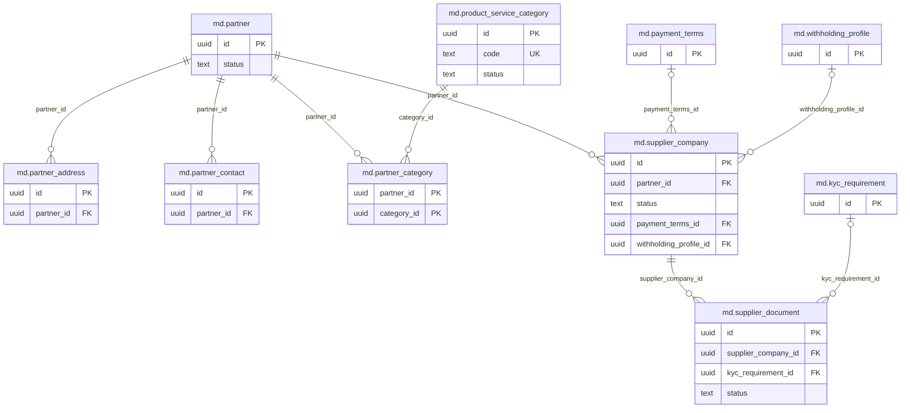

#### md.product_service_category

Tags for what suppliers provide (FR-MD-013).

*Mutable, never deleted · written by P19.04 · volume S (< 10 k rows)*

| Column | Type | Null | Default | Key / reference | Notes |
|---|---|---|---|---|---|
| `id` | uuid | no |  | PK |  |
| `code` | text | no |  | UNIQUE |  |
| `name` | text | no |  |  |  |
| `kind` | text | no |  |  | one of `PRODUCT`, `SERVICE` |
| `status` | text | no | 'ACTIVE' |  | one of `ACTIVE`, `INACTIVE` |
| *standard audit columns:* `created_at`, `created_by`, `updated_at`, `updated_by`, `version` (§2.5) | | | | | |

#### md.partner

Organisations and individuals acting as supplier, customer or transporter (FR-MD-005, FR-MD-014).

*Mutable, never deleted · written by P01.01, P14.01, P19.07 · volume M (10 k – 1 M)*

| Column | Type | Null | Default | Key / reference | Notes |
|---|---|---|---|---|---|
| `id` | uuid | no |  | PK |  |
| `kind` | text | no |  |  | one of `ORGANISATION`, `INDIVIDUAL` |
| `legal_name` | text | no |  |  | personal data |
| `trade_name` | text | yes |  |  |  |
| `business_reg_no` | text | yes |  |  |  |
| `tin` | text | yes |  | UNIQUE | unique when present; optional for individuals |
| `vat_no` | text | yes |  |  |  |
| `national_id` | text | yes |  |  | personal data; individuals without a TIN |
| `description` | text | yes |  |  |  |
| `is_supplier` | boolean | no | false |  |  |
| `is_customer` | boolean | no | false |  |  |
| `is_transporter` | boolean | no | false |  |  |
| `status` | text | no | 'ACTIVE' |  | one of `ACTIVE`, `INACTIVE` |
| *standard audit columns:* `created_at`, `created_by`, `updated_at`, `updated_by`, `version` (§2.5) | | | | | |

**Constraints and notes:**
- Check: kind = 'INDIVIDUAL' or tin is present.
- Index: (legal_name) -- trigram, for the similar-name warning.

#### md.partner_address

Physical and mailing addresses (FR-PRC-001 step 3).

*Mutable · written by P01.01 · volume M (10 k – 1 M)*

| Column | Type | Null | Default | Key / reference | Notes |
|---|---|---|---|---|---|
| `id` | uuid | no |  | PK |  |
| `partner_id` | uuid | no |  | → `md.partner` |  |
| `address_type` | text | no |  |  | one of `PHYSICAL`, `MAILING`, `SHIP_TO`, `BILL_TO` |
| `country` | text | no |  |  |  |
| `region` | text | yes |  |  |  |
| `city` | text | yes |  |  |  |
| `postal_code` | text | yes |  |  |  |
| `line` | text | yes |  |  | personal data |
| `is_default` | boolean | no | false |  |  |
| *standard audit columns:* `created_at`, `created_by`, `updated_at`, `updated_by`, `version` (§2.5) | | | | | |

#### md.partner_contact

Contact people (FR-PRC-001 step 2).

*Mutable · written by P01.01 · volume M (10 k – 1 M)*

| Column | Type | Null | Default | Key / reference | Notes |
|---|---|---|---|---|---|
| `id` | uuid | no |  | PK |  |
| `partner_id` | uuid | no |  | → `md.partner` |  |
| `name` | text | no |  |  | personal data |
| `position` | text | yes |  |  |  |
| `phone` | text | yes |  |  | personal data |
| `mobile` | text | yes |  |  | personal data |
| `email` | citext | yes |  |  | personal data |
| `is_primary` | boolean | no | false |  |  |
| *standard audit columns:* `created_at`, `created_by`, `updated_at`, `updated_by`, `version` (§2.5) | | | | | |

#### md.partner_category

What a partner supplies (FR-MD-013).

*Mutable · written by P01.01 · volume M (10 k – 1 M)*

| Column | Type | Null | Default | Key / reference | Notes |
|---|---|---|---|---|---|
| `partner_id` | uuid | no |  | PK → `md.partner` |  |
| `category_id` | uuid | no |  | PK → `md.product_service_category` |  |

**Constraints and notes:**
- Primary key: (partner_id, category_id).

#### md.supplier_company

The supplier role of a partner for the company: lifecycle, terms, payment and tax settings (TDD §10).

*Mutable, never deleted · written by P01.04, P01.05, P01.08, P01.09 · volume M (10 k – 1 M)*

| Column | Type | Null | Default | Key / reference | Notes |
|---|---|---|---|---|---|
| `id` | uuid | no |  | PK |  |
| `partner_id` | uuid | no |  | → `md.partner` |  |
| `company_id` | uuid | no |  | → `core.company` |  |
| `supplier_no` | text | yes |  | UNIQUE | SUP-{SEQ:5} |
| `supplier_group` | text | no | 'STANDARD' |  | drives the KYC checklist |
| `status` | text | no | 'DRAFT' |  | one of `DRAFT`, `SUBMITTED`, `APPROVED`, `SUSPENDED`, `BLOCKED`, `REJECTED`, `INACTIVE` |
| `block_reason` | text | yes |  |  |  |
| `payment_block` | boolean | no | false |  |  |
| `payment_method_pref` | text | yes |  |  | one of `TRANSFER`, `CHEQUE`, `CASH`, `MOBILE` |
| `payment_terms_id` | uuid | yes |  | → `md.payment_terms` |  |
| `currency_code` | char(3) | yes |  | → `md.currency`.code |  |
| `withholding_profile_id` | uuid | yes |  | → `md.withholding_profile` |  |
| `self_billing` | boolean | no | false |  | FR-AP-018 |
| `empty_bag_disposition` | text | no | 'RETURN' |  | one of `RETURN`, `KEEP`, `CREDIT` |
| `payable_weight_basis` | text | no | 'OURS' |  | one of `OURS`, `SUPPLIER`, `LOWER` |
| `registered_at` | timestamptz | yes |  |  | system-set at approval |
| `approval_chain_id` | uuid | yes |  | → `core.approval_chain` |  |
| *standard audit columns:* `created_at`, `created_by`, `updated_at`, `updated_by`, `version` (§2.5) | | | | | |

**Constraints and notes:**
- Unique: (partner_id, company_id).

#### md.kyc_requirement

Onboarding document checklist per supplier group (FR-PRC-001).

*Mutable · written by P19.05 · volume S (< 10 k rows)*

| Column | Type | Null | Default | Key / reference | Notes |
|---|---|---|---|---|---|
| `id` | uuid | no |  | PK |  |
| `supplier_group` | text | no |  |  |  |
| `document_type` | text | no |  |  | TRADE_LICENCE, TIN_CERT, VAT_CERT, BANK_LETTER … |
| `mandatory` | boolean | no | true |  |  |
| `expiry_required` | boolean | no | false |  |  |
| *standard audit columns:* `created_at`, `created_by`, `updated_at`, `updated_by`, `version` (§2.5) | | | | | |

**Constraints and notes:**
- Unique: (supplier_group, document_type).

#### md.supplier_document

Supplier KYC documents with expiry (FR-PRC-001, FR-PRC-003).

*Mutable · written by P01.03, P01.07 · volume M (10 k – 1 M)*

| Column | Type | Null | Default | Key / reference | Notes |
|---|---|---|---|---|---|
| `id` | uuid | no |  | PK |  |
| `supplier_company_id` | uuid | no |  | → `md.supplier_company` |  |
| `kyc_requirement_id` | uuid | yes |  | → `md.kyc_requirement` |  |
| `document_type` | text | no |  |  |  |
| `document_no` | text | yes |  |  |  |
| `file_id` | uuid | no |  | → `core.attachment` |  |
| `issued_on` | date | yes |  |  |  |
| `expires_on` | date | yes |  |  |  |
| `status` | text | no | 'VALID' |  | one of `VALID`, `EXPIRED`, `SUPERSEDED` |
| *standard audit columns:* `created_at`, `created_by`, `updated_at`, `updated_by`, `version` (§2.5) | | | | | |

**Constraints and notes:**
- Index: (expires_on) WHERE status = 'VALID'.

### 5.3 Banks, bank accounts, terms, currencies and tax

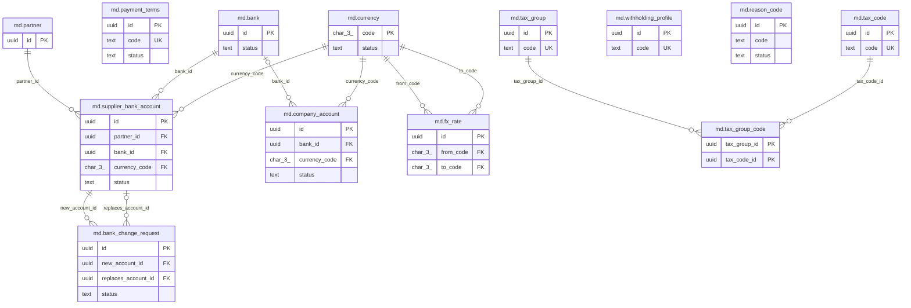

#### md.bank

Bank master list (FR-MD-012).

*Mutable, never deleted · written by P19.05 · volume S (< 10 k rows)*

| Column | Type | Null | Default | Key / reference | Notes |
|---|---|---|---|---|---|
| `id` | uuid | no |  | PK |  |
| `name` | text | no |  |  |  |
| `branch` | text | yes |  |  |  |
| `swift` | text | yes |  |  |  |
| `status` | text | no | 'ACTIVE' |  | one of `ACTIVE`, `INACTIVE` |
| *standard audit columns:* `created_at`, `created_by`, `updated_at`, `updated_by`, `version` (§2.5) | | | | | |

**Constraints and notes:**
- Unique: (name, branch).

#### md.supplier_bank_account

Supplier bank accounts: encrypted, never edited in place (FR-PRC-004, FR-PRC-005).

*Mutable, never deleted · written by P01.02, P02.02, P02.05 · volume M (10 k – 1 M)*

| Column | Type | Null | Default | Key / reference | Notes |
|---|---|---|---|---|---|
| `id` | uuid | no |  | PK |  |
| `partner_id` | uuid | no |  | → `md.partner` |  |
| `bank_id` | uuid | no |  | → `md.bank` |  |
| `account_name` | text | no |  |  | personal data |
| `account_no_enc` | bytea | no |  |  | **encrypted**; AES-256-GCM, key from env or KMS |
| `account_no_last4` | text | no |  |  |  |
| `currency_code` | char(3) | no |  | → `md.currency`.code |  |
| `status` | text | no | 'PENDING' |  | one of `PENDING`, `ACTIVE`, `INACTIVE`, `REJECTED` |
| `details_hash` | text | no |  |  | hash of bank, number, name; re-verified at payment (BR-AP-04) |
| `usable_from` | timestamptz | yes |  |  | approval + cooling-off |
| *standard audit columns:* `created_at`, `created_by`, `updated_at`, `updated_by`, `version` (§2.5) | | | | | |

**Constraints and notes:**
- Index: (partner_id, status).

#### md.bank_change_request

Dual-controlled change of supplier bank details, with call-back evidence (FR-PRC-004, P02).

*Mutable, never deleted · written by P02.02, P02.03, P02.04 · volume S (< 10 k rows)*

| Column | Type | Null | Default | Key / reference | Notes |
|---|---|---|---|---|---|
| `id` | uuid | no |  | PK |  |
| `new_account_id` | uuid | no |  | → `md.supplier_bank_account` |  |
| `replaces_account_id` | uuid | yes |  | → `md.supplier_bank_account` |  |
| `status` | text | no | 'DRAFT' |  | one of `DRAFT`, `SUBMITTED`, `APPROVED`, `REJECTED` |
| `reason` | text | no |  |  |  |
| `letter_file_id` | uuid | yes |  | → `core.attachment` |  |
| `callback_phone` | text | yes |  |  | personal data; taken from the master, not the letter |
| `callback_by` | uuid | yes |  | → `core.user` |  |
| `callback_at` | timestamptz | yes |  |  |  |
| `callback_note` | text | yes |  |  |  |
| `callback_evidence_file_id` | uuid | yes |  | → `core.attachment` |  |
| `approval_chain_id` | uuid | yes |  | → `core.approval_chain` |  |
| `submitted_at` | timestamptz | yes |  |  |  |
| `submitted_by` | uuid | yes |  | → `core.user` |  |
| `decided_at` | timestamptz | yes |  |  |  |
| *standard audit columns:* `created_at`, `created_by`, `updated_at`, `updated_by`, `version` (§2.5) | | | | | |

#### md.company_account

Company bank accounts, cash boxes and mobile wallets that pay and receive, each with its export account code (FR-AP-015). In md, not fin, because sales receipts and cash sessions (tier 4) use it.

*Mutable, never deleted · written by P19.05 · volume S (< 10 k rows)*

| Column | Type | Null | Default | Key / reference | Notes |
|---|---|---|---|---|---|
| `id` | uuid | no |  | PK |  |
| `company_id` | uuid | no |  | → `core.company` |  |
| `account_type` | text | no |  |  | one of `BANK`, `CASH`, `MOBILE` |
| `name` | text | no |  |  |  |
| `bank_id` | uuid | yes |  | → `md.bank` |  |
| `account_no_enc` | bytea | yes |  |  | **encrypted** |
| `account_no_last4` | text | yes |  |  |  |
| `currency_code` | char(3) | no |  | → `md.currency`.code |  |
| `export_account_code` | text | no |  |  |  |
| `cash_limit` | core.amount | yes |  |  | per payment, cash boxes only |
| `status` | text | no | 'ACTIVE' |  | one of `ACTIVE`, `INACTIVE` |
| *standard audit columns:* `created_at`, `created_by`, `updated_at`, `updated_by`, `version` (§2.5) | | | | | |

**Constraints and notes:**
- Check: account_type = 'BANK' requires bank_id and account_no_enc.

#### md.payment_terms

Payment terms: days and basis (FR-MD-006).

*Mutable, never deleted · written by P19.05 · volume S (< 10 k rows)*

| Column | Type | Null | Default | Key / reference | Notes |
|---|---|---|---|---|---|
| `id` | uuid | no |  | PK |  |
| `code` | text | no |  | UNIQUE | NET30 … |
| `name` | text | no |  |  |  |
| `days` | int | no |  |  |  |
| `basis` | text | no |  |  | one of `INVOICE_DATE`, `GRN_DATE`, `END_OF_MONTH` |
| `status` | text | no | 'ACTIVE' |  | one of `ACTIVE`, `INACTIVE` |
| *standard audit columns:* `created_at`, `created_by`, `updated_at`, `updated_by`, `version` (§2.5) | | | | | |

#### md.currency

Currencies with minor units (FR-MD-008).

*Mutable, never deleted · written by P19.05 · volume S (< 10 k rows)*

| Column | Type | Null | Default | Key / reference | Notes |
|---|---|---|---|---|---|
| `code` | char(3) | no |  | PK |  |
| `name` | text | no |  |  |  |
| `minor_units` | smallint | no | 2 |  |  |
| `status` | text | no | 'ACTIVE' |  | one of `ACTIVE`, `INACTIVE` |

#### md.fx_rate

Exchange rates per date (FR-MD-008).

*Mutable · written by P19.05 · volume M (10 k – 1 M)*

| Column | Type | Null | Default | Key / reference | Notes |
|---|---|---|---|---|---|
| `id` | uuid | no |  | PK |  |
| `from_code` | char(3) | no |  | → `md.currency`.code |  |
| `to_code` | char(3) | no |  | → `md.currency`.code |  |
| `rate_date` | date | no |  |  |  |
| `rate` | core.factor | no |  |  |  |
| `source` | text | yes |  |  |  |
| *standard audit columns:* `created_at`, `created_by`, `updated_at`, `updated_by`, `version` (§2.5) | | | | | |

**Constraints and notes:**
- Unique: (from_code, to_code, rate_date).

#### md.tax_code

VAT, withholding, excise and other taxes with rates, thresholds and timing; rates are seed data confirmed by the client (FR-MD-007, TDD §13.1).

*Mutable, never deleted · written by P19.05 · volume S (< 10 k rows)*

| Column | Type | Null | Default | Key / reference | Notes |
|---|---|---|---|---|---|
| `id` | uuid | no |  | PK |  |
| `code` | text | no |  | UNIQUE |  |
| `name` | text | no |  |  |  |
| `kind` | text | no |  |  | one of `VAT`, `WITHHOLDING`, `EXCISE`, `OTHER` |
| `rate` | core.pct | no |  |  |  |
| `calc` | text | no | 'PERCENT' |  | one of `PERCENT`, `FIXED_PER_UNIT` |
| `direction` | text | no |  |  | one of `PURCHASE`, `SALE`, `BOTH` |
| `threshold` | core.amount | yes |  |  |  |
| `threshold_basis` | text | yes |  |  | one of `INVOICE`, `CONTRACT` |
| `recoverable` | boolean | no | true |  |  |
| `moment` | text | no | 'AT_INVOICE' |  | one of `AT_INVOICE`, `AT_PAYMENT` |
| `effective_from` | date | no |  |  |  |
| `effective_to` | date | yes |  |  |  |
| `account_map_key` | text | no |  |  | VAT_INPUT, VAT_OUTPUT, WHT_PAYABLE … |
| *standard audit columns:* `created_at`, `created_by`, `updated_at`, `updated_by`, `version` (§2.5) | | | | | |

#### md.tax_group

Named groups of tax codes applied to a line (FR-MD-007).

*Mutable, never deleted · written by P19.05 · volume S (< 10 k rows)*

| Column | Type | Null | Default | Key / reference | Notes |
|---|---|---|---|---|---|
| `id` | uuid | no |  | PK |  |
| `code` | text | no |  | UNIQUE |  |
| `name` | text | no |  |  |  |
| *standard audit columns:* `created_at`, `created_by`, `updated_at`, `updated_by`, `version` (§2.5) | | | | | |

#### md.tax_group_code

Tax codes in a group.

*Mutable · written by P19.05 · volume S (< 10 k rows)*

| Column | Type | Null | Default | Key / reference | Notes |
|---|---|---|---|---|---|
| `tax_group_id` | uuid | no |  | PK → `md.tax_group` |  |
| `tax_code_id` | uuid | no |  | PK → `md.tax_code` |  |
| `sort` | smallint | no | 1 |  |  |

**Constraints and notes:**
- Primary key: (tax_group_id, tax_code_id).

#### md.withholding_profile

Withholding treatment of a supplier: exemptions and the no-TIN rate (FR-MD-014).

*Mutable, never deleted · written by P19.05 · volume S (< 10 k rows)*

| Column | Type | Null | Default | Key / reference | Notes |
|---|---|---|---|---|---|
| `id` | uuid | no |  | PK |  |
| `code` | text | no |  | UNIQUE |  |
| `name` | text | no |  |  |  |
| `exempt` | boolean | no | false |  |  |
| `no_tin_rate` | core.pct | yes |  |  | applied when the supplier has no TIN |
| *standard audit columns:* `created_at`, `created_by`, `updated_at`, `updated_by`, `version` (§2.5) | | | | | |

#### md.reason_code

Reason codes by domain (FR-MD-009).

*Mutable, never deleted · written by P19.04 · volume S (< 10 k rows)*

| Column | Type | Null | Default | Key / reference | Notes |
|---|---|---|---|---|---|
| `id` | uuid | no |  | PK |  |
| `domain` | text | no |  |  | one of `ADJUSTMENT`, `SCRAP`, `STATUS_CHANGE`, `TRANSIT_LOSS`, `COUNT`, `GATE_REJECTION`, `REWEIGH`, `DISPUTE`, `OVERRIDE`, `DOWNTIME`, `RETURN`, `PRICE_OVERRIDE`, `FUMIGATION`, `QC_REJECTION`, `INCIDENT` |
| `code` | text | no |  |  |  |
| `name` | text | no |  |  |  |
| `requires_attachment` | boolean | no | false |  |  |
| `account_map_key` | text | yes |  |  | ADJ:<reason> |
| `status` | text | no | 'ACTIVE' |  | one of `ACTIVE`, `INACTIVE` |
| *standard audit columns:* `created_at`, `created_by`, `updated_at`, `updated_by`, `version` (§2.5) | | | | | |

**Constraints and notes:**
- Unique: (domain, code).

### 5.4 Warehouses and storage units

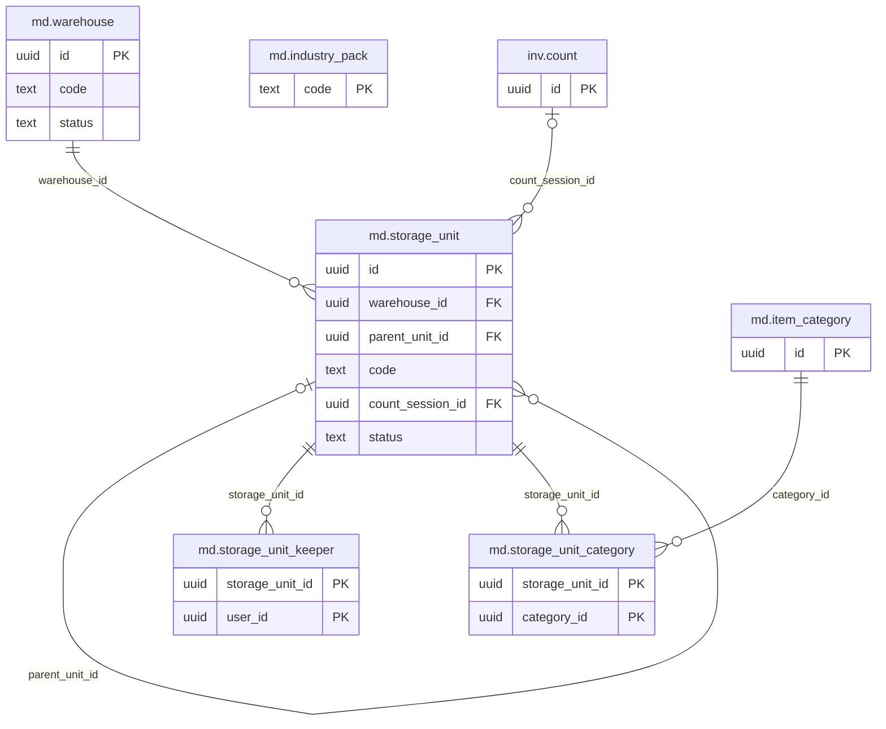

#### md.warehouse

A stock-holding facility at a site (FR-MD-010).

*Mutable, never deleted · written by P19.02 · volume S (< 10 k rows)*

| Column | Type | Null | Default | Key / reference | Notes |
|---|---|---|---|---|---|
| `id` | uuid | no |  | PK |  |
| `site_id` | uuid | no |  | → `core.site` |  |
| `code` | text | no |  |  |  |
| `name` | text | no |  |  |  |
| `capacity` | core.qty | yes |  |  |  |
| `capacity_uom_id` | uuid | yes |  | → `md.uom` |  |
| `temp_controlled` | boolean | no | false |  |  |
| `humidity_controlled` | boolean | no | false |  |  |
| `storekeeper_user_id` | uuid | yes |  | → `core.user` |  |
| `status` | text | no | 'ACTIVE' |  | one of `ACTIVE`, `INACTIVE` |
| *standard audit columns:* `created_at`, `created_by`, `updated_at`, `updated_by`, `version` (§2.5) | | | | | |

**Constraints and notes:**
- Unique: (site_id, code).

#### md.storage_unit

A place inside a warehouse: store, silo, tank, bin, yard, quarantine, reject or in-transit (FR-MD-010, FR-INV-019).

*Mutable, never deleted · written by P19.02 · volume S (< 10 k rows)*

| Column | Type | Null | Default | Key / reference | Notes |
|---|---|---|---|---|---|
| `id` | uuid | no |  | PK |  |
| `warehouse_id` | uuid | no |  | → `md.warehouse` |  |
| `parent_unit_id` | uuid | yes |  | → `md.storage_unit` | bins inside a store |
| `code` | text | no |  |  |  |
| `name` | text | no |  |  |  |
| `unit_type` | text | no |  |  | one of `STORE`, `SILO`, `TANK`, `BIN`, `YARD`, `QUARANTINE`, `REJECT`, `IN_TRANSIT` |
| `capacity` | core.qty | yes |  |  |  |
| `capacity_uom_id` | uuid | yes |  | → `md.uom` |  |
| `geometry_table` | jsonb | yes |  |  | level → volume, for dip measurement (FR-INV-020) |
| `default_bulk_density` | core.factor | yes |  |  | kg/m³ when no recent hectolitre weight |
| `reorder_level` | core.qty | yes |  |  |  |
| `max_level` | core.qty | yes |  |  |  |
| `safety_level` | core.qty | yes |  |  |  |
| `capacity_mode` | text | no | 'WARN' |  | one of `WARN`, `BLOCK` |
| `commingled` | boolean | no | false |  | true for silos and tanks by default |
| `allowed_statuses` | text[] | no | '{AVAILABLE,QUARANTINE,BLOCKED,DAMAGED,REJECTED}' |  |  |
| `restricted` | boolean | no | false |  |  |
| `allow_receipt` | boolean | no | true |  |  |
| `allow_issue` | boolean | no | true |  |  |
| `allow_transfer` | boolean | no | true |  |  |
| `transfer_requires_approval` | boolean | no | false |  |  |
| `count_session_id` | uuid | yes |  | → `inv.count` | set while a FREEZE count runs |
| `status` | text | no | 'ACTIVE' |  | one of `ACTIVE`, `INACTIVE` |
| *standard audit columns:* `created_at`, `created_by`, `updated_at`, `updated_by`, `version` (§2.5) | | | | | |

**Constraints and notes:**
- Unique: (warehouse_id, code).
- Check: safety_level <= reorder_level <= max_level <= capacity where present.
- The current level is a view over inv.stock_balance, never stored.

#### md.storage_unit_keeper

Storekeepers of a unit; a restricted unit accepts postings only from them or supervisors.

*Mutable · written by P19.02 · volume S (< 10 k rows)*

| Column | Type | Null | Default | Key / reference | Notes |
|---|---|---|---|---|---|
| `storage_unit_id` | uuid | no |  | PK → `md.storage_unit` |  |
| `user_id` | uuid | no |  | PK → `core.user` |  |

**Constraints and notes:**
- Primary key: (storage_unit_id, user_id).

#### md.storage_unit_category

Material categories a unit may hold (FR-MD-010).

*Mutable · written by P19.02 · volume S (< 10 k rows)*

| Column | Type | Null | Default | Key / reference | Notes |
|---|---|---|---|---|---|
| `storage_unit_id` | uuid | no |  | PK → `md.storage_unit` |  |
| `category_id` | uuid | no |  | PK → `md.item_category` |  |

**Constraints and notes:**
- Primary key: (storage_unit_id, category_id).

#### md.industry_pack

Record of the industry pack installed (FR-MD-011).

*Mutable · written by P19.04 · volume S (< 10 k rows)*

| Column | Type | Null | Default | Key / reference | Notes |
|---|---|---|---|---|---|
| `code` | text | no |  | PK | GRAIN_FLOUR_MILLING |
| `version` | text | no |  |  |  |
| `installed_at` | timestamptz | no | now() |  |  |
| `installed_by` | uuid | no |  | → `core.user` |  |

---

## 6. `inv`: Inventory

**Owns:** The stock ledger, balances and valuation, lots and genealogy, reservations, and every stock document: goods receipt, supplier return, issue, miscellaneous receipt, transfer, status change, adjustment, count, silo measurement, treatment hold, period snapshot. **Dependency tier:** 2. **Tables:** 30.

### 6.1 Ledger, balances, valuation, lots

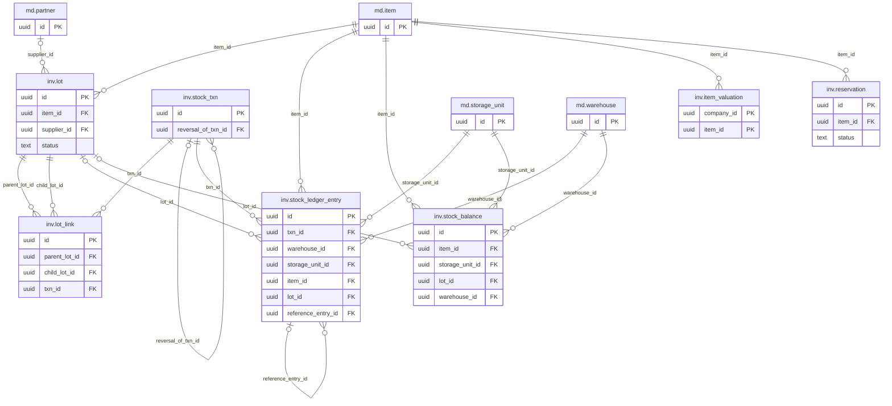

#### inv.lot

An identifiable quantity of one item with common origin and quality (FR-INV-004).

*Mutable, never deleted · written by P05.05, P05.16, P06.04, P07.08, P12.06, P13.04 · volume L (1 – 10 M)*

| Column | Type | Null | Default | Key / reference | Notes |
|---|---|---|---|---|---|
| `id` | uuid | no |  | PK |  |
| `item_id` | uuid | no |  | → `md.item` |  |
| `lot_no` | text | no |  |  | BATCH-{YYYYMMDD}-{SEQ:2} or the supplier's |
| `supplier_id` | uuid | yes |  | → `md.partner` |  |
| `supplier_lot_no` | text | yes |  |  |  |
| `source_doc_type` | text | yes |  | → `core.doc_type`.code |  |
| `source_doc_id` | uuid | yes |  |  |  |
| `received_date` | date | yes |  |  | first-in-first-out order in commingled units |
| `mfg_date` | date | yes |  |  |  |
| `expiry_date` | date | yes |  |  |  |
| `qc_status` | text | no | 'NOT_REQUIRED' |  | one of `PENDING`, `ACCEPTED`, `REJECTED`, `ON_HOLD`, `NOT_REQUIRED` |
| `grade_code` | text | yes |  |  |  |
| `attributes` | jsonb | no | '{}' |  | validated against the category's attribute schema (FR-MD-004) |
| `status` | text | no | 'ACTIVE' |  | one of `ACTIVE`, `VOID` |
| *standard audit columns:* `created_at`, `created_by`, `updated_at`, `updated_by`, `version` (§2.5) | | | | | |

**Constraints and notes:**
- Unique: (item_id, lot_no).
- Check: expiry_date >= mfg_date where both present (FR-PLT-055).
- Index: (item_id, received_date).

#### inv.lot_link

Lot genealogy: split, produce, regrade; blend is v1.1 (TDD §9.5).

*Insert-only · written by P12.06, P12.10, P13.04 · volume L (1 – 10 M)*

| Column | Type | Null | Default | Key / reference | Notes |
|---|---|---|---|---|---|
| `id` | uuid | no |  | PK |  |
| `parent_lot_id` | uuid | no |  | → `inv.lot` |  |
| `child_lot_id` | uuid | no |  | → `inv.lot` |  |
| `link_type` | text | no |  |  | one of `SPLIT`, `PRODUCE`, `REGRADE`, `BLEND` |
| `qty` | core.qty | no |  |  | parent quantity contributing, in the parent's base unit |
| `txn_id` | uuid | no |  | → `inv.stock_txn` |  |
| `created_at` | timestamptz | no | now() |  |  |

**Constraints and notes:**
- Check: parent_lot_id <> child_lot_id.
- Index: (child_lot_id).

#### inv.stock_txn

Header of one ledger posting: groups its entries (TDD §9.1).

*Insert-only · written by every stock posting · volume XL (10 – 100 M)*

| Column | Type | Null | Default | Key / reference | Notes |
|---|---|---|---|---|---|
| `id` | uuid | no |  | PK |  |
| `company_id` | uuid | no |  | → `core.company` |  |
| `site_id` | uuid | no |  | → `core.site` |  |
| `txn_type` | text | no |  |  | one of `RECEIPT`, `ISSUE`, `TRANSFER`, `STATUS_CHANGE`, `ADJUSTMENT`, `COUNT_ADJ`, `RETURN_TO_SUPPLIER`, `REVALUATION`, `LOT_SPLIT`, `PRODUCTION_ISSUE`, `PRODUCTION_OUTPUT`, `SALES_ISSUE`, `CUSTOMER_RETURN`, `OPENING_BALANCE` |
| `source_doc_type` | text | no |  | → `core.doc_type`.code |  |
| `source_doc_id` | uuid | no |  |  |  |
| `posting_date` | date | no |  |  |  |
| `posted_at` | timestamptz | no | now() |  |  |
| `posted_by` | uuid | no |  | → `core.user` |  |
| `is_reversal` | boolean | no | false |  |  |
| `reversal_of_txn_id` | uuid | yes |  | → `inv.stock_txn` |  |

**Constraints and notes:**
- Index: (source_doc_type, source_doc_id).
- Index: (company_id, posting_date).

#### inv.stock_ledger_entry

One signed movement of one bucket (item × storage unit × lot × status), with value and running snapshots (TDD §9.1).

*Insert-only · written by every stock posting · volume XL (10 – 100 M)*

| Column | Type | Null | Default | Key / reference | Notes |
|---|---|---|---|---|---|
| `id` | uuid | no |  | PK |  |
| `seq` | bigint | no |  | UNIQUE | taken while the item's valuation lock is held: in commit order per item |
| `txn_id` | uuid | no |  | → `inv.stock_txn` |  |
| `pair_id` | uuid | yes |  |  | links the two sides of an internal move |
| `company_id` | uuid | no |  | → `core.company` |  |
| `site_id` | uuid | no |  | → `core.site` |  |
| `warehouse_id` | uuid | no |  | → `md.warehouse` |  |
| `storage_unit_id` | uuid | no |  | → `md.storage_unit` |  |
| `item_id` | uuid | no |  | → `md.item` |  |
| `lot_id` | uuid | yes |  | → `inv.lot` |  |
| `stock_status` | text | no |  |  | one of `QUARANTINE`, `AVAILABLE`, `BLOCKED`, `DAMAGED`, `REJECTED` |
| `move_type` | text | no |  |  | one of `RECEIPT`, `ISSUE`, `TRANSFER`, `STATUS_CHANGE`, `ADJUSTMENT`, `COUNT_ADJ`, `RETURN_TO_SUPPLIER`, `REVALUATION`, `LOT_SPLIT`, `PRODUCTION_ISSUE`, `PRODUCTION_OUTPUT`, `SALES_ISSUE`, `CUSTOMER_RETURN`, `OPENING_BALANCE` |
| `qty_base` | core.qty | no |  |  | signed; 0 only for REVALUATION |
| `qty_entered` | core.qty | yes |  |  |  |
| `uom_entered_id` | uuid | yes |  | → `md.uom` |  |
| `uom_factor` | core.factor | yes |  |  |  |
| `unit_cost` | core.price | no |  |  |  |
| `value` | core.amount | no |  |  | signed |
| `value_mode` | text | no |  |  | one of `EXPLICIT`, `AT_AVG`, `AT_REFERENCE`, `PAIRED` |
| `bucket_qty_after` | core.qty | no |  |  |  |
| `item_qty_after` | core.qty | no |  |  |  |
| `item_value_after` | core.amount | no |  |  |  |
| `posting_date` | date | no |  |  |  |
| `posted_at` | timestamptz | no | now() |  |  |
| `source_doc_type` | text | no |  | → `core.doc_type`.code |  |
| `source_doc_id` | uuid | no |  |  |  |
| `source_line_id` | uuid | yes |  |  |  |
| `reference_entry_id` | uuid | yes |  | → `inv.stock_ledger_entry` | AT_REFERENCE source (reversal, return, in-transit) |
| `reason_code_id` | uuid | yes |  | → `md.reason_code` |  |

**Constraints and notes:**
- Check: qty_base <> 0 or move_type = 'REVALUATION'.
- Index: (item_id, storage_unit_id, lot_id, stock_status, seq).
- Index: (source_doc_type, source_doc_id).
- Index: (lot_id, seq).
- Index: (item_id, seq).
- Index: (company_id, posting_date).

#### inv.stock_balance

Current quantity per bucket; equals the sum of its ledger entries (BR-INV-01).

*Mutable · written by every stock posting · volume L (1 – 10 M)*

| Column | Type | Null | Default | Key / reference | Notes |
|---|---|---|---|---|---|
| `id` | uuid | no |  | PK |  |
| `item_id` | uuid | no |  | → `md.item` |  |
| `storage_unit_id` | uuid | no |  | → `md.storage_unit` |  |
| `lot_id` | uuid | yes |  | → `inv.lot` |  |
| `stock_status` | text | no |  |  | one of `QUARANTINE`, `AVAILABLE`, `BLOCKED`, `DAMAGED`, `REJECTED` |
| `site_id` | uuid | no |  | → `core.site` |  |
| `warehouse_id` | uuid | no |  | → `md.warehouse` |  |
| `qty_on_hand` | core.qty | no | 0 |  |  |
| `last_seq` | bigint | no |  |  |  |
| `version` | int | no | 1 |  |  |

**Constraints and notes:**
- Unique: (item_id, storage_unit_id, lot_id, stock_status) -- NULLS NOT DISTINCT.
- Check: qty_on_hand >= 0.
- Index: (storage_unit_id).
- Index: (site_id, item_id).

#### inv.item_valuation

Company-level moving-average valuation per item (FR-INV-010, FR-PLT-003).

*Mutable · written by every stock posting · volume M (10 k – 1 M)*

| Column | Type | Null | Default | Key / reference | Notes |
|---|---|---|---|---|---|
| `company_id` | uuid | no |  | PK → `core.company` |  |
| `item_id` | uuid | no |  | PK → `md.item` |  |
| `qty_total` | core.qty | no | 0 |  |  |
| `value_total` | core.amount | no | 0 |  |  |
| `avg_cost` | core.price | no | 0 |  |  |
| `last_seq` | bigint | no | 0 |  |  |
| `version` | int | no | 1 |  |  |

**Constraints and notes:**
- Primary key: (company_id, item_id).
- Check: qty_total >= 0 and value_total >= 0 and (qty_total <> 0 or value_total = 0).

#### inv.reservation

Soft reservations from approved sales orders and released work orders (FR-INV-015).

*Mutable · written by P12.03, P13.02, P14.03 · volume L (1 – 10 M)*

| Column | Type | Null | Default | Key / reference | Notes |
|---|---|---|---|---|---|
| `id` | uuid | no |  | PK |  |
| `company_id` | uuid | no |  | → `core.company` |  |
| `site_id` | uuid | no |  | → `core.site` |  |
| `item_id` | uuid | no |  | → `md.item` |  |
| `source_doc_type` | text | no |  | → `core.doc_type`.code |  |
| `source_doc_id` | uuid | no |  |  |  |
| `source_line_id` | uuid | no |  |  |  |
| `qty_base` | core.qty | no |  |  |  |
| `qty_consumed` | core.qty | no | 0 |  |  |
| `status` | text | no | 'OPEN' |  | one of `OPEN`, `CONSUMED`, `RELEASED` |
| `created_at` | timestamptz | no | now() |  |  |
| `closed_at` | timestamptz | yes |  |  |  |

**Constraints and notes:**
- Unique: (source_doc_type, source_line_id) WHERE status = 'OPEN'.
- Check: 0 <= qty_consumed <= qty_base.
- Index: (item_id, site_id) WHERE status = 'OPEN'.

### 6.2 Goods receipt and supplier return

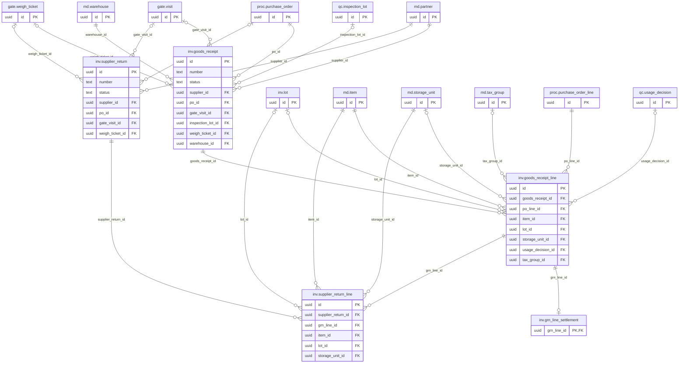

#### inv.goods_receipt

GRN header: receipt against a PO, prepared by the system and confirmed by the storekeeper (FR-PRC-013, FR-INB-002).

*Posting document: immutable once posted · written by P05.14, P05.16, P06.04, P07.05, P07.08 · volume L (1 – 10 M)*

| Column | Type | Null | Default | Key / reference | Notes |
|---|---|---|---|---|---|
| `id` | uuid | no |  | PK |  |
| *posting-document header:* the commitment header plus `posting_date`, `posted_at`, `posted_by`, `is_reversal`, `reversal_of_id`, `reversed_by_id` (§2.5) | | | | | |
| `status` | text | no | 'DRAFT' |  | one of `DRAFT`, `POSTED`, `REVERSED`, `CANCELLED` |
| `supplier_id` | uuid | no |  | → `md.partner` |  |
| `po_id` | uuid | no |  | → `proc.purchase_order` |  |
| `gate_visit_id` | uuid | yes |  | → `gate.visit` | NULL with the gate module off |
| `inspection_lot_id` | uuid | yes |  | → `qc.inspection_lot` | flow C, or quarantine lot |
| `weigh_ticket_id` | uuid | yes |  | → `gate.weigh_ticket` |  |
| `warehouse_id` | uuid | no |  | → `md.warehouse` |  |
| `vehicle_no` | text | yes |  |  |  |
| `delivery_note_no` | text | yes |  |  |  |
| `receipt_mode` | text | no | 'CONFIRM' |  | one of `CONFIRM`, `AUTOMATIC` |
| `flags` | text[] | no | '{}' |  | NO_TARE, ESTIMATED_TARE, TARE_ANOMALY, VERIFICATION_PENDING |
| `needs_approval` | boolean | no | false |  | e.g. exit without tare needs PMGR (E06) |

**Constraints and notes:**
- Unique: (company_id, number): the document number is unique per company.
- Unique: (reversal_of_id) WHERE is_reversal.
- Unique: (gate_visit_id, po_id) WHERE status <> 'CANCELLED' and not is_reversal.

#### inv.goods_receipt_line

GRN line: accepted and rejected quantity, payable quantity and quality-adjusted price, weights, batch and unit (FR-PRC-013, FR-PRC-021, FR-INV-022).

*Posting document: immutable once posted · written by P05.14, P05.16, P07.08 · volume L (1 – 10 M)*

| Column | Type | Null | Default | Key / reference | Notes |
|---|---|---|---|---|---|
| `id` | uuid | no |  | PK |  |
| `goods_receipt_id` | uuid | no |  | → `inv.goods_receipt` |  |
| `line_no` | int | no |  |  |  |
| `po_line_id` | uuid | no |  | → `proc.purchase_order_line` |  |
| `item_id` | uuid | no |  | → `md.item` |  |
| `line_kind` | text | no | 'GOODS' |  | one of `GOODS`, `SERVICE`; services write no ledger entries (FR-PRC-022) |
| `qty_source` | text | no |  |  | one of `WEIGHBRIDGE`, `COUNT`, `SERVICE` |
| *standard quantity columns:* `qty_entered`, `uom_entered_id`, `uom_factor`, `qty_base` (§2.5) | | | | | |
| `accepted_qty_base` | core.qty | no |  |  |  |
| `rejected_qty_base` | core.qty | no | 0 |  |  |
| `rejected_disposition` | text | yes |  |  | one of `RETURNED_ON_TRUCK`, `HELD_AS_REJECTED` |
| `payable_qty_base` | core.qty | no |  |  | after payable-quantity deductions (BR-QC-03) |
| `po_price` | core.price | no |  |  | snapshot (BR-PRC-02) |
| `adjusted_price` | core.price | no |  |  | after grade and price deductions (FR-QC-013) |
| `unit_cost` | core.price | no |  |  | value ÷ physical quantity |
| `line_value` | core.amount | no |  |  | payable × adjusted price (FR-INV-022) |
| `gross_kg` | core.qty | yes |  |  |  |
| `tare_kg` | core.qty | yes |  |  |  |
| `net_kg` | core.qty | yes |  |  |  |
| `bag_count` | int | yes |  |  |  |
| `bag_tare_kg` | core.qty | yes |  |  |  |
| `batch_no` | text | yes |  |  |  |
| `lot_id` | uuid | yes |  | → `inv.lot` |  |
| `storage_unit_id` | uuid | yes |  | → `md.storage_unit` |  |
| `receipt_status` | text | yes |  |  | one of `QUARANTINE`, `AVAILABLE`; per the item's QC policy |
| `usage_decision_id` | uuid | yes |  | → `qc.usage_decision` |  |
| `deduction_snapshot` | jsonb | yes |  |  | breakdown and rule-set version (FR-QC-014) |
| `tax_group_id` | uuid | yes |  | → `md.tax_group` |  |

**Constraints and notes:**
- Unique: (goods_receipt_id, line_no).
- Check: accepted_qty_base >= 0 and rejected_qty_base >= 0 and payable_qty_base <= accepted_qty_base.
- Check: rejected_disposition is present when rejected_qty_base > 0.

#### inv.grn_line_settlement

Mutable counters of a posted GRN line: invoiced, returned and debited quantities (TDD §8.4).

*Settlement side table: mutable counters · written by P09.04, P08.04, P08.06 · volume L (1 – 10 M)*

| Column | Type | Null | Default | Key / reference | Notes |
|---|---|---|---|---|---|
| `grn_line_id` | uuid | no |  | PK → `inv.goods_receipt_line` |  |
| `qty_invoiced` | core.qty | no | 0 |  |  |
| `qty_returned` | core.qty | no | 0 |  |  |
| `qty_debited` | core.qty | no | 0 |  |  |
| `version` | int | no | 1 |  |  |

**Constraints and notes:**
- Check: qty_invoiced − qty_debited ≤ payable_qty_base × (1 + quantity tolerance) (BR-AP-01).

#### inv.supplier_return

Supplier return header: rejected or defective stock sent back, at the original receipt cost (FR-PRC-015).

*Posting document: immutable once posted · written by P08.02, P08.04 · volume M (10 k – 1 M)*

| Column | Type | Null | Default | Key / reference | Notes |
|---|---|---|---|---|---|
| `id` | uuid | no |  | PK |  |
| *posting-document header:* the commitment header plus `posting_date`, `posted_at`, `posted_by`, `is_reversal`, `reversal_of_id`, `reversed_by_id` (§2.5) | | | | | |
| `status` | text | no | 'DRAFT' |  | one of `DRAFT`, `SUBMITTED`, `APPROVED`, `POSTED`, `REVERSED`, `REJECTED` |
| `supplier_id` | uuid | no |  | → `md.partner` |  |
| `po_id` | uuid | yes |  | → `proc.purchase_order` |  |
| `reason_code_id` | uuid | no |  | → `md.reason_code` |  |
| `reopen_for_replacement` | boolean | no | false |  |  |
| `gate_visit_id` | uuid | yes |  | → `gate.visit` |  |
| `weigh_ticket_id` | uuid | yes |  | → `gate.weigh_ticket` |  |

**Constraints and notes:**
- Unique: (company_id, number): the document number is unique per company.
- Unique: (reversal_of_id) WHERE is_reversal.

#### inv.supplier_return_line

Lots returned, each against its original GRN line.

*Posting document: immutable once posted · written by P08.02, P08.04 · volume M (10 k – 1 M)*

| Column | Type | Null | Default | Key / reference | Notes |
|---|---|---|---|---|---|
| `id` | uuid | no |  | PK |  |
| `supplier_return_id` | uuid | no |  | → `inv.supplier_return` |  |
| `line_no` | int | no |  |  |  |
| `grn_line_id` | uuid | no |  | → `inv.goods_receipt_line` |  |
| `item_id` | uuid | no |  | → `md.item` |  |
| `lot_id` | uuid | yes |  | → `inv.lot` |  |
| `storage_unit_id` | uuid | no |  | → `md.storage_unit` |  |
| `from_status` | text | no |  |  | one of `REJECTED`, `AVAILABLE`, `DAMAGED`, `BLOCKED` |
| *standard quantity columns:* `qty_entered`, `uom_entered_id`, `uom_factor`, `qty_base` (§2.5) | | | | | |
| `unit_cost` | core.price | yes |  |  | the original receipt cost, set at posting |
| `line_value` | core.amount | yes |  |  |  |

**Constraints and notes:**
- Unique: (supplier_return_id, line_no).

### 6.3 Issues, receipts, transfers, status changes, adjustments

```mermaid
erDiagram
    inv__stock_issue["inv.stock_issue"] {
        uuid id PK
        text number
        text status
        uuid gate_pass_id FK
    }
    inv__stock_issue_line["inv.stock_issue_line"] {
        uuid id PK
        uuid stock_issue_id FK
        uuid item_id FK
        uuid storage_unit_id FK
        uuid lot_id FK
    }
    inv__misc_receipt["inv.misc_receipt"] {
        uuid id PK
        text number
        text status
    }
    inv__misc_receipt_line["inv.misc_receipt_line"] {
        uuid id PK
        uuid misc_receipt_id FK
        uuid item_id FK
        uuid storage_unit_id FK
        uuid lot_id FK
    }
    inv__transfer_order["inv.transfer_order"] {
        uuid id PK
        text number
        text status
    }
    inv__transfer_order_line["inv.transfer_order_line"] {
        uuid id PK
        uuid transfer_order_id FK
        uuid item_id FK
        uuid from_unit_id FK
        uuid to_unit_id FK
        uuid lot_id FK
    }
    inv__transfer_movement["inv.transfer_movement"] {
        uuid id PK
        text number
        text status
        uuid transfer_order_id FK
        uuid gate_visit_id FK
        uuid weigh_ticket_id FK
    }
    inv__transfer_movement_line["inv.transfer_movement_line"] {
        uuid id PK
        uuid transfer_movement_id FK
        uuid transfer_order_line_id FK
        uuid item_id FK
        uuid from_unit_id FK
        uuid to_unit_id FK
        uuid lot_id FK
        uuid reference_entry_id FK
    }
    inv__status_change["inv.status_change"] {
        uuid id PK
        text number
        text status
        uuid inspection_lot_id FK
        uuid treatment_hold_id FK
    }
    inv__status_change_line["inv.status_change_line"] {
        uuid id PK
        uuid status_change_id FK
        uuid item_id FK
        uuid storage_unit_id FK
        uuid lot_id FK
    }
    inv__stock_adjustment["inv.stock_adjustment"] {
        uuid id PK
        text number
        text status
        uuid count_id FK
    }
    inv__stock_adjustment_line["inv.stock_adjustment_line"] {
        uuid id PK
        uuid stock_adjustment_id FK
        uuid item_id FK
        uuid storage_unit_id FK
        uuid lot_id FK
        uuid count_line_id FK
    }
    gate__gate_pass["gate.gate_pass"] {
        uuid id PK
    }
    gate__visit["gate.visit"] {
        uuid id PK
    }
    gate__weigh_ticket["gate.weigh_ticket"] {
        uuid id PK
    }
    inv__count["inv.count"] {
        uuid id PK
    }
    inv__count_line["inv.count_line"] {
        uuid id PK
    }
    inv__lot["inv.lot"] {
        uuid id PK
    }
    inv__stock_ledger_entry["inv.stock_ledger_entry"] {
        uuid id PK
    }
    inv__treatment_hold["inv.treatment_hold"] {
        uuid id PK
    }
    md__item["md.item"] {
        uuid id PK
    }
    md__storage_unit["md.storage_unit"] {
        uuid id PK
    }
    qc__inspection_lot["qc.inspection_lot"] {
        uuid id PK
    }
    gate__gate_pass |o--o{ inv__stock_issue : "gate_pass_id"
    inv__stock_issue ||--o{ inv__stock_issue_line : "stock_issue_id"
    md__item ||--o{ inv__stock_issue_line : "item_id"
    md__storage_unit ||--o{ inv__stock_issue_line : "storage_unit_id"
    inv__lot |o--o{ inv__stock_issue_line : "lot_id"
    inv__misc_receipt ||--o{ inv__misc_receipt_line : "misc_receipt_id"
    md__item ||--o{ inv__misc_receipt_line : "item_id"
    md__storage_unit ||--o{ inv__misc_receipt_line : "storage_unit_id"
    inv__lot |o--o{ inv__misc_receipt_line : "lot_id"
    inv__transfer_order ||--o{ inv__transfer_order_line : "transfer_order_id"
    md__item ||--o{ inv__transfer_order_line : "item_id"
    md__storage_unit ||--o{ inv__transfer_order_line : "from_unit_id"
    md__storage_unit ||--o{ inv__transfer_order_line : "to_unit_id"
    inv__lot |o--o{ inv__transfer_order_line : "lot_id"
    inv__transfer_order ||--o{ inv__transfer_movement : "transfer_order_id"
    gate__visit |o--o{ inv__transfer_movement : "gate_visit_id"
    gate__weigh_ticket |o--o{ inv__transfer_movement : "weigh_ticket_id"
    inv__transfer_movement ||--o{ inv__transfer_movement_line : "transfer_movement_id"
    inv__transfer_order_line ||--o{ inv__transfer_movement_line : "transfer_order_line_id"
    md__item ||--o{ inv__transfer_movement_line : "item_id"
    md__storage_unit |o--o{ inv__transfer_movement_line : "from_unit_id"
    md__storage_unit |o--o{ inv__transfer_movement_line : "to_unit_id"
    inv__lot |o--o{ inv__transfer_movement_line : "lot_id"
    inv__stock_ledger_entry |o--o{ inv__transfer_movement_line : "reference_entry_id"
    qc__inspection_lot |o--o{ inv__status_change : "inspection_lot_id"
    inv__treatment_hold |o--o{ inv__status_change : "treatment_hold_id"
    inv__status_change ||--o{ inv__status_change_line : "status_change_id"
    md__item ||--o{ inv__status_change_line : "item_id"
    md__storage_unit ||--o{ inv__status_change_line : "storage_unit_id"
    inv__lot |o--o{ inv__status_change_line : "lot_id"
    inv__count |o--o{ inv__stock_adjustment : "count_id"
    inv__stock_adjustment ||--o{ inv__stock_adjustment_line : "stock_adjustment_id"
    md__item ||--o{ inv__stock_adjustment_line : "item_id"
    md__storage_unit ||--o{ inv__stock_adjustment_line : "storage_unit_id"
    inv__lot |o--o{ inv__stock_adjustment_line : "lot_id"
    inv__count_line |o--o{ inv__stock_adjustment_line : "count_line_id"
```

#### inv.stock_issue

Issue to a department or cost centre, or scrap (FR-INV-006).

*Posting document: immutable once posted · written by P10.01, P16.02 · volume L (1 – 10 M)*

| Column | Type | Null | Default | Key / reference | Notes |
|---|---|---|---|---|---|
| `id` | uuid | no |  | PK |  |
| *posting-document header:* the commitment header plus `posting_date`, `posted_at`, `posted_by`, `is_reversal`, `reversal_of_id`, `reversed_by_id` (§2.5) | | | | | |
| `status` | text | no | 'DRAFT' |  | one of `DRAFT`, `SUBMITTED`, `APPROVED`, `POSTED`, `REVERSED`, `REJECTED` |
| `purpose` | text | no |  |  | one of `CONSUMPTION`, `SCRAP`, `SCRAP_SALE`, `SAMPLE`, `OTHER` |
| `department_id` | uuid | yes |  | → `core.department` |  |
| `cost_centre` | text | yes |  |  |  |
| `reason_code_id` | uuid | yes |  | → `md.reason_code` |  |
| `gate_pass_id` | uuid | yes |  | → `gate.gate_pass` |  |

**Constraints and notes:**
- Unique: (company_id, number): the document number is unique per company.
- Unique: (reversal_of_id) WHERE is_reversal.

#### inv.stock_issue_line

Issue lines, valued at the moving average at posting.

*Posting document: immutable once posted · written by P10.01 · volume L (1 – 10 M)*

| Column | Type | Null | Default | Key / reference | Notes |
|---|---|---|---|---|---|
| `id` | uuid | no |  | PK |  |
| `stock_issue_id` | uuid | no |  | → `inv.stock_issue` |  |
| `line_no` | int | no |  |  |  |
| `item_id` | uuid | no |  | → `md.item` |  |
| `storage_unit_id` | uuid | no |  | → `md.storage_unit` |  |
| `lot_id` | uuid | yes |  | → `inv.lot` |  |
| `stock_status` | text | no | 'AVAILABLE' |  | one of `AVAILABLE`, `DAMAGED`, `REJECTED` |
| *standard quantity columns:* `qty_entered`, `uom_entered_id`, `uom_factor`, `qty_base` (§2.5) | | | | | |
| `unit_cost` | core.price | yes |  |  |  |
| `line_value` | core.amount | yes |  |  |  |

**Constraints and notes:**
- Unique: (stock_issue_id, line_no).
- Check: stock_status = 'AVAILABLE' unless the issue purpose is SCRAP or SCRAP_SALE (FR-INV-002).

#### inv.misc_receipt

Opening balances and miscellaneous receipts with an explicit cost (FR-INV-005, FR-PLT-047).

*Posting document: immutable once posted · written by P10.02, P19.07 · volume M (10 k – 1 M)*

| Column | Type | Null | Default | Key / reference | Notes |
|---|---|---|---|---|---|
| `id` | uuid | no |  | PK |  |
| *posting-document header:* the commitment header plus `posting_date`, `posted_at`, `posted_by`, `is_reversal`, `reversal_of_id`, `reversed_by_id` (§2.5) | | | | | |
| `status` | text | no | 'DRAFT' |  | one of `DRAFT`, `SUBMITTED`, `APPROVED`, `POSTED`, `REVERSED`, `REJECTED` |
| `kind` | text | no |  |  | one of `OPENING_BALANCE`, `MISCELLANEOUS` |
| `reason_code_id` | uuid | yes |  | → `md.reason_code` |  |
| `import_batch_id` | uuid | yes |  | → `core.import_batch` |  |

**Constraints and notes:**
- Unique: (company_id, number): the document number is unique per company.
- Unique: (reversal_of_id) WHERE is_reversal.

#### inv.misc_receipt_line

Lines of a miscellaneous or opening receipt.

*Posting document: immutable once posted · written by P10.02, P19.07 · volume M (10 k – 1 M)*

| Column | Type | Null | Default | Key / reference | Notes |
|---|---|---|---|---|---|
| `id` | uuid | no |  | PK |  |
| `misc_receipt_id` | uuid | no |  | → `inv.misc_receipt` |  |
| `line_no` | int | no |  |  |  |
| `item_id` | uuid | no |  | → `md.item` |  |
| `storage_unit_id` | uuid | no |  | → `md.storage_unit` |  |
| `lot_id` | uuid | yes |  | → `inv.lot` |  |
| `stock_status` | text | no | 'AVAILABLE' |  | one of `QUARANTINE`, `AVAILABLE`, `BLOCKED`, `DAMAGED`, `REJECTED` |
| *standard quantity columns:* `qty_entered`, `uom_entered_id`, `uom_factor`, `qty_base` (§2.5) | | | | | |
| `unit_cost` | core.price | no |  |  |  |
| `line_value` | core.amount | no |  |  |  |

**Constraints and notes:**
- Unique: (misc_receipt_id, line_no).

#### inv.transfer_order

Transfer order: intra-site move or inter-site dispatch and receipt (FR-INV-007).

*Mutable · written by P10.03, P10.04 · volume M (10 k – 1 M)*

| Column | Type | Null | Default | Key / reference | Notes |
|---|---|---|---|---|---|
| `id` | uuid | no |  | PK |  |
| *commitment-document header:* company, site, number, document date, currency and rate, approval, submission, cancellation and audit columns (§2.5) | | | | | |
| `status` | text | no | 'DRAFT' |  | one of `DRAFT`, `SUBMITTED`, `APPROVED`, `CLOSED`, `REJECTED`, `CANCELLED` |
| `transfer_type` | text | no |  |  | one of `INTRA_SITE`, `INTER_SITE` |
| `from_site_id` | uuid | no |  | → `core.site` |  |
| `to_site_id` | uuid | no |  | → `core.site` |  |
| `dispatch_status` | text | no | 'NONE' |  | one of `NONE`, `PARTIAL`, `FULL` |
| `receipt_status` | text | no | 'NONE' |  | one of `NONE`, `PARTIAL`, `FULL` |

**Constraints and notes:**
- Unique: (company_id, number): the document number is unique per company.
- Check: transfer_type = 'INTRA_SITE' exactly when from_site_id = to_site_id.

#### inv.transfer_order_line

Lines with dispatched, received and lost counters.

*Mutable · written by P10.03, P10.04, P10.05 · volume M (10 k – 1 M)*

| Column | Type | Null | Default | Key / reference | Notes |
|---|---|---|---|---|---|
| `id` | uuid | no |  | PK |  |
| `transfer_order_id` | uuid | no |  | → `inv.transfer_order` |  |
| `line_no` | int | no |  |  |  |
| `item_id` | uuid | no |  | → `md.item` |  |
| `from_unit_id` | uuid | no |  | → `md.storage_unit` |  |
| `to_unit_id` | uuid | no |  | → `md.storage_unit` |  |
| `lot_id` | uuid | yes |  | → `inv.lot` |  |
| *standard quantity columns:* `qty_entered`, `uom_entered_id`, `uom_factor`, `qty_base` (§2.5) | | | | | |
| `qty_dispatched` | core.qty | no | 0 |  |  |
| `qty_received` | core.qty | no | 0 |  |  |
| `qty_lost` | core.qty | no | 0 |  |  |
| `version` | int | no | 1 |  |  |

**Constraints and notes:**
- Unique: (transfer_order_id, line_no).
- Check: qty_received + qty_lost <= qty_dispatched <= qty_base.

#### inv.transfer_movement

A posted transfer step: intra-site move, dispatch into in-transit, receipt, or transit loss.

*Posting document: immutable once posted · written by P10.03, P10.04, P10.05 · volume M (10 k – 1 M)*

| Column | Type | Null | Default | Key / reference | Notes |
|---|---|---|---|---|---|
| `id` | uuid | no |  | PK |  |
| *posting-document header:* the commitment header plus `posting_date`, `posted_at`, `posted_by`, `is_reversal`, `reversal_of_id`, `reversed_by_id` (§2.5) | | | | | |
| `status` | text | no | 'DRAFT' |  | one of `DRAFT`, `SUBMITTED`, `APPROVED`, `POSTED`, `REVERSED`, `REJECTED` |
| `movement_kind` | text | no |  |  | one of `INTRA_MOVE`, `DISPATCH`, `RECEIPT`, `TRANSIT_LOSS` |
| `transfer_order_id` | uuid | no |  | → `inv.transfer_order` |  |
| `gate_visit_id` | uuid | yes |  | → `gate.visit` |  |
| `weigh_ticket_id` | uuid | yes |  | → `gate.weigh_ticket` |  |
| `seal_numbers` | text[] | yes |  |  |  |

**Constraints and notes:**
- Unique: (company_id, number): the document number is unique per company.
- Unique: (reversal_of_id) WHERE is_reversal.

#### inv.transfer_movement_line

Lines of a transfer step.

*Posting document: immutable once posted · written by P10.03, P10.04, P10.05 · volume M (10 k – 1 M)*

| Column | Type | Null | Default | Key / reference | Notes |
|---|---|---|---|---|---|
| `id` | uuid | no |  | PK |  |
| `transfer_movement_id` | uuid | no |  | → `inv.transfer_movement` |  |
| `line_no` | int | no |  |  |  |
| `transfer_order_line_id` | uuid | no |  | → `inv.transfer_order_line` |  |
| `item_id` | uuid | no |  | → `md.item` |  |
| `from_unit_id` | uuid | yes |  | → `md.storage_unit` |  |
| `to_unit_id` | uuid | yes |  | → `md.storage_unit` |  |
| `lot_id` | uuid | yes |  | → `inv.lot` |  |
| `stock_status` | text | no | 'AVAILABLE' |  | one of `AVAILABLE` |
| *standard quantity columns:* `qty_entered`, `uom_entered_id`, `uom_factor`, `qty_base` (§2.5) | | | | | |
| `reference_entry_id` | uuid | yes |  | → `inv.stock_ledger_entry` | the dispatch entry, for receipt and loss at dispatch cost |

**Constraints and notes:**
- Unique: (transfer_movement_id, line_no).

#### inv.status_change

Value-neutral status change: QC decisions, holds, damage, recovery (FR-INV-003).

*Posting document: immutable once posted · written by P06.07, P10.06, P10.07, P12.10 · volume L (1 – 10 M)*

| Column | Type | Null | Default | Key / reference | Notes |
|---|---|---|---|---|---|
| `id` | uuid | no |  | PK |  |
| *posting-document header:* the commitment header plus `posting_date`, `posted_at`, `posted_by`, `is_reversal`, `reversal_of_id`, `reversed_by_id` (§2.5) | | | | | |
| `status` | text | no | 'DRAFT' |  | one of `DRAFT`, `SUBMITTED`, `APPROVED`, `POSTED`, `REVERSED`, `REJECTED` |
| `origin` | text | no |  |  | one of `MANUAL`, `QC_DECISION`, `TREATMENT_HOLD`, `FG_RELEASE`, `REGRADE` |
| `inspection_lot_id` | uuid | yes |  | → `qc.inspection_lot` |  |
| `treatment_hold_id` | uuid | yes |  | → `inv.treatment_hold` |  |
| `reason_code_id` | uuid | yes |  | → `md.reason_code` |  |

**Constraints and notes:**
- Unique: (company_id, number): the document number is unique per company.
- Unique: (reversal_of_id) WHERE is_reversal.

#### inv.status_change_line

Quantity moved from one status to another; on-hand never changes.

*Posting document: immutable once posted · written by P06.07, P10.06, P10.07, P12.10 · volume L (1 – 10 M)*

| Column | Type | Null | Default | Key / reference | Notes |
|---|---|---|---|---|---|
| `id` | uuid | no |  | PK |  |
| `status_change_id` | uuid | no |  | → `inv.status_change` |  |
| `line_no` | int | no |  |  |  |
| `item_id` | uuid | no |  | → `md.item` |  |
| `storage_unit_id` | uuid | no |  | → `md.storage_unit` |  |
| `lot_id` | uuid | yes |  | → `inv.lot` |  |
| `from_status` | text | no |  |  | one of `QUARANTINE`, `AVAILABLE`, `BLOCKED`, `DAMAGED`, `REJECTED` |
| `to_status` | text | no |  |  | one of `QUARANTINE`, `AVAILABLE`, `BLOCKED`, `DAMAGED`, `REJECTED` |
| `qty_base` | core.qty | no |  |  |  |

**Constraints and notes:**
- Unique: (status_change_id, line_no).
- Check: from_status <> to_status and the pair is allowed by FR-INV-003.

#### inv.stock_adjustment

Stock adjustment with mandatory reason, approved by value; also generated from counts (FR-INV-008, FR-INV-009).

*Posting document: immutable once posted · written by P10.08, P11.06 · volume M (10 k – 1 M)*

| Column | Type | Null | Default | Key / reference | Notes |
|---|---|---|---|---|---|
| `id` | uuid | no |  | PK |  |
| *posting-document header:* the commitment header plus `posting_date`, `posted_at`, `posted_by`, `is_reversal`, `reversal_of_id`, `reversed_by_id` (§2.5) | | | | | |
| `status` | text | no | 'DRAFT' |  | one of `DRAFT`, `SUBMITTED`, `APPROVED`, `POSTED`, `REVERSED`, `REJECTED` |
| `adjustment_type` | text | no |  |  | one of `INCREASE`, `DECREASE`, `WRITE_OFF`, `COUNT`, `TRANSIT_LOSS` |
| `reason_code_id` | uuid | no |  | → `md.reason_code` |  |
| `reference` | text | yes |  |  |  |
| `count_id` | uuid | yes |  | → `inv.count` |  |
| `total_value` | core.amount | yes |  |  | drives the approval band |

**Constraints and notes:**
- Unique: (company_id, number): the document number is unique per company.
- Unique: (reversal_of_id) WHERE is_reversal.

#### inv.stock_adjustment_line

Signed quantity per bucket.

*Posting document: immutable once posted · written by P10.08, P11.06 · volume M (10 k – 1 M)*

| Column | Type | Null | Default | Key / reference | Notes |
|---|---|---|---|---|---|
| `id` | uuid | no |  | PK |  |
| `stock_adjustment_id` | uuid | no |  | → `inv.stock_adjustment` |  |
| `line_no` | int | no |  |  |  |
| `item_id` | uuid | no |  | → `md.item` |  |
| `storage_unit_id` | uuid | no |  | → `md.storage_unit` |  |
| `lot_id` | uuid | yes |  | → `inv.lot` |  |
| `stock_status` | text | no |  |  | one of `QUARANTINE`, `AVAILABLE`, `BLOCKED`, `DAMAGED`, `REJECTED` |
| `qty_delta_base` | core.qty | no |  |  | signed |
| `unit_cost` | core.price | yes |  |  | required for increases |
| `line_value` | core.amount | yes |  |  |  |
| `count_line_id` | uuid | yes |  | → `inv.count_line` |  |

**Constraints and notes:**
- Unique: (stock_adjustment_id, line_no).
- Check: qty_delta_base <> 0.

### 6.4 Counts, silo measurement, holds, period snapshot

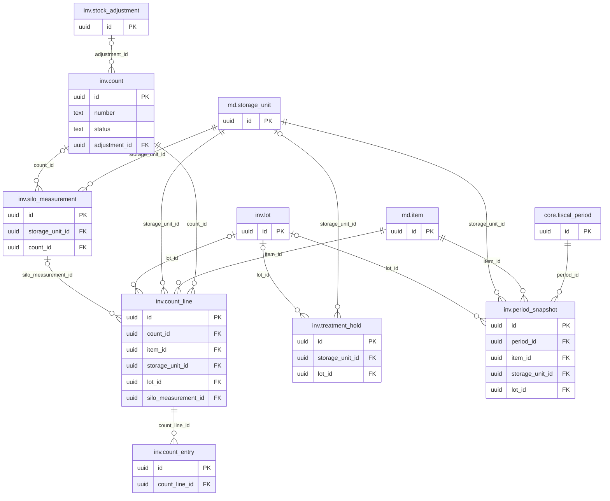

#### inv.count

Cycle or full count in FREEZE or CUT_OFF mode (FR-INV-009).

*Mutable, never deleted · written by P11.01, P11.02, P11.05 · volume M (10 k – 1 M)*

| Column | Type | Null | Default | Key / reference | Notes |
|---|---|---|---|---|---|
| `id` | uuid | no |  | PK |  |
| `company_id` | uuid | no |  | → `core.company` |  |
| `site_id` | uuid | no |  | → `core.site` |  |
| `number` | text | yes |  |  | CNT-{FY}-{SEQ:5} |
| `status` | text | no | 'PLANNED' |  | one of `PLANNED`, `IN_PROGRESS`, `COUNTED`, `RECOUNT`, `APPROVED`, `POSTED`, `CANCELLED` |
| `count_mode` | text | no |  |  | one of `FREEZE`, `CUT_OFF` |
| `blind` | boolean | no | true |  |  |
| `cut_off_at` | timestamptz | yes |  |  |  |
| `cut_off_seq` | bigint | yes |  |  | ledger position of the snapshot |
| `planned_by` | uuid | no |  | → `core.user` |  |
| `approved_by` | uuid | yes |  | → `core.user` |  |
| `approval_chain_id` | uuid | yes |  | → `core.approval_chain` |  |
| `adjustment_id` | uuid | yes |  | → `inv.stock_adjustment` |  |
| *standard audit columns:* `created_at`, `created_by`, `updated_at`, `updated_by`, `version` (§2.5) | | | | | |

**Constraints and notes:**
- Unique: (company_id, number).

#### inv.count_line

One bucket (or silo) to count, with its snapshot quantity across all statuses.

*Mutable · written by P11.02, P11.04 · volume L (1 – 10 M)*

| Column | Type | Null | Default | Key / reference | Notes |
|---|---|---|---|---|---|
| `id` | uuid | no |  | PK |  |
| `count_id` | uuid | no |  | → `inv.count` |  |
| `item_id` | uuid | no |  | → `md.item` |  |
| `storage_unit_id` | uuid | no |  | → `md.storage_unit` |  |
| `lot_id` | uuid | yes |  | → `inv.lot` |  |
| `snapshot_qty` | core.qty | no |  |  | hidden from blind counters |
| `counted_qty` | core.qty | yes |  |  | the accepted count |
| `variance_qty` | core.qty | yes |  |  |  |
| `variance_value` | core.amount | yes |  |  |  |
| `recount_required` | boolean | no | false |  |  |
| `silo_measurement_id` | uuid | yes |  | → `inv.silo_measurement` |  |
| `version` | int | no | 1 |  |  |

**Constraints and notes:**
- Unique: (count_id, item_id, storage_unit_id, lot_id) -- NULLS NOT DISTINCT.

#### inv.count_entry

Each count and recount by user (count 1, 2, 3).

*Insert-only · written by P11.03, P11.04 · volume L (1 – 10 M)*

| Column | Type | Null | Default | Key / reference | Notes |
|---|---|---|---|---|---|
| `id` | uuid | no |  | PK |  |
| `count_line_id` | uuid | no |  | → `inv.count_line` |  |
| `attempt` | smallint | no |  |  |  |
| `counted_qty` | core.qty | no |  |  |  |
| `counted_by` | uuid | no |  | → `core.user` |  |
| `counted_at` | timestamptz | no | now() |  |  |

**Constraints and notes:**
- Unique: (count_line_id, attempt).

#### inv.silo_measurement

Dip or level reading converted to mass through geometry and bulk density (FR-INV-020).

*Mutable · written by P11.03 · volume M (10 k – 1 M)*

| Column | Type | Null | Default | Key / reference | Notes |
|---|---|---|---|---|---|
| `id` | uuid | no |  | PK |  |
| `storage_unit_id` | uuid | no |  | → `md.storage_unit` |  |
| `measured_at` | timestamptz | no |  |  |  |
| `method` | text | no | 'DIP' |  | one of `DIP`, `SENSOR` |
| `level_value` | numeric(12,4) | no |  |  |  |
| `level_unit` | text | no |  |  | one of `M`, `CM`, `PERCENT` |
| `volume_m3` | core.qty | no |  |  |  |
| `bulk_density` | core.factor | no |  |  | kg/m³, from the latest hectolitre weight or the unit default |
| `computed_qty` | core.qty | no |  |  |  |
| `book_qty` | core.qty | no |  |  |  |
| `variance_qty` | core.qty | no |  |  |  |
| `count_id` | uuid | yes |  | → `inv.count` |  |
| `measured_by` | uuid | no |  | → `core.user` |  |
| *standard audit columns:* `created_at`, `created_by`, `updated_at`, `updated_by`, `version` (§2.5) | | | | | |

#### inv.treatment_hold

Fumigation or treatment hold with a release-not-before date (FR-INV-021).

*Mutable, never deleted · written by P10.07 · volume S (< 10 k rows)*

| Column | Type | Null | Default | Key / reference | Notes |
|---|---|---|---|---|---|
| `id` | uuid | no |  | PK |  |
| `scope_type` | text | no |  |  | one of `UNIT`, `LOT` |
| `storage_unit_id` | uuid | yes |  | → `md.storage_unit` |  |
| `lot_id` | uuid | yes |  | → `inv.lot` |  |
| `reason_code_id` | uuid | no |  | → `md.reason_code` |  |
| `chemical` | text | no |  |  |  |
| `dose` | text | no |  |  |  |
| `operator_name` | text | no |  |  |  |
| `applied_at` | timestamptz | no |  |  |  |
| `release_not_before` | timestamptz | no |  |  |  |
| `released_at` | timestamptz | yes |  |  |  |
| `released_by` | uuid | yes |  | → `core.user` |  |
| *standard audit columns:* `created_at`, `created_by`, `updated_at`, `updated_by`, `version` (§2.5) | | | | | |

**Constraints and notes:**
- Check: (scope_type = 'UNIT' and storage_unit_id is present) or (scope_type = 'LOT' and lot_id is present).
- Check: released_at is null or released_at >= release_not_before.

#### inv.period_snapshot

Quantity and value per bucket at inventory close; as-of reports read snapshot + delta (FR-INV-012).

*Insert-only · written by P17.05 · volume L (1 – 10 M)*

| Column | Type | Null | Default | Key / reference | Notes |
|---|---|---|---|---|---|
| `id` | uuid | no |  | PK |  |
| `period_id` | uuid | no |  | → `core.fiscal_period` |  |
| `company_id` | uuid | no |  | → `core.company` |  |
| `item_id` | uuid | no |  | → `md.item` |  |
| `storage_unit_id` | uuid | no |  | → `md.storage_unit` |  |
| `lot_id` | uuid | yes |  | → `inv.lot` |  |
| `stock_status` | text | no |  |  | one of `QUARANTINE`, `AVAILABLE`, `BLOCKED`, `DAMAGED`, `REJECTED` |
| `qty` | core.qty | no |  |  |  |
| `value` | core.amount | no |  |  |  |
| `last_seq` | bigint | no |  |  |  |

**Constraints and notes:**
- Unique: (period_id, item_id, storage_unit_id, lot_id, stock_status) -- NULLS NOT DISTINCT.

---

## 7. `qc`: Lab and quality

**Owns:** Test methods and parameters, specifications, QC policies and sampling, grading, scoring and price rules, inspection lots, samples, results and invalidations, usage decisions and concessions. **Dependency tier:** 3. **Tables:** 22.

### 7.1 Methods, parameters, specifications and policies

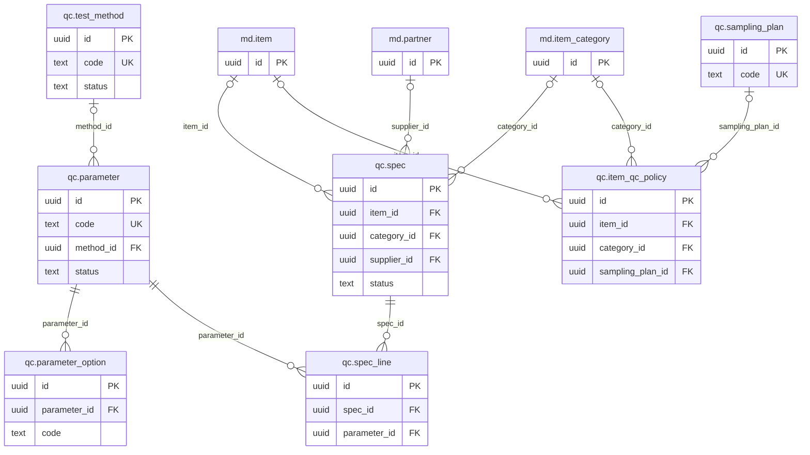

#### qc.test_method

Test method library (FR-QC-001).

*Mutable, never deleted · written by P19.04 · volume S (< 10 k rows)*

| Column | Type | Null | Default | Key / reference | Notes |
|---|---|---|---|---|---|
| `id` | uuid | no |  | PK |  |
| `code` | text | no |  | UNIQUE |  |
| `name` | text | no |  |  |  |
| `standard_ref` | text | yes |  |  | e.g. ISO 712 |
| `description` | text | yes |  |  |  |
| `document_file_id` | uuid | yes |  | → `core.attachment` |  |
| `status` | text | no | 'ACTIVE' |  | one of `ACTIVE`, `INACTIVE` |
| *standard audit columns:* `created_at`, `created_by`, `updated_at`, `updated_by`, `version` (§2.5) | | | | | |

#### qc.parameter

Parameter library: quantitative, qualitative, boolean, text (FR-QC-001).

*Mutable, never deleted · written by P19.04 · volume S (< 10 k rows)*

| Column | Type | Null | Default | Key / reference | Notes |
|---|---|---|---|---|---|
| `id` | uuid | no |  | PK |  |
| `code` | text | no |  | UNIQUE | MOISTURE, HLW, IMPURITY … |
| `name` | text | no |  |  |  |
| `value_type` | text | no |  |  | one of `QUANTITATIVE`, `QUALITATIVE`, `BOOLEAN`, `TEXT` |
| `uom_id` | uuid | yes |  | → `md.uom` |  |
| `decimals` | smallint | no | 2 |  |  |
| `method_id` | uuid | yes |  | → `qc.test_method` |  |
| `status` | text | no | 'ACTIVE' |  | one of `ACTIVE`, `INACTIVE` |
| *standard audit columns:* `created_at`, `created_by`, `updated_at`, `updated_by`, `version` (§2.5) | | | | | |

#### qc.parameter_option

Options of a qualitative parameter (e.g. odour Normal / Abnormal).

*Mutable · written by P19.04 · volume S (< 10 k rows)*

| Column | Type | Null | Default | Key / reference | Notes |
|---|---|---|---|---|---|
| `id` | uuid | no |  | PK |  |
| `parameter_id` | uuid | no |  | → `qc.parameter` |  |
| `code` | text | no |  |  |  |
| `label` | text | no |  |  |  |
| `sort` | smallint | no | 1 |  |  |

**Constraints and notes:**
- Unique: (parameter_id, code).

#### qc.spec

Versioned, approved specification per item or category, optionally per supplier and site, per purpose (FR-QC-002, FR-QC-003).

*Mutable, never deleted · written by P19.08 · volume S (< 10 k rows)*

| Column | Type | Null | Default | Key / reference | Notes |
|---|---|---|---|---|---|
| `id` | uuid | no |  | PK |  |
| `item_id` | uuid | yes |  | → `md.item` |  |
| `category_id` | uuid | yes |  | → `md.item_category` |  |
| `supplier_id` | uuid | yes |  | → `md.partner` |  |
| `site_id` | uuid | yes |  | → `core.site` |  |
| `purpose` | text | no |  |  | one of `INCOMING`, `RETEST`, `IN_PROCESS`, `FINISHED` |
| `scope_key` | text | no |  |  | generated; generated from item or category + supplier + site + purpose |
| `version` | int | no |  |  |  |
| `status` | text | no | 'DRAFT' |  | one of `DRAFT`, `SUBMITTED`, `APPROVED`, `REJECTED`, `RETIRED` |
| `effective_from` | date | no |  |  |  |
| `effective_to` | date | yes |  |  |  |
| `approval_chain_id` | uuid | yes |  | → `core.approval_chain` |  |
| *standard audit columns:* `created_at`, `created_by`, `updated_at`, `updated_by`, `version` (§2.5) | | | | | |

**Constraints and notes:**
- Unique: (scope_key, version).
- Check: exactly one of item_id, category_id is present.
- Exclusion: no two APPROVED specs with the same scope_key overlap in effective dates (btree_gist).

#### qc.spec_line

One parameter's limits and failure action (FR-QC-002).

*Mutable · written by P19.08 · volume M (10 k – 1 M)*

| Column | Type | Null | Default | Key / reference | Notes |
|---|---|---|---|---|---|
| `id` | uuid | no |  | PK |  |
| `spec_id` | uuid | no |  | → `qc.spec` |  |
| `parameter_id` | uuid | no |  | → `qc.parameter` |  |
| `mandatory` | boolean | no | true |  | false = optional "additional parameter" (FR-QC-024) |
| `min_value` | numeric(20,6) | yes |  |  |  |
| `max_value` | numeric(20,6) | yes |  |  |  |
| `min_inclusive` | boolean | no | true |  |  |
| `max_inclusive` | boolean | no | true |  |  |
| `target_value` | numeric(20,6) | yes |  |  |  |
| `accepted_option_codes` | text[] | yes |  |  |  |
| `action_on_fail` | text | no | 'REJECT' |  | one of `REJECT`, `DEDUCT`, `CONCESSION_ALLOWED`, `INFO_ONLY` |
| `max_retests` | smallint | no | 1 |  |  |
| `final_value_rule` | text | no | 'RETEST_REPLACES_IF_INVALIDATED' |  | one of `ORIGINAL_STANDS`, `RETEST_REPLACES_IF_INVALIDATED`, `AVERAGE_OF_VALID` |

**Constraints and notes:**
- Unique: (spec_id, parameter_id).

#### qc.sampling_plan

Fixed-count or percentage sampling (FR-QC-005).

*Mutable, never deleted · written by P19.08 · volume S (< 10 k rows)*

| Column | Type | Null | Default | Key / reference | Notes |
|---|---|---|---|---|---|
| `id` | uuid | no |  | PK |  |
| `code` | text | no |  | UNIQUE |  |
| `method` | text | no |  |  | one of `FIXED`, `PERCENT` |
| `value` | numeric(9,4) | no |  |  |  |
| `min_samples` | smallint | no | 1 |  |  |
| `composite` | boolean | no | true |  |  |
| *standard audit columns:* `created_at`, `created_by`, `updated_at`, `updated_by`, `version` (§2.5) | | | | | |

#### qc.item_qc_policy

QC policy per item or category, optionally per site: inspection point, release mode, sampling, CoA, retention (FR-QC-004).

*Mutable · written by P19.08 · volume S (< 10 k rows)*

| Column | Type | Null | Default | Key / reference | Notes |
|---|---|---|---|---|---|
| `id` | uuid | no |  | PK |  |
| `item_id` | uuid | yes |  | → `md.item` |  |
| `category_id` | uuid | yes |  | → `md.item_category` |  |
| `site_id` | uuid | yes |  | → `core.site` |  |
| `inspection_point` | text | no |  |  | one of `BEFORE_UNLOADING`, `IN_QUARANTINE`, `NONE` |
| `release_mode` | text | no | 'IMMEDIATE' |  | one of `IMMEDIATE`, `HOLD_PENDING_LONG_TESTS` |
| `sampling_plan_id` | uuid | yes |  | → `qc.sampling_plan` |  |
| `auto_release_on_pass` | boolean | no | false |  |  |
| `retention_required` | boolean | no | false |  |  |
| `retention_days` | int | yes |  |  |  |
| `coa_required` | boolean | no | false |  |  |
| `reweigh_on_reject` | boolean | no | true |  |  |
| *standard audit columns:* `created_at`, `created_by`, `updated_at`, `updated_by`, `version` (§2.5) | | | | | |

**Constraints and notes:**
- Check: exactly one of item_id, category_id is present.

### 7.2 Grading, scoring and price rules

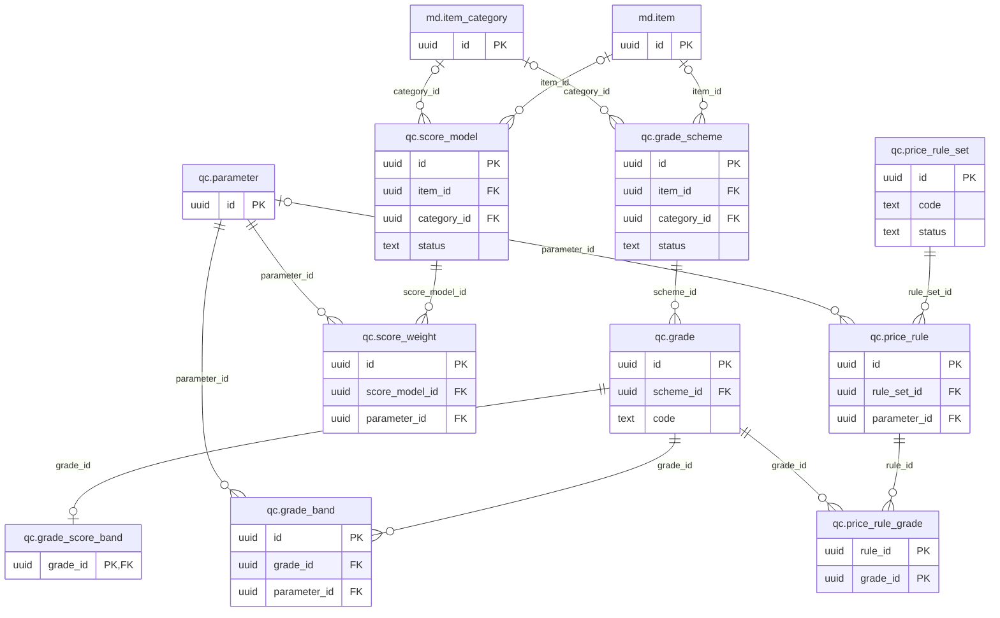

#### qc.grade_scheme

Versioned grading scheme: worst parameter or score bands (FR-QC-022).

*Mutable, never deleted · written by P19.08 · volume S (< 10 k rows)*

| Column | Type | Null | Default | Key / reference | Notes |
|---|---|---|---|---|---|
| `id` | uuid | no |  | PK |  |
| `item_id` | uuid | yes |  | → `md.item` |  |
| `category_id` | uuid | yes |  | → `md.item_category` |  |
| `version` | int | no |  |  |  |
| `method` | text | no |  |  | one of `WORST_PARAMETER`, `SCORE_BANDS` |
| `status` | text | no | 'DRAFT' |  | one of `DRAFT`, `SUBMITTED`, `APPROVED`, `REJECTED`, `RETIRED` |
| `effective_from` | date | no |  |  |  |
| `effective_to` | date | yes |  |  |  |
| *standard audit columns:* `created_at`, `created_by`, `updated_at`, `updated_by`, `version` (§2.5) | | | | | |

#### qc.grade

Ordered grades of a scheme (Grade 1, 2, 3, Reject).

*Mutable · written by P19.08 · volume S (< 10 k rows)*

| Column | Type | Null | Default | Key / reference | Notes |
|---|---|---|---|---|---|
| `id` | uuid | no |  | PK |  |
| `scheme_id` | uuid | no |  | → `qc.grade_scheme` |  |
| `seq` | smallint | no |  |  |  |
| `code` | text | no |  |  |  |
| `label` | text | no |  |  |  |
| `is_reject` | boolean | no | false |  |  |

**Constraints and notes:**
- Unique: (scheme_id, seq).
- Unique: (scheme_id, code).

#### qc.grade_band

Parameter band that a grade requires (worst-parameter method).

*Mutable · written by P19.08 · volume S (< 10 k rows)*

| Column | Type | Null | Default | Key / reference | Notes |
|---|---|---|---|---|---|
| `id` | uuid | no |  | PK |  |
| `grade_id` | uuid | no |  | → `qc.grade` |  |
| `parameter_id` | uuid | no |  | → `qc.parameter` |  |
| `min_value` | numeric(20,6) | yes |  |  |  |
| `max_value` | numeric(20,6) | yes |  |  |  |
| `accepted_option_codes` | text[] | yes |  |  |  |

**Constraints and notes:**
- Unique: (grade_id, parameter_id).

#### qc.grade_score_band

Minimum score for a grade (score-band method).

*Mutable · written by P19.08 · volume S (< 10 k rows)*

| Column | Type | Null | Default | Key / reference | Notes |
|---|---|---|---|---|---|
| `grade_id` | uuid | no |  | PK → `qc.grade` |  |
| `min_score` | numeric(5,1) | no |  |  |  |

#### qc.score_model

Versioned weighted quality-score model (FR-QC-023).

*Mutable, never deleted · written by P19.08 · volume S (< 10 k rows)*

| Column | Type | Null | Default | Key / reference | Notes |
|---|---|---|---|---|---|
| `id` | uuid | no |  | PK |  |
| `item_id` | uuid | yes |  | → `md.item` |  |
| `category_id` | uuid | yes |  | → `md.item_category` |  |
| `version` | int | no |  |  |  |
| `status` | text | no | 'DRAFT' |  | one of `DRAFT`, `SUBMITTED`, `APPROVED`, `REJECTED`, `RETIRED` |
| *standard audit columns:* `created_at`, `created_by`, `updated_at`, `updated_by`, `version` (§2.5) | | | | | |

#### qc.score_weight

Weight, target, best value and option scores per parameter.

*Mutable · written by P19.08 · volume S (< 10 k rows)*

| Column | Type | Null | Default | Key / reference | Notes |
|---|---|---|---|---|---|
| `id` | uuid | no |  | PK |  |
| `score_model_id` | uuid | no |  | → `qc.score_model` |  |
| `parameter_id` | uuid | no |  | → `qc.parameter` |  |
| `weight` | numeric(9,4) | no |  |  |  |
| `target_value` | numeric(20,6) | yes |  |  |  |
| `best_value` | numeric(20,6) | yes |  |  |  |
| `option_scores` | jsonb | yes |  |  | qualitative: option → sub-score |

**Constraints and notes:**
- Unique: (score_model_id, parameter_id).

#### qc.price_rule_set

Versioned quality price and weight rules, attached to PO lines or the approved supplier list (FR-QC-013).

*Mutable, never deleted · written by P19.08 · volume S (< 10 k rows)*

| Column | Type | Null | Default | Key / reference | Notes |
|---|---|---|---|---|---|
| `id` | uuid | no |  | PK |  |
| `code` | text | no |  |  |  |
| `version` | int | no |  |  |  |
| `status` | text | no | 'DRAFT' |  | one of `DRAFT`, `SUBMITTED`, `APPROVED`, `REJECTED`, `RETIRED` |
| `no_stacking` | boolean | no | false |  |  |
| `overall_qty_cap_pct` | core.pct | yes |  |  |  |
| `overall_price_cap_pct` | core.pct | yes |  |  |  |
| *standard audit columns:* `created_at`, `created_by`, `updated_at`, `updated_by`, `version` (§2.5) | | | | | |

**Constraints and notes:**
- Unique: (code, version).

#### qc.price_rule

One rule: threshold, step, rate, cap, effect (FR-QC-013).

*Mutable · written by P19.08 · volume S (< 10 k rows)*

| Column | Type | Null | Default | Key / reference | Notes |
|---|---|---|---|---|---|
| `id` | uuid | no |  | PK |  |
| `rule_set_id` | uuid | no |  | → `qc.price_rule_set` |  |
| `parameter_id` | uuid | yes |  | → `qc.parameter` | NULL for grade-based rules |
| `basis` | text | no |  |  | one of `THRESHOLD_STEP`, `TIERED`, `GRADE` |
| `threshold` | numeric(20,6) | yes |  |  |  |
| `step` | numeric(20,6) | yes |  |  |  |
| `rate` | numeric(20,6) | yes |  |  |  |
| `effect` | text | no |  |  | one of `PRICE_PCT`, `AMOUNT_PER_BASE_UNIT`, `PAYABLE_QTY_PCT` |
| `cap` | numeric(20,6) | yes |  |  |  |
| `reject_above` | numeric(20,6) | yes |  |  |  |
| `allow_premium` | boolean | no | false |  |  |

#### qc.price_rule_grade

Price differential per grade (e.g. Grade 2 = −3%).

*Mutable · written by P19.08 · volume S (< 10 k rows)*

| Column | Type | Null | Default | Key / reference | Notes |
|---|---|---|---|---|---|
| `rule_id` | uuid | no |  | PK → `qc.price_rule` |  |
| `grade_id` | uuid | no |  | PK → `qc.grade` |  |
| `price_pct` | core.pct | no |  |  |  |

**Constraints and notes:**
- Primary key: (rule_id, grade_id).

### 7.3 Inspection lots, samples, results, decisions

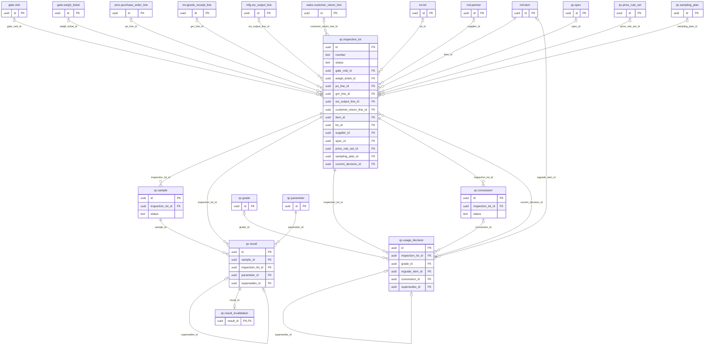

#### qc.inspection_lot

The QC work item for a delivery, receipt, output lot, return or stock lot, with the spec frozen onto it (FR-QC-006, FR-QC-024, FR-QC-025).

*Mutable, never deleted · written by P05.05, P06.04, P07.03, P12.07, P15.03, P05.10 · volume L (1 – 10 M)*

| Column | Type | Null | Default | Key / reference | Notes |
|---|---|---|---|---|---|
| `id` | uuid | no |  | PK |  |
| `company_id` | uuid | no |  | → `core.company` |  |
| `site_id` | uuid | no |  | → `core.site` |  |
| `number` | text | yes |  |  | INS-{FY}-{SEQ:6} |
| `status` | text | no | 'CREATED' |  | one of `CREATED`, `IN_TESTING`, `DECISION_PENDING`, `DECIDED`, `CLOSED`, `CANCELLED` |
| `inspection_type` | text | no |  |  | one of `INCOMING`, `RETEST`, `IN_PROCESS`, `FINISHED`, `CUSTOMER_RETURN` |
| `origin` | text | no |  |  | one of `GATE_VISIT`, `PO_TRUCK`, `GRN`, `WO_OUTPUT`, `STOCK`, `CUSTOMER_RETURN` |
| `gate_visit_id` | uuid | yes |  | → `gate.visit` |  |
| `weigh_ticket_id` | uuid | yes |  | → `gate.weigh_ticket` | inline ticket when the gate module is off |
| `po_line_id` | uuid | yes |  | → `proc.purchase_order_line` |  |
| `grn_line_id` | uuid | yes |  | → `inv.goods_receipt_line` |  |
| `wo_output_line_id` | uuid | yes |  | → `mfg.wo_output_line` |  |
| `customer_return_line_id` | uuid | yes |  | → `sales.customer_return_line` |  |
| `item_id` | uuid | no |  | → `md.item` |  |
| `lot_id` | uuid | yes |  | → `inv.lot` |  |
| `supplier_id` | uuid | yes |  | → `md.partner` |  |
| `supplier_doc_no` | text | yes |  |  |  |
| `truck_plate` | text | yes |  |  |  |
| `gross_kg` | core.qty | yes |  |  |  |
| `tare_kg` | core.qty | yes |  |  |  |
| `net_kg` | core.qty | yes |  |  |  |
| `net_is_provisional` | boolean | no | false |  |  |
| `bag_count` | int | yes |  |  |  |
| `qty_base` | core.qty | yes |  |  |  |
| `qty_secondary` | core.qty | yes |  |  |  |
| `secondary_uom_id` | uuid | yes |  | → `md.uom` |  |
| `spec_id` | uuid | yes |  | → `qc.spec` |  |
| `spec_snapshot` | jsonb | no |  |  | spec, grade scheme and score model in force at creation (FR-QC-003) |
| `price_rule_set_id` | uuid | yes |  | → `qc.price_rule_set` |  |
| `sampling_plan_id` | uuid | yes |  | → `qc.sampling_plan` |  |
| `oos_open` | boolean | no | false |  |  |
| `coa_file_id` | uuid | yes |  | → `core.attachment` |  |
| `current_decision_id` | uuid | yes |  | → `qc.usage_decision` |  |
| *standard audit columns:* `created_at`, `created_by`, `updated_at`, `updated_by`, `version` (§2.5) | | | | | |

**Constraints and notes:**
- Unique: (company_id, number).
- Unique: (gate_visit_id, item_id) WHERE status <> 'CANCELLED'.
- Unique: (grn_line_id) WHERE status <> 'CANCELLED'.
- Unique: (weigh_ticket_id, item_id) WHERE status <> 'CANCELLED'.
- Unique: (wo_output_line_id) WHERE status <> 'CANCELLED'.

#### qc.sample

Samples with labels, type, storage and retention (FR-QC-007, FR-QC-016).

*Mutable · written by P05.07, P06.06, P07.04, P12.09 · volume L (1 – 10 M)*

| Column | Type | Null | Default | Key / reference | Notes |
|---|---|---|---|---|---|
| `id` | uuid | no |  | PK |  |
| `inspection_lot_id` | uuid | no |  | → `qc.inspection_lot` |  |
| `sample_no` | text | no |  | UNIQUE | S-{FY}-{SEQ:7} |
| `sample_type` | text | no |  |  | one of `PRIMARY`, `RETEST`, `RETENTION`, `REFERENCE` |
| `status` | text | no | 'DRAWN' |  | one of `DRAWN`, `IN_TEST`, `TESTED`, `RETAINED`, `DISPOSED`, `INVALID` |
| `drawn_by` | uuid | no |  | → `core.user` |  |
| `drawn_at` | timestamptz | no | now() |  |  |
| `quantity` | text | yes |  |  |  |
| `container` | text | yes |  |  |  |
| `storage_location` | text | yes |  |  |  |
| `retain_until` | date | yes |  |  |  |
| `invalid_reason` | text | yes |  |  |  |
| `disposed_at` | timestamptz | yes |  |  |  |
| `disposed_by` | uuid | yes |  | → `core.user` |  |
| *standard audit columns:* `created_at`, `created_by`, `updated_at`, `updated_by`, `version` (§2.5) | | | | | |

**Constraints and notes:**
- Index: (retain_until) WHERE status = 'RETAINED'.

#### qc.result

A result value, never overwritten (FR-QC-008, BR-QC-05).

*Insert-only · written by P05.08, P06.06, P07.04, P12.09 · volume XL (10 – 100 M)*

| Column | Type | Null | Default | Key / reference | Notes |
|---|---|---|---|---|---|
| `id` | uuid | no |  | PK |  |
| `sample_id` | uuid | no |  | → `qc.sample` |  |
| `inspection_lot_id` | uuid | no |  | → `qc.inspection_lot` |  |
| `parameter_id` | uuid | no |  | → `qc.parameter` |  |
| `value_num` | numeric(20,6) | yes |  |  |  |
| `value_option` | text | yes |  |  |  |
| `value_bool` | boolean | yes |  |  |  |
| `value_text` | text | yes |  |  |  |
| `passed` | boolean | yes |  |  | evaluation against the frozen spec at entry |
| `supersedes_id` | uuid | yes |  | UNIQUE → `qc.result` | the retest or correction it replaces |
| `entered_by` | uuid | no |  | → `core.user` |  |
| `entered_at` | timestamptz | no | now() |  |  |

**Constraints and notes:**
- Check: exactly one value column is present, matching the parameter's value type.
- Index: (inspection_lot_id, parameter_id).

#### qc.result_invalidation

Invalidation of a result with its reason; a result is valid when it has none (TDD §11).

*Insert-only · written by P05.08, P05.18 · volume M (10 k – 1 M)*

| Column | Type | Null | Default | Key / reference | Notes |
|---|---|---|---|---|---|
| `result_id` | uuid | no |  | PK → `qc.result` |  |
| `reason` | text | no |  |  |  |
| `assignable_cause` | text | yes |  |  |  |
| `invalidated_by` | uuid | no |  | → `core.user` |  |
| `invalidated_at` | timestamptz | no | now() |  |  |

#### qc.usage_decision

The decision on an inspection lot, with grade, score and deduction evidence; superseded, never edited (FR-QC-012, FR-QC-014, FR-QC-015).

*Insert-only · written by P05.10, P06.07, P07.05, P12.10, P15.04, P05.18 · volume L (1 – 10 M)*

| Column | Type | Null | Default | Key / reference | Notes |
|---|---|---|---|---|---|
| `id` | uuid | no |  | PK |  |
| `inspection_lot_id` | uuid | no |  | → `qc.inspection_lot` |  |
| `decision` | text | no |  |  | one of `ACCEPT`, `ACCEPT_WITH_DEDUCTION`, `ACCEPT_UNDER_CONCESSION`, `PARTIAL_ACCEPT`, `REJECT`, `RELEASE`, `REGRADE`, `RESTOCK`, `SCRAP` |
| `suggested_decision` | text | yes |  |  |  |
| `is_override` | boolean | no | false |  |  |
| `accepted_qty_base` | core.qty | yes |  |  |  |
| `rejected_qty_base` | core.qty | yes |  |  |  |
| `reason_code_id` | uuid | yes |  | → `md.reason_code` |  |
| `grade_id` | uuid | yes |  | → `qc.grade` |  |
| `regrade_item_id` | uuid | yes |  | → `md.item` |  |
| `score` | numeric(5,1) | yes |  |  |  |
| `score_breakdown` | jsonb | yes |  |  |  |
| `payable_qty_base` | core.qty | yes |  |  |  |
| `adjusted_price` | core.price | yes |  |  |  |
| `deduction_breakdown` | jsonb | yes |  |  |  |
| `rule_set_version` | int | yes |  |  |  |
| `concession_id` | uuid | yes |  | → `qc.concession` |  |
| `supersedes_id` | uuid | yes |  | UNIQUE → `qc.usage_decision` |  |
| `supersede_reason` | text | yes |  |  |  |
| `supersede_approval_chain_id` | uuid | yes |  | → `core.approval_chain` |  |
| `decided_by` | uuid | no |  | → `core.user` |  |
| `decided_at` | timestamptz | no | now() |  |  |

**Constraints and notes:**
- Index: (inspection_lot_id).
- The live decision is `qc.inspection_lot.current_decision_id`. A superseding decision inserts a new row pointing at the old one.

#### qc.concession

Request to accept despite a failure, routed through the approval matrix; the analyst who entered the results cannot approve (FR-QC-011, SOD-08).

*Mutable, never deleted · written by P05.10 · volume M (10 k – 1 M)*

| Column | Type | Null | Default | Key / reference | Notes |
|---|---|---|---|---|---|
| `id` | uuid | no |  | PK |  |
| `inspection_lot_id` | uuid | no |  | → `qc.inspection_lot` |  |
| `status` | text | no | 'DRAFT' |  | one of `DRAFT`, `SUBMITTED`, `APPROVED`, `REJECTED` |
| `proposed_decision` | text | no |  |  | one of `ACCEPT_UNDER_CONCESSION`, `ACCEPT_WITH_DEDUCTION` |
| `proposed_deduction` | jsonb | yes |  |  |  |
| `justification` | text | no |  |  |  |
| `approval_chain_id` | uuid | yes |  | → `core.approval_chain` |  |
| `submitted_at` | timestamptz | yes |  |  |  |
| `submitted_by` | uuid | yes |  | → `core.user` |  |
| *standard audit columns:* `created_at`, `created_by`, `updated_at`, `updated_by`, `version` (§2.5) | | | | | |

---

## 8. `proc`: Procurement

**Owns:** Sourcing policy and approved supplier list, purchase requisitions, purchase orders with schedules, quotations and revisions. **Dependency tier:** 3. **Tables:** 9.

### 8.1 Sourcing policy and approved suppliers

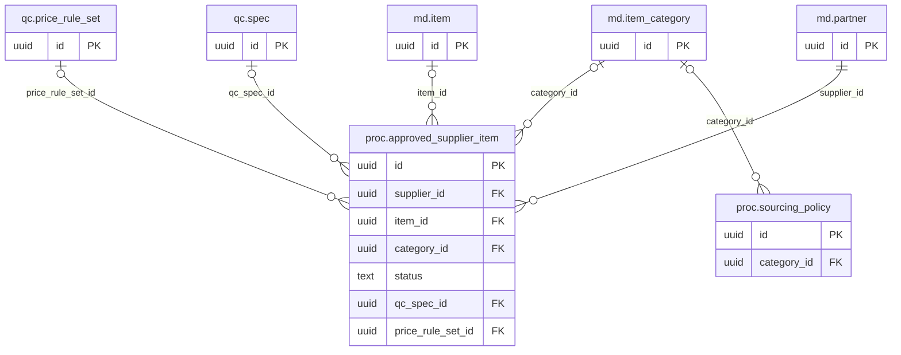

#### proc.sourcing_policy

Minimum quotations and sole-source rule per category and amount band (FR-PRC-008).

*Mutable · written by P19.05 · volume S (< 10 k rows)*

| Column | Type | Null | Default | Key / reference | Notes |
|---|---|---|---|---|---|
| `id` | uuid | no |  | PK |  |
| `company_id` | uuid | no |  | → `core.company` |  |
| `category_id` | uuid | yes |  | → `md.item_category` |  |
| `min_amount` | core.amount | yes |  |  |  |
| `max_amount` | core.amount | yes |  |  |  |
| `min_quotes` | smallint | no | 1 |  |  |
| `sole_source_allowed` | boolean | no | true |  |  |
| `asl_enforcement` | text | no | 'NONE' |  | one of `NONE`, `WARN`, `BLOCK`; FR-PRC-006 |
| *standard audit columns:* `created_at`, `created_by`, `updated_at`, `updated_by`, `version` (§2.5) | | | | | |

#### proc.approved_supplier_item

Approved supplier list per item or category, optionally per site, with QC spec and price rules (FR-PRC-006).

*Mutable · written by P01.06 · volume M (10 k – 1 M)*

| Column | Type | Null | Default | Key / reference | Notes |
|---|---|---|---|---|---|
| `id` | uuid | no |  | PK |  |
| `supplier_id` | uuid | no |  | → `md.partner` |  |
| `item_id` | uuid | yes |  | → `md.item` |  |
| `category_id` | uuid | yes |  | → `md.item_category` |  |
| `site_id` | uuid | yes |  | → `core.site` |  |
| `status` | text | no | 'ACTIVE' |  | one of `ACTIVE`, `SUSPENDED`, `EXPIRED` |
| `valid_from` | date | no |  |  |  |
| `valid_to` | date | yes |  |  |  |
| `qc_spec_id` | uuid | yes |  | → `qc.spec` |  |
| `price_rule_set_id` | uuid | yes |  | → `qc.price_rule_set` |  |
| *standard audit columns:* `created_at`, `created_by`, `updated_at`, `updated_by`, `version` (§2.5) | | | | | |

**Constraints and notes:**
- Check: exactly one of item_id, category_id is present.

### 8.2 Purchase requisitions

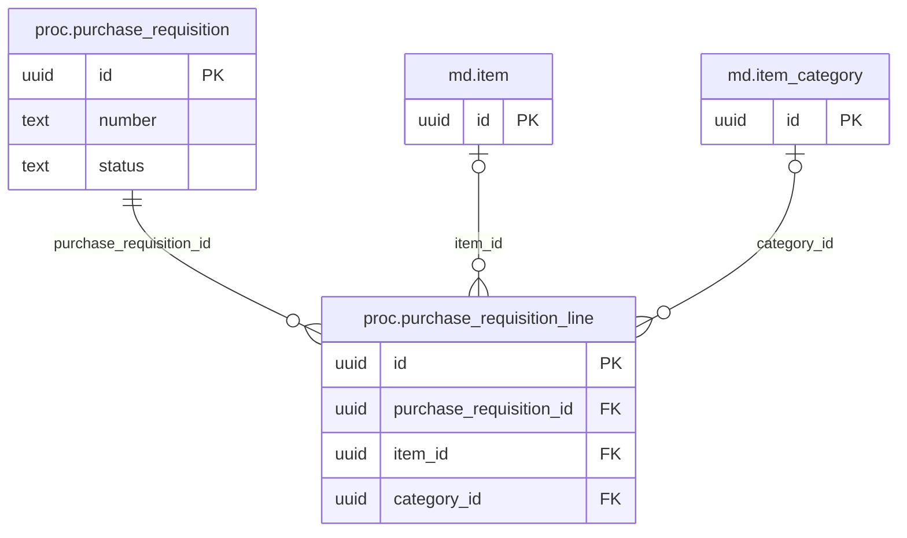

#### proc.purchase_requisition

PR header: priority, required date, department and requester (FR-PRC-007).

*Mutable · written by P03.01, P03.03, P03.04, P03.06 · volume M (10 k – 1 M)*

| Column | Type | Null | Default | Key / reference | Notes |
|---|---|---|---|---|---|
| `id` | uuid | no |  | PK |  |
| *commitment-document header:* company, site, number, document date, currency and rate, approval, submission, cancellation and audit columns (§2.5) | | | | | |
| `status` | text | no | 'DRAFT' |  | one of `DRAFT`, `SUBMITTED`, `APPROVED`, `CLOSED`, `REJECTED`, `CANCELLED` |
| `order_status` | text | no | 'NONE' |  | one of `NONE`, `PARTIAL`, `FULL` |
| `required_date` | date | no |  |  |  |
| `priority` | text | no | 'MEDIUM' |  | one of `LOW`, `MEDIUM`, `HIGH`, `URGENT` |
| `department_id` | uuid | no |  | → `core.department` |  |
| `requester_id` | uuid | no |  | → `core.user` |  |
| `requester_employee_id` | text | yes |  |  | snapshot |
| `purpose` | text | yes |  |  |  |
| `remarks` | text | yes |  |  |  |
| `close_reason` | text | yes |  |  |  |

**Constraints and notes:**
- Unique: (company_id, number): the document number is unique per company.
- Check: required_date >= document_date (FR-PLT-055).
- Displayed status PARTIALLY_ORDERED = status APPROVED and order_status PARTIAL.
- Displayed status ORDERED = status APPROVED and order_status FULL.

#### proc.purchase_requisition_line

PR line with live available stock and computed quantity to purchase (FR-PRC-007).

*Mutable · written by P03.02, P03.05 · volume M (10 k – 1 M)*

| Column | Type | Null | Default | Key / reference | Notes |
|---|---|---|---|---|---|
| `id` | uuid | no |  | PK |  |
| `purchase_requisition_id` | uuid | no |  | → `proc.purchase_requisition` |  |
| `line_no` | int | no |  |  |  |
| `item_id` | uuid | yes |  | → `md.item` | NULL for a free-text non-stock line |
| `description` | text | yes |  |  |  |
| `category_id` | uuid | yes |  | → `md.item_category` |  |
| *standard quantity columns:* `qty_entered`, `uom_entered_id`, `uom_factor`, `qty_base` (§2.5) | | | | | |
| `available_qty_snapshot` | core.qty | yes |  |  | available-to-use at submission |
| `qty_to_purchase_base` | core.qty | no |  |  |  |
| `raise_reason` | text | yes |  |  | required when raised above the computed quantity |
| `qty_ordered_base` | core.qty | no | 0 |  | maintained under the line lock (R3) |
| `estimated_unit_cost` | core.price | yes |  |  |  |
| `estimated_total` | core.amount | yes |  |  |  |
| `spec_file_id` | uuid | yes |  | → `core.attachment` |  |
| `spec_url` | text | yes |  |  |  |
| `notes` | text | yes |  |  |  |
| `version` | int | no | 1 |  |  |

**Constraints and notes:**
- Unique: (purchase_requisition_id, line_no).
- Check: qty_ordered_base <= qty_to_purchase_base × (1 + PR tolerance) (BR-PRC-05).

### 8.3 Purchase orders

```mermaid
erDiagram
    proc__purchase_order["proc.purchase_order"] {
        uuid id PK
        text number
        text status
        uuid supplier_id FK
        uuid pr_id FK
        uuid payment_terms_id FK
        uuid deliver_to_warehouse_id FK
        uuid deliver_to_unit_id FK
    }
    proc__purchase_order_line["proc.purchase_order_line"] {
        uuid id PK
        uuid purchase_order_id FK
        uuid pr_line_id FK
        uuid item_id FK
        uuid tax_group_id FK
        uuid qc_spec_id FK
        uuid price_rule_set_id FK
    }
    proc__po_schedule["proc.po_schedule"] {
        uuid id PK
        uuid po_line_id FK
    }
    proc__po_quotation["proc.po_quotation"] {
        uuid id PK
        uuid purchase_order_id FK
        uuid supplier_id FK
    }
    proc__po_revision["proc.po_revision"] {
        uuid id PK
        uuid purchase_order_id FK
        text status
    }
    md__item["md.item"] {
        uuid id PK
    }
    md__partner["md.partner"] {
        uuid id PK
    }
    md__payment_terms["md.payment_terms"] {
        uuid id PK
    }
    md__storage_unit["md.storage_unit"] {
        uuid id PK
    }
    md__tax_group["md.tax_group"] {
        uuid id PK
    }
    md__warehouse["md.warehouse"] {
        uuid id PK
    }
    proc__purchase_requisition["proc.purchase_requisition"] {
        uuid id PK
    }
    proc__purchase_requisition_line["proc.purchase_requisition_line"] {
        uuid id PK
    }
    qc__price_rule_set["qc.price_rule_set"] {
        uuid id PK
    }
    qc__spec["qc.spec"] {
        uuid id PK
    }
    md__partner ||--o{ proc__purchase_order : "supplier_id"
    proc__purchase_requisition |o--o{ proc__purchase_order : "pr_id"
    md__payment_terms |o--o{ proc__purchase_order : "payment_terms_id"
    md__warehouse |o--o{ proc__purchase_order : "deliver_to_warehouse_id"
    md__storage_unit |o--o{ proc__purchase_order : "deliver_to_unit_id"
    proc__purchase_order ||--o{ proc__purchase_order_line : "purchase_order_id"
    proc__purchase_requisition_line |o--o{ proc__purchase_order_line : "pr_line_id"
    md__item |o--o{ proc__purchase_order_line : "item_id"
    md__tax_group |o--o{ proc__purchase_order_line : "tax_group_id"
    qc__spec |o--o{ proc__purchase_order_line : "qc_spec_id"
    qc__price_rule_set |o--o{ proc__purchase_order_line : "price_rule_set_id"
    proc__purchase_order_line ||--o{ proc__po_schedule : "po_line_id"
    proc__purchase_order ||--o{ proc__po_quotation : "purchase_order_id"
    md__partner ||--o{ proc__po_quotation : "supplier_id"
    proc__purchase_order ||--o{ proc__po_revision : "purchase_order_id"
```

#### proc.purchase_order

PO header: supplier, terms, delivery, currency, discount; ISSUED when sent (FR-PRC-010, FR-PRC-012).

*Mutable · written by P04.01, P04.03, P04.04, P04.06, P04.09 · volume M (10 k – 1 M)*

| Column | Type | Null | Default | Key / reference | Notes |
|---|---|---|---|---|---|
| `id` | uuid | no |  | PK |  |
| *commitment-document header:* company, site, number, document date, currency and rate, approval, submission, cancellation and audit columns (§2.5) | | | | | |
| `status` | text | no | 'DRAFT' |  | one of `DRAFT`, `SUBMITTED`, `APPROVED`, `ISSUED`, `CLOSED`, `REJECTED`, `CANCELLED` |
| `receipt_status` | text | no | 'NONE' |  | one of `NONE`, `PARTIAL`, `FULL` |
| `invoice_status` | text | no | 'NONE' |  | one of `NONE`, `PARTIAL`, `FULL` |
| `supplier_id` | uuid | no |  | → `md.partner` |  |
| `pr_id` | uuid | yes |  | → `proc.purchase_requisition` | required unless the setting allows a PO without PR |
| `payment_terms_id` | uuid | yes |  | → `md.payment_terms` |  |
| `delivery_terms` | text | yes |  |  | Incoterm |
| `purchasing_department_id` | uuid | yes |  | → `core.department` |  |
| `buyer_id` | uuid | no |  | → `core.user` |  |
| `deliver_to_warehouse_id` | uuid | yes |  | → `md.warehouse` |  |
| `deliver_to_unit_id` | uuid | yes |  | → `md.storage_unit` |  |
| `required_delivery_date` | date | yes |  |  |  |
| `header_discount` | core.amount | no | 0 |  |  |
| `sole_source_justification` | text | yes |  |  |  |
| `revision_no` | int | no | 0 |  |  |
| `issued_at` | timestamptz | yes |  |  |  |
| `issued_via` | text | yes |  |  | one of `EMAIL`, `PRINT` |
| `close_reason` | text | yes |  |  |  |
| `closed_at` | timestamptz | yes |  |  |  |

**Constraints and notes:**
- Unique: (company_id, number): the document number is unique per company.
- Check: required_delivery_date >= document_date (FR-PLT-055).
- Displayed status PARTIALLY_RECEIVED = status ISSUED and receipt_status PARTIAL.
- Displayed status RECEIVED = status ISSUED and receipt_status FULL.

#### proc.purchase_order_line

PO line with tolerances, excess policy, QC spec, price rules, and receipt counters (FR-PRC-010, FR-PRC-014, BR-PRC-01).

*Mutable · written by P04.01, P05.16, P08.04, P09.04 · volume M (10 k – 1 M)*

| Column | Type | Null | Default | Key / reference | Notes |
|---|---|---|---|---|---|
| `id` | uuid | no |  | PK |  |
| `purchase_order_id` | uuid | no |  | → `proc.purchase_order` |  |
| `line_no` | int | no |  |  |  |
| `pr_line_id` | uuid | yes |  | → `proc.purchase_requisition_line` |  |
| `item_id` | uuid | yes |  | → `md.item` |  |
| `description` | text | yes |  |  |  |
| `line_kind` | text | no | 'GOODS' |  | one of `GOODS`, `SERVICE` |
| *standard quantity columns:* `qty_entered`, `uom_entered_id`, `uom_factor`, `qty_base` (§2.5) | | | | | |
| `unit_price` | core.price | no |  |  |  |
| `line_discount` | core.amount | no | 0 |  |  |
| `header_discount_alloc` | core.amount | no | 0 |  |  |
| `tax_group_id` | uuid | yes |  | → `md.tax_group` |  |
| `need_by_date` | date | yes |  |  |  |
| `over_tolerance_pct` | core.pct | no | 0 |  |  |
| `under_tolerance_pct` | core.pct | no | 0 |  |  |
| `excess_policy` | text | no | 'BLOCK' |  | one of `BLOCK`, `REQUIRE_APPROVAL` |
| `approved_excess_qty` | core.qty | no | 0 |  |  |
| `qc_spec_id` | uuid | yes |  | → `qc.spec` |  |
| `price_rule_set_id` | uuid | yes |  | → `qc.price_rule_set` |  |
| `qty_received_base` | core.qty | no | 0 |  |  |
| `qty_returned_base` | core.qty | no | 0 |  |  |
| `qty_invoiced_base` | core.qty | no | 0 |  |  |
| `version` | int | no | 1 |  |  |

**Constraints and notes:**
- Unique: (purchase_order_id, line_no).
- Check: qty_received_base − qty_returned_base ≤ qty_base × (1 + over_tolerance_pct) + approved_excess_qty (BR-PRC-01).

#### proc.po_schedule

Delivery schedule lines; each generates an expected arrival (FR-GATE-004).

*Mutable · written by P04.01, P04.07 · volume M (10 k – 1 M)*

| Column | Type | Null | Default | Key / reference | Notes |
|---|---|---|---|---|---|
| `id` | uuid | no |  | PK |  |
| `po_line_id` | uuid | no |  | → `proc.purchase_order_line` |  |
| `due_date` | date | no |  |  |  |
| `window_start` | timestamptz | yes |  |  |  |
| `window_end` | timestamptz | yes |  |  |  |
| `qty_base` | core.qty | no |  |  |  |

#### proc.po_quotation

Quotations recorded on the PO (FR-PRC-008).

*Mutable · written by P04.02 · volume M (10 k – 1 M)*

| Column | Type | Null | Default | Key / reference | Notes |
|---|---|---|---|---|---|
| `id` | uuid | no |  | PK |  |
| `purchase_order_id` | uuid | no |  | → `proc.purchase_order` |  |
| `supplier_id` | uuid | no |  | → `md.partner` |  |
| `amount` | core.amount | no |  |  |  |
| `currency_code` | char(3) | no |  | → `md.currency`.code |  |
| `quoted_at` | date | no |  |  |  |
| `file_id` | uuid | yes |  | → `core.attachment` |  |
| `selected` | boolean | no | false |  |  |

#### proc.po_revision

A PO amendment: draft copy, re-approved per the matrix (FR-PRC-011).

*Mutable, never deleted · written by P04.07 · volume M (10 k – 1 M)*

| Column | Type | Null | Default | Key / reference | Notes |
|---|---|---|---|---|---|
| `id` | uuid | no |  | PK |  |
| `purchase_order_id` | uuid | no |  | → `proc.purchase_order` |  |
| `revision_no` | int | no |  |  |  |
| `status` | text | no | 'DRAFT' |  | one of `DRAFT`, `SUBMITTED`, `APPROVED`, `REJECTED` |
| `snapshot` | jsonb | no |  |  | the proposed header and lines |
| `change_summary` | text | no |  |  |  |
| `auto_approved` | boolean | no | false |  |  |
| `approval_chain_id` | uuid | yes |  | → `core.approval_chain` |  |
| *standard audit columns:* `created_at`, `created_by`, `updated_at`, `updated_by`, `version` (§2.5) | | | | | |

**Constraints and notes:**
- Unique: (purchase_order_id, revision_no).

---

## 9. `gate`: Gate

**Owns:** Gate posts and weighbridges, vehicles, tares, drivers and the blacklist, tolerance rules and checklists, shifts, expected arrivals, visits and their event log, weigh tickets and weighings, verification and tolerance evaluations, exit clearance and passes, material gate passes, incidents, weight disputes, paper mode and back-entry. **Dependency tier:** 4. **Tables:** 33.

### 9.1 Posts, weighbridges, vehicles, drivers, blacklist, rules

```mermaid
erDiagram
    gate__gate_post["gate.gate_post"] {
        uuid id PK
        text code
        text status
    }
    gate__weighbridge["gate.weighbridge"] {
        uuid id PK
        text code
        text status
    }
    gate__vehicle_type["gate.vehicle_type"] {
        uuid id PK
        text code UK
    }
    gate__vehicle["gate.vehicle"] {
        uuid id PK
        uuid vehicle_type_id FK
        uuid transporter_id FK
        text status
    }
    gate__vehicle_tare["gate.vehicle_tare"] {
        uuid id PK
        uuid vehicle_id FK
        uuid source_weighing_id FK
    }
    gate__driver["gate.driver"] {
        uuid id PK
        uuid transporter_id FK
        text status
    }
    gate__blacklist_entry["gate.blacklist_entry"] {
        uuid id PK
        uuid vehicle_id FK
        uuid driver_id FK
        uuid transporter_id FK
        text status
        uuid incident_id FK
    }
    gate__tolerance_rule["gate.tolerance_rule"] {
        uuid id PK
        uuid category_id FK
        uuid item_id FK
        uuid partner_id FK
    }
    gate__checklist_template["gate.checklist_template"] {
        uuid id PK
        text code
        text status
    }
    gate__paper_series["gate.paper_series"] {
        uuid id PK
        uuid gate_post_id FK
        text status
    }
    gate__incident["gate.incident"] {
        uuid id PK
    }
    gate__weighing["gate.weighing"] {
        uuid id PK
    }
    md__item["md.item"] {
        uuid id PK
    }
    md__item_category["md.item_category"] {
        uuid id PK
    }
    md__partner["md.partner"] {
        uuid id PK
    }
    gate__vehicle_type |o--o{ gate__vehicle : "vehicle_type_id"
    md__partner |o--o{ gate__vehicle : "transporter_id"
    gate__vehicle ||--o{ gate__vehicle_tare : "vehicle_id"
    gate__weighing |o--o{ gate__vehicle_tare : "source_weighing_id"
    md__partner |o--o{ gate__driver : "transporter_id"
    gate__vehicle |o--o{ gate__blacklist_entry : "vehicle_id"
    gate__driver |o--o{ gate__blacklist_entry : "driver_id"
    md__partner |o--o{ gate__blacklist_entry : "transporter_id"
    gate__incident |o--o{ gate__blacklist_entry : "incident_id"
    md__item_category |o--o{ gate__tolerance_rule : "category_id"
    md__item |o--o{ gate__tolerance_rule : "item_id"
    md__partner |o--o{ gate__tolerance_rule : "partner_id"
    gate__gate_post ||--o{ gate__paper_series : "gate_post_id"
```

#### gate.gate_post

Gate posts with direction and allowed purposes (FR-GATE-001).

*Mutable, never deleted · written by P19.09 · volume S (< 10 k rows)*

| Column | Type | Null | Default | Key / reference | Notes |
|---|---|---|---|---|---|
| `id` | uuid | no |  | PK |  |
| `site_id` | uuid | no |  | → `core.site` |  |
| `code` | text | no |  |  |  |
| `name` | text | no |  |  |  |
| `direction` | text | no | 'BOTH' |  | one of `IN`, `OUT`, `BOTH` |
| `allowed_classes` | text[] | no |  |  |  |
| `status` | text | no | 'ACTIVE' |  | one of `ACTIVE`, `INACTIVE` |
| *standard audit columns:* `created_at`, `created_by`, `updated_at`, `updated_by`, `version` (§2.5) | | | | | |

**Constraints and notes:**
- Unique: (site_id, code).

#### gate.weighbridge

Weighbridge: capacity, division, minimum, calibration (FR-GATE-001, FR-GATE-009).

*Mutable, never deleted · written by P19.09 · volume S (< 10 k rows)*

| Column | Type | Null | Default | Key / reference | Notes |
|---|---|---|---|---|---|
| `id` | uuid | no |  | PK |  |
| `site_id` | uuid | no |  | → `core.site` |  |
| `code` | text | no |  |  | {WB} in the weigh-ticket number pattern |
| `name` | text | no |  |  |  |
| `capacity_kg` | core.qty | no |  |  |  |
| `division_kg` | core.qty | no |  |  |  |
| `min_weight_kg` | core.qty | no |  |  |  |
| `calibration_cert_no` | text | yes |  |  |  |
| `calibration_due` | date | yes |  |  |  |
| `capture_mode` | text | no | 'MANUAL' |  | one of `MANUAL`, `EDGE_AGENT` |
| `status` | text | no | 'ACTIVE' |  | one of `ACTIVE`, `OUT_OF_SERVICE`, `INACTIVE` |
| *standard audit columns:* `created_at`, `created_by`, `updated_at`, `updated_by`, `version` (§2.5) | | | | | |

**Constraints and notes:**
- Unique: (site_id, code).

#### gate.vehicle_type

Vehicle types with plausible maximum gross weight.

*Mutable, never deleted · written by P19.09 · volume S (< 10 k rows)*

| Column | Type | Null | Default | Key / reference | Notes |
|---|---|---|---|---|---|
| `id` | uuid | no |  | PK |  |
| `code` | text | no |  | UNIQUE |  |
| `name` | text | no |  |  |  |
| `max_gross_kg` | core.qty | yes |  |  |  |
| *standard audit columns:* `created_at`, `created_by`, `updated_at`, `updated_by`, `version` (§2.5) | | | | | |

#### gate.vehicle

Vehicles by normalised plate (FR-GATE-001).

*Mutable, never deleted · written by P05.02, P19.09 · volume M (10 k – 1 M)*

| Column | Type | Null | Default | Key / reference | Notes |
|---|---|---|---|---|---|
| `id` | uuid | no |  | PK |  |
| `plate_norm` | text | no |  | UNIQUE | upper case, no spaces or dashes |
| `plate_display` | text | no |  |  |  |
| `vehicle_type_id` | uuid | yes |  | → `gate.vehicle_type` |  |
| `ownership` | text | no | 'TRANSPORTER' |  | one of `OWN`, `SUPPLIER`, `CUSTOMER`, `TRANSPORTER` |
| `transporter_id` | uuid | yes |  | → `md.partner` |  |
| `capacity_kg` | core.qty | yes |  |  |  |
| `status` | text | no | 'ACTIVE' |  | one of `ACTIVE`, `INACTIVE` |
| *standard audit columns:* `created_at`, `created_by`, `updated_at`, `updated_by`, `version` (§2.5) | | | | | |

#### gate.vehicle_tare

Stored tare per tractor + trailer combination, with validity and re-tare counter (FR-GATE-013).

*Mutable, never deleted · written by P05.14 · volume M (10 k – 1 M)*

| Column | Type | Null | Default | Key / reference | Notes |
|---|---|---|---|---|---|
| `id` | uuid | no |  | PK |  |
| `vehicle_id` | uuid | no |  | → `gate.vehicle` |  |
| `trailer_plate_norm` | text | yes |  |  |  |
| `tare_kg` | core.qty | no |  |  |  |
| `weighed_at` | timestamptz | no |  |  |  |
| `source_weighing_id` | uuid | yes |  | → `gate.weighing` |  |
| `valid_until` | timestamptz | yes |  |  |  |
| `visits_since_retare` | int | no | 0 |  |  |
| `superseded_at` | timestamptz | yes |  |  |  |

**Constraints and notes:**
- Unique: (vehicle_id, trailer_plate_norm) WHERE superseded_at IS NULL -- NULLS NOT DISTINCT.

#### gate.driver

Drivers with ID, licence and photo (FR-GATE-001).

*Mutable, never deleted · written by P05.03, P19.09 · volume M (10 k – 1 M)*

| Column | Type | Null | Default | Key / reference | Notes |
|---|---|---|---|---|---|
| `id` | uuid | no |  | PK |  |
| `name` | text | no |  |  | personal data |
| `national_id` | text | yes |  |  | personal data |
| `licence_no` | text | yes |  |  | personal data |
| `licence_expiry` | date | yes |  |  |  |
| `phone` | text | yes |  |  | personal data |
| `photo_file_id` | uuid | yes |  | → `core.attachment` |  |
| `transporter_id` | uuid | yes |  | → `md.partner` |  |
| `status` | text | no | 'ACTIVE' |  | one of `ACTIVE`, `INACTIVE` |
| *standard audit columns:* `created_at`, `created_by`, `updated_at`, `updated_by`, `version` (§2.5) | | | | | |

#### gate.blacklist_entry

Blacklist for vehicles, drivers and transporters: BLOCK or WARN, with approval to add and lift (FR-GATE-002).

*Mutable, never deleted · written by P05.19, P19.09 · volume S (< 10 k rows)*

| Column | Type | Null | Default | Key / reference | Notes |
|---|---|---|---|---|---|
| `id` | uuid | no |  | PK |  |
| `subject_type` | text | no |  |  | one of `VEHICLE`, `DRIVER`, `TRANSPORTER` |
| `vehicle_id` | uuid | yes |  | → `gate.vehicle` |  |
| `driver_id` | uuid | yes |  | → `gate.driver` |  |
| `transporter_id` | uuid | yes |  | → `md.partner` |  |
| `severity` | text | no |  |  | one of `BLOCK`, `WARN` |
| `reason` | text | no |  |  |  |
| `valid_from` | date | no |  |  |  |
| `valid_to` | date | yes |  |  |  |
| `status` | text | no | 'PROPOSED' |  | one of `PROPOSED`, `ACTIVE`, `LIFTED`, `REJECTED` |
| `incident_id` | uuid | yes |  | → `gate.incident` |  |
| `approval_chain_id` | uuid | yes |  | → `core.approval_chain` |  |
| `lifted_at` | timestamptz | yes |  |  |  |
| `lifted_by` | uuid | yes |  | → `core.user` |  |
| *standard audit columns:* `created_at`, `created_by`, `updated_at`, `updated_by`, `version` (§2.5) | | | | | |

**Constraints and notes:**
- Check: the id column matching subject_type is present.

#### gate.tolerance_rule

Weight tolerance rules; the most specific wins (FR-GATE-012).

*Mutable · written by P19.09 · volume S (< 10 k rows)*

| Column | Type | Null | Default | Key / reference | Notes |
|---|---|---|---|---|---|
| `id` | uuid | no |  | PK |  |
| `site_id` | uuid | yes |  | → `core.site` |  |
| `behaviour_class` | text | yes |  |  |  |
| `category_id` | uuid | yes |  | → `md.item_category` |  |
| `item_id` | uuid | yes |  | → `md.item` |  |
| `partner_id` | uuid | yes |  | → `md.partner` |  |
| `check_kind` | text | no |  |  | one of `NET_VS_DECLARED`, `NET_VS_EXPECTED`, `NET_VS_ORDER`, `TARE_VS_STORED`, `REJECTED_EXIT_VS_ENTRY` |
| `abs_limit_kg` | core.qty | yes |  |  |  |
| `pct_limit` | core.pct | yes |  |  |  |
| `action` | text | no |  |  | one of `INFO`, `WARN`, `APPROVAL`, `BLOCK` |
| *standard audit columns:* `created_at`, `created_by`, `updated_at`, `updated_by`, `version` (§2.5) | | | | | |

#### gate.checklist_template

Versioned entry/exit checklists per visit class.

*Mutable, never deleted · written by P19.09 · volume S (< 10 k rows)*

| Column | Type | Null | Default | Key / reference | Notes |
|---|---|---|---|---|---|
| `id` | uuid | no |  | PK |  |
| `code` | text | no |  |  |  |
| `version` | int | no |  |  |  |
| `behaviour_class` | text | no |  |  |  |
| `items` | jsonb | no |  |  | [{code, question, mandatory}] |
| `status` | text | no | 'ACTIVE' |  | one of `ACTIVE`, `RETIRED` |
| *standard audit columns:* `created_at`, `created_by`, `updated_at`, `updated_by`, `version` (§2.5) | | | | | |

**Constraints and notes:**
- Unique: (code, version).

#### gate.paper_series

Registered, pre-numbered paper slip books per gate post (FR-GATE-023).

*Mutable, never deleted · written by P18.01, P19.09 · volume S (< 10 k rows)*

| Column | Type | Null | Default | Key / reference | Notes |
|---|---|---|---|---|---|
| `id` | uuid | no |  | PK |  |
| `gate_post_id` | uuid | no |  | → `gate.gate_post` |  |
| `prefix` | text | no |  |  |  |
| `from_no` | int | no |  |  |  |
| `to_no` | int | no |  |  |  |
| `issued_at` | timestamptz | no |  |  |  |
| `issued_by` | uuid | no |  | → `core.user` |  |
| `status` | text | no | 'ACTIVE' |  | one of `ACTIVE`, `CLOSED` |

**Constraints and notes:**
- Check: from_no <= to_no.

### 9.2 Shifts, expected arrivals, visits

```mermaid
erDiagram
    gate__guard_shift["gate.guard_shift"] {
        uuid id PK
        uuid gate_post_id FK
    }
    gate__guard_shift_member["gate.guard_shift_member"] {
        uuid shift_id PK
        uuid user_id PK
    }
    gate__expected_arrival["gate.expected_arrival"] {
        uuid id PK
        uuid partner_id FK
        uuid item_id FK
        text status
        uuid visit_id FK
    }
    gate__visit["gate.visit"] {
        uuid id PK
        text number
        text status
        uuid expected_arrival_id FK
        uuid shift_id FK
        uuid gate_post_id FK
        uuid vehicle_id FK
        uuid driver_id FK
        uuid transporter_id FK
        uuid partner_id FK
        uuid po_id FK
        uuid delivery_order_id FK
        uuid transfer_order_id FK
        uuid supplier_return_id FK
        uuid customer_return_id FK
        uuid gate_pass_id FK
        uuid unload_unit_id FK
    }
    gate__visit_line["gate.visit_line"] {
        uuid id PK
        uuid visit_id FK
        uuid po_line_id FK
        uuid delivery_order_line_id FK
        uuid item_id FK
    }
    gate__visit_document["gate.visit_document"] {
        uuid id PK
        uuid visit_id FK
    }
    gate__visit_seal["gate.visit_seal"] {
        uuid id PK
        uuid visit_id FK
    }
    gate__visit_checklist_response["gate.visit_checklist_response"] {
        uuid id PK
        uuid visit_id FK
        uuid template_id FK
    }
    gate__visit_event["gate.visit_event"] {
        uuid id PK
        uuid visit_id FK
    }
    gate__checklist_template["gate.checklist_template"] {
        uuid id PK
    }
    gate__driver["gate.driver"] {
        uuid id PK
    }
    gate__gate_pass["gate.gate_pass"] {
        uuid id PK
    }
    gate__gate_post["gate.gate_post"] {
        uuid id PK
    }
    gate__vehicle["gate.vehicle"] {
        uuid id PK
    }
    inv__supplier_return["inv.supplier_return"] {
        uuid id PK
    }
    inv__transfer_order["inv.transfer_order"] {
        uuid id PK
    }
    md__item["md.item"] {
        uuid id PK
    }
    md__partner["md.partner"] {
        uuid id PK
    }
    md__storage_unit["md.storage_unit"] {
        uuid id PK
    }
    proc__purchase_order["proc.purchase_order"] {
        uuid id PK
    }
    proc__purchase_order_line["proc.purchase_order_line"] {
        uuid id PK
    }
    sales__customer_return["sales.customer_return"] {
        uuid id PK
    }
    sales__delivery_order["sales.delivery_order"] {
        uuid id PK
    }
    sales__delivery_order_line["sales.delivery_order_line"] {
        uuid id PK
    }
    gate__gate_post ||--o{ gate__guard_shift : "gate_post_id"
    gate__guard_shift ||--o{ gate__guard_shift_member : "shift_id"
    md__partner |o--o{ gate__expected_arrival : "partner_id"
    md__item |o--o{ gate__expected_arrival : "item_id"
    gate__visit |o--o{ gate__expected_arrival : "visit_id"
    gate__expected_arrival |o--o{ gate__visit : "expected_arrival_id"
    gate__guard_shift ||--o{ gate__visit : "shift_id"
    gate__gate_post ||--o{ gate__visit : "gate_post_id"
    gate__vehicle ||--o{ gate__visit : "vehicle_id"
    gate__driver |o--o{ gate__visit : "driver_id"
    md__partner |o--o{ gate__visit : "transporter_id"
    md__partner |o--o{ gate__visit : "partner_id"
    proc__purchase_order |o--o{ gate__visit : "po_id"
    sales__delivery_order |o--o{ gate__visit : "delivery_order_id"
    inv__transfer_order |o--o{ gate__visit : "transfer_order_id"
    inv__supplier_return |o--o{ gate__visit : "supplier_return_id"
    sales__customer_return |o--o{ gate__visit : "customer_return_id"
    gate__gate_pass |o--o{ gate__visit : "gate_pass_id"
    md__storage_unit |o--o{ gate__visit : "unload_unit_id"
    gate__visit ||--o{ gate__visit_line : "visit_id"
    proc__purchase_order_line |o--o{ gate__visit_line : "po_line_id"
    sales__delivery_order_line |o--o{ gate__visit_line : "delivery_order_line_id"
    md__item ||--o{ gate__visit_line : "item_id"
    gate__visit ||--o{ gate__visit_document : "visit_id"
    gate__visit ||--o{ gate__visit_seal : "visit_id"
    gate__visit ||--o{ gate__visit_checklist_response : "visit_id"
    gate__checklist_template ||--o{ gate__visit_checklist_response : "template_id"
    gate__visit ||--o{ gate__visit_event : "visit_id"
```

#### gate.guard_shift

A guard shift at a gate post; gate actions need an open shift (FR-GATE-003).

*Mutable, never deleted · written by P05.01 · volume M (10 k – 1 M)*

| Column | Type | Null | Default | Key / reference | Notes |
|---|---|---|---|---|---|
| `id` | uuid | no |  | PK |  |
| `gate_post_id` | uuid | no |  | → `gate.gate_post` |  |
| `opened_at` | timestamptz | no | now() |  |  |
| `opened_by` | uuid | no |  | → `core.user` |  |
| `closed_at` | timestamptz | yes |  |  |  |
| `closed_by` | uuid | yes |  | → `core.user` |  |
| `handover_note` | text | yes |  |  |  |

**Constraints and notes:**
- Unique: (gate_post_id) WHERE closed_at IS NULL.

#### gate.guard_shift_member

People on a shift.

*Mutable · written by P05.01 · volume M (10 k – 1 M)*

| Column | Type | Null | Default | Key / reference | Notes |
|---|---|---|---|---|---|
| `shift_id` | uuid | no |  | PK → `gate.guard_shift` |  |
| `user_id` | uuid | no |  | PK → `core.user` |  |
| `station_role` | text | no |  |  | one of `GRD`, `WBO`, `SSUP` |

**Constraints and notes:**
- Primary key: (shift_id, user_id).

#### gate.expected_arrival

Expected trucks from PO schedules, transfer dispatches and released delivery orders (FR-GATE-004, FR-SAL-015).

*Mutable, never deleted · written by P04.05, P10.04, P14.05 · volume L (1 – 10 M)*

| Column | Type | Null | Default | Key / reference | Notes |
|---|---|---|---|---|---|
| `id` | uuid | no |  | PK |  |
| `site_id` | uuid | no |  | → `core.site` |  |
| `direction` | text | no |  |  | one of `IN`, `OUT` |
| `behaviour_class` | text | no |  |  |  |
| `source_doc_type` | text | no |  | → `core.doc_type`.code |  |
| `source_doc_id` | uuid | no |  |  |  |
| `source_line_id` | uuid | yes |  |  |  |
| `partner_id` | uuid | yes |  | → `md.partner` |  |
| `item_id` | uuid | yes |  | → `md.item` |  |
| `expected_qty_base` | core.qty | yes |  |  |  |
| `window_start` | timestamptz | yes |  |  |  |
| `window_end` | timestamptz | yes |  |  |  |
| `status` | text | no | 'PLANNED' |  | one of `PLANNED`, `ARRIVED`, `CLOSED`, `CANCELLED` |
| `visit_id` | uuid | yes |  | → `gate.visit` |  |
| `created_at` | timestamptz | no | now() |  |  |

**Constraints and notes:**
- Index: (site_id, status, window_start).

#### gate.visit

One truck visit from check-in to exit: the process instance of the inbound and outbound flows (TDD §12).

*Mutable, never deleted · written by P05.02–P05.15, P06.01, P08.03, P14.06–P14.11, P15.02, P16.02 · volume L (1 – 10 M)*

| Column | Type | Null | Default | Key / reference | Notes |
|---|---|---|---|---|---|
| `id` | uuid | no |  | PK |  |
| `company_id` | uuid | no |  | → `core.company` |  |
| `site_id` | uuid | no |  | → `core.site` |  |
| `number` | text | yes |  |  | GV-{FY}-{SEQ:6} |
| `behaviour_class` | text | no |  |  | one of `INBOUND_PO`, `INBOUND_TRANSFER`, `OUTBOUND_TRANSFER`, `OUTBOUND_RETURN`, `OUTBOUND_SALES`, `INBOUND_CUSTOMER_RETURN`, `GATE_PASS_OUT`, `GATE_PASS_IN`, `EMPTY_NON_CARGO` |
| `status` | text | no | 'CHECKED_IN' |  | one of `CHECKED_IN`, `HOLD_NO_PO`, `FIRST_WEIGHED`, `SAMPLED`, `QC_DECIDED`, `UNLOAD_AUTHORIZED`, `UNLOADED`, `GRN_DRAFTED`, `RECEIPTED`, `LOADING`, `SECOND_WEIGHED`, `GOODS_ISSUED`, `EXITED`, `REJECTED_AT_GATE`, `RECEIPT_EXCEPTION`, `ABANDONED`, `CANCELLED` |
| `expected_arrival_id` | uuid | yes |  | → `gate.expected_arrival` |  |
| `shift_id` | uuid | no |  | → `gate.guard_shift` |  |
| `gate_post_id` | uuid | no |  | → `gate.gate_post` |  |
| `vehicle_id` | uuid | no |  | → `gate.vehicle` |  |
| `trailer_plate_norm` | text | yes |  |  |  |
| `driver_id` | uuid | yes |  | → `gate.driver` |  |
| `transporter_id` | uuid | yes |  | → `md.partner` |  |
| `partner_id` | uuid | yes |  | → `md.partner` |  |
| `po_id` | uuid | yes |  | → `proc.purchase_order` |  |
| `delivery_order_id` | uuid | yes |  | → `sales.delivery_order` |  |
| `transfer_order_id` | uuid | yes |  | → `inv.transfer_order` |  |
| `supplier_return_id` | uuid | yes |  | → `inv.supplier_return` |  |
| `customer_return_id` | uuid | yes |  | → `sales.customer_return` |  |
| `gate_pass_id` | uuid | yes |  | → `gate.gate_pass` |  |
| `delivery_note_no` | text | yes |  |  |  |
| `declared_qty` | core.qty | yes |  |  |  |
| `declared_bags` | int | yes |  |  |  |
| `declared_weight_kg` | core.qty | yes |  |  |  |
| `persons_count` | smallint | yes |  |  |  |
| `inspection_point` | text | yes |  |  | one of `BEFORE_UNLOADING`, `IN_QUARANTINE`, `NONE`; snapshot at check-in |
| `release_mode` | text | yes |  |  | one of `IMMEDIATE`, `HOLD_PENDING_LONG_TESTS` |
| `unload_unit_id` | uuid | yes |  | → `md.storage_unit` |  |
| `flags` | text[] | no | '{}' |  | DIRECTION_ANOMALY, TARE_ANOMALY, NO_TARE, BLACKLIST_WARN … |
| `hold_reason` | text | yes |  |  |  |
| `source_channel` | text | no | 'LIVE' |  | one of `LIVE`, `BACK_ENTRY` |
| `occurred_at` | timestamptz | no |  |  | check-in time (slip time for back-entry) |
| `recorded_at` | timestamptz | no | now() |  |  |
| `exited_at` | timestamptz | yes |  |  |  |
| `version` | int | no | 1 |  |  |
| *standard audit columns:* `created_at`, `created_by`, `updated_at`, `updated_by`, `version` (§2.5) | | | | | |

**Constraints and notes:**
- Unique: (company_id, number).
- Unique: (vehicle_id) WHERE status <> 'EXITED' -- one open visit per vehicle (BR-GATE-02).
- Check: the status is allowed for the behaviour class (inbound or outbound state machine, process model §6.7–6.8).
- Index: (site_id, status).

#### gate.visit_line

Cargo lines of a visit: one weighed line plus counted lines (FR-PRC-013).

*Mutable · written by P05.03 · volume L (1 – 10 M)*

| Column | Type | Null | Default | Key / reference | Notes |
|---|---|---|---|---|---|
| `id` | uuid | no |  | PK |  |
| `visit_id` | uuid | no |  | → `gate.visit` |  |
| `line_no` | int | no |  |  |  |
| `po_line_id` | uuid | yes |  | → `proc.purchase_order_line` |  |
| `delivery_order_line_id` | uuid | yes |  | → `sales.delivery_order_line` |  |
| `item_id` | uuid | no |  | → `md.item` |  |
| `qty_source` | text | no |  |  | one of `WEIGHBRIDGE`, `COUNT` |
| `declared_qty` | core.qty | yes |  |  |  |
| `declared_uom_id` | uuid | yes |  | → `md.uom` |  |

**Constraints and notes:**
- Unique: (visit_id, line_no).

#### gate.visit_document

Reference documents presented at the gate (delivery note, waybill).

*Mutable · written by P05.03 · volume L (1 – 10 M)*

| Column | Type | Null | Default | Key / reference | Notes |
|---|---|---|---|---|---|
| `id` | uuid | no |  | PK |  |
| `visit_id` | uuid | no |  | → `gate.visit` |  |
| `document_type` | text | no |  |  |  |
| `document_ref` | text | no |  |  |  |
| `file_id` | uuid | yes |  | → `core.attachment` |  |

#### gate.visit_seal

Seal numbers recorded at entry and exit.

*Mutable · written by P05.03, P05.15 · volume L (1 – 10 M)*

| Column | Type | Null | Default | Key / reference | Notes |
|---|---|---|---|---|---|
| `id` | uuid | no |  | PK |  |
| `visit_id` | uuid | no |  | → `gate.visit` |  |
| `seal_no` | text | no |  |  |  |
| `phase` | text | no |  |  | one of `ENTRY`, `EXIT` |
| `intact` | boolean | no | true |  |  |

#### gate.visit_checklist_response

Checklist answers at entry or exit.

*Mutable · written by P05.03, P05.15 · volume XL (10 – 100 M)*

| Column | Type | Null | Default | Key / reference | Notes |
|---|---|---|---|---|---|
| `id` | uuid | no |  | PK |  |
| `visit_id` | uuid | no |  | → `gate.visit` |  |
| `template_id` | uuid | no |  | → `gate.checklist_template` |  |
| `item_code` | text | no |  |  |  |
| `response` | text | no |  |  |  |
| `note` | text | yes |  |  |  |

**Constraints and notes:**
- Unique: (visit_id, template_id, item_code).

#### gate.visit_event

Append-only log of every visit state change (TDD §12.1).

*Insert-only · written by every visit step · volume XL (10 – 100 M)*

| Column | Type | Null | Default | Key / reference | Notes |
|---|---|---|---|---|---|
| `id` | uuid | no |  | PK |  |
| `visit_id` | uuid | no |  | → `gate.visit` |  |
| `seq` | int | no |  |  |  |
| `from_status` | text | yes |  |  |  |
| `to_status` | text | no |  |  |  |
| `action` | text | no |  |  |  |
| `user_id` | uuid | yes |  | → `core.user` |  |
| `occurred_at` | timestamptz | no |  |  |  |
| `recorded_at` | timestamptz | no | now() |  |  |
| `detail` | jsonb | yes |  |  |  |

**Constraints and notes:**
- Unique: (visit_id, seq).

### 9.3 Weigh tickets, weighings, verification, tolerance, exit

```mermaid
erDiagram
    gate__weigh_ticket["gate.weigh_ticket"] {
        uuid id PK
        uuid weighbridge_id FK
        text number
        uuid visit_id FK
        text status
        uuid replaced_by_ticket_id FK
    }
    gate__weighing["gate.weighing"] {
        uuid id PK
        uuid weigh_ticket_id FK
        uuid supersedes_id FK
        uuid back_entry_batch_id FK
    }
    gate__weight_verification["gate.weight_verification"] {
        uuid id PK
        uuid weighing_id FK
    }
    gate__tolerance_evaluation["gate.tolerance_evaluation"] {
        uuid id PK
        uuid visit_id FK
        uuid weigh_ticket_id FK
        uuid rule_id FK
    }
    gate__exit_clearance["gate.exit_clearance"] {
        uuid id PK
        uuid visit_id FK
    }
    gate__exit_pass["gate.exit_pass"] {
        uuid id PK
        uuid visit_id FK
        text status
    }
    gate__back_entry_batch["gate.back_entry_batch"] {
        uuid id PK
    }
    gate__tolerance_rule["gate.tolerance_rule"] {
        uuid id PK
    }
    gate__visit["gate.visit"] {
        uuid id PK
    }
    gate__weighbridge["gate.weighbridge"] {
        uuid id PK
    }
    gate__weighbridge ||--o{ gate__weigh_ticket : "weighbridge_id"
    gate__visit |o--o{ gate__weigh_ticket : "visit_id"
    gate__weigh_ticket |o--o{ gate__weigh_ticket : "replaced_by_ticket_id"
    gate__weigh_ticket ||--o{ gate__weighing : "weigh_ticket_id"
    gate__weighing |o--o| gate__weighing : "supersedes_id"
    gate__back_entry_batch |o--o{ gate__weighing : "back_entry_batch_id"
    gate__weighing ||--o{ gate__weight_verification : "weighing_id"
    gate__visit ||--o{ gate__tolerance_evaluation : "visit_id"
    gate__weigh_ticket |o--o{ gate__tolerance_evaluation : "weigh_ticket_id"
    gate__tolerance_rule ||--o{ gate__tolerance_evaluation : "rule_id"
    gate__visit ||--o{ gate__exit_clearance : "visit_id"
    gate__visit ||--o{ gate__exit_pass : "visit_id"
```

#### gate.weigh_ticket

Weigh ticket: gap-free per weighbridge; locked when consumed by a posting (FR-GATE-009, FR-GATE-030).

*Mutable, never deleted · written by P05.05, P05.14, P07.02, P14.06, P14.08 · volume L (1 – 10 M)*

| Column | Type | Null | Default | Key / reference | Notes |
|---|---|---|---|---|---|
| `id` | uuid | no |  | PK |  |
| `weighbridge_id` | uuid | no |  | → `gate.weighbridge` |  |
| `number` | text | yes |  |  | WT-{WB}-{SEQ:7} |
| `visit_id` | uuid | yes |  | → `gate.visit` | NULL when the gate module is off (inline ticket on the inspection lot) |
| `direction` | text | no |  |  | one of `IN`, `OUT` |
| `status` | text | no | 'OPEN' |  | one of `OPEN`, `COMPLETE`, `LOCKED`, `VOIDED` |
| `verification_status` | text | no | 'PENDING' |  | one of `NOT_REQUIRED`, `PENDING`, `VERIFIED` |
| `gross_kg` | core.qty | yes |  |  |  |
| `tare_kg` | core.qty | yes |  |  |  |
| `net_kg` | core.qty | yes |  |  |  |
| `bag_count` | int | yes |  |  |  |
| `bag_tare_kg` | core.qty | yes |  |  |  |
| `tare_source` | text | yes |  |  | one of `WEIGHED`, `STORED`, `ESTIMATED` |
| `forced_retare` | boolean | no | false |  | decided by the server, revealed at the weighing step |
| `payable_basis` | text | yes |  |  | one of `OURS`, `SUPPLIER`, `LOWER` |
| `locked_by_doc_type` | text | yes |  | → `core.doc_type`.code |  |
| `locked_by_doc_id` | uuid | yes |  |  |  |
| `void_reason` | text | yes |  |  |  |
| `voided_at` | timestamptz | yes |  |  |  |
| `voided_by` | uuid | yes |  | → `core.user` |  |
| `replaced_by_ticket_id` | uuid | yes |  | → `gate.weigh_ticket` |  |
| `flags` | text[] | no | '{}' |  |  |
| `version` | int | no | 1 |  |  |
| *standard audit columns:* `created_at`, `created_by`, `updated_at`, `updated_by`, `version` (§2.5) | | | | | |

**Constraints and notes:**
- Unique: (weighbridge_id, number).

#### gate.weighing

A single weighing; re-weighing supersedes and never deletes (FR-GATE-014, BR-GATE-08).

*Insert-only · written by P05.05, P05.11, P05.14, P07.02, P07.07, P14.06, P14.08, P18.03 · volume XL (10 – 100 M)*

| Column | Type | Null | Default | Key / reference | Notes |
|---|---|---|---|---|---|
| `id` | uuid | no |  | PK |  |
| `weigh_ticket_id` | uuid | no |  | → `gate.weigh_ticket` |  |
| `seq` | smallint | no |  |  |  |
| `role` | text | no |  |  | one of `FIRST`, `SECOND`, `EXIT` |
| `weight_kg` | core.qty | no |  |  |  |
| `mode` | text | no |  |  | one of `MANUAL`, `STORED_TARE`, `PAPER_BACKENTRY` |
| `operator_id` | uuid | no |  | → `core.user` |  |
| `photo_file_id` | uuid | yes |  | → `core.attachment` |  |
| `photo_status` | text | no | 'NOT_REQUIRED' |  | one of `ATTACHED`, `PENDING`, `NOT_REQUIRED` |
| `supersedes_id` | uuid | yes |  | UNIQUE → `gate.weighing` |  |
| `reason_code_id` | uuid | yes |  | → `md.reason_code` |  |
| `back_entry_batch_id` | uuid | yes |  | → `gate.back_entry_batch` |  |
| `slip_no` | int | yes |  |  |  |
| `occurred_at` | timestamptz | no |  |  |  |
| `recorded_at` | timestamptz | no | now() |  |  |

**Constraints and notes:**
- Unique: (weigh_ticket_id, seq).
- Check: weight is a multiple of the weighbridge division and within minimum and capacity (checked by the service; FR-GATE-009).

#### gate.weight_verification

Each blind second-person verification attempt; a mismatch keeps both (FR-GATE-010, SOD-10).

*Insert-only · written by P05.06, P14.08 · volume XL (10 – 100 M)*

| Column | Type | Null | Default | Key / reference | Notes |
|---|---|---|---|---|---|
| `id` | uuid | no |  | PK |  |
| `weighing_id` | uuid | no |  | → `gate.weighing` |  |
| `verifier_id` | uuid | no |  | → `core.user` |  |
| `entered_weight_kg` | core.qty | no |  |  |  |
| `result` | text | no |  |  | one of `MATCH`, `MISMATCH` |
| `attempted_at` | timestamptz | no | now() |  |  |

**Constraints and notes:**
- Check: verifier_id differs from the weighing's operator (enforced by the SoD engine).

#### gate.tolerance_evaluation

Result of each tolerance rule applied to a visit (FR-GATE-012).

*Insert-only · written by P05.11, P05.14, P14.08 · volume XL (10 – 100 M)*

| Column | Type | Null | Default | Key / reference | Notes |
|---|---|---|---|---|---|
| `id` | uuid | no |  | PK |  |
| `visit_id` | uuid | no |  | → `gate.visit` |  |
| `weigh_ticket_id` | uuid | yes |  | → `gate.weigh_ticket` |  |
| `rule_id` | uuid | no |  | → `gate.tolerance_rule` |  |
| `measured_value` | numeric(20,6) | no |  |  |  |
| `limit_value` | numeric(20,6) | no |  |  |  |
| `outcome` | text | no |  |  | one of `PASS`, `INFO`, `WARN`, `APPROVAL`, `BLOCK` |
| `approved_by` | uuid | yes |  | → `core.user` |  |
| `evaluated_at` | timestamptz | no | now() |  |  |

#### gate.exit_clearance

Every exit attempt with the result of each check (FR-GATE-016, FR-GATE-017).

*Insert-only · written by P05.11, P05.15, P08.05, P14.11, P16.02 · volume L (1 – 10 M)*

| Column | Type | Null | Default | Key / reference | Notes |
|---|---|---|---|---|---|
| `id` | uuid | no |  | PK |  |
| `visit_id` | uuid | no |  | → `gate.visit` |  |
| `attempted_at` | timestamptz | no | now() |  |  |
| `attempted_by` | uuid | no |  | → `core.user` |  |
| `result` | text | no |  |  | one of `ALLOWED`, `REFUSED`, `OVERRIDDEN` |
| `checks` | jsonb | no |  |  | [{check, outcome, detail}] |
| `override_by` | uuid | yes |  | → `core.user` |  |
| `override_reason_code_id` | uuid | yes |  | → `md.reason_code` |  |
| `override_comment` | text | yes |  |  |  |

**Constraints and notes:**
- Check: an override never covers the outbound-document check (BR-GATE-09).

#### gate.exit_pass

Printable exit pass with QR, scanned at exit (FR-GATE-018).

*Mutable, never deleted · written by P05.11, P05.15, P14.11 · volume L (1 – 10 M)*

| Column | Type | Null | Default | Key / reference | Notes |
|---|---|---|---|---|---|
| `id` | uuid | no |  | PK |  |
| `visit_id` | uuid | no |  | → `gate.visit` |  |
| `pass_no` | text | no |  | UNIQUE |  |
| `qr_token_hash` | text | no |  | UNIQUE |  |
| `kind` | text | no |  |  | one of `NORMAL`, `REJECTION`, `OVERRIDE` |
| `status` | text | no | 'ISSUED' |  | one of `ISSUED`, `USED`, `VOID` |
| `issued_at` | timestamptz | no | now() |  |  |
| `issued_by` | uuid | no |  | → `core.user` |  |
| `used_at` | timestamptz | yes |  |  |  |

### 9.4 Material gate passes, incidents, disputes, paper mode

```mermaid
erDiagram
    gate__gate_pass["gate.gate_pass"] {
        uuid id PK
        text number
        text status
    }
    gate__gate_pass_line["gate.gate_pass_line"] {
        uuid id PK
        uuid gate_pass_id FK
        uuid item_id FK
    }
    gate__gate_pass_movement["gate.gate_pass_movement"] {
        uuid id PK
        uuid gate_pass_line_id FK
        uuid visit_id FK
    }
    gate__incident["gate.incident"] {
        uuid id PK
        uuid visit_id FK
        text status
    }
    gate__weight_dispute["gate.weight_dispute"] {
        uuid id PK
        uuid visit_id FK
        uuid weigh_ticket_id FK
        uuid goods_receipt_id FK
        text status
        uuid debit_note_id FK
    }
    gate__outage["gate.outage"] {
        uuid id PK
    }
    gate__back_entry_batch["gate.back_entry_batch"] {
        uuid id PK
        uuid outage_id FK
        uuid gate_post_id FK
        text status
    }
    gate__paper_slip["gate.paper_slip"] {
        uuid id PK
        uuid paper_series_id FK
        text status
        uuid visit_id FK
        uuid back_entry_batch_id FK
        uuid incident_id FK
    }
    fin__debit_note["fin.debit_note"] {
        uuid id PK
    }
    gate__gate_post["gate.gate_post"] {
        uuid id PK
    }
    gate__paper_series["gate.paper_series"] {
        uuid id PK
    }
    gate__visit["gate.visit"] {
        uuid id PK
    }
    gate__weigh_ticket["gate.weigh_ticket"] {
        uuid id PK
    }
    inv__goods_receipt["inv.goods_receipt"] {
        uuid id PK
    }
    md__item["md.item"] {
        uuid id PK
    }
    gate__gate_pass ||--o{ gate__gate_pass_line : "gate_pass_id"
    md__item |o--o{ gate__gate_pass_line : "item_id"
    gate__gate_pass_line ||--o{ gate__gate_pass_movement : "gate_pass_line_id"
    gate__visit |o--o{ gate__gate_pass_movement : "visit_id"
    gate__visit |o--o{ gate__incident : "visit_id"
    gate__visit |o--o{ gate__weight_dispute : "visit_id"
    gate__weigh_ticket ||--o{ gate__weight_dispute : "weigh_ticket_id"
    inv__goods_receipt |o--o{ gate__weight_dispute : "goods_receipt_id"
    fin__debit_note |o--o{ gate__weight_dispute : "debit_note_id"
    gate__outage |o--o{ gate__back_entry_batch : "outage_id"
    gate__gate_post ||--o{ gate__back_entry_batch : "gate_post_id"
    gate__paper_series ||--o{ gate__paper_slip : "paper_series_id"
    gate__visit |o--o{ gate__paper_slip : "visit_id"
    gate__back_entry_batch |o--o{ gate__paper_slip : "back_entry_batch_id"
    gate__incident |o--o{ gate__paper_slip : "incident_id"
```

#### gate.gate_pass

Material gate pass: returnable or not, out or in (FR-GATE-019).

*Mutable · written by P16.01, P16.02, P16.03 · volume M (10 k – 1 M)*

| Column | Type | Null | Default | Key / reference | Notes |
|---|---|---|---|---|---|
| `id` | uuid | no |  | PK |  |
| *commitment-document header:* company, site, number, document date, currency and rate, approval, submission, cancellation and audit columns (§2.5) | | | | | |
| `status` | text | no | 'DRAFT' |  | one of `DRAFT`, `SUBMITTED`, `APPROVED`, `OUT`, `CLOSED`, `REJECTED`, `CANCELLED`, `EXPIRED` |
| `returnable` | boolean | no |  |  |  |
| `direction` | text | no | 'OUT' |  | one of `OUT`, `IN` |
| `reason` | text | no |  |  |  |
| `requester_id` | uuid | no |  | → `core.user` |  |
| `expected_return_date` | date | yes |  |  |  |
| `valid_until` | date | no |  |  |  |

**Constraints and notes:**
- Unique: (company_id, number): the document number is unique per company.

#### gate.gate_pass_line

Items or assets on a gate pass, with out and returned quantities.

*Mutable · written by P16.01, P16.02, P16.03 · volume M (10 k – 1 M)*

| Column | Type | Null | Default | Key / reference | Notes |
|---|---|---|---|---|---|
| `id` | uuid | no |  | PK |  |
| `gate_pass_id` | uuid | no |  | → `gate.gate_pass` |  |
| `line_no` | int | no |  |  |  |
| `item_id` | uuid | yes |  | → `md.item` |  |
| `asset_tag` | text | yes |  |  |  |
| `serial_no` | text | yes |  |  |  |
| `description` | text | no |  |  |  |
| `qty` | numeric(20,6) | no |  |  |  |
| `estimated_value` | core.amount | yes |  |  |  |
| `qty_out` | numeric(20,6) | no | 0 |  |  |
| `qty_returned` | numeric(20,6) | no | 0 |  |  |

**Constraints and notes:**
- Unique: (gate_pass_id, line_no).

#### gate.gate_pass_movement

Each movement out or back through the gate.

*Insert-only · written by P16.02, P16.03 · volume M (10 k – 1 M)*

| Column | Type | Null | Default | Key / reference | Notes |
|---|---|---|---|---|---|
| `id` | uuid | no |  | PK |  |
| `gate_pass_line_id` | uuid | no |  | → `gate.gate_pass_line` |  |
| `visit_id` | uuid | yes |  | → `gate.visit` |  |
| `direction` | text | no |  |  | one of `OUT`, `IN` |
| `qty` | numeric(20,6) | no |  |  |  |
| `recorded_by` | uuid | no |  | → `core.user` |  |
| `occurred_at` | timestamptz | no |  |  |  |

#### gate.incident

Gate incidents with severity, photos, actions and an optional blacklist proposal (FR-GATE-022).

*Mutable, never deleted · written by P05.19, P18.04 · volume M (10 k – 1 M)*

| Column | Type | Null | Default | Key / reference | Notes |
|---|---|---|---|---|---|
| `id` | uuid | no |  | PK |  |
| `site_id` | uuid | no |  | → `core.site` |  |
| `visit_id` | uuid | yes |  | → `gate.visit` |  |
| `incident_type` | text | no |  |  | SEAL_BROKEN, TAMPER, FORGERY, BLACKLIST_ATTEMPT, SAFETY, THEFT, LOST_SLIP … |
| `severity` | text | no |  |  | one of `LOW`, `MEDIUM`, `HIGH`, `CRITICAL` |
| `description` | text | no |  |  |  |
| `actions` | text | yes |  |  |  |
| `status` | text | no | 'OPEN' |  | one of `OPEN`, `UNDER_REVIEW`, `CLOSED` |
| `blacklist_proposed` | boolean | no | false |  |  |
| `reported_by` | uuid | no |  | → `core.user` |  |
| `occurred_at` | timestamptz | no |  |  |  |
| `closed_at` | timestamptz | yes |  |  |  |
| `closed_by` | uuid | yes |  | → `core.user` |  |
| *standard audit columns:* `created_at`, `created_by`, `updated_at`, `updated_by`, `version` (§2.5) | | | | | |

#### gate.weight_dispute

Weight dispute with evidence; the resolution creates an adjustment and never changes the ticket (FR-GATE-015, BR-GATE-12).

*Mutable, never deleted · written by P09.05 · volume S (< 10 k rows)*

| Column | Type | Null | Default | Key / reference | Notes |
|---|---|---|---|---|---|
| `id` | uuid | no |  | PK |  |
| `visit_id` | uuid | yes |  | → `gate.visit` |  |
| `weigh_ticket_id` | uuid | no |  | → `gate.weigh_ticket` |  |
| `goods_receipt_id` | uuid | yes |  | → `inv.goods_receipt` |  |
| `our_net_kg` | core.qty | no |  |  |  |
| `supplier_net_kg` | core.qty | no |  |  |  |
| `evidence_file_id` | uuid | yes |  | → `core.attachment` |  |
| `status` | text | no | 'OPEN' |  | one of `OPEN`, `RESOLVED` |
| `resolution` | text | yes |  |  | one of `OURS`, `THEIRS`, `SPLIT` |
| `resolved_qty_kg` | core.qty | yes |  |  |  |
| `debit_note_id` | uuid | yes |  | → `fin.debit_note` |  |
| `resolved_by` | uuid | yes |  | → `core.user` |  |
| `resolved_at` | timestamptz | yes |  |  |  |
| *standard audit columns:* `created_at`, `created_by`, `updated_at`, `updated_by`, `version` (§2.5) | | | | | |

#### gate.outage

Declared outage at a site, starting paper mode (FR-GATE-023).

*Mutable, never deleted · written by P18.01 · volume S (< 10 k rows)*

| Column | Type | Null | Default | Key / reference | Notes |
|---|---|---|---|---|---|
| `id` | uuid | no |  | PK |  |
| `site_id` | uuid | no |  | → `core.site` |  |
| `declared_at` | timestamptz | no |  |  |  |
| `declared_by` | uuid | no |  | → `core.user` |  |
| `ended_at` | timestamptz | yes |  |  |  |
| `note` | text | yes |  |  |  |

#### gate.back_entry_batch

A batch of paper slips entered after recovery, verified and approved (FR-GATE-024).

*Mutable, never deleted · written by P18.03, P18.05 · volume S (< 10 k rows)*

| Column | Type | Null | Default | Key / reference | Notes |
|---|---|---|---|---|---|
| `id` | uuid | no |  | PK |  |
| `outage_id` | uuid | yes |  | → `gate.outage` |  |
| `gate_post_id` | uuid | no |  | → `gate.gate_post` |  |
| `status` | text | no | 'DRAFT' |  | one of `DRAFT`, `SUBMITTED`, `APPROVED` |
| `entered_by` | uuid | no |  | → `core.user` |  |
| `verified_by` | uuid | yes |  | → `core.user` |  |
| `approved_by` | uuid | yes |  | → `core.user` |  |
| `approved_at` | timestamptz | yes |  |  |  |
| *standard audit columns:* `created_at`, `created_by`, `updated_at`, `updated_by`, `version` (§2.5) | | | | | |

#### gate.paper_slip

Every slip number of a registered series: used, void or lost (FR-GATE-024, BR-GATE-11).

*Mutable · written by P18.02, P18.03, P18.04 · volume M (10 k – 1 M)*

| Column | Type | Null | Default | Key / reference | Notes |
|---|---|---|---|---|---|
| `id` | uuid | no |  | PK |  |
| `paper_series_id` | uuid | no |  | → `gate.paper_series` |  |
| `slip_no` | int | no |  |  |  |
| `status` | text | no | 'UNUSED' |  | one of `UNUSED`, `USED`, `VOID`, `LOST` |
| `visit_id` | uuid | yes |  | → `gate.visit` |  |
| `back_entry_batch_id` | uuid | yes |  | → `gate.back_entry_batch` |  |
| `scan_file_id` | uuid | yes |  | → `core.attachment` |  |
| `incident_id` | uuid | yes |  | → `gate.incident` |  |

**Constraints and notes:**
- Unique: (paper_series_id, slip_no).

---

## 10. `mfg`: Production

**Owns:** Work centres and calendars, recipes, work orders with grist, conditioning and dosing, material issues, outputs, pending issues, settlement, shift logs and downtime. **Dependency tier:** 4. **Tables:** 18.

### 10.1 Work centres and recipes

```mermaid
erDiagram
    mfg__shift_calendar["mfg.shift_calendar"] {
        uuid id PK
        text code
    }
    mfg__work_centre["mfg.work_centre"] {
        uuid id PK
        text code
        uuid input_unit_id FK
        uuid output_unit_id FK
        uuid calendar_id FK
        text status
    }
    mfg__recipe["mfg.recipe"] {
        uuid id PK
        uuid item_id FK
        text status
    }
    mfg__recipe_input["mfg.recipe_input"] {
        uuid id PK
        uuid recipe_id FK
        uuid item_id FK
    }
    mfg__recipe_output["mfg.recipe_output"] {
        uuid id PK
        uuid recipe_id FK
        uuid item_id FK
    }
    md__item["md.item"] {
        uuid id PK
    }
    md__storage_unit["md.storage_unit"] {
        uuid id PK
    }
    md__storage_unit |o--o{ mfg__work_centre : "input_unit_id"
    md__storage_unit |o--o{ mfg__work_centre : "output_unit_id"
    mfg__shift_calendar |o--o{ mfg__work_centre : "calendar_id"
    md__item ||--o{ mfg__recipe : "item_id"
    mfg__recipe ||--o{ mfg__recipe_input : "recipe_id"
    md__item ||--o{ mfg__recipe_input : "item_id"
    mfg__recipe ||--o{ mfg__recipe_output : "recipe_id"
    md__item |o--o{ mfg__recipe_output : "item_id"
```

#### mfg.shift_calendar

Shift patterns of a site.

*Mutable, never deleted · written by P12.01 · volume S (< 10 k rows)*

| Column | Type | Null | Default | Key / reference | Notes |
|---|---|---|---|---|---|
| `id` | uuid | no |  | PK |  |
| `site_id` | uuid | no |  | → `core.site` |  |
| `code` | text | no |  |  |  |
| `name` | text | no |  |  |  |
| `shifts` | jsonb | no |  |  | [{code, start, end}] |
| *standard audit columns:* `created_at`, `created_by`, `updated_at`, `updated_by`, `version` (§2.5) | | | | | |

**Constraints and notes:**
- Unique: (site_id, code).

#### mfg.work_centre

Cleaning, milling and packing lines with input and output units (FR-MFG-001).

*Mutable, never deleted · written by P12.01, P19.10 · volume S (< 10 k rows)*

| Column | Type | Null | Default | Key / reference | Notes |
|---|---|---|---|---|---|
| `id` | uuid | no |  | PK |  |
| `site_id` | uuid | no |  | → `core.site` |  |
| `code` | text | no |  |  |  |
| `name` | text | no |  |  |  |
| `centre_type` | text | no |  |  | one of `CLEANING`, `MILLING`, `PACKING`, `OTHER` |
| `input_unit_id` | uuid | yes |  | → `md.storage_unit` |  |
| `output_unit_id` | uuid | yes |  | → `md.storage_unit` |  |
| `calendar_id` | uuid | yes |  | → `mfg.shift_calendar` |  |
| `status` | text | no | 'ACTIVE' |  | one of `ACTIVE`, `INACTIVE` |
| *standard audit columns:* `created_at`, `created_by`, `updated_at`, `updated_by`, `version` (§2.5) | | | | | |

**Constraints and notes:**
- Unique: (site_id, code).

#### mfg.recipe

Recipe/BOM, versioned and approved, with mass-balance band and co-product allocation (FR-MFG-003).

*Mutable, never deleted · written by P12.01, P13.01, P19.10 · volume S (< 10 k rows)*

| Column | Type | Null | Default | Key / reference | Notes |
|---|---|---|---|---|---|
| `id` | uuid | no |  | PK |  |
| `item_id` | uuid | no |  | → `md.item` | the primary output |
| `version` | int | no |  |  |  |
| `recipe_kind` | text | no |  |  | one of `MILLING`, `PACKING`, `STANDARD` |
| `base_qty` | core.qty | no |  |  |  |
| `base_uom_id` | uuid | no |  | → `md.uom` |  |
| `status` | text | no | 'DRAFT' |  | one of `DRAFT`, `SUBMITTED`, `APPROVED`, `REJECTED`, `RETIRED` |
| `effective_from` | date | no |  |  |  |
| `effective_to` | date | yes |  |  |  |
| `allocation_method` | text | no | 'FIXED_RATIO' |  | one of `FIXED_RATIO`, `RELATIVE_SALES_VALUE` |
| `mass_gain_pct_max` | core.pct | no | 0 |  | e.g. tempering water |
| `mass_loss_pct_max` | core.pct | no | 0 |  | invisible loss |
| `approval_chain_id` | uuid | yes |  | → `core.approval_chain` |  |
| *standard audit columns:* `created_at`, `created_by`, `updated_at`, `updated_by`, `version` (§2.5) | | | | | |

**Constraints and notes:**
- Unique: (item_id, version).

#### mfg.recipe_input

Recipe inputs with issue method and grist target ratio.

*Mutable · written by P12.01 · volume S (< 10 k rows)*

| Column | Type | Null | Default | Key / reference | Notes |
|---|---|---|---|---|---|
| `id` | uuid | no |  | PK |  |
| `recipe_id` | uuid | no |  | → `mfg.recipe` |  |
| `item_id` | uuid | no |  | → `md.item` |  |
| `qty_per_base` | core.qty | no |  |  |  |
| `uom_id` | uuid | no |  | → `md.uom` |  |
| `scrap_pct` | core.pct | no | 0 |  |  |
| `issue_method` | text | no | 'MANUAL' |  | one of `MANUAL`, `BACKFLUSH` |
| `is_packaging` | boolean | no | false |  |  |
| `target_ratio_pct` | core.pct | yes |  |  | grist blend share |

#### mfg.recipe_output

Recipe outputs: primary, co-product, by-product, scrap, waste, with yield band and allocation (FR-MFG-003).

*Mutable · written by P12.01 · volume S (< 10 k rows)*

| Column | Type | Null | Default | Key / reference | Notes |
|---|---|---|---|---|---|
| `id` | uuid | no |  | PK |  |
| `recipe_id` | uuid | no |  | → `mfg.recipe` |  |
| `item_id` | uuid | yes |  | → `md.item` | NULL for non-stock waste |
| `output_role` | text | no |  |  | one of `PRIMARY`, `CO_PRODUCT`, `BY_PRODUCT`, `SCRAP`, `WASTE` |
| `expected_yield_pct` | core.pct | no |  |  |  |
| `yield_min_pct` | core.pct | yes |  |  |  |
| `yield_max_pct` | core.pct | yes |  |  |  |
| `allocation_ratio` | core.pct | yes |  |  | FIXED_RATIO; ratios sum to 100 |
| `by_product_value_per_uom` | core.price | yes |  |  | credit at settlement (FR-MFG-014) |
| `release_required` | boolean | no | true |  | output starts in QUARANTINE |

### 10.2 Work orders and their postings

```mermaid
erDiagram
    mfg__work_order["mfg.work_order"] {
        uuid id PK
        text number
        text status
        uuid work_centre_id FK
        uuid recipe_id FK
    }
    mfg__wo_grist["mfg.wo_grist"] {
        uuid id PK
        uuid work_order_id FK
        uuid source_unit_id FK
        uuid item_id FK
    }
    mfg__wo_conditioning["mfg.wo_conditioning"] {
        uuid id PK
        uuid work_order_id FK
    }
    mfg__wo_dosing["mfg.wo_dosing"] {
        uuid id PK
        uuid work_order_id FK
        uuid premix_item_id FK
    }
    mfg__wo_issue["mfg.wo_issue"] {
        uuid id PK
        text number
        text status
        uuid work_order_id FK
    }
    mfg__wo_issue_line["mfg.wo_issue_line"] {
        uuid id PK
        uuid wo_issue_id FK
        uuid item_id FK
        uuid storage_unit_id FK
        uuid lot_id FK
        uuid pending_issue_id FK
    }
    mfg__wo_output["mfg.wo_output"] {
        uuid id PK
        text number
        text status
        uuid work_order_id FK
    }
    mfg__wo_output_line["mfg.wo_output_line"] {
        uuid id PK
        uuid wo_output_id FK
        uuid item_id FK
        uuid storage_unit_id FK
        uuid lot_id FK
    }
    mfg__pending_issue["mfg.pending_issue"] {
        uuid id PK
        uuid work_order_id FK
        uuid item_id FK
        text status
    }
    mfg__wo_settlement["mfg.wo_settlement"] {
        uuid id PK
        text number
        text status
        uuid work_order_id FK
    }
    mfg__wo_settlement_line["mfg.wo_settlement_line"] {
        uuid id PK
        uuid wo_settlement_id FK
        uuid wo_output_line_id FK
    }
    inv__lot["inv.lot"] {
        uuid id PK
    }
    md__item["md.item"] {
        uuid id PK
    }
    md__storage_unit["md.storage_unit"] {
        uuid id PK
    }
    mfg__recipe["mfg.recipe"] {
        uuid id PK
    }
    mfg__work_centre["mfg.work_centre"] {
        uuid id PK
    }
    mfg__work_centre ||--o{ mfg__work_order : "work_centre_id"
    mfg__recipe ||--o{ mfg__work_order : "recipe_id"
    mfg__work_order ||--o{ mfg__wo_grist : "work_order_id"
    md__storage_unit ||--o{ mfg__wo_grist : "source_unit_id"
    md__item ||--o{ mfg__wo_grist : "item_id"
    mfg__work_order ||--o{ mfg__wo_conditioning : "work_order_id"
    mfg__work_order ||--o{ mfg__wo_dosing : "work_order_id"
    md__item ||--o{ mfg__wo_dosing : "premix_item_id"
    mfg__work_order ||--o{ mfg__wo_issue : "work_order_id"
    mfg__wo_issue ||--o{ mfg__wo_issue_line : "wo_issue_id"
    md__item ||--o{ mfg__wo_issue_line : "item_id"
    md__storage_unit ||--o{ mfg__wo_issue_line : "storage_unit_id"
    inv__lot |o--o{ mfg__wo_issue_line : "lot_id"
    mfg__pending_issue |o--o{ mfg__wo_issue_line : "pending_issue_id"
    mfg__work_order ||--o{ mfg__wo_output : "work_order_id"
    mfg__wo_output ||--o{ mfg__wo_output_line : "wo_output_id"
    md__item ||--o{ mfg__wo_output_line : "item_id"
    md__storage_unit ||--o{ mfg__wo_output_line : "storage_unit_id"
    inv__lot ||--o{ mfg__wo_output_line : "lot_id"
    mfg__work_order ||--o{ mfg__pending_issue : "work_order_id"
    md__item ||--o{ mfg__pending_issue : "item_id"
    mfg__work_order ||--o{ mfg__wo_settlement : "work_order_id"
    mfg__wo_settlement ||--o{ mfg__wo_settlement_line : "wo_settlement_id"
    mfg__wo_output_line ||--o{ mfg__wo_settlement_line : "wo_output_line_id"
```

#### mfg.work_order

Standard, campaign (milling run) or packing order (FR-MFG-005).

*Mutable, never deleted · written by P12.02, P12.03, P12.11, P12.12, P12.13, P13.01 · volume M (10 k – 1 M)*

| Column | Type | Null | Default | Key / reference | Notes |
|---|---|---|---|---|---|
| `id` | uuid | no |  | PK |  |
| `company_id` | uuid | no |  | → `core.company` |  |
| `site_id` | uuid | no |  | → `core.site` |  |
| `number` | text | yes |  |  | WO-{FY}-{SEQ:5} |
| `order_type` | text | no |  |  | one of `STANDARD`, `CAMPAIGN`, `PACKING` |
| `status` | text | no | 'PLANNED' |  | one of `PLANNED`, `RELEASED`, `IN_PROGRESS`, `COMPLETED`, `SETTLED`, `CLOSED`, `CANCELLED` |
| `work_centre_id` | uuid | no |  | → `mfg.work_centre` |  |
| `recipe_id` | uuid | no |  | → `mfg.recipe` |  |
| `recipe_snapshot` | jsonb | yes |  |  | set at release |
| `planned_qty` | core.qty | no |  |  |  |
| `planned_uom_id` | uuid | no |  | → `md.uom` |  |
| `planned_start` | timestamptz | yes |  |  |  |
| `planned_end` | timestamptz | yes |  |  |  |
| `released_at` | timestamptz | yes |  |  |  |
| `released_by` | uuid | yes |  | → `core.user` |  |
| `completed_at` | timestamptz | yes |  |  |  |
| `completed_by` | uuid | yes |  | → `core.user` |  |
| `mass_balance_pct` | core.pct | yes |  |  |  |
| `mass_balance_reason` | text | yes |  |  | required outside the recipe band |
| `settled_at` | timestamptz | yes |  |  |  |
| `closed_at` | timestamptz | yes |  |  |  |
| *standard audit columns:* `created_at`, `created_by`, `updated_at`, `updated_by`, `version` (§2.5) | | | | | |

**Constraints and notes:**
- Unique: (company_id, number).

#### mfg.wo_grist

The actual blend of a milling run by source silo (FR-MFG-015).

*Mutable · written by P12.04 · volume M (10 k – 1 M)*

| Column | Type | Null | Default | Key / reference | Notes |
|---|---|---|---|---|---|
| `id` | uuid | no |  | PK |  |
| `work_order_id` | uuid | no |  | → `mfg.work_order` |  |
| `source_unit_id` | uuid | no |  | → `md.storage_unit` |  |
| `item_id` | uuid | no |  | → `md.item` |  |
| `target_ratio_pct` | core.pct | no |  |  |  |
| `actual_qty` | core.qty | yes |  |  |  |

#### mfg.wo_conditioning

Tempering water and conditioning time (FR-MFG-015).

*Mutable · written by P12.04 · volume M (10 k – 1 M)*

| Column | Type | Null | Default | Key / reference | Notes |
|---|---|---|---|---|---|
| `id` | uuid | no |  | PK |  |
| `work_order_id` | uuid | no |  | → `mfg.work_order` |  |
| `water_litres` | core.qty | no |  |  |  |
| `conditioning_hours` | numeric(6,2) | yes |  |  |  |
| `recorded_by` | uuid | no |  | → `core.user` |  |
| `recorded_at` | timestamptz | no | now() |  |  |

#### mfg.wo_dosing

Fortification dosing: target vs actual premix per tonne (FR-MFG-017).

*Mutable · written by P12.09 · volume M (10 k – 1 M)*

| Column | Type | Null | Default | Key / reference | Notes |
|---|---|---|---|---|---|
| `id` | uuid | no |  | PK |  |
| `work_order_id` | uuid | no |  | → `mfg.work_order` |  |
| `premix_item_id` | uuid | no |  | → `md.item` |  |
| `target_g_per_t` | numeric(12,4) | no |  |  |  |
| `actual_g_per_t` | numeric(12,4) | no |  |  |  |
| `recorded_by` | uuid | no |  | → `core.user` |  |
| `recorded_at` | timestamptz | no | now() |  |  |

#### mfg.wo_issue

Material issue to a work order, including returns to stock (FR-MFG-006).

*Posting document: immutable once posted · written by P12.05, P13.03 · volume L (1 – 10 M)*

| Column | Type | Null | Default | Key / reference | Notes |
|---|---|---|---|---|---|
| `id` | uuid | no |  | PK |  |
| *posting-document header:* the commitment header plus `posting_date`, `posted_at`, `posted_by`, `is_reversal`, `reversal_of_id`, `reversed_by_id` (§2.5) | | | | | |
| `status` | text | no | 'DRAFT' |  | one of `DRAFT`, `POSTED`, `REVERSED` |
| `work_order_id` | uuid | no |  | → `mfg.work_order` |  |

**Constraints and notes:**
- Unique: (company_id, number): the document number is unique per company.
- Unique: (reversal_of_id) WHERE is_reversal.

#### mfg.wo_issue_line

Issue lines; a silo draw names no lot and the ledger allocates lots first-in-first-out (TDD §9.5).

*Posting document: immutable once posted · written by P12.05, P13.03 · volume L (1 – 10 M)*

| Column | Type | Null | Default | Key / reference | Notes |
|---|---|---|---|---|---|
| `id` | uuid | no |  | PK |  |
| `wo_issue_id` | uuid | no |  | → `mfg.wo_issue` |  |
| `line_no` | int | no |  |  |  |
| `item_id` | uuid | no |  | → `md.item` |  |
| `storage_unit_id` | uuid | no |  | → `md.storage_unit` |  |
| `lot_id` | uuid | yes |  | → `inv.lot` | NULL for a commingled silo draw |
| `is_return` | boolean | no | false |  |  |
| *standard quantity columns:* `qty_entered`, `uom_entered_id`, `uom_factor`, `qty_base` (§2.5) | | | | | |
| `unit_cost` | core.price | yes |  |  |  |
| `line_value` | core.amount | yes |  |  |  |
| `pending_issue_id` | uuid | yes |  | → `mfg.pending_issue` | when this line resolves a pending issue |

**Constraints and notes:**
- Unique: (wo_issue_id, line_no).

#### mfg.wo_output

Output posting of a work order: lots at provisional cost, packaging backflushed (FR-MFG-007).

*Posting document: immutable once posted · written by P12.06, P13.04 · volume L (1 – 10 M)*

| Column | Type | Null | Default | Key / reference | Notes |
|---|---|---|---|---|---|
| `id` | uuid | no |  | PK |  |
| *posting-document header:* the commitment header plus `posting_date`, `posted_at`, `posted_by`, `is_reversal`, `reversal_of_id`, `reversed_by_id` (§2.5) | | | | | |
| `status` | text | no | 'DRAFT' |  | one of `DRAFT`, `POSTED`, `REVERSED` |
| `work_order_id` | uuid | no |  | → `mfg.work_order` |  |
| `shift_code` | text | yes |  |  |  |

**Constraints and notes:**
- Unique: (company_id, number): the document number is unique per company.
- Unique: (reversal_of_id) WHERE is_reversal.

#### mfg.wo_output_line

One output lot per product (flour, bran, packed SKU).

*Posting document: immutable once posted · written by P12.06, P13.04 · volume L (1 – 10 M)*

| Column | Type | Null | Default | Key / reference | Notes |
|---|---|---|---|---|---|
| `id` | uuid | no |  | PK |  |
| `wo_output_id` | uuid | no |  | → `mfg.wo_output` |  |
| `line_no` | int | no |  |  |  |
| `item_id` | uuid | no |  | → `md.item` |  |
| `output_role` | text | no |  |  | one of `PRIMARY`, `CO_PRODUCT`, `BY_PRODUCT`, `SCRAP` |
| `storage_unit_id` | uuid | no |  | → `md.storage_unit` |  |
| `lot_id` | uuid | no |  | → `inv.lot` |  |
| *standard quantity columns:* `qty_entered`, `uom_entered_id`, `uom_factor`, `qty_base` (§2.5) | | | | | |
| `provisional_unit_cost` | core.price | no |  |  |  |
| `line_value` | core.amount | no |  |  |  |
| `initial_status` | text | no |  |  | one of `QUARANTINE`, `AVAILABLE` |

**Constraints and notes:**
- Unique: (wo_output_id, line_no).

#### mfg.pending_issue

A backflush shortage to resolve; stock never goes negative (FR-MFG-006, FR-INV-011).

*Mutable · written by P12.06, P13.04 · volume M (10 k – 1 M)*

| Column | Type | Null | Default | Key / reference | Notes |
|---|---|---|---|---|---|
| `id` | uuid | no |  | PK |  |
| `work_order_id` | uuid | no |  | → `mfg.work_order` |  |
| `item_id` | uuid | no |  | → `md.item` |  |
| `qty_base` | core.qty | no |  |  |  |
| `status` | text | no | 'OPEN' |  | one of `OPEN`, `RESOLVED` |
| `created_at` | timestamptz | no | now() |  |  |
| `resolved_at` | timestamptz | yes |  |  |  |

**Constraints and notes:**
- Index: (work_order_id) WHERE status = 'OPEN'.

#### mfg.wo_settlement

Material-cost settlement of a work order (FR-MFG-014, TDD §14.3).

*Posting document: immutable once posted · written by P12.12, P13.06 · volume M (10 k – 1 M)*

| Column | Type | Null | Default | Key / reference | Notes |
|---|---|---|---|---|---|
| `id` | uuid | no |  | PK |  |
| *posting-document header:* the commitment header plus `posting_date`, `posted_at`, `posted_by`, `is_reversal`, `reversal_of_id`, `reversed_by_id` (§2.5) | | | | | |
| `status` | text | no | 'DRAFT' |  | one of `DRAFT`, `POSTED`, `REVERSED` |
| `work_order_id` | uuid | no |  | → `mfg.work_order` |  |
| `cost_pool` | core.amount | no |  |  | issues + backflushed packaging |
| `by_product_credit` | core.amount | no |  |  |  |
| `net_cost` | core.amount | no |  |  |  |

**Constraints and notes:**
- Unique: (company_id, number): the document number is unique per company.
- Unique: (reversal_of_id) WHERE is_reversal.
- Unique: (work_order_id) WHERE status = 'POSTED' and not is_reversal.

#### mfg.wo_settlement_line

Cost allocated to each output lot and its true-up.

*Posting document: immutable once posted · written by P12.12 · volume M (10 k – 1 M)*

| Column | Type | Null | Default | Key / reference | Notes |
|---|---|---|---|---|---|
| `id` | uuid | no |  | PK |  |
| `wo_settlement_id` | uuid | no |  | → `mfg.wo_settlement` |  |
| `wo_output_line_id` | uuid | no |  | → `mfg.wo_output_line` |  |
| `allocated_cost` | core.amount | no |  |  |  |
| `provisional_cost` | core.amount | no |  |  |  |
| `true_up_on_hand` | core.amount | no |  |  | REVALUATION on the share still in stock |
| `true_up_consumed` | core.amount | no |  |  | to PRODUCTION_VARIANCE |

### 10.3 Shift logs and downtime

```mermaid
erDiagram
    mfg__shift_log["mfg.shift_log"] {
        uuid id PK
        uuid work_centre_id FK
    }
    mfg__downtime["mfg.downtime"] {
        uuid id PK
        uuid work_centre_id FK
        uuid work_order_id FK
    }
    mfg__work_centre["mfg.work_centre"] {
        uuid id PK
    }
    mfg__work_order["mfg.work_order"] {
        uuid id PK
    }
    mfg__work_centre ||--o{ mfg__shift_log : "work_centre_id"
    mfg__work_centre ||--o{ mfg__downtime : "work_centre_id"
    mfg__work_order |o--o{ mfg__downtime : "work_order_id"
```

#### mfg.shift_log

Shift log and handover per work centre (FR-MFG-012).

*Mutable · written by P12.08 · volume M (10 k – 1 M)*

| Column | Type | Null | Default | Key / reference | Notes |
|---|---|---|---|---|---|
| `id` | uuid | no |  | PK |  |
| `work_centre_id` | uuid | no |  | → `mfg.work_centre` |  |
| `shift_date` | date | no |  |  |  |
| `shift_code` | text | no |  |  |  |
| `supervisor_id` | uuid | no |  | → `core.user` |  |
| `notes` | text | yes |  |  |  |
| `handover` | text | yes |  |  |  |
| *standard audit columns:* `created_at`, `created_by`, `updated_at`, `updated_by`, `version` (§2.5) | | | | | |

**Constraints and notes:**
- Unique: (work_centre_id, shift_date, shift_code).

#### mfg.downtime

Downtime per work centre with reason; entries cannot overlap (FR-MFG-012).

*Mutable · written by P12.08 · volume M (10 k – 1 M)*

| Column | Type | Null | Default | Key / reference | Notes |
|---|---|---|---|---|---|
| `id` | uuid | no |  | PK |  |
| `work_centre_id` | uuid | no |  | → `mfg.work_centre` |  |
| `work_order_id` | uuid | yes |  | → `mfg.work_order` |  |
| `period` | tstzrange | no |  |  |  |
| `reason_code_id` | uuid | no |  | → `md.reason_code` |  |
| `note` | text | yes |  |  |  |
| `recorded_by` | uuid | no |  | → `core.user` |  |
| *standard audit columns:* `created_at`, `created_by`, `updated_at`, `updated_by`, `version` (§2.5) | | | | | |

**Constraints and notes:**
- Exclusion: no two downtime periods of one work centre overlap (btree_gist).

---

## 11. `sales`: Sales and receivables

**Owns:** Customers and credit, price lists, sales orders, delivery orders and goods issues, customer invoices, credit notes, receipts and cash sessions, customer returns. **Dependency tier:** 4. **Tables:** 20.

### 11.1 Customers, credit and prices

```mermaid
erDiagram
    sales__customer["sales.customer"] {
        uuid id PK
        uuid partner_id FK
        text status
        uuid price_list_id FK
        uuid payment_terms_id FK
    }
    sales__credit_limit_change["sales.credit_limit_change"] {
        uuid id PK
        uuid customer_id FK
        text status
    }
    sales__price_list["sales.price_list"] {
        uuid id PK
        text code
        text status
    }
    sales__price_list_line["sales.price_list_line"] {
        uuid id PK
        uuid price_list_id FK
        uuid item_id FK
    }
    sales__discount_limit["sales.discount_limit"] {
        uuid role_id PK, FK
    }
    core__role["core.role"] {
        uuid id PK
    }
    md__item["md.item"] {
        uuid id PK
    }
    md__partner["md.partner"] {
        uuid id PK
    }
    md__payment_terms["md.payment_terms"] {
        uuid id PK
    }
    md__partner ||--o{ sales__customer : "partner_id"
    sales__price_list |o--o{ sales__customer : "price_list_id"
    md__payment_terms |o--o{ sales__customer : "payment_terms_id"
    sales__customer ||--o{ sales__credit_limit_change : "customer_id"
    sales__price_list ||--o{ sales__price_list_line : "price_list_id"
    md__item ||--o{ sales__price_list_line : "item_id"
    core__role ||--o| sales__discount_limit : "role_id"
```

#### sales.customer

The customer role of a partner: lifecycle, price list, terms, credit settings (FR-SAL-001, FR-SAL-016).

*Mutable, never deleted · written by P14.01, P19.10 · volume M (10 k – 1 M)*

| Column | Type | Null | Default | Key / reference | Notes |
|---|---|---|---|---|---|
| `id` | uuid | no |  | PK |  |
| `partner_id` | uuid | no |  | → `md.partner` |  |
| `company_id` | uuid | no |  | → `core.company` |  |
| `customer_no` | text | yes |  | UNIQUE |  |
| `status` | text | no | 'DRAFT' |  | one of `DRAFT`, `SUBMITTED`, `APPROVED`, `SUSPENDED`, `BLOCKED`, `REJECTED`, `INACTIVE` |
| `customer_group` | text | yes |  |  |  |
| `price_list_id` | uuid | yes |  | → `sales.price_list` |  |
| `payment_terms_id` | uuid | yes |  | → `md.payment_terms` |  |
| `credit_limit` | core.amount | no | 0 |  |  |
| `credit_mode` | text | no | 'WARN' |  | one of `NONE`, `WARN`, `BLOCK` |
| `overdue_block_days` | int | yes |  |  |  |
| `credit_hold` | boolean | no | false |  | a flag, not a status |
| `credit_hold_reason` | text | yes |  |  |  |
| `cash_only` | boolean | no | false |  |  |
| `sales_rep_id` | uuid | yes |  | → `core.user` |  |
| `territory` | text | yes |  |  |  |
| `approval_chain_id` | uuid | yes |  | → `core.approval_chain` |  |
| *standard audit columns:* `created_at`, `created_by`, `updated_at`, `updated_by`, `version` (§2.5) | | | | | |

**Constraints and notes:**
- Unique: (partner_id, company_id).
- Ship-to addresses are md.partner_address rows of type SHIP_TO.

#### sales.credit_limit_change

A change of credit limit or mode, approved separately; the requester cannot approve (FR-SAL-016, SOD-17).

*Mutable, never deleted · written by P14.01 · volume S (< 10 k rows)*

| Column | Type | Null | Default | Key / reference | Notes |
|---|---|---|---|---|---|
| `id` | uuid | no |  | PK |  |
| `customer_id` | uuid | no |  | → `sales.customer` |  |
| `current_limit` | core.amount | no |  |  |  |
| `proposed_limit` | core.amount | no |  |  |  |
| `proposed_mode` | text | yes |  |  | one of `NONE`, `WARN`, `BLOCK` |
| `reason` | text | no |  |  |  |
| `status` | text | no | 'DRAFT' |  | one of `DRAFT`, `SUBMITTED`, `APPROVED`, `REJECTED` |
| `approval_chain_id` | uuid | yes |  | → `core.approval_chain` |  |
| `requested_by` | uuid | no |  | → `core.user` |  |
| `decided_at` | timestamptz | yes |  |  |  |
| *standard audit columns:* `created_at`, `created_by`, `updated_at`, `updated_by`, `version` (§2.5) | | | | | |

#### sales.price_list

Price-list version with validity and tax-inclusive flag; approved before use (FR-SAL-002, FR-SAL-017).

*Mutable, never deleted · written by P14.01, P19.10 · volume S (< 10 k rows)*

| Column | Type | Null | Default | Key / reference | Notes |
|---|---|---|---|---|---|
| `id` | uuid | no |  | PK |  |
| `code` | text | no |  |  |  |
| `version` | int | no |  |  |  |
| `name` | text | no |  |  |  |
| `currency_code` | char(3) | no |  | → `md.currency`.code |  |
| `tax_inclusive` | boolean | no | false |  |  |
| `valid_from` | date | no |  |  |  |
| `valid_to` | date | yes |  |  |  |
| `is_default` | boolean | no | false |  |  |
| `status` | text | no | 'DRAFT' |  | one of `DRAFT`, `SUBMITTED`, `APPROVED`, `REJECTED`, `RETIRED` |
| `approval_chain_id` | uuid | yes |  | → `core.approval_chain` |  |
| *standard audit columns:* `created_at`, `created_by`, `updated_at`, `updated_by`, `version` (§2.5) | | | | | |

**Constraints and notes:**
- Unique: (code, version).

#### sales.price_list_line

Price and floor price per item and unit.

*Mutable · written by P14.01 · volume M (10 k – 1 M)*

| Column | Type | Null | Default | Key / reference | Notes |
|---|---|---|---|---|---|
| `id` | uuid | no |  | PK |  |
| `price_list_id` | uuid | no |  | → `sales.price_list` |  |
| `item_id` | uuid | no |  | → `md.item` |  |
| `uom_id` | uuid | no |  | → `md.uom` |  |
| `price` | core.price | no |  |  |  |
| `floor_price` | core.price | yes |  |  |  |

**Constraints and notes:**
- Unique: (price_list_id, item_id, uom_id).

#### sales.discount_limit

Maximum line discount per role (FR-SAL-002).

*Mutable · written by P19.10 · volume S (< 10 k rows)*

| Column | Type | Null | Default | Key / reference | Notes |
|---|---|---|---|---|---|
| `role_id` | uuid | no |  | PK → `core.role` |  |
| `max_line_discount_pct` | core.pct | no |  |  |  |

### 11.2 Sales orders, delivery orders, goods issues

```mermaid
erDiagram
    sales__sales_order["sales.sales_order"] {
        uuid id PK
        text number
        text status
        uuid customer_id FK
        uuid ship_to_address_id FK
    }
    sales__sales_order_line["sales.sales_order_line"] {
        uuid id PK
        uuid sales_order_id FK
        uuid item_id FK
        uuid price_list_id FK
        uuid tax_group_id FK
    }
    sales__delivery_order["sales.delivery_order"] {
        uuid id PK
        text number
        text status
        uuid sales_order_id FK
        uuid customer_id FK
    }
    sales__delivery_order_line["sales.delivery_order_line"] {
        uuid id PK
        uuid delivery_order_id FK
        uuid so_line_id FK
        uuid item_id FK
        uuid picked_lot_id FK
        uuid picked_unit_id FK
    }
    sales__goods_issue["sales.goods_issue"] {
        uuid id PK
        text number
        text status
        uuid delivery_order_id FK
        uuid gate_visit_id FK
        uuid weigh_ticket_id FK
    }
    sales__goods_issue_line["sales.goods_issue_line"] {
        uuid id PK
        uuid goods_issue_id FK
        uuid do_line_id FK
        uuid so_line_id FK
        uuid item_id FK
        uuid storage_unit_id FK
        uuid lot_id FK
    }
    sales__delivery_line_billing["sales.delivery_line_billing"] {
        uuid goods_issue_line_id PK, FK
    }
    gate__visit["gate.visit"] {
        uuid id PK
    }
    gate__weigh_ticket["gate.weigh_ticket"] {
        uuid id PK
    }
    inv__lot["inv.lot"] {
        uuid id PK
    }
    md__item["md.item"] {
        uuid id PK
    }
    md__partner_address["md.partner_address"] {
        uuid id PK
    }
    md__storage_unit["md.storage_unit"] {
        uuid id PK
    }
    md__tax_group["md.tax_group"] {
        uuid id PK
    }
    sales__customer["sales.customer"] {
        uuid id PK
    }
    sales__price_list["sales.price_list"] {
        uuid id PK
    }
    sales__customer ||--o{ sales__sales_order : "customer_id"
    md__partner_address |o--o{ sales__sales_order : "ship_to_address_id"
    sales__sales_order ||--o{ sales__sales_order_line : "sales_order_id"
    md__item ||--o{ sales__sales_order_line : "item_id"
    sales__price_list |o--o{ sales__sales_order_line : "price_list_id"
    md__tax_group |o--o{ sales__sales_order_line : "tax_group_id"
    sales__sales_order ||--o{ sales__delivery_order : "sales_order_id"
    sales__customer ||--o{ sales__delivery_order : "customer_id"
    sales__delivery_order ||--o{ sales__delivery_order_line : "delivery_order_id"
    sales__sales_order_line ||--o{ sales__delivery_order_line : "so_line_id"
    md__item ||--o{ sales__delivery_order_line : "item_id"
    inv__lot |o--o{ sales__delivery_order_line : "picked_lot_id"
    md__storage_unit |o--o{ sales__delivery_order_line : "picked_unit_id"
    sales__delivery_order ||--o{ sales__goods_issue : "delivery_order_id"
    gate__visit |o--o{ sales__goods_issue : "gate_visit_id"
    gate__weigh_ticket |o--o{ sales__goods_issue : "weigh_ticket_id"
    sales__goods_issue ||--o{ sales__goods_issue_line : "goods_issue_id"
    sales__delivery_order_line ||--o{ sales__goods_issue_line : "do_line_id"
    sales__sales_order_line ||--o{ sales__goods_issue_line : "so_line_id"
    md__item ||--o{ sales__goods_issue_line : "item_id"
    md__storage_unit ||--o{ sales__goods_issue_line : "storage_unit_id"
    inv__lot |o--o{ sales__goods_issue_line : "lot_id"
    sales__goods_issue_line ||--o| sales__delivery_line_billing : "goods_issue_line_id"
```

#### sales.sales_order

Sales order with credit, price and discount triggers (FR-SAL-004).

*Mutable · written by P14.02, P14.03 · volume L (1 – 10 M)*

| Column | Type | Null | Default | Key / reference | Notes |
|---|---|---|---|---|---|
| `id` | uuid | no |  | PK |  |
| *commitment-document header:* company, site, number, document date, currency and rate, approval, submission, cancellation and audit columns (§2.5) | | | | | |
| `status` | text | no | 'DRAFT' |  | one of `DRAFT`, `SUBMITTED`, `APPROVED`, `ON_HOLD`, `CLOSED`, `REJECTED`, `CANCELLED` |
| `delivery_status` | text | no | 'NONE' |  | one of `NONE`, `PARTIAL`, `FULL` |
| `billing_status` | text | no | 'NONE' |  | one of `NONE`, `PARTIAL`, `FULL` |
| `customer_id` | uuid | no |  | → `sales.customer` |  |
| `ship_to_address_id` | uuid | yes |  | → `md.partner_address` |  |
| `sales_rep_id` | uuid | yes |  | → `core.user` |  |
| `payment_mode` | text | no | 'CREDIT' |  | one of `CREDIT`, `CASH`, `CASH_BEFORE_DELIVERY` |
| `hold_reasons` | text[] | no | '{}' |  | CREDIT_EXCEEDED, OVERDUE, BELOW_FLOOR_PRICE, DISCOUNT_OVER_LIMIT, MANUAL_HOLD |
| `credit_exposure_snapshot` | core.amount | yes |  |  |  |
| `close_reason` | text | yes |  |  |  |

**Constraints and notes:**
- Unique: (company_id, number): the document number is unique per company.
- Displayed status PARTIALLY_DELIVERED = status APPROVED and delivery_status PARTIAL.
- Displayed status DELIVERED = status APPROVED and delivery_status FULL.

#### sales.sales_order_line

Order line with the resolved price snapshotted (FR-SAL-002).

*Mutable · written by P14.02, P14.09 · volume L (1 – 10 M)*

| Column | Type | Null | Default | Key / reference | Notes |
|---|---|---|---|---|---|
| `id` | uuid | no |  | PK |  |
| `sales_order_id` | uuid | no |  | → `sales.sales_order` |  |
| `line_no` | int | no |  |  |  |
| `item_id` | uuid | no |  | → `md.item` |  |
| *standard quantity columns:* `qty_entered`, `uom_entered_id`, `uom_factor`, `qty_base` (§2.5) | | | | | |
| `price_list_id` | uuid | yes |  | → `sales.price_list` |  |
| `list_price` | core.price | no |  |  |  |
| `unit_price` | core.price | no |  |  |  |
| `discount_pct` | core.pct | no | 0 |  |  |
| `floor_price_snapshot` | core.price | yes |  |  |  |
| `tax_group_id` | uuid | yes |  | → `md.tax_group` |  |
| `qty_delivered_base` | core.qty | no | 0 |  |  |
| `version` | int | no | 1 |  |  |

**Constraints and notes:**
- Unique: (sales_order_id, line_no).
- Check: qty_delivered_base <= qty_base × (1 + delivery tolerance).

#### sales.delivery_order

Delivery order: release creates the expected arrival; pick, load, goods issue, exit, delivered (FR-SAL-006, FR-SAL-015).

*Mutable, never deleted · written by P14.05, P14.07, P14.09, P14.11, P14.12 · volume L (1 – 10 M)*

| Column | Type | Null | Default | Key / reference | Notes |
|---|---|---|---|---|---|
| `id` | uuid | no |  | PK |  |
| `company_id` | uuid | no |  | → `core.company` |  |
| `site_id` | uuid | no |  | → `core.site` |  |
| `number` | text | yes |  |  | DO-{FY}-{SEQ:5} |
| `status` | text | no | 'RELEASED' |  | one of `RELEASED`, `PICKED`, `LOADED`, `GOODS_ISSUED`, `EXITED`, `DELIVERED`, `CANCELLED` |
| `sales_order_id` | uuid | no |  | → `sales.sales_order` |  |
| `customer_id` | uuid | no |  | → `sales.customer` |  |
| `released_at` | timestamptz | no | now() |  |  |
| `released_by` | uuid | no |  | → `core.user` |  |
| `vehicle_plate` | text | yes |  |  |  |
| `driver_name` | text | yes |  |  | personal data |
| `receiver_name` | text | yes |  |  | personal data |
| `pod_file_id` | uuid | yes |  | → `core.attachment` | signed delivery note (v1 manual proof of delivery) |
| `delivered_at` | timestamptz | yes |  |  |  |
| `delivery_confirmed_by` | uuid | yes |  | → `core.user` |  |
| `cancel_reason` | text | yes |  |  |  |
| *standard audit columns:* `created_at`, `created_by`, `updated_at`, `updated_by`, `version` (§2.5) | | | | | |

**Constraints and notes:**
- Unique: (company_id, number).

#### sales.delivery_order_line

Planned, picked and loaded quantities.

*Mutable · written by P14.05, P14.07 · volume L (1 – 10 M)*

| Column | Type | Null | Default | Key / reference | Notes |
|---|---|---|---|---|---|
| `id` | uuid | no |  | PK |  |
| `delivery_order_id` | uuid | no |  | → `sales.delivery_order` |  |
| `line_no` | int | no |  |  |  |
| `so_line_id` | uuid | no |  | → `sales.sales_order_line` |  |
| `item_id` | uuid | no |  | → `md.item` |  |
| *standard quantity columns:* `qty_entered`, `uom_entered_id`, `uom_factor`, `qty_base` (§2.5) | | | | | |
| `picked_lot_id` | uuid | yes |  | → `inv.lot` |  |
| `picked_unit_id` | uuid | yes |  | → `md.storage_unit` |  |
| `qty_loaded_base` | core.qty | yes |  |  |  |

**Constraints and notes:**
- Unique: (delivery_order_id, line_no).

#### sales.goods_issue

Goods issue of a delivery order: stock out and cost of goods sold, from the verified outbound net for bulk (FR-SAL-006).

*Posting document: immutable once posted · written by P14.08, P14.09 · volume L (1 – 10 M)*

| Column | Type | Null | Default | Key / reference | Notes |
|---|---|---|---|---|---|
| `id` | uuid | no |  | PK |  |
| *posting-document header:* the commitment header plus `posting_date`, `posted_at`, `posted_by`, `is_reversal`, `reversal_of_id`, `reversed_by_id` (§2.5) | | | | | |
| `status` | text | no | 'DRAFT' |  | one of `DRAFT`, `POSTED`, `REVERSED` |
| `delivery_order_id` | uuid | no |  | → `sales.delivery_order` |  |
| `gate_visit_id` | uuid | yes |  | → `gate.visit` |  |
| `weigh_ticket_id` | uuid | yes |  | → `gate.weigh_ticket` |  |

**Constraints and notes:**
- Unique: (company_id, number): the document number is unique per company.
- Unique: (reversal_of_id) WHERE is_reversal.

#### sales.goods_issue_line

Issued lines at the moving average.

*Posting document: immutable once posted · written by P14.09 · volume L (1 – 10 M)*

| Column | Type | Null | Default | Key / reference | Notes |
|---|---|---|---|---|---|
| `id` | uuid | no |  | PK |  |
| `goods_issue_id` | uuid | no |  | → `sales.goods_issue` |  |
| `line_no` | int | no |  |  |  |
| `do_line_id` | uuid | no |  | → `sales.delivery_order_line` |  |
| `so_line_id` | uuid | no |  | → `sales.sales_order_line` |  |
| `item_id` | uuid | no |  | → `md.item` |  |
| `storage_unit_id` | uuid | no |  | → `md.storage_unit` |  |
| `lot_id` | uuid | yes |  | → `inv.lot` |  |
| *standard quantity columns:* `qty_entered`, `uom_entered_id`, `uom_factor`, `qty_base` (§2.5) | | | | | |
| `unit_cost` | core.price | yes |  |  |  |
| `cogs_value` | core.amount | yes |  |  |  |

**Constraints and notes:**
- Unique: (goods_issue_id, line_no).

#### sales.delivery_line_billing

Mutable billing counters of a posted goods-issue line (TDD §8.4).

*Settlement side table: mutable counters · written by P14.13, P15.05 · volume L (1 – 10 M)*

| Column | Type | Null | Default | Key / reference | Notes |
|---|---|---|---|---|---|
| `goods_issue_line_id` | uuid | no |  | PK → `sales.goods_issue_line` |  |
| `qty_invoiced` | core.qty | no | 0 |  |  |
| `qty_credited` | core.qty | no | 0 |  |  |
| `version` | int | no | 1 |  |  |

**Constraints and notes:**
- Check: qty_invoiced <= issued quantity and qty_credited <= qty_invoiced (P19).

### 11.3 Invoices, credit notes, receipts, cash sessions, returns

```mermaid
erDiagram
    sales__customer_invoice["sales.customer_invoice"] {
        uuid id PK
        text number
        text status
        uuid customer_id FK
        uuid sales_order_id FK
    }
    sales__customer_invoice_line["sales.customer_invoice_line"] {
        uuid id PK
        uuid customer_invoice_id FK
        uuid goods_issue_line_id FK
        uuid item_id FK
        uuid tax_group_id FK
    }
    sales__credit_note["sales.credit_note"] {
        uuid id PK
        text number
        text status
        uuid customer_id FK
        uuid customer_invoice_id FK
        uuid customer_return_id FK
    }
    sales__credit_note_line["sales.credit_note_line"] {
        uuid id PK
        uuid credit_note_id FK
        uuid invoice_line_id FK
    }
    sales__receipt["sales.receipt"] {
        uuid id PK
        text number
        text status
        uuid customer_id FK
        uuid company_account_id FK
        uuid cash_session_id FK
        uuid cheque_bank_id FK
    }
    sales__cash_session["sales.cash_session"] {
        uuid id PK
        uuid company_account_id FK
        text status
    }
    sales__customer_return["sales.customer_return"] {
        uuid id PK
        text number
        text status
        uuid customer_id FK
        uuid customer_invoice_id FK
        uuid gate_visit_id FK
    }
    sales__customer_return_line["sales.customer_return_line"] {
        uuid id PK
        uuid customer_return_id FK
        uuid goods_issue_line_id FK
        uuid item_id FK
        uuid storage_unit_id FK
        uuid lot_id FK
    }
    gate__visit["gate.visit"] {
        uuid id PK
    }
    inv__lot["inv.lot"] {
        uuid id PK
    }
    md__bank["md.bank"] {
        uuid id PK
    }
    md__company_account["md.company_account"] {
        uuid id PK
    }
    md__item["md.item"] {
        uuid id PK
    }
    md__storage_unit["md.storage_unit"] {
        uuid id PK
    }
    md__tax_group["md.tax_group"] {
        uuid id PK
    }
    sales__customer["sales.customer"] {
        uuid id PK
    }
    sales__goods_issue_line["sales.goods_issue_line"] {
        uuid id PK
    }
    sales__sales_order["sales.sales_order"] {
        uuid id PK
    }
    sales__customer ||--o{ sales__customer_invoice : "customer_id"
    sales__sales_order |o--o{ sales__customer_invoice : "sales_order_id"
    sales__customer_invoice ||--o{ sales__customer_invoice_line : "customer_invoice_id"
    sales__goods_issue_line ||--o{ sales__customer_invoice_line : "goods_issue_line_id"
    md__item ||--o{ sales__customer_invoice_line : "item_id"
    md__tax_group |o--o{ sales__customer_invoice_line : "tax_group_id"
    sales__customer ||--o{ sales__credit_note : "customer_id"
    sales__customer_invoice ||--o{ sales__credit_note : "customer_invoice_id"
    sales__customer_return |o--o{ sales__credit_note : "customer_return_id"
    sales__credit_note ||--o{ sales__credit_note_line : "credit_note_id"
    sales__customer_invoice_line ||--o{ sales__credit_note_line : "invoice_line_id"
    sales__customer ||--o{ sales__receipt : "customer_id"
    md__company_account ||--o{ sales__receipt : "company_account_id"
    sales__cash_session |o--o{ sales__receipt : "cash_session_id"
    md__bank |o--o{ sales__receipt : "cheque_bank_id"
    md__company_account ||--o{ sales__cash_session : "company_account_id"
    sales__customer ||--o{ sales__customer_return : "customer_id"
    sales__customer_invoice |o--o{ sales__customer_return : "customer_invoice_id"
    gate__visit |o--o{ sales__customer_return : "gate_visit_id"
    sales__customer_return ||--o{ sales__customer_return_line : "customer_return_id"
    sales__goods_issue_line ||--o{ sales__customer_return_line : "goods_issue_line_id"
    md__item ||--o{ sales__customer_return_line : "item_id"
    md__storage_unit ||--o{ sales__customer_return_line : "storage_unit_id"
    inv__lot |o--o{ sales__customer_return_line : "lot_id"
```

#### sales.customer_invoice

Customer invoice from posted deliveries: gap-free at posting, fiscal reference; never reversed, corrected by credit note (FR-SAL-008, FR-SAL-012).

*Posting document: immutable once posted · written by P14.13 · volume L (1 – 10 M)*

| Column | Type | Null | Default | Key / reference | Notes |
|---|---|---|---|---|---|
| `id` | uuid | no |  | PK |  |
| *posting-document header without reversal:* the commitment header plus `posting_date`, `posted_at`, `posted_by`; corrected by credit note, never reversed (§2.5) | | | | | |
| `status` | text | no | 'DRAFT' |  | one of `DRAFT`, `POSTED` |
| `customer_id` | uuid | no |  | → `sales.customer` |  |
| `sales_order_id` | uuid | yes |  | → `sales.sales_order` |  |
| `payment_mode` | text | no |  |  | one of `CREDIT`, `CASH`, `CASH_BEFORE_DELIVERY` |
| `due_date` | date | yes |  |  |  |
| `fiscal_receipt_no` | text | yes |  |  |  |
| `fiscal_machine_id` | text | yes |  |  |  |
| `total_net` | core.amount | no |  |  |  |
| `total_tax` | core.amount | no |  |  |  |
| `total_gross` | core.amount | no |  |  |  |

**Constraints and notes:**
- Unique: (company_id, number): the document number is unique per company.
- Displayed status PARTIALLY_PAID = status POSTED and 0 < open item allocated < amount.
- Displayed status PAID = status POSTED and open item allocated = amount.

#### sales.customer_invoice_line

Invoice lines, each from a posted goods-issue line (BR-SAL-03).

*Posting document: immutable once posted · written by P14.13 · volume L (1 – 10 M)*

| Column | Type | Null | Default | Key / reference | Notes |
|---|---|---|---|---|---|
| `id` | uuid | no |  | PK |  |
| `customer_invoice_id` | uuid | no |  | → `sales.customer_invoice` |  |
| `line_no` | int | no |  |  |  |
| `goods_issue_line_id` | uuid | no |  | → `sales.goods_issue_line` |  |
| `item_id` | uuid | no |  | → `md.item` |  |
| *standard quantity columns:* `qty_entered`, `uom_entered_id`, `uom_factor`, `qty_base` (§2.5) | | | | | |
| `unit_price` | core.price | no |  |  |  |
| `discount_pct` | core.pct | no | 0 |  |  |
| `tax_group_id` | uuid | yes |  | → `md.tax_group` |  |
| `net_amount` | core.amount | no |  |  |  |
| `tax_amount` | core.amount | no |  |  |  |
| `gross_amount` | core.amount | no |  |  |  |

**Constraints and notes:**
- Unique: (customer_invoice_id, line_no).

#### sales.credit_note

Credit note against an invoice: after a return, or for a price, shortage or damage claim; approved, posted on approval (FR-SAL-009, FR-SAL-018).

*Posting document: immutable once posted · written by P15.04, P15.05, P15.06 · volume M (10 k – 1 M)*

| Column | Type | Null | Default | Key / reference | Notes |
|---|---|---|---|---|---|
| `id` | uuid | no |  | PK |  |
| *posting-document header without reversal:* the commitment header plus `posting_date`, `posted_at`, `posted_by`; corrected by credit note, never reversed (§2.5) | | | | | |
| `status` | text | no | 'DRAFT' |  | one of `DRAFT`, `SUBMITTED`, `POSTED`, `REJECTED` |
| `customer_id` | uuid | no |  | → `sales.customer` |  |
| `customer_invoice_id` | uuid | no |  | → `sales.customer_invoice` |  |
| `customer_return_id` | uuid | yes |  | → `sales.customer_return` |  |
| `credit_kind` | text | no |  |  | one of `RETURN`, `PRICE`, `SHORTAGE`, `DAMAGE` |
| `reason_code_id` | uuid | no |  | → `md.reason_code` |  |
| `evidence_file_id` | uuid | yes |  | → `core.attachment` | mandatory without a return |
| `total_net` | core.amount | no |  |  |  |
| `total_tax` | core.amount | no |  |  |  |
| `total_gross` | core.amount | no |  |  |  |

**Constraints and notes:**
- Unique: (company_id, number): the document number is unique per company.

#### sales.credit_note_line

Credited quantity and price per invoice line; never above the original (BR-SAL-03).

*Posting document: immutable once posted · written by P15.05, P15.06 · volume M (10 k – 1 M)*

| Column | Type | Null | Default | Key / reference | Notes |
|---|---|---|---|---|---|
| `id` | uuid | no |  | PK |  |
| `credit_note_id` | uuid | no |  | → `sales.credit_note` |  |
| `line_no` | int | no |  |  |  |
| `invoice_line_id` | uuid | no |  | → `sales.customer_invoice_line` |  |
| `qty_base` | core.qty | no |  |  |  |
| `unit_price` | core.price | no |  |  |  |
| `net_amount` | core.amount | no |  |  |  |
| `tax_amount` | core.amount | no |  |  |  |
| `gross_amount` | core.amount | no |  |  |  |

**Constraints and notes:**
- Unique: (credit_note_id, line_no).

#### sales.receipt

Customer receipt: cash, transfer, cheque with clearance, mobile money; payment or advance (FR-SAL-008, FR-SAL-013).

*Posting document: immutable once posted · written by P14.04, P14.10, P14.14, P14.15 · volume L (1 – 10 M)*

| Column | Type | Null | Default | Key / reference | Notes |
|---|---|---|---|---|---|
| `id` | uuid | no |  | PK |  |
| *posting-document header:* the commitment header plus `posting_date`, `posted_at`, `posted_by`, `is_reversal`, `reversal_of_id`, `reversed_by_id` (§2.5) | | | | | |
| `status` | text | no | 'DRAFT' |  | one of `DRAFT`, `POSTED`, `REVERSED` |
| `customer_id` | uuid | no |  | → `sales.customer` |  |
| `purpose` | text | no | 'PAYMENT' |  | one of `PAYMENT`, `ADVANCE` |
| `method` | text | no |  |  | one of `CASH`, `TRANSFER`, `CHEQUE`, `MOBILE` |
| `company_account_id` | uuid | no |  | → `md.company_account` |  |
| `cash_session_id` | uuid | yes |  | → `sales.cash_session` |  |
| `amount` | core.amount | no |  |  |  |
| `cheque_no` | text | yes |  |  |  |
| `cheque_date` | date | yes |  |  |  |
| `cheque_bank_id` | uuid | yes |  | → `md.bank` |  |
| `cheque_status` | text | yes |  |  | one of `PENDING`, `CLEARED`, `BOUNCED` |
| `bank_reference` | text | yes |  |  |  |
| `slip_file_id` | uuid | yes |  | → `core.attachment` |  |
| `fiscal_receipt_no` | text | yes |  |  |  |

**Constraints and notes:**
- Unique: (company_id, number): the document number is unique per company.
- Unique: (reversal_of_id) WHERE is_reversal.
- Check: method = 'CASH' requires cash_session_id.
- Check: amount > 0.

#### sales.cash_session

Cashier session: float, receipts, count at close, variance with reason (FR-SAL-014).

*Mutable, never deleted · written by P14.10, P14.17 · volume M (10 k – 1 M)*

| Column | Type | Null | Default | Key / reference | Notes |
|---|---|---|---|---|---|
| `id` | uuid | no |  | PK |  |
| `site_id` | uuid | no |  | → `core.site` |  |
| `cashier_id` | uuid | no |  | → `core.user` |  |
| `company_account_id` | uuid | no |  | → `md.company_account` | the cash box |
| `status` | text | no | 'OPEN' |  | one of `OPEN`, `CLOSED` |
| `opened_at` | timestamptz | no | now() |  |  |
| `opening_float` | core.amount | no |  |  |  |
| `closed_at` | timestamptz | yes |  |  |  |
| `expected_cash` | core.amount | yes |  |  |  |
| `counted_cash` | core.amount | yes |  |  |  |
| `variance` | core.amount | yes |  |  |  |
| `variance_reason` | text | yes |  |  |  |
| `handed_over_to` | uuid | yes |  | → `core.user` |  |

**Constraints and notes:**
- Unique: (cashier_id) WHERE status = 'OPEN'.
- Check: status = 'CLOSED' requires counted_cash, and a variance other than 0 requires variance_reason.

#### sales.customer_return

Goods returned by a customer, received into QUARANTINE at the original cost (FR-SAL-009).

*Posting document: immutable once posted · written by P15.01, P15.03 · volume M (10 k – 1 M)*

| Column | Type | Null | Default | Key / reference | Notes |
|---|---|---|---|---|---|
| `id` | uuid | no |  | PK |  |
| *posting-document header:* the commitment header plus `posting_date`, `posted_at`, `posted_by`, `is_reversal`, `reversal_of_id`, `reversed_by_id` (§2.5) | | | | | |
| `status` | text | no | 'DRAFT' |  | one of `DRAFT`, `POSTED`, `REVERSED` |
| `customer_id` | uuid | no |  | → `sales.customer` |  |
| `customer_invoice_id` | uuid | yes |  | → `sales.customer_invoice` |  |
| `gate_visit_id` | uuid | yes |  | → `gate.visit` |  |
| `reason_code_id` | uuid | no |  | → `md.reason_code` |  |

**Constraints and notes:**
- Unique: (company_id, number): the document number is unique per company.
- Unique: (reversal_of_id) WHERE is_reversal.

#### sales.customer_return_line

Returned quantity per original goods-issue line.

*Posting document: immutable once posted · written by P15.01, P15.03 · volume M (10 k – 1 M)*

| Column | Type | Null | Default | Key / reference | Notes |
|---|---|---|---|---|---|
| `id` | uuid | no |  | PK |  |
| `customer_return_id` | uuid | no |  | → `sales.customer_return` |  |
| `line_no` | int | no |  |  |  |
| `goods_issue_line_id` | uuid | no |  | → `sales.goods_issue_line` |  |
| `item_id` | uuid | no |  | → `md.item` |  |
| `storage_unit_id` | uuid | no |  | → `md.storage_unit` |  |
| `lot_id` | uuid | yes |  | → `inv.lot` |  |
| *standard quantity columns:* `qty_entered`, `uom_entered_id`, `uom_factor`, `qty_base` (§2.5) | | | | | |
| `unit_cost` | core.price | yes |  |  | the original cost of goods sold (AT_REFERENCE) |
| `line_value` | core.amount | yes |  |  |  |

**Constraints and notes:**
- Unique: (customer_return_id, line_no).

---

## 12. `fin`: Payables, receivables and journals

**Owns:** Company paying accounts, supplier invoices and matching, open items, debit notes, self-billed vouchers, PVs, payments, cheques, WHT certificates, the partner sub-ledger, the account map, journals and export batches. **Dependency tier:** 5. **Tables:** 23.

### 12.1 Tolerances and account map

```mermaid
erDiagram
    fin__match_tolerance["fin.match_tolerance"] {
        uuid id PK
        uuid category_id FK
        uuid supplier_id FK
    }
    fin__account_map["fin.account_map"] {
        uuid id PK
    }
    md__item_category["md.item_category"] {
        uuid id PK
    }
    md__partner["md.partner"] {
        uuid id PK
    }
    md__item_category |o--o{ fin__match_tolerance : "category_id"
    md__partner |o--o{ fin__match_tolerance : "supplier_id"
```

#### fin.match_tolerance

Invoice matching tolerances: installation default, per category or supplier (FR-AP-003).

*Mutable · written by P19.05 · volume S (< 10 k rows)*

| Column | Type | Null | Default | Key / reference | Notes |
|---|---|---|---|---|---|
| `id` | uuid | no |  | PK |  |
| `company_id` | uuid | no |  | → `core.company` |  |
| `category_id` | uuid | yes |  | → `md.item_category` |  |
| `supplier_id` | uuid | yes |  | → `md.partner` |  |
| `price_pct` | core.pct | no | 0 |  |  |
| `price_abs` | core.amount | no | 0 |  |  |
| `qty_pct` | core.pct | no | 0 |  |  |
| `weight_pct` | core.pct | no | 0 |  |  |
| `amount_abs` | core.amount | no | 0 |  | rounding |
| *standard audit columns:* `created_at`, `created_by`, `updated_at`, `updated_by`, `version` (§2.5) | | | | | |

#### fin.account_map

Map keys to the external chart of accounts, with conditions and priority (TDD §13.4).

*Mutable · written by P19.05 · volume S (< 10 k rows)*

| Column | Type | Null | Default | Key / reference | Notes |
|---|---|---|---|---|---|
| `id` | uuid | no |  | PK |  |
| `company_id` | uuid | no |  | → `core.company` |  |
| `map_key` | text | no |  |  | INVENTORY, GRNI, AP_CONTROL, PPV, VAT_INPUT, BANK:<id> … |
| `conditions` | jsonb | no | '{}' |  | e.g. item category, site |
| `priority` | int | no | 100 |  |  |
| `external_account` | text | no |  |  |  |
| `cost_centre` | text | yes |  |  |  |
| *standard audit columns:* `created_at`, `created_by`, `updated_at`, `updated_by`, `version` (§2.5) | | | | | |

**Constraints and notes:**
- Index: (company_id, map_key, priority).

### 12.2 Supplier invoices, matching, debit notes, self-billing

```mermaid
erDiagram
    fin__supplier_invoice["fin.supplier_invoice"] {
        uuid id PK
        text number
        text status
        uuid supplier_id FK
        uuid po_id FK
    }
    fin__supplier_invoice_line["fin.supplier_invoice_line"] {
        uuid id PK
        uuid supplier_invoice_id FK
        uuid po_line_id FK
        uuid grn_line_id FK
        uuid item_id FK
        uuid tax_group_id FK
    }
    fin__invoice_match["fin.invoice_match"] {
        uuid id PK
        uuid supplier_invoice_line_id FK
        uuid grn_line_id FK
        uuid reversal_of_id FK
    }
    fin__debit_note["fin.debit_note"] {
        uuid id PK
        text number
        text status
        uuid supplier_id FK
        uuid supplier_invoice_id FK
        uuid supplier_return_id FK
    }
    fin__debit_note_line["fin.debit_note_line"] {
        uuid id PK
        uuid debit_note_id FK
        uuid grn_line_id FK
    }
    fin__self_billed_voucher["fin.self_billed_voucher"] {
        uuid id PK
        text number
        text status
        uuid supplier_id FK
        uuid goods_receipt_id FK
    }
    fin__self_billed_voucher_line["fin.self_billed_voucher_line"] {
        uuid id PK
        uuid self_billed_voucher_id FK
        uuid grn_line_id FK
    }
    inv__goods_receipt["inv.goods_receipt"] {
        uuid id PK
    }
    inv__goods_receipt_line["inv.goods_receipt_line"] {
        uuid id PK
    }
    inv__supplier_return["inv.supplier_return"] {
        uuid id PK
    }
    md__item["md.item"] {
        uuid id PK
    }
    md__partner["md.partner"] {
        uuid id PK
    }
    md__tax_group["md.tax_group"] {
        uuid id PK
    }
    proc__purchase_order["proc.purchase_order"] {
        uuid id PK
    }
    proc__purchase_order_line["proc.purchase_order_line"] {
        uuid id PK
    }
    md__partner ||--o{ fin__supplier_invoice : "supplier_id"
    proc__purchase_order |o--o{ fin__supplier_invoice : "po_id"
    fin__supplier_invoice ||--o{ fin__supplier_invoice_line : "supplier_invoice_id"
    proc__purchase_order_line |o--o{ fin__supplier_invoice_line : "po_line_id"
    inv__goods_receipt_line |o--o{ fin__supplier_invoice_line : "grn_line_id"
    md__item |o--o{ fin__supplier_invoice_line : "item_id"
    md__tax_group |o--o{ fin__supplier_invoice_line : "tax_group_id"
    fin__supplier_invoice_line ||--o{ fin__invoice_match : "supplier_invoice_line_id"
    inv__goods_receipt_line ||--o{ fin__invoice_match : "grn_line_id"
    md__partner ||--o{ fin__debit_note : "supplier_id"
    fin__supplier_invoice |o--o{ fin__debit_note : "supplier_invoice_id"
    inv__supplier_return |o--o{ fin__debit_note : "supplier_return_id"
    fin__debit_note ||--o{ fin__debit_note_line : "debit_note_id"
    inv__goods_receipt_line |o--o{ fin__debit_note_line : "grn_line_id"
    md__partner ||--o{ fin__self_billed_voucher : "supplier_id"
    inv__goods_receipt ||--o{ fin__self_billed_voucher : "goods_receipt_id"
    fin__self_billed_voucher ||--o{ fin__self_billed_voucher_line : "self_billed_voucher_id"
    inv__goods_receipt_line |o--o{ fin__self_billed_voucher_line : "grn_line_id"
```

#### fin.supplier_invoice

Supplier invoice: DRAFT while typed, POSTED by Submit, which runs matching (FR-AP-001, FR-AP-002).

*Posting document: immutable once posted · written by P09.03, P09.04 · volume L (1 – 10 M)*

| Column | Type | Null | Default | Key / reference | Notes |
|---|---|---|---|---|---|
| `id` | uuid | no |  | PK |  |
| *posting-document header:* the commitment header plus `posting_date`, `posted_at`, `posted_by`, `is_reversal`, `reversal_of_id`, `reversed_by_id` (§2.5) | | | | | |
| `status` | text | no | 'DRAFT' |  | one of `DRAFT`, `POSTED`, `REVERSED` |
| `supplier_id` | uuid | no |  | → `md.partner` |  |
| `supplier_invoice_no` | text | no |  |  |  |
| `invoice_no_norm` | text | no |  |  | normalised for duplicate detection |
| `fiscal_year_id` | uuid | no |  | → `core.fiscal_year` |  |
| `invoice_date` | date | no |  |  |  |
| `due_date` | date | yes |  |  |  |
| `po_id` | uuid | yes |  | → `proc.purchase_order` |  |
| `total_net` | core.amount | no |  |  |  |
| `total_vat` | core.amount | no |  |  |  |
| `total_wht` | core.amount | no | 0 |  | when withholding is due at invoice |
| `total_gross` | core.amount | no |  |  |  |
| `file_id` | uuid | yes |  | → `core.attachment` |  |

**Constraints and notes:**
- Unique: (company_id, number): the document number is unique per company.
- Unique: (reversal_of_id) WHERE is_reversal.
- Unique: (supplier_id, invoice_no_norm, fiscal_year_id) WHERE status <> 'DRAFT' and not is_reversal.
- Displayed status MATCHED = status POSTED and open item match_status MATCHED.
- Displayed status ON_HOLD = status POSTED and open item match_status ON_HOLD.
- Displayed status AWAITING_RECEIPT = status POSTED and open item match_status AWAITING_RECEIPT.
- Displayed status PARTIALLY_PAID = status POSTED and 0 < open item allocated < amount.
- Displayed status PAID = status POSTED and open item allocated = amount.

#### fin.supplier_invoice_line

Invoice lines linked to PO and GRN lines: goods, services, charges.

*Posting document: immutable once posted · written by P09.03, P09.04 · volume L (1 – 10 M)*

| Column | Type | Null | Default | Key / reference | Notes |
|---|---|---|---|---|---|
| `id` | uuid | no |  | PK |  |
| `supplier_invoice_id` | uuid | no |  | → `fin.supplier_invoice` |  |
| `line_no` | int | no |  |  |  |
| `line_kind` | text | no |  |  | one of `GOODS`, `SERVICE`, `CHARGE` |
| `po_line_id` | uuid | yes |  | → `proc.purchase_order_line` |  |
| `grn_line_id` | uuid | yes |  | → `inv.goods_receipt_line` | NULL until matched (awaiting receipt) |
| `item_id` | uuid | yes |  | → `md.item` |  |
| `description` | text | yes |  |  |  |
| `qty_base` | core.qty | yes |  |  |  |
| `unit_price` | core.price | yes |  |  |  |
| `net_amount` | core.amount | no |  |  |  |
| `tax_group_id` | uuid | yes |  | → `md.tax_group` |  |
| `vat_amount` | core.amount | no | 0 |  |  |
| `wht_amount` | core.amount | no | 0 |  |  |
| `gross_amount` | core.amount | no |  |  |  |

**Constraints and notes:**
- Unique: (supplier_invoice_id, line_no).

#### fin.invoice_match

Matched quantity and amount of an invoice line against a GRN line, with variances; re-matches and reversals add rows (TDD §13.2).

*Insert-only · written by P09.04, P09.05 · volume L (1 – 10 M)*

| Column | Type | Null | Default | Key / reference | Notes |
|---|---|---|---|---|---|
| `id` | uuid | no |  | PK |  |
| `supplier_invoice_line_id` | uuid | no |  | → `fin.supplier_invoice_line` |  |
| `grn_line_id` | uuid | no |  | → `inv.goods_receipt_line` |  |
| `matched_qty` | core.qty | no |  |  | signed; negative on reversal |
| `matched_amount` | core.amount | no |  |  |  |
| `price_variance` | core.amount | no | 0 |  |  |
| `qty_variance` | core.qty | no | 0 |  |  |
| `outcome` | text | no |  |  | one of `MATCHED`, `HELD`, `VARIANCE_ACCEPTED`, `REVERSED` |
| `approval_chain_id` | uuid | yes |  | → `core.approval_chain` | variance acceptance |
| `created_at` | timestamptz | no | now() |  |  |
| `created_by` | uuid | no |  | → `core.user` |  |
| `reversal_of_id` | uuid | yes |  | → `fin.invoice_match` |  |

**Constraints and notes:**
- Index: (grn_line_id).

#### fin.debit_note

Debit note to a supplier: automatic quality debit, return debit, weight-dispute or decision-supersede adjustment (FR-AP-005, FR-PRC-015).

*Posting document: immutable once posted · written by P08.06, P09.04, P09.05 · volume M (10 k – 1 M)*

| Column | Type | Null | Default | Key / reference | Notes |
|---|---|---|---|---|---|
| `id` | uuid | no |  | PK |  |
| *posting-document header:* the commitment header plus `posting_date`, `posted_at`, `posted_by`, `is_reversal`, `reversal_of_id`, `reversed_by_id` (§2.5) | | | | | |
| `status` | text | no | 'DRAFT' |  | one of `DRAFT`, `SUBMITTED`, `APPROVED`, `POSTED`, `REVERSED`, `REJECTED` |
| `origin` | text | no |  |  | one of `QUALITY`, `RETURN`, `WEIGHT_DISPUTE`, `QC_SUPERSEDE`, `MANUAL` |
| `supplier_id` | uuid | no |  | → `md.partner` |  |
| `supplier_invoice_id` | uuid | yes |  | → `fin.supplier_invoice` |  |
| `supplier_return_id` | uuid | yes |  | → `inv.supplier_return` |  |
| `total_amount` | core.amount | no |  |  |  |

**Constraints and notes:**
- Unique: (company_id, number): the document number is unique per company.
- Unique: (reversal_of_id) WHERE is_reversal.

#### fin.debit_note_line

Debit per GRN line.

*Posting document: immutable once posted · written by P08.06, P09.04 · volume M (10 k – 1 M)*

| Column | Type | Null | Default | Key / reference | Notes |
|---|---|---|---|---|---|
| `id` | uuid | no |  | PK |  |
| `debit_note_id` | uuid | no |  | → `fin.debit_note` |  |
| `line_no` | int | no |  |  |  |
| `grn_line_id` | uuid | yes |  | → `inv.goods_receipt_line` |  |
| `qty_base` | core.qty | yes |  |  |  |
| `amount` | core.amount | no |  |  |  |
| `description` | text | no |  |  |  |

**Constraints and notes:**
- Unique: (debit_note_id, line_no).

#### fin.self_billed_voucher

Purchase voucher generated for a self-billing supplier; confirmed by the finance officer, signed copy attached (FR-AP-006, FR-AP-018).

*Posting document: immutable once posted · written by P09.01, P09.06 · volume M (10 k – 1 M)*

| Column | Type | Null | Default | Key / reference | Notes |
|---|---|---|---|---|---|
| `id` | uuid | no |  | PK |  |
| *posting-document header:* the commitment header plus `posting_date`, `posted_at`, `posted_by`, `is_reversal`, `reversal_of_id`, `reversed_by_id` (§2.5) | | | | | |
| `status` | text | no | 'DRAFT' |  | one of `DRAFT`, `POSTED`, `REVERSED` |
| `supplier_id` | uuid | no |  | → `md.partner` |  |
| `goods_receipt_id` | uuid | no |  | → `inv.goods_receipt` |  |
| `confirmed_by` | uuid | yes |  | → `core.user` | not the GRN poster (SOD-16) |
| `signed_copy_file_id` | uuid | yes |  | → `core.attachment` |  |
| `total_net` | core.amount | no |  |  |  |
| `total_vat` | core.amount | no | 0 |  | only for VAT-registered suppliers |
| `total_wht` | core.amount | no | 0 |  |  |
| `total_gross` | core.amount | no |  |  |  |

**Constraints and notes:**
- Unique: (company_id, number): the document number is unique per company.
- Unique: (reversal_of_id) WHERE is_reversal.

#### fin.self_billed_voucher_line

Goods and deduction lines of a self-billed voucher.

*Posting document: immutable once posted · written by P09.01, P09.06 · volume M (10 k – 1 M)*

| Column | Type | Null | Default | Key / reference | Notes |
|---|---|---|---|---|---|
| `id` | uuid | no |  | PK |  |
| `self_billed_voucher_id` | uuid | no |  | → `fin.self_billed_voucher` |  |
| `line_no` | int | no |  |  |  |
| `line_type` | text | no |  |  | one of `GOODS`, `DEDUCTION` |
| `grn_line_id` | uuid | yes |  | → `inv.goods_receipt_line` |  |
| `qty_base` | core.qty | yes |  |  |  |
| `unit_price` | core.price | yes |  |  |  |
| `net_amount` | core.amount | no |  |  |  |
| `vat_amount` | core.amount | no | 0 |  |  |
| `description` | text | yes |  |  |  |

**Constraints and notes:**
- Unique: (self_billed_voucher_id, line_no).

### 12.3 Open items, partner ledger and allocations

```mermaid
erDiagram
    fin__open_item["fin.open_item"] {
        uuid id PK
        uuid partner_id FK
    }
    fin__partner_entry["fin.partner_entry"] {
        uuid id PK
        uuid partner_id FK
        uuid open_item_id FK
    }
    fin__partner_allocation["fin.partner_allocation"] {
        uuid id PK
        uuid increasing_item_id FK
        uuid decreasing_item_id FK
        uuid reversal_of_id FK
    }
    fin__partner_balance["fin.partner_balance"] {
        uuid company_id PK
        uuid partner_id PK
        text partner_role PK
        char_3_ currency_code PK
    }
    md__partner["md.partner"] {
        uuid id PK
    }
    md__partner ||--o{ fin__open_item : "partner_id"
    md__partner ||--o{ fin__partner_entry : "partner_id"
    fin__open_item |o--o{ fin__partner_entry : "open_item_id"
    fin__open_item ||--o{ fin__partner_allocation : "increasing_item_id"
    fin__open_item ||--o{ fin__partner_allocation : "decreasing_item_id"
    md__partner ||--o{ fin__partner_balance : "partner_id"
```

#### fin.open_item

The open amount of every partner document: invoices, debit notes, vouchers, customer invoices, credit notes, advances and on-account payments (generalises TDD's invoice_open_item).

*Settlement side table: mutable counters · written by every partner posting, P09.04, P09.07, P09.10, P14.13, P14.14 · volume L (1 – 10 M)*

| Column | Type | Null | Default | Key / reference | Notes |
|---|---|---|---|---|---|
| `id` | uuid | no |  | PK |  |
| `company_id` | uuid | no |  | → `core.company` |  |
| `partner_id` | uuid | no |  | → `md.partner` |  |
| `partner_role` | text | no |  |  | one of `SUPPLIER`, `CUSTOMER` |
| `source_doc_type` | text | no |  | → `core.doc_type`.code |  |
| `source_doc_id` | uuid | no |  |  |  |
| `currency_code` | char(3) | no |  | → `md.currency`.code |  |
| `side` | text | no |  |  | one of `INCREASES_BALANCE`, `DECREASES_BALANCE`; an invoice increases what is owed; a payment, debit or credit note decreases it |
| `amount` | core.amount | no |  |  | gross, in document currency |
| `reserved` | core.amount | no | 0 |  | held by submitted PVs (AP) |
| `allocated` | core.amount | no | 0 |  |  |
| `match_status` | text | no | 'NOT_APPLICABLE' |  | one of `AWAITING_RECEIPT`, `MATCHED`, `ON_HOLD`, `NOT_APPLICABLE` |
| `hold_reasons` | text[] | no | '{}' |  | PRICE, QUANTITY, WEIGHT, QC, VERIFICATION, NO_TARE, PAYMENT_BLOCK |
| `doc_date` | date | no |  |  |  |
| `due_date` | date | yes |  |  |  |
| `version` | int | no | 1 |  |  |

**Constraints and notes:**
- Unique: (source_doc_type, source_doc_id).
- Check: reserved >= 0 and allocated >= 0 and reserved + allocated <= amount (BR-AP-02, P12).
- Index: (partner_id, partner_role) WHERE allocated < amount.

#### fin.partner_entry

Signed partner sub-ledger entry per posting (TDD §13.3).

*Insert-only · written by every partner posting · volume L (1 – 10 M)*

| Column | Type | Null | Default | Key / reference | Notes |
|---|---|---|---|---|---|
| `id` | uuid | no |  | PK |  |
| `company_id` | uuid | no |  | → `core.company` |  |
| `partner_id` | uuid | no |  | → `md.partner` |  |
| `partner_role` | text | no |  |  | one of `SUPPLIER`, `CUSTOMER` |
| `open_item_id` | uuid | yes |  | → `fin.open_item` |  |
| `source_doc_type` | text | no |  | → `core.doc_type`.code |  |
| `source_doc_id` | uuid | no |  |  |  |
| `posting_date` | date | no |  |  |  |
| `currency_code` | char(3) | no |  | → `md.currency`.code |  |
| `amount_doc` | core.amount | no |  |  | signed, document currency |
| `amount_company` | core.amount | no |  |  | signed, company currency |
| `posted_at` | timestamptz | no | now() |  |  |

**Constraints and notes:**
- Index: (partner_id, posting_date).

#### fin.partner_allocation

Allocation of a decreasing item (payment, receipt, debit or credit note) to an increasing one (invoice), with the withholding settled (TDD §13.3).

*Insert-only · written by P09.10, P14.14, P08.06, P15.05 · volume L (1 – 10 M)*

| Column | Type | Null | Default | Key / reference | Notes |
|---|---|---|---|---|---|
| `id` | uuid | no |  | PK |  |
| `company_id` | uuid | no |  | → `core.company` |  |
| `increasing_item_id` | uuid | no |  | → `fin.open_item` |  |
| `decreasing_item_id` | uuid | no |  | → `fin.open_item` |  |
| `amount` | core.amount | no |  |  | signed; negative on reversal |
| `wht_amount` | core.amount | no | 0 |  |  |
| `source_doc_type` | text | no |  | → `core.doc_type`.code |  |
| `source_doc_id` | uuid | no |  |  |  |
| `allocated_at` | timestamptz | no | now() |  |  |
| `reversal_of_id` | uuid | yes |  | → `fin.partner_allocation` |  |

**Constraints and notes:**
- Index: (increasing_item_id).
- Index: (decreasing_item_id).

#### fin.partner_balance

Current balance per partner, role and currency; equals the sum of its entries (P11).

*Mutable · written by every partner posting · volume M (10 k – 1 M)*

| Column | Type | Null | Default | Key / reference | Notes |
|---|---|---|---|---|---|
| `company_id` | uuid | no |  | PK → `core.company` |  |
| `partner_id` | uuid | no |  | PK → `md.partner` |  |
| `partner_role` | text | no |  | PK | one of `SUPPLIER`, `CUSTOMER` |
| `currency_code` | char(3) | no |  | PK → `md.currency`.code |  |
| `balance` | core.amount | no | 0 |  |  |
| `version` | int | no | 1 |  |  |

**Constraints and notes:**
- Primary key: (company_id, partner_id, partner_role, currency_code).

### 12.4 PVs, payments, cheques, withholding

```mermaid
erDiagram
    fin__payment_request["fin.payment_request"] {
        uuid id PK
        text number
        text status
        uuid source_grn_id FK
        uuid supplier_id FK
        uuid bank_account_id FK
    }
    fin__payment_request_line["fin.payment_request_line"] {
        uuid id PK
        uuid payment_request_id FK
        uuid open_item_id FK
        uuid po_id FK
        uuid goods_receipt_id FK
    }
    fin__payment["fin.payment"] {
        uuid id PK
        text number
        text status
        uuid payment_request_id FK
        uuid supplier_id FK
        uuid company_account_id FK
        uuid cheque_id FK
    }
    fin__cheque_book["fin.cheque_book"] {
        uuid id PK
        uuid company_account_id FK
        text status
    }
    fin__cheque["fin.cheque"] {
        uuid id PK
        uuid company_account_id FK
        uuid cheque_book_id FK
        text status
        uuid payment_id FK
    }
    fin__wht_certificate["fin.wht_certificate"] {
        uuid id PK
        text number
        text status
        uuid supplier_id FK
        uuid payment_id FK
        uuid supplier_invoice_id FK
    }
    fin__open_item["fin.open_item"] {
        uuid id PK
    }
    fin__supplier_invoice["fin.supplier_invoice"] {
        uuid id PK
    }
    inv__goods_receipt["inv.goods_receipt"] {
        uuid id PK
    }
    md__company_account["md.company_account"] {
        uuid id PK
    }
    md__partner["md.partner"] {
        uuid id PK
    }
    md__supplier_bank_account["md.supplier_bank_account"] {
        uuid id PK
    }
    proc__purchase_order["proc.purchase_order"] {
        uuid id PK
    }
    inv__goods_receipt |o--o{ fin__payment_request : "source_grn_id"
    md__partner ||--o{ fin__payment_request : "supplier_id"
    md__supplier_bank_account |o--o{ fin__payment_request : "bank_account_id"
    fin__payment_request ||--o{ fin__payment_request_line : "payment_request_id"
    fin__open_item ||--o{ fin__payment_request_line : "open_item_id"
    proc__purchase_order |o--o{ fin__payment_request_line : "po_id"
    inv__goods_receipt |o--o{ fin__payment_request_line : "goods_receipt_id"
    fin__payment_request ||--o{ fin__payment : "payment_request_id"
    md__partner ||--o{ fin__payment : "supplier_id"
    md__company_account ||--o{ fin__payment : "company_account_id"
    fin__cheque |o--o{ fin__payment : "cheque_id"
    md__company_account ||--o{ fin__cheque_book : "company_account_id"
    md__company_account ||--o{ fin__cheque : "company_account_id"
    fin__cheque_book ||--o{ fin__cheque : "cheque_book_id"
    fin__payment |o--o{ fin__cheque : "payment_id"
    md__partner ||--o{ fin__wht_certificate : "supplier_id"
    fin__payment |o--o{ fin__wht_certificate : "payment_id"
    fin__supplier_invoice |o--o{ fin__wht_certificate : "supplier_invoice_id"
```

#### fin.payment_request

PV (payment request): numbered at submission, approved, paid in one or more payments (FR-AP-007, FR-AP-014).

*Mutable · written by P09.01, P09.07, P09.08 · volume L (1 – 10 M)*

| Column | Type | Null | Default | Key / reference | Notes |
|---|---|---|---|---|---|
| `id` | uuid | no |  | PK |  |
| *commitment-document header:* company, site, number, document date, currency and rate, approval, submission, cancellation and audit columns (§2.5) | | | | | |
| `status` | text | no | 'DRAFT' |  | one of `DRAFT`, `SUBMITTED`, `APPROVED`, `REJECTED`, `CANCELLED` |
| `payment_status` | text | no | 'NONE' |  | one of `NONE`, `PARTIAL`, `FULL` |
| `origin` | text | no | 'MANUAL' |  | one of `MANUAL`, `AUTO` |
| `source_grn_id` | uuid | yes |  | → `inv.goods_receipt` |  |
| `supplier_id` | uuid | no |  | → `md.partner` |  |
| `payment_method` | text | yes |  |  | one of `TRANSFER`, `CHEQUE`, `CASH`, `MOBILE` |
| `department_id` | uuid | yes |  | → `core.department` |  |
| `priority` | text | no | 'MEDIUM' |  | one of `LOW`, `MEDIUM`, `HIGH`, `URGENT` |
| `purpose` | text | yes |  |  |  |
| `bank_account_id` | uuid | yes |  | → `md.supplier_bank_account` | snapshot at submission (transfers) |
| `bank_details_hash` | text | yes |  |  | re-verified at payment (BR-AP-04) |
| `total_amount` | core.amount | no | 0 |  | generated; Σ line amounts to pay; never typed |
| `awaiting_invoice` | boolean | no | false |  |  |

**Constraints and notes:**
- Unique: (company_id, number): the document number is unique per company.
- Unique: (source_grn_id) WHERE origin = 'AUTO' and status NOT IN ('CANCELLED','REJECTED').
- Displayed status PARTIALLY_PAID = status APPROVED and payment_status PARTIAL.
- Displayed status PAID = status APPROVED and payment_status FULL.

#### fin.payment_request_line

Invoice (or voucher) lines on a PV with gross, VAT, WHT, net and the amount to pay (FR-AP-007, FR-AP-013).

*Mutable · written by P09.01, P09.07 · volume L (1 – 10 M)*

| Column | Type | Null | Default | Key / reference | Notes |
|---|---|---|---|---|---|
| `id` | uuid | no |  | PK |  |
| `payment_request_id` | uuid | no |  | → `fin.payment_request` |  |
| `line_no` | int | no |  |  |  |
| `open_item_id` | uuid | no |  | → `fin.open_item` |  |
| `po_id` | uuid | yes |  | → `proc.purchase_order` |  |
| `goods_receipt_id` | uuid | yes |  | → `inv.goods_receipt` |  |
| `invoice_amount` | core.amount | no |  |  | snapshot |
| `previously_paid` | core.amount | no |  |  | snapshot |
| `balance_due` | core.amount | no |  |  | snapshot |
| `amount_to_pay` | core.amount | no |  |  | gross share settled |
| `vat_amount` | core.amount | no | 0 |  |  |
| `wht_amount` | core.amount | no | 0 |  |  |
| `net_amount` | core.amount | no |  |  |  |

**Constraints and notes:**
- Unique: (payment_request_id, line_no).
- Check: 0 < amount_to_pay <= balance_due.

#### fin.payment

Supplier payment recorded against an approved PV, with proof (FR-AP-008).

*Posting document: immutable once posted · written by P09.10 · volume L (1 – 10 M)*

| Column | Type | Null | Default | Key / reference | Notes |
|---|---|---|---|---|---|
| `id` | uuid | no |  | PK |  |
| *posting-document header:* the commitment header plus `posting_date`, `posted_at`, `posted_by`, `is_reversal`, `reversal_of_id`, `reversed_by_id` (§2.5) | | | | | |
| `status` | text | no | 'DRAFT' |  | one of `DRAFT`, `POSTED`, `REVERSED` |
| `payment_request_id` | uuid | no |  | → `fin.payment_request` |  |
| `supplier_id` | uuid | no |  | → `md.partner` |  |
| `company_account_id` | uuid | no |  | → `md.company_account` |  |
| `method` | text | no |  |  | one of `TRANSFER`, `CHEQUE`, `CASH`, `MOBILE`; equals the PV's |
| `cheque_id` | uuid | yes |  | → `fin.cheque` |  |
| `cheque_date` | date | yes |  |  | may be future-dated |
| `bank_reference` | text | yes |  |  |  |
| `amount` | core.amount | no |  |  | net paid |
| `wht_total` | core.amount | no | 0 |  |  |
| `amount_in_words` | text | no |  |  |  |
| `proof_file_id` | uuid | yes |  | → `core.attachment` |  |
| `bank_details_hash` | text | yes |  |  | verified against the PV snapshot for transfers |

**Constraints and notes:**
- Unique: (company_id, number): the document number is unique per company.
- Unique: (reversal_of_id) WHERE is_reversal.
- Unique: (company_account_id, bank_reference) WHERE bank_reference is present.

#### fin.cheque_book

Cheque books registered by number range per bank account (FR-AP-016).

*Mutable, never deleted · written by P19.05 · volume S (< 10 k rows)*

| Column | Type | Null | Default | Key / reference | Notes |
|---|---|---|---|---|---|
| `id` | uuid | no |  | PK |  |
| `company_account_id` | uuid | no |  | → `md.company_account` |  |
| `from_no` | int | no |  |  |  |
| `to_no` | int | no |  |  |  |
| `received_at` | date | no |  |  |  |
| `status` | text | no | 'ACTIVE' |  | one of `ACTIVE`, `EXHAUSTED`, `CANCELLED` |
| *standard audit columns:* `created_at`, `created_by`, `updated_at`, `updated_by`, `version` (§2.5) | | | | | |

**Constraints and notes:**
- Check: from_no <= to_no.

#### fin.cheque

Cheque register: every issued, voided, cleared, stale or missing leaf; numbers never reused (FR-AP-012, FR-AP-016).

*Mutable, never deleted · written by P09.10, P09.12 · volume M (10 k – 1 M)*

| Column | Type | Null | Default | Key / reference | Notes |
|---|---|---|---|---|---|
| `id` | uuid | no |  | PK |  |
| `company_account_id` | uuid | no |  | → `md.company_account` |  |
| `cheque_book_id` | uuid | no |  | → `fin.cheque_book` |  |
| `cheque_no` | int | no |  |  |  |
| `status` | text | no |  |  | one of `ISSUED`, `CLEARED`, `STALE`, `VOIDED`, `MISSING` |
| `payment_id` | uuid | yes |  | → `fin.payment` |  |
| `payee` | text | yes |  |  | personal data |
| `amount` | core.amount | yes |  |  |  |
| `cheque_date` | date | yes |  |  |  |
| `cleared_at` | date | yes |  |  |  |
| `voided_reason` | text | yes |  |  |  |
| `voided_by` | uuid | yes |  | → `core.user` |  |
| `voided_at` | timestamptz | yes |  |  |  |
| *standard audit columns:* `created_at`, `created_by`, `updated_at`, `updated_by`, `version` (§2.5) | | | | | |

**Constraints and notes:**
- Unique: (company_account_id, cheque_no).

#### fin.wht_certificate

Withholding certificate, gap-free; shown ISSUED when posted and VOID when reversed, number kept (FR-AP-008, FR-AP-013).

*Posting document: immutable once posted · written by P09.10 · volume M (10 k – 1 M)*

| Column | Type | Null | Default | Key / reference | Notes |
|---|---|---|---|---|---|
| `id` | uuid | no |  | PK |  |
| *posting-document header:* the commitment header plus `posting_date`, `posted_at`, `posted_by`, `is_reversal`, `reversal_of_id`, `reversed_by_id` (§2.5) | | | | | |
| `status` | text | no | 'POSTED' |  | one of `POSTED`, `REVERSED` |
| `supplier_id` | uuid | no |  | → `md.partner` |  |
| `payment_id` | uuid | yes |  | → `fin.payment` |  |
| `supplier_invoice_id` | uuid | yes |  | → `fin.supplier_invoice` |  |
| `supplier_tin` | text | yes |  |  | snapshot |
| `base_amount` | core.amount | no |  |  |  |
| `rate` | core.pct | no |  |  |  |
| `wht_amount` | core.amount | no |  |  |  |

**Constraints and notes:**
- Unique: (company_id, number): the document number is unique per company.
- Unique: (reversal_of_id) WHERE is_reversal.

### 12.5 Journals and export

```mermaid
erDiagram
    fin__journal_entry["fin.journal_entry"] {
        uuid id PK
        uuid reversal_of_id FK
    }
    fin__journal_line["fin.journal_line"] {
        uuid id PK
        uuid journal_entry_id FK
        uuid item_id FK
        uuid partner_id FK
    }
    fin__export_batch["fin.export_batch"] {
        uuid id PK
        text status
    }
    fin__export_batch_item["fin.export_batch_item"] {
        uuid journal_entry_id PK, FK
        uuid export_batch_id FK
    }
    md__item["md.item"] {
        uuid id PK
    }
    md__partner["md.partner"] {
        uuid id PK
    }
    fin__journal_entry ||--o{ fin__journal_line : "journal_entry_id"
    md__item |o--o{ fin__journal_line : "item_id"
    md__partner |o--o{ fin__journal_line : "partner_id"
    fin__journal_entry ||--o| fin__export_batch_item : "journal_entry_id"
    fin__export_batch ||--o{ fin__export_batch_item : "export_batch_id"
```

#### fin.journal_entry

Journal entry written in the posting transaction through JournalPort (TDD §13.4).

*Insert-only · written by every posting · volume XL (10 – 100 M)*

| Column | Type | Null | Default | Key / reference | Notes |
|---|---|---|---|---|---|
| `id` | uuid | no |  | PK |  |
| `company_id` | uuid | no |  | → `core.company` |  |
| `posting_date` | date | no |  |  |  |
| `source_doc_type` | text | no |  | → `core.doc_type`.code |  |
| `source_doc_id` | uuid | no |  |  |  |
| `description` | text | yes |  |  |  |
| `currency_code` | char(3) | no |  | → `md.currency`.code |  |
| `is_reversal` | boolean | no | false |  |  |
| `reversal_of_id` | uuid | yes |  | → `fin.journal_entry` |  |
| `created_at` | timestamptz | no | now() |  |  |

**Constraints and notes:**
- Index: (source_doc_type, source_doc_id).
- Index: (company_id, posting_date).

#### fin.journal_line

Debit or credit line with map key, resolved external account and dimensions.

*Insert-only · written by every posting · volume XL (10 – 100 M)*

| Column | Type | Null | Default | Key / reference | Notes |
|---|---|---|---|---|---|
| `id` | uuid | no |  | PK |  |
| `journal_entry_id` | uuid | no |  | → `fin.journal_entry` |  |
| `line_no` | smallint | no |  |  |  |
| `map_key` | text | no |  |  |  |
| `external_account` | text | no |  |  | resolved snapshot |
| `cost_centre` | text | yes |  |  |  |
| `debit` | core.amount | no | 0 |  |  |
| `credit` | core.amount | no | 0 |  |  |
| `amount_doc` | core.amount | yes |  |  | document currency, signed |
| `site_id` | uuid | yes |  | → `core.site` |  |
| `item_id` | uuid | yes |  | → `md.item` |  |
| `partner_id` | uuid | yes |  | → `md.partner` |  |

**Constraints and notes:**
- Unique: (journal_entry_id, line_no).
- Check: debit >= 0 and credit >= 0 and (debit = 0 or credit = 0).
- Σ debit = Σ credit per entry is verified by the Poster, with a deferred trigger as backstop (P8).

#### fin.export_batch

CSV export batch for the accounting package; a re-download is byte-identical (FR-AP-010).

*Mutable, never deleted · written by P17.07 · volume S (< 10 k rows)*

| Column | Type | Null | Default | Key / reference | Notes |
|---|---|---|---|---|---|
| `id` | uuid | no |  | PK |  |
| `company_id` | uuid | no |  | → `core.company` |  |
| `adapter` | text | no | 'CSV_GENERIC' |  |  |
| `cutoff_date` | date | no |  |  |  |
| `status` | text | no | 'REQUESTED' |  | one of `REQUESTED`, `READY`, `FAILED` |
| `file_id` | uuid | yes |  | → `core.attachment` |  |
| `row_count` | int | yes |  |  |  |
| `sha256` | text | yes |  |  |  |
| `requested_by` | uuid | no |  | → `core.user` |  |
| `requested_at` | timestamptz | no | now() |  |  |
| `ready_at` | timestamptz | yes |  |  |  |

#### fin.export_batch_item

Journal entries claimed by a batch: each entry is exported exactly once (TDD §13.5).

*Insert-only · written by P17.07 · volume XL (10 – 100 M)*

| Column | Type | Null | Default | Key / reference | Notes |
|---|---|---|---|---|---|
| `journal_entry_id` | uuid | no |  | PK → `fin.journal_entry` |  |
| `export_batch_id` | uuid | no |  | → `fin.export_batch` |  |
| `claimed_at` | timestamptz | no | now() |  |  |

**Constraints and notes:**
- Index: (export_batch_id).

---


## 13. Deep dives

The examples reuse the FRD's own figures so they can be checked against the acceptance criteria. Amounts are in company currency. VAT is left out unless stated; the rates are client inputs.

### 13.1 The stock ledger: buckets, balances and valuation

**Tables:**
- `inv.stock_txn`: one row per posting;
- `inv.stock_ledger_entry` (SLE): one signed row per bucket touched;
- `inv.stock_balance`: quantity per bucket;
- `inv.item_valuation`: company-level moving average per item;
- `inv.period_snapshot`: frozen at inventory close.

A **bucket** is item × storage unit × lot × stock status (FRD glossary).

**Worked example.** The wheat receipt of FR-QC-013, then a production issue:
- **GRN posting:** 20,000 kg physical, payable 19,900 kg, quality-adjusted price 29.70/kg.
  - Value = 19,900 × 29.70 = **591,030.00** (FR-INV-022).
  - Unit cost = 591,030 ÷ 20,000 = **29.5515**/kg. Silo 01 was empty.
- **Production issue** of 12,000 kg to a milling run, at the moving average.

| SLE | txn | Bucket (unit, lot, status) | move_type | qty_base | unit_cost | value | value_mode | bucket_qty_after | item_qty_after | item_value_after |
|---|---|---|---|---|---|---|---|---|---|---|
| seq 1001 | T1 (GRN) | Silo 01, lot A, AVAILABLE | RECEIPT | +20,000 | 29.5515 | +591,030.0000 | EXPLICIT | 20,000 | 20,000 | 591,030.0000 |
| seq 1002 | T2 (WO issue) | Silo 01, lot A, AVAILABLE | PRODUCTION_ISSUE | −12,000 | 29.5515 | −354,618.0000 | AT_AVG | 8,000 | 8,000 | 236,412.0000 |

- **Balances after T2:**
  - `stock_balance`: (wheat, Silo 01, lot A, AVAILABLE) = 8,000.
  - `item_valuation`: qty 8,000, value 236,412.0000, average 29.5515.
- **Journals:**
  - T1: Dr INVENTORY 591,030.00 / Cr GRNI 591,030.00.
  - T2: Dr WIP 354,618.00 / Cr INVENTORY 354,618.00.
- **A status change** (e.g. QUARANTINE → AVAILABLE after a QC decision) writes **two** SLEs sharing a `pair_id`: −q in the old status and +q in the new one, with values that cancel (value mode PAIRED). The quantity on hand is unchanged (FR-INV-003, BR-INV-02).
- **A held-rejected quantity** at receipt is a second RECEIPT entry into the REJECTED status of the same unit. It counts as "received" in the stock-balance report and sits in the rejected column (FR-INV-014).
- **Reading rules:**
  - "On hand now" reads `stock_balance`.
  - "As of a date" reads the latest `period_snapshot` plus the SLE rows after it.
  - Incremental readers never page by `seq`, which is in commit order only per item (TDD §9.4).
- **Invariants:** P1–P7 (§15).

### 13.2 Lots, genealogy and silo commingling

**Tables:** `inv.lot`; `inv.lot_link`; the `lot_id` on SLEs.
- A silo holds several lot buckets at once (`md.storage_unit.commingled`).
- An issue from a silo names no lot. The ledger splits it across the silo's AVAILABLE lot buckets, oldest `received_date` first, and writes **one SLE per lot consumed**. The allocation is therefore recorded by the ledger itself; no separate allocation table is needed.

**Worked example** (process model §8.3): Silo 01 holds lot A (12,000 kg, received 1 October) and lot B (20,000 kg, received 3 October). WO-1 issues 20,000 kg, then outputs flour lot F1 (15,000 kg) and bran lot R1 (4,600 kg).

| Table | Row |
|---|---|
| `inv.stock_ledger_entry` | T5 PRODUCTION_ISSUE: Silo 01 / lot A / AVAILABLE −12,000 |
| `inv.stock_ledger_entry` | T5 PRODUCTION_ISSUE: Silo 01 / lot B / AVAILABLE −8,000 |
| `inv.stock_ledger_entry` | T6 PRODUCTION_OUTPUT: flour bin / lot F1 / QUARANTINE +15,000 |
| `inv.stock_ledger_entry` | T6 PRODUCTION_OUTPUT: bran store / lot R1 / QUARANTINE +4,600 |
| `inv.lot_link` | A → F1 PRODUCE 12,000 · B → F1 PRODUCE 8,000 · A → R1 PRODUCE 12,000 · B → R1 PRODUCE 8,000 |

- **Trace:** a link's `qty` is the input lot quantity the work order consumed. In v1 every output of a run links to every input of that run; the share per output is not modelled (blend genealogy is v1.1). A recall of lot A therefore finds F1 and R1 and everything made or shipped from them, which errs on the safe side.
- **Queries:** trace is a recursive query over `inv.lot_link`, with a depth limit. The backward trace from a lot ends at `inv.lot.source_doc_type/id`: the GRN, work-order output or customer return that created it.

### 13.3 The document-link graph and traceability

- **What is written.** `core.doc_link` gets rows in every posting transaction.
- **Link types** (`link_type`):
  - SOURCE: e.g. PO → GRN, GRN → PV, SO → DO → goods issue → invoice;
  - MATCH: GRN → supplier invoice;
  - ALLOCATION: payment → invoice, receipt → invoice;
  - REVERSAL;
  - RETURN: GRN → supplier return;
  - REPLACEMENT: supplier return → replacement GRN;
  - SETTLEMENT: work order → settlement.

**Example chain for one wheat delivery:**

| from | to | link_type |
|---|---|---|
| PR-2026-00012 | PO-2026-00045 | SOURCE |
| PO-2026-00045 | GRN-2026-000123 | SOURCE |
| INS-2026-000078 | GRN-2026-000123 | SOURCE |
| GRN-2026-000123 | PV-2026-000129 | SOURCE |
| GRN-2026-000123 | SINV-2026-000311 | MATCH |
| SINV-2026-000311 | DN-2026-00017 | SOURCE |
| PV-2026-000129 | PAY-2026-000156 | SOURCE |
| PAY-2026-000156 | SINV-2026-000311 | ALLOCATION |

**The graph serves four readers:**
- the trace screens and the PV's linked cards;
- the **reversal guard**: a document cannot be reversed while a posted document links from it (FR-PLT-022);
- the **cross-document SoD rules**, together with `core.doc_actor`: e.g. the user who posted GRN-2026-000123 may not approve PV-2026-000129 (SOD-03);
- the recall and audit reports.

### 13.4 Approvals and segregation of duties

**Tables:**
- `core.approval_matrix`: the rules (FR-PLT-023);
- `core.approval_chain` → `core.approval_step` → `core.approval_assignment`: one chain per submission;
- `core.approval_decision`: every decision, **insert-only**;
- `core.approval_delegation`; `core.sod_rule`; `core.doc_actor`.

**Example:** PO-2026-00045 for 150,000 in category RAW. The seeded matrix has two rows for PO/RAW: band 50,000–250,000 at stage 1 (PMGR), and band 100,000+ at stage 2 (PLM).

| Table | Rows written at submission |
|---|---|
| `core.approval_chain` | 1 row: status ACTIVE, facts `{amount: 150000, category: RAW, site: …, flags: []}`, the content hash of the PO |
| `core.approval_step` | Stage 1 (PMGR, ACTIVE, due in 24 h), stage 2 (PLM, WAITING) |
| `core.approval_assignment` | One per eligible PMGR in scope, **excluding the PO's creator** (SOD-01, via `core.doc_actor`) |
| `core.doc_actor` | (PO, SUBMIT, buyer) |

- **When a PMGR approves:**
  - one `approval_decision` row is inserted;
  - the assignment becomes DECIDED and step 1 APPROVED;
  - step 2 becomes ACTIVE, with its assignments excluding everyone who decided stage 1 (SOD-11).
- **When the last stage approves,** the chain becomes APPROVED and the PO's approval hook runs in the same transaction.
- **History is immutable.** Decisions and comments are never updated or deleted, including on rejected or cancelled documents (FR-PLT-054). Chains, steps and assignments are never deleted.

### 13.5 Numbering

**Tables:** `core.number_series` (pattern, reset, gap-free flag, optional site or `scope_ref`) and `core.number_counter` (series × period key → last value).

- **When a number is allocated.** In the document's own transaction, at the irreversible point: posting for most documents, **submission for PVs**. The counter row is locked last (R6), so a rollback returns the number and the sequence has no gaps (FR-PLT-041, TDD §17.1).
- **Example:** series `PV-{FY}-{SEQ:6}`, reset per fiscal year, gap-free. Its counter row (series, `FY2026`) holds 128, so the next submission gets **PV-2026-000129** and the counter becomes 129. If that PV is later cancelled, it keeps the number and is listed as CANCELLED.
- **Weigh tickets** have one series per weighbridge (`scope_ref` = the weighbridge id, pattern `WT-{WB}-{SEQ:7}`), so each weighbridge's numbers are contiguous (FR-GATE-030).

### 13.6 The audit log and its seal

**Tables:** `core.audit_event` (insert-only; carries `txid`) and `core.audit_seal` (a hash chain).

- **Writing.** Each transaction inserts its audit rows without taking any lock.
- **Sealing.** Every few minutes a job:
  1. takes the unsealed rows whose transaction ids are below the current snapshot's minimum, i.e. committed and stable;
  2. orders them by (txid, id);
  3. writes one `audit_seal` row: the id range, the count, the hash, the previous hash, and an HMAC keyed from env or KMS.
- **Verification.** A daily job recomputes the chain and alerts on any break (FR-PLT-046).
- **Loss of the HMAC key** makes old seals unverifiable. The key must be backed up with the database (§16.4).

### 13.7 Attachments

**Table:** `core.attachment`.

- **Upload.** Files are uploaded before, and outside, any business transaction. The upload writes a row with the storage key (`<install_id>/<yyyy>/<uuid>`), SHA-256, sniffed MIME type, size and virus-scan status.
- **Linking.** A business command references the `file_id` in a column (e.g. `fin.payment.proof_file_id`) and links the row to its record (`entity_type`, `entity_id`).
- **Clean-up.** Files never linked are removed after 24 h. This is the only deletion.
- **Backups.** The database and the file store must be backed up consistently, or restored rows could point at missing files (§16.4).

### 13.8 Outbox, processed events, idempotency and process exceptions

- **Outbox.** `core.outbox_event` rows are written in the business transaction (status PENDING).
  - The relay claims them with a lease (CLAIMED, `claimed_until`) and hands them to the queue with `jobId = id`.
  - The consumer's database effects and its `core.processed_event` row commit together, and only then does the event become DONE.
  - A consumer that finds its source document no longer in the expected state does nothing and records `SKIPPED_STALE`, e.g. a GRN reversed before `grn.posted` ran.
  - The event catalogue is process model §9.2.
- **Idempotency.** `core.idempotency_key` (principal, key) is the first insert of every mutating request.
  - A replay returns the stored 2xx response.
  - The same key with a different request returns 422.
- **Process exceptions.** Business failures of automated steps become `core.process_exception` tasks (OPEN → RESOLVED or CANCELLED, FR-PLT-050). They are never retried blindly.

### 13.9 Gate visits and weigh tickets

**Tables:**
- `gate.visit`: the process instance;
- `gate.visit_event`: its insert-only log;
- `gate.weigh_ticket` → `gate.weighing` (insert-only) → `gate.weight_verification` (insert-only);
- `gate.tolerance_evaluation`, `gate.exit_clearance`, `gate.exit_pass`.

**Example (P05):** a wheat truck with stored tare 2,500 kg, where the server decides on a forced re-tare.

| Table | Row |
|---|---|
| `gate.weigh_ticket` | WT-WB1-0000456, direction IN, status OPEN → COMPLETE → LOCKED (by GRN-2026-000123), verification PENDING → VERIFIED |
| `gate.weighing` | seq 1 FIRST 25,000 kg, MANUAL, operator A, photo ATTACHED |
| `gate.weight_verification` | weighing 1, verifier B, entered 25,000, MATCH |
| `gate.weighing` | seq 2 SECOND 2,480 kg, MANUAL (forced re-tare), operator A |
| `gate.weight_verification` | weighing 2, verifier B, entered 2,480, MATCH |
| `gate.tolerance_evaluation` | rule TARE_VS_STORED: measured 20 kg, limit 50 kg → PASS |
| Ticket result | gross 25,000, tare 2,480, net 22,520; 450 bags × 0.15 kg = 67.5 kg, so the material net is **22,452.5 kg** |

- **Corrections.** A typo in a weighing is fixed by a new weighing with `supersedes_id`; the old row stays.
- **After consumption.** Once the ticket is LOCKED, a weight correction means reversing the downstream document, voiding the ticket (its number is kept) and issuing a new linked ticket, with approval (FR-GATE-014).
- **Verification attempts.** A mismatch is kept as its own row, so both attempts are visible (FR-GATE-010).
- **Gate module off (flow C).** The weighbridge station still records weigh tickets. The inspection lot references the ticket (`qc.inspection_lot.weigh_ticket_id`) and reads its weights through the `WeighTicketReader` port (§18, D-05). Where there is no weighbridge at all, the weights are typed on the inspection lot.

### 13.10 Quality: specs, results, grades and deductions

**Tables:**
- `qc.spec`/`qc.spec_line`, versioned; `qc.item_qc_policy`;
- `qc.grade_scheme`/`qc.grade`/bands; `qc.score_model`/`qc.score_weight`; `qc.price_rule_set`/`qc.price_rule`;
- `qc.inspection_lot`, with `spec_snapshot`; `qc.sample`; `qc.result` (insert-only); `qc.result_invalidation`;
- `qc.usage_decision` (insert-only); `qc.concession`.

- **The frozen spec.** The spec, grade scheme and score model in force are frozen into `inspection_lot.spec_snapshot` when the lot is created, so a later spec version never re-evaluates an old lot (FR-QC-003).
- **Valid results.** A result is valid when it has no `result_invalidation` row. A retest is a new result with `supersedes_id`.
- **Example: the FR-QC-013 decision row.**

| Column | Value |
|---|---|
| `decision` | ACCEPT_WITH_DEDUCTION (suggested and confirmed by LAB; `is_override` false) |
| `accepted_qty_base` | 20,000 |
| `payable_qty_base` | 19,900 (moisture 12.0% against a base of 11.5%, at 0.1% payable weight per 0.1 point) |
| `adjusted_price` | 29.70 (foreign matter 2.0%, at −1% price per point above 1.0%) |
| `deduction_breakdown` | `[{param: MOISTURE, effect: PAYABLE_QTY_PCT, value: 0.5}, {param: FOREIGN_MATTER, effect: PRICE_PCT, value: -1.0}]` |
| `grade_id`, `score` | As the seeded flour-pack scheme computes (client grade table pending, Q2) |

- **Links.** The lot's `current_decision_id` points at this row, and the GRN line copies it (`usage_decision_id`) together with the payable quantity and price.
- **Superseding** (FR-QC-015) inserts a new decision with `supersedes_id` and a supersede approval, then moves `current_decision_id`. Compensating documents (a status change, a revaluation, a debit note) link to it.

### 13.11 Payables: matching, open items and the partner ledger

**Tables:**
- `fin.supplier_invoice`/`_line`; `fin.invoice_match` (insert-only); `inv.grn_line_settlement` (counters);
- `fin.open_item`: the open amount of every partner document;
- `fin.debit_note`/`_line`; `fin.payment_request`/`_line` (the PV); `fin.payment`; `fin.wht_certificate`; `fin.cheque`;
- `fin.partner_entry` and `fin.partner_allocation` (both insert-only); `fin.partner_balance`.

**Worked example.**
- **GRN:** GRN-2026-000123 is valued 591,030.00 (§13.1).
- **Invoice:** the supplier invoices the gross 20,000 kg at 29.70 = **594,000.00**.
- **Withholding:** 2% at payment, as an illustration only; the rate is a client input (Q14).

| Step | Rows | Effect |
|---|---|---|
| Invoice posts (P09.04) | `supplier_invoice` POSTED; `open_item` (INCREASES_BALANCE, amount 594,000.00); `invoice_match` (matched qty 20,000, qty variance 100 kg); `grn_line_settlement.qty_invoiced` = 20,000 | The 100 kg excess equals the recorded quality deduction, so it matches with an **automatic quality debit note** (FR-AP-005) |
| Debit note posts (same transaction) | `debit_note` DN-2026-00017 (QUALITY, 2,970.00 = 100 × 29.70); `open_item` (DECREASES_BALANCE, 2,970.00); `partner_allocation` (invoice ← debit note 2,970.00); `grn_line_settlement.qty_debited` = 100 | The invoice's open amount is now 591,030.00 |
| PV submitted (P09.07) | `payment_request` PV-2026-000129; line: amount to pay 591,030.00, WHT 11,820.60, net 579,209.40; `open_item.reserved` += 591,030.00 | Reserved + allocated = 594,000.00 ≤ amount (BR-AP-02) |
| Payment posts (P09.10) | `payment` (net 579,209.40, WHT 11,820.60); `open_item` for the payment (DECREASES_BALANCE, 591,030.00); `partner_allocation` (invoice ← payment 591,030.00, `wht_amount` 11,820.60); `wht_certificate` (base 591,030.00, 2%, 11,820.60); the invoice's `reserved` −591,030.00 and `allocated` +591,030.00 | Invoice fully allocated: displayed **PAID**; PV `payment_status` FULL |

**Journals** (GRNI clears to zero):

| Document | Dr | Cr |
|---|---|---|
| GRN | INVENTORY 591,030.00 | GRNI 591,030.00 |
| Supplier invoice | GRNI 594,000.00 | AP 594,000.00 |
| Quality debit note | AP 2,970.00 | GRNI 2,970.00 |
| Payment | AP 591,030.00 | BANK 579,209.40 · WHT_PAYABLE 11,820.60 |

- **Supplier balance:** +594,000.00 − 2,970.00 − 591,030.00 = **0**.
- **GRNI:** −591,030.00 + 594,000.00 − 2,970.00 = **0**.
- **A held price difference** stays in GRNI until it is accepted (a PPV entry) or credited. The GRNI reconciliation report lists it meanwhile (FR-AP-019).

### 13.12 Production: recipes, work orders, issues, outputs and settlement

**Tables:**
- `mfg.recipe` with `recipe_input` and `recipe_output`;
- `mfg.work_order` with `wo_grist`, `wo_conditioning`, `wo_dosing`;
- `mfg.wo_issue` and `mfg.wo_output` (postings);
- `mfg.pending_issue`; `mfg.wo_settlement` (posting); `mfg.downtime`; `mfg.shift_log`.

**Worked example (FR-MFG-014):** a milling run issues wheat worth **600,000.00**. It outputs 15,000 kg flour, provisionally valued at its reference cost of 36.00 (540,000.00), and 4,600 kg bran, credited at 8.00 (36,800.00).

| Posting | Rows | Journal |
|---|---|---|
| Issue | `wo_issue` + lines; SLE PRODUCTION_ISSUE (−600,000.00, AT_AVG) | Dr WIP 600,000.00 / Cr INVENTORY 600,000.00 |
| Output | `wo_output` + 2 lines; 2 new lots (QUARANTINE); SLE PRODUCTION_OUTPUT: flour +540,000.00, bran +36,800.00 (EXPLICIT) | Dr INVENTORY 576,800.00 / Cr WIP 576,800.00 |
| Settlement | `wo_settlement` (cost pool 600,000.00, by-product credit 36,800.00, net cost 563,200.00); flour line: allocated 563,200.00, provisional 540,000.00, true-up on hand +23,200.00; bran line: allocated 36,800.00, true-up 0; SLE REVALUATION flour +23,200.00 | Dr INVENTORY 23,200.00 / Cr WIP 23,200.00 |

- **Result:** flour is valued at 563,200 ÷ 15,000 = **37.5467**/kg, and WIP ends at 600,000 − 576,800 − 23,200 = **0**.
- **P21:** the primary and co-product lots carry the net cost, and the by-product lots carry their credit. Together they equal the cost pool.
- **If some flour was consumed before settlement** (e.g. 5,000 kg packed), the true-up splits pro rata: 15,466.67 as REVALUATION on the 10,000 kg on hand, and 7,733.33 to PRODUCTION_VARIANCE.
- **Mass balance** is checked at completion: outputs against inputs plus tempering water (`wo_conditioning`). A run outside the recipe band needs `mass_balance_reason`.
- **Settlement is refused** while a `pending_issue` is open. Inventory close is refused while an order with postings in the period is unsettled (BR-MFG-01).

### 13.13 Sales and receivables

**Tables:**
- `sales.customer` (credit settings) and `sales.credit_limit_change`; `sales.price_list`/`_line`;
- `sales.sales_order`/`_line`; `sales.delivery_order`/`_line`; `sales.goods_issue`/`_line`;
- `sales.delivery_line_billing` (counters);
- `sales.customer_invoice`/`_line`; `sales.credit_note`/`_line`; `sales.receipt`; `sales.cash_session`;
- `sales.customer_return`/`_line`;
- AR open items and entries in `fin`.

**Worked example.**
- **Order:** SO-2026-00045 is for 30,000 kg of bulk flour at 45.00/kg.
- **Weighing:** the verified outbound net is 29,980 kg, within tolerance.
- **Cost:** the moving average of flour is 37.55.

| Step | Rows |
|---|---|
| Goods issue (P14.09) | `goods_issue` + line (29,980 kg); SLE SALES_ISSUE −29,980 kg, value −1,125,749.00 (AT_AVG); `inv.reservation` consumed; `sales_order_line.qty_delivered_base` 29,980; `delivery_line_billing` row (0 invoiced). Journal Dr COGS 1,125,749.00 / Cr INVENTORY 1,125,749.00 |
| Invoice (P14.13) | `customer_invoice` INV-2026-000210 (29,980 × 45.00 = 1,349,100.00); `delivery_line_billing.qty_invoiced` 29,980; `fin.open_item` (CUSTOMER, INCREASES_BALANCE, 1,349,100.00); `fin.partner_entry` +1,349,100.00. Journal Dr AR / Cr REVENUE |
| Receipt (P14.14) | `receipt` RCT-2026-000402 (transfer, 1,000,000.00); `fin.open_item` for the receipt (DECREASES_BALANCE); `fin.partner_allocation` (invoice ← receipt 1,000,000.00). The invoice's open amount is 349,100.00: displayed **PARTIALLY_PAID** |

**Credit exposure** (BR-SAL-01) is computed at order approval and again at delivery release, from four parts:
- `fin.partner_balance` (AR);
- plus delivered-not-invoiced: goods-issue lines minus `delivery_line_billing.qty_invoiced`, at the order price;
- plus open approved orders: order lines minus `qty_delivered_base`;
- plus this order.

The customer row is locked `FOR SHARE` (R4) while it is computed.

---

## 14. What gets written: key transactions

Each table lists, in lock order, what one transaction writes. **Every posting also writes:**
- `core.idempotency_key` (R1, first);
- `core.doc_actor`, `core.doc_link`, `core.audit_event` and `core.outbox_event` (last, unlocked inserts);
- and `core.number_counter` (R6) when it allocates a number.

These are not repeated below.

### 14.1 GRN posting (P05.16, confirm mode; one weighed line)

| Order | Table | Operation | Lock |
|---|---|---|---|
| 1 | `gate.visit` | Lock; status GRN_DRAFTED → RECEIPTED (if still on site) | R2 |
| 2 | `proc.purchase_order` | Lock the header (through `ReceiptCommitmentPort`) | R2 |
| 3 | `inv.goods_receipt` | Lock; status DRAFT → POSTED; number, `posting_date`, `content_hash` | R2 |
| 4 | `proc.purchase_order_line` | Lock; `qty_received_base` += accepted; CHECK the tolerance ceiling (BR-PRC-01); `receipt_status` updated on the header | R3 |
| 5 | `core.period_status` (inv), `md.supplier_company`, `md.storage_unit` | Read FOR SHARE (a BLOCK-mode silo FOR NO KEY UPDATE) | R4 |
| 6 | `inv.item_valuation`, `inv.stock_balance` | Insert if missing, lock sorted by key, update | R5 |
| 7 | `inv.stock_txn`, `inv.stock_ledger_entry` | Insert 1 transaction; 1 SLE (accepted), plus 1 (held-rejected) if any | — |
| 8 | `inv.lot` | Status ACTIVE; `qc_status` from the decision (the lot was pre-created at first weighing) | — |
| 9 | `inv.grn_line_settlement` | Insert 1 per line (counters at 0) | — |
| 10 | `gate.weigh_ticket` | Status LOCKED, `locked_by_doc` = the GRN | — |
| 11 | `fin.journal_entry`, `fin.journal_line` | 1 entry, 2 lines (Dr INVENTORY / Cr GRNI), through `JournalPort` | — |
| After commit | `fin.payment_request` (DRAFT, `origin` AUTO, `awaiting_invoice`), `core.processed_event` | The `grn.posted` consumer | — |

### 14.2 Supplier invoice posting with an automatic quality debit note (P09.04)

| Order | Table | Operation | Lock |
|---|---|---|---|
| 1 | `proc.purchase_order` | Lock the header (doc-type rank: PO before invoice) | R2 |
| 2 | `fin.supplier_invoice` | Lock; DRAFT → POSTED; internal number; the duplicate key (supplier, normalised number, fiscal year) | R2 |
| 3 | `proc.purchase_order_line`, `inv.grn_line_settlement` | Lock; `qty_invoiced_base` and `qty_invoiced` += invoiced; CHECK BR-AP-01. When the automatic debit note applies (row 6), `qty_debited` is set in the same statement, so the CHECK sees the final pair | R3 |
| 4 | `fin.open_item` | Insert (invoice, INCREASES_BALANCE); match status set | R3 |
| 5 | `fin.invoice_match` | Insert per matched line | — |
| 6 | `fin.debit_note` + line | Insert and post (the excess equals the deduction); `open_item` (DECREASES); `partner_allocation`; `grn_line_settlement.qty_debited` | — |
| 7 | `core.period_status` (fin) | FOR SHARE | R4 |
| 8 | `fin.partner_balance` | Lock and update | R5 |
| 9 | `fin.partner_entry` | Insert 2 (invoice +, debit note −) | — |
| 10 | `fin.journal_entry` ×2, lines | Invoice: Dr GRNI / Cr AP. Debit note: Dr AP / Cr GRNI | — |
| 11 | `proc.purchase_order` | Status CLOSED if fully received and invoiced (FR-PRC-012) | (already R2) |

### 14.3 PV submission (P09.07)

| Order | Table | Operation | Lock |
|---|---|---|---|
| 1 | `fin.payment_request` | Lock; DRAFT → SUBMITTED; **number allocated now**; `content_hash`; `total_amount` from the lines | R2 |
| 2 | `core.approval_chain`, `approval_step`, `approval_assignment` | Insert (S1.01) | R2 (chain) |
| 3 | `fin.open_item` | Lock each invoice's item; `reserved` += amount to pay; CHECK reserved + allocated ≤ amount | R3 |
| 4 | `md.supplier_bank_account` | FOR SHARE; snapshot `bank_account_id` and `bank_details_hash` on the PV | R4 |

### 14.4 Payment posting (P09.10)

| Order | Table | Operation | Lock |
|---|---|---|---|
| 1 | `fin.payment_request`, then `fin.payment` | Lock both (doc-type rank); payment DRAFT → POSTED | R2 |
| 2 | `fin.open_item` | The invoice items: `reserved` −, `allocated` +. Insert the payment's own item | R3 |
| 3 | `core.period_status`, `md.supplier_company`, `md.supplier_bank_account`, `md.company_account` | FOR SHARE: not blocked; hash equals the PV snapshot for transfers; cash limit for cash | R4 |
| 4 | `fin.partner_balance` | Lock and update | R5 |
| 5 | `fin.partner_allocation`, `fin.partner_entry` | Insert | — |
| 6 | `fin.wht_certificate` | Insert, posted (gap-free number) | — |
| 7 | `fin.cheque` | Insert ISSUED (cheque payments); the number must lie in a registered book | — |
| 8 | `fin.journal_entry`, lines | Dr AP / Cr BANK or CASH (+ Cr WHT_PAYABLE) | — |
| 9 | `fin.payment_request` | `payment_status` PARTIAL or FULL | (R2) |

### 14.5 Usage decision in quarantine, partial acceptance (P06.07)

| Order | Table | Operation | Lock |
|---|---|---|---|
| 1 | `qc.inspection_lot` | Lock; DECISION_PENDING → DECIDED → CLOSED; `current_decision_id` | R2 |
| 2 | `qc.usage_decision` | Insert | — |
| 3 | `inv.status_change` + 2 lines | Insert and post: QUARANTINE → AVAILABLE (accepted), QUARANTINE → REJECTED (rejected) | R2 (header) |
| 4 | `inv.item_valuation`, `inv.stock_balance` | Three buckets, locked sorted; the value is unchanged | R5 |
| 5 | `inv.stock_txn`, `inv.stock_ledger_entry` | 4 SLEs in two pairs (PAIRED); plus a REVALUATION entry if a deduction applies | — |
| 6 | `inv.lot` | `qc_status` ACCEPTED (and the split lot, if the rejected part gets its own lot) | — |
| 7 | `fin.journal_entry` | Only for a deduction: Cr INVENTORY / Dr PPV (the on-hand share), through `JournalPort` | — |

### 14.6 Work-order issue, output and settlement (P12.05, P12.06, P12.12)

| Transaction | Tables written (in lock order) |
|---|---|
| Issue | `mfg.work_order` (R2; RELEASED → IN_PROGRESS on the first posting) → `mfg.wo_issue` (R2) → `inv.reservation` → `core.period_status` (R4) → balances (R5) → `inv.stock_txn`, SLEs (one per silo lot consumed) → journal (Dr WIP / Cr INVENTORY) |
| Output | `mfg.work_order` (R2) → `mfg.wo_output` (R2) → balances (R5) → `inv.lot` ×n (new lots) → `inv.lot_link` → SLEs (PRODUCTION_OUTPUT; packaging backflush AT_AVG) → `mfg.pending_issue` on a shortage → `qc.inspection_lot` per lot (FG release) → journal (Dr INVENTORY / Cr WIP) |
| Settlement | `mfg.work_order` (R2; COMPLETED → SETTLED) → `mfg.wo_settlement` (R2) → balances (R5) → SLE REVALUATION per output lot still on hand → journal (WIP ↔ INVENTORY; WIP → PRODUCTION_VARIANCE for the consumed share; BY_PRODUCT_CREDIT) |

### 14.7 Sales goods issue (P14.09)

| Order | Table | Operation | Lock |
|---|---|---|---|
| 1 | `gate.visit` | Lock; SECOND_WEIGHED → GOODS_ISSUED arrives later through the event; the exit check reads the posting | (R2 at the event) |
| 2 | `sales.sales_order`, `sales.delivery_order`, `sales.goods_issue` | Lock in doc-type order; the goods issue DRAFT → POSTED; the delivery order LOADED → GOODS_ISSUED | R2 |
| 3 | `sales.sales_order_line`, `sales.delivery_order_line` | `qty_delivered_base`, `qty_loaded_base` | R3 |
| 4 | `core.period_status` | FOR SHARE | R4 |
| 5 | Balances | Lock and update | R5 |
| 6 | `inv.reservation` | `qty_consumed` +, or CONSUMED | — |
| 7 | `inv.stock_txn`, SLEs | SALES_ISSUE (AT_AVG) | — |
| 8 | `sales.delivery_line_billing` | Insert per line | — |
| 9 | `gate.weigh_ticket` | LOCKED by the goods issue | — |
| 10 | Journal | Dr COGS / Cr INVENTORY | — |

### 14.8 Customer invoice and receipt (P14.13, P14.14)

| Transaction | Tables written |
|---|---|
| Invoice | `sales.customer_invoice` (R2; POSTED; gap-free number) → `sales.delivery_line_billing` (R3; `qty_invoiced` +; CHECK ≤ issued) → `fin.open_item` insert (through `PartnerLedgerPort`) → `fin.partner_balance` (R5) → `fin.partner_entry` → journal (Dr AR, or Cr CUSTOMER_ADVANCE when an advance is allocated / Cr REVENUE, Cr VAT_OUTPUT) |
| Receipt | `sales.receipt` (R2; POSTED; gap-free number) → `sales.cash_session` (must be OPEN, for cash) → `fin.open_item` (R3; the invoices' `allocated` +; insert the receipt's item) → `md.company_account` (R4) → `fin.partner_balance` (R5) → `fin.partner_entry`, `fin.partner_allocation` → journal (Dr BANK or CASH / Cr AR, or Cr CUSTOMER_ADVANCE for a deposit) |

### 14.9 Count approval (P11.05–P11.06)

| Order | Table | Operation | Lock |
|---|---|---|---|
| 1 | `inv.count` | Lock; COUNTED → APPROVED → POSTED | R2 |
| 2 | `inv.stock_adjustment` + lines | Generated from the count lines; posted (COUNT type) | R2 |
| 3 | `md.storage_unit` | FREEZE mode: clear `count_session_id` | R4 (NO KEY UPDATE) |
| 4 | Balances | Lock and update | R5 |
| 5 | `inv.stock_txn`, SLEs | COUNT_ADJ at the current average | — |
| 6 | Journal | INVENTORY ↔ COUNT_VARIANCE | — |

### 14.10 Reversal of a posted GRN (process model S2)

1. **Dependency guard:** read `core.doc_link` for posted downstream documents. A matched invoice or a posted return blocks the reversal and is named in the refusal.
2. Lock the original `inv.goods_receipt` (R2). **Insert** the reversal row: same table, `is_reversal` true, `reversal_of_id` = the original, lines mirrored.
3. **Stamp** the original REVERSED with `reversed_by_id`. This is the only update the guard trigger allows on a posted row.
4. `proc.purchase_order_line.qty_received_base` −= the reversed quantity (R3, through the port).
5. **Mirror** the original SLEs with negated quantities at their original cost (`value_mode` AT_REFERENCE). If the stock was consumed in the meantime, the reversal is refused.
6. **Journal:** a reversal entry (`is_reversal`, `reversal_of_id`).
7. **Weigh ticket:** it stays LOCKED; its lock moves to the corrected GRN when that posts, and the move is audited. If the weight itself was wrong, the ticket is voided and a new linked ticket issued with approval (FR-GATE-014).
8. **`grn.reversed` event:** its consumer removes the GRN's lines from any draft PV (process model §9.2).

---

## 15. Invariants and reconciliation

### 15.1 Invariants and where each is enforced

| # | Invariant | Tables | Enforced by |
|---|---|---|---|
| P1 | Balance quantity = Σ SLE quantity per bucket | `inv.stock_balance`, `inv.stock_ledger_entry` | Written together in `InventoryLedger.apply` (R5); property test; nightly reconciliation R-01 |
| P2 | Item quantity and value = Σ buckets and Σ SLE value | `inv.item_valuation` | As P1; R-02 |
| P3 | Nothing is negative; a refused command leaves no rows | `stock_balance`, `item_valuation` | CHECK ≥ 0; the service refuses first (`INV_INSUFFICIENT_STOCK`) |
| P4 | A reversal nets to zero (± an exact revaluation) | SLE | Reversal writer (AT_REFERENCE); property test |
| P5 | Zero quantity ⇒ zero value; value never negative | `item_valuation` | CHECK; the residual clamp writes a REVALUATION |
| P6 | Internal moves are zero-sum per transaction | SLE | The Poster verifies; a deferred trigger is the backstop |
| P7 | Running snapshots = per-item prefix sums | SLE | Written under the valuation lock; property test |
| P8 | Every journal entry balances | `fin.journal_line` | The Poster verifies; a deferred trigger is the backstop |
| P9 | Journal inventory + in-transit + WIP = Σ SLE value per company | journals, SLE | Nightly R-03 (at 4 dp) |
| P10 | GRNI = uninvoiced GRN value + unresolved invoice variances | journals, GRN lines, `invoice_match` | GRNI reconciliation report (FR-AP-019); R-04 |
| P11 | Partner balance = Σ partner entries | `fin.partner_balance`, `fin.partner_entry` | Written together (R5); R-05 |
| P12 | Open item: 0 ≤ reserved + allocated ≤ amount | `fin.open_item` | CHECK; R-06 compares `allocated` with Σ allocations |
| P13 | PO received − returned ≤ ordered × (1 + tolerance) + approved excess | `proc.purchase_order_line` | CHECK under the R3 lock; concurrency test |
| P14 | Gap-free series are exactly 1..n | `core.number_counter` and the numbered tables | Same-transaction allocation (R6); R-07 gap report |
| P15 | An idempotent replay gives the same state and response | `core.idempotency_key` | First-statement insert (R1) |
| P16 | Unit conversions are invariant | `md.item_uom`, lines | Conversion snapshot on each line; `item_uom` rows immutable once referenced |
| P17 | QC boundaries; deductions and score are monotonic | `qc.*` | Pure evaluator; property test |
| P18 | Approvals are deterministic; SoD is never violated; no chain is unstaffed | `core.approval_*`, `core.doc_actor` | SoD engine at assignment and decision |
| P19 | Invoiced ≤ issued; credited ≤ invoiced | `sales.delivery_line_billing` | CHECK under R3 |
| P20 | Receipt allocations ≤ the receipt and ≤ the invoice's open amount | `fin.open_item`, `fin.partner_allocation` | CHECK on both open items |
| P21 | Settled output value = cost pool (net cost on primary and co-products + by-product credit) | `mfg.wo_settlement`, SLE | Settlement Poster; example test |
| P22 | Reserved ≤ available at reservation time | `inv.reservation` | Checked under the item's valuation lock (R5) |

### 15.2 Nightly reconciliation jobs

These run as the read-only role and raise a process exception, plus an alert, on any difference.

| Job | Compares |
|---|---|
| R-01 | Every `stock_balance.qty_on_hand` against Σ SLE quantity for its bucket |
| R-02 | Every `item_valuation` against Σ SLE quantity and value for the item |
| R-03 | Journal balances of the INVENTORY, IN_TRANSIT and WIP map keys against Σ SLE value |
| R-04 | The GRNI journal balance against the GRNI reconciliation report total |
| R-05 | Every `partner_balance` against Σ `partner_entry` |
| R-06 | Every `open_item.allocated` against Σ `partner_allocation`; `reserved` against Σ submitted and approved PV lines not yet paid |
| R-07 | Gap-free series: numbers 1..n with no gaps or duplicates per series and period; cheque-book leaves all ISSUED, VOIDED or MISSING; paper slips all USED, VOID or LOST |
| R-08 | Counters against their sources: `purchase_order_line.qty_received_base` vs Σ GRN lines − returns; `grn_line_settlement.qty_invoiced` vs Σ `invoice_match`; `sales_order_line.qty_delivered_base` vs Σ goods-issue lines |
| R-09 | Orphaned polymorphic references (§2.9): each (type, id) resolves to an existing row |
| R-10 | Every POSTING table row with status POSTED has a matching `core.audit_event` and `core.doc_actor` POST row |
| R-11 | The audit seal chain (daily; FR-PLT-046) |
| R-12 | Grants and triggers against the table registry (the catalog test, repeated in production) |

---

## 16. Operations

### 16.1 Indexing
- **Every foreign-key column has an index.** The CI catalog test enforces this (TDD §4.3), so the dictionary does not list those indexes.
- **The indexes listed per table are the extra ones:**
  - composite access paths, e.g. the SLE bucket path (item, unit, lot, status, seq);
  - partial indexes for work queues, e.g. outbox PENDING and CLAIMED, open reservations, OPEN process exceptions, valid supplier documents by expiry;
  - partial unique indexes that enforce "one live" rules: one open visit per vehicle, one live inspection lot per delivery, one automatic PV per GRN, one open shift per post, one open cash session per cashier;
  - trigram indexes on partner names and item names for similar-name search.
- **Report indexes** (covering indexes for heavy reports) are added from measurements in WP-13, not guessed now.

### 16.2 Volumes and partitioning

**Design point** (NFR-01):
- 5 sites × 200 trucks a day (1,000 visits a day), 5,000 stock movements a day, 300 users;
- **10 years online**.

The first client is expected to run at a fraction of this.

| Table | Basis | ≈ Rows per year | ≈ Rows in 10 years |
|---|---|---|---|
| `core.audit_event` | ≈ 30,000 audited actions a day | 11 M | **110 M** |
| `fin.journal_line` | ≈ 3,000 postings a day × 4 lines | 4.4 M | 44 M |
| `gate.visit_event` | 1,000 visits a day × ≈ 10 events | 3.7 M | 37 M |
| `gate.visit_checklist_response` | 1,000 visits a day × ≈ 10 answers | 3.7 M | 37 M |
| `core.doc_actor` | ≈ 8,000 actions a day | 2.9 M | 29 M |
| `inv.stock_ledger_entry` | 5,000 movements a day × ≈ 1.5 entries | 2.7 M | 27 M |
| `core.doc_link` | ≈ 5,500 links a day | 2.0 M | 20 M |
| `qc.result` | ≈ 500 inspection lots a day × ≈ 10 results | 1.8 M | 18 M |
| `inv.stock_txn`, `fin.journal_entry`, `fin.export_batch_item` | ≈ 3,000 postings a day | 1.1 M | 11 M |
| `gate.weighing`, `gate.weight_verification` | 1,000 visits a day × ≈ 2.5 | 0.9 M | 9 M |
| `gate.visit`, `gate.weigh_ticket` | 1,000 a day | 0.37 M | 3.7 M |

**Partitioning:**
- **`core.audit_event` is not partitioned in v1** (owner decision in Phase 6, ADR-0021; this design had recommended monthly partitions from day one). It is the only table heading above 100 M rows. Monitoring alerts at 40 M rows. Monthly partitioning is then added as a planned migration: the primary key becomes (`id`, `occurred_at`), and archiving old months means detaching partitions.
- **Everything else stays unpartitioned in v1.** At these sizes, PostgreSQL with the listed indexes needs no partitioning.
- **Later.** If a table passes about 50 M rows, range partitioning by `posting_date` or `occurred_at` can be added. That changes the table's primary key, so it is a planned migration, not a switch.

### 16.3 Retention and archiving

| Data | Kept | Then |
|---|---|---|
| Business records: documents, ledgers, journals, results, weighings, approvals, attachments | **10 years online** (NFR-01), pending the client's legal retention periods (client question BQ-42) | Archive by exporting whole fiscal years (Later) |
| `core.audit_event`, `core.audit_seal` | 10 years | Archive by id range (by detaching monthly partitions once partitioning is added) |
| `core.auth_event` | 2 years | Pseudonymise the username and IP |
| `core.notification` | 1 year | Delete |
| `core.report_job` files | 30 days | Delete the file; keep the row |
| `core.outbox_event` DONE | 30 days | Delete (DEAD rows are kept until resolved) |
| `core.processed_event` | 90 days | Delete |
| `core.idempotency_key` | 48 hours | Delete (daily sweep) |
| `core.session` | 30 days after expiry | Delete |
| `core.oidc_flow`, `core.password_reset_token`, expired `core.invitation` | 1–7 days | Delete |
| Unlinked `core.attachment` rows | 24 hours | Delete the file and the row |

### 16.4 Backup and recovery requirements

The method depends on the hosting choice, which is still open (ADR-0019; TDD §20.3 lists the options). The requirements themselves do not.

- **What must be backed up together:**
  - the database;
  - the file store (attachments and generated PDFs);
  - **the encryption key**: without it, bank account numbers and TOTP secrets are unreadable;
  - **the audit HMAC key**: without it, the old seals cannot be verified.
- **Consistency.** The database and file-store backups must be taken so that a restore never leaves rows pointing at missing files. The orphan check (R-09) runs after every restore.
- **Proposed targets** (NFR-04; confirmed after the infrastructure answers):
  - RPO ≤ 15 minutes, which needs continuous WAL archiving (a nightly dump alone gives an RPO of up to 24 hours);
  - RTO ≤ 4 hours;
  - daily full backup and an off-host copy.
- **Restore drill** before go-live (M7) and quarterly after, recorded. The drill ends with the reconciliation jobs R-01…R-12 passing on the restored copy.

### 16.5 Migrations, seed data and data import
- **Migrations:**
  - one ordered migration history (Drizzle SQL migrations plus hand-written SQL for triggers, grants and exclusion constraints), run as `mos_migrator`;
  - expand/contract, with destructive steps only after the code stops using the old shape;
  - the migration-safety check refuses DROP, RENAME and SET NOT NULL unless the migration is annotated (TDD §18.4).
- **Seed data** (idempotent):
  - the permission catalogue, the 24 roles, document types and their policies;
  - default number series, reason codes, SoD rules;
  - the approval-matrix template and the account-map template;
  - **the grain/flour-milling industry pack** (FR-MD-011).
- **Import** (P19.07):
  - each file becomes a `core.import_batch`, validated in a dry run, then committed in one transaction;
  - opening stock posts as `inv.misc_receipt` of kind OPENING_BALANCE, with explicit costs;
  - opening supplier and customer balances become `fin.open_item` and `fin.partner_entry` rows with source type `OPENING_BALANCE`, one per open invoice, so they can be paid and allocated like any other.

### 16.6 Grants, encryption and personal data

**Roles** (TDD §4.2):
- `mos_owner` owns everything;
- `mos_migrator` runs migrations;
- `mos_app` and `mos_worker` (group `mos_rw`) get the class grants of §2.6;
- `mos_readonly` gets SELECT, minus the protected columns below.

**Protected columns** (encrypted, or one-way hashed; REVOKEd from `mos_readonly`):

| Table | Column | Protection |
|---|---|---|
| `core.local_credential` | `password_hash` | One-way hash; REVOKEd from `mos_readonly` |
| `core.local_credential` | `totp_secret_enc` | AES-256-GCM in the application; key from env or KMS; REVOKEd from `mos_readonly` |
| `core.local_credential` | `recovery_codes_hash` | One-way hash; REVOKEd from `mos_readonly` |
| `core.idp_config` | `client_secret_enc` | AES-256-GCM in the application; key from env or KMS; REVOKEd from `mos_readonly` |
| `core.invitation` | `token_hash` | One-way hash; REVOKEd from `mos_readonly` |
| `core.oidc_flow` | `state_hash` | One-way hash; REVOKEd from `mos_readonly` |
| `core.oidc_flow` | `code_verifier_enc` | AES-256-GCM in the application; key from env or KMS; REVOKEd from `mos_readonly` |
| `core.oidc_flow` | `binding_hash` | One-way hash; REVOKEd from `mos_readonly` |
| `core.password_reset_token` | `token_hash` | One-way hash; REVOKEd from `mos_readonly` |
| `core.session` | `token_hash` | One-way hash; REVOKEd from `mos_readonly` |
| `core.audit_seal` | `prev_hash` | One-way hash; REVOKEd from `mos_readonly` |
| `md.supplier_bank_account` | `account_no_enc` | AES-256-GCM in the application; key from env or KMS; REVOKEd from `mos_readonly` |
| `md.company_account` | `account_no_enc` | AES-256-GCM in the application; key from env or KMS; REVOKEd from `mos_readonly` |
| `gate.exit_pass` | `qr_token_hash` | One-way hash; REVOKEd from `mos_readonly` |

**Personal data** (NFR-06). These columns are the inventory for export requests, deletion where the law allows, and pseudonymisation in audit free text:

| Table | Columns |
|---|---|
| `core.user` | `display_name`, `email`, `employee_id` |
| `core.local_credential` | `username` |
| `core.user_identity` | `subject`, `email_at_link` |
| `core.invitation` | `email` |
| `core.session` | `ip` |
| `core.auth_event` | `username_attempted`, `ip` |
| `core.audit_event` | `ip` |
| `md.partner` | `legal_name`, `national_id` |
| `md.partner_address` | `line` |
| `md.partner_contact` | `name`, `phone`, `mobile`, `email` |
| `md.supplier_bank_account` | `account_name` |
| `md.bank_change_request` | `callback_phone` |
| `gate.driver` | `name`, `national_id`, `licence_no`, `phone` |
| `sales.delivery_order` | `driver_name`, `receiver_name` |
| `fin.cheque` | `payee` |

### 16.7 Expansion

| Stage | Database change |
|---|---|
| 1. One instance per customer | None. Each customer has its own database; UUIDv7 keys keep future merges collision-free |
| 2. Several companies in one installation | None structurally: `company_id` is already on every document, ledger, series, period, account and role table. Allow a second `core.company` row, show the company pickers, and add site-level valuation areas if wanted (a data migration from company-level `item_valuation`) |
| 3. Pooled multi-tenant SaaS | TDD Appendix A:<br>• `core.installation` becomes `core.tenant`<br>• `tenant_id` is added to every organisation-owned table in the registry<br>• composite foreign keys, `tenant_id`-prefixed unique keys, and RLS with the forced policy template<br>The installation-wide catalogues (`core.permission`, `core.doc_type`, `md.currency`) stay global |

---

## 17. Ownership and CRUD matrix

**Key:**
- **O**: the owning module. It is the only code that creates, updates or deletes rows.
- **S**: this module triggers writes through the owner's application service, a port or an event. Examples: gate triggers inspection-lot creation; sales and inventory write the partner ledger through `PartnerLedgerPort`.
- **R**: this module reads the table, through a foreign key or the owner's read services.
- Blank: no dependency.

| Table | `core` | `md` | `inv` | `qc` | `proc` | `gate` | `mfg` | `sales` | `fin` |
|---|---|---|---|---|---|---|---|---|---|
| `core.installation` | **O** |  |  |  |  |  |  |  |  |
| `core.company` | **O** | R | R | R | R | R | R | R | R |
| `core.site` | **O** | R | R | R | R | R | R | R | R |
| `core.department` | **O** |  | R |  | R |  |  |  | R |
| `core.user` | **O** | R | R | R | R | R | R | R | R |
| `core.local_credential` | **O** |  |  |  |  |  |  |  |  |
| `core.user_identity` | **O** |  |  |  |  |  |  |  |  |
| `core.idp_config` | **O** |  |  |  |  |  |  |  |  |
| `core.auth_policy` | **O** |  |  |  |  |  |  |  |  |
| `core.invitation` | **O** |  |  |  |  |  |  |  |  |
| `core.oidc_flow` | **O** |  |  |  |  |  |  |  |  |
| `core.password_reset_token` | **O** |  |  |  |  |  |  |  |  |
| `core.session` | **O** |  |  |  |  |  |  |  |  |
| `core.auth_event` | **O** |  |  |  |  |  |  |  |  |
| `core.permission` | **O** |  |  |  |  |  |  |  |  |
| `core.role` | **O** |  |  |  |  |  |  | R |  |
| `core.role_permission` | **O** |  |  |  |  |  |  |  |  |
| `core.user_role` | **O** |  |  |  |  |  |  |  |  |
| `core.doc_type` | **O** |  | R |  |  | R |  |  | R |
| `core.doc_type_policy` | **O** |  |  |  |  |  |  |  |  |
| `core.number_series` | **O** |  |  |  |  |  |  |  |  |
| `core.number_counter` | **O** | S | S | S | S | S | S | S | S |
| `core.fiscal_year` | **O** |  |  |  |  |  |  |  | R |
| `core.fiscal_period` | **O** |  | R |  |  |  |  |  |  |
| `core.period_status` | **O** |  |  |  |  |  |  |  |  |
| `core.approval_matrix` | **O** |  |  |  |  |  |  |  |  |
| `core.approval_chain` | **O** | S | S | S | S | S | S | S | S |
| `core.approval_step` | **O** | S | S | S | S | S | S | S | S |
| `core.approval_assignment` | **O** | S | S | S | S | S | S | S | S |
| `core.approval_decision` | **O** | S | S | S | S | S | S | S | S |
| `core.approval_delegation` | **O** |  |  |  |  |  |  |  |  |
| `core.sod_rule` | **O** |  |  |  |  |  |  |  |  |
| `core.doc_actor` | **O** | S | S | S | S | S | S | S | S |
| `core.doc_link` | **O** | S | S | S | S | S | S | S | S |
| `core.outbox_event` | **O** | S | S | S | S | S | S | S | S |
| `core.processed_event` | **O** | S | S | S | S | S | S | S | S |
| `core.idempotency_key` | **O** | S | S | S | S | S | S | S | S |
| `core.process_exception` | **O** | S | S | S | S | S | S | S | S |
| `core.attachment` | **O** | S | S | S | S | S | S | S | S |
| `core.audit_event` | **O** | S | S | S | S | S | S | S | S |
| `core.audit_seal` | **O** |  |  |  |  |  |  |  |  |
| `core.notification` | **O** | S | S | S | S | S | S | S | S |
| `core.notification_pref` | **O** |  |  |  |  |  |  |  |  |
| `core.report_job` | **O** |  |  |  |  |  |  |  |  |
| `core.import_batch` | **O** |  | R |  |  |  |  |  |  |
| `md.uom` |  | **O** | R | R | R | R | R | R |  |
| `md.item_category` | R | **O** |  | R | R | R |  |  | R |
| `md.item` |  | **O** | R | R | R | R | R | R | R |
| `md.item_uom` |  | **O** |  |  |  |  |  |  |  |
| `md.item_level` |  | **O** |  |  |  |  |  |  |  |
| `md.product_service_category` |  | **O** |  |  |  |  |  |  |  |
| `md.partner` |  | **O** | R | R | S | R |  | S | R |
| `md.partner_address` |  | **O** |  |  | S |  |  | S |  |
| `md.partner_contact` |  | **O** |  |  | S |  |  | S |  |
| `md.partner_category` |  | **O** |  |  | S |  |  |  |  |
| `md.supplier_company` |  | **O** |  |  | S |  |  |  |  |
| `md.kyc_requirement` |  | **O** |  |  |  |  |  |  |  |
| `md.supplier_document` |  | **O** |  |  | S |  |  |  |  |
| `md.bank` |  | **O** |  |  |  |  |  | R |  |
| `md.supplier_bank_account` |  | **O** |  |  | S |  |  |  | S |
| `md.bank_change_request` |  | **O** |  |  | S |  |  |  | S |
| `md.company_account` |  | **O** |  |  |  |  |  | R | R |
| `md.payment_terms` |  | **O** |  |  | R |  |  | R |  |
| `md.currency` | R | **O** | R |  | R | R | R | R | R |
| `md.fx_rate` |  | **O** |  |  |  |  |  |  |  |
| `md.tax_code` |  | **O** |  |  |  |  |  |  |  |
| `md.tax_group` |  | **O** | R |  | R |  |  | R | R |
| `md.tax_group_code` |  | **O** |  |  |  |  |  |  |  |
| `md.withholding_profile` |  | **O** |  |  |  |  |  |  |  |
| `md.reason_code` |  | **O** | R | R |  | R | R | R |  |
| `md.warehouse` |  | **O** | R |  | R |  |  |  |  |
| `md.storage_unit` |  | **O** | R |  | R | R | R | R |  |
| `md.storage_unit_keeper` |  | **O** |  |  |  |  |  |  |  |
| `md.storage_unit_category` |  | **O** |  |  |  |  |  |  |  |
| `md.industry_pack` |  | **O** |  |  |  |  |  |  |  |
| `inv.lot` |  |  | **O** | S |  | S | S | S |  |
| `inv.lot_link` |  |  | **O** | S |  |  | S |  |  |
| `inv.stock_txn` |  |  | **O** | S |  |  | S | S |  |
| `inv.stock_ledger_entry` |  |  | **O** | S |  |  | S | S |  |
| `inv.stock_balance` |  |  | **O** | S |  |  | S | S |  |
| `inv.item_valuation` |  |  | **O** | S |  |  | S | S |  |
| `inv.reservation` |  |  | **O** |  |  |  | S | S |  |
| `inv.goods_receipt` |  |  | **O** |  | S | S |  |  | R |
| `inv.goods_receipt_line` |  |  | **O** | R | S | S |  |  | R |
| `inv.grn_line_settlement` |  |  | **O** |  |  |  |  |  | S |
| `inv.supplier_return` |  |  | **O** |  |  | R |  |  | R |
| `inv.supplier_return_line` |  |  | **O** |  |  |  |  |  |  |
| `inv.stock_issue` |  |  | **O** |  |  |  |  |  |  |
| `inv.stock_issue_line` |  |  | **O** |  |  |  |  |  |  |
| `inv.misc_receipt` |  |  | **O** |  |  |  |  |  |  |
| `inv.misc_receipt_line` |  |  | **O** |  |  |  |  |  |  |
| `inv.transfer_order` |  |  | **O** |  |  | R |  |  |  |
| `inv.transfer_order_line` |  |  | **O** |  |  |  |  |  |  |
| `inv.transfer_movement` |  |  | **O** |  |  | S |  |  |  |
| `inv.transfer_movement_line` |  |  | **O** |  |  |  |  |  |  |
| `inv.status_change` |  |  | **O** | S |  |  | S |  |  |
| `inv.status_change_line` |  |  | **O** | S |  |  | S |  |  |
| `inv.stock_adjustment` |  |  | **O** |  |  |  |  |  |  |
| `inv.stock_adjustment_line` |  |  | **O** |  |  |  |  |  |  |
| `inv.count` |  | R | **O** |  |  |  |  |  |  |
| `inv.count_line` |  |  | **O** |  |  |  |  |  |  |
| `inv.count_entry` |  |  | **O** |  |  |  |  |  |  |
| `inv.silo_measurement` |  |  | **O** |  |  |  |  |  |  |
| `inv.treatment_hold` |  |  | **O** |  |  |  |  |  |  |
| `inv.period_snapshot` |  |  | **O** |  |  |  |  |  |  |
| `qc.test_method` |  |  |  | **O** |  |  |  |  |  |
| `qc.parameter` |  |  |  | **O** |  |  |  |  |  |
| `qc.parameter_option` |  |  |  | **O** |  |  |  |  |  |
| `qc.spec` |  |  |  | **O** | R |  |  |  |  |
| `qc.spec_line` |  |  |  | **O** |  |  |  |  |  |
| `qc.sampling_plan` |  |  |  | **O** |  |  |  |  |  |
| `qc.item_qc_policy` |  |  |  | **O** |  |  |  |  |  |
| `qc.grade_scheme` |  |  |  | **O** |  |  |  |  |  |
| `qc.grade` |  |  |  | **O** |  |  |  |  |  |
| `qc.grade_band` |  |  |  | **O** |  |  |  |  |  |
| `qc.grade_score_band` |  |  |  | **O** |  |  |  |  |  |
| `qc.score_model` |  |  |  | **O** |  |  |  |  |  |
| `qc.score_weight` |  |  |  | **O** |  |  |  |  |  |
| `qc.price_rule_set` |  |  |  | **O** | R |  |  |  |  |
| `qc.price_rule` |  |  |  | **O** |  |  |  |  |  |
| `qc.price_rule_grade` |  |  |  | **O** |  |  |  |  |  |
| `qc.inspection_lot` |  |  | S | **O** | S | S | S | S |  |
| `qc.sample` |  |  |  | **O** |  | S |  |  |  |
| `qc.result` |  |  |  | **O** |  |  |  |  |  |
| `qc.result_invalidation` |  |  |  | **O** |  |  |  |  |  |
| `qc.usage_decision` |  |  | R | **O** |  |  |  |  |  |
| `qc.concession` |  |  |  | **O** |  |  |  |  |  |
| `proc.sourcing_policy` |  |  |  |  | **O** |  |  |  |  |
| `proc.approved_supplier_item` |  |  |  |  | **O** |  |  |  |  |
| `proc.purchase_requisition` |  |  |  |  | **O** |  |  |  |  |
| `proc.purchase_requisition_line` |  |  |  |  | **O** |  |  |  |  |
| `proc.purchase_order` |  |  | S |  | **O** | R |  |  | S |
| `proc.purchase_order_line` |  |  | S | R | **O** | R |  |  | S |
| `proc.po_schedule` |  |  |  |  | **O** |  |  |  |  |
| `proc.po_quotation` |  |  |  |  | **O** |  |  |  |  |
| `proc.po_revision` |  |  |  |  | **O** |  |  |  |  |
| `gate.gate_post` |  |  |  |  |  | **O** |  |  |  |
| `gate.weighbridge` |  |  |  |  |  | **O** |  |  |  |
| `gate.vehicle_type` |  |  |  |  |  | **O** |  |  |  |
| `gate.vehicle` |  |  |  |  |  | **O** |  |  |  |
| `gate.vehicle_tare` |  |  |  |  |  | **O** |  |  |  |
| `gate.driver` |  |  |  |  |  | **O** |  |  |  |
| `gate.blacklist_entry` |  |  |  |  |  | **O** |  |  |  |
| `gate.tolerance_rule` |  |  |  |  |  | **O** |  |  |  |
| `gate.checklist_template` |  |  |  |  |  | **O** |  |  |  |
| `gate.paper_series` |  |  |  |  |  | **O** |  |  |  |
| `gate.guard_shift` |  |  |  |  |  | **O** |  |  |  |
| `gate.guard_shift_member` |  |  |  |  |  | **O** |  |  |  |
| `gate.expected_arrival` |  |  | S |  | S | **O** |  | S |  |
| `gate.visit` |  |  | S | S |  | **O** |  | S |  |
| `gate.visit_line` |  |  |  |  |  | **O** |  |  |  |
| `gate.visit_document` |  |  |  |  |  | **O** |  |  |  |
| `gate.visit_seal` |  |  |  |  |  | **O** |  |  |  |
| `gate.visit_checklist_response` |  |  |  |  |  | **O** |  |  |  |
| `gate.visit_event` |  |  | S | S |  | **O** |  | S |  |
| `gate.weigh_ticket` |  |  | R | R |  | **O** |  | R |  |
| `gate.weighing` |  |  |  |  |  | **O** |  |  |  |
| `gate.weight_verification` |  |  |  |  |  | **O** |  |  |  |
| `gate.tolerance_evaluation` |  |  |  |  |  | **O** |  |  |  |
| `gate.exit_clearance` |  |  |  |  |  | **O** |  |  |  |
| `gate.exit_pass` |  |  |  |  |  | **O** |  |  |  |
| `gate.gate_pass` |  |  | R |  |  | **O** |  |  |  |
| `gate.gate_pass_line` |  |  |  |  |  | **O** |  |  |  |
| `gate.gate_pass_movement` |  |  |  |  |  | **O** |  |  |  |
| `gate.incident` |  |  |  |  |  | **O** |  |  |  |
| `gate.weight_dispute` |  |  |  |  |  | **O** |  |  | S |
| `gate.outage` |  |  |  |  |  | **O** |  |  |  |
| `gate.back_entry_batch` |  |  |  |  |  | **O** |  |  |  |
| `gate.paper_slip` |  |  |  |  |  | **O** |  |  |  |
| `mfg.shift_calendar` |  |  |  |  |  |  | **O** |  |  |
| `mfg.work_centre` |  |  |  |  |  |  | **O** |  |  |
| `mfg.recipe` |  |  |  |  |  |  | **O** |  |  |
| `mfg.recipe_input` |  |  |  |  |  |  | **O** |  |  |
| `mfg.recipe_output` |  |  |  |  |  |  | **O** |  |  |
| `mfg.work_order` |  |  |  |  |  |  | **O** |  |  |
| `mfg.wo_grist` |  |  |  |  |  |  | **O** |  |  |
| `mfg.wo_conditioning` |  |  |  |  |  |  | **O** |  |  |
| `mfg.wo_dosing` |  |  |  |  |  |  | **O** |  |  |
| `mfg.wo_issue` |  |  |  |  |  |  | **O** |  |  |
| `mfg.wo_issue_line` |  |  |  |  |  |  | **O** |  |  |
| `mfg.wo_output` |  |  |  |  |  |  | **O** |  |  |
| `mfg.wo_output_line` |  |  |  | R |  |  | **O** |  |  |
| `mfg.pending_issue` |  |  |  |  |  |  | **O** |  |  |
| `mfg.wo_settlement` |  |  |  |  |  |  | **O** |  |  |
| `mfg.wo_settlement_line` |  |  |  |  |  |  | **O** |  |  |
| `mfg.shift_log` |  |  |  |  |  |  | **O** |  |  |
| `mfg.downtime` |  |  |  |  |  |  | **O** |  |  |
| `sales.customer` |  |  |  |  |  |  |  | **O** |  |
| `sales.credit_limit_change` |  |  |  |  |  |  |  | **O** |  |
| `sales.price_list` |  |  |  |  |  |  |  | **O** |  |
| `sales.price_list_line` |  |  |  |  |  |  |  | **O** |  |
| `sales.discount_limit` |  |  |  |  |  |  |  | **O** |  |
| `sales.sales_order` |  |  |  |  |  |  |  | **O** |  |
| `sales.sales_order_line` |  |  |  |  |  |  |  | **O** |  |
| `sales.delivery_order` |  |  |  |  |  | R |  | **O** |  |
| `sales.delivery_order_line` |  |  |  |  |  | R |  | **O** |  |
| `sales.goods_issue` |  |  |  |  |  |  |  | **O** |  |
| `sales.goods_issue_line` |  |  |  |  |  |  |  | **O** |  |
| `sales.delivery_line_billing` |  |  |  |  |  |  |  | **O** |  |
| `sales.customer_invoice` |  |  |  |  |  |  |  | **O** |  |
| `sales.customer_invoice_line` |  |  |  |  |  |  |  | **O** |  |
| `sales.credit_note` |  |  |  | S |  |  |  | **O** |  |
| `sales.credit_note_line` |  |  |  | S |  |  |  | **O** |  |
| `sales.receipt` |  |  |  |  |  |  |  | **O** |  |
| `sales.cash_session` |  |  |  |  |  |  |  | **O** |  |
| `sales.customer_return` |  |  |  |  |  | R |  | **O** |  |
| `sales.customer_return_line` |  |  |  | R |  |  |  | **O** |  |
| `fin.match_tolerance` |  |  |  |  |  |  |  |  | **O** |
| `fin.account_map` |  |  |  |  |  |  |  |  | **O** |
| `fin.supplier_invoice` |  |  |  |  |  |  |  |  | **O** |
| `fin.supplier_invoice_line` |  |  |  |  |  |  |  |  | **O** |
| `fin.invoice_match` |  |  |  |  |  |  |  |  | **O** |
| `fin.debit_note` |  |  | S |  |  | S |  |  | **O** |
| `fin.debit_note_line` |  |  |  |  |  |  |  |  | **O** |
| `fin.self_billed_voucher` |  |  |  |  |  |  |  |  | **O** |
| `fin.self_billed_voucher_line` |  |  |  |  |  |  |  |  | **O** |
| `fin.open_item` |  |  |  |  |  |  |  | S | **O** |
| `fin.partner_entry` |  |  |  |  |  |  |  | S | **O** |
| `fin.partner_allocation` |  |  |  |  |  |  |  | S | **O** |
| `fin.partner_balance` |  |  |  |  |  |  |  | S | **O** |
| `fin.payment_request` |  |  | S |  |  |  |  |  | **O** |
| `fin.payment_request_line` |  |  |  |  |  |  |  |  | **O** |
| `fin.payment` |  |  |  |  |  |  |  |  | **O** |
| `fin.cheque_book` |  |  |  |  |  |  |  |  | **O** |
| `fin.cheque` |  |  |  |  |  |  |  |  | **O** |
| `fin.wht_certificate` |  |  |  |  |  |  |  |  | **O** |
| `fin.journal_entry` | S | S | S | S | S | S | S | S | **O** |
| `fin.journal_line` | S | S | S | S | S | S | S | S | **O** |
| `fin.export_batch` |  |  |  |  |  |  |  |  | **O** |
| `fin.export_batch_item` |  |  |  |  |  |  |  |  | **O** |

---

## 18. Decisions made in this phase, changes fed back, open items

### 18.1 Design decisions

| # | Decision | Why | Changes |
|---|---|---|---|
| D-01 | **`fin.open_item`** holds the open amount of every partner document: supplier invoices, debit notes, self-billed vouchers, customer invoices, credit notes, advances, and payments and receipts | One allocation mechanism for AP and AR; partial payments, on-account amounts and advances all work the same way. It replaces the TDD's supplier-only `fin.invoice_open_item` | TDD §7.3, §8.4, §13.2–13.3 |
| D-02 | **Company paying accounts move to `md.company_account`** (from `fin.company_account`) | Sales receipts and cash sessions (tier 4) must use them, and TDD §1.3 already gives bank accounts to `md` | TDD §10, §13.3, §15.3 |
| D-03 | **Tax codes move to `md`** (`md.tax_code`, `md.tax_group`, `md.tax_group_code`, `md.withholding_profile`) | PO lines (tier 3) and sales lines (tier 4) use them; TDD §13.1 had placed them in `fin` (tier 5), contradicting its own §1.3 | TDD §13.1 |
| D-04 | **New port `PartnerLedgerPort`** (core declares, fin implements), beside `JournalPort`. **A supplier return posts Cr INVENTORY / Dr GRNI**; only when the returned goods were already invoiced does `fin` draft a debit note (Dr AP / Cr GRNI), from the new event `supplier_return.posted` | Customer invoices, receipts and credit notes (sales, tier 4) must write the partner ledger without importing `fin`. The return split keeps GRNI clearing whether or not the goods were invoiced | TDD §1.3, §8.5, §13.4; process model §9.2, P08 |
| D-05 | **New port `WeighTicketReader`** (qc declares, gate implements). The Gate module switch turns off visits, shifts, the yard board and exit clearance, but **keeps the weighbridge station** when weighbridges exist | In flow C the inspection lot needs the ticket's weights, and qc (tier 3) may not import gate (tier 4). FR-PLT-006 said only that weights "are captured on the inspection record" | TDD §1.3, §12.2; FRD FR-PLT-006 wording |
| D-06 | **`qc.usage_decision` is insert-only**; the live decision is `qc.inspection_lot.current_decision_id` | TDD §11 updated the old decision's `superseded_by_id`, which an immutable decision table cannot allow | TDD §11 |
| D-07 | **`core.approval_decision` is a separate insert-only table**; chains, steps and assignments are never deleted | Makes "history is immutable" (FR-PLT-054) a grant, not a convention | TDD §16.1 |
| D-08 | **"Never deleted"** is a registry attribute of mutable tables (no DELETE grant) | Masters, users, chains, visits and cheques must never be deleted, but need updates | TDD §4.2 |
| D-09 | **`core.doc_type`** is a global catalogue; per-company settings live in **`core.doc_type_policy`** | Keeps the document type a simple code that foreign keys can reference | TDD §8.1 |
| D-10 | **`core.period_status`** (period × module) carries the status; it is the R4 lock target | FR-PLT-042 closes periods per module | TDD §7.3, §8.5 |
| D-11 | **`sales.goods_issue`** is its own posting document under the commitment `sales.delivery_order`; billing counters key on goods-issue lines | The delivery order carries a process state; the goods issue is the immutable posting | TDD §8.4, §15.2 |
| D-12 | **`inv.transfer_order`** (commitment) plus **`inv.transfer_movement`** (postings: move, dispatch, receipt, loss) | Inter-site transfers post several times against one order | TDD §9.5 |
| D-13 | **The supplier return lives in `inv`**, beside the GRN; **the customer return lives in `sales`** | Each posts stock and links to the document it reverses | TDD §10, §15.3 |
| D-14 | **`fin.wht_certificate` is a posting document**: shown ISSUED when posted and VOID when reversed; the number is kept | Reuses the immutability and reversal machinery | TDD §13.3 |
| D-15 | **New domain `core.pct`** | Percentages everywhere with one precision | TDD §9.6 |
| D-16 | **Foreign keys may cross schemas in any direction; polymorphic references are checked by reconciliation** | Integrity without constraining the code tiers | TDD §1.3 |
| D-17 | **Ship-to addresses are `md.partner_address` rows** of type SHIP_TO (no `sales.ship_to`) | One address model for all partners | TDD §15.1 |
| D-18 | Partitioning `core.audit_event` by month from day one was recommended; **the owner declined it in Phase 6** (ADR-0021) | Simpler start; partitioning becomes a planned migration near 50 M rows | Decided 2026-09-28 |
| D-19 | **`qc.concession`** is its own approval-controlled record | The approval engine needs a document to route | TDD §11 |

### 18.2 Changes fed back in this phase
- **TDD 0.3.1 → 0.3.2:** D-01…D-17 applied in the sections named; a pointer to this document from TDD §1.3 and §8; the lock-rank table uses the new names.
- **FRD 0.3.1 → 0.3.2:** FR-PLT-006 states that the weighbridge station stays available with the gate module off (D-05). No other FRD change was needed: every FRD §1.5 lifecycle and every v1 requirement already has its storage.
- **Process model 0.1 → 0.2:** §9.1 gains the two new ports (SY-16 `PartnerLedgerPort`, SY-17 `WeighTicketReader`); §9.2 gains the event `supplier_return.posted`; P08.04 and P08.06 state the return and debit-note journals.

### 18.3 Open items (for Phase 5 and Phase 6; the two owner items were decided in Phase 6)

| Item | Decided by | Needed by |
|---|---|---|
| PostgreSQL version: **decided, 18** (ADR-0021) | Owner, Phase 6 | Done |
| Monthly partitioning of `core.audit_event` from day one (D-18): **declined**, planned migration later (ADR-0021) | Owner, Phase 6 | Done |
| Legal retention periods (BQ-42) | Client, Phase 5 | Before go-live |
| WHT certificate layout and numbering rules | Client, Phase 5 | M3 |
| Whether customer credit balances are ever refunded (a refund document would be added to `sales` and `fin`) | Client, Phase 5 | M5 |
| USD purchase orders paid in ETB (Q11): supported by document currency and rate; the FX-variance posting is configured if confirmed | Client | M1 |
| v1.1 tables not designed here: instrument register and calibration (FR-QC-020), blend genealogy (FR-INV-019), AP advances and payment runs (FR-AP-011), hard lot reservations (FR-INV-015), the proof-of-delivery token link (FR-SAL-007) | — | v1.1 planning |
