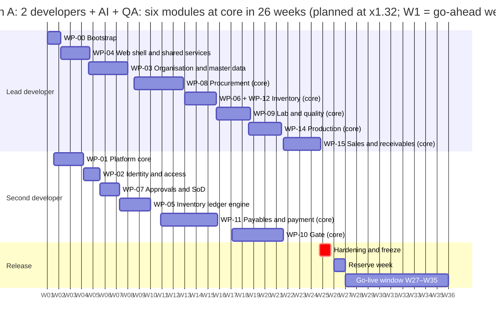
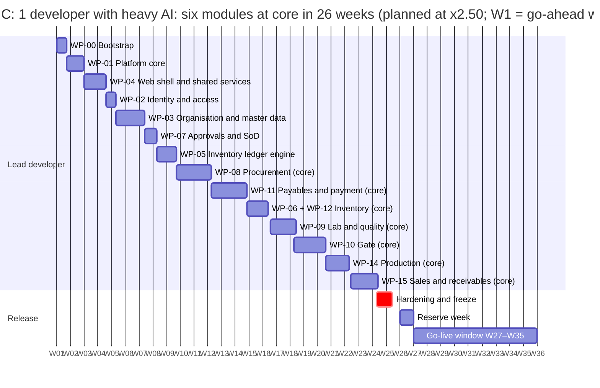
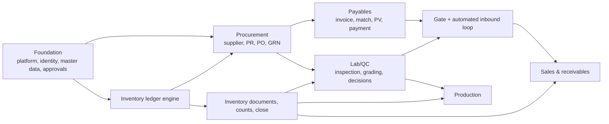

# MOS: Implementation Plan and Roadmap

| | |
|---|---|
| Product | MOS (Manufacturing Operations Suite). Working codename; the client's draft uses "Factory ERP" |
| Document | Implementation plan: estimate, capacity per team path, week-level roadmap, work packages, go-live plan, risks |
| Version | **0.4**, draft for review (package v0.3, planning Phase 4) |
| Date | 2026-09-27 |
| Audience | Product owner, the development team (human and AI-assisted) |
| Status | **Planning only; no implementation has started.** The prices built on this plan are in [MOS-COMMERCIAL-PROPOSAL.md](MOS-COMMERCIAL-PROPOSAL.md); the detailed plan for Module 1 is [MOS-PROCUREMENT-MODULE-PLAN.md](MOS-PROCUREMENT-MODULE-PLAN.md) |
| Companion docs | [MOS-FRD.md](MOS-FRD.md) · [MOS-PROCESS-MODEL.md](MOS-PROCESS-MODEL.md) · [MOS-DATABASE-DESIGN.md](MOS-DATABASE-DESIGN.md) · [MOS-TDD.md](MOS-TDD.md) · [MOS-MASTER-PLAN.md](MOS-MASTER-PLAN.md) · [adr/](adr/) |

**Revision history**

| Version | Date | Change |
|---|---|---|
| 0.1 | 2026-09-26 | First plan: MVP ≈ 9.5 months (54 dev-weeks), Phase 2 ≈ 8 months, Phase 3 ≈ 4–5 months; ≈ 21–23 months in total |
| 0.2 | 2026-09-27 | Client procure-to-pay draft absorbed: MVP ≈ 10.4 months (59.5 dev-weeks), full scope ≈ 22–24 months |
| 0.3 | 2026-09-27 | **Re-framed by the owner:** single company, no tenancy (ADR-0017); all six modules in ≤ 6 months of development, then 2 months to go live (ADR-0018); infrastructure not assumed (ADR-0019); team paths A/B/C. MVP/P2/P3 replaced by v1 / v1.1 / Later |
| 0.3.1 | 2026-09-27 | Planning Phase 2: the six new v1 requirements assigned to work packages. No change to months or weights |
| **0.4** | 2026-09-28 | **Planning Phases 4 and 6: estimated in hours, planned by week, committed by the owner.** • bottom-up estimate: 187 features covering all 205 v1 requirements, **3,102 build hours** (likely), each feature tagged core / standard / full (§3) • capacity per team path at the owner's hours (§4) • at the likely estimate, no path builds all six modules in 26 weeks (§5.1) • **owner decision (Phase 6, 2026-09-28): one release, all six modules at core depth, capped at 26 weeks, on every path** (§5.2, ADR-0020); each path is planned at the velocity it needs, measured at W4 and W9 • week-level roadmap per path (§6); go-live hours per path (§8); client inputs by week (§9) • the tiers replace the v0.3 "B-risk" and "C" lists; standard and full depth are the pull-in list; the month weights of ADR-0018 are replaced by the schedule • new risks R22–R24 |

---

## Summary

1. **The estimate.**
   - Lean-complete v1 (every requirement tagged v1 in the FRD) is **3,102 build hours** at the likely estimate. The range is 2,326 (optimistic) to 3,878 (pessimistic) hours.
   - **Core depth** of every module, meaning each module's flow with its key controls, is **2,380 hours**, incl. hardening.
   - Build hours are AI-assisted developer hours, including the developer's own tests (§3).
2. **The commitment (owner decision, Phase 6).**
   - **One release: all six modules at core depth, built in W1–W26 and taken live in W27–W35, on every team path.**
   - At the likely estimate the six modules at core would need 34 weeks on path A, 39 on B and 63 on C (§5.1).
   - The owner commits to the 26 weeks. Each path is therefore planned at the velocity it needs (§5.2):

     | Path | Velocity needed | Each estimated hour done in |
     |---|---|---|
     | A | **×1.32** the likely estimate | 46 minutes |
     | B | **×1.52** | 40 minutes |
     | C | **×2.50** | 24 minutes |

     Path A's figure sits at the optimistic end of the estimate range. B and C are beyond it.
3. **How the commitment is held** (§11):
   - The W4 and W9 checkpoints measure real velocity against the path's required rate.
   - If it is short, the lever is capacity, not the date or the core scope. The owner adds hours, or a third developer (reference A+ needs only ×1.01).
   - If velocity is ahead, standard-depth items are pulled into the release.
4. **Prices** (packages 1–3, build to go-live; [commercial proposal](MOS-COMMERCIAL-PROPOSAL.md)):
   - path A **$23,200**;
   - path B **$18,000**;
   - path C **$11,760**.

   The paths are laid out side by side for the client to choose.

## 1. Planning frame

| Item | Value | Why it matters |
|---|---|---|
| Development window | **26 weeks**, W1 = the go-ahead week | Owner decision (ADR-0018, ADR-0020): all six modules at core depth in one release, on every path |
| Go-live window | **9 weeks, W27–W35** | System integration test, UAT, data migration, training, production set-up, cutover, hypercare (§8) |
| After go-live | Maintenance and support (a separate service); **v1.1** planned during hypercare | Not inside the development window |
| Team paths | **A:** 2 devs + AI + QA · **B:** 2 devs + AI · **C:** 1 dev with heavy AI · reference **A+:** 3 devs + AI + QA | All three are laid out for the client; A+ is the fallback capacity if the checkpoints show a shortfall (§11) |
| Hours per week | Lead developer **56** (7 × 8, owner's figure); second and third developer **48** (6 × 8, parameter); QA **40** (5 × 8, parameter) | §4 shows the second developer at 40 / 48 / 56 |
| Focus factor | **80%** of worked hours go to estimated build work | The rest: meetings, reviews, demos, client questions, rework from feedback, illness and holidays. At 56 hours a week, a higher figure is not sustainable (R18) |
| Reserve | **1 week (W26)** of the team's capacity kept unallocated | The go-live window cannot double as build buffer |
| Testing without a QA engineer | **+15%** of build hours (paths B and C) | The developers write and run acceptance and regression tests themselves |
| Environment | **Development only** until the hosting decision (ADR-0019). Production set-up in W27–W29 | Hosting answers are needed **before W18** (§9) |
| Locale | English / Gregorian in v1 | The Amharic + Ethiopian-calendar pack is Later; the hooks exist from day one |

## 2. Delivery principles

1. **Contracts first.** Each work package starts with its Zod contracts (`packages/contracts`) and its acceptance tests from the FRD. Implementation follows.
2. **Correctness core before screens.** The inventory ledger engine and its property tests (WP-05) come before inventory screens. Every module posts through it.
3. **A block is done only when its acceptance tests are green in CI** and `PROGRESS.md` is updated. Half-built blocks are not counted.
4. **A demo at the end of every month.** The client sees each block as it lands.
5. **Core before standard, standard before full.** The release is every module's core. Standard and full depth are the pull-in list, in this order: procure-to-pay standard items first (the client's first module), then the other modules' standard items, then full depth.
6. **Scope freeze per block at its start.** Changes after that go through the change rule (§11).
7. **Screens follow the client draft's layout**, with the corrections in the client-draft review §5.
8. **Nothing tagged v1.1 or Later sneaks into v1** (§10).

---

## 3. The estimate

### 3.1 Method

- **Bottom-up by feature.**
  - Every work package is broken into features, 187 in all ([Appendix A](#appendix-a-feature-estimate)). Each feature lists the FRD requirements it delivers.
  - **Every one of the 205 v1 requirements maps to at least one feature**, checked by script.
- **Hours are AI-assisted developer hours.**
  - They include the developer's own unit, integration and property tests, the migrations for the feature's tables ([database design](MOS-DATABASE-DESIGN.md)), its screens and its PDFs.
  - They assume the planning package is the specification. No design time is added, because the process model, database design and TDD already exist.
  - They exclude the QA engineer's work, meetings and demos (the focus factor), and the go-live window.
- **Three tiers per feature:**
  - **C (core):** the module's flow runs end to end with its key controls: posting integrity, approvals, SoD, gap-free numbering, audit.
  - **S (standard):** year-one controls and conveniences, such as TOTP, delegation, PO amendments, self-billing, count modes, paper mode.
  - **F (full):** the rest of lean-complete v1, the first to move to v1.1.

  The tiers replace the v0.3 "B-risk" and "C" lists.
- **AI factor.** The likely figures assume AI assistance roughly halves the effort of the same work done without it. This is the largest uncertainty in the plan (R22), so the range in §3.4 and the calibration checkpoint in §11 exist for it.

### 3.2 By work package

| WP | Title | Module | Core | Standard | Full | Total |
|---|---|---|---|---|---|---|
| WP-00 | Repository and tooling bootstrap | Foundation | 64 | — | — | **64** |
| WP-01 | Platform core | Foundation | 130 | 20 | — | **150** |
| WP-02 | Identity and access | Foundation | 74 | 22 | 26 | **122** |
| WP-03 | Organisation and master data | Foundation | 204 | 26 | 6 | **236** |
| WP-04 | Web shell and shared services | Foundation | 150 | 16 | 20 | **186** |
| WP-05 | Inventory ledger engine | Foundation | 136 | — | — | **136** |
| WP-07 | Approvals and SoD | Foundation | 86 | 20 | — | **106** |
| WP-08 | Procurement | Procurement | 256 | 76 | — | **332** |
| WP-11 | Payables and supplier payment | Payables | 256 | 52 | — | **308** |
| WP-06 | Inventory documents and reports | Inventory | 118 | 54 | 8 | **180** |
| WP-12 | Counts, period close, exception reports | Inventory | 40 | 66 | 12 | **118** |
| WP-09 | Lab and quality | Lab/QC | 176 | 34 | 10 | **220** |
| WP-10 | Gate and the automated inbound loop | Gate | 222 | 74 | 20 | **316** |
| WP-14 | Production | Production | 170 | 56 | 14 | **240** |
| WP-15 | Sales and receivables | Sales | 190 | 54 | — | **244** |
| WP-13 | Hardening and feature freeze | Hardening | 108 | 36 | — | **144** |
| | **Total** | | **2,380** | **606** | **116** | **3,102** |

### 3.3 By module

| Module | Core | Standard | Full | Total | Share | v1 requirements covered |
|---|---|---|---|---|---|---|
| Foundation | 844 | 104 | 52 | 1,000 | 32% | 64 |
| Procurement | 256 | 76 | — | 332 | 11% | 21 |
| Payables | 256 | 52 | — | 308 | 10% | 22 |
| Inventory | 158 | 120 | 20 | 298 | 10% | 19 |
| Lab/QC | 176 | 34 | 10 | 220 | 7% | 24 |
| Gate | 222 | 74 | 20 | 316 | 10% | 35 |
| Production | 170 | 56 | 14 | 240 | 8% | 18 |
| Sales | 190 | 54 | — | 244 | 8% | 19 |
| Hardening | 108 | 36 | — | 144 | 5% | — |
| **Total** | **2,380** | **606** | **116** | **3,102** | 100% | 205 (each at least once) |

Foundation is about 35% of the core. That is the cost of building an ERP platform from scratch (identity, approvals, numbering, audit, documents, ledger, master data) before the first purchase order can be raised. The house systems' patterns (DMS, SSO) are reused, but not their code (ADR-0014, ADR-0015).

### 3.4 Range

| Scope | Optimistic (×0.75) | Likely | Pessimistic (×1.25) |
|---|---|---|---|
| Core (every module's flow with its key controls, incl. hardening) | 1,785 | **2,380** | 2,975 |
| Core + standard | 2,240 | **2,986** | 3,732 |
| Lean-complete v1 (core + standard + full) | 2,326 | **3,102** | 3,878 |

The optimistic column is what a very effective agentic workflow on a fully specified design could reach. The pessimistic column covers late client answers and rework. **The plan uses the likely column.**

---

## 4. Capacity per team path

| | Path A | Path B | Path C | Reference A+ |
|---|---|---|---|---|
| Team (hours per week) | Lead developer 56 h Second developer 48 h QA 40 h | Lead developer 56 h Second developer 48 h | Lead developer 56 h | Lead developer 56 h Second developer 48 h Third developer 48 h QA 40 h |
| Developer hours worked in 26 weeks | 2,704 | 2,704 | 1,456 | 3,952 |
| × focus 80% = hours on estimated work | 2,163 | 2,163 | 1,165 | 3,162 |
| minus the reserve week (W26) | 2,080 | 2,080 | 1,120 | 3,040 |
| minus developer testing without a QA engineer (+15%) | — | 271 | 146 | — |
| **= build hours available** | **2,080** | **1,809** | **974** | **3,040** |
| QA engineer hours worked (on estimated work) | 1,040 (832) | — | — | 1,040 (832) |
| Share of core (2,380 h) | 87% | 76% | 41% | 128% |
| Share of lean-complete v1 (3,102 h) | 67% | 58% | 31% | 98% |

**Second developer's hours** (paths A and B):

| Second developer's week | Build hours available (path A) | Path A option 1 total (US$) | Path B option 1 total (US$) |
|---|---|---|---|
| 40 h (5 days) | 1,920 | $21,645 | $16,165 |
| 48 h (6 days) | 2,080 | $22,685 | $17,205 |
| 56 h (7 days) | 2,240 | $23,725 | $18,245 |

**QA engineer (path A)** during the build:

| QA activity (path A, W1–W26) | Basis | Hours |
|---|---|---|
| Test strategy, test data, E2E harness | fixed | 60 |
| Acceptance scripts from the FRD criteria, per module | ≈ 10% of 2,380 estimated build h | 238 |
| Exploratory testing of each delivered block | ≈ 7% of build h | 167 |
| Automated E2E flows (procure-to-pay, inbound loop, reversal, approvals) | ≈ 5% of build h | 119 |
| Regression before each month-end demo | 6 × 16 h | 96 |
| SIT preparation (scenarios AS-01…AS-19, data sets) | fixed | 40 |
| **Total** | | **720** of 832 available (after focus) |

---

## 5. The estimate against the 26-week commitment

### 5.1 At the likely estimate

How the check works:
- Blocks are scheduled in priority order into each developer's stream, in weeks, respecting dependencies. A block may start once half of each block it depends on is done.
- The priority order is:
  1. the foundation's core;
  2. procurement, payables, inventory and QC core (the client's procure-to-pay);
  3. gate, production and sales core;
  4. standard depth, procure-to-pay first;
  5. full depth.

At the likely rate, this is what fits in 26 weeks:

| | In 26 weeks at the likely estimate | If AI delivers the optimistic estimate (×0.75) | If the pessimistic estimate holds (×1.25) |
|---|---|---|---|
| **Path A** | Foundation (core), Procurement (core + standard), Payables (core + standard), Inventory (core), Lab/QC (core). **Not in the release:** Gate, Production, Sales | Foundation (core), Procurement (core + standard), Payables (core + standard), Inventory (core), Lab/QC (core + standard + full), Gate (core), Production (core), Sales (core). **All six modules.** | Foundation (core + standard + full), Procurement (core + standard), Inventory (core). **Not in the release:** Payables, Lab/QC, Gate, Production, Sales |
| **Path B** | Foundation (core), Procurement (core), Payables (core + standard), Inventory (core). **Not in the release:** Lab/QC, Gate, Production, Sales | Foundation (core), Procurement (core), Payables (core), Inventory (core), Lab/QC (core), Gate (core), Production (core). **Not in the release:** Sales | Foundation (core), Procurement (core), Inventory (core). **Not in the release:** Payables, Lab/QC, Gate, Production, Sales |
| **Path C** | Foundation (core). **Not in the release:** Procurement, Payables, Inventory, Lab/QC, Gate, Production, Sales | Foundation (core), Procurement (core + standard). **Not in the release:** Payables, Inventory, Lab/QC, Gate, Production, Sales | Foundation (core). **Not in the release:** Procurement, Payables, Inventory, Lab/QC, Gate, Production, Sales |
| **Reference A+** | Foundation (core), Procurement (core + standard), Payables (core + standard), Inventory (core), Lab/QC (core + standard + full), Gate (core + standard + full), Production (core + standard + full). **Not in the release:** Sales | Foundation (core + standard + full), Procurement (core + standard), Payables (core + standard), Inventory (core + standard + full), Lab/QC (core + standard + full), Gate (core + standard + full), Production (core + standard + full), Sales (core + standard). **All six modules.** | Foundation (core), Procurement (core + standard), Payables (core + standard), Inventory (core), Lab/QC (core + standard + full). **Not in the release:** Gate, Production, Sales |

| | Path A | Path B | Path C | Reference A+ |
|---|---|---|---|---|
| Development weeks for **all six modules at core depth** (likely) | **34** | **39** | **63** | **27** |
| … at the optimistic estimate | 26 | 30 | 47 | 20 |
| Development weeks for **lean-complete v1** (likely) | 41 | 47 | 81 | 31 |
| Go-live for all six at core: development weeks + 9 | W43 (≈ 9.9 months) | W48 (≈ 11.1 months) | W72 (≈ 16.6 months) | W36 (≈ 8.3 months) |

**What the planning package found:**
- All six modules in 26 weeks does not hold at the likely estimate for any of the three paths.
  - The v0.3 audit's figure (≈ 58 dev-weeks, "path A just fits") was a top-down guess.
  - The bottom-up estimate is about 34% higher (3,102 hours against ≈ 2,320).
- The package offered the owner phased and longer options. The owner rejected them in Phase 6.

### 5.2 The owner's commitment

**Decision (2026-09-28, ADR-0020):** one release with all six modules at core depth, built in 26 weeks and live at W35, on every team path. The owner states the team can reach the needed velocity with AI assistance. Each path is planned at that velocity:

| | Path A | Path B | Path C | Reference A+ |
|---|---|---|---|---|
| Core build hours at the likely estimate (incl. hardening) | 2,380 | 2,380 | 2,380 | 2,380 |
| Build hours available in 26 weeks at the likely rate (§4) | 2,080 | 1,809 | 974 | 3,040 |
| Development weeks at the likely estimate | 34 | 39 | 63 | 27 |
| **Velocity needed to finish in 26 weeks** (× the likely estimate) | **×1.32** | **×1.52** | **×2.50** | **×1.01** |
| In other words, each estimated hour of work is done in | 46 minutes | 40 minutes | 24 minutes | 59 minutes |
| Against the estimate range (the optimistic end is ×1.33) | inside the range | beyond the optimistic end | beyond the optimistic end | inside the range |

**What this means for the plan:**
- **The week plan in §6 is the committed plan.** The estimate stays the reference: Appendix A hours are what each feature is measured against.
- **Required velocity per path:**
  - **path A** needs every estimated hour done in 46 minutes, which is the optimistic end of the range;
  - **path B** needs 40 minutes, because its developers also carry testing;
  - **path C** needs 24 minutes: one developer at two and a half times the likely rate.
- **Core scope and the date are both fixed**, so capacity is the only lever if velocity falls short (§11).
- **Standard and full depth** (606 + 116 estimated hours) are not in the release. They are pulled in only if velocity runs ahead; otherwise they are v1.1.

## 6. Week-level roadmap

Weeks are counted from the go-ahead (W1). Each block is one developer's work unless noted. The Gantt charts use drawing dates only (W1 is placed on a Monday so the axis shows week numbers).

### 6.1 Path A (2 developers + AI + QA), planned at ×1.32

| Weeks | Stream | Block | Hours | Depth |
|---|---|---|---|---|
| W1–W2 | Lead developer | WP-00 Bootstrap | 64 | C |
| W1–W4 | Second developer | WP-01 Platform core | 130 | C |
| W2–W4 | Lead developer | WP-04 Web shell and shared services | 150 | C |
| W4–W5 | Second developer | WP-02 Identity and access | 74 | C |
| W4–W8 | Lead developer | WP-03 Organisation and master data | 204 | C |
| W5–W7 | Second developer | WP-07 Approvals and SoD | 86 | C |
| W7–W9 | Second developer | WP-05 Inventory ledger engine | 136 | C |
| W8–W12 | Lead developer | WP-08 Procurement (core) | 256 | C |
| W10–W15 | Second developer | WP-11 Payables and payment (core) | 256 | C |
| W12–W15 | Lead developer | WP-06 + WP-12 Inventory (core) | 158 | C |
| W15–W18 | Lead developer | WP-09 Lab and quality (core) | 176 | C |
| W17–W21 | Second developer | WP-10 Gate (core) | 222 | C |
| W18–W21 | Lead developer | WP-14 Production (core) | 170 | C |
| W21–W24 | Lead developer | WP-15 Sales and receivables (core) | 190 | C |
| W24–W25 | all developers | WP-13 Hardening and feature freeze | 108 | C |

**Month-end demos (path A):**

| Demo | Week | What the client sees |
|---|---|---|
| M1 | W4 | Sign-in, the shell, the platform core (audit, documents), first shared components; **first velocity checkpoint** |
| M2 | W9 | Users and roles with site scopes, company set-up, storage units and silos, items, partners, tax codes, numbering, approval matrix and inbox; the ledger engine; supplier registration and PR (procurement W8–W12); **second velocity checkpoint** |
| M3 | W13 | PO, GRN with weights, bags and dispositions, supplier returns; invoices and matching (payables W10–W15); stock documents begin (inventory W12–W15) |
| M4 | W17 | PV drafted from the GRN, approval, payment with cheques and WHT; counts and close; inspection with grading and deductions (QC W15–W18): **the client's procure-to-pay with inspection (AS-13)** |
| M5 | W22 | Gate and weighbridge loop (gate W17–W21); milling runs, packing, output, costing (production W18–W21) |
| M6 | W26 | Sales, delivery through the gate, invoices, receipts (sales W21–W24); hardening; feature freeze |

**Note on the v0.3 month plan and the FRD month tags.**
- The FRD's month tags follow the v0.3 plan, and they disagree among themselves: QC is tagged M3 in the FRD but was M4 in the v0.3 plan.
- They are re-aligned to this path A schedule in FRD 0.3.3.

### 6.2 Path B (2 developers + AI), planned at ×1.52

| Weeks | Stream | Block | Hours | Depth |
|---|---|---|---|---|
| W1–W2 | Lead developer | WP-00 Bootstrap | 64 | C |
| W1–W4 | Second developer | WP-01 Platform core | 130 | C |
| W2–W4 | Lead developer | WP-04 Web shell and shared services | 150 | C |
| W4–W5 | Second developer | WP-02 Identity and access | 74 | C |
| W4–W8 | Lead developer | WP-03 Organisation and master data | 204 | C |
| W5–W7 | Second developer | WP-07 Approvals and SoD | 86 | C |
| W7–W9 | Second developer | WP-05 Inventory ledger engine | 136 | C |
| W8–W12 | Lead developer | WP-08 Procurement (core) | 256 | C |
| W10–W15 | Second developer | WP-11 Payables and payment (core) | 256 | C |
| W12–W15 | Lead developer | WP-06 + WP-12 Inventory (core) | 158 | C |
| W15–W18 | Lead developer | WP-09 Lab and quality (core) | 176 | C |
| W17–W21 | Second developer | WP-10 Gate (core) | 222 | C |
| W18–W21 | Lead developer | WP-14 Production (core) | 170 | C |
| W21–W24 | Lead developer | WP-15 Sales and receivables (core) | 190 | C |
| W24–W25 | all developers | WP-13 Hardening and feature freeze | 108 | C |

Same streams and weeks as path A. With no QA engineer, the developers carry the testing, so the velocity they need is higher.

### 6.3 Path C (1 developer with heavy AI), planned at ×2.50

| Weeks | Stream | Block | Hours | Depth |
|---|---|---|---|---|
| W1 | Lead developer | WP-00 Bootstrap | 64 | C |
| W1–W2 | Lead developer | WP-01 Platform core | 130 | C |
| W2–W4 | Lead developer | WP-04 Web shell and shared services | 150 | C |
| W4–W5 | Lead developer | WP-02 Identity and access | 74 | C |
| W5–W7 | Lead developer | WP-03 Organisation and master data | 204 | C |
| W7–W8 | Lead developer | WP-07 Approvals and SoD | 86 | C |
| W8–W9 | Lead developer | WP-05 Inventory ledger engine | 136 | C |
| W9–W12 | Lead developer | WP-08 Procurement (core) | 256 | C |
| W12–W14 | Lead developer | WP-11 Payables and payment (core) | 256 | C |
| W14–W16 | Lead developer | WP-06 + WP-12 Inventory (core) | 158 | C |
| W16–W18 | Lead developer | WP-09 Lab and quality (core) | 176 | C |
| W18–W20 | Lead developer | WP-10 Gate (core) | 222 | C |
| W20–W22 | Lead developer | WP-14 Production (core) | 170 | C |
| W22–W24 | Lead developer | WP-15 Sales and receivables (core) | 190 | C |
| W24–W25 | all developers | WP-13 Hardening and feature freeze | 108 | C |

One stream: every block runs in sequence, and illness or leave stops the project (R23).

### 6.4 Reference A+ (3 developers + AI + QA)

| Weeks | Stream | Block | Hours | Depth |
|---|---|---|---|---|
| W1–W2 | Lead developer | WP-00 Bootstrap | 64 | C |
| W1–W5 | Second developer | WP-01 Platform core | 130 | C |
| W1–W5 | Third developer | WP-04 Web shell and shared services | 150 | C |
| W3–W5 | Lead developer | WP-02 Identity and access | 74 | C |
| W5–W9 | Lead developer | WP-03 Organisation and master data | 204 | C |
| W5–W7 | Second developer | WP-07 Approvals and SoD | 86 | C |
| W7–W10 | Third developer | WP-05 Inventory ledger engine | 136 | C |
| W9–W15 | Lead developer | WP-08 Procurement (core) | 256 | C |
| W10–W14 | Third developer | WP-06 + WP-12 Inventory (core) | 158 | C |
| W12–W18 | Second developer | WP-11 Payables and payment (core) | 256 | C |
| W15–W19 | Lead developer | WP-09 Lab and quality (core) | 176 | C |
| W17–W22 | Third developer | WP-10 Gate (core) | 222 | C |
| W19–W22 | Lead developer | WP-14 Production (core) | 170 | C |
| W19–W24 | Second developer | WP-15 Sales and receivables (core) | 190 | C |
| W24–W25 | all developers | WP-13 Hardening and feature freeze | 108 | C |

### 6.5 Dependencies that drive the order

- **The GRN needs** the ledger (stock), approvals and master data. With the gate off (flow C) it takes weights from the GRN or the inspection record, so procurement does not wait for the gate.
- **QC decisions** set the receipt status (QUARANTINE vs AVAILABLE) and the payable quantity. Payables already reads the payable quantity before QC exists (it equals the accepted quantity), so adding QC later needs no rework.
- **The gate automates** GRN preparation and needs the QC decision in the same transaction.
- **Sales' outbound exit** reuses the gate's exit clearance (BR-GATE-09), so sales follows the gate.
- **Production consumes** only QC-released stock.

---

## 7. Work packages (v1)

Weeks are from each path's committed schedule (§6). Every package's core is in the release; its standard and full features are the pull-in list (Appendix A).

| WP | Title | Path A | Path B | Path C | Scope (v1) | Key FRs / acceptance |
|---|---|---|---|---|---|---|
| WP-00 | Repository and tooling bootstrap | W1–W2 | W1–W2 | W1 | Monorepo (api, worker, web, contracts, domain-kernel, db); lint and dependency-cruiser; CI gates (TDD §18.4); test harness connecting as `mos_app` | CI green; the migration-safety check blocks an un-annotated DROP |
| WP-01 | Platform core | W1–W4 | W1–W4 | W1–W2 | `UnitOfWorkInterceptor` with retry; idempotency keys; outbox with relay, `processed_event`, `process_exception`; audit log with sealing job; error model, env contract, health; privilege boot probe, grant/trigger catalogue test, lock ranks | FR-PLT-020…022, 031, 046, 050; invariant P15 |
| WP-02 | Identity and access | W4–W5 | W4–W5 | W4–W5 | Local accounts with TOTP (ADR-0015); optional OIDC SSO; operation unit; roles with site scope; sessions, CSRF; access-review export | FR-PLT-010…012, 014, 015, 017…019 |
| WP-03 | Organisation and master data | W4–W8 | W4–W8 | W5–W7 | Setup wizard, sites, departments; warehouses → storage units (silos); UoM, items, categories, partners, banks, company paying accounts; tax codes, payment terms, reason codes; numbering, fiscal periods, module switches; deactivate-only masters; import with dry run; grain/flour pack | FR-PLT-002…004, 006…008, 040…043, 047, 053, 055; FR-MD-001…014; FR-AP-015 |
| WP-04 | Web shell and shared services | W2–W4 | W2–W4 | W2–W4 | Layout; `DataGrid`, `LineItemsForm`, `DocumentPage`, `ScanInput`; approvals inbox; attachment service; PDF template engine; notifications; list export; global search; i18n hooks; build fingerprint | FR-PLT-030, 032, 044, 045, 048, 049, 051, 052; FR-RPT-002; inbox usable at 375 px |
| WP-07 | Approvals (lean) and SoD | W5–W7 | W5–W7 | W7–W8 | Approval matrix; sequential stages; delegation; reminder + fallback escalation; SoD rule types; immutable approval history | FR-PLT-023, 025…029, 054; AS-12 |
| WP-05 | Inventory ledger engine | W7–W9 | W7–W9 | W8–W9 | Ledger, balances and moving average over storage units; sorted locking, capacity check, commingled-silo FIFO; posting and reversal framework; property-test harness. **No UI** | FR-INV-010, 011, 019, 022; P1–P9 green over ≥ 10,000 generated sequences |
| WP-08 | Procurement | W8–W12 | W8–W12 | W9–W12 | Supplier wizard with KYC and bank-change control; approved supplier list; PR; quotations on the PO; PO (issue, amendments, tolerances, closure); GRN (gate-off weights, bags, mixed lines, dispositions); service receipts; supplier returns; reports. Story level: [procurement module plan](MOS-PROCUREMENT-MODULE-PLAN.md) | FR-PRC-001…008, 010…015, 017, 021, 022 |
| WP-11 | Payables and supplier payment | W10–W15 | W10–W15 | W12–W14 | Supplier invoices; 3-way match; debit notes; self-billing; PV drafted from the GRN; payment with cheque register and books, proof, WHT certificates; partner ledger; journals + CSV export; tax registers; GRNI reconciliation | FR-AP-001…010, 012…014, 016…019; FR-INB-003, 010; AS-05 |
| WP-06 | Inventory documents and reports | W12–W15 | W12–W15 | W14–W16 | Receipts, issues, transfers, adjustments, status changes; lots and trace; stock balance and history; silo levels; reorder report; labels | FR-INV-001…008, 013, 014, 018; AS-06 |
| WP-12 | Counts, period close, exception reports | W12–W15 | W12–W15 | W14–W16 | Counts (modes, blind, recount) with generated adjustment; silo dip; fumigation holds; inventory period close; exception reports; background report jobs. Role dashboards are built with each module | FR-INV-009, 012, 020, 021; FR-RPT-001, 003, 004; AS-07, AS-08 |
| WP-09 | Lab and quality | W15–W18 | W15–W18 | W16–W18 | Parameters, specs, QC policies, sampling; inspection record incl. gate-off creation; samples; insert-only results; grading and score; retest; concessions; usage decisions; deduction rules; CoA gate; lab dashboard | FR-QC-001…018, 022…025; **AS-13**; AS-03 (with WP-11) |
| WP-10 | Gate and the automated inbound loop | W17–W21 | W17–W21 | W18–W20 | Gate masters, blacklist, shifts, expected arrivals, visits; weigh tickets with blind verification; exit clearance and passes; material gate passes; incidents; yard board; paper mode and back-entry; GRN prepared at tare; failure-case suite; outbound visit class | FR-GATE-001…019, 021…025, 030; FR-INB-001, 002, 004…009; AS-01, 02, 04, 09, 10 |
| WP-14 | Production | W18–W21 | W18–W21 | W20–W22 | Work centres; recipes with co- and by-products; work orders (standard, campaign, packing); milling runs; issue and backflush; output by lot; finished-goods QC; traceability; material-cost settlement; shift log and downtime; reports | FR-MFG-001, 003, 005…009, 011…018; FR-QC-019, 026; AS-14, AS-16, AS-17 |
| WP-15 | Sales and receivables | W21–W24 | W21–W24 | W22–W24 | Customers, price lists, orders with holds, reservation; delivery orders through the outbound gate; invoicing with fiscal reference; cash sales and sessions; advances, receipts; returns and credit notes; statements, reports; output VAT | FR-SAL-001, 002, 004…006, 008…010, 012…018; FR-INV-015; FR-AP-017 (output VAT); AS-15, AS-18, AS-19 |
| WP-13 | Hardening and feature freeze | W24–W25 | W24–W25 | W24–W25 | Security review (ASVS L2), performance test, backup/restore drill on dev, acceptance scripts, guides | All in-scope FRs have passing tests; the in-scope AS scenarios are green |
| WP-16 | Go live | W27–W35 | W27–W35 | W27–W35 | SIT, UAT, data migration, training, production deployment, go-live, hypercare (§8) | UAT sign-off; go-live checklist; hypercare exit criteria |

---

## 8. Going live (W27–W35)

**Exit criteria:**

| Weeks | Activity | Exit criterion |
|---|---|---|
| W27–W28 | **System integration test** on a staging copy of the target environment, with the in-scope AS scenarios and realistic data volumes | No open High/Critical defects |
| W27–W29 | **Production environment** on the infrastructure the client chose (ADR-0019): servers or VMs, OS hardening, PostgreSQL, reverse proxy and TLS, backups with a tested restore, monitoring, email relay | Restore drill passes; environment signed off |
| W29–W31 | **User acceptance test** by the client's key users, per module, using the acceptance scripts | UAT sign-off per module |
| W29–W32 | **Data migration:** masters, opening stock with lots and costs, open POs, open supplier (and, with sales, customer) balances. Two dry runs, then cutover | Dry-run reconciliation within agreed tolerances |
| W30–W32 | **Training:** role-based sessions and short guides per role | Every go-live user trained |
| W32–W33 | **Cutover and go-live:** freeze legacy entry, final migration, opening balances posted | Go-live checklist complete |
| W33–W35 | **Hypercare:** daily check-ins, fast fixes, the v1.1 backlog groomed | Hypercare exit criteria met; handover to maintenance |

**Hours per path** (all six modules at core). The hours scale with the scope; environment set-up and cutover are fixed. Go-live work is people's time with the client (testing, training, cutover), so it is not planned at the build velocity.

*Path A:*

| Weeks | Activity | Package | Lead developer | Second developer | QA engineer | Hours |
|---|---|---|---|---|---|---|
| W27–W28 | SIT: run the acceptance scenarios and regression | 2 QA & UAT | — | — | 98 | 98 |
| W27–W28 | SIT: fix defects | 2 QA & UAT | 43 | 36 | — | 79 |
| W27–W29 | Production environment: set-up, hardening, backups with a tested restore, monitoring, runbook | 3 Go-live | 48 | 40 | — | 88 |
| W29–W31 | UAT: prepare scripts, coordinate key users, triage | 2 QA & UAT | — | — | 81 | 81 |
| W29–W31 | UAT: fix defects | 2 QA & UAT | 61 | 50 | — | 111 |
| W29–W32 | Data migration: mapping, two dry runs, cutover load | 3 Go-live | 67 | 54 | — | 121 |
| W29–W32 | Data migration: reconciliation checks | 3 Go-live | — | — | 17 | 17 |
| W30–W32 | Training: role guides and role sessions | 3 Go-live | — | — | 67 | 67 |
| W30–W32 | Training: administrator and key-user sessions | 3 Go-live | 28 | 22 | — | 50 |
| W32–W33 | Cutover and go-live | 3 Go-live | 22 | 18 | — | 40 |
| W32–W33 | Cutover checks | 3 Go-live | — | — | 8 | 8 |
| W33–W35 | Hypercare: fixes and support | 3 Go-live | 63 | 52 | — | 115 |
| W33–W35 | Hypercare: verification | 3 Go-live | — | — | 21 | 21 |
| | **Total** | | **332** | **272** | **292** | **896** |
| | Available in W27–W35 | | 504 | 432 | 360 | |
| | Weeks of full-time work for each person | | 5.9 | 5.7 | 7.3 | |

*Path B:*

| Weeks | Activity | Package | Lead developer | Second developer | Hours |
|---|---|---|---|---|---|
| W27–W28 | SIT: run the acceptance scenarios and regression | 2 QA & UAT | 49 | 49 | 98 |
| W27–W28 | SIT: fix defects | 2 QA & UAT | 43 | 36 | 79 |
| W27–W29 | Production environment: set-up, hardening, backups with a tested restore, monitoring, runbook | 3 Go-live | 48 | 40 | 88 |
| W29–W31 | UAT: prepare scripts, coordinate key users, triage | 2 QA & UAT | 40 | 41 | 81 |
| W29–W31 | UAT: fix defects | 2 QA & UAT | 61 | 50 | 111 |
| W29–W32 | Data migration: mapping, two dry runs, cutover load | 3 Go-live | 67 | 54 | 121 |
| W29–W32 | Data migration: reconciliation checks | 3 Go-live | 8 | 9 | 17 |
| W30–W32 | Training: role guides and role sessions | 3 Go-live | 34 | 33 | 67 |
| W30–W32 | Training: administrator and key-user sessions | 3 Go-live | 28 | 22 | 50 |
| W32–W33 | Cutover and go-live | 3 Go-live | 22 | 18 | 40 |
| W32–W33 | Cutover checks | 3 Go-live | 4 | 4 | 8 |
| W33–W35 | Hypercare: fixes and support | 3 Go-live | 63 | 52 | 115 |
| W33–W35 | Hypercare: verification | 3 Go-live | 10 | 11 | 21 |
| | **Total** | | **477** | **419** | **896** |
| | Available in W27–W35 | | 504 | 432 | |
| | Weeks of full-time work for each person | | 8.5 | 8.7 | |

*Path C:*

| Weeks | Activity | Package | Lead developer | Hours |
|---|---|---|---|---|
| W27–W28 | SIT: run the acceptance scenarios and regression | 2 QA & UAT | 98 | 98 |
| W27–W28 | SIT: fix defects | 2 QA & UAT | 79 | 79 |
| W27–W29 | Production environment: set-up, hardening, backups with a tested restore, monitoring, runbook | 3 Go-live | 88 | 88 |
| W29–W31 | UAT: prepare scripts, coordinate key users, triage | 2 QA & UAT | 81 | 81 |
| W29–W31 | UAT: fix defects | 2 QA & UAT | 111 | 111 |
| W29–W32 | Data migration: mapping, two dry runs, cutover load | 3 Go-live | 121 | 121 |
| W29–W32 | Data migration: reconciliation checks | 3 Go-live | 17 | 17 |
| W30–W32 | Training: role guides and role sessions | 3 Go-live | 67 | 67 |
| W30–W32 | Training: administrator and key-user sessions | 3 Go-live | 50 | 50 |
| W32–W33 | Cutover and go-live | 3 Go-live | 40 | 40 |
| W32–W33 | Cutover checks | 3 Go-live | 8 | 8 |
| W33–W35 | Hypercare: fixes and support | 3 Go-live | 115 | 115 |
| W33–W35 | Hypercare: verification | 3 Go-live | 21 | 21 |
| | **Total** | | **896** | **896** |
| | Available in W27–W35 | | 504 | |
| | Weeks of full-time work for each person | | 16.0 | |

**Staffing in the go-live window:**
- **Paths A and B:** the go-live needs about 8 weeks (A) and 9 weeks (B) of each person's time inside the 9-week window.
- **Path C:** one person needs about 16 weeks of full-time work, which does not fit in 9 weeks. Path C needs one of these:
  - a second person for W27–W35 (priced as extra hours);
  - the client's key users running more of UAT and training;
  - a longer go-live.

---

## 9. Client inputs and when they are needed

The needed-by weeks follow the path A schedule. The [decision register](MOS-DECISION-REGISTER.md) holds every item, and the [stakeholder questionnaire](MOS-STAKEHOLDER-QUESTIONNAIRE.md) asks the client.

| Needed by | Inputs |
|---|---|
| **Before W1** | "Floor" or **flour**; product name; meaning of "operation unit"; **currency** (USD POs, ETB payments?); team path; the go-ahead date |
| **Before W4** (master data) | Item and UoM lists; warehouses, storage units and silo capacities; supplier master extract; banks and the company's paying accounts; users, roles and site scopes |
| **Before W6** (approvals) | PR, PO and PV approval bands; SoD exceptions the client wants to allow |
| **Before W8** (procurement) | Self-billing and individual (no-TIN) suppliers; sourcing policy (quotations); tolerances between PR, PO, GRN and invoice (BQ-32); the onboarding document checklist per supplier group |
| **Before W10** (payables) | Invoice timing and weight basis; withholding-agent status and rates; VAT; payment methods; cheque book ranges; WHT certificate layout; the accounting package and its import format (BQ-40) |
| **Before W12** (inventory) | Rejected-quantity and empty-bag handling; transfer approvers; count practice; fumigation practice |
| **Before W14** | **Gate workshop** and **production workshop**; wheat and other raw-material specs, **grade table and score weights**, deduction and price rules, item QC and lot flags (BQ-29, BQ-30) |
| **Before W18** | **Sales workshop** and the **fiscal-device / e-invoice requirement**; **hosting and infrastructure decision** (ADR-0019), so the production environment is ready for W27 |
| **Before W27** | UAT key users per module; migration data extracts; training schedule; go-live date; legal retention periods |

---

## 10. Not in v1

**Depth that moves to v1.1:** the release is every module's core. Standard (606 h) and full (116 h) features move to v1.1 unless pulled in (§11). The tier of every feature is in Appendix A.

**v1.1** (planned during hypercare):
- RFQ-lite improvements; supplier self-registration link; GRN PO-reassignment document;
- general approval conditions with parallel/quorum steps;
- routings; quotations and dispatch planning; tokenised proof-of-delivery link; OEE;
- advances and payment runs; multi-document trucks; service/contractor visit log;
- the standard and full depth not pulled into the release (Appendix A tiers S and F).

**Later** (roadmap, no date):
- **SaaS:** shared multi-tenant SaaS (expansion playbook, TDD Appendix A), tenant onboarding, billing.
- **Identity and integration:** bundled IdP, public API and webhooks, API keys.
- **Hardware:** edge agent with weighbridge capture and ZPL printing, ANPR and barriers.
- **Portals:** supplier portal, RFQ comparison workflow, contracts.
- **Planning and costing:** MRP/MPS, finite scheduling, labour/overhead costing and variances.
- **Inventory:** FIFO option, landed cost, serial numbers, catch-weight.
- **Compliance and locale:** fiscal device / e-invoicing (unless the client's answer makes it a v1 legal requirement), Amharic/Ethiopian-calendar pack.
- **Connectors:** DMS connector, accounting-package adapters.
- **Never, unless re-scoped:** a general ledger.

---

## 11. Governance, calibration and change control

- **Weekly:** `PROGRESS.md` updated (status, what moved, blockers, next step). **Monthly:** demo and re-plan.
- **Velocity checkpoints at W4 and W9** (the heart of the commitment):
  1. For every finished feature, divide the actual build hours by the Appendix A hours. The average is the **measured factor**.
  2. **The required factor** is the path's plan: A 46/60, B 40/60, C 24/60 of each estimated hour.
  3. **If the measured factor is more than 10% above the required one,** the plan is behind. The owner adds capacity before W10: more hours from the second developer (up to 56), or a third developer (reference A+ needs only ×1.01). The client is told at the next demo. The date and the core scope do not move.
  4. **If it is below the required one,** the next standard-depth items are pulled into the release in priority order.
  5. The factor and the action taken are recorded in `PROGRESS.md` and in the decision register.
- **Pull-in rule:** an item is pulled in only if it can be finished and tested before W25, so nothing ships half-done.
- **Scope-change rule:**
  - A request that adds or changes an FRD requirement gets an ID, an estimate in hours (Appendix A units), a tier and an FRD revision.
  - It enters v1 only if items of equal hours leave, or by agreement.
  - It is billed at the change-request rate (commercial proposal §8).
- **Decisions:** every non-trivial technical choice gets an ADR in `docs/adr/`.
- **Definition of done** (per block):
  1. contracts and migrations reviewed;
  2. acceptance tests green in CI;
  3. lint and catalogue gates green;
  4. docs updated (TDD sections touched, ADRs);
  5. `PROGRESS.md` updated with actual hours;
  6. demo notes recorded.

## 12. Resumability protocol (for any developer or AI session)

1. **Start every session** by reading `MOS/CLAUDE.md`, `MOS/PROGRESS.md`, and the TDD section for the current work package.
2. **Work inside one block.** If a task touches another, stop and note it in `PROGRESS.md`.
3. **Contracts first:** Zod schemas and acceptance tests before implementation.
4. **End every session** by updating `PROGRESS.md`: status, last commit, hours spent against the feature estimate, next concrete step, open questions.
5. **Decisions** go into ADRs, never only into chat.
6. **A block is resumable at any point** because its acceptance tests define "done".

---

## 13. Risk register

| # | Risk | Likelihood | Impact | Mitigation | Trigger / early warning |
|---|---|---|---|---|---|
| R1 | Requirements stay hypothetical beyond procurement: gate, production and sales have no client input yet | High | High | Workshops before the blocks that need them (§9); month-end demos; the grain/flour pack as the baseline | No production or sales input four weeks before their blocks |
| R2 | Bus factor: 1–2 developers | High | High | CLAUDE.md, ADRs, PROGRESS, contract-first, CI gates, resumable blocks | A block stalls > 1 week without a PROGRESS update |
| R3 | Scope creep from mock-ups and demos | High | High | Freeze per block; change rule; v1.1 list as the pressure valve | FRD revisions during a block |
| R4 | Ledger or valuation defects found late | Medium | High | WP-05 property harness before any inventory UI; invariants in CI | Any invariant failure |
| R6 | Timeline optimism: AI speeds up coding, not client decisions, UAT or hosting | High | High | Quantified in §5; go-live window kept separate; client inputs by week (§9) | A demo slips > 1 week |
| R7 | Gate connectivity or power failures | High | Medium | Paper mode and back-entry (standard tier); UPS and 4G recommended; stakeholder questions | Site answers show unstable links |
| R8 | Weighbridge fraud during manual weighing | Medium | High | Photo + blind verification + forced re-tare + tare analytics + exception reports | Rising tare deviations or overrides |
| R10 | Low digital literacy at gate, floor and lab | Medium | Medium | Scan-first, big-target UI; role training | UAT tasks take too long |
| R13 | AI-generated code quality drift under time pressure | Medium | High | Strict lint, types, contracts; tests before merge; QA on path A | Repeated reverts or flaky tests |
| R14 | Tax or regulatory variance | Medium | Medium | Tax codes as data; client questions on WHT and VAT | A rule the tax model can't express |
| R15 | Client answers late (§9) | High | High | Needed-by weeks; documented defaults; demos surface gaps early | An input missing at the start of its block |
| R16 | Local-account security (a new attack surface) | Medium | High | ASVS L2 controls (TDD §6.1); targeted tests in WP-13 | Unusual lockout or reset volumes |
| R17 | **Schedule compression:** six modules in 26 weeks leaves no slack for rework | High | High | Reserve week; core only in the release; checkpoints (§11) with capacity as the lever | Measured factor > 1.1 × required at W4 or W9 |
| R18 | **Burnout:** 7-day, 8-hour weeks for 8 months at a velocity above the likely estimate | High | High | 80% focus factor; one rest day a week recommended; path A spreads the load; a third developer as the relief valve | Sustained velocity drop; rising defect rate |
| R19 | **Infrastructure unknown** (ADR-0019) | High | Medium | Portable design; hosting decision before W18 | No decision at W18 |
| R20 | **Sales invoicing may legally need a fiscal device / e-invoicing** | Medium | High | Asked before the sales workshop; adapter interface in the design; enters v1 via the change rule | The answer is "required" |
| R21 | **Domain misread** ("Floor" vs flour) | Low | High | Asked before W1; the client draft's content (wheat, silos) already points to flour | The answer is "flooring" |
| R22 | **Velocity commitment:** the plan needs ×1.32 (A), ×1.52 (B) or ×2.50 (C) the likely estimate; AI-assisted productivity at this scale is unproven | High | High | Checkpoints at W4 and W9; capacity added before W10 if behind (§11); standard depth pulled in only if ahead | Measured factor > 1.1 × required |
| R23 | **Path C:** one developer at ×2.50 the likely estimate; illness stops the project; the go-live needs 16 person-weeks in a 9-week window | High | High | W4 checkpoint decides early whether a second person joins; client key users carry more of UAT and training | Measured factor behind at W4 |
| R24 | **Exchange-rate movement** between quote and payment (prices quoted in ETB, rate in US$) | Medium | Medium | Planning rate and ±10% sensitivity in the proposal; an FX adjustment clause | ETB/US$ moves > 5% from the planning rate |

R5 (tenant isolation), R9 (edge-agent hardware), R11 (SaaS operations) and R12 (IdP limits) from v0.2 are retired with ADR-0017/0018.

---

## 14. Next steps

1. **The client chooses** a team path from the proposal, answers the questionnaire's "before W1" items, and names the start week.
2. **FRD month tags** follow the path A schedule of this plan (FRD 0.3.3).
3. **W1** starts with WP-00. The first velocity checkpoint is at W4.

**Nothing in this plan has been implemented. No application code has been written.**

---

## Appendix A. Feature estimate

Every feature with its tier, likely hours and the v1 requirements it delivers. Hours are AI-assisted developer build hours (§3.1).

| WP | Key | Feature | Tier | Hours | Requirements |
|---|---|---|---|---|---|
| WP-00 | f00a | Monorepo layout, workspaces, shared packages | C | 12 | — |
| WP-00 | f00b | Lint, formatting, dependency-cruiser tier rules | C | 8 | — |
| WP-00 | f00c | CI: types, unit and integration tests on PostgreSQL as mos_app, migration-safety check, build | C | 20 | — |
| WP-00 | f00d | Development environment, env contract templates, seed scripts | C | 10 | — |
| WP-00 | f00e | Test harness: factories, fixtures, database reset | C | 14 | — |
| WP-01 | f01a | Unit of work: transactions, serialisation retry, request context | C | 16 | FR-PLT-020 |
| WP-01 | f01b | Idempotency keys | C | 10 | — |
| WP-01 | f01c | Outbox, relay, processed events, process-exception records | C | 28 | FR-PLT-050 |
| WP-01 | f01d | Audit log of every create, submit, approve, post, reverse, override and sign-in | C | 10 | FR-PLT-046 |
| WP-01 | f01e | Audit hash chain with daily sealing and verification | S | 10 | FR-PLT-046 |
| WP-01 | f01f | Error model, env validation, health, structured logs | C | 12 | — |
| WP-01 | f01g | Table registry, generated grants, posted-row guard trigger | C | 10 | FR-PLT-021 |
| WP-01 | f01h | Privilege boot probe; grant and trigger catalogue test | S | 10 | FR-PLT-021 |
| WP-01 | f01i | Document engine: lifecycles, named actions, status map, lock ranks, posting and reversal base | C | 32 | FR-PLT-020, FR-PLT-022, FR-PLT-031 |
| WP-01 | f01j | Job queue port and scheduler | C | 12 | — |
| WP-02 | f02a | Local accounts: password policy, hashing, lockout, admin reset, forced change | C | 24 | FR-PLT-010, FR-PLT-018 |
| WP-02 | f02b | TOTP second factor, enforceable per role | S | 14 | FR-PLT-018 |
| WP-02 | f02c | Optional OpenID Connect sign-in with invitation matching | F | 20 | FR-PLT-010, FR-PLT-011 |
| WP-02 | f02d | Sessions, CSRF, idle and absolute expiry, sign-out | C | 12 | FR-PLT-015 |
| WP-02 | f02e | Users, invitations, role and permission editor, site-scoped access in every query | C | 32 | FR-PLT-011, FR-PLT-012, FR-PLT-014 |
| WP-02 | f02f | Operation-unit selection after sign-in | C | 6 | FR-PLT-019 |
| WP-02 | f02g | Access-review export; sign-in event log | S | 8 | FR-PLT-017 |
| WP-02 | f02h | Password reset by email link | F | 6 | FR-PLT-018 |
| WP-03 | f03a | Setup wizard, company profile, sites, departments, site time zones | C | 16 | FR-PLT-002, FR-PLT-003, FR-PLT-004, FR-PLT-007, FR-PLT-008 |
| WP-03 | f03b | Warehouses and storage units: types, permissions, allowed categories and statuses, keepers, stock levels | C | 22 | FR-MD-010 |
| WP-03 | f03c | Silo geometry tables and bulk density | S | 6 | FR-MD-010 |
| WP-03 | f03d | Units of measure and versioned item conversions | C | 14 | FR-MD-001, FR-MD-002 |
| WP-03 | f03e | Items, categories, item stock levels | C | 20 | FR-MD-003 |
| WP-03 | f03f | Category attribute schemas for lots | S | 8 | FR-MD-004 |
| WP-03 | f03g | Business partners (organisations and individuals), addresses, contacts, categories, TIN rules | C | 18 | FR-MD-005, FR-MD-013, FR-MD-014 |
| WP-03 | f03h | Fuzzy duplicate-name warning | F | 6 | FR-MD-005 |
| WP-03 | f03i | Bank master; company paying accounts (bank, cash, mobile money) | C | 10 | FR-MD-012, FR-AP-015 |
| WP-03 | f03j | Tax codes and groups, withholding profiles, payment terms, currencies and rates, reason codes | C | 24 | FR-MD-006, FR-MD-007, FR-MD-008, FR-MD-009 |
| WP-03 | f03k | Numbering: series, patterns, gap-free counters with a concurrency test | C | 20 | FR-PLT-040, FR-PLT-041 |
| WP-03 | f03l | Fiscal years, periods, per-module period status, close and reopen | C | 16 | FR-PLT-042 |
| WP-03 | f03m | Module switches, deactivate-only masters, backdating windows, date checks | C | 12 | FR-PLT-006, FR-PLT-043, FR-PLT-053, FR-PLT-055 |
| WP-03 | f03n | Import framework: CSV/XLSX templates, dry-run report, all-or-nothing commit | C | 20 | FR-PLT-047 |
| WP-03 | f03o | Import templates for every master and opening balance | S | 12 | FR-PLT-047 |
| WP-03 | f03p | Grain/flour industry pack: items, categories, reason codes, templates | C | 12 | FR-MD-011 |
| WP-04 | f04a | App shell, navigation, sign-in pages, message catalogues, one date formatter | C | 24 | FR-PLT-052 |
| WP-04 | f04b | Shared components: data grid, line-items form, document page, scan input, lookups | C | 48 | FR-RPT-002 |
| WP-04 | f04c | Approvals inbox, usable on a phone | C | 16 | FR-PLT-030 |
| WP-04 | f04d | Inbox KPI tiles and bulk approve/reject | S | 8 | FR-PLT-030, FR-PLT-032 |
| WP-04 | f04e | Attachment service: content check, size limit, fingerprint, local-disk or S3 storage | C | 12 | FR-PLT-044 |
| WP-04 | f04f | Virus-scan adapter for an optional scanner | F | 6 | FR-PLT-044 |
| WP-04 | f04g | PDF template engine with a branded base template and QR code | C | 20 | FR-PLT-049 |
| WP-04 | f04h | In-app notifications | C | 10 | FR-PLT-045 |
| WP-04 | f04i | Email notifications through SMTP, with per-user opt-out | S | 8 | FR-PLT-045 |
| WP-04 | f04j | List export to XLSX/CSV within scopes and filters | C | 8 | FR-PLT-048 |
| WP-04 | f04k | Global search | F | 14 | FR-PLT-051 |
| WP-04 | f04l | Process-exception work queue | C | 8 | FR-PLT-050 |
| WP-04 | f04m | Build fingerprint | C | 4 | — |
| WP-07 | f07a | Approval matrix: amount bands, site, category, flags; admin screen | C | 28 | FR-PLT-023 |
| WP-07 | f07b | Approval chains: submit, approve, reject, request changes, recall; sequential stages, one-of-N | C | 28 | FR-PLT-025, FR-PLT-054 |
| WP-07 | f07c | Delegation | S | 10 | FR-PLT-026 |
| WP-07 | f07d | Reminders and fallback escalation | S | 10 | FR-PLT-027 |
| WP-07 | f07e | SoD rules, actor tracking, exclusion at assignment and posting, eligible-approver check | C | 24 | FR-PLT-028, FR-PLT-029 |
| WP-07 | f07f | Approval history (immutable) | C | 6 | FR-PLT-054 |
| WP-05 | f05a | Stock ledger, buckets and balances with sorted locking | C | 28 | FR-INV-001, FR-INV-011 |
| WP-05 | f05b | Moving-average valuation at company level | C | 20 | FR-INV-010 |
| WP-05 | f05c | Capacity check and commingled-silo FIFO | C | 20 | FR-INV-019 |
| WP-05 | f05d | Inventory posting and reversal framework, negative-stock refusal, pending-issue hook | C | 24 | FR-INV-011, FR-INV-022 |
| WP-05 | f05e | Property tests: invariants over at least 10,000 generated sequences | C | 32 | — |
| WP-05 | f05f | Lots and genealogy links | C | 12 | FR-INV-004 |
| WP-08 | f08a | Supplier 5-step wizard with drafts; onboarding document checklist | C | 24 | FR-PRC-001 |
| WP-08 | f08b | Supplier document expiry tracking | S | 8 | FR-PRC-001, FR-PRC-003 |
| WP-08 | f08c | Supplier lifecycle actions and order/receipt/payment eligibility | C | 12 | FR-PRC-002, FR-PLT-053 |
| WP-08 | f08d | Approved supplier list with enforcement | S | 8 | FR-PRC-006 |
| WP-08 | f08e | Supplier bank accounts (encrypted, masked, audited reveal) and bank-change control | C | 28 | FR-PRC-004, FR-PRC-005 |
| WP-08 | f08f | Document-expiry notification job | S | 6 | FR-PRC-003 |
| WP-08 | f08g | Purchase requisition with live available stock, quantity to purchase, approval, conversion tracking | C | 32 | FR-PRC-007 |
| WP-08 | f08h | Sourcing policy, quotations on the PO, sole-source justification | S | 14 | FR-PRC-008 |
| WP-08 | f08i | Purchase order: terms, lines, discounts, taxes, schedules, tolerances, approval, issue by PDF/email | C | 44 | FR-PRC-010 |
| WP-08 | f08j | PO amendments as re-approved revisions | S | 20 | FR-PRC-011 |
| WP-08 | f08k | PO closure (auto, short-close, cancel) and stale-PO report | C | 10 | FR-PRC-012 |
| WP-08 | f08l | GRN with the gate off: pre-fill, accepted/rejected with disposition, batches, weights, bags, tolerances, valuation | C | 56 | FR-PRC-013, FR-PRC-014, FR-PRC-021, FR-INV-022 |
| WP-08 | f08m | Service and non-stock receipt confirmation | S | 10 | FR-PRC-022 |
| WP-08 | f08n | Supplier returns and replacement | C | 20 | FR-PRC-015 |
| WP-08 | f08o | Procurement reports: open PRs and POs, ageing, status, outstanding deliveries | C | 10 | FR-PRC-017 |
| WP-08 | f08p | Price history and spend reports | S | 10 | FR-PRC-017 |
| WP-08 | f08q | Procurement dashboard | C | 8 | FR-RPT-001 |
| WP-08 | f08r | PDF templates: PO, GRN, supplier receipt with deductions, rejection note | C | 12 | FR-PLT-049 |
| WP-11 | f11a | Supplier invoice capture (list and inline on the PV), duplicate detection, due dates | C | 20 | FR-AP-001 |
| WP-11 | f11b | Matching: three-way/two-way on payable quantity and adjusted price, tolerances, PPV, holds | C | 40 | FR-AP-002, FR-AP-003 |
| WP-11 | f11c | Match-exception resolution through the approval matrix | C | 12 | FR-AP-004 |
| WP-11 | f11d | Debit notes (quality and return) and their allocation | C | 10 | FR-AP-005 |
| WP-11 | f11e | Automatic quality debit note | S | 6 | FR-AP-005 |
| WP-11 | f11f | Self-billed vouchers and their rules | S | 16 | FR-AP-006, FR-AP-018 |
| WP-11 | f11g | PV drafted from the GRN; lines, gross/VAT/WHT/net, reservation, approval, lifecycle | C | 40 | FR-AP-007, FR-AP-013, FR-AP-014, FR-INB-003, FR-INB-010 |
| WP-11 | f11h | Payment recording: paying account, cheque, bank reference, proof, allocation, bank-detail re-check | C | 28 | FR-AP-008, FR-AP-015 |
| WP-11 | f11i | Cheque register | C | 12 | FR-AP-012 |
| WP-11 | f11j | Cheque books with gap detection; cleared and stale cheques | S | 8 | FR-AP-016 |
| WP-11 | f11k | Withholding computation and certificates | C | 14 | FR-AP-013 |
| WP-11 | f11l | Partner ledger: open items, entries, allocations, balances, statements, ageing | C | 28 | FR-AP-009 |
| WP-11 | f11m | Journals: posting rules, account map, CSV export batches | C | 32 | FR-AP-010 |
| WP-11 | f11n | Tax registers (input VAT, withholding) | S | 10 | FR-AP-017 |
| WP-11 | f11o | GRNI reconciliation report | S | 12 | FR-AP-019 |
| WP-11 | f11p | Payables dashboard | C | 8 | FR-RPT-001 |
| WP-11 | f11q | PDF templates: self-billed voucher, PV, payment voucher, debit note, WHT certificate | C | 12 | FR-PLT-049 |
| WP-06 | f06a | Miscellaneous receipts and issues (consumption, scrap) at moving average | C | 20 | FR-INV-005, FR-INV-006 |
| WP-06 | f06b | Intra-site transfers | C | 12 | FR-INV-007 |
| WP-06 | f06c | Inter-site transfers through in-transit, short receipts, transit loss | S | 20 | FR-INV-007 |
| WP-06 | f06d | Stock adjustments routed by value through the approval matrix | C | 16 | FR-INV-008 |
| WP-06 | f06e | Status changes: block, damage, recovery | C | 16 | FR-INV-002, FR-INV-003 |
| WP-06 | f06f | Lot attributes and backward/forward trace | C | 12 | FR-INV-004 |
| WP-06 | f06g | Lot split (relabel) with genealogy | F | 8 | FR-INV-004 |
| WP-06 | f06h | Stock balance with status breakdown and transaction history | C | 24 | FR-INV-014, FR-RPT-005 |
| WP-06 | f06i | Movement ledger, valuation, expiry, adjustments register, in-transit ageing | S | 12 | FR-INV-014 |
| WP-06 | f06j | Silo levels and level alerts | C | 10 | FR-INV-019 |
| WP-06 | f06k | Reorder report that creates PRs | S | 10 | FR-INV-013 |
| WP-06 | f06l | PDF labels with barcode/QR; scanner input | S | 12 | FR-INV-018 |
| WP-06 | f06m | Inventory dashboard | C | 8 | FR-RPT-001 |
| WP-12 | f12a | Counts: count, approval, generated adjustment | C | 20 | FR-INV-009 |
| WP-12 | f12b | Count modes (freeze or cut-off), blind counting, forced recount | S | 16 | FR-INV-009 |
| WP-12 | f12c | Silo dip measurement | S | 14 | FR-INV-020 |
| WP-12 | f12d | Fumigation and treatment holds | S | 12 | FR-INV-021 |
| WP-12 | f12e | Inventory period close with checklist and value snapshot | C | 20 | FR-INV-012 |
| WP-12 | f12f | Exception reports (the detective controls) | S | 24 | FR-RPT-004 |
| WP-12 | f12g | Background report jobs | F | 12 | FR-RPT-003 |
| WP-09 | f09a | Test methods, parameters, versioned and approved specs, QC policies, fixed-count sampling | C | 24 | FR-QC-001, FR-QC-002, FR-QC-003, FR-QC-004, FR-QC-005 |
| WP-09 | f09b | Percentage and composite sampling plans | S | 8 | FR-QC-005 |
| WP-09 | f09c | Inspection lots (from the gate, from quarantine, gate off with weights), inspection record, samples and labels | C | 28 | FR-QC-006, FR-QC-007, FR-QC-024, FR-QC-025 |
| WP-09 | f09e | Result entry grid, insert-only results, invalidation | C | 28 | FR-QC-008, FR-QC-010 |
| WP-09 | f09f | Evaluation, grading schemes, quality score | C | 28 | FR-QC-009, FR-QC-022, FR-QC-023 |
| WP-09 | f09g | Out-of-spec retest and concessions | S | 20 | FR-QC-010, FR-QC-011 |
| WP-09 | f09h | Usage decisions, their stock effects, decision changes | C | 24 | FR-QC-012, FR-QC-015 |
| WP-09 | f09i | Quality price and weight rules; deduction results | C | 24 | FR-QC-013, FR-QC-014 |
| WP-09 | f09j | Certificate-of-analysis gate; retention samples | F | 10 | FR-QC-016, FR-QC-017 |
| WP-09 | f09k | Lab dashboard | C | 8 | FR-QC-018, FR-RPT-001 |
| WP-09 | f09l | QC reports | S | 6 | FR-QC-018 |
| WP-09 | f09m | Flour-pack QC seed: wheat parameters, specs, grades, deduction rules | C | 12 | FR-MD-011 |
| WP-10 | f10a | Gate masters: posts, weighbridges, vehicles, tares, drivers, tolerance rules, checklists | C | 18 | FR-GATE-001, FR-GATE-012 |
| WP-10 | f10b | Blacklist with approval | S | 6 | FR-GATE-002 |
| WP-10 | f10c | Guard shifts | C | 6 | FR-GATE-003 |
| WP-10 | f10e | Expected arrivals | C | 10 | FR-GATE-004 |
| WP-10 | f10f | Inbound visits: arrival by plate, entry, one open visit per vehicle, documents, seals, checklist, events | C | 36 | FR-GATE-005, FR-GATE-006, FR-GATE-007, FR-GATE-008 |
| WP-10 | f10g | Weigh tickets: gap-free per weighbridge, direction, blind verification, tolerances, stored tare, re-weighing | C | 40 | FR-GATE-009, FR-GATE-010, FR-GATE-011, FR-GATE-013, FR-GATE-014, FR-GATE-015, FR-GATE-030 |
| WP-10 | f10h | Inspection hand-off and unloading pre-flight checks | C | 16 | FR-INB-004 |
| WP-10 | f10i | GRN prepared at tare; receipt exceptions | C | 28 | FR-INB-001, FR-INB-002, FR-INB-005, FR-INB-006 |
| WP-10 | f10j | Exit clearance, overrides, exit passes | C | 16 | FR-GATE-016, FR-GATE-017, FR-GATE-018 |
| WP-10 | f10k | Material gate passes | S | 20 | FR-GATE-019 |
| WP-10 | f10l | Incidents and weight disputes | F | 10 | FR-GATE-022 |
| WP-10 | f10m | Yard board | S | 8 | FR-GATE-021 |
| WP-10 | f10n | Paper mode and back-entry workbench | S | 28 | FR-GATE-023, FR-GATE-024 |
| WP-10 | f10o | Outbound visit class (dispatch, returns, transfers) | C | 16 | FR-GATE-006 |
| WP-10 | f10p | Inbound failure-case suite and idempotency replay tests | C | 20 | FR-INB-007, FR-INB-008 |
| WP-10 | f10q | Remaining failure cases | S | 12 | FR-INB-008 |
| WP-10 | f10r | Supplier notifications | F | 10 | FR-INB-009 |
| WP-10 | f10s | Gate reports and dashboard | C | 10 | FR-GATE-025, FR-RPT-001 |
| WP-10 | f10t | PDF templates: weigh ticket, gate pass, exit pass | C | 6 | FR-PLT-049 |
| WP-14 | f14a | Work centres and shift calendar | C | 10 | FR-MFG-001 |
| WP-14 | f14b | Recipes with co- and by-products and a mass-balance band, versioned and approved | C | 24 | FR-MFG-003 |
| WP-14 | f14c | Work orders (standard and packing) and release | C | 20 | FR-MFG-005 |
| WP-14 | f14d | Campaign work orders | S | 8 | FR-MFG-005 |
| WP-14 | f14e | Milling run: grist from silos, extraction rate | C | 20 | FR-MFG-015 |
| WP-14 | f14f | Tempering and fortification dosing | S | 12 | FR-MFG-015, FR-MFG-017 |
| WP-14 | f14g | Material issue: silo draw-down, scan issue, backflush, pending issues; supervisor screens | C | 28 | FR-MFG-006, FR-MFG-011 |
| WP-14 | f14h | Output by lot with co- and by-products; packing into bag SKUs | C | 20 | FR-MFG-007, FR-MFG-016 |
| WP-14 | f14i | Finished-goods QC and release | S | 8 | FR-MFG-008, FR-QC-019, FR-QC-026 |
| WP-14 | f14j | Material-cost settlement | C | 32 | FR-MFG-014 |
| WP-14 | f14k | Shift logs and downtime | S | 14 | FR-MFG-012 |
| WP-14 | f14l | Traceability backward and forward | C | 8 | FR-MFG-009 |
| WP-14 | f14m | Recall report | S | 6 | FR-MFG-009 |
| WP-14 | f14n | Planner's demand and material view | F | 14 | FR-MFG-018 |
| WP-14 | f14o | Production reports (extraction rate, yield) and dashboard | C | 8 | FR-MFG-013, FR-RPT-001 |
| WP-14 | f14p | Further production reports | S | 8 | FR-MFG-013 |
| WP-15 | f15a | Customers with approval, credit limits and changes, ship-to addresses | C | 24 | FR-SAL-001, FR-SAL-016 |
| WP-15 | f15b | Price lists with approval, floor prices, discount limits | C | 12 | FR-SAL-002, FR-SAL-017 |
| WP-15 | f15d | Sales orders with credit, price and discount holds | C | 28 | FR-SAL-004 |
| WP-15 | f15e | Availability check and soft reservation | S | 8 | FR-SAL-005, FR-INV-015 |
| WP-15 | f15f | Delivery orders through the outbound gate: pick, load, weigh, goods issue, exit | C | 36 | FR-SAL-006, FR-SAL-015 |
| WP-15 | f15g | Goods issue posting at average cost | C | 12 | FR-SAL-006 |
| WP-15 | f15h | Customer invoicing (gap-free, fiscal reference) | C | 24 | FR-SAL-008, FR-SAL-012 |
| WP-15 | f15i | Cash sales and cash sessions | C | 20 | FR-SAL-014 |
| WP-15 | f15j | Customer receipts with allocation | C | 16 | FR-SAL-013 |
| WP-15 | f15k | Customer advances and cash-before-delivery | S | 8 | FR-SAL-013 |
| WP-15 | f15l | Customer returns and credit notes | S | 28 | FR-SAL-009, FR-SAL-018 |
| WP-15 | f15m | Statements, ageing, sales reports and dashboard | C | 10 | FR-SAL-010, FR-RPT-001 |
| WP-15 | f15n | Output VAT register; further sales reports | S | 10 | FR-SAL-010, FR-AP-017 |
| WP-15 | f15p | PDF templates: delivery note, customer invoice, credit note, receipt | C | 8 | FR-PLT-049 |
| WP-13 | f13a | Security review (ASVS L2, local-account attacks) and fixes | C | 40 | — |
| WP-13 | f13b | Performance test at the NFR targets | C | 16 | — |
| WP-13 | f13c | Extended performance test and tuning | S | 16 | — |
| WP-13 | f13d | Backup and restore drill on development | C | 8 | — |
| WP-13 | f13e | Acceptance scripts and user-guide drafts (developer share) | C | 20 | — |
| WP-13 | f13f | Further acceptance scripts and guides | S | 20 | — |
| WP-13 | f13g | Administration guide and runbook drafts | C | 24 | — |
