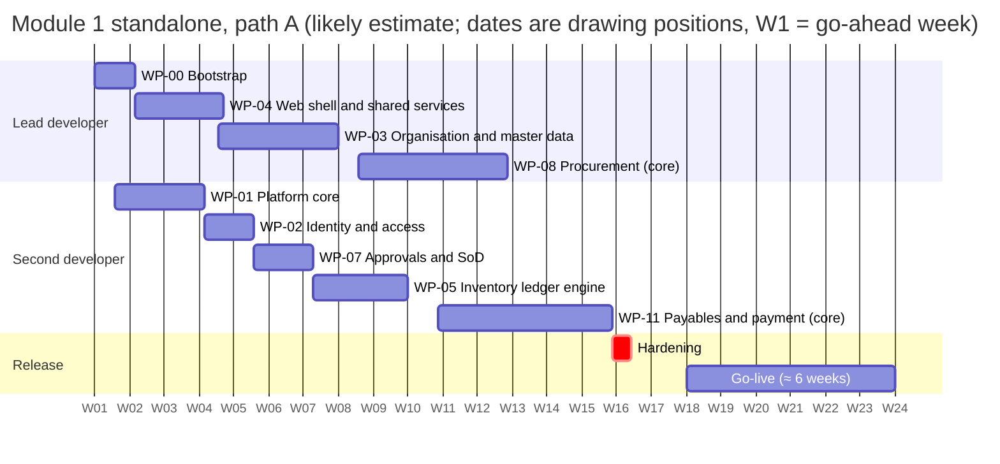
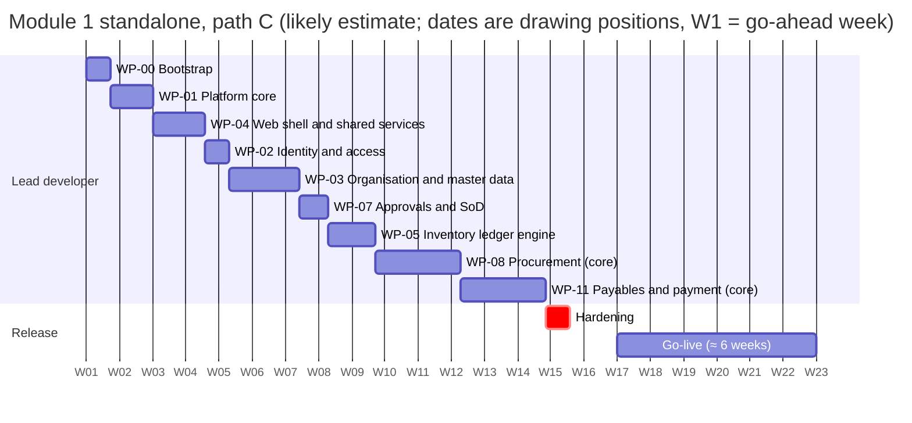

# MOS: Module 1 plan: Procurement, including supplier payment

| | |
|---|---|
| Product | MOS (Manufacturing Operations Suite). Working codename; the client's draft uses "Factory ERP" |
| Document | Detailed plan for Module 1: scope, stories, hours, week plan per team path, acceptance, UAT, migration, training, go-live |
| Version | **0.1**, draft for review (package v0.3, planning Phase 4) |
| Date | 2026-09-27 |
| Audience | Product owner and the development team; the client's procurement and finance leads for §7–§13 |
| Status | **Planning only; no implementation has started** |
| Companion docs | [Implementation plan](MOS-IMPLEMENTATION-PLAN.md) (estimate, capacity, whole-ERP schedule) · [Commercial proposal](MOS-COMMERCIAL-PROPOSAL.md) (prices) · [FRD](MOS-FRD.md) §6, §10 · [Process model](MOS-PROCESS-MODEL.md) P01–P04, P07–P09 · [Database design](MOS-DATABASE-DESIGN.md) `md`, `proc`, `inv`, `fin` |

---

## Summary

- **Module 1** is the client's procure-to-pay without inspection:
  - suppliers, with fraud-resistant bank details;
  - purchase requisitions and purchase orders;
  - goods receipt (GRN);
  - supplier returns;
  - invoices and matching;
  - the payment request (PV), its approval and the payment.
- It is **48 stories in 9 epics, 640 developer hours**: 512 core and 128 standard.
- **It depends on the platform foundation** (≈ 844 core hours: identity, master data, approvals, numbering, documents, the stock ledger), which it cannot run without. The foundation is shared with every later module.
- **Inside the whole-ERP release (path A, planned at ×1.32 the likely estimate, like the rest of the release):**
  - procurement is built in W8–W12 and payables in W10–W15;
  - procure-to-pay works end to end when payables finishes;
  - with stock (W12–W15) and inspection (W15–W18) it becomes the client's full procure-to-pay (AS-13) by the M4 demo (W17).
- **Bought on its own** (§5, at the same velocity), Module 1 core is built by W17 on path A ($15,760), W17 on path B ($12,360), and W16 on path C ($8,000). Each goes live about six weeks later.
- **The client's procure-to-pay bundle** (Module 1 + stock + inspection, which matches the client's first-module document) is built by W20 on path A ($18,315).

---

## 1. What Module 1 is

| | In Module 1 | Not in Module 1 (where it lives) |
|---|---|---|
| Suppliers | 5-step registration (organisations and individuals), onboarding documents, approval and lifecycle, **bank accounts with change control** (independent approver, call-back, cooling-off), approved supplier list | Supplier self-registration link (v1.1); supplier portal (Later) |
| Requisitions | PR with live available stock and quantity to purchase; approval; conversion to POs | Reorder report that creates PRs (inventory, WP-06) |
| Purchase orders | Terms, lines, taxes, discounts, schedule, tolerances; approval by the matrix; issue to the supplier; amendments as revisions; quotations on the PO; closure | RFQ comparison workflow, contracts (Later) |
| Receiving | **GRN with the gate module off** (the client's own flow C): pre-filled draft, weights, bags, accepted/rejected with disposition, batches, storage units, tolerances, valuation; service receipts; supplier returns | Inspection, grading and deductions (Lab/QC, WP-09); weighbridge visits and the automated inbound loop (Gate, WP-10) |
| Payables | Invoices (inline on the PV), 3-way match, holds, debit notes, self-billed vouchers; **PV drafted automatically from the GRN**; approval; payment with cheque register, proof and withholding; partner ledger; journals and CSV export; tax registers; GRNI reconciliation | Advances and payment runs (v1.1); cheque printing (Later) |

**Two ways to buy it** (prices in §5):
1. **As part of the whole ERP:** built in the path's schedule, sharing the foundation. This is the default.
2. **On its own:** "Module 1" alone, or the **client procure-to-pay bundle**, which adds stock documents and counts (inventory core) and inspection (QC core, gate off). The bundle matches the client's own first-module draft: supplier → PR → PO → inspection → GRN → payment request → payment.

## 2. What Module 1 depends on

Module 1 stories start only when these foundation blocks are usable (the [implementation plan](MOS-IMPLEMENTATION-PLAN.md) §7 has their scope):

| Block | Core hours | Module 1 needs it for |
|---|---|---|
| WP-00 Bootstrap | 64 | CI and the test harness every story's tests run in |
| WP-01 Platform core | 130 | Transactions, idempotency, outbox (PV drafting, PO email), audit, document lifecycles and reversal |
| WP-04 Web shell and shared services | 150 | Document page, line-items form, data grid, approvals inbox, attachments, PDF engine, notifications |
| WP-02 Identity and access | 74 | Users, roles, site scopes (a storekeeper sees only their site) |
| WP-03 Organisation and master data | 204 | Company, sites, departments, storage units, items, UoM, partners, banks, company paying accounts, tax codes, payment terms, currencies, numbering, periods |
| WP-07 Approvals and SoD | 86 | Supplier, PR, PO, bank-change, match-exception and PV approvals; SoD pairs such as PO creator ≠ GRN poster ≠ PV approver |
| WP-05 Inventory ledger engine | 136 | Posting the GRN and the supplier return to stock at moving-average cost |
| **Total** | **844** | |

---

## 3. Epics, features and stories

Each story is one slice of a feature in the [implementation plan's Appendix A](MOS-IMPLEMENTATION-PLAN.md#appendix-a-feature-estimate), with the same hours.
- **Tier C** stories are Module 1 core.
- **Tier S** stories are standard depth. They are on the pull-in list: built in the release only if velocity runs ahead (implementation plan §11), otherwise v1.1.
- Acceptance criteria are the FRD criteria of the listed requirements (§7).
- QA hours are the path A QA engineer's share for acceptance scripts, exploratory testing and regression, ≈ 30% of developer hours.

| ID | Story | Requirements | Tables | Tier | Dev h | QA h (path A) |
|---|---|---|---|---|---|---|
| **E1** | **Supplier management** | | | | | |
| M1-01 | As a buyer, I register a supplier (organisation or individual) through the 5-step wizard and can save a draft at any step | FR-PRC-001 | `md.partner`, `md.supplier_company`, `md.partner_address`, `md.partner_contact`, `md.partner_category` | C | 14 | 4 |
| M1-02 | As a buyer, I attach the documents the supplier's group requires; submission is refused while one is missing | FR-PRC-001 | `md.kyc_requirement`, `md.supplier_document`, `core.attachment` | C | 10 | 3 |
| M1-03 | As a procurement manager, I approve, reject, suspend, block or deactivate a supplier; only approved, unblocked suppliers can be ordered from, deliver and be paid | FR-PRC-002, FR-PLT-053 | `md.partner`, `core.approval_chain`, `core.approval_decision` | C | 12 | 4 |
| M1-04 | As a buyer, I record supplier bank accounts; numbers are stored encrypted and masked, and revealing one needs a permission and is audited | FR-PRC-005 | `md.supplier_bank_account`, `md.bank`, `core.audit_event` | C | 12 | 4 |
| M1-05 | As a finance controller, I approve a bank-detail change only with call-back evidence and never my own request; the new account is usable after the cooling-off period | FR-PRC-004 | `md.bank_change_request`, `md.supplier_bank_account` | C | 16 | 5 |
| M1-06 | As a buyer, I see each supplier document with its expiry date and status | FR-PRC-001, FR-PRC-003 | `md.supplier_document` | S | 8 | 2 |
| M1-07 | As a buyer, I am notified 30 and 7 days before a supplier document expires | FR-PRC-003 | `core.notification` | S | 6 | 2 |
| M1-08 | As a procurement manager, I keep the approved supplier list per item or category, enforced as none, warn or block at PO submission and receipt | FR-PRC-006 | `proc.approved_supplier_item` | S | 8 | 2 |
| **E2** | **Purchase requisition** | | | | | |
| M1-09 | As a storekeeper or requester, I raise a PR whose lines show live available stock and the computed quantity to purchase; the required date cannot precede the request date | FR-PRC-007, FR-PLT-055, FR-PLT-007 | `proc.purchase_requisition`, `proc.purchase_requisition_line`, `inv.stock_balance` | C | 16 | 5 |
| M1-10 | As a manager, I approve, reject or return a PR from the approvals inbox, with a comment where required | FR-PRC-007, FR-PLT-025 | `core.approval_chain`, `core.approval_decision` | C | 8 | 2 |
| M1-11 | As a buyer, I convert approved PR lines into one or more POs; ordered quantity is tracked per line, and ordering beyond the PR tolerance is refused | FR-PRC-007 | `proc.purchase_requisition_line`, `proc.purchase_order_line` | C | 8 | 2 |
| **E3** | **Purchase order** | | | | | |
| M1-12 | As a buyer, I create a PO from a PR with terms, lines, taxes, discounts, delivery schedule and receipt tolerances | FR-PRC-010 | `proc.purchase_order`, `proc.purchase_order_line`, `proc.po_schedule`, `md.tax_code` | C | 20 | 6 |
| M1-13 | As an approver, I receive the PO for approval according to the matrix (amount band, category, flags); small POs auto-approve | FR-PRC-010, FR-PLT-023 | `core.approval_matrix`, `core.approval_chain` | C | 12 | 4 |
| M1-14 | As a buyer, I issue the approved PO to the supplier as a PDF (by email where configured), and the issue is recorded | FR-PRC-010 | `proc.purchase_order`, `core.outbox_event` | C | 12 | 4 |
| M1-15 | As a buyer, I record the quotations obtained (or a sole-source justification) on the PO, as the sourcing policy requires | FR-PRC-008 | `proc.sourcing_policy`, `proc.po_quotation` | S | 14 | 4 |
| M1-16 | As a buyer, I amend an issued PO as a new revision that is re-approved; receipts continue against the approved revision | FR-PRC-011 | `proc.po_revision`, `proc.purchase_order` | S | 20 | 6 |
| M1-17 | As a buyer, POs close when received and invoiced; I can short-close with a reason or cancel one with no receipts; a stale-PO report lists the rest | FR-PRC-012 | `proc.purchase_order` | C | 10 | 3 |
| **E4** | **Goods receipt and returns** | | | | | |
| M1-18 | As a storekeeper, I generate the GRN from a pre-filled draft: accepted and rejected quantities with disposition, batch and storage unit | FR-PRC-013 | `inv.goods_receipt`, `inv.goods_receipt_line`, `inv.lot` | C | 20 | 6 |
| M1-19 | As a storekeeper (gate off), I record gross, tare and net weights and the bag count and tare; one weighed line plus counted lines must reconcile to the net | FR-PRC-013, FR-PRC-021 | `inv.goods_receipt`, `inv.goods_receipt_line` | C | 12 | 4 |
| M1-20 | As the system, I enforce receipt tolerances and the line's excess policy (block, or require approval) | FR-PRC-014 | `inv.goods_receipt_line`, `proc.purchase_order_line` | C | 12 | 4 |
| M1-21 | As the system, I value the receipt at payable quantity × quality-adjusted price and post stock and the GRNI journal | FR-INV-022, FR-AP-010 | `inv.stock_ledger_entry`, `inv.grn_line_settlement`, `fin.journal_entry` | C | 12 | 4 |
| M1-22 | As a requester, I confirm service and non-stock PO lines as delivered, by quantity or percentage | FR-PRC-022 | `inv.goods_receipt`, `inv.goods_receipt_line` | S | 10 | 3 |
| M1-23 | As a storekeeper, I return rejected or available stock to the supplier at its original cost; payables gets the debit expectation, and the PO can reopen for replacement | FR-PRC-015 | `inv.supplier_return`, `inv.supplier_return_line`, `fin.debit_note` | C | 20 | 6 |
| **E5** | **Procurement reports and documents** | | | | | |
| M1-24 | As a procurement manager, I see open PRs and POs, PR ageing, PO status and outstanding deliveries | FR-PRC-017 | `proc.purchase_requisition`, `proc.purchase_order` | C | 10 | 3 |
| M1-25 | As a procurement manager, I see price history per item and spend by supplier and category | FR-PRC-017 | `proc.purchase_order_line`, `inv.goods_receipt_line` | S | 10 | 3 |
| M1-26 | As a procurement manager, my dashboard shows pending approvals, open orders and deliveries due | FR-RPT-001 | `core.approval_chain`, `proc.purchase_order` | C | 8 | 2 |
| M1-27 | As a buyer or storekeeper, I print the PO, GRN, supplier receipt with its deduction breakdown, and rejection note from branded templates | FR-PLT-049 | `proc.purchase_order`, `inv.goods_receipt` | C | 12 | 4 |
| **E6** | **Supplier invoices and matching** | | | | | |
| M1-28 | As a finance officer, I capture a supplier invoice from the invoice list or inline on the PV, with duplicate detection and a due date from the payment terms | FR-AP-001 | `fin.supplier_invoice`, `fin.supplier_invoice_line` | C | 20 | 6 |
| M1-29 | As the system, I match invoices three ways on the GRN's payable quantity and adjusted price (two ways for services); differences within tolerance post to PPV or rounding | FR-AP-002, FR-AP-003 | `fin.invoice_match`, `fin.match_tolerance` | C | 24 | 7 |
| M1-30 | As the system, I put a mismatch on hold with its reason (price, quantity, weight, QC, verification) and show it on the invoice | FR-AP-002 | `fin.invoice_match`, `fin.open_item` | C | 16 | 5 |
| M1-31 | As an approver, I resolve a match exception: accept the variance, request a credit note, or keep it on hold | FR-AP-004 | `fin.invoice_match`, `core.approval_decision` | C | 12 | 4 |
| M1-32 | As a finance officer, I raise quality and return debit notes and allocate them against invoices | FR-AP-005 | `fin.debit_note`, `fin.debit_note_line` | C | 10 | 3 |
| M1-33 | As the system, I create the quality debit note automatically when an invoice exceeds payable by exactly the recorded deduction | FR-AP-005 | `fin.debit_note` | S | 6 | 2 |
| M1-34 | As a finance officer, I confirm a self-billed voucher generated from the GRN for a supplier who issues no invoice | FR-AP-006, FR-AP-018 | `fin.self_billed_voucher`, `fin.self_billed_voucher_line` | S | 16 | 5 |
| **E7** | **Payment request (PV)** | | | | | |
| M1-35 | As the system, when a GRN posts I draft one PV for the finance officer from the PO and GRN (and a matched invoice), never twice for the same GRN | FR-INB-003, FR-INB-010 | `fin.payment_request`, `fin.payment_request_line`, `core.processed_event` | C | 16 | 5 |
| M1-36 | As a finance officer, I confirm invoices and amounts to pay (full or partial) with gross, VAT, WHT and net; the total is derived and the open balance reserved | FR-AP-007, FR-AP-013 | `fin.payment_request_line`, `fin.open_item` | C | 14 | 4 |
| M1-37 | As a payment approver, I approve the PV per the matrix; a recently changed bank account adds a stage, and a method change after approval sends it back | FR-AP-007, FR-AP-014 | `fin.payment_request`, `core.approval_chain` | C | 10 | 3 |
| **E8** | **Payment, cheques and withholding** | | | | | |
| M1-38 | As treasury, I record the payment against an approved PV: paying account, cheque number and date or bank reference, amount in words and proof; bank details are re-checked | FR-AP-008, FR-AP-015 | `fin.payment`, `fin.partner_allocation`, `md.company_account` | C | 28 | 8 |
| M1-39 | As treasury, I keep a cheque register per bank account: unique numbers, voids kept with a reason | FR-AP-012 | `fin.cheque` | C | 12 | 4 |
| M1-40 | As treasury, I register cheque books by number range, see gaps, and mark cheques cleared or stale | FR-AP-016 | `fin.cheque_book`, `fin.cheque` | S | 8 | 2 |
| M1-41 | As the system, I withhold once on the invoice value and issue a gap-free WHT certificate that agrees with the amount withheld | FR-AP-013 | `fin.wht_certificate` | C | 14 | 4 |
| **E9** | **Partner ledger, journals and payables reports** | | | | | |
| M1-42 | As a finance officer, I see each supplier's open items, statement and ageing as of any date | FR-AP-009 | `fin.open_item`, `fin.partner_entry`, `fin.partner_allocation`, `fin.partner_balance` | C | 28 | 8 |
| M1-43 | As a finance controller, every posting writes a balanced journal mapped through the account map | FR-AP-010 | `fin.account_map`, `fin.journal_entry`, `fin.journal_line` | C | 20 | 6 |
| M1-44 | As a finance controller, I export journals as CSV batches with a checksum; re-downloading a batch gives the same file | FR-AP-010 | `fin.export_batch`, `fin.export_batch_item` | C | 12 | 4 |
| M1-45 | As a finance controller, I export the input-VAT and withholding registers per period | FR-AP-017 | `fin.supplier_invoice`, `fin.wht_certificate` | S | 10 | 3 |
| M1-46 | As a finance controller, the GRNI reconciliation lists uninvoiced receipts and unresolved variances and equals the GRNI balance | FR-AP-019 | `inv.grn_line_settlement`, `fin.invoice_match` | S | 12 | 4 |
| M1-47 | As a finance officer, my dashboard shows PVs to prepare, approvals pending, payments due and holds | FR-RPT-001 | `fin.payment_request`, `fin.open_item` | C | 8 | 2 |
| M1-48 | As a finance officer, I print the self-billed voucher, PV, payment voucher, debit note and WHT certificate | FR-PLT-049 | `fin.payment_request`, `fin.payment`, `fin.wht_certificate` | C | 12 | 4 |
| | **Total: core 512 h + standard 128 h** | | | | **640** | **194** |

**Coverage:** every one of the 37 v1 requirements of procurement (FR-PRC), payables (FR-AP) and the payment trigger (FR-INB-003, FR-INB-010) appears in at least one story, checked by script. FR-AP-015 (company paying accounts) is master data built in WP-03 and used by M1-38.

## 4. Hours per role

Module 1 core bought on its own, per path. Build hours are each person's full weekly hours over the build; go-live hours are for its ≈ 6-week go-live.

| Role | Path A | Path B | Path C |
|---|---|---|---|
| Lead developer | 952 build + 267 go-live | 952 build + 377 go-live | 896 build + 704 go-live |
| Second developer | 816 build + 218 go-live | 816 build + 327 go-live | — |
| QA engineer | 680 build + 219 go-live | — | — |
| **Total hours** | **3,152** | **2,472** | **1,600** |

Inside the whole ERP, Module 1's share of the development window is in the [commercial proposal](MOS-COMMERCIAL-PROPOSAL.md) §6.

## 5. Packages and prices

| Package | Build h (incl. hardening) | Path A: weeks · US$ · ETB | Path B: weeks · US$ · ETB | Path C: weeks · US$ · ETB |
|---|---|---|---|---|
| Module 1, core: platform + procurement + payables | 1,420 | build W1–W17, live ≈ W23 **$15,760** ETB 2,553,120 | build W1–W17, live ≈ W23 **$12,360** ETB 2,002,320 | build W1–W16, live ≈ W22 **$8,000** ETB 1,296,000 |
| Module 1, core + standard | 1,663 | build W1–W18, live ≈ W24 **$16,765** ETB 2,715,930 | build W1–W18, live ≈ W24 **$13,165** ETB 2,132,730 | build W1–W19, live ≈ W25 **$9,125** ETB 1,478,250 |
| Client procure-to-pay bundle: Module 1 core + stock (inventory core) + inspection (QC core) | 1,770 | build W1–W20, live ≈ W26 **$18,315** ETB 2,967,030 | build W1–W20, live ≈ W26 **$14,315** ETB 2,319,030 | build W1–W20, live ≈ W26 **$9,515** ETB 1,541,430 |

- Prices are packages 1–3 of the proposal (development, QA/UAT, deployment and go-live) at US$5 per hour and ETB 162.00 per US$, excluding VAT and withholding.
- Maintenance and hosting are extra (proposal §7, §9).
- Standalone prices include the whole foundation. When the rest of the ERP follows, the foundation is not paid again.

---

## 6. Week-by-week plan

### 6.1 Path A, inside the whole-ERP release

Procurement runs in W8–W12 while payables runs in W10–W15, on the stream the schedule gives each. Stories are placed in their block in order, proportionally to their hours. Standard-depth stories are not placed; they are pull-ins.

| Weeks | Developer | Stories |
|---|---|---|
| W8 | Lead developer | M1-01 |
| W8–W9 | Lead developer | M1-02 |
| W9 | Lead developer | M1-03, M1-04, M1-05, M1-09 |
| W9–W10 | Lead developer | M1-10 |
| W10 | Lead developer | M1-11, M1-12, M1-13 |
| W10–W11 | Lead developer | M1-14 |
| W11 | Lead developer | M1-17, M1-18, M1-19, M1-20 |
| W11–W12 | Lead developer | M1-21 |
| W12 | Lead developer | M1-23, M1-24, M1-26, M1-27 |
| W10–W11 | Second developer | M1-28 |
| W11 | Second developer | M1-29, M1-30 |
| W11–W12 | Second developer | M1-31 |
| W12 | Second developer | M1-32, M1-35 |
| W12–W13 | Second developer | M1-36 |
| W13 | Second developer | M1-37, M1-38 |
| W13–W14 | Second developer | M1-39 |
| W14 | Second developer | M1-41, M1-42 |
| W14–W15 | Second developer | M1-43 |
| W15 | Second developer | M1-44, M1-47, M1-48 |

The chart shows **Module 1 bought on its own** on path A (build W1–W17). Inside the whole ERP the same blocks sit where the table above puts them.

### 6.2 Path B, inside the whole-ERP release

| Weeks | Developer | Stories |
|---|---|---|
| W8 | Lead developer | M1-01 |
| W8–W9 | Lead developer | M1-02 |
| W9 | Lead developer | M1-03, M1-04, M1-05, M1-09 |
| W9–W10 | Lead developer | M1-10 |
| W10 | Lead developer | M1-11, M1-12, M1-13, M1-14 |
| W10–W11 | Lead developer | M1-17 |
| W11 | Lead developer | M1-18, M1-19, M1-20 |
| W11–W12 | Lead developer | M1-21 |
| W12 | Lead developer | M1-23, M1-24, M1-26, M1-27 |
| W10–W11 | Second developer | M1-28 |
| W11 | Second developer | M1-29, M1-30 |
| W11–W12 | Second developer | M1-31 |
| W12 | Second developer | M1-32, M1-35 |
| W12–W13 | Second developer | M1-36 |
| W13 | Second developer | M1-37, M1-38, M1-39 |
| W13–W14 | Second developer | M1-41 |
| W14 | Second developer | M1-42 |
| W14–W15 | Second developer | M1-43 |
| W15 | Second developer | M1-44, M1-47, M1-48 |

### 6.3 Path C, inside the whole-ERP release

One developer builds the foundation first, then Module 1, at ×2.50 the likely estimate. The chart below is Module 1 bought on its own on path C.

| Weeks | Developer | Stories |
|---|---|---|
| W9 | Lead developer | M1-01, M1-02 |
| W9–W10 | Lead developer | M1-03 |
| W10 | Lead developer | M1-04, M1-05, M1-09, M1-10, M1-11, M1-12, M1-13 |
| W10–W11 | Lead developer | M1-14 |
| W11 | Lead developer | M1-17, M1-18, M1-19, M1-20, M1-21, M1-23 |
| W11–W12 | Lead developer | M1-24 |
| W12 | Lead developer | M1-26, M1-27, M1-28, M1-29, M1-30 |
| W12–W13 | Lead developer | M1-31 |
| W13 | Lead developer | M1-32, M1-35, M1-36, M1-37, M1-38, M1-39 |
| W13–W14 | Lead developer | M1-41 |
| W14 | Lead developer | M1-42, M1-43, M1-44, M1-47, M1-48 |

---

## 7. Acceptance criteria

**Story level.** A story is accepted when:
1. the FRD acceptance criteria of its requirements pass as automated tests (the test names quote the FR ID);
2. the tables it writes follow the [database design](MOS-DATABASE-DESIGN.md) (classes, keys, status columns, grants);
3. its screens follow the client draft's layout with the corrections in the client-draft review §5;
4. QA's exploratory notes are closed (path A).

**Module level.** Module 1 is accepted when these scenarios pass end to end on the staging environment:

| Scenario | What it proves | FRD |
|---|---|---|
| **AS-13, without inspection** | Supplier → PR → PO → GRN (gate off) → PV drafted → approval → payment, no re-keying | §16 |
| **AS-05** | A bank-detail change needs an independent approver, a call-back and the cooling-off period; payment to a changed account is blocked until then | §16 |
| **AS-12** | Approval matrix, delegation, SoD exclusions | §16 |
| **AS-11** | Site scopes: a Site A storekeeper cannot see or post Site B documents | §16 |
| **Invariants** | P-invariants of the database design for GRN, open items and journals hold after every scenario; the GRNI reconciliation equals the GRNI balance | Database design §15 |

## 8. UAT script

Run by the client's key users on staging with their own data (migrated in the dry run). Each case records pass/fail, the tester, and any defect number.

| # | Scenario | Steps | Expected result | Stories | FRD |
|---|---|---|---|---|---|
| UAT-01 | Register and approve a supplier | Buyer fills the 5 steps, attaches the documents, submits; the procurement manager approves; finance verifies the bank account with a call-back | Supplier APPROVED; bank account ACTIVE only after the cooling-off period; the registration date and status were never editable | M1-01…05 | FR-PRC-001, 002, 004, 005 |
| UAT-02 | Bank-detail fraud attempt | The requester of a bank change tries to approve it; a transfer is recorded to a just-changed account | Both refused with a clear message; the attempt is in the audit log | M1-05, M1-38 | FR-PRC-004; BR-AP-04 |
| UAT-03 | PR with live stock | Storekeeper requests 500 kg with 120 kg available; tries a required date before the request date | 380 kg proposed to purchase; the wrong date blocks submission | M1-09 | FR-PRC-007; FR-PLT-055 |
| UAT-04 | PR approval, return and rejection | Manager returns a PR with a comment, then approves the resubmitted PR | The requester sees the comment; the history shows RETURNED, then APPROVED | M1-10 | FR-PLT-025 |
| UAT-05 | PO approval by the matrix | Create a 150,000 PO for a raw material, and a 5,000 PO | Two-stage chain for the first; the second auto-approves; the header discount allocates exactly to the lines | M1-12, M1-13 | FR-PLT-023; FR-PRC-010 |
| UAT-06 | Issue the PO | Issue the approved PO | Branded PDF with logo, legal details and QR code; issue time and method recorded; email queued where configured | M1-14, M1-27 | FR-PRC-010; FR-PLT-049 |
| UAT-07 | GRN with weights and bags | Truck net 22,500 kg with 450 bags of 0.15 kg tare; then the client-draft case (20,000 kg net vs 20,500 kg of lines) | Material net 22,432.5 kg; the mismatch case is refused with the difference named | M1-18, M1-19 | FR-PRC-013, 021 |
| UAT-08 | Over-receipt | Receive beyond tolerance on a BLOCK line and on a REQUIRE_APPROVAL line | Blocked; approval requested and, once approved, received and payable | M1-20 | FR-PRC-014 |
| UAT-09 | Receipt value | Receive 20,000 kg with a recorded 1% payable-weight deduction at 30.00/kg | GRN value 19,800 × 30.00 = 594,000; unit cost 29.70; GRNI journal balanced | M1-21, M1-43 | FR-INV-022; FR-AP-010 |
| UAT-10 | PV drafted once | Post a GRN; replay the event | One PV draft in the finance officer's queue, marked "awaiting invoice" until an invoice is added | M1-35 | FR-INB-003 |
| UAT-11 | Invoice matching | Invoices at the adjusted price, at +0.5% with 1% tolerance, and at +2% | Matched; matched with 0.5% to PPV; price hold | M1-28…31 | FR-AP-002, 003, 004 |
| UAT-12 | Quality debit note | Invoice at gross 20,000 kg against payable 19,900 kg with a 100 kg recorded deduction | Debit note for 100 kg allocated to the invoice (automatic with the standard tier, raised by the finance officer otherwise) | M1-32, M1-33 | FR-AP-005 |
| UAT-13 | Partial payment with withholding | PV for a 150,000 invoice with a withholding code, paid in two parts | Withholding taken once on the invoice value; certificate agrees with the amount withheld | M1-36, M1-41 | FR-AP-013 |
| UAT-14 | Method change after approval | Switch an approved PV from transfer to cheque | The PV returns for approval | M1-37 | FR-AP-007 |
| UAT-15 | Payment recording | Record a cheque with a number already used on that account; record without proof; record more than approved | All three refused | M1-38, M1-39 | FR-AP-008, 012 |
| UAT-16 | Supplier return | Return a held-rejected lot with "reopen for replacement" | Stock leaves at original cost; payables has the debit expectation; the PO's open quantity rises | M1-23 | FR-PRC-015 |
| UAT-17 | Statement and ageing | Print a supplier statement as of month end | The closing balance equals the ledger balance; ageing buckets add up | M1-42 | FR-AP-009 |
| UAT-18 | Journal export | Export the month's journals twice | Debits = credits per entry; the second download is identical (same checksum) | M1-44 | FR-AP-010 |
| UAT-19 | Segregation of duties | The PO creator opens the PO's approval task; the GRN poster opens the PV covering that GRN | Neither sees the task | M1-13, M1-37 | FR-PLT-028; BR-AP-05 |
| UAT-20 | Correction by reversal | Reverse a GRN that an invoice is matched to | Refused, naming the blocking invoice | M1-21 | FR-PLT-022 |
| UAT-21 | *(bundle only)* Inspection before GRN, gate off | Lab records results and grade, the decision applies a deduction | The GRN draft carries the payable quantity and adjusted price from the decision | — (QC core) | FR-QC-013, 014, 025; AS-13 |

---

## 9. Data migration

Loaded with the import tool (FR-PLT-047): each file is validated in a dry run, then committed all-or-nothing. Two dry runs happen during UAT, and the final load at cutover.

| Object | Source (client) | Checks before commit | Owner |
|---|---|---|---|
| Users, roles, site scopes | HR/IT list | Every approver named in the approval matrix exists and has a role | ADM |
| Company, sites, departments | Management | Set-up wizard; TIN, logo and fiscal-year start confirmed | ADM |
| Warehouses, storage units, silos | Stores | Safety ≤ reorder ≤ maximum ≤ capacity; each silo's capacity and UoM | STK / WSUP |
| Items, categories, UoM conversions | Stores and procurement | Unique codes; base UoM; bag conversions (e.g. 1 bag = 50 kg) | BUY / STK |
| Suppliers: contacts, addresses, categories | Procurement | Unique TIN; mandatory fields; individual suppliers flagged | BUY |
| Supplier bank accounts | Finance | **Imported as PENDING.** Each needs the call-back verification of FR-PRC-004 before its first transfer; planned as a verification sprint in W30–W32 | APC / FINC |
| Supplier documents | Procurement | Scanned files with expiry dates | BUY |
| Banks, company paying accounts, cheque books | Finance | Cheque ranges do not overlap; each account has its export code | TRS / FINC |
| Tax codes, withholding profiles, payment terms | Finance (confirms the seed data) | Rates and thresholds as the client confirmed them | FINC |
| Approval matrix | Management | Every row has an eligible approver after SoD exclusion | ADM / PLM |
| Opening stock with lots and costs | Stores and finance | Total value equals the finance balance at cutover | STK / FINC |
| Open POs (issued, not fully received) | Procurement | Supplier APPROVED; received-to-date quantity recorded | BUY |
| Open supplier balances (unpaid invoices) | Finance | Total equals the payables control balance | APC |

## 10. Training

| Group | Roles | Sessions | Covers |
|---|---|---|---|
| Requesters and stores | REQ, STK | 2 × 3 h | PR, stock availability, GRN with weights and bags, rejected quantities, supplier returns |
| Buyers | BUY, PMGR | 2 × 3 h | Suppliers and documents, bank-change requests, PO, quotations, amendments, closure, reports |
| Approvers | MGMT, PMGR, PAP, PLM | 1 × 2 h | Approvals inbox on a phone, comments, delegation, what SoD blocks |
| Finance | APC, TRS, FINC | 3 × 3 h | Invoices, matching and holds, debit notes, self-billing, PV, payments, cheques, withholding, statements, journal export, GRNI |
| Administrators | ADM | 2 × 3 h | Users, roles and scopes, approval matrix, numbering, periods, imports, audit |
| Auditors | AUD | 1 × 2 h | Read-only access, audit log, exception reports |

Every group gets a short role guide (PDF, from the acceptance scripts) and a practice environment with the migrated data.

## 11. Go-live checklist

1. UAT signed off per epic; no open High/Critical defects.
2. Production environment signed off: restore drill passed, backups scheduled and monitored, TLS, email relay (if used).
3. Final data loaded; opening stock and open supplier balances reconciled to finance, signed by FINC.
4. Every supplier bank account used in the first payment run verified (call-back evidence attached).
5. Approval matrix and SoD rules reviewed and signed by management; every approver trained.
6. Number series set so the first MOS numbers follow the last paper numbers; cheque books registered.
7. Periods opened; the legacy process frozen from the cutover date; a paper fallback agreed for the first week.
8. Users trained and signed in at least once; TOTP enrolled for PAP, TRS and ADM (standard tier).
9. Hypercare rota and contact channel published; the defect triage rule agreed.

## 12. Risks

| # | Risk | Mitigation |
|---|---|---|
| M1-R1 | Supplier master data is incomplete or duplicated | Import dry runs with duplicate-TIN and fuzzy-name checks; data owners named in §9 |
| M1-R2 | Verifying every imported bank account delays the first payments | Verification sprint in W30–W32; pay by cheque until an account is verified |
| M1-R3 | Withholding and VAT rules unconfirmed | Rates as seed data; client questions due before W10 (implementation plan §9) |
| M1-R4 | Invoice timing and weight basis differ from the design (gross vs accepted) | Confirmed before W10; the match already uses the payable quantity and adjusted price |
| M1-R5 | Approval bands change after go-live | The approval matrix is data; changes are audited and need no release |
| M1-R6 | USD POs paid in ETB | Currency question before W1; one currency per document, rate stored (FR-MD-008) |
| M1-R7 | Paper habits persist (PRs signed on paper) | Management sponsorship; the inbox works on phones; no paper PR accepted after cutover |
| M1-R8 | No cheque printing in v1 | Cheques written by hand and recorded; the register keeps them gap-free; printing is Later |

## 13. Client inputs Module 1 needs

| Needed by (path A) | Input |
|---|---|
| Before W1 | Currency of POs vs payments; the meaning of "operation unit"; user and role list |
| Before W4 | Supplier, item, storage-unit and bank data extracts |
| Before W6 | PR, PO and PV approval bands |
| Before W8 | Onboarding documents per supplier group; self-billing and individual suppliers; sourcing policy; tolerances |
| Before W10 | Invoice timing and weight basis; withholding status and rates; VAT; payment methods and paying accounts; cheque book ranges; WHT certificate layout; accounting package import format |
| Before W27 | UAT key users; migration extracts; training dates; go-live date |

**Nothing in this plan has been implemented. No application code has been written.**
